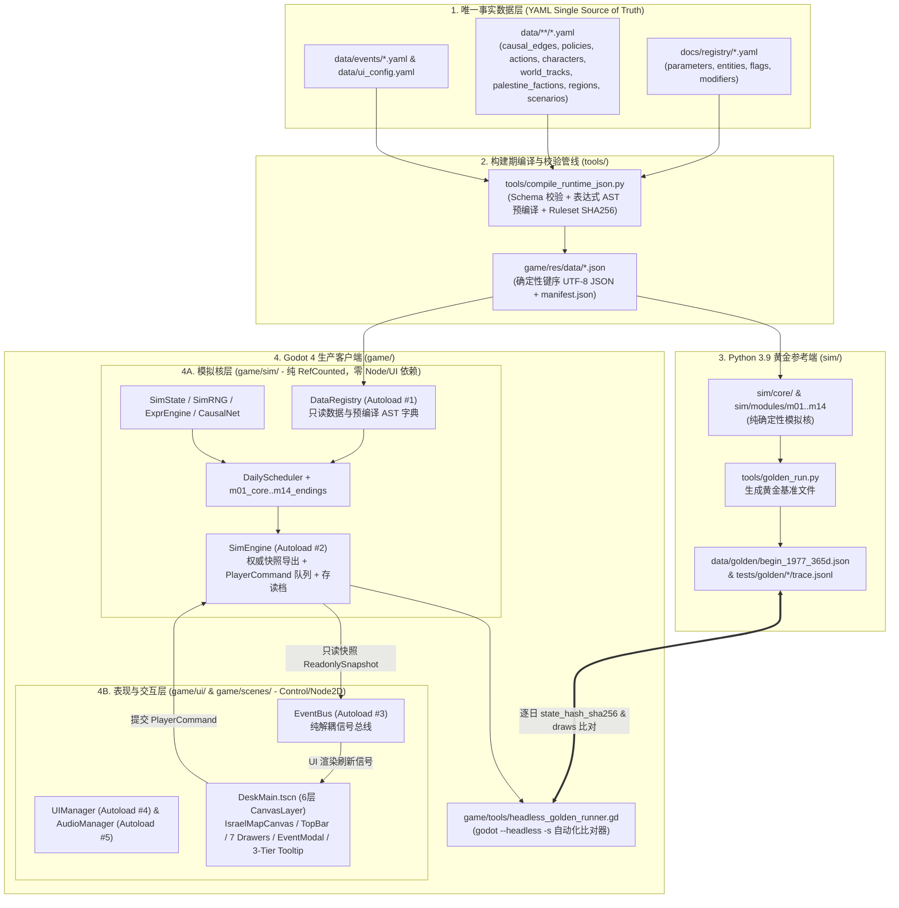
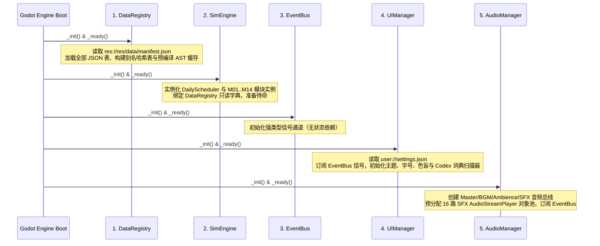
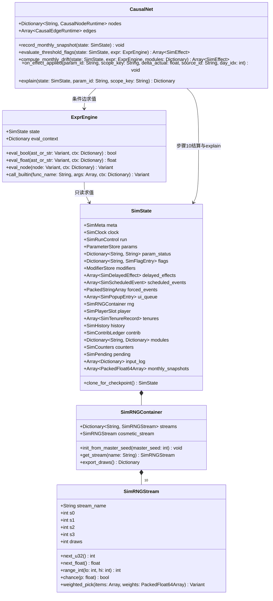
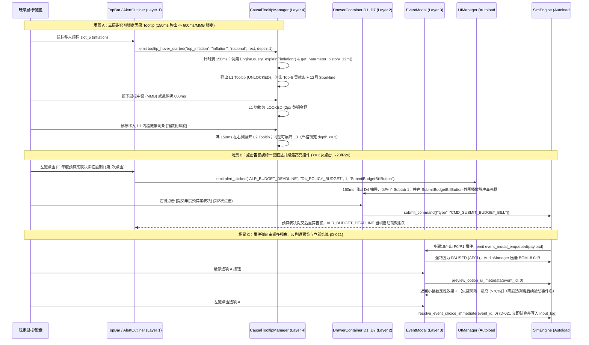

# Godot 4 客户端核心技术架构规范（Phase 4A）

> [!IMPORTANT]
> **文档定位与权威效力**：本文档（`docs/architecture/godot_architecture.md`）是《以色列政治模拟器（Israel Political Simulation）》阶段 4（Godot 4 生产客户端实现）的**最高工程技术蓝图**。本文档严格统合 `docs/contracts.md`、`docs/registry/DECISIONS.md`（`D-001` 至 `D-088`）、`docs/specs/M01_core_loop.md` 与 `docs/specs/M15_ui_presentation.md`。任何初级程序员或 AI 代码代理在构建 `game/` 目录下的 Godot 4 工程时，必须 100% 遵循本文档定义的目录拓扑、类签名、确定性算法与信号契约，确保与 Python 参考实现（`sim/`）达到**逐日字节级状态哈希对齐（浮点误差 $\le 10^{-6}$）**。

---

## 0. 文档元信息与技术栈基线

| 维度 | 规范要求 | 关联契约与裁决 |
|---|---|---|
| **目标引擎版本** | Godot Engine `4.2+` / `4.3` Stable（Forward+ / Compatibility 渲染后端兼容） | `contracts.md` §1 |
| **编程语言规范** | GDScript 2.0 **全量强类型模式**（启用 `debug/gdscript/warnings/untyped_declaration = 2 (Error)`，禁止隐式 `Variant` 推断） | 本架构强制约束 |
| **基准分辨率与缩放** | `1920×1080`（`viewport` / `canvas_items` 拉伸模式，`aspect = expand`，支持 `85%–150%` 五档字号动态缩放） | `M15` §3.1, §4.1, §10.7 |
| **黄金标准参考端** | Python 3.9（`sim/` 目录），Godot `game/sim/` 为 1:1 确定性同构移植 | `contracts.md` §1, `M01` §4.11 |
| **运行时数据管线** | 设计期维护 `data/**/*.yaml` + `docs/registry/*.yaml`；构建期由 `tools/compile_runtime_json.py` 编译为 `game/res/data/*.json` | `contracts.md` §1, §2 |
| **确定性量化精度** | 每步结算末尾对被写入浮点数执行 `q(x) = floor(x * 1000000.0 + 0.5) / 1000000.0`；规范化哈希整数化为 $\lfloor x \times 10^6 + 0.5 \rfloor$ | `D-015`, `M01` §3.1, §4.11.2 |
| **性能与退化红线** | 第 30 年单日结算耗时 $\le 2.5\text{ ms}$（非周/月普通日 $\le 2.0\text{ ms}$）；后期退化比 $R = T_{\text{year30}} / T_{\text{year1}} \le 1.30$；UI 渲染稳态 `60 FPS`（$\le 16.67\text{ ms/frame}$） | `M01` §0.1, §4.10 |

---

## 1. 总体架构原则与双端同源设计（Python `sim/` 黄金参考 vs Godot 4 `game/` 生产客户端）

### 1.1 双端同源架构全景图

本项目采用 **“Python 黄金参考内核（`sim/`） + 声明式 YAML 数据源（`data/`） + Godot 4 生产客户端（`game/`）”** 的双端同源架构。Python 端承担快速算法原型验证、大规模蒙特卡洛机器人压测（BOT/SIM）与黄金基准文件（Golden Trace）生成；Godot 4 端承载商业级“耶路撒冷总理办公桌（Map-on-Desk）”交互体验，并在无头模式（`--headless`）下执行与 Python 端逐日一致的回归比对。



---

### 1.2 构建期 YAML $\to$ JSON 编译管线（`tools/compile_runtime_json.py`）

Godot 4 原生不内置 YAML 解析器，而手写 GDScript YAML 解析器既慢又易引入边缘语法歧义。因此，所有设计期 `.yaml` 文件在进入 Godot 运行时之前，**必须由构建脚本 `tools/compile_runtime_json.py` 统一静态编译为 `game/res/data/*.json`**。

#### 1.2.1 编译映射清单

| 源文件（YAML） | 编译产物（Godot 运行时 JSON） | 编译期预处理与增强内容 |
|---|---|---|
| `docs/registry/parameters.yaml` | `game/res/data/parameters.json` | 展开 `aliases` 双向映射表；规范化 `range`、`type`、`scope`、`owner`、`era`、`visible` 字段 |
| `docs/registry/entities.yaml` | `game/res/data/entities.json` | 固化全部合法实体枚举 ID（按 ASCII 升序排列） |
| `docs/registry/modifiers.yaml` + `data/modifiers.yaml` | `game/res/data/modifiers.json` | 将 `remove_if` 与效果 `scale` 表达式预编译为 JSON AST 节点树；校验 `KNOWN_MODIFIER_FACTORS` |
| `data/causal_edges.yaml` | `game/res/data/causal_edges.json` | 拓扑校验 M02 节点、模块内边、跨模块边、政策杠杆边与 `term_provider` 名称 |
| `data/policies.yaml` | `game/res/data/policies.json` | 76 项持续性政策定义、档位区间、随附杠杆边与财政成本系数 |
| `data/actions.yaml` | `game/res/data/actions.json` | 104 项主动行动定义、条件 AST、成本、工期、冷却与效果队列 |
| `data/characters.yaml` | `game/res/data/characters.json` | 43 名历史人物属性、派系归属、特质、`is_living` 合规标记 |
| `data/world_tracks.yaml` | `game/res/data/world_tracks.json` | 1977–1992 外部世界历史轨道关键帧与默认参数曲线 |
| `data/palestine_factions.yaml` | `game/res/data/palestine_factions.json` | 9 大巴勒斯坦派系初始值与 AI 阈值参数（含 `D-072` 别名映射） |
| `data/regions.yaml` | `game/res/data/regions.json` | 11 个区域多边形顶点坐标、25 个关键地点坐标与决策、5 张战略规划图（`D-076`） |
| `data/events/**/*.yaml` | `game/res/data/events.json` | 合并全部历史锚点事件（`E-*`）、时代通用事件（`E-G*`）、随机事件（`R-*`）；自动为对应行动生成 `!flag("act.<action_id>")` 互斥条件（`D-034`）；预编译触发条件 AST |
| `data/ui_config.yaml` + `data/codex_terms.yaml` | `game/res/data/ui_config.json` + `game/res/data/codex_terms.json` | 顶栏 9 槽位配置、告警规则 AST、专有名词 Aho-Corasick / 前缀树匹配词典 |
| `data/migrations.yaml` | `game/res/data/migrations.json` | 存档版本声明式迁移步骤表 |
| `data/scenarios/<id>/**` | `game/res/data/scenarios/<id>.json` | 将 `scenario.yaml`、`snapshot.yaml`、`flags.yaml`、`modifiers.yaml` 及 `modules/*.yaml` 打包为单文件剧本镜像 |
| （全量编译产物汇总） | `game/res/data/manifest.json` | 记录每个 `.json` 文件的 SHA-256 及总合 `ruleset_hash`（64 位小写十六进制，写入存档 `header.ruleset_hash`） |

#### 1.2.2 编译期静态保障规则（Fail-Fast）
1. **键序规范化**：`json.dumps(..., ensure_ascii=False, sort_keys=True, separators=(",", ":"))`，确保不同操作系统编译出的 `.json` 字节流与 `ruleset_hash` 100% 相同。
2. **整数字面量显式标注**：因为 Godot `JSON.parse_string()` 会将所有 JSON 数字解析为 64 位 `float`，编译器在生成 JSON 时，对所有 ID、枚举和需要严格保持整数语义的结构提供 schema 类型表，供 `DataRegistry` 加载时自动执行 `int(val)` 强转。
3. **表达式预编译（AST 序列化）**：遵照 `M01` §4.10.3 第 4 条复杂度规则，所有 DSL 字符串（如 `alienation[mizrahi] >= 40 and flag("likud_in_power")`）在 `compile_runtime_json.py` 中直接解析为 JSON AST 数组（例如 `["and", [">=", ["idx", "alienation", "mizrahi"], 40.0], ["call", "flag", ["likud_in_power"]]]`），同时保留原始字符串供调试日志打印。Godot 运行时 `ExprEngine` 直接解释 AST 节点，**运行时零字符串词法/语法解析开销**。

---

### 1.3 模拟核（Simulation Core）与表现层（Presentation Layer）的 100% 物理隔离

为了从架构根源上杜绝“玩家打开某个 UI 抽屉、悬停某个 Tooltip、切换地图图层或修改音量/字号，导致随机数偏移或浮点数状态被意外篡改”（满足 `T-M15-12` 与 `D-086`），工程实施以下 **四条物理隔离铁律**：

1. **目录与继承树物理隔离**：
   - `game/sim/` 下的所有脚本必须且只能继承自 `RefCounted`（或纯数据 `Resource`）。**严禁在 `game/sim/` 下的任何文件中出现 `extends Node`、`extends Control`、`extends Node2D`、`get_tree()`、`Input`、`RenderingServer` 或 `AudioServer`**。
   - 静态检查脚本 `tools/check_gdscript_isolation.py` 在 CI 中扫描 `game/sim/**/*.gd`，一旦发现任何 Node/UI API 引用立即报错阻断构建。
2. **单向只读快照隔离（Zero-Direct-Mutation Rule）**：
   - 表现层（`game/ui/` 与 `game/scenes/`）**绝对禁止持有 `SimState` 的可变引用**。
   - 每日步骤 20 与日终阶段结算完毕后，`SimEngine` 生成一份不可变的 `SimReadonlySnapshot`（对字典和数组执行深冻结 `.read_only()`，并对 `visible: fuzzy` 参数预先通过模糊滤波器转换为五档定性词与估算区间 `[L_est, U_est]`，绝不向 UI 暴露精确底层值，满足 `D-088`）。
   - UI 控件只能读取 `SimEngine.get_snapshot()` 或调用只读查询方法（`query_explain()`, `get_parameter_history_12m()`, `preview_option_ui_metadata()`）。
3. **唯一写通道——`PlayerCommand` 队列**：
   - 玩家在界面上的所有交互决策（选择事件选项、下达主动行动、调整政策杠杆、拖动预算滑块、调整区级优先级、任命/撤换部长、批阅 `MinisterProposal`）全部封装为强类型 `PlayerCommand` 对象，经 `SimEngine.submit_command(cmd: PlayerCommand)` 提交。
   - **暂停阶段 P 立即生效类命令**（如 `CMD_EVENT_CHOICE`）：在暂停态由 `SimEngine` 立即调用 M12 应用效果（使用 `events` 子流，`D-021`），重算当日快照并刷新 UI。
   - **排期入队类命令**（如 `CMD_SUBMIT_ACTION`、`CMD_CHANGE_POLICY`、`CMD_SET_BUDGET_SLIDER`）：在暂停态登记入 `pending_commands` 缓冲区，于下一结算日步骤 2（`M05.actions_intake`）统一进入权威执行流。
   - 每一条被接受的模拟命令自动分配递增 `seq` 并追加至 `state.input_log`，用于确定性回放。
4. **表现层专属状态与随机流隔离**：
   - 客户端本地状态（`UIState`：当前打开的抽屉 `active_drawer`、地图图层 `F1..F7`、Tooltip 锁定栈 `tooltip_stack`、面板最后访问天数 `panel_last_visited_day`；以及 `UserSettings`：字号、色盲、自动暂停）由 `UIManager` 独立管理，**永不混入 `SimState` 权威哈希**。
   - 漏读满 90 天触发的兜底简报（`R27`, `D-086`）由 `UIManager` 在客户端本地拦截并弹出纯表现层提醒框，不消耗任何权威随机子流、不修改任何模拟参数。
   - 表现层动效随机（如打字机击键音高微调、纸张翻动音效随机变体、情报模糊区间月度哈希偏移）严格只使用第 10 个独立子流 `cosmetic`（不存档、不计入状态哈希，`D-011`）。

---

### 1.4 权威状态哈希（`state_hash_sha256`）与黄金文件逐日自动化回归比对机制

#### 1.4.1 规范化序列化器（`CanonicalSerializer.gd`）与百万分之一整数化

为彻底消除 Python `float` 与 GDScript `float` 在 IEEE 754 字符串格式化（如 `0.30000000000000004` vs `0.3`）上的文本表示差异，两端计算 `state_hash_sha256` 时严格遵循 `M01` §4.11.2 的规范化序列化协议：

1. **排除非权威字段**：序列化 `SimState` 时，跳过 `meta.game_version`、`meta.ruleset_hash`、`meta.modified`、`meta.created_real_time`、`run`、`input_log`、`stats`、`errors` 以及 `rng["cosmetic"]`。
2. **数值统一百万分之一整数化（`D-015`）**：
   - 任何参与哈希的数字 $x$（无论是 `int` 还是 `float`），一律转换为 64 位整数：
     $$I(x) = \lfloor x \times 1000000.0 + 0.5 \rfloor$$
   - 直接输出十进制整数字符串（不带小数点与指数符号）。例如：`day_index = 3` 输出 `3000000`；`inflation = 35.0` 输出 `35000000`；`political_capital = 40.5` 输出 `40500000`。
3. **字典键序与紧凑格式**：
   - 所有 `Dictionary` 的键必须先转为 `String` 并按 UTF-8 / ASCII 码点升序排序（在 GDScript 中调用 `keys.sort()`，因其默认按 Unicode 码点排序，对 ASCII 键与 Python `sorted()` 完全一致）。
   - 键值分隔符固定为 `":"`，元素分隔符固定为 `","`，**全程禁止任何空格或换行**。
4. **SHA-256 摘要计算**：
   - 将生成的 UTF-8 字节数组送入 Godot 内置 `HashingContext`（`HashingContext.HASH_SHA256`），输出 64 字符小写十六进制字符串。

#### 1.4.2 黄金文件（`data/golden/begin_1977_365d.json`）逐日自动化比对管线

1. **黄金基准文件结构（`data/golden/begin_1977_365d.json`）**：
   由 Python 黄金参考端运行 `tools/golden_run.py --scenario begin_1977 --seed 19770620 --days 365 --bot first_option` 生成，结构如下：
   ```json
   {
     "scenario_id": "begin_1977",
     "master_seed": 19770620,
     "total_days": 365,
     "ruleset_hash": "a1b2c3...",
     "inputs": [
       {"after_day": 0, "seq": 0, "type": "event_choice", "payload": {"event_id": "E-1977-06", "opt": "A"}}
     ],
     "daily_records": [
       {
         "day": 1,
         "date": "1977-06-21",
         "state_hash_sha256": "8f4e2b...",
         "draws": {"ai": 0, "combat": 2, "core": 1, "economy": 0, "elections": 0, "events": 1, "politics": 0, "random_events": 4, "world": 1},
         "key_metrics": {"political_capital": 40000000, "inflation": 35000000, "coalition_seats": 61000000}
       }
     ],
     "checkpoints": {
       "0": { "...第0日完整规范化状态..." },
       "30": { "...第30日完整规范化状态..." },
       "180": { "...第180日完整规范化状态..." },
       "365": { "...第365日完整规范化状态..." }
     }
   }
   ```
2. **Godot 无头验证器（`game/tools/headless_golden_runner.gd`）**：
   - 通过命令行直接启动：`godot --headless --path game -s res://tools/headless_golden_runner.gd -- --golden ../data/golden/begin_1977_365d.json`。
   - 加载 `begin_1977` 剧本与 `master_seed = 19770620`，在对应 `after_day` 注入相同的 `inputs` 序列，逐日推进 1 至 365 天。
   - **逐日三重硬断言**：
     - **断言 1（随机子流消耗次数零偏差）**：对比当日 9 个权威随机子流的 `draws` 字典。若任一子流 `draws` 不等，立即以 Exit Code `2` 终止并打印精确到步骤编号（Step 1–20）的 RNG 调用栈差异。
     - **断言 2（状态哈希逐日比对）**：对比 `state_hash_sha256`。若完全一致，进入下一日。
     - **断言 3（容差回退与差异定位，`M01` §4.11.4）**：若第 $D$ 日 `state_hash_sha256` 不同，自动展开全部状态字段对比：若所有非数值字段完全相等且所有数值字段 $|I_{\text{gd}}(x) - I_{\text{py}}(x)| \le 1$（即误差 $\le 10^{-6}$），记为一次“量化边界抖动”（每万日最多允许 $\le 3$ 次，365 日内目标为 $0$ 次），将状态对齐到 Python 基准后继续；若任一数值字段误差 $> 10^{-6}$ 或结构字段不等，立即以 Exit Code `1` 报错，输出首个分叉字段的 JSONPath、Python 值、Godot 值及当日触发的效果列表。

---

## 2. Godot 4 工程完整目录树与 Autoload 单例规划

### 2.1 `game/` 工程完整目录树与全量文件职责清单

```text
game/
├── project.godot                                  # Godot 4 工程主配置文件（Autoload、输入映射、显示、严格类型警告）
├── export_presets.cfg                             # Windows / macOS / Linux 导出预设配置
├── res/                                           # 静态只读资产与编译后数据目录
│   ├── data/                                      # 由 tools/compile_runtime_json.py 自动生成的运行时 JSON
│   │   ├── manifest.json                          # 数据文件哈希清单与 ruleset_hash
│   │   ├── parameters.json                        # 110+ 参数定义与别名表
│   │   ├── entities.json                          # 政党/选民集团/区域/国家/派系/职位枚举
│   │   ├── modifiers.json                         # 修正器定义与预编译 AST
│   │   ├── causal_edges.json                      # M02 因果网节点、边与 term_provider 绑定
│   │   ├── policies.json                          # M05 76 项持续性政策定义
│   │   ├── actions.json                           # M05 104 项主动行动目录
│   │   ├── characters.json                        # M06 43 名历史人物库
│   │   ├── world_tracks.json                      # M07 外部世界历史轨道
│   │   ├── palestine_factions.json                # M08 巴勒斯坦九大派系数据
│   │   ├── regions.json                           # M11 11 区域多边形顶点、25 关键地点、5 规划图
│   │   ├── events.json                            # M12 全量固定/通用/随机事件与预编译 AST
│   │   ├── ui_config.json                         # M15 顶栏槽位、告警规则、模糊参数配置
│   │   ├── codex_terms.json                       # M15 政治百科词条与自动超链接词典
│   │   ├── migrations.json                        # M01 存档版本迁移声明表
│   │   └── scenarios/
│   │       └── begin_1977.json                    # 贝京 1977 剧本完整初始快照包
│   ├── themes/                                    # Godot 主题与样式表资源 (.tres)
│   │   ├── mahapach_1977_theme.tres               # 1977 默认档案纸与胡桃木主视觉 Theme
│   │   ├── skin_1970s_config.tres                 # 1970年代桌面皮肤配置资源（转盘电话/打字机/黑白颗粒）
│   │   ├── skin_1980s_config.tres                 # 1980年代桌面皮肤配置资源（按键电话/热敏传真/绿屏终端）
│   │   ├── skin_1990s_config.tres                 # 1990年代桌面皮肤配置资源（早期台式PC/彩色报刊）
│   │   ├── palette_standard.tres                  # 标准语义配色方案（22 色 Hex）
│   │   ├── palette_deuteranopia.tres              # 红绿色盲安全配色方案（Okabe-Ito 蓝橙体系）
│   │   └── palette_tritanopia_hc.tres             # 全色盲与高对比度配色方案
│   ├── shaders/                                   # 自定义 CanvasItem 着色器 (.gdshader)
│   │   ├── map_region_heatmap.gdshader            # 地图区划颜色插值、斜纹填充（占领/管制区）与边界高亮着色器
│   │   ├── map_plan_dashed_line.gdshader          # 战略规划图（阿隆计划/七星计划）动态流动虚线着色器
│   │   ├── paper_grain_sepia.gdshader             # 公文纸 4% 纤维噪点与历史照片 Tri-X 400 半色调着色器
│   │   └── onboarding_spotlight.gdshader          # 新手引导圆角矩形挖洞聚光灯遮罩着色器
│   ├── fonts/                                     # 字体资源目录（思源宋体/思源黑体/Courier Prime/OpenDyslexic）
│   ├── textures/                                  # 桌面背景、实物精灵、人物立绘、事件插图、图标 SVG
│   └── audio/                                     # BGM 三轨分轨 OGG 与 24 项环境/交互 SFX
├── autoload/                                      # 5 大全局 Autoload 单例脚本
│   ├── DataRegistry.gd                            # [Autoload #1] 静态 JSON 数据加载、别名解析与 AST 缓存中心
│   ├── SimEngine.gd                               # [Autoload #2] 模拟核宿主、逻辑帧推进器、快照生成与命令队列
│   ├── EventBus.gd                                # [Autoload #3] 全局强类型解耦信号总线
│   ├── UIManager.gd                               # [Autoload #4] UI 状态机、抽屉/弹窗栈、字号/色盲/时代皮肤管理
│   └── AudioManager.gd                            # [Autoload #5] 三态迟滞动态音景混音器、-8dB 闪避与 SFX 对象池
├── sim/                                           # 【纯模拟核层】100% 继承 RefCounted，零 Node/UI 依赖
│   ├── core/                                      # M01/M02/M12 核心基础引擎类
│   │   ├── SimTypes.gd                            # 枚举、常量、错误码与数据结构辅助定义
│   │   ├── SimMath.gd                             # 确定性量化 q(x)、posmod、ipow、查表函数与算术白名单
│   │   ├── SimRNG.gd                              # xoshiro128** + mul32 确定性随机数生成器与 10 子流容器
│   │   ├── SimCalendar.gd                         # 公历日期 <-> abs_day/day_index 换算、weekday、months_since、era
│   │   ├── SimState.gd                            # 权威游戏状态根对象及全部强类型子结构（Clock, ModifierStore 等）
│   │   ├── ParameterStore.gd                      # 参数读写、D-054..D-077 全量别名路由、范围夹紧与量化
│   │   ├── ModifierEngine.gd                      # 修正器生命周期、最小堆到期、历史债务增长、factor 缓存与 hooks
│   │   ├── EffectProcessor.gd                     # 8 阶段效果解释器（A校验->H事件）、数值聚合与 ContribLedger 记录
│   │   ├── ExprEngine.gd                          # 预编译 AST 确定性求值器与 50+ 内置只读查询函数分发表
│   │   ├── CausalNet.gd                           # M02 因果网引擎、惯性漂移、30%冲击记忆衰减、thr.* 滞回与 explain()
│   │   ├── DailyScheduler.gd                      # 每日 20 步确定性结算调度器 + 暂停阶段 P + 日终阶段流水线
│   │   ├── CanonicalSerializer.gd                 # 规范化百万分之一整数 JSON 序列化与 SHA-256 状态哈希计算器
│   │   ├── SaveSystem.gd                          # .ipsave.json 读写、Schema 校验、铁人保护与声明式版本迁移器
│   │   ├── ReplaySystem.gd                        # 玩家输入日志录制、确定性回放驱动器与命令序列化
│   │   ├── AutoPauseEvaluator.gd                  # AP00..AP16 自动暂停条件日终求值器
│   │   └── SimReadonlySnapshot.gd                 # 面向表现层的只读状态快照与 visible:fuzzy 情报模糊转译器
│   └── modules/                                   # M01–M14 十四大模拟业务逻辑模块（统一继承 SimModuleBase.gd）
│       ├── SimModuleBase.gd                       # 模拟模块抽象基类（定义 8 大标准生命周期接口）
│       ├── m01_core.gd                            # M01 核心循环、步骤1推进、卸任与继任流程及 m01_* custom 处理器
│       ├── m02_contradictions.gd                  # M02 社会矛盾月度结算、历史快照与 m02_add_baseline_shift
│       ├── m03_parliament.gd                      # M03 议会120席、周民调、法案表决、大选与组阁状态机
│       ├── m04_party.gd                           # M04 党内政治、五轴立场走廊、24月宽限期、承诺与宏大愿景
│       ├── m05_actions.gd                         # M05 政治资本月产出、每周2行动槽、76项政策杠杆与人情账本
│       ├── m06_characters.gd                      # M06 43名历史人物、AI部长周结（越权/泄密/MinisterProposal）
│       ├── m07_diplomacy.gd                       # M07 外部世界轨道、美苏与阿拉伯关系、多议题峰会与条约批准
│       ├── m08_palestine.gd                       # M08 巴勒斯坦九大派系、自治模式、武装袭击与大起义状态机
│       ├── m09_military.gd                        # M09 军事战备、动员档位、战线推进、防长越权与核模糊
│       ├── m10_economy.gd                         # M10 财政收支、外汇储备、季度宏观经济（通胀螺旋）与年度预算案
│       ├── m11_regions.gd                         # M11 11区域安全与发展、定居点人口、三难三角与5张战略规划图
│       ├── m12_events.gd                          # M12 事件引擎（步骤18.0-18.6）、候选集增量维护与选项UI预览生成
│       ├── m13_authoritarian.gd                   # M13 集权五阶段(C1-C5)、9大阻力方反制、抗议等级与政变/遇刺检定
│       └── m14_endings.gd                         # M14 任期结束判定（D-081优先级）、40结局、八维评价与30成就
├── scenes/                                        # Godot 场景树文件 (.tscn)
│   ├── boot/
│   │   ├── BootSplash.tscn                        # 启动加载、编译数据完整性校验与主菜单入口
│   │   └── MainMenu.tscn                          # 主菜单（新游戏剧本选择、种子/铁人配置、读档、设置）
│   ├── main/
│   │   └── DeskMain.tscn                          # 【核心主场景】6层 CanvasLayer 的耶路撒冷总理办公桌主视图
│   ├── map/
│   │   ├── IsraelMapCanvas.tscn                   # 中央展开战略地图视口（1520x964，11区域 Polygon2D + 25关键地点）
│   │   ├── RegionPolygonNode.tscn                 # 单个区域多边形渲染与交互热区组件
│   │   ├── MapSitePin.tscn                        # 地图关键地点星标/工程/核设施交互图标组件
│   │   └── RegionInspectorCard.tscn               # 点击地图区域滑出的紧凑型区级政策滑块检视卡
│   ├── hud/
│   │   ├── TopBar.tscn                            # 顶栏 9 项核心指标槽位 + 日期/星期/5档速度控制器
│   │   ├── TopBarSlotWidget.tscn                  # 单个顶栏指标组件（小整数 + 趋势箭头 + 悬停 Tooltip 触发源）
│   │   ├── AlertOutliner.tscn                     # 顶栏下方红/黄/蓝三级悬挂告警旗标横幅（最多8个+折叠槽）
│   │   ├── DiegeticDeskProps.tscn                 # 办公桌四周 7 大可交互实物入口（半圆议会盘/卷宗夹/红黑电话等）
│   │   └── MessageLogPanel.tscn                   # 右下角滚动消息日志流与顾问自动处理开关
│   ├── drawers/
│   │   ├── DrawerContainer.tscn                   # 左右滑出抽屉宿主容器（管理 160ms 缓动动画与二级页签栏）
│   │   ├── D1_GoalsDrawer.tscn                    # 抽屉1：三层目标（承诺/五轴走廊/宏大愿景）、党内派系与M13集权
│   │   ├── D2_KnessetDrawer.tscn                  # 抽屉2：120席议会半圆图、执政联盟安抚、排期法案表决与民调
│   │   ├── D3_CabinetDrawer.tscn                  # 抽屉3：部长主动提案卡、内阁与安全首长名录、部门主动行动池
│   │   ├── D4_PolicyBudgetDrawer.tscn             # 抽屉4：5大政策杠杆、Democracy 4式社会矛盾因果连线网、8项预算滑块
│   │   ├── D5_DiplomacyDrawer.tscn                # 抽屉5：大国关系、美援、阿拉伯邻国敌意/稳定度与多议题峰会面板
│   │   ├── D6_PalestineDrawer.tscn                # 抽屉6：占领区宏观态势、巴勒斯坦九大派系谱系与占领区治理工具箱
│   │   ├── D7_MilitaryIntelDrawer.tscn            # 抽屉7：国防战备、动员档位、活跃战线指挥、绝密情报与三难三角
│   │   ├── LedgerOverlay.tscn                     # 国家总账本（L键，6张全量可排序表格，遵守 D-088 迷雾规则）
│   │   └── CodexOverlay.tscn                      # 以色列政治百科与三姐妹报刊历史剪报归档（C键）
│   └── modals/
│       ├── EventModal.tscn                        # Suzerain式事件弹窗宿主（动态切换A公文/B急电/C内阁交锋/D报刊四版式）
│       ├── OptionPreviewCard.tscn                 # 事件选项悬停双栏预览框（确定性定性效果 + 事前零剧透四档风险徽章）
│       ├── CausalTooltipPanel.tscn                # 单层混合因果 Tooltip 面板（当前值+Top5贡献条+12月Sparkline折线图）
│       ├── EndTenureBookModal.tscn                # 卸任与终局《以色列当代政治史》双页精装书总结画卷
│       ├── OnboardingOverlay.tscn                 # 10分钟交互式新手引导聚光灯遮罩与内阁秘书提示框
│       └── SystemSettingsModal.tscn               # 系统菜单（存读档、5档字号、3套色盲模式、自动暂停规则表）
├── ui/                                            # 【表现层控制脚本】与 scenes/ 一一对应
│   ├── main/DeskMainController.gd
│   ├── map/IsraelMapCanvas.gd
│   ├── map/RegionPolygonNode.gd
│   ├── map/RegionInspectorCard.gd
│   ├── hud/TopBarController.gd
│   ├── hud/TopBarSlotWidget.gd
│   ├── hud/AlertOutlinerController.gd
│   ├── hud/DiegeticDeskPropsController.gd
│   ├── hud/MessageLogController.gd
│   ├── drawers/DrawerContainerController.gd
│   ├── drawers/D1_GoalsController.gd
│   ├── drawers/D2_KnessetController.gd
│   ├── drawers/D3_CabinetController.gd
│   ├── drawers/D4_PolicyBudgetController.gd
│   ├── drawers/D5_DiplomacyController.gd
│   ├── drawers/D6_PalestineController.gd
│   ├── drawers/D7_MilitaryIntelController.gd
│   ├── drawers/LedgerController.gd
│   ├── drawers/CodexController.gd
│   ├── modals/EventModalController.gd
│   ├── modals/EndTenureBookController.gd
│   ├── modals/OnboardingDirector.gd
│   ├── modals/SystemSettingsController.gd
│   └── tooltip/
│       ├── CausalTooltipManager.gd                # 三层嵌套可锁定（150ms弹出/600ms或MMB锁定）Tooltip 栈控制器
│       ├── CausalTooltipPanel.gd                  # 单个 Tooltip 节点渲染与内部超链接悬停侦测器
│       └── SparklineDrawer.gd                     # 基于 Control._draw() 的零 GC 12个月迷你折线图绘制器
└── tools/                                         # Godot 端自动化测试与基准脚本（--headless 运行）
    ├── headless_golden_runner.gd                  # 逐日比对 data/golden/begin_1977_365d.json 的 CI 黄金验证器
    ├── headless_perf_bench.gd                     # 运行 10,957 天（30年）测量单日耗时与退化比 R <= 1.3 的基准器
    └── ui_constraints_validator.gd                # 自动化校验 T-M15-01..12（地图占屏比>=68%、点击<=2次、字号>=18px）
```

---

### 2.2 `game/project.godot` 标准配置规范

```ini
; Engine configuration file.
; It's best edited using the editor UI and not directly,
; since the parameters that go here are not all obvious.

config_version=5

[application]
config/name="Israel Political Simulation (1977: Mahapach)"
config/version="0.1.0"
run/main_scene="res://scenes/boot/BootSplash.tscn"
config/features=PackedStringArray("4.2", "Forward Plus")
config/icon="res://res/textures/app_icon.png"

[autoload]
DataRegistry="*res://autoload/DataRegistry.gd"
SimEngine="*res://autoload/SimEngine.gd"
EventBus="*res://autoload/EventBus.gd"
UIManager="*res://autoload/UIManager.gd"
AudioManager="*res://autoload/AudioManager.gd"

[display]
window/size/viewport_width=1920
window/size/viewport_height=1080
window/size/min_width=1280
window/size/min_height=720
window/stretch/mode="canvas_items"
window/stretch/aspect="expand"
window/vsync/vsync_mode=1

[debug]
gdscript/warnings/enable=true
gdscript/warnings/untyped_declaration=2
gdscript/warnings/unsafe_property_access=2
gdscript/warnings/unsafe_method_access=2
gdscript/warnings/unsafe_cast=1
gdscript/warnings/integer_division=2
gdscript/warnings/narrowing_conversion=2

[gui]
theme/custom="res://res/themes/mahapach_1977_theme.tres"
theme/custom_font="res://res/fonts/SourceHanSansSC-Regular.otf"
timers/tooltip_delay_sec=0.15

[input]
toggle_pause={
"deadzone": 0.5,
"events": [Object(InputEventKey,"keycode":32)] ; Space
}
speed_1={"deadzone": 0.5, "events": [Object(InputEventKey,"keycode":49)]}
speed_2={"deadzone": 0.5, "events": [Object(InputEventKey,"keycode":50)]}
speed_3={"deadzone": 0.5, "events": [Object(InputEventKey,"keycode":51)]}
speed_4={"deadzone": 0.5, "events": [Object(InputEventKey,"keycode":52)]}
speed_5={"deadzone": 0.5, "events": [Object(InputEventKey,"keycode":53)]}
map_mode_f1={"deadzone": 0.5, "events": [Object(InputEventKey,"keycode":4194332)]}
map_mode_f2={"deadzone": 0.5, "events": [Object(InputEventKey,"keycode":4194333)]}
map_mode_f3={"deadzone": 0.5, "events": [Object(InputEventKey,"keycode":4194334)]}
map_mode_f4={"deadzone": 0.5, "events": [Object(InputEventKey,"keycode":4194335)]}
map_mode_f5={"deadzone": 0.5, "events": [Object(InputEventKey,"keycode":4194336)]}
map_mode_f6={"deadzone": 0.5, "events": [Object(InputEventKey,"keycode":4194337)]}
map_mode_f7={"deadzone": 0.5, "events": [Object(InputEventKey,"keycode":4194338)]}
toggle_ledger={"deadzone": 0.5, "events": [Object(InputEventKey,"keycode":76)]} ; L
toggle_codex={"deadzone": 0.5, "events": [Object(InputEventKey,"keycode":67)]} ; C
quick_save={"deadzone": 0.5, "events": [Object(InputEventKey,"keycode":4194336)]} ; F5
quick_load={"deadzone": 0.5, "events": [Object(InputEventKey,"keycode":4194340)]} ; F9
```

> [!WARNING]
> 注意 `[debug]` 段的编译器强制红线：`untyped_declaration=2 (Error)`、`integer_division=2 (Error)`、`narrowing_conversion=2 (Error)`。任何未声明类型的变量、隐式整数除法或浮点转整数窄化，在 Godot 编辑器与无头 CI 中都会直接编译报错，从语法层面杜绝 Python 移植时的隐式类型 Bug。

---

### 2.3 五大 Autoload 单例规划、初始化顺序与完整接口签名

Godot 启动时严格按照 `project.godot` 中声明的顺序依次初始化 5 大 Autoload 单例：
**`1. DataRegistry` $\to$ `2. SimEngine` $\to$ `3. EventBus` $\to$ `4. UIManager` $\to$ `5. AudioManager`**。



#### 2.3.1 `DataRegistry.gd`（Autoload #1：静态只读数据库与别名中心）

```gdscript
# res://autoload/DataRegistry.gd
extends Node

var ruleset_hash: String = ""
var parameters_def: Dictionary = {}       # param_id -> ParamDef (RefCounted)
var param_aliases: Dictionary = {}        # alias_name -> canonical_param_id
var entity_aliases: Dictionary = {}       # category -> {alias -> canonical_id}
var modifiers_def: Dictionary = {}        # mod_id -> ModifierDef
var causal_nodes_def: Dictionary = {}     # param_id -> CausalNodeDef
var causal_edges_def: Array[Dictionary] = []
var policies_def: Dictionary = {}         # policy_id -> PolicyDef
var actions_def: Dictionary = {}          # action_id -> ActionDef
var characters_def: Dictionary = {}       # char_id -> CharacterDef
var world_tracks_def: Dictionary = {}     # track_id -> WorldTrackDef
var pal_factions_def: Dictionary = {}     # faction_id -> PalFactionDef
var regions_def: Dictionary = {}          # region_id -> RegionDef
var sites_def: Dictionary = {}            # site_id -> SiteDef
var plans_def: Dictionary = {}            # plan_id -> StrategicPlanDef
var events_def: Dictionary = {}           # event_id -> EventDef
var ui_config: Dictionary = {}            # 顶栏槽位、告警规则、模糊参数配置
var codex_terms: Dictionary = {}          # term_id -> CodexEntry
var migrations_def: Array[Dictionary] = []
var compiled_ast_cache: Dictionary = {}   # expr_str -> Array (JSON AST)

func load_all_runtime_data() -> Error
func get_scenario_bundle(scenario_id: String) -> Dictionary
func resolve_param_alias(raw_param_id: String) -> String
func resolve_region_id(raw_region_id: String) -> String          # D-077: north<->galilee, central<->triangle, south<->negev
func resolve_pal_faction_id(raw_faction_id: String) -> String    # D-072: notables->jordan_notables, left_factions->pflp, islamic_jihad->pij
func resolve_party_id(raw_party_id: String) -> String            # D-054: pm_new_party->new_party_a, alignment->labor, etc.
func get_compiled_ast(expr_str: String) -> Array
func format_codex_bbcode(raw_text: String) -> String             # hook_m15_codex_link_parse
```

#### 2.3.2 `SimEngine.gd`（Autoload #2：模拟核宿主与逻辑帧控制器）

```gdscript
# res://autoload/SimEngine.gd
extends Node

const SPEED_INTERVALS_MS: Array[float] = [0.0, 1500.0, 750.0, 350.0, 150.0, 50.0]

var _state: SimState = null
var _scheduler: DailyScheduler = null
var _latest_snapshot: SimReadonlySnapshot = null
var _accumulated_ms: float = 0.0

# 生命周期与会话管理
func start_new_game(scenario_id: String, custom_seed: int = -1, is_ironman: bool = false) -> Error
func load_game_from_slot(slot_name: String) -> Error
func save_game_to_slot(slot_name: String) -> Error
func advance_single_day_headless() -> void                       # 供黄金测试与性能基准直接调用

# 玩家命令唯一写入口（M15 -> SimEngine）
func submit_command(cmd: Dictionary) -> Error
func resolve_event_choice_immediate(event_id: String, option_idx: int) -> Error  # D-021 暂停态立即结算
func set_paused(paused: bool, reason_id: String = "PLAYER") -> void
func set_speed(speed_level: int) -> void
func trigger_succession_continue() -> Error                      # D-013 以下一任总理继续

# 表现层只读查询接口（B-15-01 .. B-15-04，零副作用）
func get_snapshot() -> SimReadonlySnapshot
func query_explain(param_id: String, scope_key: String = "") -> Dictionary
func get_parameter_history_12m(param_id: String, scope_key: String = "national") -> PackedFloat64Array
func preview_option_ui_metadata(event_id: String, option_idx: int) -> Dictionary
func get_state_hash_sha256() -> String
func get_rng_draws_report() -> Dictionary
```

#### 2.3.3 `EventBus.gd`（Autoload #3：全局解耦信号总线）

```gdscript
# res://autoload/EventBus.gd
extends Node

# 1. 模拟核 -> 表现层同步信号（仅在步骤 20 日终或暂停态命令结算完毕后触发）
signal snapshot_updated(snapshot: SimReadonlySnapshot)
signal day_advanced(day_index: int, date_str: String, is_week: bool, is_month: bool, is_quarter: bool, is_year: bool)
signal pause_state_changed(is_paused: bool, speed_level: int, pause_reasons: PackedStringArray)
signal event_modal_enqueued(event_payload: Dictionary)
signal tenure_ended_summary_ready(tenure_record: Dictionary, evaluation_payload: Dictionary)
signal succession_completed(new_leader_id: String, new_party_id: String, tenure_index: int)
signal lifecycle_signal_raised(signal_name: String, payload: Dictionary) # minister_overreach, war_started, etc.

# 2. 表现层内部导航与交互信号（绝不惊动 SimState）
signal drawer_requested(drawer_id: String, subtab_index: int, highlight_node_name: String)
signal drawer_closed(drawer_id: String)
signal map_mode_changed(map_layer_id: String)                    # F1_POLITICAL .. F7_DEMOGRAPHICS
signal map_region_selected(region_id: String)
signal map_site_clicked(site_id: String, region_id: String)
signal map_camera_focus_requested(target_pos: Vector2, target_zoom: float)
signal alert_clicked(alert_id: String, target_drawer: String, target_subtab: int, highlight_node: String)
signal alert_dismissed(alert_id: String)
signal tooltip_hover_started(control_id: String, param_id: String, scope_key: String, global_rect: Rect2, depth: int)
signal tooltip_hover_ended(control_id: String, depth: int)
signal tooltip_lock_requested(depth: int)
signal codex_term_clicked(term_id: String)
signal era_skin_changed(skin_id: String)                         # SKIN_1970S, SKIN_1980S, SKIN_1990S (D-087)
signal accessibility_updated(font_scale: float, colorblind_mode: String, dyslexic_font: bool)
signal sfx_requested(sfx_id: String)
```

#### 2.3.4 `UIManager.gd`（Autoload #4：客户端 UI 状态机与可访问性控制器）

```gdscript
# res://autoload/UIManager.gd
extends Node

var ui_state: Dictionary = {
    "active_drawer": "NONE",
    "active_drawer_subtab": 0,
    "active_map_layer": "F1_POLITICAL",
    "selected_region_id": "",
    "map_zoom": 1.0,
    "map_pan_offset": Vector2.ZERO,
    "era_visual_skin": "SKIN_1970S",
    "onboarding_step": 1,
    "panel_last_visited_day": {"D1_GOALS": 0, "D2_KNESSET": 0, "D3_CABINET": 0, "D4_POLICY_BUDGET": 0, "D5_DIPLOMACY": 0, "D6_PALESTINE": 0, "D7_MILITARY_INTEL": 0},
    "last_rescue_day": {"D1_GOALS": -999, "D2_KNESSET": -999, "D3_CABINET": -999, "D4_POLICY_BUDGET": -999, "D5_DIPLOMACY": -999, "D6_PALESTINE": -999, "D7_MILITARY_INTEL": -999},
    "dismissed_alert_ids": {}
}

var user_settings: Dictionary = {
    "font_scale_preset": 1.00,
    "dyslexic_font_enabled": false,
    "colorblind_mode": "NONE",
    "advisor_auto_minor_events": true,
    "typewriter_speed_cps": 45,
    "autopause_rules": {}
}

func open_drawer(drawer_id: String, subtab: int = 0, highlight_target: String = "") -> void
func close_active_drawer() -> void
func switch_map_layer(layer_id: String) -> void
func handle_global_escape() -> bool                              # 逆序关闭：Tooltip -> 区域卡 -> 抽屉/账本 -> 系统菜单
func check_era_skin_progression(current_year: int) -> void       # D-087: 1980-01-01 -> 80S, 1990-01-01 -> 90S
func check_missed_panel_crisis(snapshot: SimReadonlySnapshot) -> void # R27 & D-086 纯表现层90天漏读兜底检查
func apply_accessibility_settings(scale: float, cb_mode: String, dyslexic: bool) -> void
func load_user_settings() -> void
func save_user_settings() -> void
```

#### 2.3.5 `AudioManager.gd`（Autoload #5：动态音景状态机与音效池）

```gdscript
# res://autoload/AudioManager.gd
extends Node

const TENSION_ENTER_THRESHOLD: float = 65.0
const TENSION_EXIT_THRESHOLD: float = 52.0
const CROSSFADE_DURATION_SEC: float = 2.5
const MODAL_DUCKING_DB: float = -8.0

var current_mood: String = "PEACE_CALM"                          # PEACE_CALM | POLITICAL_TENSION | ACTIVE_WAR
var _peace_streak_days: int = 0
var _bgm_stems: Dictionary = {}                                  # mood -> AudioStreamPlayer
var _ambience_players: Dictionary = {}                           # mood -> AudioStreamPlayer
var _sfx_pool: Array[AudioStreamPlayer] = []                     # 预分配 16 路对象池

func evaluate_daily_soundscape(snapshot: SimReadonlySnapshot) -> void # M15 §4.6 迟滞切歌公式
func transition_to_mood(new_mood: String) -> void
func set_modal_ducking(is_ducked: bool) -> void                  # 弹窗时 300ms 压低 -8dB，关闭后 800ms 恢复
func play_sfx(sfx_id: String, pitch_jitter: bool = false) -> void # 使用 cosmetic 子流微调音高
```

---

## 3. 核心数据结构与类型系统（GDScript 2.0 强类型 `RefCounted` / `Resource` 类设计）

### 3.1 核心模拟核类图（Class Diagram）



---

### 3.2 `SimState.gd` 与 `ParameterStore.gd` 强类型实现规范

```gdscript
# res://sim/core/SimState.gd
class_name SimState
extends RefCounted

class SimMeta extends RefCounted:
    var save_version: int = 1
    var game_version: String = "0.1.0"
    var scenario_id: String = "begin_1977"
    var master_seed: int = 19770620
    var ruleset_hash: String = ""
    var ironman: bool = false
    var modified: bool = false
    var created_real_time: String = ""
    var completed: bool = false

class SimClock extends RefCounted:
    var start_date: String = "1977-06-20"
    var date: String = "1977-06-20"
    var day_index: int = 0
    var abs_day: int = 2727
    var y: int = 1977
    var m: int = 6
    var d: int = 20
    var weekday: int = 0 # 0=Mon .. 6=Sun (D-012)
    var is_week: bool = false
    var is_month: bool = false
    var is_quarter: bool = false
    var is_year: bool = false

class SimCounters extends RefCounted:
    var next_modifier_uid: int = 1
    var next_popup_uid: int = 1
    var next_delayed_seq: int = 0
    var next_input_seq: int = 0
    var forced_popups_month: int = 0

var meta: SimMeta = SimMeta.new()
var clock: SimClock = SimClock.new()
var run: Dictionary = {"phase": "PAUSED", "speed": 2, "paused": true, "pause_reasons": ["AP00"], "headless": false}
var params: ParameterStore = ParameterStore.new()
var param_status: Dictionary = {}        # param_id -> "active" | "inactive"
var flags: Dictionary = {}               # flag_id -> {"set_day": int, "value": float, "source": String}
var modifiers: ModifierEngine = ModifierEngine.new()
var delayed_effects: Array[Dictionary] = []
var scheduled_events: Array[Dictionary] = []
var forced_events: PackedStringArray = PackedStringArray()
var ui_queue: Array[Dictionary] = []
var rng: SimRNG = SimRNG.new()
var player: Dictionary = {"leader_id": "begin", "party_id": "likud", "tenure_index": 0, "tenure_start_day": 0, "fictional": false}
var tenures: Array[Dictionary] = []
var history: Dictionary = {
    "series_ids": [],
    "series": {},
    "series_start_day": -1,
    "event_log": [],
    "event_last_day": {},
    "turning_points": []
}
var contrib: Dictionary = {"month_key": "1977-06", "current": {}, "previous": {}}
var one_off_flows: Dictionary = {"budget_balance": 0.0} # D-010 流量参数月度一次性收支累加器
var modules: Dictionary = {}             # "M02" .. "M14" 私有字典块
var counters: SimCounters = SimCounters.new()
var pending: Dictionary = {"tenure_end": {}, "vote_requests": [], "signals": []}
var input_log: Array[Dictionary] = []
var monthly_snapshots: Array[Dictionary] = [] # B-15-04 容量 12 的只读环形缓冲区
var stats: Dictionary = {}
var errors: Array[Dictionary] = []
```

#### `ParameterStore.gd`：全量同义别名与双模解析（`contracts.md` §2.1 & `D-054..D-077`）

`ParameterStore` 封装对全国标量参数与带 `scope` 字典参数的访问，内置零开销透明映射：

```gdscript
# res://sim/core/ParameterStore.gd
class_name ParameterStore
extends RefCounted

var _scalars: Dictionary = {}            # param_id -> float
var _scoped: Dictionary = {}             # param_id -> Dictionary[scope_key, float]
var _registry: Node = null               # 指向 DataRegistry

func get_val(raw_param: String, raw_key: String = "", state: SimState = null) -> float:
    # 1. 特殊复合路由：country_relation[c] (D-068)
    if raw_param == "country_relation":
        if raw_key == "usa":
            return _scalars.get("us_admin_relation", 55.0)
        var power_dict: Dictionary = _scoped.get("power_relation", {})
        if power_dict.has(raw_key):
            return float(power_dict[raw_key])
        var host_dict: Dictionary = _scoped.get("regime_hostility", {})
        if host_dict.has(raw_key):
            return 100.0 - float(host_dict[raw_key])
        return 50.0

    # 2. 特殊单向/双向参数重定向：islamic_assoc_strength <-> faction_strength[mujama] (D-072)
    if raw_param == "islamic_assoc_strength":
        return get_val("faction_strength", "mujama", state)

    # 3. 规范化参数别名 (voter_cynicism->cynicism, security_index->public_security, etc.)
    var param_id: String = _registry.resolve_param_alias(raw_param)
    var pdef: Dictionary = _registry.parameters_def.get(param_id, {})
    if pdef.get("scope", "national") == "national":
        return float(_scalars.get(param_id, 0.0))

    # 4. 规范化实体键别名与职位双模转发 (D-065, D-072, D-077, D-054)
    var scope_key: String = _resolve_scope_key(pdef["scope"], raw_key, state)
    if scope_key == "":
        return 0.0 # 如职位当前空缺，安全返回 0.0 (D-065)
    var sub_dict: Dictionary = _scoped.get(param_id, {})
    return float(sub_dict.get(scope_key, 0.0))

func _resolve_scope_key(scope_type: String, raw_key: String, state: SimState) -> String:
    match scope_type:
        "region":
            return _registry.resolve_region_id(raw_key)
        "pal_faction":
            return _registry.resolve_pal_faction_id(raw_key)
        "party":
            return _registry.resolve_party_id(raw_key)
        "character":
            # D-065: 同时接受 CharacterId 与 OfficeId
            if _registry.characters_def.has(raw_key):
                return raw_key
            if state != null and state.modules.has("M06"):
                var offices: Dictionary = state.modules["M06"].get("offices", {})
                return String(offices.get(raw_key, ""))
            return raw_key
        _:
            return raw_key
```

---

### 3.3 `SimRNG.gd`：与 Python 逐位一致的确定性伪随机数生成器

根据 `contracts.md` §1 与 `M01` §4.4.2，GDScript 的 `int` 为 64 位有符号补码整数（范围 $[-2^{63}, 2^{63}-1]$）。为了实现与 Python 3.9 100% 逐位相同的 `xoshiro128** + mul32` 序列（并支持 SHA256/FNV1a 子流派生校验），所有运算严格限制在低 32 位非负整数 $[0, 2^{32}-1]$ 内，乘法拆分为高低 16 位以保证中间结果最大不超过 $2^{48} < 2^{63}-1$，**绝不发生 64 位有符号符号位翻转溢出**。

```gdscript
# res://sim/core/SimRNG.gd
class_name SimRNG
extends RefCounted

const MASK32: int = 0xFFFFFFFF
const STREAM_NAMES: Array[String] = [
    "ai", "combat", "core", "economy", "elections",
    "events", "politics", "random_events", "world"
] # 9 个权威子流（按 ASCII 升序），另有 "cosmetic" 表现层独立子流

class Stream extends RefCounted:
    var name: String = ""
    var s0: int = 0
    var s1: int = 0
    var s2: int = 0
    var s3: int = 0
    var draws: int = 0

    static func mul32(a: int, b: int) -> int:
        var a32: int = a & MASK32
        var b32: int = b & MASK32
        var lo: int = a32 * (b32 & 0xFFFF)
        var hi: int = ((a32 * (b32 >> 16)) & 0xFFFF) << 16
        return (lo + hi) & MASK32

    static func rotl32(x: int, k: int) -> int:
        var x32: int = x & MASK32
        return ((x32 << k) & MASK32) | (x32 >> (32 - k))

    static func fnv1a32(text: String) -> int:
        var h: int = 0x811C9DC5
        var bytes: PackedByteArray = text.to_utf8_buffer()
        for i in range(bytes.size()):
            h = mul32(h ^ int(bytes[i]), 0x01000193)
        return h

    static func fmix32(h_in: int) -> int:
        var h: int = h_in & MASK32
        h ^= (h >> 16)
        h = mul32(h, 0x85EBCA6B)
        h ^= (h >> 13)
        h = mul32(h, 0xC2B2AE35)
        h ^= (h >> 16)
        return h & MASK32

    func init_stream(master_seed: int, stream_name: String) -> void:
        name = stream_name
        var x: int = fmix32((master_seed & MASK32) ^ fnv1a32(stream_name))
        var st: Array[int] = [0, 0, 0, 0]
        for i in range(4):
            x = (x + 0x9E3779B9) & MASK32
            var z: int = x
            z = mul32(z ^ (z >> 16), 0x85EBCA6B)
            z = mul32(z ^ (z >> 13), 0xC2B2AE35)
            z = (z ^ (z >> 16)) & MASK32
            st[i] = z
        if st[0] == 0 and st[1] == 0 and st[2] == 0 and st[3] == 0:
            st[0] = 1
        s0 = st[0]; s1 = st[1]; s2 = st[2]; s3 = st[3]
        draws = 0

    func next_u32() -> int:
        var r: int = mul32(rotl32(mul32(s1, 5), 7), 9)
        var t: int = (s1 << 9) & MASK32
        s2 ^= s0
        s3 ^= s1
        s1 ^= s2
        s0 ^= s3
        s2 ^= t
        s3 = rotl32(s3, 11)
        draws += 1
        return r

    func next_float() -> float:
        # 24-bit 尾数精度，两端 IEEE 754 双精度除法 100% 精确一致
        return float(next_u32() >> 8) / 16777216.0

    func range_int(lo: int, hi: int) -> int:
        var span: int = hi - lo + 1
        if span <= 1:
            next_u32() # 保持消耗次数一致
            return lo
        return lo + (next_u32() % span)

    func chance(p: float) -> bool:
        # 铁律：无论 p >= 1.0 或 p <= 0.0，必定消耗 1 次随机数
        var f: float = next_float()
        return f < p

    func weighted_pick(items: Array, weights: PackedFloat64Array) -> Variant:
        var total_w: float = 0.0
        for i in range(weights.size()):
            total_w += weights[i]
        var f: float = next_float()
        if total_w <= 0.0 or items.is_empty():
            return items[0] if not items.is_empty() else null
        var threshold: float = f * total_w
        var acc: float = 0.0
        for i in range(items.size()):
            acc += weights[i]
            if acc > threshold:
                return items[i]
        return items[items.size() - 1]
```

> [!TIP]
> **T01 黄金向量自动校验**：当 `master_seed = 19770620` 时，`SimRNG.Stream.fnv1a32("events") == 316203908`；`core` 子流前 3 次 `next_u32()` 严格等于 `[1043188165, 3233761027, 729440262]`；`events` 子流前 3 次 `next_u32()` 严格等于 `[4038072526, 988157684, 1135148507]`。`BootSplash.tscn` 启动时自动执行此自检，若不匹配直接报错阻断。

---

### 3.4 `ExprEngine.gd`：预编译 AST 求值器与 50+ 内置函数分发表

`ExprEngine` 直接对 `DataRegistry` 中预编译好的 JSON AST 树进行无递归栈溢出的高速求值，并提供 `contracts.md` §5.1–§5.2 规定的全部内置变量与 50+ 查询函数：

```gdscript
# res://sim/core/ExprEngine.gd
class_name ExprEngine
extends RefCounted

var _state: SimState = null
var _modules: Dictionary = {} # module_id -> SimModuleBase

func eval_bool(expr_or_ast: Variant, ctx: Dictionary = {}) -> bool:
    var v: Variant = eval_raw(expr_or_ast, ctx)
    if typeof(v) == TYPE_BOOL:
        return v
    if typeof(v) == TYPE_FLOAT or typeof(v) == TYPE_INT:
        return float(v) != 0.0
    if typeof(v) == TYPE_STRING:
        return not String(v).is_empty()
    return false

func eval_float(expr_or_ast: Variant, ctx: Dictionary = {}) -> float:
    var v: Variant = eval_raw(expr_or_ast, ctx)
    if typeof(v) == TYPE_FLOAT or typeof(v) == TYPE_INT:
        var f: float = float(v)
        if is_nan(f) or is_inf(f):
            return 0.0
        return f
    if typeof(v) == TYPE_BOOL:
        return 1.0 if bool(v) else 0.0
    return 0.0

func eval_raw(expr_or_ast: Variant, ctx: Dictionary = {}) -> Variant:
    var ast: Array = expr_or_ast if typeof(expr_or_ast) == TYPE_ARRAY else DataRegistry.get_compiled_ast(String(expr_or_ast))
    if ast.is_empty():
        return 0.0
    return _eval_node(ast, ctx)

func _eval_node(node: Variant, ctx: Dictionary) -> Variant:
    if typeof(node) != TYPE_ARRAY:
        return node # 字面量 float / int / bool / String
    var arr: Array = node
    var op: String = String(arr[0])
    match op:
        "lit":
            return arr[1]
        "var":
            return _resolve_variable(String(arr[1]), ctx)
        "idx":
            var param_name: String = String(arr[1])
            var key_val: String = String(_eval_node(arr[2], ctx))
            return _state.params.get_val(param_name, key_val, _state)
        "and":
            # 短路求值
            for i in range(1, arr.size()):
                if not eval_bool(arr[i], ctx):
                    return false
            return true
        "or":
            for i in range(1, arr.size()):
                if eval_bool(arr[i], ctx):
                    return true
            return false
        "not":
            return not eval_bool(arr[1], ctx)
        "+":
            return eval_float(arr[1], ctx) + eval_float(arr[2], ctx)
        "-":
            if arr.size() == 2:
                return -eval_float(arr[1], ctx)
            return eval_float(arr[1], ctx) - eval_float(arr[2], ctx)
        "*":
            return eval_float(arr[1], ctx) * eval_float(arr[2], ctx)
        "/":
            var denom: float = eval_float(arr[2], ctx)
            if absf(denom) < 1e-12:
                _state.record_error("E_DIV0", "Division by zero in expression")
                return 0.0
            return eval_float(arr[1], ctx) / denom
        "==", "!=", "<", "<=", ">", ">=":
            return _compare(op, _eval_node(arr[1], ctx), _eval_node(arr[2], ctx))
        "in", "not_in":
            var item: Variant = _eval_node(arr[1], ctx)
            var list_val: Array = _eval_node(arr[2], ctx)
            var found: bool = list_val.has(item)
            return found if op == "in" else not found
        "call":
            var fn_name: String = String(arr[1])
            var raw_args: Array = arr[2]
            var evaled_args: Array = []
            for a in raw_args:
                evaled_args.append(_eval_node(a, ctx))
            return _dispatch_builtin(fn_name, evaled_args, ctx)
    return 0.0
```

---

### 3.5 `CausalNet.gd`：M02 因果网、冲击记忆衰减与 `explain()` 溯源引擎

根据 `D-001`、`D-003`、`D-006`、`D-052` 与 `M15` §4.4，`CausalNet.gd` 负责维护所有矛盾参数与因果节点的月度收敛漂移、30% 事件冲击记忆项（$\rho = 0.30, \mu = 0.05$）以及 `M15` 悬停 Tooltip 所需的实时 Top-5 贡献边分解：

```gdscript
# res://sim/core/CausalNet.gd
class_name CausalNet
extends RefCounted

const INERTIA_ALPHA: float = 0.10         # D-001 统一月度收敛惯性系数
const MEMORY_RHO: float = 0.30            # D-003 事件/行动一次性 add 效果进入记忆项比例
const MEMORY_MU: float = 0.05             # D-003 记忆项月度自然衰减率

# 存储于 state.modules["M02"] 中的运行时结构：
# - baseline_shifts: Dictionary["param" or "param[key]" -> float]
# - shock_memories: Dictionary["param" or "param[key]" -> Array[{source_id, remaining, last_day}]]
# - thr_states: Dictionary["thr_flag_id" -> bool]

func on_effect_applied(state: SimState, param_id: String, scope_key: String, delta_actual: float, source_id: String, is_owner_set: bool) -> void:
    # D-006 B7: owner 模块在自身步骤提交的 set (priority 100) 不进入记忆项
    if is_owner_set or absf(delta_actual) < 1e-9:
        return
    var node_key: String = _make_node_key(param_id, scope_key)
    if not DataRegistry.causal_nodes_def.has(param_id):
        return
    var ndef: Dictionary = DataRegistry.causal_nodes_def[param_id]
    if ndef.get("node_type", "") != "level":
        return
    var mem_delta: float = SimMath.quantize(delta_actual * MEMORY_RHO)
    var m02_data: Dictionary = state.modules["M02"]
    var memories: Dictionary = m02_data["shock_memories"]
    if not memories.has(node_key):
        memories[node_key] = []
    memories[node_key].append({
        "source_id": source_id,
        "remaining": mem_delta,
        "day": state.clock.day_index
    })

func compute_node_step_breakdown(state: SimState, param_id: String, scope_key: String, expr: ExprEngine, modules: Dictionary) -> Dictionary:
    # 计算单个节点(param_id, scope_key)的目标值 target、各条边贡献 contributions、惯性项与单步夹紧后增量
    var current_val: float = state.params.get_val(param_id, scope_key, state)
    var ndef: Dictionary = DataRegistry.causal_nodes_def.get(param_id, {})
    var node_key: String = _make_node_key(param_id, scope_key)
    var m02_data: Dictionary = state.modules["M02"]

    var contributions: Array[Dictionary] = []
    var base_val: float = float(ndef.get("baseline", 50.0)) + float(m02_data["baseline_shifts"].get(node_key, 0.0))
    var target_sum: float = base_val

    # 1. 遍历静态因果边 + 活跃修正器动态挂边 (D-006 B3) + 政策杠杆边 (D-030)
    for edge in _get_active_edges_for_target(state, param_id, scope_key):
        if edge.has("cond_ast") and not expr.eval_bool(edge["cond_ast"], {"key": scope_key}):
            continue
        var src_val: float = _read_edge_source(state, edge, scope_key, expr)
        var ref_val: float = float(edge.get("ref", 0.0))
        var coef: float = float(edge.get("coef", 0.0))
        var raw_contrib: float = coef * (src_val - ref_val)
        if edge.has("cap"):
            var c_lim: float = float(edge["cap"])
            raw_contrib = clampf(raw_contrib, -c_lim, c_lim)
        target_sum += raw_contrib
        contributions.append({
            "source_id": String(edge["id"]),
            "source_label_zh": String(edge.get("label_zh", edge["id"])),
            "linked_param": String(edge.get("source_param", "")),
            "delta_per_tick": SimMath.quantize(raw_contrib * INERTIA_ALPHA),
            "raw_target_shift": raw_contrib,
            "kind": "edge"
        })

    # 2. 调用挂载在节点上的动态 term_provider (D-052, contracts.md §4.2.1)
    var provider_name: String = String(ndef.get("term_provider", ""))
    if not provider_name.is_empty():
        var owner_mod_id: String = String(ndef.get("provider_module", ""))
        if modules.has(owner_mod_id):
            var dynamic_terms: Array[Dictionary] = modules[owner_mod_id].provide_terms(provider_name, state, param_id, scope_key)
            for term in dynamic_terms:
                var t_val: float = float(term.get("value", 0.0))
                target_sum += t_val
                contributions.append({
                    "source_id": String(term.get("id", provider_name)),
                    "source_label_zh": String(term.get("label_zh", provider_name)),
                    "linked_param": String(term.get("linked_param", "")),
                    "delta_per_tick": SimMath.quantize(t_val),
                    "raw_target_shift": t_val,
                    "kind": "term_provider"
                })

    # 3. 叠加冲击记忆项 (Shock Memory, D-003)
    var mem_list: Array = m02_data["shock_memories"].get(node_key, [])
    for m_item in mem_list:
        var rem: float = float(m_item["remaining"])
        target_sum += rem
        contributions.append({
            "source_id": String(m_item["source_id"]),
            "source_label_zh": "事件冲击余波 (" + String(m_item["source_id"]) + ")",
            "linked_param": "",
            "delta_per_tick": SimMath.quantize(rem * INERTIA_ALPHA),
            "raw_target_shift": rem,
            "kind": "memory"
        })

    # 4. 惯性收敛与单步上限夹紧 (D-001)
    var raw_step: float = INERTIA_ALPHA * (target_sum - current_val)
    var max_step: float = float(ndef.get("max_step_per_month", 5.0))
    var clamped_step: float = clampf(raw_step, -max_step, max_step)
    var convergence_pct: float = 100.0 if absf(target_sum - current_val) < 0.5 else clampf((1.0 - absf(target_sum - current_val) / 50.0) * 100.0, 0.0, 99.0)

    return {
        "param_id": param_id,
        "scope_key": scope_key,
        "current_val": current_val,
        "target_val": SimMath.quantize(target_sum),
        "raw_step": SimMath.quantize(raw_step),
        "clamped_step": SimMath.quantize(clamped_step),
        "convergence_pct": SimMath.quantize(convergence_pct),
        "contributions": contributions
    }
```

---

## 4. M01–M14 十四大模拟模块在 GDScript 中的解耦组织与 20 步日结算调度器（`DailyScheduler.gd`）

### 4.1 模拟模块统一基类（`SimModuleBase.gd`）与 8 大标准接口

所有 14 个业务模拟模块（`m01_core.gd` 至 `m14_endings.gd`）统一继承自 `SimModuleBase.gd`。模块内部**严禁保存任何跨局可变成员变量**（遵守 `M01` §10 边界情况：“禁止任何模块使用全局/静态变量保存局内状态”），模块的私有持久化数据必须全部读写自 `state.modules["Mxx"]`。

```gdscript
# res://sim/modules/SimModuleBase.gd
class_name SimModuleBase
extends RefCounted

var module_id: String = "M00"

# 1. 剧本初始化接口（在 LOADING 阶段 L9 按 M02..M14 固定顺序调用，严禁消耗随机数）
func init_scenario(state: SimState, scenario_bundle: Dictionary) -> void:
    pass

# 2. 每日结算步接口（对应 步骤 1, 2, 3, 4, 5, 18, 19, 20）
func daily_step(step_no: int, state: SimState, ctx: Dictionary) -> Array[Dictionary]:
    return []

# 3. 每周结算步接口（星期日 weekday == 6 执行，对应 步骤 6, 7, 8）
func weekly_step(step_no: int, state: SimState, ctx: Dictionary) -> Array[Dictionary]:
    return []

# 4. 每月结算步接口（每月 1 日 d == 1 执行，对应 步骤 7a[首个周日], 9, 10, 11, 12, 13, 14, 15）
func monthly_step(step_no: int, state: SimState, ctx: Dictionary) -> Array[Dictionary]:
    return []

# 5. 每季结算步接口（1/4/7/10 月 1 日执行，对应 步骤 16）
func quarterly_step(step_no: int, state: SimState, ctx: Dictionary) -> Array[Dictionary]:
    return []

# 6. 每年结算步接口（每年 1 月 1 日执行，对应 步骤 17a, 17b, 17c）
func annual_step(step_no: int, state: SimState, ctx: Dictionary) -> Array[Dictionary]:
    return []

# 7. 自定义效果处理器分发接口（处理 contracts.md §4.2 登记的 op: custom）
func handle_custom_op(op_name: String, state: SimState, args: Dictionary, ctx: Dictionary) -> Array[Dictionary]:
    return []

# 8. 因果网动态贡献项提供器接口（处理 contracts.md §4.2.1 登记的 term_provider, D-052）
func provide_terms(provider_name: String, state: SimState, param_id: String, scope_key: String) -> Array[Dictionary]:
    return []
```

---

### 4.2 十四大模块（`m01_core.gd` .. `m14_endings.gd`）职责、结算步骤与处理器映射总表

| 模块脚本路径 | 模块标识 | 负责的结算步骤（`contracts.md` §3） | 负责实现的 `custom` 处理器（`contracts.md` §4.2） | 负责实现的 `term_provider` 与表达式函数 |
|---|---|---|---|---|
| `game/sim/modules/m01_core.gd` | `M01` | **步骤 1**（`1a–1h` 推进日期、账本轮换、era激活、修正器到期与历史债务、释放延迟效果与计划事件、周期效果）、**步骤 15 末**（推入 `monthly_snapshots`）、**日终阶段**（序列记录、卸任与继任流程） | `random_branch`, `if_then`, `add_all_keys`, `schedule_event_window`, `end_tenure`, `m01_raise_signal`, `m01_force_pause`, `m01_set_player_party`, `activate_key`, `deactivate_key` | `flag`, `has_modifier`, `months_since`, `days_since`, `scenario`, `era` |
| `game/sim/modules/m02_contradictions.gd` | `M02` | **步骤 10**（`10a` 记录 `hist` 快照 $\to$ `10b` 结算 `thr.*` 滞回旗标 $\to$ `10c` 执行 `CausalNet` 节点漂移） | `m02_add_baseline_shift` | 维护 `CausalNet` 与 `get_parameter_history_12m` (`B-15-01`) |
| `game/sim/modules/m03_parliament.gd` | `M03` | **步骤 7a**（每月首个周日：政党生命周期、组阁协议审查、`ally_satisfaction`、`govt_fatigue`，`D-043`）、**步骤 7b**（每周日：选民集团 `bloc_support`、周民调 `poll_*`、周三排期法案表决）、**步骤 19**（到期 `vote_requests` 大选/不信任案/组阁，`D-042`, `D-083`） | `m03_apply_seat_change`, `m03_request_vote`, `m03_submit_bill`, `m03_offer`, `m03_form_unity_rotation`, `m03_add_to_coalition`, `m03_remove_from_coalition`, `m03_split_party`, `m03_found_party`, `m03_merge_parties`, `m03_dissolve_party`, `m03_mk_defect`, `m03_set_role`, `m03_assign_portfolio`, `m03_delay_demand`, `m03_force_support`, `m03_postpone_election`, `m03_dissolve_knesset` | `term_months`, `days_to_election`, `party_seats`, `party_in_coalition`, `party_has_tag` |
| `game/sim/modules/m04_party.gd` | `M04` | **步骤 11**（计算五轴 `stance_deviation` 含 24 月遗产宽限期 `D-051`、内阁分肥 $ms_f$ `D-063`、结算 `faction_mood`, `party_cohesion`, `party_standing`, `challenger_strength`, `cynicism`, `promise_credit`、检查承诺到期与宏大愿景里程碑 `D-053`） | `stance_shift_by_corridor` (`m04_add_stance_by_corridor`), `m04_push_corridor`, `m04_shift_corridor`, `m04_add_promise_by_tag`, `m04_set_promises`, `m04_party_convention`, `m04_faction_deal`, `m04_faction_exit`, `m04_party_split`, `m04_found_new_party`, `m04_leadership_vote`, `m04_force_challenge`, `m04_vision_event`, `m04_open_campaign_pool`, `m04_election_settle`, `m04_activate_campaign_promises`, `m04_finalize_promises`, `m04_reset_goals_for_leader` | **Provide**: `m04_terms`；<br>**Expr**: `party_stage`, `promise_active`, `vision_milestone_done`, `corridor_lo`, `corridor_hi` |
| `game/sim/modules/m05_actions.gd` | `M05` | **步骤 2**（玩家暂停态下达的主动行动与 `MinisterProposal` 入队，`D-064`）、**步骤 5**（执行中决议剩余天数递减、完成效果结算、设置 `act.<action_id>` 旗标 `D-034` 并触发 `action_completed` hooks）、**步骤 15**（计算当月 `political_capital` 产出，软上限 92，`D-031`） | `m05_change_policy`, `m05_grant_favor`, `m05_incur_favor`, `m05_cancel_action`, `m05_unlock`, `m05_bill_result`, `m05_add_axis_impulse` | `m05_policy_fiscal_delta()`, `m05_iou_total`, `action_running`, `action_done_count`, `arg` |
| `game/sim/modules/m06_characters.gd` | `M06` | **步骤 6**（每周日 AI 部长自主行为检定：越权、泄密、最后通牒、每周最多 1 份 `MinisterProposal` 提案、派系要价）、**步骤 17b**（每年 1 月 1 日人物年龄增长、健康衰减与自然病逝检定） | `m06_appoint`, `m06_dismiss`, `m06_open_reshuffle`, `m06_add_relation_cabinet`, `m06_promote_group`, `m06_pick_successor`, `m06_rebase_relations`, `m06_health_check`, `m06_kill_character`, `m06_inquiry_report` | `character_in_office`, `character_alive`, `holder_of`, `ambition` |
| `game/sim/modules/m07_diplomacy.gd` | `M07` | **步骤 4**（多议题外交峰会推进、秘密渠道接触、国际停火施压与危机倒计时）、**步骤 12a**（每月 1 日推进 1977–1992 世界轨道关键帧与 $\Delta_{\text{perm}}$，结算美/大国/阿拉伯国家参数与 `enemy_nuclear_progress`） | `m07_set_world_track`, `m07_open_negotiation`, `m07_set_issue_tier`, `m07_trade_concession`, `m07_conclude_summit`, `m07_ratification_result` | **Provide**: `m07_us_admin_baseline`, `m07_power_baseline`；<br>**Expr**: `peace_treaty`, `treaty_tier`, `secret_channel`, `nuclear_progress` |
| `game/sim/modules/m08_palestine.gd` | `M08` | **步骤 8b 后半**（每周日检定巴方武装袭击，追加 `public_security`/`deterrence` 冲击并发出 `sig.m08_armed_incident`，`D-075`）、**步骤 12b**（每月 1 日结算巴勒斯坦九大派系实力/合法性/温和度/凝聚力及 `pal_hostility`, `uprising_risk`, `autonomy_progress`） | `m08_spawn_hamas`, `m08_activate_delegation`, `m08_set_autonomy_modality`, `m08_start_intifada` | （通过 `ParameterStore` 提供九大派系与 `D-072` 别名读取） |
| `game/sim/modules/m09_military.gd` | `M09` | **步骤 3**（每日动员水平渐进、交战战线推进与伤亡计算、防长/总参谋长越权检定触发 `minister_overreach` 与 `AP04`、战时财政消耗记入 `one_off_flows["budget_balance"]`）、**步骤 8b 前半**（每周日读取步骤 8a 更新后的 `region_security`、威慑值、伤亡与导弹袭击状态含爱国者减半规则 `D-071` 结算 `public_security`） | `m09_start_war`, `m09_ceasefire`, `m09_set_mobilization` | `at_war`, `last_ceasefire_date`, `front_phase`, `casualties_total` |
| `game/sim/modules/m10_economy.gd` | `M10` | **步骤 9**（每月 1 日汇总八项预算支出、`m05_policy_fiscal_delta()` 及上月 `one_off_flows["budget_balance"]`，更新财政收支、公共债务、外汇储备、工会实力、罢工风险、吸收容量）、**步骤 16**（每季首日结算 `growth` 含动员档位拖累 `D-070`、`inflation`、`unemployment`、`inequality`）、**步骤 17a**（每年 1 月 1 日开启新财年预算表决周期，`D-061`, `D-062`） | `m10_pass_budget`, `m10_budget_result`, `m10_set_draft_slider`, `m10_set_enacted_slider_delta`, `m10_apply_stabilization_plan`, `m10_trigger_bank_bailout`, `m10_inject_external_inflation_shock`, `m10_spawn_aliyah_cohort` | **Provide**: `m10_monthly_terms`, `m10_quarterly_terms` |
| `game/sim/modules/m11_regions.gd` | `M11` | **步骤 8a**（每周日严格先于 8b 执行 `tick_weekly_region_security` 更新 `region_security[r]` 与 `region_vote_share[r]`，`D-078`）、**步骤 13**（每月 1 日结算 `region_development`, `region_alienation`, `settler_population` 与三难三角 `trilemma_*`）、**步骤 17c**（每年 1 月 1 日区域人口自然增长、移民安置落地与 `haredi_cohort` 更新） | `m11_activate_region` (`m11_create_region` / `m11_add_region`), `m11_remove_region`, `m11_set_legal_status`, `m11_activate_overlay` | **Provide**: `m11_settler_demography_term`；<br>**Expr**: `region_exists`, `legal_status`, `site_status`, `settler_pop`, `active_plan`, `region_pop_group_total` |
| `game/sim/modules/m12_events.gd` | `M12` | **步骤 18**（`18.0` 处理 `forced_events` $\to$ `18.1` 时代通用事件与冷却 $\to$ `18.2` 固定历史事件窗口与条件扫描 $\to$ `18.3` 随机事件池掷骰 $\to$ `18.3b` 事件钩子 $\to$ `18.4` 弹窗队列排序与月配额 3 检查 `D-024` $\to$ `18.5` 顾问自动处理到期 `minor` 事件 `D-023` $\to$ `18.6` 维护 `event_engine_crisis`） | （事件选项通过 `EffectProcessor` 执行） | `event_done`, `event`, `event_choice`, `repeat_count`, `slot`, `preview_option_ui_metadata` (`B-15-02`) |
| `game/sim/modules/m13_authoritarian.gd` | `M13` | **步骤 14**（每月 1 日结算 `centralization` C1–C5 五阶段、9 大阻力方姿态与反制、四级社会抗议 `social_protest_tier`、`coup_risk` 与 `assassination_risk` 月度检定，`D-084`） | `m13_apply_centralization_impulse` | `m13_stage`, `m13_actor_posture`, `m13_protest_tier`, `m13_in_survival_mode` |
| `game/sim/modules/m14_endings.gd` | `M14` | **步骤 20**（每日检查硬性终局与任期结束条件，同日多源按 `D-081` 12 级致命度优先级裁决；卸任时结算 40 结局、八维评价含 `D-081` 威权 B 级封顶与 `D-082` 伟大背离 `+8.0` 奖励、三大史派评语与 30 成就） | `m14_record_turning_point`, `m14_grant_achievement`, `m14_generate_fictional_leader` | `tenure_months`, `tenure_index`, `count_peace_treaties`, `settler_population_total`, `casualties_total_all_fronts`, `front_quagmire_months` |

---

### 4.3 20 步日结算调度器（`DailyScheduler.gd`）完整确定性流水线实现

`DailyScheduler.gd` 是整个模拟核的心脏，严格锁定 `contracts.md` §3 的步骤顺序、子步骤读写边界与随机子流绑定：

```gdscript
# res://sim/core/DailyScheduler.gd
class_name DailyScheduler
extends RefCounted

var modules: Dictionary = {}             # "M01" .. "M14" -> SimModuleBase
var effect_processor: EffectProcessor = null
var expr_engine: ExprEngine = null
var causal_net: CausalNet = null
var autopause_eval: AutoPauseEvaluator = null

func execute_single_day(state: SimState) -> void:
    var t0_usec: int = Time.get_ticks_usec()

    # =========================================================================
    # 每日 20 步权威结算流水线 (contracts.md §3)
    # 铁律：每一步只能读取上一步结束时的状态；多模块子步骤读取同一份步骤初状态，
    #       合并效果列表后在该步骤末尾统一调用 effect_processor.apply_effects()。
    # =========================================================================

    # 步骤 1 [每日 | 子流: core] M01: 推进日期与基础维护 (子动作 1a - 1h)
    _run_single_module_step(1, "M01", "daily", "core", state)

    # 步骤 2 [每日 | 子流: core] M05: 玩家暂停阶段下达的行动入队
    _run_single_module_step(2, "M05", "daily", "core", state)

    # 步骤 3 [每日 | 子流: combat] M09: 军事与战线日结
    _run_single_module_step(3, "M09", "daily", "combat", state)

    # 步骤 4 [每日 | 子流: world] M07: 外交与峰会日结
    _run_single_module_step(4, "M07", "daily", "world", state)

    # 步骤 5 [每日 | 子流: politics] M05: 执行中决议推进与完成结算
    _run_single_module_step(5, "M05", "daily", "politics", state)

    # -------------------------------------------------------------------------
    # 周结算段：仅在星期日 (state.clock.is_week == true, weekday == 6, D-012) 执行
    # -------------------------------------------------------------------------
    if state.clock.is_week:
        # 步骤 6 [每周日 | 子流: ai] M06: AI 部长与人物周结
        _run_single_module_step(6, "M06", "weekly", "ai", state)

        # 步骤 7 [每周日 | 子流: politics] M03: 议会、民调与联盟周结
        # 注：若当日为本月第一个星期日 (state.clock.d <= 7)，M03 内部先执行 7a 月结，再执行 7b 周结 (D-043)
        _run_single_module_step(7, "M03", "weekly", "politics", state)

        # 步骤 8 [每周日 | 子流: combat] 区域安全与公众安全感周结 (严格锁定 8a -> 8b 顺序，D-078)
        _run_step_8_locked_sequence(state)

    # -------------------------------------------------------------------------
    # 月结算段：仅在每月 1 日 (state.clock.is_month == true, d == 1) 执行
    # -------------------------------------------------------------------------
    if state.clock.is_month:
        # 步骤 9 [每月1日 | 子流: economy] M10: 财政与外汇月结
        _run_single_module_step(9, "M10", "monthly", "economy", state)

        # 步骤 10 [每月1日 | 子流: politics] M02: 因果网与矛盾参数月结 (10a hist -> 10b thr.* -> 10c drift)
        _run_single_module_step(10, "M02", "monthly", "politics", state)

        # 步骤 11 [每月1日 | 子流: politics] M04: 党内政治、走廊与承诺月结
        _run_single_module_step(11, "M04", "monthly", "politics", state)

        # 步骤 12 [每月1日 | 子流: world] M07 (12a 外部世界) + M08 (12b 巴勒斯坦) 联合月结
        _run_multi_module_step(12, [
            {"mod": "M07", "period": "monthly", "stream": "world"},
            {"mod": "M08", "period": "monthly", "stream": "world"}
        ], state)

        # 步骤 13 [每月1日 | 子流: world] M11: 地图与区域月结 (含三难三角)
        _run_single_module_step(13, "M11", "monthly", "world", state)

        # 步骤 14 [每月1日 | 子流: politics] M13: 集权与宪政危机月结
        _run_single_module_step(14, "M13", "monthly", "politics", state)

        # 步骤 15 [每月1日 | 子流: politics] M05: 政治资本月产出 + M01: 推入 monthly_snapshots (B-15-04)
        _run_single_module_step(15, "M05", "monthly", "politics", state)
        (modules["M01"] as SimModuleBase). record_monthly_ring_snapshot(state)

    # -------------------------------------------------------------------------
    # 季结算段：仅在 1/4/7/10 月 1 日 (state.clock.is_quarter == true) 执行
    # -------------------------------------------------------------------------
    if state.clock.is_quarter:
        # 步骤 16 [每季首日 | 子流: economy] M10: 宏观经济季结
        _run_single_module_step(16, "M10", "quarterly", "economy", state)

    # -------------------------------------------------------------------------
    # 年结算段：仅在 1 月 1 日 (state.clock.is_year == true) 执行
    # -------------------------------------------------------------------------
    if state.clock.is_year:
        # 步骤 17 [每年1月1日] 17a M10(economy) -> 17b M06(ai) -> 17c M11(world)
        _run_multi_module_step(17, [
            {"mod": "M10", "period": "annual", "stream": "economy"},
            {"mod": "M06", "period": "annual", "stream": "ai"},
            {"mod": "M11", "period": "annual", "stream": "world"}
        ], state)

    # -------------------------------------------------------------------------
    # 每日尾部事件、选举与终局检查 (步骤 18 - 20)
    # -------------------------------------------------------------------------
    # 步骤 18 [每日 | 子流: events & random_events] M12: 事件调度日结 (18.0 - 18.6)
    _run_single_module_step(18, "M12", "daily", "events", state)

    # 步骤 19 [到期事件触发 | 子流: elections] M03: 大选、不信任投票与组阁 (D-042)
    if _has_due_vote_requests(state):
        _run_single_module_step(19, "M03", "daily", "elections", state)

    # 步骤 20 [每日 | 子流: core] M14: 任期与终局条件检查 (D-081 优先级裁决)
    _run_single_module_step(20, "M14", "daily", "core", state)

    # =========================================================================
    # 日终阶段 (End-of-Day Phase, M01 §4.2.3)
    # =========================================================================
    _execute_end_of_day_phase(state, Time.get_ticks_usec() - t0_usec)

func _run_step_8_locked_sequence(state: SimState) -> void:
    # D-078 硬约束：必须先执行并应用 8a (M11 更新 region_security)，
    # 然后 8b (M09/M08) 读取更新后的 region_security 结算 public_security 与巴方袭击！
    var ctx_8a: Dictionary = _make_tick_ctx(8, "M11", "combat", state)
    var eff_8a: Array[Dictionary] = modules["M11"].weekly_step(8, state, ctx_8a)
    effect_processor.apply_effects(eff_8a, ctx_8a, state, 0)

    var ctx_8b_m09: Dictionary = _make_tick_ctx(8, "M09", "combat", state)
    var eff_8b: Array[Dictionary] = modules["M09"].weekly_step(8, state, ctx_8b_m09)
    var ctx_8b_m08: Dictionary = _make_tick_ctx(8, "M08", "combat", state)
    eff_8b.append_array(modules["M08"].weekly_step(8, state, ctx_8b_m08))
    effect_processor.apply_effects(eff_8b, ctx_8b_m09, state, 0)
```

---

## 5. M15 界面表现层与“办公桌上的展开战略地图”场景树（Scene Tree）架构

### 5.1 主场景 `DeskMain.tscn` 的 6 层 `CanvasLayer` 空间架构

为确保“中央战略地图常驻占屏比 $70.66\% \ge 68\%$”、“滑出式抽屉面板绝不全屏遮挡地图”、“事件弹窗激活时仍能查看顶栏 9 项核心资源”以及“三层嵌套 Tooltip 永远浮于所有弹窗与抽屉之上”，主场景 `res://scenes/main/DeskMain.tscn` 严格划分为 **6 个独立 `CanvasLayer`（Layer 0 至 Layer 5）**：

```text
DeskMain (Node - 脚本: res://ui/main/DeskMainController.gd)
│
├── Layer0_DeskAndMap (CanvasLayer, layer = 0)  [办公桌环境与中央展开地图层]
│   ├── DeskWalnutBackground (TextureRect - 1920x1080, 随 D-087 切换 70s/80s/90s 胡桃木桌面底图)
│   ├── OliveLinenMat (NinePatchRect - Rect: X=188..1732, Y=48..1028, 军用亚麻桌垫与折痕阴影)
│   ├── IsraelMapViewportContainer (SubViewportContainer - Rect: X=200, Y=56, W=1520, H=964, 占屏比 70.66%)
│   │   └── MapSubViewport (SubViewport - size=1520x964, handle_input_locally=true, msaa_2d=2)
│   │       └── IsraelMapCanvas (Node2D - 实例化 res://scenes/map/IsraelMapCanvas.tscn)
│   ├── DiegeticDeskProps (Control - 实例化 res://scenes/hud/DiegeticDeskProps.tscn, mouse_filter=IGNORE)
│   │   ├── Prop1_KnessetBoard (TextureButton - X:16..192, Y:110..340, 120席木钉+红灯+木槌动画)
│   │   ├── Prop2_CabinetFolder (TextureButton - X:16..192, Y:360..560, 2枚黄铜行动槽灯+部长提案签呈角)
│   │   ├── Prop3_PartyMemoEnvelope (TextureButton - X:16..192, Y:575..765, 承诺倒计时+五轴走廊灯)
│   │   ├── Prop4_RedBlackPhones (TextureButton - X:16..192, Y:780..980, 外交危机 2.0Hz 红灯闪烁)
│   │   ├── Prop5_PolicyBudgetBinder (TextureButton - X:1728..1904, Y:380..660, 5杠杆滑尺+预算待决黄封条)
│   │   ├── Prop6_TopSecretDossier (Control - X:1728..1904, Y:680..900, 上半部D7战情/下半部D6巴方剪报)
│   │   └── Prop7_PressStandAndLedger (HBoxContainer - X:1360..1710, Y:1004..1072, 三姐妹头版+总账本[L])
│   └── MapModeBottomBar (PanelContainer - Rect: X=200..1340, Y=1004..1068, F1..F7 按钮组)
│
├── Layer1_TopBarAndAlerts (CanvasLayer, layer = 1)  [常驻态势感知与告警消息层]
│   ├── TopBar (PanelContainer - 实例化 res://scenes/hud/TopBar.tscn, Rect: X=0, Y=0, W=1920, H=56)
│   ├── AlertOutliner (Control - 实例化 res://scenes/hud/AlertOutliner.tscn, Rect: X=200, Y=56, W=1520, H=40)
│   ├── PauseFrameBorder (NinePatchRect - 1920x1080, 4px 暗金/朱砂红暂停警示外框, mouse_filter=IGNORE)
│   └── MessageLogPanel (PanelContainer - 实例化 res://scenes/hud/MessageLogPanel.tscn, Rect: X=1728..1912, Y=908..1072)
│
├── Layer2_DrawersAndInspectors (CanvasLayer, layer = 2)  [半幅滑出抽屉与总账本层]
│   ├── DrawerContainer (Control - 实例化 res://scenes/drawers/DrawerContainer.tscn, mouse_filter=PASS)
│   │   ├── LeftDrawerHost (PanelContainer - 滑出坐标 X:200..880, Y:96..996, 挂载 D1 / D2 / D3 / D5)
│   │   └── RightDrawerHost (PanelContainer - 滑出坐标 X:1040..1720, Y:96..996, 挂载 D4 / D6 / D7)
│   ├── RegionInspectorCard (PanelContainer - 实例化 res://scenes/map/RegionInspectorCard.tscn, X:1320..1712, Y:108..540)
│   ├── LedgerOverlay (PanelContainer - 实例化 res://scenes/drawers/LedgerOverlay.tscn, 居中 1280x820)
│   └── CodexOverlay (PanelContainer - 实例化 res://scenes/drawers/CodexOverlay.tscn, 居中 1160x780)
│
├── Layer3_EventModalsAndSummary (CanvasLayer, layer = 3)  [模态事件弹窗与卸任历史书层]
│   ├── ModalBackdropDimmer (ColorRect - Rect: X=0, Y=56, W=1920, H=1024, Color(0,0,0,0.35), 保留顶栏可见!)
│   ├── EventModal (Control - 实例化 res://scenes/modals/EventModal.tscn, 居中 860x680)
│   └── EndTenureBookModal (Control - 实例化 res://scenes/modals/EndTenureBookModal.tscn, 居中 1680x920)
│
├── Layer4_NestedTooltips (CanvasLayer, layer = 4)  [三层嵌套可锁定因果 Tooltip 顶层]
│   └── CausalTooltipManager (Control - 脚本: res://ui/tooltip/CausalTooltipManager.gd, 全屏穿透)
│       ├── TooltipConnectorCanvas (Control - 绘制 L1->L2->L3 黄铜溯源折线)
│       ├── TooltipSlot_L1 (CausalTooltipPanel)
│       ├── TooltipSlot_L2 (CausalTooltipPanel)
│       └── TooltipSlot_L3 (CausalTooltipPanel)
│
└── Layer5_OnboardingAndSystem (CanvasLayer, layer = 5)  [新手引导聚光灯与系统设置最高层]
    ├── OnboardingOverlay (Control - 实例化 res://scenes/modals/OnboardingOverlay.tscn)
    └── SystemSettingsModal (PanelContainer - 实例化 res://scenes/modals/SystemSettingsModal.tscn)
```

---

### 5.2 中央矢量/多边形地图渲染器（`IsraelMapCanvas.gd`）详细实现设计

中央战略地图渲染器 `res://ui/map/IsraelMapCanvas.gd` 负责管理 **11 个区域（6 个固定区 + 5 个动态占领/安全区）的 `Polygon2D` 网格**、**25 个关键地点（`MapSitePin`）**、**F1–F7 七层热力图 Shader 插值** 以及 **5 张战略区域规划图（`allon_plan`, `sharon_seven_stars`, `greater_jerusalem`, `gaza_jericho_first`, `security_barrier`）的动态虚线叠加层**。

#### 5.2.1 11 个区域的节点结构与动态存在性（`D-076`, `D-077`）

- **6 个固定主权区（`exists` 恒为 `true`）**：`galilee`（别名 `north`）、`haifa`、`tel_aviv`、`jerusalem`、`triangle`（别名 `central`）、`negev`（别名 `south`）。
- **5 个动态区（随战争/条约激活或撤离归还）**：`west_bank`、`gaza`、`golan`、`sinai`（1982 年归还埃及后 `exists = false`，渲染为埃及领土浅褐色并禁用区级滑块）、`south_lebanon`（1977 开局 `exists = false`，入侵黎巴嫩或设立安全区后激活，`D-076`）。

每个区域节点 `RegionPolygonNode.tscn` 的内部结构如下：
```text
RegionPolygonNode (Node2D - 脚本: res://ui/map/RegionPolygonNode.gd)
├── FillPolygon (Polygon2D - 绑定 ShaderMaterial: res://res/shaders/map_region_heatmap.gdshader)
├── BorderLine (Line2D - width=2.5, default_color=#2B1D14, 选中时切换为 4.0px #C89D54 黄铜高亮)
├── ClickArea (Area2D -> CollisionPolygon2D, 与 FillPolygon 共享 PackedVector2Array 顶点)
└── MapBadgeAnchor (Marker2D - 位于多边形视觉质心 pole_of_inaccessibility)
    └── RegionBadgeWidget (PanelContainer - 动态展示当前热力图模式下的核心指标徽章)
```

#### 5.2.2 F1–F7 热力图 Shader（`map_region_heatmap.gdshader`）与 120ms 平滑颜色插值

```glsl
// res://res/shaders/map_region_heatmap.gdshader
shader_type canvas_item;

uniform vec4 primary_color : source_color = vec4(0.168, 0.357, 0.518, 0.85);
uniform vec4 stripe_color : source_color = vec4(0.168, 0.357, 0.518, 0.85);
uniform float stripe_density : hint_range(0.0, 100.0) = 0.0; // >0 时绘制 45° 斜纹（军事占领区/色盲负向填充）
uniform float hover_highlight : hint_range(0.0, 1.0) = 0.0;
uniform float paper_grain_alpha : hint_range(0.0, 0.2) = 0.04;
uniform sampler2D noise_tex : repeat_enable;

void fragment() {
    vec4 base = primary_color;
    if (stripe_density > 0.5) {
        float pat = fract((SCREEN_UV.x * 1920.0 + SCREEN_UV.y * 1080.0) / stripe_density);
        if (pat < 0.35) {
            base = stripe_color;
        }
    }
    float grain = (texture(noise_tex, UV * 4.0).r - 0.5) * paper_grain_alpha;
    vec3 final_rgb = clamp(base.rgb + vec3(grain) + vec3(hover_highlight * 0.12), 0.0, 1.0);
    COLOR = vec4(final_rgb, base.a);
}
```

#### 5.2.3 `IsraelMapCanvas.gd` 核心控制伪代码

```gdscript
# res://ui/map/IsraelMapCanvas.gd
class_name IsraelMapCanvas
extends Node2D

const ZOOM_MIN: float = 0.80
const ZOOM_MAX: float = 2.50
const PAN_LIMIT_X: float = 480.0
const PAN_LIMIT_Y: float = 320.0
const DRAWER_CAMERA_SHIFT_X: float = 180.0 # M15 §4.1 抽屉滑出时相机反向偏移量

@onready var camera: Camera2D = $MapCamera2D
@onready var regions_root: Node2D = $RegionsLayer
@onready var sites_root: Node2D = $SitesLayer
@onready var plans_overlay_root: Node2D = $StrategicPlansOverlayLayer
@onready var fronts_root: Node2D = $ActiveFrontsLayer

var _region_nodes: Dictionary = {}        # region_id -> RegionPolygonNode
var _site_pins: Dictionary = {}           # site_id -> MapSitePin
var _active_layer: String = "F1_POLITICAL"
var _drawer_shift_tween: Tween = null

func _ready() -> void:
    _build_regions_from_registry()
    _build_25_sites_from_registry()
    EventBus.snapshot_updated.connect(_on_snapshot_updated)
    EventBus.map_mode_changed.connect(apply_map_layer)
    EventBus.drawer_requested.connect(_on_drawer_opened)
    EventBus.drawer_closed.connect(_on_drawer_closed)

func apply_map_layer(layer_id: String) -> void:
    _active_layer = layer_id
    var snap: SimReadonlySnapshot = SimEngine.get_snapshot()
    if snap == null:
        return
    var palette: Resource = UIManager.get_current_palette()
    for region_id in _region_nodes.keys():
        var rnode: Node2D = _region_nodes[region_id]
        var rdata: Dictionary = snap.get_region_data(region_id)
        var target_col: Color = _compute_region_heatmap_color(layer_id, rdata, palette)
        var use_stripes: bool = (layer_id == "F1_POLITICAL" and rdata["legal_status"] in ["occupied_military", "occupied_civil_admin", "annexed_disputed"])
        rnode.tween_heatmap_style(target_col, use_stripes, 0.12) # 120ms 内完成平滑过渡
        rnode.update_badge_content(layer_id, rdata)

func update_strategic_plan_overlay(active_plan_id: String) -> void:
    # D-076: 渲染 5 张战略规划图（如阿隆计划蓝线、沙龙七星计划定居点走廊虚线）
    for child in plans_overlay_root.get_children():
        child.visible = (child.name == active_plan_id)

func _on_drawer_opened(drawer_id: String, _subtab: int, _hl: String) -> void:
    # M15 §4.1: 左侧抽屉打开时地图向右移 +180px；右侧抽屉打开时向左移 -180px
    var is_left: bool = drawer_id in ["D1_GOALS", "D2_KNESSET", "D3_CABINET", "D5_DIPLOMACY"]
    var shift_x: float = -DRAWER_CAMERA_SHIFT_X if is_left else DRAWER_CAMERA_SHIFT_X
    if _drawer_shift_tween != null:
        _drawer_shift_tween.kill()
    _drawer_shift_tween = create_tween().set_trans(Tween.TRANS_CUBIC).set_ease(Tween.EASE_OUT)
    _drawer_shift_tween.tween_property(camera, "offset:x", shift_x, 0.16)
```

---

### 5.3 顶栏、告警横幅、7 大抽屉、四类事件弹窗与三层嵌套 Tooltip 的信号流与节点绑定

#### 5.3.1 核心 UI 组件交互信号流图



#### 5.3.2 顶栏 `TopBar.tscn` 与告警横幅 `AlertOutliner.tscn` 绑定契约

- **`TopBar.tscn`（`X: 0..1920, Y: 0..56`）**：
  - 左侧排列 `data/ui_config.json` 定义的 9 个 `TopBarSlotWidget` 实例（`political_capital`, `coalition_seats`, `party_standing`, `budget_balance`, `inflation`, `fx_reserves`, `readiness`, `public_security`, `intl_legitimacy`）。
  - 每个槽位严格按 `M15` §4.2 公式将浮点数格式化为四舍五入小整数（或 1 位小数百分比）并拼接五档趋势箭头（`▲▲ / ▲ / → / ▼ / ▼▼`）。当 `invert_color == true`（如 `inflation`）时，`▲` 染朱砂红 `#B82921`，`▼` 染森林绿 `#1E6F43`。
  - 左键点击任一槽位，直接调用 `UIManager.open_drawer(slot.click_drawer, slot.click_subtab)`（满足 1 次点击直达对应抽屉页签）。
- **`AlertOutliner.tscn`（`X: 200..1720, Y: 56..96`）**：
  - 根容器设置 `mouse_filter = Control.MOUSE_FILTER_IGNORE`，确保无旗标的空白区域 100% 将鼠标滚轮与点击透传给下方的 `IsraelMapCanvas`。
  - 每日步骤 20 快照更新时，遍历 `ui_config.json` 的 `alerts` 列表，用 `ExprEngine` 求值 `condition_expr`。不满足条件的告警旗标在**当帧立即移出对象池隐藏**（解决即消，`T-M15-06`）。
  - 最多平铺前 8 个最高优先级告警；若活跃告警数 $M > 8$，第 9 个按钮显示 `[+(M-8) 项更多告警 ▼]`。

#### 5.3.3 七大功能抽屉宿主 `DrawerContainer.tscn` 与国家总账本 `LedgerOverlay.tscn`

- **菜单深度硬约束（$\le 2$ 层）**：
  - `DrawerContainer.tscn` 内部仅包含顶部的二级 `TabBar`（最多 2–3 个页签）与底部的页签内容区。**严禁在页签内容区内再嵌套弹出子窗口或三级页签**。
  - 打开任何抽屉时，`UIManager` 自动更新 `ui_state["panel_last_visited_day"][drawer_id] = snapshot.day_index`，重置该面板的 90 天漏读兜底计时器（`R27`）。
- **D4 抽屉中的 Democracy 4 式动态加权因果连线画布（`CausalGraphCanvas.gd`）**：
  - 在 `D4_PolicyBudgetDrawer.tscn` 的页签 0 中，左侧排列 5 个政策杠杆节点，右侧排列 7 大社会矛盾与 3 项历史债务节点。
  - 当鼠标悬停在任一政策杠杆或矛盾节点上时，中间的 `CausalGraphCanvas` 通过 `_draw()` 实时调用 `draw_multiline` / `draw_bezier` 绘制连接源节点与目标节点的红绿加权曲线，线宽正比于 $|\text{delta\_per\_tick}|$，并沿曲线移动脉冲光点指示因果传导方向。
- **国家总账本 `LedgerOverlay.tscn` 的战争迷雾强制过滤（`D-088`）**：
  - 账本的 6 张可排序 `Tree` / 表格在填充单元格前，必须检查参数或字段的 `visible` 属性。
  - 对 11 个 `visible: fuzzy` 参数（如 `enemy_nuclear_progress[iraq]`、`uprising_risk`、`faction_strength`），排序键取 `SimReadonlySnapshot` 计算出的估算中心值 $X_{\text{est}}$，而单元格显示文本强制绑定为 `G(X_est) + " (" + str(L_est) + "%–" + str(U_est) + "%)"`（例如 `严峻 (65%–85%)`），**严禁将底层精确浮点数转为字符串显示在表格中**。

#### 5.3.4 四类事件弹窗 `EventModal.tscn` 与反剧透预览卡

`EventModal.tscn` 内置 4 套 `Container` 版式模板，在收到 `event_modal_enqueued(payload)` 时根据 `payload["layout_style"]` 动态切换激活：
1. **`LAYOUT_A_DOSSIER`（政府公文签呈）**：米黄公文底板 + 以色列国徽页眉 + 黑白颗粒插图框（`560×180 px`） + 正文 `RichTextLabel`（字号 `19 px`，行高 `1.60`，定宽 `665 px` 每行 34–35 汉字，满足 `R24`） + 中部多视角引语切换栏（满足 `R20`） + 底部选项按钮栈。
2. **`LAYOUT_B_CABLE`（紧急军事/外交电报）**：电传热敏纸纹理 + 红色 `URGENT / סודי ביותר` 印章 + 打字机逐字动效（默认 `45 cps`，按空格或左键瞬间补全） + `SFX_CABLE_URGENT_BELL`。
3. **`LAYOUT_C_CONFRONTATION`（周日内阁人物交锋）**：左右对称双立绘槽位（如魏茨曼 vs 沙龙）+ 实时关系值/压力值徽章 + 对话气泡交锋文本。
4. **`LAYOUT_D_NEWSPAPER`（三姐妹报刊头版剪报）**：三栏式并排展示《国土报》（Haaretz）、《晚祷报》（Maariv）、《耶路撒冷邮报》（The Jerusalem Post）的差异化头条社论。

- **反剧透选项预览卡（`OptionPreviewCard.tscn`）**：
  - 悬停在任意选项按钮上时，调用 `SimEngine.preview_option_ui_metadata(event_id, opt_idx)`。
  - 左栏渲染确定性即时效果（已通过 `M15` §4.2 转为“微幅/小幅/显著/剧烈 + 带符号整数”与三层目标触及徽章）；右栏仅当该选项关联潜在失控/暴行后续事件时，按 `M15` §4.3 公式渲染 `【失控风险：低/中/高/极高】` 与阿曼/摩萨德事前背景警告，**绝不读取或显示后续被动事件的 `title_zh` 或具体惩罚数值**（满足 `T-M15-08`）。

#### 5.3.5 三层嵌套可锁定因果 Tooltip 管理器（`CausalTooltipManager.gd`）

```gdscript
# res://ui/tooltip/CausalTooltipManager.gd
class_name CausalTooltipManager
extends Control

const SHOW_DELAY_MS: float = 150.0        # M15 §4.4 悬停满 150ms 弹出
const LOCK_DELAY_MS: float = 600.0        # M15 §4.4 悬停满 600ms 自动锁定
const DISMISS_GRACE_MS: float = 250.0     # 移出所有 Tooltip 并集矩形 250ms 后销毁
const MAX_DEPTH: int = 3                  # 严格锁死最多 3 层 (L1 -> L2 -> L3)

@onready var panels: Array[CausalTooltipPanel] = [$TooltipSlot_L1, $TooltipSlot_L2, $TooltipSlot_L3]

var _active_depth: int = 0                # 0=全部隐藏, 1..3=当前展开层数
var _pending_hover: Dictionary = {}       # 正在计时等待 150ms 弹出的悬停目标
var _hover_elapsed_ms: float = 0.0
var _outside_elapsed_ms: float = 0.0

func _input(event: InputEvent) -> void:
    # 鼠标中键 (MMB) 立即锁定当前最深层的 UNLOCKED Tooltip (T-M15-04)
    if event is InputEventMouseButton and event.button_index == MOUSE_BUTTON_MIDDLE and event.pressed:
        if _active_depth >= 1 and not panels[_active_depth - 1].is_locked:
            _lock_panel(_active_depth - 1)
            get_viewport().set_input_as_handled()

func _process(delta: float) -> void:
    var dt_ms: float = delta * 1000.0
    # 1. 处理待弹出计时 (150ms)
    if not _pending_hover.is_empty():
        _hover_elapsed_ms += dt_ms
        if _hover_elapsed_ms >= SHOW_DELAY_MS:
            _spawn_tooltip_at_depth(_pending_hover)
            _pending_hover.clear()

    # 2. 处理当前最深层 UNLOCKED 面板的 600ms 自动锁定圆环进度
    if _active_depth >= 1:
        var top_panel: CausalTooltipPanel = panels[_active_depth - 1]
        if not top_panel.is_locked:
            top_panel.hover_time_ms += dt_ms
            top_panel.update_lock_ring_progress((top_panel.hover_time_ms - SHOW_DELAY_MS) / (LOCK_DELAY_MS - SHOW_DELAY_MS))
            if top_panel.hover_time_ms >= LOCK_DELAY_MS:
                _lock_panel(_active_depth - 1)

        # 3. 检查鼠标是否位于源控件或任何已激活 Tooltip 矩形的并集内
        if _is_mouse_inside_active_union():
            _outside_elapsed_ms = 0.0
        else:
            _outside_elapsed_ms += dt_ms
            if _outside_elapsed_ms >= DISMISS_GRACE_MS:
                clear_all_tooltips()

func _lock_panel(idx: int) -> void:
    panels[idx].set_locked_state(true) # 切换为 2px #C89D54 黄铜边框，激活内部 RichTextLabel meta_hover_started
    AudioManager.play_sfx("SFX_UI_TOOLTIP_LOCK")
```

---

## 6. 存档/读档（Save/Load）、版本迁移与回放（Replay Log）系统

### 6.1 明文 `.ipsave.json` 跨端零差异互读协议（`SaveSystem.gd`，`D-014`）

为确保 Python `sim/` 与 Godot 4 `game/` 能够直接互相读取对方生成的存档文件且 `state_hash_sha256` 100% 一致：

1. **存储路径与槽位管理**：
   - 用户存档目录：`user://saves/`（在 macOS 上对应 `~/Library/Application Support/Godot/app_userdata/Israel Political Simulation (1977: Mahapach)/saves/`）。
   - 槽位命名规则：手动槽位 `slot_01.ipsave.json` .. `slot_20.ipsave.json`；月度轮换自动存档 `autosave_1.ipsave.json` .. `autosave_3.ipsave.json`；大选前夕专项存档 `autosave_election.ipsave.json`；任期总结存档 `autosave_tenure_<n>.ipsave.json`；快速存档 `quicksave.ipsave.json`；铁人模式唯一槽位 `ironman_<scenario>_<seed>.ipsave.json`。
2. **UTF-8 明文不压缩（`D-014`）**：
   - 使用 `FileAccess.open(path, FileAccess.WRITE)` 直接写入 UTF-8 文本，**严禁调用 `FileAccess.open_compressed()`**。第 1 年存档约 `312 KB`，第 30 年存档约 `707 KB`（远低于 `8 MB` 门槛），固态硬盘读写耗时 `< 8 ms`。
3. **JSON 反序列化类型还原器（`SaveSystem._restore_int_types()`）**：
   - **关键防坑设计**：Godot 4 的 `JSON.parse_string()` 会将 JSON 中所有的数字（包括 `day_index: 454`、`s0: 2311705362`、`uid: 12`）全部解析为 `TYPE_FLOAT`。
   - 如果不将整数字段还原为 `TYPE_INT`，后续进行位运算（如 `SimRNG`）、字典键查找或数组索引时会发生类型错误或哈希分叉。
   - 因此，`SaveSystem.gd` 在读取 JSON 后，必须执行递归 Schema 类型修复，将以下字段强制执行 `int(round(val))` 转为 64 位 `int`：
     - `meta.save_version`, `meta.master_seed`
     - `clock.day_index`, `clock.abs_day`, `clock.y`, `clock.m`, `clock.d`, `clock.weekday`
     - `rng.*` 下的 `s0`, `s1`, `s2`, `s3`, `draws`
     - `modifiers.active[*]` 下的 `uid`, `start_day`, `end_day`, `stacks`
     - `counters.*` 全部字段、`flags[*].set_day`、`delayed_effects[*].due_day/seq`、`scheduled_events[*].due_day/seq`、`ui_queue[*].uid/created_day/auto_resolve_day`
     - `history.series_start_day`、`history.event_last_day[*]`、`history.event_log[*].day`
     - `modules.M03` 中的议会席位 `knesset_seats[*]` 与 `bill_uid`、`modules.M05` 中的 `policy_level[*]` 与行动剩余天数。

### 6.2 声明式版本迁移引擎（`migrations.json`）

当读取旧版本存档（`header.save_version < CURRENT_SAVE_VERSION`）时，在进入 Schema 校验前由 `SaveSystem.migrate_state_dict(raw_state: Dictionary, from_ver: int, to_ver: int)` 逐步升级：

```gdscript
# res://sim/core/SaveSystem.gd (版本迁移核心片段)
func migrate_state_dict(state_dict: Dictionary, from_ver: int, to_ver: int) -> Error:
    var cur_v: int = from_ver
    while cur_v < to_ver:
        var mig_entry: Dictionary = _find_migration_step(cur_v, cur_v + 1)
        if mig_entry.is_empty():
            return ERR_INVALID_DATA # E_MIGRATION_GAP (M01 §4.8.3)
        for step in mig_entry["steps"]:
            var op: String = String(step["op"])
            match op:
                "add_param":
                    state_dict["params"][String(step["id"])] = float(step["default"])
                "rename_param":
                    var old_id: String = String(step["from"])
                    var new_id: String = String(step["to"])
                    if state_dict["params"].has(old_id):
                        state_dict["params"][new_id] = state_dict["params"][old_id]
                        state_dict["params"].erase(old_id)
                "remove_param":
                    state_dict["params"].erase(String(step["id"]))
                "add_rng_stream":
                    var s_name: String = String(step["name"])
                    var stream := SimRNG.Stream.new()
                    stream.init_stream(int(state_dict["meta"]["master_seed"]), s_name)
                    state_dict["rng"][s_name] = stream.to_dict()
                "set_field":
                    _set_nested_path(state_dict, String(step["path"]), step["value"])
                "custom":
                    _invoke_custom_migration(String(step["handler"]), state_dict)
        cur_v += 1
        state_dict["meta"]["save_version"] = cur_v
    return OK
```

### 6.3 确定性回放日志系统（`ReplaySystem.gd`）

1. **输入录制（Recording）**：
   - 玩家在暂停阶段 P 做出的每一个改变模拟状态的动作（事件选项点击、主动行动入队、取消行动、调整政策档位、修改预算滑块、调整区级优先级、内阁任免、回应部长提案），在通过合法性检查后，生成一条 `InputRecord`：
     ```json
     {
       "after_day": 12,
       "seq": 3,
       "type": "event_choice",
       "payload": {"event_id": "E-1977-06", "opt": "A"}
     }
     ```
   - 注意：纯 UI 浏览操作（打开抽屉、切换 F1–F7、锁定 Tooltip、暂停/调速、存读档、点击 R27 漏读兜底提醒）**严禁记入 `input_log`**。
2. **回放与断点复现（Deterministic Replay）**：
   - 给定任意存档或剧本的 `(scenario_id, master_seed, input_log)`，`ReplaySystem.run_replay_to_day(target_day: int)` 可以从第 0 天无头高速重演至 `target_day`，保证最终 `state_hash_sha256` 与玩家当年实际游玩到达该天时的哈希 100% 相同。
   - 当玩家提交 Bug 报告时，只需附带约 `20 KB` 的 `input_log.json`，开发者即可在 Python `sim/` 或 Godot 编辑器中精确复现第 N 天的崩溃或数值异常现场。

---

## 7. 性能预算与内存防膨胀规范

### 7.1 模拟核与表现层硬性性能指标（`M01` §4.10 & `paradox_lessons` §5.3-G）

| 性能指标项 | 硬性预算上限 | 测试基准条件 | 违规阻断机制 |
|---|---|---|---|
| **非周/月普通日单日结算耗时** | **$\le 2.0\text{ ms}$** | Intel i5-1135G7 / Apple M1 同级单核，Godot `--headless` | `headless_perf_bench.gd` 超标即 CI 失败 |
| **第 30 年全周期平均单日结算耗时** | **$\le 2.5\text{ ms}$** | 第 10,593–10,957 天（含周/月/季/年分摊）去掉最高 1% GC 峰值后均值 | 超出 `2.5 ms` 立即失败 |
| **月度结算日峰值耗时（步骤 1–20 全跑）** | **$\le 30.0\text{ ms}$** | 每月 1 日且恰逢星期日、季首重叠 | 超出 `30.0 ms` 失败 |
| **年度结算日峰值耗时（1 月 1 日）** | **$\le 60.0\text{ ms}$** | 含步骤 17a/17b/17c 及月初全部结算 | 超出 `60.0 ms` 失败 |
| **30 年后期退化比 $R = T_{\text{year30}} / T_{\text{year1}}$** | **$\le 1.30$** | 连续模拟 10,957 天（1977–2007），对比第 30 年与第 1 年日均耗时 | $R > 1.30$ 判定存在 $O(N_{\text{days}})$ 历史扫描泄漏 |
| **带 UI 5 档最高速推进帧率与吞吐** | **$\ge 10\text{ 日/秒}$ 且 $\ge 55\text{ FPS}$** | 开启主界面地图与顶栏，以 5 档（`50 ms/day`）连续推进 | 逻辑帧限流每渲染帧最多结算 1 日 |
| **客户端稳态内存占用与第 30 年增长** | 初始 $\le 380\text{ MB}$，30 年后增长 $\le 45\text{ MB}$ | 监控 `Performance.OBJECT_COUNT` 与 `OBJECT_ORPHAN_NODE_COUNT == 0` | 存在孤儿节点（Orphan Nodes）直接报错 |

---

### 7.2 UI 60 FPS（`16.67 ms/frame`）帧预算精确分配表

在正常游戏推进帧（含 5 档高速推进当日触发 UI 快照刷新）中，单帧 `16.67 ms` 的 CPU/GPU 预算分配如下：

| 阶段 | 分配预算 | 关键优化手段与帧内限流策略 |
|---|---|---|
| **1. 模拟核单日结算（`_process` 逻辑步）** | `2.00 ms`（月结日峰值由单帧独占，不连跳两日） | 每渲染帧最多调用 1 次 `execute_single_day()`；绝不在同一渲染帧内追赶多日（防止螺旋卡死 Spiral of Death）。 |
| **2. 只读快照构建与模糊转译（`SimReadonlySnapshot`）** | `0.35 ms` | 仅对本步发生变化的 `dirty_params` 重新计算显示字符串与趋势箭头；`visible: fuzzy` 的哈希偏移每月只算 1 次并缓存。 |
| **3. 顶栏 9 槽位与告警条增量刷新（Layer 1）** | `0.45 ms` | 顶栏 `Label.text` 仅在显示字符串实际改变时赋值（避免触发 Godot `TextServer` 重复排版 Shaping）。 |
| **4. 战略地图多边形与徽章更新（Layer 0）** | `0.80 ms` | 11 个区域的 `Polygon2D` 顶点在初始化时静态生成，运行时只修改 `ShaderMaterial` 的 `uniform vec4 primary_color`（GPU 零顶点重建开销）。 |
| **5. 当前激活抽屉或 Tooltip 刷新（Layer 2 / Layer 4）** | `1.20 ms` | **休眠裁剪铁律**：未打开的 6 个抽屉面板设置 `visible = false` 且 `process_mode = PROCESS_MODE_DISABLED`，不接收也不处理 `snapshot_updated` 信号；仅当前打开的唯一抽屉更新 UI。 |
| **6. Godot SceneTree 布局与 Vulkan/Metal 渲染提交** | `4.50 ms` | 使用 `SubViewport` 缓存静态办公桌外框纹理；`SparklineDrawer` 直接使用 `CanvasItem.draw_polyline()` 绘制 12 点折线。 |
| **7. 帧余量（Headroom）** | `7.37 ms` | 保障低配核显笔记本稳定 60 FPS 无掉帧。 |

---

### 7.3 内存防膨胀与对象池（Object Pooling）七大工程铁律

为确保连续游玩 30 个游戏年（10,957 天）后耗时退化比 $R \le 1.30$ 且内存零泄漏，全工程强制执行以下 7 条防膨胀规范：

1. **严禁日结算遍历历史日志（$O(1)$ 索引化）**：
   - 任何模块或表达式函数（如 `event_done(id)`、`months_since(event(id))`）严禁遍历 `state.history.event_log` 数组，必须直接读取哈希表 `state.history.event_last_day[id]`（`O(1)` 查找）。
2. **到期队列统一采用数组最小堆（Binary Min-Heap）**：
   - `delayed_effects`、`scheduled_events` 与 `modifiers` 到期检查均按 `(due_day, seq)` 维护最小堆。每日步骤 `1d` 与 `1f` 只检查堆顶元素 `heap[0].due_day <= day_index`，未到期时 `O(1)` 立即跳过。
3. **M12 事件候选池增量维护（Window Bucket Indexing）**：
   - 游戏共有数百个历史与通用事件。`m12_events.gd` 在剧本加载时将所有固定事件按 `earliest_year` 分桶；每年初步骤 `1c` 将当年进入时间窗口的事件移入 `active_candidate_events` 集合，事件一旦触发（非可重复事件）或过了 `latest_date` 立即从候选集中永久移除。每日步骤 `18.2` 仅遍历不超过 `15–25` 个活跃候选事件。
4. **容量硬上限与环形缓冲区（Ring Buffers）**：
   - `monthly_snapshots` 严格限制为容量 `12` 的环形数组（`B-15-04`）；
   - 右下角 UI `message_log` 严格限制最大长度为 `120` 条，超出时复用最旧的 `LogEntryRow` 节点；
   - `state.errors` 最多保留最近 `500` 条；活跃修正器上限 `400`、延迟效果上限 `2000`、计划事件上限 `500`（`M01` §4.10.3）。
5. **高频 UI 节点对象池（Widget Object Pools）**：
   - **禁止在每日或每月刷新时频繁调用 `instantiate()` 与 `queue_free()`**：
     - `CausalTooltipManager` 预实例化 3 个常驻 `CausalTooltipPanel`（L1/L2/L3），每个面板内部预实例化 6 行因果贡献条控件，弹出时仅修改属性与 `visible`；
     - `AlertOutliner` 预实例化 9 个常驻 `AlertFlagButton`；
     - `EventModal` 预实例化 4 个选项按钮槽位；
     - `AudioManager` 预实例化 16 个 `AudioStreamPlayer` 构成 SFX 池。
6. **已退场实体归档隔离（Active vs Archive Separation）**：
   - 已去世或永久退场的历史人物（`M06`）、已解散或合并的政党（`M03`）、已撤离归还的动态区域（`M11`）立即从活跃遍历字典移入 `state.modules["Mxx"]["archive"]`，日常周结/月结循环只遍历活跃实体表。
7. **`RefCounted` 循环引用防范**：
   - 在 GDScript 中，`RefCounted` 子类采用引用计数管理内存。严禁在 `SimState` 的子对象（如 `ParameterStore` 或 `ModifierEngine`）中强引用父级 `SimState`；若需反向引用，必须使用 `WeakRef`（`weakref(state)`）或通过方法参数传入 `state: SimState`，确保读档或重开新局丢弃旧 `SimState` 时内存 100% 瞬时释放。

---

## 8. Python `sim/` $\to$ GDScript 1:1 移植对照表与防踩坑清单

> [!CAUTION]
> **移植最高警戒区**：Python 3.9 与 Godot 4 GDScript 虽然语法相似，但在**负数整除与取模、四舍五入规则、JSON 数字解析类型、字典排序、64位整数溢出**这 5 个底层行为上存在致命差异！任何一处未按本表转换，都会导致第 N 天状态哈希分叉。

### 8.1 Python 3.9 vs GDScript 2.0 核心语义差异与标准转换对照表

| 序号 | 语义维度 | Python 3.9 参考实现写法 | Godot 4 GDScript **错误写法（严禁！）** | Godot 4 GDScript **正确标准写法（强制！）** | 差异根因说明 |
|---|---|---|---|---|---|
| **1** | **整数除法（含负数可能时）** | `a // b`（向负无穷向下取整 Floor Division，如 `-7 // 2 == -4`） | `a / b`（向零截断 Truncation，`-7 / 2 == -3`，且触发 `integer_division` 编译错误） | `SimMath.idiv_floor(a, b)`（内部：`int(floor(float(a) / float(b)))`） | 公历换算或坐标网格含负数时，向零取整会差 1 |
| **2** | **整数取模（含被除数为负时）** | `a % b`（结果与除数 `b` 同号，如 `-3 % 7 == 4`） | `a % b`（结果与被除数 `a` 同号，`-3 % 7 == -3`！） | `posmod(a, b)`（Godot 内置正余数函数，`posmod(-3, 7) == 4`） | `weekday` 或环形缓冲区负索引取模时，`%` 会直接算出负下标越界 |
| **3** | **浮点数四舍五入（`.5` 边界）** | 禁用内置 `round(x)`（Python 采用 Round Half to Even 银行家舍入，`round(2.5) == 2`） | 禁用内置 `roundf(x)`（Godot 采用 Round Half Away from Zero，`roundf(-2.5) == -3.0`） | 统一使用 `SimMath.round_half_up(x)`：`floor(x + 0.5)`；量化统一用 `SimMath.quantize(x)`：`floor(x * 1000000.0 + 0.5) / 1000000.0` | `M01` §4.11.1 白名单明确禁用两端原生 `round()`，统一用 `floor(x + 0.5)` |
| **4** | **模拟算术中的整数字面量除法** | `1 / 2`（Python 3 中 `/` 恒为浮点真除法 `0.5`） | `1 / 2`（GDScript 中两个 `int` 相除结果为整数 `0`！） | 模拟公式中所有常数**必须带小数点**：`1.0 / 2.0` 或显式 `float(a) / float(b)` | GDScript 根据操作数类型决定 `/` 是整除还是浮点除 |
| **5** | **字典遍历顺序（影响 RNG 或浮点累加时）** | `for k in sorted(d.keys()):` | `for k in d:` 或 `for k in d.keys():`（直接遍历插入顺序） | `for k in SimMath.sorted_keys(d):`（拷贝键数组并按 ASCII 升序 `keys.sort()`） | 即使顺序在单次运行中确定，增删键或 JSON 重载后插入顺序也会改变，导致浮点加法不满足结合律或 RNG 错位 |
| **6** | **64位有符号整数位运算与无符号右移** | `(a * b) & 0xFFFFFFFF`（Python `int` 为任意精度大整数，永不溢出） | `(a * b) & 0xFFFFFFFF`（当 `a, b` 为 32 位大数时，`a * b` 可达 $2^{64}-1$，在 GDScript 有符号 `int64` 中发生符号位溢出变成负数！） | 严格调用 `SimRNG.Stream.mul32(a, b)`（高低 16 位拆分相乘，中间值 $< 2^{48}$）；右移前先 `& 0xFFFFFFFF` 确保正数再 `>>` | GDScript 的 `>>` 是算术右移（负数高位补 1），必须先 `& 0xFFFFFFFF` 保证第 63 位符号位为 0 |
| **7** | **幂运算与超越函数** | `x ** n`（整数幂） | `pow(x, y)`、`exp(x)`、`log(x)`、`sin(x)`（不同 OS 的 C `libm` 在末位 1 ULP 上可能不同） | 非负整数幂用 `SimMath.ipow(x, n)`（循环连乘）；复杂曲线一律用分段线性插值 `SimMath.piecewise_linear()` | `M01` §4.11.1 可移植算术白名单严禁在模拟核调用平台相关的 `libm` 超越函数 |
| **8** | **JSON 解析后的整数类型丢失** | `json.loads()` 自动区分 `int` 与 `float` | 直接使用 `JSON.parse_string()` 的返回值作为 `int` | 必须经过 `SaveSystem._restore_int_types()` 或 `int(dict["field"])` 显式强转 | Godot `JSON` 将所有 JSON Number 统一解析为 `float` |
| **9** | **列表/字典默认参数陷阱** | `def f(arr=None): arr = [] if arr is None else arr` | `func f(arr: Array = []) -> void:`（GDScript 中默认可变容器在同一实例或静态上下文可能共享引用） | 在函数体内初始化新数组，或对只读默认参数加 `.duplicate()` | 防止跨日调用污染默认空列表 |
| **10** | **空值与“永久/不存在”表示** | `-1` 或 `""` | 混用 `null` 与 `-1` | 整数字段表示“永久/无”一律用 `-1`（如 `end_day = -1`, `event() = -1`），字符串字段用 `""`（`M01` §3.1） | 消除 `null` 与数值比较时的类型崩溃 |

---

### 8.2 `SimMath.gd` 标准可移植算术库完整实现（供全模块直接调用）

所有 `game/sim/` 模块在进行数值量化、取整、正余数、整数幂、分段线性插值与字典有序遍历时，**必须且只能调用 `SimMath` 静态方法**：

```gdscript
# res://sim/core/SimMath.gd
class_name SimMath
extends RefCounted

const QUANT_SCALE: float = 1000000.0
const INV_QUANT_SCALE: float = 1.0 / 1000000.0

# 1. D-015 标准百万分之一量化函数 q(x) = floor(x * 1e6 + 0.5) / 1e6
static func quantize(x: float) -> float:
    if is_nan(x) or is_inf(x):
        return 0.0
    return floor(x * QUANT_SCALE + 0.5) * INV_QUANT_SCALE

# 2. D-015 规范化哈希整数化函数 I(x) = int(floor(x * 1e6 + 0.5))
static func to_canonical_int(x: Variant) -> int:
    var f: float = float(x)
    if is_nan(f) or is_inf(f):
        return 0
    return int(floor(f * QUANT_SCALE + 0.5))

# 3. 跨平台一致的 Round Half Up 四舍五入为整数 (替代原生 round/roundf)
static func round_half_up_int(x: float) -> int:
    return int(floor(x + 0.5))

# 4. 跨平台一致的向负无穷整除 (与 Python a // b 完全一致)
static func idiv_floor(a: int, b: int) -> int:
    if b == 0:
        return 0
    # 当 a >= 0 且 b > 0 时，直接用整数运算避免大数 float 精度损失
    if a >= 0 and b > 0:
        return int(a / b) # NOLINT: integer_division
    return int(floor(float(a) / float(b)))

# 5. 非负整数次幂 (循环连乘，避免 pow() 平台 libm 差异)
static func ipow(base: float, exp_n: int) -> float:
    if exp_n <= 0:
        return 1.0
    var result: float = 1.0
    for _i in range(exp_n):
        result *= base
    return result

# 6. 字典键按 ASCII 码点升序排列 (M01 §3.1 硬约束)
static func sorted_keys(d: Dictionary) -> Array[String]:
    var k_list: Array[String] = []
    k_list.resize(d.size())
    var idx: int = 0
    for k in d.keys():
        k_list[idx] = String(k)
        idx += 1
    k_list.sort() # GDScript Array[String].sort() 按 Unicode/ASCII 码点升序，与 Python sorted() 一致
    return k_list

# 7. 确定性分段线性插值 (用于替代复杂超越函数曲线)
static func piecewise_linear(x: float, xs: PackedFloat64Array, ys: PackedFloat64Array) -> float:
    var n: int = xs.size()
    if n == 0:
        return 0.0
    if x <= xs[0]:
        return ys[0]
    if x >= xs[n - 1]:
        return ys[n - 1]
    for i in range(n - 1):
        if x >= xs[i] and x <= xs[i + 1]:
            var span: float = xs[i + 1] - xs[i]
            if absf(span) < 1e-12:
                return ys[i]
            var t: float = (x - xs[i]) / span
            return ys[i] + t * (ys[i + 1] - ys[i])
    return ys[n - 1]
```

---

### 8.3 阶段 4 开发者 / AI 代理实施自检清单（Pre-Commit Checklist）

任何开发者或子代理在提交 `game/` 目录下的代码前，必须逐项核对以下 10 条铁律：

- [ ] **1. 模拟核零 UI 依赖**：`game/sim/` 下的所有 `.gd` 文件是否全部 `extends RefCounted`？是否没有任何 `Node`、`Control`、`Input` 或 `AudioServer` 引用？
- [ ] **2. 全量强类型标注**：所有函数参数、返回值、局部变量是否均带有 `: int`、`: float`、`: String`、`: Dictionary`、`: Array[T]` 显式类型声明，且在 `untyped_declaration=2` 下零报错？
- [ ] **3. 算术白名单合规**：`game/sim/` 中是否完全没有使用 `round()`、`roundf()`、`pow()`、`exp()`、`log()` 或未保护的负数 `%`？所有浮点常数是否均写为 `2.0` 而非 `2`？
- [ ] **4. 字典遍历排序**：所有影响参数修改、效果生成或随机数消耗的字典遍历，是否全部使用了 `for k in SimMath.sorted_keys(dict):`？
- [ ] **5. 随机数消耗对齐**：含 `chance` 字段的效果，在 `chance >= 1.0` 或 `chance <= 0.0` 时是否依然消耗了 1 次对应子流的随机数？`T01` 随机数算例向量是否 100% 通过？
- [ ] **6. 步骤 8 子步骤顺序与 owner 增量原则**：每周日步骤 8 是否严格先执行并应用 `8a`（M11 更新 `region_security`），再执行 `8b`（M09/M08 结算 `public_security`）？非 `derived` 参数的 owner 是否基于“旧值 + 增量”计算？
- [ ] **7. 表现层只读与迷雾隔离**：UI 节点是否只从 `SimReadonlySnapshot` 读取数据？国家总账本（Ledger）与面板对 11 个 `visible: fuzzy` 参数是否只展示五档定性词与区间，未泄露底层精确浮点数？
- [ ] **8. 90 天漏读兜底零状态污染**：`R27` 漏读兜底弹窗是否由 `UIManager` 纯表现层触发，完全不消耗模拟核 RNG、不修改模拟参数？
- [ ] **9. 黄金文件 365 天逐日比对通过**：运行 `godot --headless --path game -s res://tools/headless_golden_runner.gd -- --golden ../data/golden/begin_1977_365d.json` 是否输出 `365/365 DAYS MATCHED (0 DIVERGENCES)`？
- [ ] **10. 30 年性能基准达标**：运行 `headless_perf_bench.gd`（10,957 天）是否满足第 30 年单日耗时 $\le 2.5\text{ ms}$ 且退化比 $R \le 1.30$？

---

## 9. 核心引擎关键组件完整参考实现（供阶段 4 直接落地）

为确保初级程序员或 AI 代码代理在实现**8阶段效果解释器**、**规范化状态哈希序列化器**、**表现层只读模糊快照生成**以及**无头黄金文件回归对比器**时零歧义，本节给出这四个核心引擎文件的完整 GDScript 2.0 生产级代码蓝本。

### 9.1 `EffectProcessor.gd`：8 阶段确定性效果解释器（`M01` §4.3.2–§4.3.5）

```gdscript
# res://sim/core/EffectProcessor.gd
class_name EffectProcessor
extends RefCounted

const MAX_CUSTOM_DEPTH: int = 3

var expr_engine: ExprEngine = null
var causal_net: CausalNet = null
var modules: Dictionary = {} # "M01" .. "M14" -> SimModuleBase

func apply_effects(raw_effects: Array[Dictionary], step_ctx: Dictionary, state: SimState, depth: int = 0) -> void:
    if raw_effects.is_empty():
        return
    if depth > MAX_CUSTOM_DEPTH:
        state.record_error("E_CUSTOM_DEPTH", "Custom effect recursion depth exceeded 3")
        return

    var rng_stream: SimRNG.Stream = state.rng.get_stream(String(step_ctx.get("stream_name", "core")))
    var step_Owner_mod: String = String(step_ctx.get("module_id", ""))

    # =========================================================================
    # 阶段 A (校验与延迟分流) & 阶段 B (chance 掷骰) & 阶段 C (scale 缩放求值)
    # =========================================================================
    var active_effects: Array[Dictionary] = []
    var seq_counter: int = 0

    for eff_in in raw_effects:
        var eff: Dictionary = eff_in.duplicate(true)
        eff["seq"] = seq_counter
        seq_counter += 1

        # 1. 延迟效果分流 (delay_days > 0 进入 delayed_effects 最小堆，释放时再求值 chance/scale)
        var delay_d: int = int(eff.get("delay_days", 0))
        if delay_d > 0:
            if state.delayed_effects.size() >= 2000:
                state.record_error("W_CAPACITY", "delayed_effects capacity (2000) exceeded")
                continue
            eff["delay_days"] = 0
            eff["due_day"] = state.clock.day_index + delay_d
            eff["delayed_seq"] = state.counters.next_delayed_seq
            state.counters.next_delayed_seq += 1
            state.push_delayed_effect_heap(eff)
            continue

        # 2. 阶段 A：基础合法性校验
        if not _validate_effect_schema(eff, step_Owner_mod, state):
            continue

        # 3. 阶段 B：chance 掷骰（铁律：只要存在 chance 字段，无论 >=1.0 或 <=0.0 必消耗 1 次随机数）
        if eff.has("chance") and eff["chance"] != null:
            var p: float = float(eff["chance"])
            if not rng_stream.chance(p):
                continue

        # 4. 阶段 C：scale 表达式求值（读取本步开始时的状态）
        var s_factor: float = 1.0
        if eff.has("scale") and not String(eff["scale"]).is_empty():
            s_factor = expr_engine.eval_float(eff["scale"], step_ctx)
        eff["_computed_scale"] = s_factor
        active_effects.append(eff)

    # =========================================================================
    # 阶段 D：结构性变更 (remove_modifier -> add_modifier -> clear_flag -> set_flag)
    # =========================================================================
    var mod_changed: bool = false
    for eff in active_effects:
        if String(eff["op"]) == "remove_modifier":
            var mod_id: String = String(eff.get("modifier", eff.get("key", "")))
            var scope_k: String = _extract_mod_scope_key(eff)
            state.modifiers.remove_modifier(mod_id, scope_k, state)
            mod_changed = true

    for eff in active_effects:
        if String(eff["op"]) == "add_modifier":
            var mod_id: String = String(eff.get("modifier", eff.get("key", "")))
            var val_dict: Dictionary = eff.get("value", {}) if typeof(eff.get("value")) == TYPE_DICTIONARY else {}
            state.modifiers.add_modifier(mod_id, val_dict, String(eff.get("source", "")), state)
            mod_changed = true

    for eff in active_effects:
        if String(eff["op"]) == "clear_flag":
            var flag_id: String = String(eff.get("flag", eff.get("key", "")))
            state.flags.erase(flag_id)

    for eff in active_effects:
        if String(eff["op"]) == "set_flag":
            var flag_id: String = String(eff.get("flag", eff.get("key", "")))
            var f_val: float = float(eff.get("value", 1.0))
            if state.flags.has(flag_id):
                state.flags[flag_id]["value"] = f_val
            else:
                state.flags[flag_id] = {"set_day": state.clock.day_index, "value": f_val, "source": String(eff.get("source", ""))}

    if mod_changed:
        state.modifiers.invalidate_factor_cache()

    # =========================================================================
    # 阶段 E：数值聚合 (set / mul / add / add_relation)
    # =========================================================================
    var grouped_numeric: Dictionary = {} # "param_id|scope_key" -> Array[Dictionary]
    var group_order: Array[String] = []

    for eff in active_effects:
        var op: String = String(eff["op"])
        if op in ["add", "set", "mul", "add_relation"]:
            var target_param: String = "relation" if op == "add_relation" else DataRegistry.resolve_param_alias(String(eff.get("target", "")))
            var raw_key: String = String(eff.get("key", ""))
            var resolved_key: String = state.params.resolve_key_for_write(target_param, raw_key, state)
            if resolved_key == "__INVALID_EMPTY_OFFICE__":
                continue # D-065 空缺职位写入安全忽略

            # D-010 流量参数一次性效果拦截：非 M10 owner 对 budget_balance 的 add 记入 one_off_flows
            if target_param == "budget_balance" and op == "add" and step_Owner_mod != "M10":
                var flow_delta: float = float(eff["value"]) * float(eff["_computed_scale"])
                state.one_off_flows["budget_balance"] = SimMath.quantize(float(state.one_off_flows.get("budget_balance", 0.0)) + flow_delta)
                state.record_contrib("budget_balance", "", String(eff.get("source", "event")), flow_delta)
                continue

            var g_key: String = target_param + "|" + resolved_key
            if not grouped_numeric.has(g_key):
                grouped_numeric[g_key] = []
                group_order.append(g_key)
            grouped_numeric[g_key].append(eff)

    for g_key in group_order:
        _apply_numeric_group(g_key, grouped_numeric[g_key], step_Owner_mod, state)

    # =========================================================================
    # 阶段 F：议会席位变更 (change_seat -> 委托 M03)
    # =========================================================================
    for eff in active_effects:
        if String(eff["op"]) == "change_seat":
            var seat_args: Dictionary = {"party": String(eff.get("key", "")), "delta": int(round(float(eff.get("value", 0.0)) * float(eff["_computed_scale"])))}
            var seat_followup: Array[Dictionary] = modules["M03"].handle_custom_op("m03_apply_seat_change", state, seat_args, step_ctx)
            if not seat_followup.is_empty():
                apply_effects(seat_followup, step_ctx, state, depth + 1)

    # =========================================================================
    # 阶段 G：自定义处理器 (custom / random_branch / if_then)
    # =========================================================================
    for eff in active_effects:
        var op: String = String(eff["op"])
        if op in ["custom", "random_branch", "if"]:
            var custom_name: String = op if op != "custom" else String(eff.get("key", eff.get("custom", "")))
            if custom_name == "if":
                custom_name = "if_then"
            var custom_args: Dictionary = eff.get("value", eff.get("args", {}))
            var owner_mod: String = DataRegistry.get_custom_handler_owner(custom_name)
            if owner_mod.is_empty() or not modules.has(owner_mod):
                state.record_error("E_UNKNOWN_CUSTOM", "Unregistered custom op: " + custom_name)
                continue
            var child_effects: Array[Dictionary] = modules[owner_mod].handle_custom_op(custom_name, state, custom_args, step_ctx)
            if not child_effects.is_empty():
                apply_effects(child_effects, step_ctx, state, depth + 1)

    # =========================================================================
    # 阶段 H：事件触发与计划排期 (trigger_event / schedule_event)
    # =========================================================================
    for eff in active_effects:
        var op: String = String(eff["op"])
        if op == "trigger_event":
            var ev_id: String = String(eff.get("event", eff.get("key", "")))
            if not ev_id.is_empty() and not state.forced_events.has(ev_id):
                state.forced_events.append(ev_id)
        elif op == "schedule_event":
            var ev_id: String = String(eff.get("event", eff.get("key", "")))
            var d_days: int = maxi(1, int(eff.get("delay_days", eff.get("value", 1))))
            state.push_scheduled_event_heap({
                "event_id": ev_id,
                "due_day": state.clock.day_index + d_days,
                "seq": state.counters.next_delayed_seq
            })
            state.counters.next_delayed_seq += 1

    # 处理本步产生的生命周期信号 (remove_on 修正器清理等)
    state.process_pending_signals()
```

---

### 9.2 `CanonicalSerializer.gd`：规范化状态序列化与 SHA-256 计算器（`M01` §4.11.2）

```gdscript
# res://sim/core/CanonicalSerializer.gd
class_name CanonicalSerializer
extends RefCounted

const EXCLUDED_TOP_KEYS: Dictionary = {
    "run": true,
    "input_log": true,
    "stats": true,
    "errors": true
}

const EXCLUDED_META_KEYS: Dictionary = {
    "game_version": true,
    "ruleset_hash": true,
    "modified": true,
    "created_real_time": true
}

static func compute_state_hash_sha256(state: SimState) -> String:
    var canonical_json: String = to_canonical_json_string(state.to_raw_state_dict())
    var ctx := HashingContext.new()
    ctx.start(HashingContext.HASH_SHA256)
    ctx.update(canonical_json.to_utf8_buffer())
    var digest: PackedByteArray = ctx.finish()
    return digest.hex_encode().to_lower()

static func to_canonical_json_string(root_dict: Dictionary) -> String:
    var chunks: PackedStringArray = PackedStringArray()
    _serialize_value(root_dict, "", chunks)
    return "".join(chunks)

static func _serialize_value(val: Variant, parent_path: String, out: PackedStringArray) -> void:
    match typeof(val):
        TYPE_NIL:
            out.append("null")
        TYPE_BOOL:
            out.append("true" if bool(val) else "false")
        TYPE_INT, TYPE_FLOAT:
            # D-015 & M01 §4.11.2: 所有数字（含整数）统一写为百万分之一整数 floor(x * 1e6 + 0.5)
            var canon_i: int = SimMath.to_canonical_int(val)
            out.append(str(canon_i))
        TYPE_STRING:
            out.append(_escape_json_string(String(val)))
        TYPE_ARRAY, TYPE_PACKED_FLOAT64_ARRAY, TYPE_PACKED_INT64_ARRAY, TYPE_PACKED_STRING_ARRAY:
            out.append("[")
            var arr_size: int = val.size()
            for i in range(arr_size):
                if i > 0:
                    out.append(",")
                _serialize_value(val[i], parent_path, out)
            out.append("]")
        TYPE_DICTIONARY:
            var d: Dictionary = val
            var sorted_k: Array[String] = SimMath.sorted_keys(d)
            out.append("{")
            var first: bool = true
            for k in sorted_k:
                if parent_path == "" and EXCLUDED_TOP_KEYS.has(k):
                    continue
                if parent_path == "meta" and EXCLUDED_META_KEYS.has(k):
                    continue
                if parent_path == "rng" and k == "cosmetic":
                    continue
                if not first:
                    out.append(",")
                first = false
                out.append(_escape_json_string(k))
                out.append(":")
                var child_path: String = k if parent_path.is_empty() else (parent_path + "." + k)
                _serialize_value(d[k], child_path, out)
            out.append("}")

static func _escape_json_string(s: String) -> String:
    var res: String = "\""
    for i in range(s.length()):
        var code: int = s.unicode_at(i)
        match code:
            0x22: res += "\\\""
            0x5C: res += "\\\\"
            0x08: res += "\\b"
            0x0C: res += "\\f"
            0x0A: res += "\\n"
            0x0D: res += "\\r"
            0x09: res += "\\t"
            _:
                if code < 0x20:
                    res += "\\u%04x" % code
                else:
                    res += s[i]
    res += "\""
    return res
```

---

### 9.3 `SimReadonlySnapshot.gd`：只读快照与 `visible: fuzzy` 情报模糊转译器（`M15` §4.2, §4.3, `D-088`）

```gdscript
# res://sim/core/SimReadonlySnapshot.gd
class_name SimReadonlySnapshot
extends RefCounted

var day_index: int = 0
var date_str: String = "1977-06-20"
var weekday: int = 0
var year: int = 1977
var month: int = 6
var day: int = 20

var visible_scalars: Dictionary = {}      # param_id -> {"val": float, "display_str": String, "delta": float, "arrow": String}
var visible_scoped: Dictionary = {}       # param_id -> {key -> {"val": float, "display_str": String, ...}}
var fuzzy_evaluations: Dictionary = {}    # "param_id|key" -> {"est_center": int, "lo": int, "hi": int, "grade_zh": String, "full_label_zh": String}

static func build_from_state(state: SimState) -> SimReadonlySnapshot:
    var snap := SimReadonlySnapshot.new()
    snap.day_index = state.clock.day_index
    snap.date_str = state.clock.date
    snap.weekday = state.clock.weekday
    snap.year = state.clock.y
    snap.month = state.clock.m
    snap.day = state.clock.d

    # 读取当前摩萨德/辛贝特首长情报能力 C_intel in [1, 5] (M15 §4.3)
    var c_intel: int = _get_current_intel_capability(state)
    var month_bucket: int = SimMath.idiv_floor(state.clock.day_index, 30)

    for param_id in SimMath.sorted_keys(DataRegistry.parameters_def):
        var pdef: Dictionary = DataRegistry.parameters_def[param_id]
        var vis_mode: String = String(pdef.get("visible", "true"))
        if vis_mode == "false" and state.run.get("phase", "") != "TENURE_SUMMARY":
            continue # historical_rating 平时完全隐藏

        var scope_type: String = String(pdef.get("scope", "national"))
        if vis_mode == "fuzzy":
            # M15 §4.3 & D-088: 转换为五档定性词与模糊估算区间，绝不暴露原始 float
            if scope_type == "national":
                var raw_v: float = state.params.get_val(param_id, "", state)
                snap.fuzzy_evaluations[param_id + "|national"] = _compute_fuzzy_entry(param_id, "national", raw_v, c_intel, month_bucket)
            else:
                for k in state.params.get_active_keys(param_id):
                    var raw_v: float = state.params.get_val(param_id, k, state)
                    snap.fuzzy_evaluations[param_id + "|" + k] = _compute_fuzzy_entry(param_id, k, raw_v, c_intel, month_bucket)
        else:
            # visible: true 精确参数 -> 格式化小整数与趋势箭头 (M15 §4.2)
            if scope_type == "national":
                var cur_v: float = state.params.get_val(param_id, "", state)
                var prev_v: float = state.get_snapshot_val_ago(param_id, "", 1)
                snap.visible_scalars[param_id] = _format_visible_metric(cur_v, cur_v - prev_v, pdef)
            else:
                var k_dict: Dictionary = {}
                for k in state.params.get_active_keys(param_id):
                    var cur_v: float = state.params.get_val(param_id, k, state)
                    var prev_v: float = state.get_snapshot_val_ago(param_id, k, 1)
                    k_dict[k] = _format_visible_metric(cur_v, cur_v - prev_v, pdef)
                snap.visible_scoped[param_id] = k_dict

    return snap

static func _compute_fuzzy_entry(param_id: String, key: String, raw_x: float, c_intel: int, month_bucket: int) -> Dictionary:
    var w_half: int = 15 - 2 * clampi(c_intel, 1, 5)
    # 确定性伪随机月度偏移（基于 FNV1a32，不消耗权威子流）
    var seed_str: String = param_id + ":" + key + ":" + str(month_bucket)
    var h_u32: int = SimRNG.Stream.fnv1a32(seed_str)
    var norm_f: float = (float(h_u32 >> 8) / 16777216.0) * 2.0 - 1.0 # [-1.0, 1.0)
    var delta_hash: float = norm_f * (0.6 * float(w_half))
    var x_est: int = clampi(SimMath.round_half_up_int(raw_x + delta_hash), 0, 100)
    var l_est: int = maxi(0, 5 * SimMath.idiv_floor(x_est - w_half, 5))
    var u_est: int = mini(100, 5 * int(ceil(float(x_est + w_half) / 5.0)))

    var grade_zh: String = "极高 / 濒临失控"
    if x_est < 20:
        grade_zh = "极低 / 微弱"
    elif x_est < 40:
        grade_zh = "较低 / 有限"
    elif x_est < 60:
        grade_zh = "中等 / 活跃"
    elif x_est < 80:
        grade_zh = "偏高 / 严峻"

    return {
        "est_center": x_est, # 供国家总账本 Ledger 排序使用 (D-088)
        "lo": l_est,
        "hi": u_est,
        "grade_zh": grade_zh,
        "full_label_zh": "%s (%d%%–%d%%)" % [grade_zh, l_est, u_est]
    }
```

---

### 9.4 `headless_golden_runner.gd`：命令行逐日黄金比对器完整实现

```gdscript
# res://tools/headless_golden_runner.gd
extends SceneTree

func _init() -> void:
    var args: PackedStringArray = OS.get_cmdline_user_args()
    var golden_path: String = "../data/golden/begin_1977_365d.json"
    for i in range(args.size()):
        if args[i] == "--golden" and i + 1 < args.size():
            golden_path = args[i + 1]

    print("[GoldenRunner] Loading golden reference from: ", golden_path)
    var file := FileAccess.open(golden_path, FileAccess.READ)
    if file == null:
        printerr("[GoldenRunner] FATAL: Cannot open golden file: ", golden_path)
        quit(3)
        return

    var golden_data: Dictionary = JSON.parse_string(file.get_as_text())
    var scenario_id: String = String(golden_data.get("scenario_id", "begin_1977"))
    var master_seed: int = int(golden_data.get("master_seed", 19770620))
    var total_days: int = int(golden_data.get("total_days", 365))
    var inputs_by_day: Dictionary = _index_inputs_by_day(golden_data.get("inputs", []))
    var daily_records: Array = golden_data.get("daily_records", [])

    var data_reg: Node = root.get_node("DataRegistry")
    var sim_eng: Node = root.get_node("SimEngine")
    data_reg.load_all_runtime_data()
    sim_eng.start_new_game(scenario_id, master_seed, false)
    sim_eng._state.run["headless"] = true

    var boundary_jitter_count: int = 0

    # 第 0 日暂停态输入注入
    _inject_day_inputs(0, inputs_by_day, sim_eng)

    for d_idx in range(1, total_days + 1):
        sim_eng.advance_single_day_headless()
        _inject_day_inputs(d_idx, inputs_by_day, sim_eng)

        var rec: Dictionary = daily_records[d_idx - 1]
        var expected_draws: Dictionary = rec.get("draws", {})
        var actual_draws: Dictionary = sim_eng.get_rng_draws_report()

        # 断言 1：检查 9 个权威随机子流消耗次数是否 100% 相等
        for s_name in expected_draws.keys():
            if int(expected_draws[s_name]) != int(actual_draws.get(s_name, -1)):
                printerr("[GoldenRunner] RNG DRAW MISMATCH on day %d (%s) stream '%s': expected=%d, actual=%d" % [
                    d_idx, sim_eng._state.clock.date, s_name, int(expected_draws[s_name]), int(actual_draws.get(s_name, -1))
                ])
                quit(2)
                return

        # 断言 2：检查规范化 SHA-256 状态哈希
        var expected_hash: String = String(rec.get("state_hash_sha256", ""))
        var actual_hash: String = sim_eng.get_state_hash_sha256()
        if actual_hash != expected_hash:
            # 断言 3：检查是否属于 <= 1e-6 的量化边界抖动 (M01 §4.11.4)
            if not _check_within_1e6_tolerance(d_idx, golden_data, sim_eng):
                printerr("[GoldenRunner] STATE HASH DIVERGENCE on day %d (%s): expected=%s, actual=%s" % [
                    d_idx, sim_eng._state.clock.date, expected_hash, actual_hash
                ])
                quit(1)
                return
            boundary_jitter_count += 1
            if boundary_jitter_count > 3:
                printerr("[GoldenRunner] Exceeded max allowed boundary jitters (3): count=", boundary_jitter_count)
                quit(1)
                return

    print("[GoldenRunner] SUCCESS: %d/%d DAYS MATCHED (0 DIVERGENCES, %d boundary jitters)" % [
        total_days, total_days, boundary_jitter_count
    ])
    quit(0)
```
