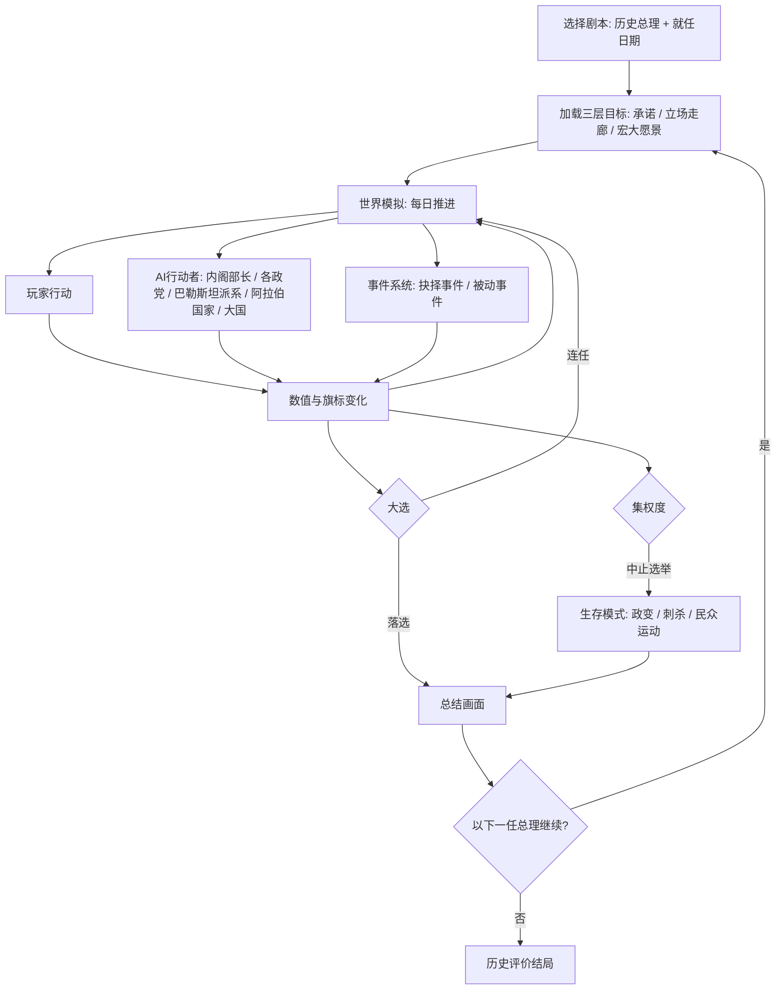

# 以色列政治策略游戏：系统设计草案 v5

> [!NOTE]
> **v5 已确认的设计方向**
> - **第一阶段只做总理视角**：采用剧本制，玩家扮演已去世的真实历史总理，**从就任开始**
> - 核心玩法：在**兑现承诺**、**守住党的立场走廊**和**推进玩家自己的方向**三者之间取舍
> - 只要能继续当选，就可以一直玩；卸任后进入总结画面，也可以选择以下一任总理的视角继续
> - 提供**偏离民选政治、走向独裁**的路线，伴随政治运动、政变和刺杀风险
> - 每个剧本的主角都有一个现实中没有实现的**宏大愿景**，实现后获得额外成就
> - 由状态驱动的**事件系统**，包括抉择事件和被动事件，负责叙事感和代入感
> - 沿用的方向：真实国家、真实历史；数值全部可见；以天为单位的连续时间，可以暂停和调速；沙盒式推进，事件按条件触发
> - 虚构人物生涯模式（部长起步、出身系统）推迟到**第二阶段**，见第19节

> [!IMPORTANT]
> **对标锚点**（研究见 [research/](research/)）
> - **深度与重复可玩性**：必须超过《为了祖国：朴正熙纪事》——这是最基本的锚点
> - **UI与整体观感**：以 Suzerain 为标准
> - **整体规模**：最接近白日升
> - **政治深度**：接近 Democracy 4
> - **地图复杂度**：明显低于P社，但整体观感尽量接近P社；吸取P社成功作与差评作的经验
> - **技术**：Godot 4 + GDScript；Python 参考实现用于验证（见 [contracts.md](contracts.md)）；首个可玩版本只做贝京1977

---

## 目录
1. 总体结构
2. 第一阶段范围
3. 剧本
4. 三层目标：承诺、立场、愿景
5. 连任、卸任与继任
6. 独裁路线
7. 时间系统
8. 界面
9. 地图系统
10. 数值体系
11. 修正器系统
12. 行动系统
13. AI内阁与人物
14. 外国影响力与巴勒斯坦派系
15. 事件系统
16. 反事实路线
17. 敏感内容处理原则
18. 结束条件与历史评价
19. 第二阶段：虚构人物生涯模式
20. 待定问题

---

## 1. 总体结构



**核心原则**
- **三层目标的张力**：选举承诺来自选民，立场走廊来自政党，愿景来自玩家自己。三者经常互相冲突，玩法的核心就是取舍。
- **背离党的立场是最精彩的时刻**：贝京归还西奈、拉宾签署奥斯陆协议、沙龙撤离加沙，都是总理背离自己政党的传统立场。
- **历史债务**：早期的决定会随时间加深，越晚处理成本越高。
- **矛盾的继承**：前任留下的矛盾，会成为玩家开局时的负担。

---

## 2. 第一阶段范围

| 纳入 | 推迟到第二阶段 |
|---|---|
| 总理视角的全部行动 | 部长、在野党领袖、普通议员的玩法 |
| 4–6个历史剧本 | 虚构人物与出身系统 |
| 承诺、立场走廊、宏大愿景 | 生涯快进、角色晋升 |
| 连任与继任 | 继承人模式（由继任机制部分代替） |
| 独裁路线 | — |
| 地图、矛盾参数、外交、巴勒斯坦派系 | — |
| 事件系统 | — |

**理由**：现有的大部分系统本来就是以总理视角设计的，可以直接使用；部长每天玩什么、AI总理怎么执政这类最没把握的问题，可以先放一放；剧本有起点和终点，内容量可控。

---

## 3. 剧本

### 3.1 剧本列表

| 剧本 | 就任方式 | 政党 | 主要矛盾 | 核心张力 |
|---|---|---|---|---|
| **贝京 1977-06-20**（首个原型） | 选举大翻盘 | 利库德 | 领土、族群、经济转型 | 民族主义立场和以领土换和平之间的冲突 |
| **本-古里安 1948-05-14** | 宣布建国，出任临时政府总理；1949年第一届议会选举 | 马帕伊 | 独立战争、移民安置、世俗与宗教、国家建设 | 战争开局；一支军队、紧缩配给、现状协议、军事管制 |
| **埃什科尔 1963-06-26** | 本-古里安辞职后接任 | 马帕伊 | 经济衰退、军事管制、1967年前夜 | 接任型剧本，前任一直在场 |
| **梅厄 1969-03-17** | 埃什科尔去世后接任 | 劳工党 | 消耗战、战略自满 | 隐藏层：1973年的突袭 |
| **拉宾 1992-07-13** | 选举获胜 | 劳工党 | 奥斯陆进程、俄裔移民、宗教政党 | 和平进程和国内反对，有刺杀风险 |
| 沙龙 2001-03-07（可选） | 总理直选 | 利库德 | 起义、隔离墙、撤离加沙 | 背离党的立场的终极形态：退党另组新党 |

> [!WARNING]
> 可玩的历史人物只限已去世的人物。在世人物出现在事件文本中时需要标注，继任机制中的处理方式见第5.3节。

### 3.2 剧本包含的内容
- **开局快照**：开局时的全部数值、旗标、联合政府构成、内阁成员。
- **开局目标**：选举承诺或继承的使命、党的立场走廊、宏大愿景（见第4节）。
- **专属事件池**：时代事件见 [events/](events/README.md) 事件库。
- **人物**：本剧本需要深度建模的AI人物，一般10–15位。

---

## 4. 三层目标：承诺、立场、愿景

### 4.1 总览

| 层次 | 来源 | 形式 | 偏离的代价 |
|---|---|---|---|
| **承诺** | 选民 | 3–5条，有期限、可衡量 | 选民集团支持下降，下届选举受损 |
| **立场走廊** | 政党 | 几条矛盾轴上可以活动的区间 | 党内地位下降，出现党内挑战者，最严重时党分裂 |
| **宏大愿景** | 剧本主角 / 玩家 | 一条有挑战的反事实路线 | 不惩罚；实现后获得成就，并计入历史评价 |

### 4.2 承诺
- **两种来源**：
  - **选举承诺**：选举上台的剧本，比如贝京1977、拉宾1992。
  - **继承的使命**：接任上台的剧本，比如埃什科尔1963、梅厄1969。来源是前任路线和党内期待；玩家可以选择延续，也可以摆脱，摆脱的代价是与前任的人物关系恶化。
- 每条承诺都有**期限**和**衡量指标**，例如“两年内年通胀降到X%以下”、“任期内不归还任何一寸土地”。
- 承诺之间可能互相矛盾，这是有意为之的设计。
- 每次大选时，玩家都会作出新一轮承诺，玩家可以在候选承诺中挑选，挑选结果影响选民集团支持。

### 4.3 立场走廊
- 每个政党在若干条轴上有一个**可以接受的区间**，例如利库德：领土轴偏右，经济模式轴中间偏右。
- **偏离走廊**会持续扣减党内地位；偏离越远、持续越久，扣得越多，并依次触发：党内批评 → 党内挑战者 → 派系出走 → 党分裂。
- **推动走廊**：玩家可以花政治资本，用演说、党代会、派系交易等方式把走廊慢慢推向自己的方向。
- **打破走廊**：玩家可以退党另组新党（以沙龙2005年成立前进党为原型），这需要一套政党分裂和重组的机制。

### 4.4 宏大愿景
各剧本主角的宏大愿景都是**历史上确实有过机会、但没有实现的事**：

| 剧本 | 宏大愿景 | 历史依据 |
|---|---|---|
| 本-古里安 1948 | 制定成文宪法，并在内盖夫安置百万人口 | 1950年议会决定暂缓制宪（哈拉里决议）；内盖夫是他终生的理想 |
| 埃什科尔 1963 | 落实“以领土换和平” | 1967年6月19日，内阁通过了以西奈、戈兰换和平的决议 |
| 梅厄 1969 | 避免赎罪日战争 | 1971年萨达特提出过重开运河的临时协议 |
| 贝京 1977 | 全面和平，包括与约旦、叙利亚媾和，并落实巴勒斯坦自治 | 戴维营框架中的自治部分始终没有执行 |
| 拉宾 1992 | 完成最终地位协议，并与叙利亚媾和 | “拉宾承诺”（据称他私下承诺过从戈兰撤军），奥斯陆协议的五年期限 |
| 沙龙 2001 | 单方面划定永久边界 | 撤离加沙之后原本计划的下一步 |

- 愿景不强制，玩家可以完全自由地玩。
- 愿景有一个**进度条**，由若干里程碑组成，界面上可以查看。

---

## 5. 连任、卸任与继任

### 5.1 连任
- 只要玩家能赢得大选并成功组阁，游戏就一直继续，没有固定的结束年份。
- 下台的方式包括：选举失利、组阁失败、建设性不信任投票、党内初选落败、主动辞职、健康原因、死亡。

### 5.2 卸任
- 卸任后进入**总结画面**：历史评价、承诺兑现率、愿景进度、各项数值的变化曲线，以及一段“历史书式”的总结文字。
- 玩家可以选择**以下一任总理的视角继续**。

### 5.3 继任者

| 继任者类型 | 处理方式 |
|---|---|
| 已去世、已建模的历史人物 | 直接继续，加载此人的承诺、立场走廊和宏大愿景 |
| 在世人物，或没有建模的人物 | 换成一个**虚构的同党继任者**，自动生成其意识形态、承诺和愿景 |

- 继任者由模拟结果决定，不一定是历史上的那个人。
- 玩家留下的矛盾和债务会全部由继任者承接。

---

## 6. 独裁路线

### 6.1 设计原则
- **以以色列真实的制度结构为根据，而不是一个抽象的“独裁按钮”**。以色列没有成文宪法，紧急状态从1948年起一直没有解除，这些都是真实存在的制度弱点。
- **全剧本开放，但难度随时代递增**：建国初期权力集中，制度尚未成形，难度较低；到1990年代，制度已经成熟，难度高得多。
- **永远不是最优解**：独裁路线会长期压低民主法治、国际合法性和对美关系。

### 6.2 集权度与路径
新增全国参数**集权度**（0–100），由以下手段推高：

| 阶段 | 手段 | 有历史依据的切入点 |
|---|---|---|
| 掏空制衡 | 削弱最高法院、操控法官任命、凌驾条款 | 没有成文宪法，基本法可以用简单多数修改 |
| 控制信息 | 审查、控制广播局、打压媒体 | 军事审查制度、早期的国营广播 |
| 延长权力 | 以战争或紧急状态为由推迟选举 | 1973年选举确实因战争推迟过；议会有权延长自己的任期 |
| 控制强力部门 | 撤换总参谋长、辛贝特首长，安插亲信 | 拉冯事件；总理兼任国防部长的传统 |
| 放弃民选 | 中止选举、解散议会 | 没有先例，纯粹的反事实 |

### 6.3 阻力方
都是AI行动者，各有自己的触发阈值：最高法院、总参谋部、预备役军人（拒绝服役）、总工会、媒体、联合政府伙伴、美国国会、海外犹太社群。

### 6.4 风险事件
大规模抗议、总罢工、预备役拒绝服役、政变、刺杀（可能来自左右两翼的任何一方）、美国冻结援助、资本外逃与人才外流。

### 6.5 生存模式与结局
- 完全中止选举之后，**胜负条件从“连任”变成“生存”**。
- 结局：被推翻、遇刺、政变，或者稳固统治直到自然死亡（**“成功”的结局，但历史评价中的民主项会被大幅压低**）。

---

## 7. 时间系统

### 7.1 推进方式
- 最小单位为1天，提供暂停与1–5档速度。
- 重大事件弹窗时自动暂停，玩家也可以自定义自动暂停的条件。

### 7.2 结算节奏

| 周期 | 内容 |
|---|---|
| **每日** | 军事行动、危机倒计时、决议进度、谈判进度 |
| **每周** | 民调、媒体舆论、议会议程与投票、**内阁例会**（集中处理积压议题，见第15节） |
| **每月** | 财政收支、各矛盾数值漂移、派系满意度、立场偏离结算、外交关系、移民流入、各区数值 |
| **每季** | 经济增长、通胀、援助拨款 |
| **每年** | 人口结构、预算法案、人物年龄与健康 |

### 7.3 时间压力
- 预算法案必须在期限前通过，否则自动提前大选。
- 法定大选最长四年一次，可能被提前触发。
- 承诺有期限。
- 重大决议都有执行周期，比如核反应堆、国家输水工程、隔离墙。

---

## 8. 界面

### 8.1 顶栏（常驻）
政治资本、联合政府席位（x/120）、党内地位、财政月收支、通胀、战备、威慑、国际合法性、主要盟友关系（按时代切换）、日期与速度。

### 8.2 主面板
1. **目标面板**：承诺（进度与期限）、立场走廊（当前位置与偏离程度）、宏大愿景（里程碑）
2. 内阁与联合政府
3. 社会矛盾
4. 三难三角
5. 地图（见第9节）
6. 安全与情报
7. 外交与外国影响力
8. 巴勒斯坦政治
9. 经济与预算
10. 人物
11. 决议与法令

---

## 9. 地图系统

### 9.1 设计原则
> **每次地块操作都应该是一次“答案因地而异”的政治选择。如果某个操作在每个地块上的最优解都一样，就把它抽象到全国层。**

- 经济不在地块层操作，各区自动发展，玩家不建工厂。
- 地块层只放政治性、一次性或不可逆的决策。
- 地图同时是信息图层，用来“看见矛盾”。

### 9.2 区划（最多10个区）

**绿线以内：6个固定区**

| 区 | 关键属性 | 关键地点 |
|---|---|---|
| **加利利（北部）** | 阿拉伯与德鲁兹人口比例高，北部边境，军事管制 | 拿撒勒、德鲁兹村庄、基布兹边境带、太巴列湖（水源） |
| **海法与北部沿海** | 港口工业、混居城市、工会重镇 | 海法港、瓦迪萨利布、炼油厂 |
| **特拉维夫与中部沿海** | 经济与文化中心，世俗、自由派 | 特拉维夫、雅法、本-古里安机场、贝内贝拉克（哈雷迪聚居城市） |
| **三角地带与沙龙平原** | 紧贴停火线，国土最窄处，阿拉伯城镇带 | 卡夫尔卡西姆、瓦迪阿拉、国土最窄处（约15公里） |
| **耶路撒冷** | 宗教、哈雷迪、首都地位、1967年前是分治的边境 | 西耶路撒冷、议会与政府区、哈雷迪街区、（1967年后）东耶路撒冷、圣殿山、哭墙 |
| **内盖夫（南部）** | 发展城镇、贝都因人、核设施、红海出海口 | 贝尔谢巴、迪莫纳、埃拉特、未被承认的贝都因村庄、斯代博克 |

**动态区：最多4个**

| 区 | 存续 | 关键地点 |
|---|---|---|
| **约旦河西岸** | 1967年后 | 约旦河谷、大定居区块（古什埃齐翁等）、山地腹地（纳布卢斯、希伯伦）、拉姆安拉 |
| **加沙** | 1956–57年、1967–2005年 | 加沙城、难民营、古什卡蒂夫定居点群、拉法边境 |
| **戈兰高地** | 1967年后 | 制高点、水源、德鲁兹村庄 |
| **西奈** | 1956–57年、1967–1982年 | 苏伊士运河防线、沙姆沙伊赫（蒂朗海峡）、油田、亚米特定居点 |

- **战线区**（不算正式地块）：南黎巴嫩“安全区”（1985–2000）、运河前线、约旦河前线。
- **地图外的邻国**：以边缘标签表示，标出该国的敌意、战备和开战概率。

### 9.3 区级数值

| 数值 | 说明 |
|---|---|
| 人口构成 | 阿什肯纳兹、米兹拉希、阿拉伯、德鲁兹、贝都因、哈雷迪、俄裔，绝对数与比例 |
| 法律地位 | 主权领土、军事管制、占领区、吞并区、奥斯陆A/B/C区占比 |
| 安全 | 0–100，受恐袭、越境袭击、暴力事件影响 |
| 发展水平 | 自动演化，受区级投资滑块影响 |
| 疏离度 | 按群体分别计算 |
| 选民倾向 | 各党在该区的支持率，大选时汇总 |
| 战略价值 / 谈判价值 / 宗教价值 | 静态值，再加上事件修正 |

### 9.4 区级政策（滑块，不需要逐格操作）
- **移民安置倾向**：本区接收新移民的优先级。
- **投资优先级**：基础设施和公共服务投资。
- **安全姿态**：警力与军力部署、军事管制强度（适用时）。
- **土地政策**：土地征用的力度、规划许可的松紧。
- **定居点政策**（占领区）：冻结、自然增长、积极扩张。

### 9.5 关键地点决策（一次性、有重量）

| 决策 | 举例 |
|---|---|
| 新建定居点或发展城镇 | 选择约旦河谷还是纳布卢斯附近，在三难三角和对美关系上的后果截然不同 |
| 撤离或拆除 | 古什卡蒂夫撤离、亚米特拆除 |
| 吞并或交还 | 吞并戈兰高地（1981）、归还西奈 |
| 圣地安排 | 维持或改变圣殿山现状 |
| 大型工程 | 国家输水工程、迪莫纳核设施、隔离墙 |
| 城市边界 | 耶路撒冷市界划定 |

### 9.6 规划图
玩家可以画一张“规划图”，一次覆盖多个区和地点，例如阿隆计划或隔离墙走向。执行机构会在一段时间内自动推进，期间触发阻力事件，比如定居者抗议、法院诉讼、国际谴责、美国施压。

### 9.7 信息图层（热力图）
疏离度、民间敌意、定居密度、安全事件、水资源、选民倾向、阿拉伯公民融合度。

### 9.8 军事地图
- 战争在战线上推进，战线沿各区边界和地图外的邻国展开。
- 玩家下达**战役目标**并分配资源，例如“夺取西奈至运河”、“只推进到米特拉山口”，不操纵单个部队。
- 占领新领土时，会自动生成对应的动态区。

---

## 10. 数值体系

### 10.1 权力生存层

| 数值 | 范围 | 说明 |
|---|---|---|
| 盟党满意度（每党） | 0–100 | 由诉求满足情况、部长职位分配、意识形态距离决定 |
| 党内地位 | 0–100 | 民调、战争、丑闻、**立场偏离**、党内派系压力 |
| 选民集团支持 | 每集团0–100 | 由该集团关心的数值和**承诺兑现情况**决定 |
| 政治资本 | 消耗型 | 每月产出 = 基础值 + 党内地位系数 + 民意系数 − 丑闻惩罚 |
| **承诺进度**（v5） | 每条0–100% | 到期时结算 |
| **立场偏离**（v5） | 每条轴 ≥ 0 | 0表示在走廊内 |
| **愿景进度**（v5） | 里程碑 | 不惩罚 |
| **集权度**（v5） | 0–100 | 见第6节 |

**选民集团**：劳工派阿什肯纳兹人、米兹拉希、基布兹与莫沙夫成员、宗教犹太复国主义者、哈雷迪、阿拉伯公民、俄裔（1990年后）、中产自由派。

### 10.2 国家能力层
财政与外汇、通胀、战备（动员会拖累经济）、各武器来源的可靠度、移民吸收容量，以及1948–49年专属的国家整合度。

### 10.3 矛盾参数（精简版）

> 完整设计见 [contradiction_parameters.md](contradiction_parameters.md)。

| 矛盾 | 参数 |
|---|---|
| 世俗与宗教 | 宗教现状指数（轴）、兵役豁免规模（债务） |
| 族群与移民（米兹拉希、俄裔、埃塞俄比亚裔） | 每个群体：疏离度、历史怨气 |
| 阿拉伯公民（阿拉伯人、德鲁兹人、贝都因人） | 每个群体：国家认同度、土地怨气 |
| 大国依赖与战略自主 | 战略依赖度、国际合法性；美国：政府关系、国会关系；其他势力（含海外犹太社群）：关系值 |
| 领土与定居 | 三难三角（派生）、定居者运动动量 |
| 经济意识形态 | 经济模式（轴）、贫富差距、工会实力 |
| 安全与民主法治 | 民主法治指数、公众安全感（1990年代后加司法冲突度） |
| 外部冲突 | 每个阿拉伯国家：政权敌意、民间敌意、政权稳定度；巴勒斯坦：民间敌意、生活水平，每个派系实力、合法性；全局：威慑值、战略自满度 |

### 10.4 三难三角
- 三个顶点：犹太人口占比（控制区内）、民主合法性、领土控制度。
- 三者的加权和设有上限，由实际状态自动计算，玩家只能间接塑造。

### 10.5 隐藏层
战略自满度、核计划进度与暴露风险、历史评价。隐藏值通过情报和顾问报告以模糊措辞透露，而且这些报告本身可能是错的。

---

## 11. 修正器系统

| 字段 | 示例 |
|---|---|
| 名称 | “紧缩配给（Tzena）” |
| 来源 | 法令、事件、战争、人物特质、区级状态 |
| 作用范围 | 全国、单个区、单个派系、单个国家 |
| 持续 | 永久、N天、满足条件时移除 |
| 效果 | 外汇消耗 −20%，中产支持每月 −0.5 |

**历史债务型修正器**：效果随时间加深，越晚处理成本越高。例如“耶希瓦学生兵役豁免”，每年覆盖人数增加，取消它所需的政治资本也逐年上升。

---

## 12. 行动系统

| 类别 | 说明 |
|---|---|
| **法令** | 提交议会投票，可以用政治资本或诉求交换选票 |
| **决议** | 行政动作，消耗政治资本和资金，有执行周期 |
| **人事** | 任命部长、总参谋长、情报首长；内阁改组 |
| **预算** | 每年的预算滑块：国防、安置、宗教、发展城镇、教育、福利、基建 |
| **区级政策与地点决策** | 见第9节 |
| **军事** | 报复行动、先发制人、全面战争、动员、核设施打击 |
| **外交** | 秘密渠道、谈判、援助、军售、领土交换 |
| **外国影响力** | 见第14节 |
| **议会与政党** | 组阁谈判、提前大选、策反、党代会、**推动立场走廊**、退党另组新党 |
| **舆论与动员** | 媒体攻势、演说、动员选民集团 |
| **集权**（v5） | 见第6节，按阶段解锁 |

---

## 13. AI内阁与人物

### 13.1 AI内阁
- 第一阶段中，各部部长都由AI担任，有自己的野心、立场和派系。
- **部长会越权**：例如1982年国防部长沙龙把黎巴嫩战争扩大到远超内阁授权的程度。越权会以事件形式出现，玩家可以事后追认、斥责或撤换。
- 部长之间会互相告状、争夺预算，也会在党内挑战玩家。
- 组阁时把部长职位分给盟党，会影响盟党满意度和施政效率。

### 13.2 人物
- 属性：年龄、健康、能力（行政、军事、外交、政治手腕）、意识形态、野心、忠诚、特质。
- **历史人物由AI控制**，他们的仕途会随历史偏离而改变，例如达扬可能成为总理，拉宾可能没有机会出任。
- 与玩家之间的**关系值**：信任、恩怨、欠下的人情。
- 职位：各部部长、副部长、总参谋长、摩萨德与辛贝特首长、党内派系领袖、反对党领袖、盟党领袖。

### 13.3 AI行动者
- **以色列各政党**：有意识形态、诉求和联盟偏好，会主动策反、合并、倒阁。
- **巴勒斯坦派系**：见14.3。
- **阿拉伯国家**：有政权目标（生存、地区领导地位、收复失地）、受民间压力影响、有大国庇护。
- **大国**：美、苏、法、英、西德等，有全球战略与国内政治约束。

---

## 14. 外国影响力与巴勒斯坦派系

### 14.1 影响力分层

| 档位 | 对象 | 手段 |
|---|---|---|
| **深度** | 巴勒斯坦 | 经济许可、通行证、税收转交、释放囚犯、逮捕、定点清除、谈判渠道、承认或不承认 |
| **中度** | 黎巴嫩、约旦等政局脆弱的邻国 | 秘密支持派系、军援、威慑信号、情报合作 |
| **间接** | 美国、苏联、外围国家、海外犹太社群 | 国会游说、军售、情报交换、秘密外交、移民运动 |

### 14.2 核心机制
- **只能改变概率和力量，无法直接控制结果。**
- **合作者污名**：以色列越公开地支持某个派系，该派系在本国民众中的合法性下降得越多。
  ```
  派系合法性 Δ = −k × 以色列公开支持度 × 该国民间敌意
  ```
- **反噬事件**：扶植对象倒台、被刺杀，或者转而反对以色列；被压制的派系借机崛起。
  - 历史参照：村庄联盟（1978–84）、1980年代对伊斯兰主义团体的宽容、1982年扶植杰马耶勒。
- **暴露风险**：秘密行动有暴露概率，暴露后国际合法性和对象国关系都会受损。

### 14.3 巴勒斯坦政治模型

**派系**（按时代出现或消失）

| 派系 | 时期 |
|---|---|
| 传统地方显要（亲约旦派） | 1967年前后到1980年代 |
| 法塔赫与巴解组织主流 | 1960年代至今 |
| 左翼派别（人阵等） | 1960年代至今 |
| 哈马斯 | 1987年至今 |
| 伊斯兰圣战 | 1980年代至今 |
| 巴勒斯坦权力机构安全部门 | 1994年至今 |

**派系属性**：实力、民间合法性、温和度、组织完整度、外部庇护者（埃及、约旦、叙利亚、伊朗、海湾国家）、对以色列的立场。

**巴勒斯坦整体数值**：民众生活水平、对以色列的民间敌意、对和平进程的支持度、政治分裂度、起义风险。

**以色列的工具与权衡**

| 工具 | 短期效果 | 长期代价 |
|---|---|---|
| 放宽经济许可 | 生活水平上升，起义风险下降 | 安全风险上升，右翼不满 |
| 封锁、宵禁 | 安全提高 | 民间敌意上升，激进派获益 |
| 定点清除 | 目标派系的组织完整度下降 | 报复事件、国际合法性下降、出现殉道者效应 |
| 扶持温和派 | 温和派实力上升 | 温和派背上合作者污名 |
| 释放囚犯 | 谈判对象的合法性上升 | 国内反弹，部分获释者重返武装 |
| 谈判与承认 | 和平进程推进 | 国内右翼和宗教派强烈反对，刺杀风险上升 |

---

## 15. 事件系统

> 事件库见 [events/README.md](events/README.md)，按时代分文件，包含格式规范与数值词典。

### 15.1 事件类型

| 类型 | 触发方式 | 比例 | 例子 |
|---|---|---|---|
| **历史锚点** | 条件满足时触发，窗口在历史日期附近 | 少，但分量重 | 埃及封锁蒂朗海峡：埃及政权敌意 > 70，且苏联支持 > 50 |
| **结构性** | 数值越过阈值 | 主体 | 疏离度达到60触发抗议，战略自满度高时遭受突袭 |
| **人物** | 由AI人物的属性、野心、健康触发 | 中 | 部长越权、盟党以退出相要挟、党内对手发难、健康危机 |
| **风味** | 时代背景下的小事，主要提供叙事感 | 多，但轻 | 移民营里的冬天、广播里的新歌 |
| **架空** | 历史旗标偏离后出现 | 视沙盒走向而定 | 约旦–以色列早期单独和约、苏伊士战争未发生 |
| **随机**（R-） | 每月按基础概率掷骰，只受时代和存在性前提限制；**可反复发生**，有冷却 | 平时约每月1条 | 旱灾、公交事故、港口罢工、部长失言、越境渗透、欧冠夺冠 |

> [!IMPORTANT]
> **固定事件（E-）全部条件触发**：每条都有窗口、前置、数值条件、每月概率、失效条件和未触发时的处理（规范见 [events/README.md](events/README.md) 第5节），不允许只按日期触发。
> **随机事件（R-）发生与否是随机的，但后果随国家状态缩放**，所以仍然和玩家的决策有关（规范见第6节）。

### 15.2 选项形式
- **抉择事件**：2–3个选项，每个选项都要得罪某一方。
- **被动事件**：无选项，玩家被动接受效果，约占25–30%，例如战争爆发、外国政变、人物死亡、经济冲击。被动事件之后常常接一个抉择事件。

### 15.3 设计原则
1. **由状态触发，随机的只是时机**：事件概率由数值决定，玩家能预见，也能提前干预。
2. **每个选项都要得罪某一方**：至少触及承诺、立场走廊、愿景三层中的一层，不设“免费选项”。
3. **延迟后果的事件链**：今天的选择，几个月后再结账。
4. **防止重复**：冷却时间、记忆旗标；同类事件再次出现时，文本和选项要随之变化。
5. **事件主要由人物带来**：AI部长、盟党、党内对手是主要的事件来源。
6. **内阁例会**：每周的固定事件场景，集中处理积压的议题。
7. **控制频率**：小事件可以交给顾问自动处理，玩家可以自定义。
8. **多视角**：重大事件附上不同群体的声音。
9. **暴行类事件的两个抉择点**：事前的政策决策点只呈现风险，玩家不知道结果（例如是否组建101部队、是否允许长枪党进入难民营）；暴行本身是被动事件，按概率发生；之后再由总理做事后处置（审判、调查委员会或掩盖）。

### 15.4 历史引力
- **目标**：玩家不刻意干预时，重大历史事件（六日战争、赎罪日战争、拉宾遇刺等）约有 **70–80%** 的概率重演；玩家的政策可以显著提高或降低这个概率。
- **校准方法**：原型阶段用"按史实路线自动游玩"的AI跑大量模拟（蒙特卡洛），反推每条锚点事件的基础概率，使重演率落在目标区间。
- 事件文件中的"每月 x%"都是初值，以校准结果为准。

### 15.5 外部世界：历史轨道加扰动
- 外国政局（政权稳定度、政变、革命、大国政策）**默认沿史实轨道推进**，例如伊朗政权稳定度在1977–79年按史实曲线下滑。
- 轨道上叠加少量**随机扰动**，每局略有不同。
- **以色列的行动会改变这些国家的数值**，从而把轨道推离史实：例如提前与埃及媾和，会降低埃及国内反对派的合法性，改变萨达特遇刺的概率。
- 大国层面的"世界旗标"（朝鲜战争、冷战缓和、苏联解体等）同样沿轨道推进，只在玩家行动足以影响时才偏离。

### 15.6 世界状态
- 世界状态由**数值加历史旗标**共同描述，后续事件只读取状态，不依赖日期。
- AI行动者有自己的目标与行为树，历史不会被强制重演。

---

## 16. 反事实路线

所有反事实路线都**建立在真实的历史可能性之上**，作为沙盒中可以争取的方向，而不是一键切换。各剧本的宏大愿景（第4.4节）是其中的一部分。

| 路线 | 历史依据 | 关键条件 | 主要代价 |
|---|---|---|---|
| **东方阵营** | 苏联是最早承认以色列的国家之一；1948年的关键武器来自捷克斯洛伐克；马帕姆党亲苏 | 在1950年前后（朝鲜战争）的站队中倒向苏联，马帕姆党坐大 | 失去美国犹太社群的捐款，西德赔款可能告吹，苏联犹太人政策成为长期张力 |
| **早期中东和解** | 1949年叙利亚扎伊姆政权的和平提议；与约旦阿卜杜拉一世的秘密谈判；洛桑会议 | 在难民和边界问题上作出让步，保护阿卜杜拉的安全 | 右翼与安全派强烈反对，阿拉伯国家的伙伴政权可能被推翻 |
| **双民族国家** | 布伯、马格内斯的“和平之约”与伊胡德运动 | 极难，需要犹太与阿拉伯两方都有温和派掌权 | 犹太国家属性下降，犹太复国主义主流强烈反对 |
| **中立与不结盟** | 1950–60年代在非洲、亚洲的援助外交 | 同时保持与美苏的距离 | 武器来源不稳，战时孤立 |
| **“土地换和平”提前** | 1967年战后曾讨论以领土换和平 | 在定居者运动成形之前作出决定 | 宗教派与右翼反弹，阿拉伯方面未必接受 |
| **大以色列** | 1967年后的定居点运动 | 吞并占领区，持续扩张定居点 | 三难三角严重失衡，国际孤立，对美关系受损 |
| **威权化**（v5） | 没有成文宪法、长期紧急状态、1973年推迟选举 | 集权度持续上升，见第6节 | 民主法治崩塌、国际孤立、政变与刺杀风险 |

---

## 17. 敏感内容处理原则

1. **多视角事件文本**：重大事件同时呈现各方的经历，包括犹太方的生存恐惧、巴勒斯坦人的流离与“大灾难”、阿拉伯公民、米兹拉希、宗教群体。
2. **不设种族灭绝机制**。
3. **极端选项有严重而持久的代价**：大规模驱逐、屠杀、集体惩罚之类的行为，在机制上永远不会是“划算的选择”。它们会长期影响国际合法性、民间敌意、民主法治和历史评价。
4. **后果一致**：暴力与占领的代价在机制上真实存在，不能为了迎合任何一方而取消。
5. **独裁路线同样适用第3、4条**：不能是最优解，代价真实而持久。
6. **学术审阅**：事件文本与数据请不同立场的历史学者审阅。
7. **免责与定位**：开场说明本作是对统治困境的严肃模拟，不代表对任何立场的背书。
8. **在世人物**：不可玩；在事件文本中出现时需要标注，并尽量以职位描述代替人名。

---

## 18. 结束条件与历史评价

- **结束**：玩家卸任后选择不继续、国家崩溃、独裁路线中被推翻或遇刺、玩家主动结束。
- **历史评价**：从多个维度打分，包括安全、民主、繁荣、团结、和平、犹太属性、国际地位、个人遗产。另外单独统计**承诺兑现率**、**立场忠诚度**和**愿景成就**。
- 最后生成一段“历史书式”的总结文字。
- **连续游玩多任总理时**：每任总理单独评价，最后再给出一段跨时代的国家评价。

---

## 19. 第二阶段：虚构人物生涯模式

> [!NOTE]
> 以下内容来自 v4，第一阶段不做，保留作为第二阶段的设计基础。

### 19.1 概念
玩家扮演一位**虚构的以色列政治人物**，通过出身系统创建角色，默认从部长起步，可以一路晋升为总理。历史人物全部由AI控制，作为玩家的上级、盟友、竞争对手和继任者。

### 19.2 角色层级

| 角色 | 可用行动 | 主要目标 |
|---|---|---|
| **总理** | 全部行动 | 维持执政，平衡各对矛盾 |
| **部长** | 本部门的行动，加上内阁投票 | 在本领域做出政绩，积累党内地位 |
| **在野党领袖** | 议会攻防、政党整合、动员、舆论、对外接触 | 推翻政府或赢下选举 |
| **党内竞争者** | 初选、拉拢党内派系、人脉经营 | 夺取党魁位置 |
| **副部长、普通议员** | 有限的部门行动、议会投票、私人议案、党内结盟 | 积累政绩与人脉，争取入阁 |

### 19.3 部长权限示例

| 部门 | 专属行动 |
|---|---|
| **国防部** | 军事行动（重大行动需要总理或安全内阁批准）、军工项目、武器采购、占领区的民政管理 |
| **财政部** | 预算草案、税制、货币政策（与央行博弈）、私有化 |
| **外交部** | 外交渠道、联合国投票游说、对外援助 |
| **住房与建设部** | 移民安置、发展城镇、定居点建设（这是沙龙在1990–92年的真实权力基础） |
| **宗教事务部** | 拉比机构、宗教预算、安息日与饮食规范的执行 |

### 19.4 角色转换

| 转换 | 触发方式 |
|---|---|
| 在野领袖 → 总理 | 赢下大选并成功组阁，或通过建设性不信任投票上台 |
| 在野领袖 → 部长 | 国家危机时加入团结政府（1967年、1984年） |
| 部长 → 总理 | 总理辞职或去世后接任，或在党内夺权 |
| 总理 → 在野领袖 | 选举失利、联合政府倒台 |
| 任意角色 → 隐退 | 主动隐退，之后可以触发复出事件（本-古里安1953年退居斯代博克，1955年复出） |

### 19.5 在野模式的核心循环

| 杠杆 | 内容 |
|---|---|
| 议会攻防 | 不信任动议、策反执政联盟里的小党、阻挠预算 |
| 政党整合 | 合并政党、组建新阵营，例如加哈尔集团（1965）、利库德集团（1973） |
| 动员不满集团 | 利用疏离度高的选民集团，此举会进一步推高该矛盾数值 |
| 街头与舆论 | 抗议与媒体攻势，力度越大，激进化风险越高 |
| 危机入阁 | 国家危机时可以加入团结政府 |
| 对外接触 | 海外犹太社群、美国政界、秘密渠道 |

### 19.6 开局：起始年份、出身、起始职位

**角色出身**

| 出身 | 初始优势 | 初始劣势与天花板 |
|---|---|---|
| **基布兹出身的帕尔马赫老兵**（阿什肯纳兹） | 劳工党人脉、军方关系、精英集团接纳 | 米兹拉希与宗教选民疏远；1977年后劳工派式微 |
| **摩洛哥裔米兹拉希**，在发展城镇长大 | 米兹拉希集团支持、“代表被遗忘者”的叙事 | 遭精英阶层排斥，早期很难进入核心圈 |
| **伊拉克裔米兹拉希**，城市中产 | 经济、金融能力，跨族群的桥梁作用 | 两边都不完全认同 |
| **宗教犹太复国主义者** | 宗教党派与定居者网络 | 世俗选民和美国自由派犹太人警惕 |
| **前地下组织成员**（伊尔贡或莱希） | 右翼阵营的忠诚、民族主义选民 | 建国初期被劳工派当权者排斥 |
| **职业军官、情报官员** | 安全议题上的权威，“将军转政客”的通道 | 文官治理能力弱，容易被视为强硬派 |
| **前苏联移民**（1990年后开局可选） | 俄裔集团支持，世俗右翼 | 犹太律法身份可能受质疑，在政坛被视为外来者 |
| **德鲁兹军官**（高难度） | 军方声望、德鲁兹社群 | 当上总理难度极高，但这本身就是一种挑战 |

此外还有**个人特质**，例如：演说家、行政干才、密谋者、清廉、多疑、病弱、战争英雄，等等。

**起始职位**：部长（默认）、副部长或部门总司长（较难）、普通议员（困难）。

### 19.7 生涯节奏
- 生涯可能长达数十年，所以**快进与机会窗口自动暂停**是核心功能。
- 机会窗口包括：内阁改组、总理健康危机、联合政府倒台、战争、丑闻、党内初选、大选。
- 继承人模式：可以选择一位玩家角色提拔过的门生继续游戏。

### 19.8 第二阶段待解决的问题
- 部长的核心循环：一个月里具体做哪些决定，政绩如何转化为晋升。
- AI总理如何执政。
- 人际关系与党内派系的详细机制。

---

## 20. 待定问题

1. **立场走廊的惩罚力度**：太严玩家只会照历史走，太松没有张力，需要在原型中调校。
2. **议会、选举与组阁**：席位换算（比例代表制、选举门槛随时代变化）、组阁谈判、党内初选的详细机制。
3. **政治资本的经济**：各类行动的价格、能否储存、上限。
4. **政党分裂与新党**：退党另组新党的完整机制。
5. **战争系统的细节**：战役目标的颗粒度，是否加入空军和情报的独立子系统？
6. **事件频率**：每个游戏月平均几条事件；顾问自动处理的规则。
7. **矛盾之间的联动图**：检查失控的正反馈，确认每个参数都有回落机制。
8. **《为了祖国：朴正熙纪事》**：需要借鉴的具体机制待补充。
9. **核心数值的量化**：先从贝京1977开局做出一个可试玩的数值原型（含30–50条事件），再根据试玩结果调整系数。
