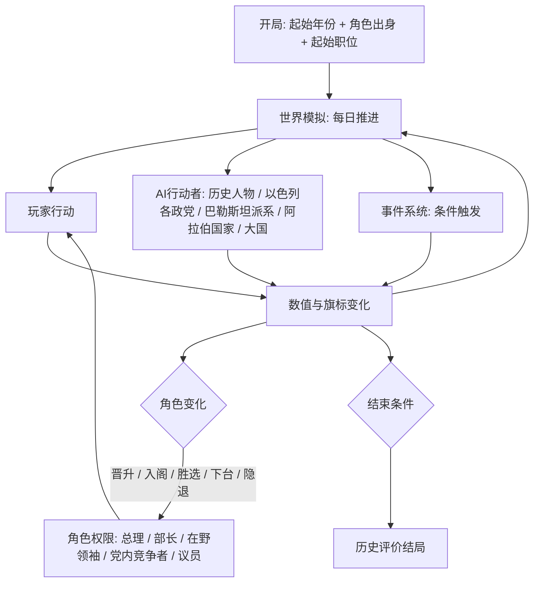

# 以色列政治策略游戏：系统设计草案 v4

> [!NOTE]
> **已确认的设计方向**
> - 真实国家、真实历史；**玩家扮演虚构政治人物**，默认从部长起步；历史人物由AI控制
> - 另设历史剧本模式，可以直接扮演已去世的真实历史人物
> - 策略游戏式：数值与仪表盘全部可见
> - 以天为单位的连续时间，可暂停、可调速（P社式）
> - 沙盒：允许偏离历史，所有事件按条件触发，并提供有史可依的反事实路线
> - 开局方式：选择起始年份、角色出身和起始职位
> - 角色权限分级：总理、部长、在野党领袖、党内竞争者、副部长和普通议员
> - 地图不超过10个区，采用"区加关键地点"的两级结构
> - 玩家可以有限地影响外国政治，巴勒斯坦有内部派系模拟

---

## 目录
1. 总体结构
2. 角色与权限分级
3. 时间系统
4. 界面
5. 地图系统
6. 数值体系
7. 修正器系统
8. 行动系统
9. 外国影响力与巴勒斯坦派系
10. 事件系统
11. 人物与AI
12. 开局与游戏模式
13. 反事实路线
14. 敏感内容处理原则
15. 结束条件与历史评价
16. 待定问题

---

## 1. 总体结构



**核心原则**
- **同一个世界，不同的杠杆**：所有角色共用一套世界模拟和数值，区别只在于能动用哪些行动。
- **矛盾的两面**：执政时社会矛盾是负担，在野时社会矛盾是武器。但被煽动起来的矛盾会一直留着，等你上台后由你自己继承。
- **历史债务**：早期的决定会随时间加深，越晚处理成本越高。

---

## 2. 角色与权限分级

### 2.0 玩家角色
- **主模式**：玩家扮演一位**虚构的以色列政治人物**，通过出身系统创建角色，默认从部长起步（见12.1）。
- **历史剧本模式**：玩家直接扮演真实历史人物（见12.3）。
- 两种模式共用下面的权限分级。

### 2.1 角色层级

| 角色 | 可用行动 | 主要目标 |
|---|---|---|
| **总理** | 全部行动 | 维持执政，平衡各对矛盾 |
| **部长** | 本部门的行动，加上内阁投票 | 在本领域做出政绩，积累党内地位 |
| **在野党领袖** | 议会攻防、政党整合、动员、舆论、对外接触 | 推翻政府或赢下选举 |
| **党内竞争者** | 初选、拉拢党内派系、人脉经营 | 夺取党魁位置 |
| **副部长、普通议员** | 有限的部门行动、议会投票、私人议案、党内结盟 | 积累政绩与人脉，争取入阁 |

### 2.2 部长权限示例

| 部门 | 专属行动 |
|---|---|
| **国防部** | 军事行动（重大行动需要总理或安全内阁批准）、军工项目、武器采购、占领区的民政管理 |
| **财政部** | 预算草案、税制、货币政策（与央行博弈）、私有化 |
| **外交部** | 外交渠道、联合国投票游说、对外援助 |
| **住房与建设部** | 移民安置、发展城镇、定居点建设（这是沙龙在1990–92年的真实权力基础） |
| **宗教事务部** | 拉比机构、宗教预算、安息日与饮食规范的执行 |

> [!TIP]
> 部长可以"越权"做事，比如沙龙在1982年把黎巴嫩战争的规模扩大到远超内阁授权的程度。越权能快速达成目标，但会损耗与总理的关系，事后还可能被调查委员会追责。

### 2.3 角色转换

| 转换 | 触发方式 |
|---|---|
| 在野领袖 → 总理 | 赢下大选并成功组阁，或通过建设性不信任投票上台 |
| 在野领袖 → 部长 | 国家危机时加入团结政府（1967年、1984年） |
| 部长 → 总理 | 总理辞职或去世后接任，或在党内夺权 |
| 总理 → 在野领袖 | 选举失利、联合政府倒台 |
| 任意角色 → 隐退 | 主动隐退，之后可以触发复出事件（本-古里安1953年退居斯代博克，1955年复出） |
| 角色死亡或彻底退出 | 游戏结束，或进入**继承人模式**（选择同党或同阵营的人物继续） |

### 2.4 在野模式的核心循环

| 杠杆 | 内容 |
|---|---|
| 议会攻防 | 不信任动议、策反执政联盟里的小党、阻挠预算 |
| 政党整合 | 合并政党、组建新阵营，例如加哈尔集团（1965）、利库德集团（1973） |
| 动员不满集团 | 利用疏离度高的选民集团，此举会进一步推高该矛盾数值 |
| 街头与舆论 | 抗议与媒体攻势，力度越大，激进化风险越高 |
| 危机入阁 | 国家危机时可以加入团结政府 |
| 对外接触 | 海外犹太社群、美国政界、秘密渠道 |

- **快进**：在野期间可以加速推进，出现机会窗口时自动暂停，例如联合政府危机、战争失利、丑闻。

---

## 3. 时间系统

### 3.1 推进方式
- 最小单位为1天，提供暂停与1–5档速度。
- 重大事件弹窗时自动暂停，玩家也可以自定义自动暂停的条件。

### 3.2 结算节奏

| 周期 | 内容 |
|---|---|
| **每日** | 军事行动、危机倒计时、决议进度、谈判进度 |
| **每周** | 民调、媒体舆论、议会议程与投票 |
| **每月** | 财政收支、各矛盾数值漂移、派系满意度、外交关系、移民流入、各区数值 |
| **每季** | 经济增长、通胀、援助拨款 |
| **每年** | 人口结构、预算法案、人物年龄与健康 |

### 3.3 时间压力
- 预算法案必须在期限前通过，否则自动提前大选。
- 法定大选最长四年一次，可能被提前触发。
- 重大决议都有执行周期，比如核反应堆、国家输水工程、隔离墙。

### 3.4 生涯节奏
- 玩家角色的政治生涯可能长达数十年，所以**快进与机会窗口自动暂停**是核心功能（见12.2）。
- 角色不在关键职位上时，世界由AI推进，玩家主要在机会窗口出现时做决定。

---

## 4. 界面

### 4.1 顶栏（常驻）
政治资本、联合政府席位（x/120）、财政月收支、通胀、战备、威慑、国际合法性、主要盟友关系（按时代切换）、日期与速度。

> 顶栏内容随角色变化。在野时，"联合政府席位"换成"反对派阵营席位"和"倒阁所需票数"。

### 4.2 主面板
1. 内阁与联合政府
2. 社会矛盾
3. 三难三角
4. 地图（见第5节）
5. 安全与情报
6. 外交与外国影响力
7. 巴勒斯坦政治
8. 经济与预算
9. 人物
10. 决议与法令

---

## 5. 地图系统

### 5.1 设计原则
> **每次地块操作都应该是一次"答案因地而异"的政治选择。如果某个操作在每个地块上的最优解都一样，就把它抽象到全国层。**

- 经济不在地块层操作，各区自动发展，玩家不建工厂。
- 地块层只放政治性、一次性或不可逆的决策。
- 地图同时是信息图层，用来"看见矛盾"。

### 5.2 区划（最多10个区）

**绿线以内：6个固定区**

| 区 | 关键属性 | 关键地点 |
|---|---|---|
| **加利利（北部）** | 阿拉伯与德鲁兹人口比例高，北部边境，军事管制 | 拿撒勒、德鲁兹村庄、基布兹边境带、太巴列湖（水源） |
| **海法与北部沿海** | 港口工业、混居城市、工会重镇 | 海法港、瓦迪萨利布、炼油厂 |
| **特拉维夫与中部沿海** | 经济与文化中心，世俗、自由派 | 特拉维夫、雅法、本-古里安机场、贝内贝拉克（哈雷迪聚居城市） |
| **三角地带与沙龙平原** | 紧贴停火线，国土最窄处，阿拉伯城镇带 | 卡夫尔卡西姆、瓦迪阿拉、国土最窄处（约15公里） |
| **耶路撒冷** | 宗教、哈雷迪、首都地位、1967年前是分治的边境 | 西耶路撒冷、议会与政府区、哈雷迪街区、（1967年后）东耶路撒冷、圣殿山、哭墙 |
| **内盖夫（南部）** | 发展城镇、贝都因人、核设施、红海出海口 | 贝尔谢巴、迪莫纳、埃拉特、未被承认的贝都因村庄、斯代博克 |

**动态区：最多4个**

| 区 | 存续 | 关键地点 |
|---|---|---|
| **约旦河西岸** | 1967年后 | 约旦河谷、大定居区块（古什埃齐翁等）、山地腹地（纳布卢斯、希伯伦）、拉姆安拉 |
| **加沙** | 1956–57年、1967–2005年 | 加沙城、难民营、古什卡蒂夫定居点群、拉法边境 |
| **戈兰高地** | 1967年后 | 制高点、水源、德鲁兹村庄 |
| **西奈** | 1956–57年、1967–1982年 | 苏伊士运河防线、沙姆沙伊赫（蒂朗海峡）、油田、亚米特定居点 |

- **战线区**（不算正式地块）：南黎巴嫩"安全区"（1985–2000）、运河前线、约旦河前线。
- **地图外的邻国**：以边缘标签表示，标出该国的敌意、战备和开战概率。

### 5.3 区级数值

| 数值 | 说明 |
|---|---|
| 人口构成 | 阿什肯纳兹、米兹拉希、阿拉伯、德鲁兹、贝都因、哈雷迪、俄裔，绝对数与比例 |
| 法律地位 | 主权领土、军事管制、占领区、吞并区、奥斯陆A/B/C区占比 |
| 安全 | 0–100，受恐袭、越境袭击、暴力事件影响 |
| 发展水平 | 自动演化，受区级投资滑块影响 |
| 疏离度 | 按群体分别计算 |
| 选民倾向 | 各党在该区的支持率，大选时汇总 |
| 战略价值 / 谈判价值 / 宗教价值 | 静态值，再加上事件修正 |

### 5.4 区级政策（滑块，不需要逐格操作）
- **移民安置倾向**：本区接收新移民的优先级。
- **投资优先级**：基础设施和公共服务投资。
- **安全姿态**：警力与军力部署、军事管制强度（适用时）。
- **土地政策**：土地征用的力度、规划许可的松紧。
- **定居点政策**（占领区）：冻结、自然增长、积极扩张。

### 5.5 关键地点决策（一次性、有重量）

| 决策 | 举例 |
|---|---|
| 新建定居点或发展城镇 | 选择约旦河谷还是纳布卢斯附近，在三难三角和对美关系上的后果截然不同 |
| 撤离或拆除 | 古什卡蒂夫撤离、亚米特拆除 |
| 吞并或交还 | 吞并戈兰高地（1981）、归还西奈 |
| 圣地安排 | 维持或改变圣殿山现状 |
| 大型工程 | 国家输水工程、迪莫纳核设施、隔离墙 |
| 城市边界 | 耶路撒冷市界划定 |

### 5.6 规划图
玩家可以画一张"规划图"，一次覆盖多个区和地点，例如阿隆计划或隔离墙走向。执行机构会在一段时间内自动推进，期间触发阻力事件，比如定居者抗议、法院诉讼、国际谴责、美国施压。

### 5.7 信息图层（热力图）
疏离度、民间敌意、定居密度、安全事件、水资源、选民倾向、阿拉伯公民融合度。

### 5.8 军事地图
- 战争在战线上推进，战线沿各区边界和地图外的邻国展开。
- 玩家下达**战役目标**并分配资源，例如"夺取西奈至运河"、"只推进到米特拉山口"，不操纵单个部队。
- 占领新领土时，会自动生成对应的动态区。

---

## 6. 数值体系

### 6.1 权力生存层

| 数值 | 范围 | 说明 |
|---|---|---|
| 盟党满意度（每党） | 0–100 | 由诉求满足情况、部长职位分配、意识形态距离决定 |
| 党内地位 | 0–100 | 民调、战争、丑闻、党内派系压力 |
| 选民集团支持 | 每集团0–100 | 由该集团关心的数值决定 |
| 政治资本 | 消耗型 | 每月产出 = 基础值 + 党内地位系数 + 民意系数 − 丑闻惩罚；产出公式随角色变化 |

**选民集团**：劳工派阿什肯纳兹人、米兹拉希、基布兹与莫沙夫成员、宗教犹太复国主义者、哈雷迪、阿拉伯公民、俄裔（1990年后）、中产自由派。

### 6.2 国家能力层
财政与外汇、通胀、战备（动员会拖累经济）、各武器来源的可靠度、移民吸收容量，以及1948年剧本专属的国家整合度。

### 6.3 矛盾参数（精简版）

> 完整设计见 [contradiction_parameters.md](contradiction_parameters.md)。规则：每对矛盾1–2个参数，最多3个；涉及群体或势力时，每个对象1–3个。政策杠杆、共享状态、修正器不计入矛盾参数。

| 矛盾 | 参数 |
|---|---|
| 世俗与宗教 | 宗教现状指数（轴）、兵役豁免规模（债务） |
| 族群与移民（米兹拉希、俄裔、埃塞俄比亚裔） | 每个群体：疏离度、历史怨气 |
| 阿拉伯公民（阿拉伯人、德鲁兹人、贝都因人） | 每个群体：国家认同度、土地怨气 |
| 大国依赖与战略自主 | 战略依赖度、国际合法性；美国：政府关系、国会关系；其他势力（含海外犹太社群）：关系值 |
| 领土与定居 | 三难三角（派生）、定居者运动动量 |
| 经济意识形态 | 经济模式（轴）、贫富差距、工会实力 |
| 安全与民主法治 | 民主法治指数、公众安全感（1990年代后加司法冲突度） |
| 外部冲突 | 每个阿拉伯国家：政权敌意、民间敌意、政权稳定度；巴勒斯坦：民间敌意、生活水平，每个派系实力、合法性；全局：威慑值、战略自满度 |

### 6.4 三难三角
- 三个顶点：犹太人口占比（控制区内）、民主合法性、领土控制度。
- 三者的加权和设有上限，由实际状态自动计算，玩家只能间接塑造。

### 6.5 隐藏层
战略自满度、核计划进度与暴露风险、历史评价。隐藏值通过情报和顾问报告以模糊措辞透露，而且这些报告本身可能是错的。

---

## 7. 修正器系统

| 字段 | 示例 |
|---|---|
| 名称 | "紧缩配给（Tzena）" |
| 来源 | 法令、事件、战争、人物特质、区级状态 |
| 作用范围 | 全国、单个区、单个派系、单个国家 |
| 持续 | 永久、N天、满足条件时移除 |
| 效果 | 外汇消耗 −20%，中产支持每月 −0.5 |

**历史债务型修正器**：效果随时间加深，越晚处理成本越高。例如"耶希瓦学生兵役豁免"，每年覆盖人数增加，取消它所需的政治资本也逐年上升。

---

## 8. 行动系统

| 类别 | 说明 | 可用角色 |
|---|---|---|
| **法令** | 提交议会投票，可以用政治资本或诉求交换选票 | 总理、部长（本部门法案）；在野领袖可以提出私人议案 |
| **决议** | 行政动作，消耗政治资本和资金，有执行周期 | 总理、部长（本部门） |
| **人事** | 任命部长、总参谋长、情报首长 | 总理 |
| **预算** | 每年的预算滑块：国防、安置、宗教、发展城镇、教育、福利、基建 | 总理、财政部长（起草） |
| **区级政策与地点决策** | 见第5节 | 总理、相关部长 |
| **军事** | 报复行动、先发制人、全面战争、动员、核设施打击 | 总理、安全内阁；国防部长可以提议或越权 |
| **外交** | 秘密渠道、谈判、援助、军售、领土交换 | 总理、外交部长 |
| **外国影响力** | 见第9节 | 总理、国防部长、情报系统 |
| **议会与政党** | 不信任动议、策反、政党合并、初选 | 所有角色 |
| **舆论与动员** | 媒体攻势、抗议、动员选民集团 | 所有角色，在野时最强 |

---

## 9. 外国影响力与巴勒斯坦派系

### 9.1 影响力分层

| 档位 | 对象 | 手段 |
|---|---|---|
| **深度** | 巴勒斯坦 | 经济许可、通行证、税收转交、释放囚犯、逮捕、定点清除、谈判渠道、承认或不承认 |
| **中度** | 黎巴嫩、约旦等政局脆弱的邻国 | 秘密支持派系、军援、威慑信号、情报合作 |
| **间接** | 美国、苏联、外围国家、海外犹太社群 | 国会游说、军售、情报交换、秘密外交、移民运动 |

### 9.2 核心机制
- **只能改变概率和力量，无法直接控制结果。**
- **合作者污名**：以色列越公开地支持某个派系，该派系在本国民众中的合法性下降得越多。
  ```
  派系合法性 Δ = −k × 以色列公开支持度 × 该国民间敌意
  ```
- **反噬事件**：扶植对象倒台、被刺杀，或者转而反对以色列；被压制的派系借机崛起。
  - 历史参照：村庄联盟（1978–84）、1980年代对伊斯兰主义团体的宽容、1982年扶植杰马耶勒。
- **暴露风险**：秘密行动有暴露概率，暴露后国际合法性和对象国关系都会受损。

### 9.3 巴勒斯坦政治模型

**派系**（按时代出现或消失）

| 派系 | 时期 |
|---|---|
| 传统地方显要（亲约旦派） | 1967年前后到1980年代 |
| 法塔赫与巴解组织主流 | 1960年代至今 |
| 左翼派别（人阵等） | 1960年代至今 |
| 哈马斯 | 1987年至今 |
| 伊斯兰圣战 | 1980年代至今 |
| 巴勒斯坦权力机构安全部门 | 1994年至今 |

**派系属性**：实力、民间合法性、温和度、组织完整度、外部庇护者（埃及、约旦、叙利亚、伊朗、海湾国家）、对以色列的立场。

**巴勒斯坦整体数值**：民众生活水平、对以色列的民间敌意、对和平进程的支持度、政治分裂度（例如2007年后的约旦河西岸与加沙分治）、起义风险。

**以色列的工具与权衡**

| 工具 | 短期效果 | 长期代价 |
|---|---|---|
| 放宽经济许可 | 生活水平上升，起义风险下降 | 安全风险上升，右翼不满 |
| 封锁、宵禁 | 安全提高 | 民间敌意上升，激进派获益 |
| 定点清除 | 目标派系的组织完整度下降 | 报复事件、国际合法性下降、出现殉道者效应 |
| 扶持温和派 | 温和派实力上升 | 温和派背上合作者污名 |
| 释放囚犯 | 谈判对象的合法性上升 | 国内反弹，部分获释者重返武装 |
| 谈判与承认 | 和平进程推进 | 国内右翼和宗教派强烈反对，刺杀风险上升 |

---

## 10. 事件系统

| 类型 | 触发方式 | 例子 |
|---|---|---|
| **历史锚点** | 条件满足时触发，窗口在历史日期附近 | 埃及封锁蒂朗海峡：埃及政权敌意 > 70，且苏联支持 > 50 |
| **结构性** | 数值越过阈值 | 疏离度达到60触发抗议，战略自满度高时遭受突袭 |
| **架空** | 历史旗标偏离后出现 | 约旦–以色列早期单独和约、苏伊士战争未发生 |
| **人物** | 由人物属性、年龄、健康触发 | 健康危机、丑闻、对手发难、刺杀 |
| **区域** | 由区级数值触发 | 某区骚乱、越境袭击、定居者与当地居民冲突 |

- 世界状态由**数值加历史旗标**共同描述，后续事件只读取状态，不依赖日期。
- AI行动者有自己的目标与行为树，历史不会被强制重演。

---

## 11. 人物与AI

### 11.1 人物
- 属性：年龄、健康、能力（行政、军事、外交、政治手腕）、意识形态、野心、忠诚、特质。
- **历史人物全部由AI控制**，作为玩家的上级、盟友、竞争对手和继任者。他们的仕途会随历史偏离而改变，例如达扬可能成为总理，拉宾可能没有机会出任。
- 玩家的虚构角色与历史人物之间有**关系值**：信任、恩怨、欠下的人情。这些关系决定玩家能否被任命为部长、能否在党内获得支持。
- 职位：总理、各部部长、副部长、总参谋长、摩萨德与辛贝特首长、党魁、议员。

### 11.2 历史人物AI的行为原则
- 每位历史人物都有基于史实的**性格与政策倾向**，比如本-古里安的国家主义、夏里特的外交温和路线、贝京的民族主义与法治观念。
- 玩家不在总理位置时，**AI总理按自己的逻辑执政**，玩家只能在部门权限内影响国家，或者通过内阁投票、党内斗争来左右他。
- 玩家的行动会改变AI人物的处境和选择。例如玩家作为国防部长在1956年反对苏伊士行动，AI总理可能改变决定，也可能撤换玩家。

### 11.3 AI行动者
- **以色列各政党**：有意识形态、诉求和联盟偏好，会主动策反、合并、倒阁。
- **巴勒斯坦派系**：见9.3。
- **阿拉伯国家**：有政权目标（生存、地区领导地位、收复失地）、受民间压力影响、有大国庇护。
- **大国**：美、苏、法、英、西德等，有全球战略与国内政治约束。

---

## 12. 开局与游戏模式

### 12.1 主模式：政治生涯

开局由三项组成：**起始年份、角色出身、起始职位**。

**① 起始年份**（每个都是一份历史快照）

| 起始 | 开局局势 | 在任的AI总理 |
|---|---|---|
| 1948-05-14 | 宣布建国，阿拉伯国家联军入侵 | 本-古里安 |
| 1955年 | 本-古里安复出，边境报复行动与苏伊士前夜 | 夏里特，随后本-古里安 |
| 1963-06-26 | 本-古里安下台，党内分裂，经济衰退 | 埃什科尔 |
| 1969-03-17 | 消耗战，占领地问题浮现 | 梅厄 |
| 1977-06-20 | 利库德首次执政 | 贝京 |
| 1984年 | 恶性通胀，团结政府轮值 | 佩雷斯与沙米尔轮值 |
| 1992-07-13 | 奥斯陆前夜，俄裔移民潮 | 拉宾 |

**② 角色出身**（直接对应游戏中的社会矛盾）

| 出身 | 初始优势 | 初始劣势与天花板 |
|---|---|---|
| **基布兹出身的帕尔马赫老兵**（阿什肯纳兹） | 劳工党人脉、军方关系、精英集团接纳 | 米兹拉希与宗教选民疏远；1977年后劳工派式微 |
| **摩洛哥裔米兹拉希**，在发展城镇长大 | 米兹拉希集团支持、"代表被遗忘者"的叙事 | 遭精英阶层排斥，早期很难进入核心圈 |
| **伊拉克裔米兹拉希**，城市中产 | 经济、金融能力，跨族群的桥梁作用 | 两边都不完全认同 |
| **宗教犹太复国主义者** | 宗教党派与定居者网络 | 世俗选民和美国自由派犹太人警惕 |
| **前地下组织成员**（伊尔贡或莱希） | 右翼阵营的忠诚、民族主义选民 | 建国初期被劳工派当权者排斥 |
| **职业军官、情报官员** | 安全议题上的权威，"将军转政客"的通道 | 文官治理能力弱，容易被视为强硬派 |
| **前苏联移民**（1990年后开局可选） | 俄裔集团支持，世俗右翼 | 犹太律法身份可能受质疑，在政坛被视为外来者 |
| **德鲁兹军官**（高难度） | 军方声望、德鲁兹社群 | 当上总理难度极高，但这本身就是一种挑战 |

此外还有**个人特质**，例如：演说家、行政干才、密谋者、清廉、多疑、病弱、战争英雄，等等。

**③ 起始职位**

| 职位 | 难度 | 说明 |
|---|---|---|
| **部长**（默认） | 标准 | 可以选择一个部门，部门选项受出身和年份限制 |
| 副部长或部门总司长 | 较难 | 行政权力有限，靠政绩晋升 |
| 普通议员 | 困难 | 从议会和党内斗争起步 |

### 12.2 生涯节奏
- 生涯可能长达数十年，所以**快进是核心功能**：没有危机时可以高速推进，出现机会窗口时自动暂停。
- 机会窗口包括：内阁改组、总理健康危机、联合政府倒台、战争、丑闻、党内初选、大选。
- 角色会衰老，并有健康事件。不同出身的起步年龄不同。

### 12.3 历史剧本模式（特色模式）
直接扮演真实的历史人物，开局时就处在其真实职位上。剧本保留v3的列表：

| 类型 | 剧本 |
|---|---|
| 总理 | 本-古里安（1948）、埃什科尔（1963）、梅厄（1969）、贝京（1977）、拉宾（1992）、沙龙（2001） |
| 崛起 | 佩雷斯（1953，国防部总司长）、达扬（1967，国防部长）、拉宾（1990，党内竞争者） |
| 在野 | 贝京（1973）、沙龙（1999） |

> [!WARNING]
> 历史剧本只收录已去世的人物。涉及在世政治人物的内容，包括作为AI登场，都需要单独评估法律与舆论风险。

---

## 13. 反事实路线

所有反事实路线都**建立在真实的历史可能性之上**，作为沙盒中可以争取的方向，而不是一键切换。

| 路线 | 历史依据 | 关键条件 | 主要代价 |
|---|---|---|---|
| **东方阵营** | 苏联是最早承认以色列的国家之一；1948年的关键武器来自捷克斯洛伐克；马帕姆党亲苏 | 在1950年前后（朝鲜战争）的站队中倒向苏联，马帕姆党坐大 | 失去美国犹太社群的捐款，西德赔款可能告吹，苏联犹太人政策成为长期张力 |
| **早期中东和解** | 1949年叙利亚扎伊姆政权的和平提议；与约旦阿卜杜拉一世的秘密谈判；洛桑会议 | 在难民和边界问题上作出让步，保护阿卜杜拉的安全 | 右翼与安全派强烈反对，阿拉伯国家的伙伴政权可能被推翻 |
| **双民族国家** | 布伯、马格内斯的"和平之约"与伊胡德运动 | 极难，需要犹太与阿拉伯两方都有温和派掌权 | 犹太国家属性下降，犹太复国主义主流强烈反对 |
| **中立与不结盟** | 1950–60年代在非洲、亚洲的援助外交 | 同时保持与美苏的距离 | 武器来源不稳，战时孤立 |
| **"土地换和平"提前** | 1967年战后曾讨论以领土换和平 | 在定居者运动成形之前作出决定 | 宗教派与右翼反弹，阿拉伯方面未必接受 |
| **大以色列** | 1967年后的定居点运动 | 吞并占领区，持续扩张定居点 | 三难三角严重失衡，国际孤立，对美关系受损 |

---

## 14. 敏感内容处理原则

1. **多视角事件文本**：重大事件同时呈现各方的经历，包括犹太方的生存恐惧、巴勒斯坦人的流离与"大灾难"、阿拉伯公民、米兹拉希、宗教群体。
2. **不设种族灭绝机制**。
3. **极端选项有严重而持久的代价**：大规模驱逐、屠杀、集体惩罚之类的行为，在机制上永远不会是"划算的选择"。它们会长期影响国际合法性、民间敌意、民主法治和历史评价。
4. **后果一致**：暴力与占领的代价在机制上真实存在，不能为了迎合任何一方而取消。
5. **学术审阅**：事件文本与数据请不同立场的历史学者审阅。
6. **免责与定位**：开场说明本作是对统治困境的严肃模拟，不代表对任何立场的背书。

---

## 15. 结束条件与历史评价

- **结束**：玩家角色死亡或彻底退出（未启用继承人模式时）、国家崩溃、到达设定的终止年份。
- **继承人模式**：可以选择一位玩家角色提拔过的门生，或同阵营的人物继续游戏，门生可以是虚构人物，也可以是历史人物。
- **历史评价**：从多个维度打分，包括安全、民主、繁荣、团结、和平、犹太属性、国际地位、个人遗产；最后生成"历史书式"的总结文本，以虚构角色的人物传记形式呈现。
- **没当上总理也可以拿高分**：一位以部长身份改变国家走向的角色，同样能获得很高的评价。

---

## 16. 待定问题

1. **战争系统的细节**：战役目标的颗粒度，是否加入空军和情报的独立子系统？
2. **从1948年一路玩到当代时**：如何建模1990年代以后的高科技产业与经济结构转型？
3. **巴勒斯坦派系能否单独可玩**：目前的设计是不可玩，只做AI行动者。
4. **《为了祖国：朴正熙纪事》**：需要借鉴的具体机制待补充。
5. **核心数值的量化**：先从1948年开局做出一个可试玩的数值原型，再根据试玩结果调整各公式的系数。
6. **历史人物AI的工作量**：需要深度建模的历史人物大约有多少？建议先做1948–1967年的十余位核心人物。
7. **出身数量与平衡**：首发版本提供几种出身？各出身的天花板是否需要随时代动态变化？
