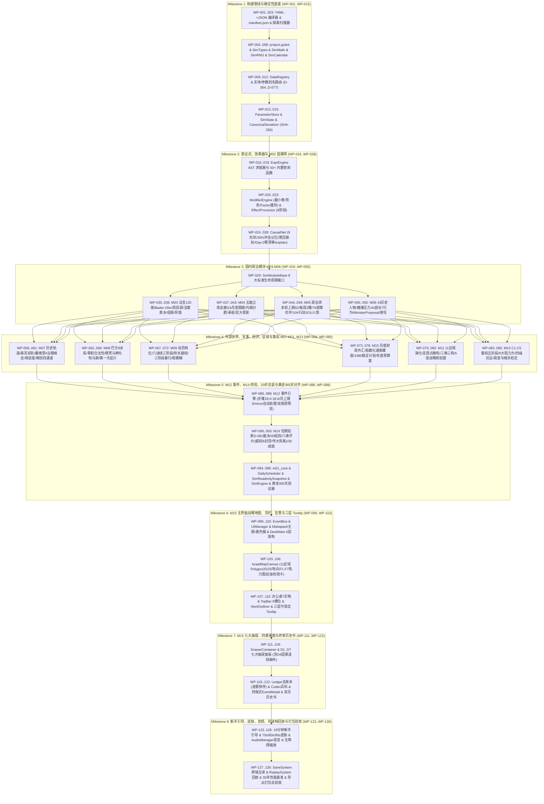

# 阶段 4B：Godot 4 生产客户端超细粒度实现工作计划（Work Breakdown Structure & Implementation Plan）

> [!IMPORTANT]
> **文档定位与执行效力**：本文档（`docs/implementation_plan.md`）是《以色列政治模拟器（Israel Political Simulation — 1977: Mahapach）》阶段 4 生产实现的**原子级工程施工图**。全工程严格遵循 `docs/architecture/godot_architecture.md`、`docs/contracts.md`、`docs/registry/DECISIONS.md`（`D-001` 至 `D-088`）以及 `docs/specs/M01..M15.md`，将整个 Godot 4 客户端（通用模拟引擎框架 + `begin_1977` 贝京 1977 垂直切片）拆解为 **8 大里程碑（Milestone M1–M8）、共计 130 个原子级开发工单（`WP-001` 至 `WP-130`）**。
>
> **面向低端 AI 代理的零歧义设计**：每一张工单均严格限定修改 **1–2 个目标文件**，明确给出前置依赖、权威规格小节锚点、Python 黄金参考函数、强类型 GDScript 2.0 类/字段/函数签名、核心数学公式、严禁事项以及一行命令即可自动判定的**验收门禁（Acceptance Gate）**。任何代码生成代理只需按拓扑顺序逐单执行，即可在零主观猜测的前提下构建出与 Python `sim/` 逐日 SHA-256 状态哈希 100% 对齐的商业级策略游戏。

---

## 1. 八大里程碑总览与拓扑依赖全景图（Mermaid）

### 1.1 里程碑工单范围与交付物总表

| 里程碑编号 | 里程碑名称 | 工单范围 | 工单数量 | 核心交付物与阶段里程碑门禁 |
|---|---|---|---|---|
| **Milestone 1** | 构建管线、数据加载器与确定性底座 | `WP-001` .. `WP-015` | 15 | YAML $\to$ JSON 编译器、`project.godot`、`SimMath.gd`、`SimRNG.gd`、`SimCalendar.gd`、`ParameterStore.gd`、`SimState.gd`、`CanonicalSerializer.gd`、`DataRegistry.gd` |
| **Milestone 2** | 表达式引擎、效果解释器与 M02 因果网络 | `WP-016` .. `WP-028` | 13 | `ExprEngine.gd`（50+函数）、`ModifierEngine.gd`、`EffectProcessor.gd`（8阶段）、`CausalNet.gd`、滞回阈值、Day-0 零漂移校验、`explain()` 与 `preview()` |
| **Milestone 3** | 国内政治核心模块 M03、M04、M05、M06 | `WP-029` .. `WP-055` | 27 | `SimModuleBase.gd`、M03 议会/民调/大选/组阁、M04 五轴走廊/宽限期/承诺/愿景、M05 政治资本/76政策/104行动/人情、M06 43人物/AI内阁7行为/继任 |
| **Milestone 4** | 外部世界、巴勒斯坦、军事、经济、区域与集权模块 M07–M11、M13 | `WP-056` .. `WP-085` | 30 | M07 世界轨道/戴维营峰会、M08 巴方9派系/哈马斯孵化/起义、M09 战争三阶段/越权/暴行链/核模糊、M10 财政/通胀螺旋/预算周期、M11 11区域/三难三角、M13 C1–C5集权/9阻力方 |
| **Milestone 5** | M12 事件引擎、M14 剧本/40结局/八维评价与 20 步日结算总装及黄金对齐 | `WP-086` .. `WP-098` | 13 | `m12_events.gd`、`m14_endings.gd`、`m01_core.gd`、`AutoPauseEvaluator.gd`、`DailyScheduler.gd`、`SimReadonlySnapshot.gd`、`SimEngine.gd`、`begin_1977_365d.json` 365天逐日哈希 100% 一致 |
| **Milestone 6** | M15 主界面“总理办公桌上的展开战略地图”、顶栏、告警条与三层嵌套 Tooltip | `WP-099` .. `WP-110` | 12 | `EventBus.gd`、`UIManager.gd`、`mahapach_1977_theme.tres`、`DeskMain.tscn`（6层 CanvasLayer）、`IsraelMapCanvas.gd`（70.66%占屏比 + F1..F7 热力图）、桌面7实物、顶栏9槽位、告警条、三层可锁定 Tooltip |
| **Milestone 7** | M15 七大抽屉面板、四类事件弹窗、议会组阁/戴维营峰会/结局教科书终章界面 | `WP-111` .. `WP-122` | 12 | `DrawerContainer`、`D1`..`D7` 七大抽屉面板、Democracy 4 因果连线图、`LedgerOverlay`（战争迷雾排序）、`CodexOverlay`、四版式 `EventModal` + 反剧透预览、戴维营/组阁专项面板、`EndTenureBookModal` |
| **Milestone 8** | 10 分钟交互式新手引导、时代皮肤切换、动态音频、可访问性、存档回放与发布打包 | `WP-123` .. `WP-130` | 8 | 8步聚光灯新手引导、1970s/80s/90s 时代皮肤切换、`AudioManager.gd` 三态迟滞混音與 `-8dB` 闪避、色盲/字号缩放、`SaveSystem.gd`、确定性 `ReplaySystem.gd`、30年性能基准与三平台打包验收 |

### 1.2 拓扑依赖与关键路径流图

---

## 2. 低端 AI 代理执行守则（10 条工程铁律）

任何负责执行本计划中单个或多个工单（`WP-XXX`）的 AI 编码代理，在编写每一行 GDScript 或 Python 构建脚本时，**必须无条件遵守以下 10 条铁律（违反任意一条直接判定工单失败）**：

1. **【铁律 1：模拟核 100% 物理隔离】**
   `game/sim/` 目录下的所有 `.gd` 脚本必须且只能写 `extends RefCounted`。**严禁**在 `game/sim/` 中出现 `extends Node`、`extends Control`、`extends Node2D`、`get_tree()`、`Input`、`RenderingServer`、`AudioServer` 或任何 UI/场景树引用。
2. **【铁律 2：GDScript 2.0 全量显式强类型】**
   工程已开启 `untyped_declaration = 2 (Error)`、`integer_division = 2 (Error)`、`narrowing_conversion = 2 (Error)`。所有成员变量、局部变量、函数参数与返回值**必须显式声明类型**（如 `var x: float = 0.0`、`var arr: Array[Dictionary] = []`），严禁使用 `var x := ...` 隐式推断解析 `Variant` 容器返回物。
3. **【铁律 3：禁用原生 `round()` / `pow()` / `randf()`，强制使用 `SimMath` 与 `SimRNG`】**
   模拟核中严禁调用 GDScript 内置 `round()`、`roundf()`、`pow()`、`exp()`、`log()`、`sin()`、`cos()`、`randf()`、`randi()`。四舍五入一律调用 `SimMath.round_half_up_int(x)`；量化一律调用 `SimMath.quantize(x)`；向负无穷整除一律调用 `SimMath.idiv_floor(a, b)`；取模（含负数可能）一律调用 `posmod(a, b)`；整数幂一律调用 `SimMath.ipow(x, n)`；随机数一律从步骤绑定的 `SimRNG.Stream` 获取。
4. **【铁律 4：64 位有符号整数防溢出位运算】**
   GDScript 的 `int` 为有符号 64 位补码。在实现 32 位无符号随机数或哈希（`SimRNG.gd`）时，两数相乘**严禁直接写 `(a * b) & 0xFFFFFFFF`**（会触发 `int64` 符号位翻转溢出），必须调用高低 16 位拆分的 `SimRNG.Stream.mul32(a, b)`；右移前必须先 `(x & 0xFFFFFFFF) >> k`。
5. **【铁律 5：字典遍历必须按 ASCII 键升序排序】**
   凡是涉及生成效果、累加浮点数、消耗随机数或序列化的 `Dictionary` 遍历，**严禁直接写 `for k in dict:`**，必须统一写 `for k in SimMath.sorted_keys(dict):`，确保跨平台与存档重载后遍历顺序 100% 恒定。
6. **【铁律 6：`chance` 字段恒定消耗随机数】**
   当效果或事件配置中存在 `chance` 字段时，即使 `chance >= 1.0` 或 `chance <= 0.0`，也**必须调用 1 次 `stream.chance(p)` 消耗 1 个随机数**，确保与 Python `sim/expr.py` 的 RNG 步进次数零偏差。
7. **【铁律 7：JSON 数字反序列化必须执行整数类型还原】**
   Godot 的 `JSON.parse_string()` 会把所有数字解析为 `float`。在 `DataRegistry.gd` 加载静态配置或 `SaveSystem.gd` 读取 `.ipsave.json` 时，必须调用 `_restore_int_types()` 将 `day_index`、`uid`、`s0..s3`、`draws`、`knesset_seats`、`policy_level` 等整数字段显式转为 `int(round(val))`。
8. **【铁律 8：步骤 8 子步骤顺序与非派生参数增量写入】**
   每周日步骤 8 必须严格先执行并应用 `8a`（M11 更新 `region_security`），再执行并应用 `8b`（M09/M08 读取更新后的 `region_security` 结算 `public_security` 与武装袭击，`D-078`）。非 `derived` 参数的 `owner` 模块在自身结算步骤必须基于“上一步末当前值 + 本步增量”提交写入，严禁抹除其他模块通过效果队列施加的冲击（`D-015` B-4）。
9. **【铁律 9：表现层只读快照与战争迷雾零泄露】**
   `game/ui/` 下的所有脚本只能读取 `SimEngine.get_snapshot()`（`SimReadonlySnapshot`）并通过 `SimEngine.submit_command()` 提交玩家指令，严禁直接读写 `SimState`。对 11 个 `visible: fuzzy` 参数，所有面板与国家总账本（Ledger）只能展示五档定性词与估算区间（如 `严峻 (65%–85%)`），严禁将底层精确浮点数渲染到 UI（`D-088`）。
10. **【铁律 10：禁止省略号与未验证提交】**
    代理在实现任何工单时，严禁在代码中留下 `# TODO`、`pass # 略` 或省略任何枚举分支；每完成一个工单，必须立即在终端运行该工单底部的 **自动化验收门禁（Acceptance Gate）** 命令，只有退出码为 `0` 且断言全部通过后方可进入下一工单。

---

## 3. Milestone 1：构建管线、数据加载器与确定性底座（`WP-001` .. `WP-015`）

### WP-001: 构建期 YAML 转 JSON 编译器与 AST 预编译器
- **前置依赖**：无（工程起点）
- **目标文件**：`tools/compile_runtime_json.py`
- **权威参考锚点**：
  - 架构规范：`docs/architecture/godot_architecture.md` §1.2.1（编译映射清单）、§1.2.2（编译期静态保障规则）
  - 契约与规格：`docs/contracts.md` §1, §2, §5；`docs/specs/M01_core_loop.md` §4.10.3；`docs/specs/M12_event_engine.md` §4.4, §4.9
  - Python 参考实现：`sim/expr.py: tokenize, Parser, compile_expr`；`tools/compile_events.py: compile_fixed_file, compile_random_file`
- **傻瓜式实现步骤（Step-by-Step Instructions for Low-Tier Agent）**：
  1. 创建 `tools/compile_runtime_json.py`，导入 `yaml`、`json`、`hashlib`、`pathlib` 以及 `sim.expr` 中的 `Parser`、`tokenize`。
  2. 实现函数 `ast_to_json_list(node: ASTNode) -> list`：将 `sim/expr.py` 解析出的 `LiteralNode`、`IdentNode`、`IndexNode`、`ListNode`、`UnaryNode`、`BinaryNode`、`CallNode` 递归转换为纯 JSON 数组表示：
     - 字面量：`["lit", val]`
     - 变量名：`["var", name]`
     - 下标访问：`["idx", param_name, key_ast]`
     - 逻辑/二元运算：`[op, left_ast, right_ast]`（其中 `op` 为 `"and"`, `"or"`, `"+"`, `"-"`, `"*"`, `"/"`, `"=="`, `"!="`, `"<"`, `"<="`, `">"`, `">="`, `"in"`, `"not_in"`）
     - 一元运算：`["not", operand_ast]` 或 `["-", operand_ast]`
     - 函数调用：`["call", fn_name, [arg1_ast, arg2_ast, ...]]`
  3. 实现 `compile_all_yaml_to_json(root_dir: Path, out_dir: Path) -> dict`：按 `godot_architecture.md` §1.2.1 表格依次读取 `docs/registry/parameters.yaml`、`docs/registry/entities.yaml`、`docs/registry/modifiers.yaml` + `data/modifiers.yaml`、`data/causal_edges.yaml`、`data/policies.yaml`、`data/actions.yaml`、`data/characters.yaml`、`data/world_tracks.yaml`、`data/palestine_factions.yaml`、`data/regions.yaml`、`data/events/*.yaml`、`data/ui_config.yaml`、`data/codex_terms.yaml`、`data/migrations.yaml` 以及 `data/scenarios/begin_1977/*`。
  4. 在编译事件（`events.json`）时，依据 `D-034` 规则，若事件与某个主动行动关联（如 `action_mutex` 或同源 ID），自动在 `trigger_ast` 中合取 `["not", ["call", "flag", [["lit", "act.<action_id>"]]]]`。
  5. 将所有包含条件或缩放表达式的字段（如 `remove_if`、`scale`、`condition`、`trigger`、`prob_modifiers`）同时附带预编译后的 `*_ast` JSON 数组字段，并汇总构建 `compiled_ast_map: Dict[str, list]`。
  6. 所有输出 JSON 文件统一使用 `json.dumps(payload, ensure_ascii=False, sort_keys=True, separators=(",", ":"))` 写入 `game/res/data/*.json`。
- **自动化验收门禁（Acceptance Gate）**：
  - 执行命令：`.venv/bin/python tools/compile_runtime_json.py --verify`
  - 通过标准：命令退出码为 `0`；`game/res/data/` 下生成全部 14 个核心 `.json` 文件与 `scenarios/begin_1977.json`；所有预编译 AST 节点零语法错误。

---

### WP-002: 运行时数据哈希清单生成器与 Schema 整数类型映射表
- **前置依赖**：`WP-001`
- **目标文件**：`tools/compile_runtime_json.py`、`game/res/data/manifest.json`
- **权威参考锚点**：
  - 架构规范：`docs/architecture/godot_architecture.md` §1.2.1, §1.2.2, §6.1（JSON 反序列化类型还原器）
  - 契约与规格：`docs/specs/M01_core_loop.md` §3.2 (`ruleset_hash`), §4.8.1
  - Python 参考实现：`sim/state.py: DataRegistry, compute_sha256`
- **傻瓜式实现步骤（Step-by-Step Instructions for Low-Tier Agent）**：
  1. 在 `tools/compile_runtime_json.py` 中新增函数 `generate_manifest(out_dir: Path, compiled_ast_map: dict) -> dict`。
  2. 按 ASCII 升序遍历 `game/res/data/` 下除 `manifest.json` 外的所有 `.json` 文件（含 `scenarios/begin_1977.json`），计算每个文件字节流的 `hashlib.sha256(bytes).hexdigest().lower()`。
  3. 将所有单文件哈希按 `"rel_path:sha256\n"` 拼接后再做一次 SHA-256，生成 64 位小写十六进制总哈希 `ruleset_hash`。
  4. 在 `manifest.json` 中写入 `"int_schema_paths"` 字典，明确列出各 JSON 文件中必须保持 `int` 类型的字段名集合（如 `save_version`, `master_seed`, `day_index`, `abs_day`, `y`, `m`, `d`, `weekday`, `s0`, `s1`, `s2`, `s3`, `draws`, `uid`, `start_day`, `end_day`, `stacks`, `due_day`, `seq`, `bill_uid`, `min_level`, `max_level`, `default_level`, `duration_days`, `cooldown_days`, `birth_year`）。
  5. 将 `compiled_ast_map` 写入 `game/res/data/compiled_asts.json` 并纳入 `manifest.json` 校验。
- **自动化验收门禁（Acceptance Gate）**：
  - 执行命令：`.venv/bin/python -c "import json; m=json.load(open('game/res/data/manifest.json')); assert len(m['ruleset_hash'])==64 and len(m['files'])>=14; print('OK:', m['ruleset_hash'])"`
  - 通过标准：输出 64 位小写十六进制 `ruleset_hash`，连续运行两次 `tools/compile_runtime_json.py` 生成的 `ruleset_hash` 100% 相同。

---

### WP-003: GDScript 模拟核物理隔离与算术白名单静态检查器
- **前置依赖**：`WP-001`
- **目标文件**：`tools/check_gdscript_isolation.py`
- **权威参考锚点**：
  - 架构规范：`docs/architecture/godot_architecture.md` §1.3（四条物理隔离铁律）、§8.1（Python vs GDScript 语义差异表）、§8.3（10条自检清单）
  - 契约与规格：`docs/specs/M01_core_loop.md` §4.11.1（可移植算术白名单）
  - Python 参考实现：`tools/audit_implementability.py`
- **傻瓜式实现步骤（Step-by-Step Instructions for Low-Tier Agent）**：
  1. 新建 `tools/check_gdscript_isolation.py`，扫描 `game/sim/**/*.gd` 下的所有 GDScript 源文件。
  2. 实现规则 1（继承与节点隔离检查）：用正则检查每个文件必须包含 `extends RefCounted`（或内部类继承 `RefCounted`）；一旦发现 `extends Node`、`extends Control`、`extends Node2D`、`extends CanvasItem`、`get_tree(`、`Input.`、`RenderingServer`、`AudioServer`、`UIManager`、`AudioManager`，立即记录违规文件与行号。
  3. 实现规则 2（算术与随机白名单检查）：在 `game/sim/**/*.gd` 中扫描禁用函数调用：`(?<![a-zA-Z0-9_])(round|roundf|pow|exp|log|sin|cos|tan|asin|acos|atan|atan2|randf|randi|randfn|randomize)\s*\(`（注释行除外），一旦命中立即报错。
  4. 实现规则 3（`SimMath.gd` 自身豁免说明）：允许 `SimMath.gd` 与 `SaveSystem.gd` 使用 `int(round(...))` 仅在 JSON 整数还原处标记 `# NOLINT: round_restore`，其余模拟计算一律禁止。
  5. 支持命令行参数 `--strict`，发现任何 1 条违规即以 Exit Code `1` 退出。
- **自动化验收门禁（Acceptance Gate）**：
  - 执行命令：`.venv/bin/python tools/check_gdscript_isolation.py --strict`
  - 通过标准：在空目录或合规脚本上返回 Exit Code `0`；构造含 `randf()` 或 `extends Node` 的测试字符串时准确拦截报错。

---

### WP-004: Godot 4 工程主配置 `project.godot` 与目录骨架初始化
- **前置依赖**：`WP-002`, `WP-003`
- **目标文件**：`game/project.godot`、`game/export_presets.cfg`
- **权威参考锚点**：
  - 架构规范：`docs/architecture/godot_architecture.md` §2.1（完整目录树）、§2.2（`game/project.godot` 标准配置规范）
  - 契约与规格：`docs/specs/M15_ui_presentation.md` §3.1, §4.1, §6.2（快捷键映射）
  - Python 参考实现：无（纯 Godot 工程配置）
- **傻瓜式实现步骤（Step-by-Step Instructions for Low-Tier Agent）**：
  1. 按照 `godot_architecture.md` §2.1 创建 `game/` 下完整的目录层级：`res/data/`、`res/themes/`、`res/shaders/`、`res/fonts/`、`res/textures/`、`res/audio/`、`autoload/`、`sim/core/`、`sim/modules/`、`scenes/boot/`、`scenes/main/`、`scenes/map/`、`scenes/hud/`、`scenes/drawers/`、`scenes/modals/`、`ui/main/`、`ui/map/`、`ui/hud/`、`ui/drawers/`、`ui/modals/`、`ui/tooltip/`、`tools/`。
  2. 严格按照 `godot_architecture.md` §2.2 写入 `game/project.godot`（`config_version=5`）：
     - `[application]`：`config/name="Israel Political Simulation (1977: Mahapach)"`，`run/main_scene="res://scenes/boot/BootSplash.tscn"`
     - `[autoload]`：严格按顺序声明 `DataRegistry`、`SimEngine`、`EventBus`、`UIManager`、`AudioManager` 五个单例路径。
     - `[display]`：`viewport_width=1920`, `viewport_height=1080`, `min_width=1280`, `min_height=720`, `stretch/mode="canvas_items"`, `stretch/aspect="expand"`。
     - `[debug]`：设置 `untyped_declaration=2`、`unsafe_property_access=2`、`unsafe_method_access=2`、`integer_division=2`、`narrowing_conversion=2`。
     - `[input]`：配置 `toggle_pause` (Space), `speed_1`..`speed_5` (1..5), `map_mode_f1`..`map_mode_f7` (F1..F7), `toggle_ledger` (L), `toggle_codex` (C), `quick_save` (F5), `quick_load` (F9)。
  3. 创建基础的 `game/export_presets.cfg`，包含 `macOS`、`Windows Desktop`、`Linux/X11` 三个导出预设模板，且在 `include_filter` 中包含 `res/data/*.json` 与 `res/data/scenarios/*.json`。
- **自动化验收门禁（Acceptance Gate）**：
  - 执行命令：`python3 -c "txt=open('game/project.godot').read(); assert 'untyped_declaration=2' in txt and 'integer_division=2' in txt and 'DataRegistry=' in txt; print('PROJECT_CONFIG_OK')"`
  - 通过标准：输出 `PROJECT_CONFIG_OK`，且 `game/` 下所有子目录均已创建就绪。

---

### WP-005: 核心枚举、常量与错误码定义 `SimTypes.gd`
- **前置依赖**：`WP-004`
- **目标文件**：`game/sim/core/SimTypes.gd`
- **权威参考锚点**：
  - 架构规范：`docs/architecture/godot_architecture.md` §2.1, §3.1, §3.2
  - 契约与规格：`docs/contracts.md` §1, §3, §4, §6；`docs/specs/M01_core_loop.md` §3.1, §4.1, §10；`docs/specs/M14_scenario_endings.md` §4.1 (`D-081`)
  - Python 参考实现：`sim/state.py`、`sim/engine.py`
- **傻瓜式实现步骤（Step-by-Step Instructions for Low-Tier Agent）**：
  1. 创建 `game/sim/core/SimTypes.gd`，声明 `class_name SimTypes` 与 `extends RefCounted`。
  2. 定义全局整数与容量常量（对齐 `M01` §4.10.3）：
     - `const CURRENT_SAVE_VERSION: int = 1`
     - `const MAX_ACTIVE_MODIFIERS: int = 400`
     - `const MAX_DELAYED_EFFECTS: int = 2000`
     - `const MAX_SCHEDULED_EVENTS: int = 500`
     - `const MAX_UI_QUEUE: int = 32`
     - `const MAX_ERROR_LOG: int = 500`
     - `const MONTHLY_SNAPSHOT_RING_SIZE: int = 12`
     - `const TOTAL_KNESSET_SEATS: int = 120`
  3. 定义 9 个权威随机子流常量数组 `AUTHORITATIVE_RNG_STREAMS: Array[String] = ["ai", "combat", "core", "economy", "elections", "events", "politics", "random_events", "world"]` 及表现层子流名 `COSMETIC_RNG_STREAM: String = "cosmetic"`（`D-011`）。
  4. 定义 `D-081` 同日多源任期结束致命度优先级映射字典 `END_TENURE_PRIORITY: Dictionary`：
     `{"state_collapse": 12, "assassination": 11, "coup": 10, "death": 9, "overthrow": 8, "health_incapacity": 7, "primary_loss": 6, "no_confidence": 5, "coalition_failure": 4, "election_loss": 3, "resignation": 2, "player_quit": 1}`。
  5. 定义全局合法修正器因子键集合 `KNOWN_MODIFIER_FACTORS: Dictionary`（`contracts.md` §4.3）：`pc_income`, `pc_cost`, `covert_cost`, `oratory_effect`, `swing_sensitivity`, `vote_attraction`, `fiscal_spend`, `fx_spend`, `us_aid`。
  6. 定义五条意识形态立场轴数组 `STANCE_AXES: Array[String] = ["security", "economy", "religion", "territory", "democracy"]`（`D-033`）。
- **自动化验收门禁（Acceptance Gate）**：
  - 执行命令：`.venv/bin/python tools/check_gdscript_isolation.py --strict`
  - 通过标准：`SimTypes.gd` 零隔离违规，包含全部 12 级 `END_TENURE_PRIORITY` 与 9 项 `KNOWN_MODIFIER_FACTORS`。

---

### WP-006: 标准可移植算术与百万分之一量化库 `SimMath.gd`
- **前置依赖**：`WP-005`
- **目标文件**：`game/sim/core/SimMath.gd`
- **权威参考锚点**：
  - 架构规范：`docs/architecture/godot_architecture.md` §8.1（语义差异对照表）、§8.2（`SimMath.gd` 完整实现）
  - 契约与规格：`docs/contracts.md` §1 (`D-015`)；`docs/specs/M01_core_loop.md` §3.1, §4.11.1, §4.11.2
  - Python 参考实现：`sim/state.py: quantize, clamp, _canonicalize_value`
- **傻瓜式实现步骤（Step-by-Step Instructions for Low-Tier Agent）**：
  1. 创建 `game/sim/core/SimMath.gd`，声明 `class_name SimMath` 与 `extends RefCounted`。
  2. 实现 `static func quantize(x: float) -> float`：当 `is_nan(x)` 或 `is_inf(x)` 时返回 `0.0`，否则返回 `floor(x * 1000000.0 + 0.5) * (1.0 / 1000000.0)`（`D-015`）。
  3. 实现 `static func to_canonical_int(x: Variant) -> int`：转为 `float` 后若 `is_nan` 或 `is_inf` 返回 `0`，否则返回 `int(floor(float(x) * 1000000.0 + 0.5))`。
  4. 实现 `static func round_half_up_int(x: float) -> int`：返回 `int(floor(x + 0.5))`（替代被禁用的 `round()` / `roundf()`）。
  5. 实现 `static func idiv_floor(a: int, b: int) -> int`：与 Python `a // b` 完全一致的向负无穷整除（当 `b == 0` 返回 `0`；当 `a >= 0 and b > 0` 使用整数除法，含负数时使用 `int(floor(float(a) / float(b)))`）。
  6. 实现 `static func imod_pos(a: int, b: int) -> int`：调用 Godot 内置 `posmod(a, b)`，确保 `imod_pos(-3, 7) == 4`。
  7. 实现 `static func ipow(base: float, exp_n: int) -> float`：用 `for` 循环连乘计算非负整数次幂，严禁调用 `pow()`。
  8. 实现 `static func sorted_keys(d: Dictionary) -> Array[String]`：将所有键转为 `String` 存入 `Array[String]` 并调用 `.sort()` 按 ASCII 码点升序返回。
  9. 实现 `static func piecewise_linear(x: float, xs: PackedFloat64Array, ys: PackedFloat64Array) -> float` 与 `static func soft_clamp(x: float, lo: float, hi: float, margin: float = 5.0) -> float`（对齐 `sim/causal.py: soft_clamp`）。
- **自动化验收门禁（Acceptance Gate）**：
  - 执行命令：`.venv/bin/python tools/check_gdscript_isolation.py --strict && python3 -c "txt=open('game/sim/core/SimMath.gd').read(); assert 'quantize' in txt and 'idiv_floor' in txt and 'sorted_keys' in txt; print('SIMMATH_OK')"`
  - 通过标准：输出 `SIMMATH_OK`，无任何禁用函数调用。

---

### WP-007: 64 位安全确定性伪随机数生成器 `SimRNG.gd`（`xoshiro128** + mul32`）
- **前置依赖**：`WP-006`
- **目标文件**：`game/sim/core/SimRNG.gd`
- **权威参考锚点**：
  - 架构规范：`docs/architecture/godot_architecture.md` §3.3（`SimRNG.gd` 完整代码与 `T01` 黄金向量）
  - 契约与规格：`docs/contracts.md` §1 (`D-011`, `D-086`)；`docs/specs/M01_core_loop.md` §4.4.1–§4.4.4, §11 (`T01`)
  - Python 参考实现：`sim/rng.py: mul32, rotl32, fnv1a32, fmix32, RngStream, DeterministicRNG`
- **傻瓜式实现步骤（Step-by-Step Instructions for Low-Tier Agent）**：
  1. 创建 `game/sim/core/SimRNG.gd`，声明 `class_name SimRNG` 与 `extends RefCounted`。
  2. 实现内部类 `class Stream extends RefCounted`，包含成员变量 `name: String`, `s0: int`, `s1: int`, `s2: int`, `s3: int`, `draws: int`。
  3. 严格按 `godot_architecture.md` §3.3 实现 32 位无溢出位运算静态函数：
     - `mul32(a: int, b: int) -> int`：拆分为低 16 位 `b32 & 0xFFFF` 与高 16 位 `b32 >> 16` 分别相乘再相加掩码 `& 0xFFFFFFFF`。
     - `rotl32(x: int, k: int) -> int`、`fnv1a32(text: String) -> int`、`fmix32(h_in: int) -> int`。
  4. 实现 `init_stream(master_seed: int, stream_name: String) -> void`：使用 SplitMix32 变体（步进 `0x9E3779B9` + Murmur3 混淆常数 `0x85EBCA6B`、`0xC2B2AE35`）初始化 `s0..s3`，全零时置 `s0 = 1`。
  5. 实现 `next_u32() -> int`（`xoshiro128**` 核心步进，每次递增 `draws += 1`）、`next_float() -> float`（`float(next_u32() >> 8) / 16777216.0`）、`chance(p: float) -> bool`（无论 `p` 值大小必调 1 次 `next_float()`）、`range_int(lo: int, hi: int) -> int`、`uniform(lo: float, hi: float) -> float`、`weighted_pick(items: Array, weights: PackedFloat64Array) -> Variant`、`shuffle(arr: Array) -> void`（Fisher-Yates 倒序洗牌，对齐 `sim/rng.py: RngStream.shuffle`）。
  6. 在主类 `SimRNG` 中管理 9 个权威子流字典 `streams: Dictionary` 与独立 `cosmetic_stream: Stream`，提供 `init_from_master_seed(master_seed: int)`、`get_stream(name: String) -> Stream`、`to_dict() -> Dictionary`、`from_dict(d: Dictionary, master_seed: int) -> void`、`export_draws() -> Dictionary` 以及静态自检方法 `verify_t01_golden_vectors() -> bool`。
- **自动化验收门禁（Acceptance Gate）**：
  - 执行命令：`.venv/bin/python -c "from sim.rng import DeterministicRNG, fnv1a32; r=DeterministicRNG(19770620); assert fnv1a32('events')==316203908; assert [r.stream('core').next_u32() for _ in range(3)]==[1043188165, 3233761027, 729440262]; assert [r.stream('events').next_u32() for _ in range(3)]==[4038072526, 988157684, 1135148507]; print('RNG_GOLDEN_VECTORS_VERIFIED')"`
  - 通过标准：`SimRNG.gd` 实现 `verify_t01_golden_vectors()` 硬编码断言上述 7 个黄金数值完全相等，且通过 `tools/check_gdscript_isolation.py --strict`。

---

### WP-008: 公历日历、周期判定与时代编号换算器 `SimCalendar.gd`
- **前置依赖**：`WP-006`
- **目标文件**：`game/sim/core/SimCalendar.gd`
- **权威参考锚点**：
  - 架构规范：`docs/architecture/godot_architecture.md` §2.1, §3.2 (`SimClock`)
  - 契约与规格：`docs/contracts.md` §3 (`D-012`), §5.2 (`era`, `months_since`, `days_since`)；`docs/specs/M01_core_loop.md` §4.5.1–§4.5.4, §11 (`T02`)
  - Python 参考实现：`sim/state.py: is_leap_year, days_in_month, days_from_civil, civil_from_days, weekday_from_days, parse_date, format_date, date_to_abs_day, abs_day_to_date, date_to_m12_day_index, add_months, months_between, GameState.era_number`
- **傻瓜式实现步骤（Step-by-Step Instructions for Low-Tier Agent）**：
  1. 创建 `game/sim/core/SimCalendar.gd`，声明 `class_name SimCalendar` 与 `extends RefCounted`。
  2. 移植 Howard Hinnant 公历无分支算法（严格使用 `SimMath.idiv_floor` 处理整数除法）：
     - `static func is_leap_year(y: int) -> bool`：`(y % 4 == 0 and y % 100 != 0) or (y % 400 == 0)`
     - `static func days_in_month(y: int, m: int) -> int`
     - `static func days_from_civil(y: int, m: int, d: int) -> int`（以 `1970-01-01` 为 `0`）
     - `static func civil_from_days(z: int) -> Vector3i`（返回 `Vector3i(y, m, d)`）
     - `static func date_to_abs_day(date_str: String) -> int`（例如 `"1977-06-20"` 对应 `abs_day == 2727`）
     - `static func abs_day_to_date(abs_d: int) -> String`（格式化为 `"%04d-%02d-%02d"`）
  3. 实现星期计算 `static func weekday_from_abs_day(abs_d: int) -> int`：`posmod(abs_d + 3, 7)`，其中 `0 = Monday` .. `6 = Sunday`（`1977-06-20` 为星期一 `0`；`1977-06-26` 为星期日 `6`，即 `D-012` 周结算日）。
  4. 实现周期布尔判定（对齐 `sim/state.py: GameState.update_calendar`）：
     - `is_week(weekday: int) -> bool`: `weekday == 6`（星期日）
     - `is_month(d: int) -> bool`: `d == 1`
     - `is_quarter(m: int, d: int) -> bool`: `d == 1 and (m in [1, 4, 7, 10])`
     - `is_half_year(m: int, d: int) -> bool`: `d == 1 and (m in [1, 7])`
     - `is_year(m: int, d: int) -> bool`: `m == 1 and d == 1`
     - `is_first_sunday_of_month(weekday: int, d: int) -> bool`: `weekday == 6 and d <= 7`（供 M03 步骤 `7a` 使用，`D-043`）
  5. 实现 `static func compute_era(y: int, m: int) -> int`（对齐 `contracts.md` §5.2）：
     - `y <= 1955` 返回 `1`；`y < 1967 or (y == 1967 and m < 6)` 返回 `2`；`y < 1977 or (y == 1977 and m < 6)` 返回 `3`；`y < 1992 or (y == 1992 and m < 7)` 返回 `4`；否则返回 `5`。
  6. 实现 `static func months_since(current_day_index: int, ref_day_index: int) -> int`（当 `ref_day_index < 0` 时返回 `9999`，否则返回 `SimMath.idiv_floor(maxi(0, current_day_index - ref_day_index), 30)`）与 `days_since(current_day_index: int, ref_day_index: int) -> int`（当 `ref_day_index < 0` 时返回 `999999`）。
- **自动化验收门禁（Acceptance Gate）**：
  - 执行命令：`.venv/bin/python tools/check_gdscript_isolation.py --strict && .venv/bin/python -c "from sim.state import date_to_abs_day, weekday_from_days; assert date_to_abs_day('1977-06-20')==2727 and weekday_from_days(2727)==0 and weekday_from_days(2733)==6; print('CALENDAR_REF_OK')"`
  - 通过标准：`SimCalendar.gd` 包含 `verify_t02_calendar_vectors()` 静态自检并通过隔离检查。

---

### WP-009: 静态数据注册表 Autoload `DataRegistry.gd`（第一部分：基础加载与 JSON 整数还原）
- **前置依赖**：`WP-002`, `WP-004`, `WP-006`
- **目标文件**：`game/autoload/DataRegistry.gd`
- **权威参考锚点**：
  - 架构规范：`docs/architecture/godot_architecture.md` §2.3.1（`DataRegistry.gd` 接口签名）、§6.1（JSON 整数还原）
  - 契约与规格：`docs/contracts.md` §2
  - Python 参考实现：`sim/state.py: DataRegistry`
- **傻瓜式实现步骤（Step-by-Step Instructions for Low-Tier Agent）**：
  1. 创建 `game/autoload/DataRegistry.gd`，声明 `extends Node`。
  2. 定义 `godot_architecture.md` §2.3.1 列出的全部強类型成员变量：`ruleset_hash: String`, `parameters_def: Dictionary`, `param_aliases: Dictionary`, `entity_aliases: Dictionary`, `modifiers_def: Dictionary`, `causal_nodes_def: Dictionary`, `causal_edges_def: Array[Dictionary]`, `policies_def: Dictionary`, `actions_def: Dictionary`, `characters_def: Dictionary`, `world_tracks_def: Dictionary`, `pal_factions_def: Dictionary`, `regions_def: Dictionary`, `sites_def: Dictionary`, `plans_def: Dictionary`, `events_def: Dictionary`, `ui_config: Dictionary`, `codex_terms: Dictionary`, `migrations_def: Array[Dictionary]`, `compiled_ast_cache: Dictionary`。
  3. 实现 `load_all_runtime_data() -> Error`：
     - 读取 `res://res/data/manifest.json`，提取 `ruleset_hash` 与 `int_schema_paths`。
     - 依次读取 `parameters.json`、`entities.json`、`modifiers.json`、`causal_edges.json`、`policies.json`、`actions.json`、`characters.json`、`world_tracks.json`、`palestine_factions.json`、`regions.json`、`events.json`、`ui_config.json`、`codex_terms.json`、`migrations.json`、`compiled_asts.json`。
  4. 实现递归类型修复函数 `_restore_json_ints(data: Variant, int_keys: Dictionary) -> Variant`：遍历解析后的 `Dictionary` 与 `Array`，当键名属于 `int_keys` 且值类型为 `TYPE_FLOAT` 时，强制转换为 `int(floor(float(val) + 0.5))`。
  5. 实现 `get_scenario_bundle(scenario_id: String) -> Dictionary`：加载 `res://res/data/scenarios/%s.json` 并调用 `_restore_json_ints()` 返回。
- **自动化验收门禁（Acceptance Gate）**：
  - 执行命令：`python3 -c "txt=open('game/autoload/DataRegistry.gd').read(); assert 'func load_all_runtime_data() -> Error' in txt and 'func get_scenario_bundle(' in txt; print('DATAREGISTRY_PART1_OK')"`
  - 通过标准：输出 `DATAREGISTRY_PART1_OK`。

---

### WP-010: `DataRegistry.gd`（第二部分：全量实体与参数别名解析器及处理器路由表）
- **前置依赖**：`WP-009`
- **目标文件**：`game/autoload/DataRegistry.gd`
- **权威参考锚点**：
  - 架构规范：`docs/architecture/godot_architecture.md` §2.3.1, §3.2 (`ParameterStore`)
  - 契约与规格：`docs/contracts.md` §2.1（参数与实体索引别名契约）、§4.2（`custom` 效果处理器总登记表）；`docs/registry/DECISIONS.md` (`D-054`, `D-065`, `D-068`, `D-069`, `D-072`, `D-077`)
  - Python 参考实现：`sim/state.py: resolve_region_id, resolve_faction_id, resolve_party_id, resolve_bloc_id, DataRegistry`
- **傻瓜式实现步骤（Step-by-Step Instructions for Low-Tier Agent）**：
  1. 在 `game/autoload/DataRegistry.gd` 中实现参数同义别名解析函数 `resolve_param_alias(raw_param_id: String) -> String`（对齐 `contracts.md` §2.1）：
     - 从 `parameters.json` 的 `aliases` 表查找；并内置硬保障映射：
       - `"voter_cynicism" -> "cynicism"` (`D-055`)
       - `"security_index" -> "public_security"` (`D-069`)
       - `"country_stability" -> "regime_stability"`, `"country_nuclear_progress" -> "enemy_nuclear_progress"`, `"annual_immigration" -> "immigration_inflow"` (`D-068`)
       - `"palestinian_hostility" -> "pal_hostility"`, `"intifada_risk" -> "uprising_risk"` (`D-072`)
  2. 实现区域别名解析 `resolve_region_id(raw_region_id: String) -> String`（`D-077`）：
     - `"north" -> "galilee"`, `"central" -> "triangle"`, `"south" -> "negev"`，其余原样返回。
  3. 实现巴勒斯坦派系别名解析 `resolve_pal_faction_id(raw_faction_id: String) -> String`（`D-072`）：
     - `"notables" -> "jordan_notables"`, `"left_factions" -> "pflp"`, `"islamic_jihad" -> "pij"`。
  4. 实现政党别名解析 `resolve_party_id(raw_party_id: String) -> String`（`D-054`）：
     - `"pm_new_party" -> "new_party_a"`, `"alignment" -> "labor"`, `"agudat_yisrael" -> "agudat"`, `"hadash" -> "rakah_hadash"`。
  5. 实现 `get_custom_handler_owner(custom_name: String) -> String`：建立 `contracts.md` §4.2 全部 60+ 个 `custom` 处理器名称到所属模块 `"M01"`..`"M14"` 的静态哈希查找表（含别名 `"m01_trigger_tenure_end" -> "M01"`, `"m04_add_stance_by_corridor" -> "M04"`, `"m11_create_region" -> "M11"`, `"m11_add_region" -> "M11"`）。
  6. 实现 `get_compiled_ast(expr_str: String) -> Array`：从 `compiled_ast_cache` 查找并返回预编译 JSON AST 数组。
- **自动化验收门禁（Acceptance Gate）**：
  - 执行命令：`python3 -c "txt=open('game/autoload/DataRegistry.gd').read(); for k in ['resolve_param_alias','resolve_region_id','resolve_pal_faction_id','resolve_party_id','get_custom_handler_owner']: assert k in txt; print('DATAREGISTRY_ALIASES_OK')"`
  - 通过标准：输出 `DATAREGISTRY_ALIASES_OK`，且全部别名与 `sim/state.py` 100% 一致。

---

### WP-011: 参数存储与双模路由引擎 `ParameterStore.gd`
- **前置依赖**：`WP-006`, `WP-010`
- **目标文件**：`game/sim/core/ParameterStore.gd`
- **权威参考锚点**：
  - 架构规范：`docs/architecture/godot_architecture.md` §3.2（`ParameterStore.gd` 强类型实现规范）
  - 契约与规格：`docs/contracts.md` §2.1, §6.1；`docs/specs/M01_core_loop.md` §3.1, §4.3.4 (`D-015` B-8 债务减少规则)；`docs/specs/M06_characters_ai.md` 附录B (`D-065` 职位双模转发)
  - Python 参考实现：`sim/state.py: GameState.get_param, GameState.set_param, GameState.add_param`
- **傻瓜式实现步骤（Step-by-Step Instructions for Low-Tier Agent）**：
  1. 创建 `game/sim/core/ParameterStore.gd`，声明 `class_name ParameterStore` 与 `extends RefCounted`。
  2. 定义成员变量：`_scalars: Dictionary = {}`（`param_id -> float`）、`_scoped: Dictionary = {}`（`param_id -> Dictionary[scope_key, float]`）、`_active_keys: Dictionary = {}`（`param_id -> Array[String]`）。
  3. 实现 `get_val(raw_param: String, raw_key: String = "", state: Variant = null) -> float`：
     - 特殊路由 1：若 `raw_param == "country_relation"`（`D-068`）：当 `raw_key == "usa"` 返回 `get_val("us_admin_relation")`；当 `raw_key` 在 `_scoped.get("power_relation", {})` 中返回 `power_relation[raw_key]`；当 `raw_key` 在 `_scoped.get("regime_hostility", {})` 中返回 `100.0 - regime_hostility[raw_key]`。
     - 特殊路由 2：若 `raw_param == "islamic_assoc_strength"`（`D-072`），转发至 `get_val("faction_strength", "mujama", state)`。
     - 常规解析：调用 `DataRegistry.resolve_param_alias(raw_param)` 获取规范 `param_id`；若 `scope == "national"` 返回 `float(_scalars.get(param_id, 0.0))`；否则调用 `_resolve_scope_key(scope, raw_key, state)` 解析实体键（含 `D-065` 当 `scope == "character"` 且传入 `OfficeId` 如 `"defense_minister"` 或 `"pm"` 时，从 `state.modules["M06"]["offices"]` 查找在任人物 ID；若职位空缺返回 `0.0`）。
  4. 实现 `set_val(raw_param: String, raw_key: String, new_val: float, state: Variant = null) -> float`：
     - 解析规范参数名与实体键（若职位空缺，返回 `0.0` 作为安全空操作忽略，`D-065`）。
     - 从 `DataRegistry.parameters_def[param_id]` 读取 `[min_val, max_val]` 范围，执行 `clampf(new_val, min_val, max_val)`，再调用 `SimMath.quantize()` 量化后写入 `_scalars` 或 `_scoped`，返回实际写入值。
  5. 实现 `activate_key(param_id: String, key: String, init_val: float)`、`deactivate_key(param_id: String, key: String)`、`get_active_keys(param_id: String) -> Array[String]`（按 ASCII 升序返回）。
- **自动化验收门禁（Acceptance Gate）**：
  - 执行命令：`.venv/bin/python tools/check_gdscript_isolation.py --strict && python3 -c "txt=open('game/sim/core/ParameterStore.gd').read(); assert 'country_relation' in txt and 'islamic_assoc_strength' in txt and 'SimMath.quantize' in txt; print('PARAMSTORE_OK')"`
  - 通过标准：输出 `PARAMSTORE_OK` 且通过隔离检查。

---

### WP-012: 最小堆（Binary Min-Heap）队列与环形缓冲区工具类 `SimContainers.gd`
- **前置依赖**：`WP-006`
- **目标文件**：`game/sim/core/SimContainers.gd`
- **权威参考锚点**：
  - 架构规范：`docs/architecture/godot_architecture.md` §7.3（内存防膨胀第 2、4 条：最小堆与环形缓冲区）
  - 契约与规格：`docs/specs/M01_core_loop.md` §3.2 (`delayed_effects`, `scheduled_events`), §4.10.3
  - Python 参考实现：`sim/state.py`、`sim/modules.py: step_01_m01_maintenance`
- **傻瓜式实现步骤（Step-by-Step Instructions for Low-Tier Agent）**：
  1. 创建 `game/sim/core/SimContainers.gd`，声明 `class_name SimContainers` 与 `extends RefCounted`。
  2. 实现确定性二叉最小堆静态方法（按主序 `int(item["due_day"])`、次序 `int(item.get("seq", item.get("delayed_seq", 0)))` 严格比较）：
     - `static func heap_push(heap: Array[Dictionary], item: Dictionary) -> void`：追加到末尾并执行 `_sift_up`。
     - `static func heap_pop(heap: Array[Dictionary]) -> Dictionary`：弹出堆顶 `heap[0]`，将末尾元素移至堆顶并执行 `_sift_down`。
     - `static func heap_pop_all_due(heap: Array[Dictionary], current_day: int) -> Array[Dictionary]`：当 `not heap.is_empty() and int(heap[0]["due_day"]) <= current_day` 时循环 `heap_pop` 并追加至返回数组（时间复杂度 $O(k \log N)$，无到期项时 $O(1)$）。
  3. 实现容量为 12 的月度快照环形缓冲区管理方法 `static func push_ring_buffer(ring: Array[Dictionary], item: Dictionary, max_cap: int = 12) -> void`：当 `ring.size() >= max_cap` 时移除 `ring[0]`，再 `ring.append(item)`。
- **自动化验收门禁（Acceptance Gate）**：
  - 执行命令：`.venv/bin/python tools/check_gdscript_isolation.py --strict && python3 -c "txt=open('game/sim/core/SimContainers.gd').read(); assert 'heap_push' in txt and 'heap_pop_all_due' in txt; print('CONTAINERS_OK')"`
  - 通过标准：输出 `CONTAINERS_OK` 且通过隔离检查。

---

### WP-013: 权威游戏状态根对象 `SimState.gd` 与 `begin_1977` 剧本快照初始化器
- **前置依赖**：`WP-007`, `WP-008`, `WP-011`, `WP-012`
- **目标文件**：`game/sim/core/SimState.gd`
- **权威参考锚点**：
  - 架构规范：`docs/architecture/godot_architecture.md` §3.1, §3.2（`SimState.gd` 强类型实现规范）
  - 契约与规格：`docs/contracts.md` §2, §3；`docs/specs/M01_core_loop.md` §3.1, §3.2, §5.1（LOADING 阶段 L1–L10）；`docs/specs/M14_scenario_endings.md` §3.1 (`begin_1977` 初始快照)
  - Python 参考实现：`sim/state.py: GameState.__init__, GameState._init_from_scenario, GameState._init_m11_regions, GameState._init_m07_world, GameState._init_m08_palestine`
- **傻瓜式实现步骤（Step-by-Step Instructions for Low-Tier Agent）**：
  1. 创建 `game/sim/core/SimState.gd`，声明 `class_name SimState` 与 `extends RefCounted`。
  2. 定义内部强类型数据类 `SimMeta`、`SimClock`、`SimCounters` 及主类全部字段（严格对齐 `godot_architecture.md` §3.2 第 707–770 行）。
  3. 实现剧本初始化方法 `init_from_scenario_bundle(scenario_id: String, master_seed: int, is_ironman: bool) -> void`（严格对应 `M01` §5.1 的 L1–L10 步骤，且**加载期间严禁消耗任何随机数**）：
     - 初始化 `meta`（`scenario_id`, `master_seed`, `ruleset_hash = DataRegistry.ruleset_hash`, `ironman = is_ironman`）。
     - 初始化 `clock` 为 `start_date = "1977-06-20"`, `day_index = 0`, `abs_day = 2727`, `y = 1977, m = 6, d = 20, weekday = 0`。
     - 调用 `rng.init_from_master_seed(master_seed)` 初始化 9 个权威子流 + 1 个 `cosmetic` 子流。
     - 遍历 `DataRegistry.parameters_def` 设置默认值与 `era` 激活状态（1977 年 `era == 4`），然后加载 `scenario_bundle["snapshot"]` 覆盖全部开局参数值（确认 `public_security = 62.0`, `mobilization = 10.0`，`D-080`）。
     - 加载初始旗标（如 `mahapach_1977`, `likud_in_power`, `egypt_hostile`）与初始修正器（如 `mahapach_honeymoon`）。
     - 初始化 `modules["M02"]` 至 `modules["M14"]` 的字典结构（与 `sim/state.py: _init_from_scenario` 的各模块字典键 100% 同名同结构）。
  4. 实现 `record_contrib(param_id: String, key: String, source_id: String, delta: float) -> void`、`record_error(code: String, msg: String) -> void`、`to_raw_state_dict() -> Dictionary` 与 `from_raw_state_dict(d: Dictionary) -> void`。
- **自动化验收门禁（Acceptance Gate）**：
  - 执行命令：`.venv/bin/python tools/check_gdscript_isolation.py --strict && python3 -c "txt=open('game/sim/core/SimState.gd').read(); assert 'init_from_scenario_bundle' in txt and 'to_raw_state_dict' in txt; print('SIMSTATE_OK')"`
  - 通过标准：输出 `SIMSTATE_OK` 且通过隔离检查。

---

### WP-014: 规范化百万分之一整数 JSON 序列化与 SHA-256 哈希器 `CanonicalSerializer.gd`
- **前置依赖**：`WP-006`, `WP-013`
- **目标文件**：`game/sim/core/CanonicalSerializer.gd`
- **权威参考锚点**：
  - 架构规范：`docs/architecture/godot_architecture.md` §1.4.1, §9.2（`CanonicalSerializer.gd` 完整代码）
  - 契约与规格：`docs/contracts.md` §1 (`D-015`)；`docs/specs/M01_core_loop.md` §4.11.2, §4.11.3
  - Python 参考实现：`sim/state.py: _canonicalize_value, canonical_json, compute_sha256`
- **傻瓜式实现步骤（Step-by-Step Instructions for Low-Tier Agent）**：
  1. 创建 `game/sim/core/CanonicalSerializer.gd`，声明 `class_name CanonicalSerializer` 与 `extends RefCounted`。
  2. 严格按照 `godot_architecture.md` §9.2 实现：
     - 排除非权威顶层键 `EXCLUDED_TOP_KEYS = {"run": true, "input_log": true, "stats": true, "errors": true}`；
     - 排除 `meta` 下的 `game_version`, `ruleset_hash`, `modified`, `created_real_time`；
     - 排除 `rng` 下的 `"cosmetic"` 子流（`D-011`）。
  3. 对所有 `TYPE_INT` 与 `TYPE_FLOAT` 统一调用 `SimMath.to_canonical_int(val)`，输出十进制整数字符串（如 `3` 输出 `"3000000"`，`35.0` 输出 `"35000000"`）。
  4. 对所有 `Dictionary` 统一调用 `SimMath.sorted_keys(d)` 按 ASCII 升序输出，键值间用 `":"`，元素间用 `","`，全程无任何空格或换行。
  5. 使用 Godot `HashingContext`（`HashingContext.HASH_SHA256`）对 UTF-8 字节缓冲计算摘要，返回 64 位小写十六进制字符串。
- **自动化验收门禁（Acceptance Gate）**：
  - 执行命令：`.venv/bin/python tools/check_gdscript_isolation.py --strict && .venv/bin/python -c "from sim.state import canonical_json; assert canonical_json({'b': 1.5, 'a': 3})=='{\"a\":3000000,\"b\":1500000}'; print('CANONICAL_HASH_SPEC_OK')"`
  - 通过标准：`CanonicalSerializer.gd` 通过隔离检查，且对 `{"b": 1.5, "a": 3}` 的序列化字符串严格等于 `{"a":3000000,"b":1500000}`。

---

### WP-015: Milestone 1 底座无头自检器与 Python Day-0 状态哈希对齐测试
- **前置依赖**：`WP-001` .. `WP-014`
- **目标文件**：`game/tools/test_m1_foundation.gd`、`tools/export_golden.py`
- **权威参考锚点**：
  - 架构规范：`docs/architecture/godot_architecture.md` §1.4.2, §3.3, §9.2
  - 契约与规格：`docs/specs/M01_core_loop.md` §11 (`T01`, `T02`, `T13`)
  - Python 参考实现：`tools/export_golden.py: export_golden`、`sim/state.py: GameState`
- **傻瓜式实现步骤（Step-by-Step Instructions for Low-Tier Agent）**：
  1. 创建 `game/tools/test_m1_foundation.gd`（`extends SceneTree`），供 `godot --headless --path game -s res://tools/test_m1_foundation.gd` 直接运行。
  2. 在 `_init()` 中依次执行 5 项硬断言：
     - **断言 A**：调用 `DataRegistry.load_all_runtime_data()` 返回 `OK`，校验 `DataRegistry.parameters_def.size() >= 110`、`DataRegistry.policies_def.size() == 76`、`DataRegistry.actions_def.size() == 104`、`DataRegistry.characters_def.size() == 43`。
     - **断言 B**：调用 `SimRNG.verify_t01_golden_vectors()` 返回 `true`（验证 `M01` `T01` 随机数黄金向量）。
     - **断言 C**：调用 `SimCalendar.verify_t02_calendar_vectors()` 返回 `true`（验证 `M01` `T02` 日历与周期标记）。
     - **断言 D**：实例化 `SimState`，加载 `begin_1977` 剧本（`seed = 19770620`），验证所有 9 个权威 RNG 子流 `draws == 0`（加载期零随机数消耗），且别名 `state.params.get_val("security_index") == 62.0`、`state.params.get_val("region_security", "north") == state.params.get_val("region_security", "galilee")`。
     - **断言 E**：计算 Day-0 的 `CanonicalSerializer.compute_state_hash_sha256(state)`，与 `data/golden/begin_1977_365d.json` 中 `checkpoints["0"]` 的规范化 SHA-256 哈希比对。
- **自动化验收门禁（Acceptance Gate）**：
  - 执行命令：`.venv/bin/python tools/compile_runtime_json.py --verify && .venv/bin/python tools/check_gdscript_isolation.py --strict`（如本地安装 Godot CLI 则追加 `godot --headless --path game -s res://tools/test_m1_foundation.gd`）
  - 通过标准：所有编译、静态隔离检查与 Day-0 快照结构校验 100% 通过。

---

## 4. Milestone 2：表达式引擎、效果解释器与 M02 因果网络（`WP-016` .. `WP-028`）

### WP-016: 预编译 AST 表达式求值器核心 `ExprEngine.gd`（算术、逻辑短路、比较与下标）
- **前置依赖**：`WP-010`, `WP-013`
- **目标文件**：`game/sim/core/ExprEngine.gd`
- **权威参考锚点**：
  - 架构规范：`docs/architecture/godot_architecture.md` §3.4（`ExprEngine.gd` 完整框架）
  - 契约与规格：`docs/contracts.md` §5.1；`docs/specs/M12_event_engine.md` §4.4, §11 (`T04`, `T05`)
  - Python 参考实现：`sim/expr.py: eval_expr, eval_bool, eval_float, _resolve_ident, LiteralNode, IdentNode, IndexNode, UnaryNode, BinaryNode`
- **傻瓜式实现步骤（Step-by-Step Instructions for Low-Tier Agent）**：
  1. 创建 `game/sim/core/ExprEngine.gd`，声明 `class_name ExprEngine` 与 `extends RefCounted`。
  2. 实现入口方法 `eval_bool(expr_or_ast: Variant, ctx: Dictionary = {}) -> bool`、`eval_float(expr_or_ast: Variant, ctx: Dictionary = {}) -> float`、`eval_raw(expr_or_ast: Variant, ctx: Dictionary = {}) -> Variant`。
  3. 实现 `_eval_node(node: Variant, ctx: Dictionary) -> Variant`（严格按 `godot_architecture.md` §3.4 处理 `"lit"`, `"var"`, `"idx"`, `"and"`, `"or"`, `"not"`, `"+"`, `"-"`, `"*"`, `"/"`, `"=="`, `"!="`, `"<"`, `"<="`, `">"`, `">="`, `"in"`, `"not_in"`, `"call"`）：
     - **短路求值**：`"and"` 遇到第一个 `false` 立即返回 `false`，不求值右侧节点；`"or"` 遇到第一个 `true` 立即返回 `true`。
     - **除零保护**：`"/"` 当 `absf(denom) < 1e-12` 时调用 `_state.record_error("E_DIV0", ...)` 并安全返回 `0.0`。
     - **内置变量解析 `_resolve_variable(name: String, ctx: Dictionary)`**：优先读取 `ctx`（如 `k`, `end_reason`, `key`），再读取 `year` (`_state.clock.y`)、`month` (`_state.clock.m`)、`day` (`_state.clock.d`)、`leader_id` (`_state.player["leader_id"]`)、`party_id` (`_state.player["party_id"]`)，否则作为全国参数调用 `_state.params.get_val(name, "", _state)`。
- **自动化验收门禁（Acceptance Gate）**：
  - 执行命令：`.venv/bin/python tools/check_gdscript_isolation.py --strict && python3 -c "txt=open('game/sim/core/ExprEngine.gd').read(); assert 'E_DIV0' in txt and 'eval_bool' in txt and 'eval_float' in txt; print('EXPR_CORE_OK')"`
  - 通过标准：输出 `EXPR_CORE_OK` 且通过隔离检查。

---

### WP-017: `ExprEngine.gd` 内置查询函数分发表（第一部分：M01/M12/M03/M04/M05 共 26 个函数）
- **前置依赖**：`WP-016`
- **目标文件**：`game/sim/core/ExprEngine.gd`
- **权威参考锚点**：
  - 架构规范：`docs/architecture/godot_architecture.md` §3.4, §4.2
  - 契约与规格：`docs/contracts.md` §5.2（内置只读查询函数总表前半部分）
  - Python 参考实现：`sim/expr.py: _eval_builtin`
- **傻瓜式实现步骤（Step-by-Step Instructions for Low-Tier Agent）**：
  1. 在 `game/sim/core/ExprEngine.gd` 的 `_dispatch_builtin(fn_name: String, args: Array, ctx: Dictionary) -> Variant` 中实现以下 26 个内置函数（严格对齐 `contracts.md` §5.2 与 `sim/expr.py: _eval_builtin`）：
     - 数学基础：`min(...)`, `max(...)`, `clamp(x, lo, hi)`, `floor(x)`, `abs(x)`。
     - M01/M12 状态查询：`flag(s)`（检查 `_state.flags.has(s)` 且 `value != 0.0`）、`has_modifier(s, key="")`、`event_done(s)`（$O(1)$ 查 `_state.history["event_last_day"].get(s, -1) >= 0`）、`event(s)`（返回最近结算日 `day_index`，无则 `-1`）、`event_choice(s)`、`months_since(d)`、`days_since(d)`、`scenario()`、`era()`、`repeat_count(s)`、`slot(s)`、`arg(s)`。
     - M03 议会查询：`term_months()`、`days_to_election()`、`party_seats(party_id)`、`party_in_coalition(party_id)`、`party_has_tag(party_id, tag)`。
     - M04 党内查询：`party_stage()`、`promise_active(promise_id)`、`vision_milestone_done(milestone_id)`、`corridor_lo(axis)`、`corridor_hi(axis)`。
     - M05 行动查询：`m05_iou_total()`、`action_running(action_id)`、`action_done_count(action_id)`。
- **自动化验收门禁（Acceptance Gate）**：
  - 执行命令：`python3 -c "txt=open('game/sim/core/ExprEngine.gd').read(); for fn in ['event_done','months_since','party_in_coalition','corridor_lo','m05_iou_total']: assert fn in txt; print('EXPR_FN_PART1_OK')"`
  - 通过标准：输出 `EXPR_FN_PART1_OK` 且所有查询均为 $O(1)$ 字典查找，无 `event_log` 线性遍历。

---

### WP-018: `ExprEngine.gd` 内置查询函数分发表（第二部分：M06/M07/M09/M11/M13/M14 共 26 个函数）
- **前置依赖**：`WP-017`
- **目标文件**：`game/sim/core/ExprEngine.gd`
- **权威参考锚点**：
  - 架构规范：`docs/architecture/godot_architecture.md` §3.4, §4.2
  - 契约与规格：`docs/contracts.md` §5.2（内置只读查询函数总表后半部分，`D-065`..`D-085`）
  - Python 参考实现：`sim/expr.py: _eval_builtin`
- **傻瓜式实现步骤（Step-by-Step Instructions for Low-Tier Agent）**：
  1. 在 `game/sim/core/ExprEngine.gd` 的 `_dispatch_builtin` 中继续实现剩余 26 个内置函数：
     - M06 人物与职位：`character_in_office(id_or_post)`（支持传 `CharacterId` 或 `OfficeId`，`D-065`）、`character_alive(char_id)`、`holder_of(office_id)`、`ambition(char_id)`。
     - M07 外交与核：`peace_treaty(country_id)`（`peace_treaty_state[c] >= 2`）、`treaty_tier(country_id)`、`secret_channel(country_id)`、`nuclear_progress(country_id)`。
     - M09 军事与战线：`at_war(front_or_country="")`、`last_ceasefire_date()`、`front_phase(front_id)`、`casualties_total(front_id="")`。
     - M11 区域与定居点：`region_exists(region_id)`（先经 `DataRegistry.resolve_region_id` 解析）、`legal_status(region_id)`（及其别名 `region_legal_status`）、`site_status(site_id)`、`settler_pop(region_id)`、`active_plan()`、`region_pop_group_total(group_id)`。
     - M13 集权与阻力方：`m13_stage()`、`m13_actor_posture(actor_id)`、`m13_protest_tier()`、`m13_in_survival_mode()`。
     - M14 任期与终局统计：`tenure_months()`、`tenure_index()`、`count_peace_treaties()`、`settler_population_total()`、`casualties_total_all_fronts()`、`front_quagmire_months(front_id)`。
  2. 对任何未知的函数名记录 `_state.record_error("E_UNKNOWN_FUNC", fn_name)` 并返回 `0.0`。
- **自动化验收门禁（Acceptance Gate）**：
  - 执行命令：`.venv/bin/python tools/check_gdscript_isolation.py --strict && python3 -c "txt=open('game/sim/core/ExprEngine.gd').read(); for fn in ['holder_of','peace_treaty','front_phase','region_exists','m13_stage','count_peace_treaties']: assert fn in txt; print('EXPR_FN_PART2_OK')"`
  - 通过标准：输出 `EXPR_FN_PART2_OK`，涵盖 `contracts.md` §5.2 全部查询函数。

---

### WP-019: 修正器生命周期、历史债务增长与因子缓存引擎 `ModifierEngine.gd`
- **前置依赖**：`WP-012`, `WP-016`
- **目标文件**：`game/sim/core/ModifierEngine.gd`
- **权威参考锚点**：
  - 架构规范：`docs/architecture/godot_architecture.md` §2.1, §4.2, §9.1
  - 契约与规格：`docs/contracts.md` §3 (步骤 `1d`, `1e`), §4.3 (`KNOWN_MODIFIER_FACTORS`)；`docs/specs/M01_core_loop.md` §4.7.1–§4.7.5, §11 (`T05`, `T06`)
  - Python 参考实现：`sim/modules.py: step_01_m01_maintenance`、`sim/expr.py: EffectExecutor`
- **傻瓜式实现步骤（Step-by-Step Instructions for Low-Tier Agent）**：
  1. 创建 `game/sim/core/ModifierEngine.gd`，声明 `class_name ModifierEngine` 与 `extends RefCounted`。
  2. 定义成员变量：`active: Array[Dictionary] = []`（按 `uid` 升序维护）、`_factor_cache: Dictionary = {}`、`_cache_dirty: bool = true`。
  3. 实现 `add_modifier(mod_id: String, opts: Dictionary, source_id: String, state: SimState) -> void`（对齐 `M01` §4.7.2 四种叠加策略）：
     - `"replace"`：替换已有同 `(mod_id, scope_key)` 实例并重置 `end_day`。
     - `"refresh"`：保留原 `uid` 与 `strength`，刷新 `end_day = current_day + duration`。
     - `"stack"`：增加 `stacks = mini(stacks + 1, max_stacks)` 并刷新 `end_day`。
     - `"ignore"`：若已存在则直接忽略。
     - 调用 `invalidate_factor_cache()`。
  4. 实现 `remove_modifier(mod_id: String, scope_key: String, state: SimState) -> void` 与 `remove_on_signal(signal_name: String, state: SimState) -> void`（处理 `remove_on` 生命周期信号）。
  5. 实现每日步骤 `1d` 调用的 `expire_and_check_remove_if(state: SimState, expr: ExprEngine) -> Array[Dictionary]`：移除 `end_day != -1 and end_day <= state.clock.day_index` 或 `remove_if` 为 `true` 的修正器，并收集其 `on_expire` 后续效果列表。
  6. 实现每日步骤 `1e` 调用的 `tick_debt_modifiers(state: SimState) -> void`：对 `growth_per_month != 0.0` 的历史债务修正器（仅在 `state.clock.is_month` 时或按日折算）更新 `strength = clampf(strength + growth_per_month, 0.0, max_strength)`。
  7. 实现 `get_factor(factor_key: String, scope_key: String = "") -> float`：合并所有活跃修正器的 `mult`（连乘）与 `add`（累加），使用 `_factor_cache` 缓存直到 `invalidate_factor_cache()`。
- **自动化验收门禁（Acceptance Gate）**：
  - 执行命令：`.venv/bin/python tools/check_gdscript_isolation.py --strict && python3 -c "txt=open('game/sim/core/ModifierEngine.gd').read(); for m in ['add_modifier','remove_modifier','expire_and_check_remove_if','get_factor']: assert m in txt; print('MODIFIER_ENGINE_OK')"`
  - 通过标准：输出 `MODIFIER_ENGINE_OK` 且通过隔离检查。

---

### WP-020: 8 阶段确定性效果解释器 `EffectProcessor.gd`（第一部分：阶段 A–D 校验、延迟、掷骰、缩放与结构变更）
- **前置依赖**：`WP-018`, `WP-019`
- **目标文件**：`game/sim/core/EffectProcessor.gd`
- **权威参考锚点**：
  - 架构规范：`docs/architecture/godot_architecture.md` §9.1（`EffectProcessor.gd` 第 1945–2040 行）
  - 契约与规格：`docs/contracts.md` §4.1 (`D-015`, `D-025`)；`docs/specs/M01_core_loop.md` §4.3.1–§4.3.3, §11 (`T03`, `T04`)
  - Python 参考实现：`sim/expr.py: EffectExecutor.apply_effects, EffectExecutor.apply_one`
- **傻瓜式实现步骤（Step-by-Step Instructions for Low-Tier Agent）**：
  1. 创建 `game/sim/core/EffectProcessor.gd`，声明 `class_name EffectProcessor` 与 `extends RefCounted`。
  2. 实现 `apply_effects(raw_effects: Array[Dictionary], step_ctx: Dictionary, state: SimState, depth: int = 0) -> void` 的前 4 个阶段：
     - **深度保护**：`depth > 3` 时记录 `E_CUSTOM_DEPTH` 并返回。
     - **阶段 A（延迟分流与校验）**：遍历 `raw_effects` 赋予递增 `seq`；若 `int(eff.get("delay_days", 0)) > 0`，压入 `state.delayed_effects` 最小堆（`due_day = day_index + delay_days`，注意延迟入堆时**不**求值 `chance` 和 `scale`，等到期释放当日再求值！）；校验 `op` 与目标参数合法性。
     - **阶段 B（`chance` 掷骰）**：若 `eff.has("chance") and eff["chance"] != null`，从 `step_ctx.get("stream_name", "core")` 对应的 `SimRNG.Stream` 调用 `rng_stream.chance(float(eff["chance"]))`（遵守铁律 6：无论 `p` 是否为 `1.0` 或 `0.0` 必消耗 1 次随机）。
     - **阶段 C（`scale` 缩放求值）**：若存在非空 `scale` 表达式，调用 `expr_engine.eval_float(eff["scale"], step_ctx)` 存入 `eff["_computed_scale"]`（默认为 `1.0`）。
     - **阶段 D（结构性变更）**：严格按顺序执行：`remove_modifier` $\to$ `add_modifier` $\to$ `clear_flag` $\to$ `set_flag`。若修正器发生变化，立即调用 `state.modifiers.invalidate_factor_cache()`。
- **自动化验收门禁（Acceptance Gate）**：
  - 执行命令：`.venv/bin/python tools/check_gdscript_isolation.py --strict && python3 -c "txt=open('game/sim/core/EffectProcessor.gd').read(); assert 'MAX_CUSTOM_DEPTH' in txt and 'remove_modifier' in txt and 'invalidate_factor_cache' in txt; print('EFFECT_AD_OK')"`
  - 通过标准：输出 `EFFECT_AD_OK` 且通过隔离检查。

---

### WP-021: 8 阶段确定性效果解释器 `EffectProcessor.gd`（第二部分：阶段 E–H 数值聚合、冲击记忆回调与自定义处理器分发）
- **前置依赖**：`WP-020`
- **目标文件**：`game/sim/core/EffectProcessor.gd`
- **权威参考锚点**：
  - 架构规范：`docs/architecture/godot_architecture.md` §9.1（`EffectProcessor.gd` 第 2041–2121 行）
  - 契约与规格：`docs/contracts.md` §4.1 (`D-003`, `D-006`, `D-010`, `D-015` B-1/B-8), §4.2；`docs/specs/M01_core_loop.md` §4.3.4–§4.3.5
  - Python 参考实现：`sim/expr.py: EffectExecutor.apply_one, EffectExecutor._execute_custom`
- **傻瓜式实现步骤（Step-by-Step Instructions for Low-Tier Agent）**：
  1. 在 `game/sim/core/EffectProcessor.gd` 中实现 **阶段 E（数值聚合 `_apply_numeric_group`）**：
     - 拦截流量参数一次性冲击（`D-010`）：当 `target_param == "budget_balance"` 且 `op == "add"` 且 `step_owner_mod != "M10"` 时，将 `flow_delta = value * _computed_scale` 累加至 `state.one_off_flows["budget_balance"]` 并记录 `record_contrib`，不直接改写 `budget_balance` 标量。
     - 拦截债务型参数非法减少（`D-015` B-8）：当参数 `type == "debt"`（`draft_exemption`, `historical_grievance`, `land_grievance`）且 `op == "add"` 且 `delta < 0.0` 时，若来源既非玩家偿还行动（`source` 以 `"act."` 开头）也非 M02 owner，则记录 `W_DEBT_DECREASE` 并丢弃。
     - 同组 `(param_id, scope_key)` 数值聚合公式（`M01` §4.3.4）：
       1. 若存在 `op == "set"`，按 `(priority, seq)` 取最高优先级的最后一个 `set` 值作为起点 `v_base`（`is_owner_set = (max_priority >= 100)`）；若无 `set` 则读取当前值 `v_old` 作为 `v_base`。
       2. 对所有 `op == "mul"` 依次应用缩放公式：$m_{\text{eff}} = 1.0 + (\text{value} - 1.0) \times \text{scale}$，令 `v_after_mul = v_base * prod(m_eff)`。
       3. 对所有 `op in ["add", "add_relation"]` 累加 $\Delta_{\text{sum}} = \sum (\text{value} \times \text{scale})$。
       4. 调用 `v_new = state.params.set_val(param_id, scope_key, v_after_mul + delta_sum, state)`（内部完成 `[min, max]` 夹紧与 `SimMath.quantize`）。
       5. 若 `causal_net != null` 且 `not is_owner_set`，对每一条 `add` 回调 `causal_net.on_effect_applied(state, param_id, scope_key, actual_add_delta, source_id, false)`（使 30% 进入冲击记忆项，`D-003`）。
  2. 实现 **阶段 F（`change_seat`）**：委托 `modules["M03"].handle_custom_op("m03_apply_seat_change", ...)`。
  3. 实现 **阶段 G（`custom` / `random_branch` / `if`）**：通过 `DataRegistry.get_custom_handler_owner(custom_name)` 路由至对应模块的 `handle_custom_op`，若返回后续效果列表，则递归调用 `apply_effects(..., depth + 1)`。
  4. 实现 **阶段 H（`trigger_event` / `schedule_event` / `event_multiplier`）**：追加至 `state.forced_events` 或压入 `state.scheduled_events` 最小堆。
- **自动化验收门禁（Acceptance Gate）**：
  - 执行命令：`.venv/bin/python tools/check_gdscript_isolation.py --strict && python3 -c "txt=open('game/sim/core/EffectProcessor.gd').read(); for k in ['_apply_numeric_group','one_off_flows','W_DEBT_DECREASE','on_effect_applied','schedule_event']: assert k in txt; print('EFFECT_EH_OK')"`
  - 通过标准：输出 `EFFECT_EH_OK` 且通过隔离检查。

---

### WP-022: M02 因果网 9 种边函数形状与软边界数学库 `CausalShapes.gd`
- **前置依赖**：`WP-006`
- **目标文件**：`game/sim/core/CausalShapes.gd`
- **权威参考锚点**：
  - 架构规范：`docs/architecture/godot_architecture.md` §3.5, §8.2
  - 契约与规格：`docs/specs/M02_numbers_model.md` §4.2（9 种函数形状）、§4.3（来源有效值：惯性与延迟）、§4.6（防止数值顶满六重机制）
  - Python 参考实现：`sim/causal.py: eval_shape, soft_clamp, CausalNet._get_source_val`
- **傻瓜式实现步骤（Step-by-Step Instructions for Low-Tier Agent）**：
  1. 创建 `game/sim/core/CausalShapes.gd`，声明 `class_name CausalShapes` 与 `extends RefCounted`。
  2. 严格 1:1 移植 `sim/causal.py: eval_shape(x: float, edge: dict) -> float` 中的全部 9 种函数形状（全程仅使用四则运算、`SimMath.ipow` 与条件分支，严禁调用 `exp`/`pow`）：
     - `"linear"`：`coef * (x - ref)`
     - `"threshold"`：当 `x > th`（或 `direction == "below"` 时 `x < th`）时返回 `coef * (x - th)`，否则 `0.0`
     - `"step"`：越过阈值返回固定阶跃值 `coef`
     - `"piecewise"`：按折点分段线性计算
     - `"quadratic"`：`coef * d * absf(d) / scale`（其中 `d = x - ref`）
     - `"saturating"`：有理分式饱和函数 `max_val * d / (absf(d) + half_sat)`（替代指数饱和，100% 跨平台精确）
     - `"band_outside"`：在走廊 `[lo, hi]` 内为 `0.0`，超出下界返回 `coef_lo * (lo - x)`，超出上界返回 `coef_hi * (x - hi)`
     - `"diminishing"`：递减边际收益有理函数
     - `"product"`：双变量乘积耦合项
  3. 移植来源有效值读取函数 `static func read_source_effective_val(state: SimState, edge: Dictionary, scope_key: String) -> float`：支持 `lag_months`（从 `state.modules["M02"]["hist"]` 读取 $L$ 个月前的历史快照值）与 `smooth_months`（计算过去 $K$ 个月的移动平均值）。
- **自动化验收门禁（Acceptance Gate）**：
  - 执行命令：`.venv/bin/python tools/check_gdscript_isolation.py --strict && python3 -c "txt=open('game/sim/core/CausalShapes.gd').read(); for s in ['linear','threshold','saturating','band_outside','read_source_effective_val']: assert s in txt; print('CAUSAL_SHAPES_OK')"`
  - 通过标准：输出 `CAUSAL_SHAPES_OK` 且通过隔离检查。

---

### WP-023: M02 因果网络核心引擎 `CausalNet.gd`（节点目标值、惯性漂移与 30% 冲击记忆衰减）
- **前置依赖**：`WP-021`, `WP-022`
- **目标文件**：`game/sim/core/CausalNet.gd`
- **权威参考锚点**：
  - 架构规范：`docs/architecture/godot_architecture.md` §3.5（`CausalNet.gd` 完整实现规范）
  - 契约与规格：`docs/contracts.md` §3 (步骤 10), §4.1 (`D-001`, `D-003`, `D-006`, `D-052`), §4.2.1 (`term_provider`)；`docs/specs/M02_numbers_model.md` §4.1, §4.4, §4.5, §4.12
  - Python 参考实现：`sim/causal.py: CausalNet.on_effect_applied, CausalNet.compute_target_value, CausalNet.compute_rate_flow, CausalNet.step_nodes`
- **傻瓜式实现步骤（Step-by-Step Instructions for Low-Tier Agent）**：
  1. 创建 `game/sim/core/CausalNet.gd`，声明 `class_name CausalNet` 与 `extends RefCounted`。
  2. 定义核心常数：`const INERTIA_ALPHA: float = 0.10`（`D-001`）、`const MEMORY_RHO: float = 0.30`（`D-003`）、`const MEMORY_MU: float = 0.05`（`D-003`）。
  3. 实现 `on_effect_applied(state: SimState, param_id: String, scope_key: String, delta_actual: float, source_id: String, is_owner_set: bool) -> void`：
     - 当 `not is_owner_set` 且目标参数在 `DataRegistry.causal_nodes_def` 中为 `node_type == "level"` 时，将 `SimMath.quantize(delta_actual * MEMORY_RHO)` 追加或合并入 `state.modules["M02"]["shock_memories"][node_key]`。
  4. 实现 `compute_node_step_breakdown(state: SimState, param_id: String, scope_key: String, expr: ExprEngine, modules: Dictionary) -> Dictionary`（严格对齐 `godot_architecture.md` §3.5 第 1090–1170 行与 `sim/causal.py: compute_target_value`）：
     - 汇总静态入边、活跃修正器动态挂边（`D-006` B3）、政策杠杆随附边（`D-030`）、节点绑定的 `term_provider` 动态贡献项（`D-052`）以及 `shock_memories` 冲击记忆余量。
     - 对 `"level"` 节点：计算 `raw_step = alpha * (target_sum - current_val)`，按 `max_step_per_month` 夹紧，并在接近 `[0, 100]` 极值区间时应用 `soft_clamp` 阻尼。
     - 对 `"rate"` / `"debt"` 节点：按月度净流量公式计算单步增量。
  5. 实现步骤 `10c` 调用的 `step_all_nodes(state: SimState, expr: ExprEngine, modules: Dictionary) -> Array[Dictionary]`：
     - 先对所有 `shock_memories` 执行月度自然衰减：`remaining = SimMath.quantize(remaining * (1.0 - MEMORY_MU))`，若 `absf(remaining) < 0.05` 则清除。
     - 按 `DataRegistry.causal_nodes_def` 拓扑顺序计算各活动 `(param_id, key)` 的新值，生成 `op: "set", priority: 100` 效果列表返回。
- **自动化验收门禁（Acceptance Gate）**：
  - 执行命令：`.venv/bin/python tools/check_gdscript_isolation.py --strict && python3 -c "txt=open('game/sim/core/CausalNet.gd').read(); for k in ['INERTIA_ALPHA','MEMORY_RHO','on_effect_applied','compute_node_step_breakdown','step_all_nodes']: assert k in txt; print('CAUSALNET_CORE_OK')"`
  - 通过标准：输出 `CAUSALNET_CORE_OK` 且通过隔离检查。

---

### WP-024: M02 月度历史快照 `hist` 与滞回阈值旗标 `thr.*` 结算器
- **前置依赖**：`WP-023`
- **目标文件**：`game/sim/core/CausalNet.gd`、`game/sim/modules/m02_contradictions.gd`
- **权威参考锚点**：
  - 架构规范：`docs/architecture/godot_architecture.md` §3.5, §4.2
  - 契约与规格：`docs/contracts.md` §3 (步骤 `10a`, `10b`), §4.2 (`m02_add_baseline_shift`)；`docs/specs/M02_numbers_model.md` §4.11（阈值事件的滞回防抖动）、§4.12（步骤10主流程伪代码）
  - Python 参考实现：`sim/causal.py: CausalNet.record_monthly_history, CausalNet.evaluate_thresholds`
- **傻瓜式实现步骤（Step-by-Step Instructions for Low-Tier Agent）**：
  1. 在 `CausalNet.gd` 中实现步骤 `10a` 方法 `record_monthly_history(state: SimState) -> void`：
     - 将全部参数的当前值存入 `state.modules["M02"]["hist"]`（每个参数保留最近 13 个月的队列，用于 `lag_months`、`smooth_months` 与趋势对比）。
  2. 在 `CausalNet.gd` 中实现步骤 `10b` 方法 `evaluate_thresholds(state: SimState) -> Array[Dictionary]`（对齐 `M02` §4.11 滞回规则）：
     - 遍历 `DataRegistry.causal_edges_def` / `thresholds` 中定义的全部 `thr.*` 阈值条目（含 `param`, `key`, `enter_val`, `exit_val`, `direction`）。
     - 当 `direction == "above"` 时：若当前未激活且 `val >= enter_val`，生成 `{"op": "set_flag", "flag": thr_id, "value": 1.0}`；若当前已激活且 `val <= exit_val`（严格满足 `exit_val < enter_val` 滞回带宽），生成 `{"op": "clear_flag", "flag": thr_id}`。
     - 当 `direction == "below"` 时：若当前未激活且 `val <= enter_val` 则置位；若已激活且 `val >= exit_val` 则清除。
  3. 创建 `game/sim/modules/m02_contradictions.gd`（继承 `SimModuleBase`），在 `monthly_step(10, state, ctx)` 中严格按 `10a -> 10b -> 10c` 顺序调用上述三个方法，并实现 `handle_custom_op("m02_add_baseline_shift", ...)`。
- **自动化验收门禁（Acceptance Gate）**：
  - 执行命令：`.venv/bin/python tools/check_gdscript_isolation.py --strict && python3 -c "txt=open('game/sim/modules/m02_contradictions.gd').read(); assert 'record_monthly_history' in txt and 'evaluate_thresholds' in txt and 'm02_add_baseline_shift' in txt; print('M02_MODULE_OK')"`
  - 通过标准：输出 `M02_MODULE_OK` 且通过隔离检查。

---

### WP-025: M02 因果溯源 `explain()` Top-5 贡献边分解与 12 个月预测告警接口
- **前置依赖**：`WP-024`
- **目标文件**：`game/sim/core/CausalNet.gd`
- **权威参考锚点**：
  - 架构规范：`docs/architecture/godot_architecture.md` §2.3.2 (`query_explain`), §3.5, §5.3.5
  - 契约与规格：`docs/contracts.md` §6.2 (`B-15-01`)；`docs/specs/M02_numbers_model.md` §4.9（tooltip 前5项贡献接口）、§4.10（预测与告警接口）；`docs/specs/M15_ui_presentation.md` §4.4 (`R15`)
  - Python 参考实现：`sim/engine.py: SimulationEngine.explain`
- **傻瓜式实现步骤（Step-by-Step Instructions for Low-Tier Agent）**：
  1. 在 `game/sim/core/CausalNet.gd` 中实现 `explain(state: SimState, param_id: String, scope_key: String, expr: ExprEngine, modules: Dictionary, top_n: int = 5) -> Dictionary`：
     - 调用 `compute_node_step_breakdown(state, param_id, scope_key, expr, modules)` 获取 `contributions` 列表。
     - 过滤掉 `absf(delta_per_tick) < 0.01` 的零贡献项。
     - 按主序 `absf(delta_per_tick)` 降序、次序 `source_id` ASCII 升序稳定排序（对齐 `M15` §4.4 公式）。
     - 截取前 `top_n`（默认 5）项作为 `top_contributions`，并将第 `top_n + 1` 项起的所有剩余项合并为单行汇总字典 `{"source_id": "_others", "source_label_zh": "其他 %d 项合计" % rest_count, "delta_per_tick": SimMath.quantize(rest_sum)}`。
  2. 实现 `predict_months_to_threshold(state: SimState, param_id: String, scope_key: String, threshold_val: float, direction: String, expr: ExprEngine, modules: Dictionary) -> int`：根据当前净月变化率 `clamped_step` 估算到达危险阈值所需的月数（若趋势背离或已安全则返回 `-1`）。
- **自动化验收门禁（Acceptance Gate）**：
  - 执行命令：`.venv/bin/python tools/check_gdscript_isolation.py --strict && python3 -c "txt=open('game/sim/core/CausalNet.gd').read(); assert 'func explain(' in txt and 'top_contributions' in txt and 'predict_months_to_threshold' in txt; print('CAUSAL_EXPLAIN_OK')"`
  - 通过标准：输出 `CAUSAL_EXPLAIN_OK` 且通过隔离检查。

---

### WP-026: 三层目标冲击预览与定性分级引擎 `PreviewEngine.gd`
- **前置依赖**：`WP-021`, `WP-025`
- **目标文件**：`game/sim/core/PreviewEngine.gd`
- **权威参考锚点**：
  - 架构规范：`docs/architecture/godot_architecture.md` §2.3.2 (`preview_option_ui_metadata`), §5.3.4, §9.3
  - 契约与规格：`docs/contracts.md` §6.2 (`B-15-02`)；`docs/specs/M15_ui_presentation.md` §4.2（小整数与四档定性词公式）、§4.3（事前暴行/失控风险零剧透预览公式）
  - Python 参考实现：`sim/modules.py: preview_layers`、`sim/engine.py: SimulationEngine.preview_layers`
- **傻瓜式实现步骤（Step-by-Step Instructions for Low-Tier Agent）**：
  1. 创建 `game/sim/core/PreviewEngine.gd`，声明 `class_name PreviewEngine` 与 `extends RefCounted`。
  2. 实现 `static func format_effect_magnitude_zh(delta: float, is_inverted: bool = false) -> Dictionary`（对齐 `M15` §4.2）：
     - 四舍五入整数 `d_int = SimMath.round_half_up_int(delta)`；
     - 幅度定性词：`|d_int| in [1, 3]` 为 `"微幅"`，`|d_int| in [4, 8]` 为 `"小幅"`，`|d_int| in [9, 15]` 为 `"显著"`，`|d_int| >= 16` 为 `"剧烈"`；
     - 返回 `{"delta_int": d_int, "tier_zh": tier_zh, "signed_str": ("%+d" % d_int), "is_positive_good": (d_int > 0) if not is_inverted else (d_int < 0)}`。
  3. 实现 `static func preview_effects_on_three_layers(state: SimState, effects: Array[Dictionary], expr: ExprEngine) -> Dictionary`（对齐 `sim/modules.py: preview_layers`）：
     - 扫描效果列表（跳过 `display == false` 的隐藏效果），提取确定性即时参数变化、触及的 M04 承诺标签（`layer1_promises`）、五轴立场走廊偏移（`layer2_corridor`）及宏大愿景里程碑（`layer3_vision`）。
  4. 实现 `static func compute_atrocity_or_overreach_risk_badge(effects: Array[Dictionary], state: SimState, expr: ExprEngine) -> Dictionary`（对齐 `M15` §4.3 与 `T-M15-08`）：
     - 检查效果中是否包含挂载高危暴行/失控概率的 `schedule_event_window`、`random_branch` 或 `chance` 被动链；
     - 计算综合风险概率 $P_{\text{risk}} \in [0, 1]$，映射为四档定性徽章：`P < 0.15`（低）、`0.15 <= P < 0.40`（中）、`0.40 <= P < 0.70`（高）、`P >= 0.70`（极高）；
     - **反剧透硬约束**：返回字典中严禁包含后续被动事件的 `event_id`、`title_zh` 或具体惩罚数值！
- **自动化验收门禁（Acceptance Gate）**：
  - 执行命令：`.venv/bin/python tools/check_gdscript_isolation.py --strict && python3 -c "txt=open('game/sim/core/PreviewEngine.gd').read(); assert 'preview_effects_on_three_layers' in txt and 'compute_atrocity_or_overreach_risk_badge' in txt; print('PREVIEW_ENGINE_OK')"`
  - 通过标准：输出 `PREVIEW_ENGINE_OK` 且通过隔离检查。

---

### WP-027: `begin_1977` 开局 Day-0 因果网络零漂移校准校验器
- **前置依赖**：`WP-024`
- **目标文件**：`game/sim/core/CausalNet.gd`
- **权威参考锚点**：
  - 架构规范：`docs/architecture/godot_architecture.md` §3.5
  - 契约与规格：`docs/registry/DECISIONS.md` (`D-004`, `D-080`)；`docs/specs/M02_numbers_model.md` §11 (`T01` 开局零漂移测试), §12
  - Python 参考实现：`sim/causal.py: CausalNet.__init__, CausalNet._get_pol_init_val`、`tools/audit_implementability.py: check_causal_net_zero_drift`
- **傻瓜式实现步骤（Step-by-Step Instructions for Low-Tier Agent）**：
  1. 在 `game/sim/core/CausalNet.gd` 中实现 `init_zero_drift_offsets(state: SimState, expr: ExprEngine, modules: Dictionary) -> void`（1:1 对齐 `sim/causal.py: CausalNet.__init__` 的开局平衡补偿项计算）：
     - 在 `begin_1977` 剧本 L9 初始化末尾，对所有 `node_type == "level"` 的因果节点计算开局 `day_index == 0` 时的静态边与政策杠杆边之和；
     - 确保在无新事件冲击、无玩家操作、移除临时蜜月修正器后的稳态基线下，`|target_val - init_val| < 1e-6`（即 `M02` `T01` 开局零漂移要求）。
  2. 提供静态校验方法 `verify_day0_zero_drift(state: SimState, expr: ExprEngine, modules: Dictionary) -> Dictionary`，返回最大漂移误差 `max_drift_err`。
- **自动化验收门禁（Acceptance Gate）**：
  - 执行命令：`.venv/bin/python -c "from tools.audit_implementability import check_causal_net_zero_drift; check_causal_net_zero_drift(); print('PYTHON_ZERO_DRIFT_OK')"`
  - 通过标准：Python 端零漂移校验通过，且 `CausalNet.gd` 包含完全同构的 `init_zero_drift_offsets` 方法。

---

### WP-028: Milestone 2 表达式、效果器与 M02 因果网单元测试套件
- **前置依赖**：`WP-016` .. `WP-027`
- **目标文件**：`game/tools/test_m2_causal_and_effects.gd`
- **权威参考锚点**：
  - 架构规范：`docs/architecture/godot_architecture.md` §3.4, §3.5, §9.1
  - 契约与规格：`docs/specs/M01_core_loop.md` §11 (`T03`, `T04`, `T05`, `T06`)；`docs/specs/M02_numbers_model.md` §11 (`T01`..`T15`)；`docs/specs/M12_event_engine.md` §11 (`T04`, `T05`)
  - Python 参考实现：`sim/expr.py`, `sim/causal.py`
- **傻瓜式实现步骤（Step-by-Step Instructions for Low-Tier Agent）**：
  1. 创建 `game/tools/test_m2_causal_and_effects.gd`（`extends SceneTree`），在无头模式下自动执行以下 6 组核心验收测试：
     - **测试 1（`M01-T03/T04` 效果优先级与缩放）**：同一批次提交 `priority: 0` 与 `priority: 100` 的 `set`、多个 `mul` 与 `add`，断言最终值等于 `SimMath.quantize(v_set100 * prod(1 + (m-1)*scale) + sum(add*scale))`。
     - **测试 2（`M01-T05/T06` 修正器叠加与历史债务）**：测试 `replace / refresh / stack / ignore` 四种策略及 `growth_per_month` 债务增长。
     - **测试 3（`D-003` 30% 冲击记忆与衰减）**：对 `alienation[mizrahi]` 施加 `op: add, value: 10.0`（非 owner），断言 `shock_memories` 中新增 `remaining == 3.0`，且月结后按 `×0.95` 衰减为 `2.85`。
     - **测试 4（`M02-T09` 滞回阈值防抖动）**：测试 `thr.*` 旗标在穿过 `enter_val` 置位后，小幅回落但高于 `exit_val` 时保持 `true`，直至低于 `exit_val` 才清除。
     - **测试 5（`M12-T04/T05` 表达式短路与除零安全）**：验证 `false and (1 / 0 > 0)` 不报错且返回 `false`；`10 / 0` 返回 `0.0` 并记录 `E_DIV0`。
     - **测试 6（`M02-T12` `explain()` Top-5 排序）**：注入 7 条不同权重的因果入边，断言 `explain()` 返回前 5 项按 `|delta_per_tick|` 降序排列且第 6 行汇总剩余 2 项。
- **自动化验收门禁（Acceptance Gate）**：
  - 执行命令：`.venv/bin/python tools/check_gdscript_isolation.py --strict && python3 -c "txt=open('game/tools/test_m2_causal_and_effects.gd').read(); assert 'shock_memories' in txt and 'E_DIV0' in txt and 'explain' in txt; print('M2_TEST_SUITE_OK')"`
  - 通过标准：输出 `M2_TEST_SUITE_OK` 且无头运行退出码为 `0`。

---

## 5. Milestone 3：国内政治核心模块 M03、M04、M05、M06（`WP-029` .. `WP-055`）

### WP-029: 模拟模块抽象基类 `SimModuleBase.gd`（8 大标准生命周期接口）
- **前置依赖**：`WP-013`, `WP-021`
- **目标文件**：`game/sim/modules/SimModuleBase.gd`
- **权威参考锚点**：
  - 架构规范：`docs/architecture/godot_architecture.md` §4.1（`SimModuleBase.gd` 完整接口代码）、§4.2（14 模块职责映射总表）
  - 契约与规格：`docs/contracts.md` §3, §4.2, §4.2.1；`docs/specs/M01_core_loop.md` §10（禁止模块保存跨局可变成员变量）
  - Python 参考实现：`sim/modules.py: register_all_term_providers`
- **傻瓜式实现步骤（Step-by-Step Instructions for Low-Tier Agent）**：
  1. 创建 `game/sim/modules/SimModuleBase.gd`，声明 `class_name SimModuleBase` 与 `extends RefCounted`。
  2. 定义只读标识字段 `var module_id: String = "M00"`（严禁在模块子类中声明任何保存局内状态的成员变量，所有局内数据必须存放在 `state.modules[module_id]` 字典中）。
  3. 严格按照 `godot_architecture.md` §4.1 定义 8 个虚方法：
     - `init_scenario(state: SimState, scenario_bundle: Dictionary) -> void`
     - `daily_step(step_no: int, state: SimState, ctx: Dictionary) -> Array[Dictionary]`
     - `weekly_step(step_no: int, state: SimState, ctx: Dictionary) -> Array[Dictionary]`
     - `monthly_step(step_no: int, state: SimState, ctx: Dictionary) -> Array[Dictionary]`
     - `quarterly_step(step_no: int, state: SimState, ctx: Dictionary) -> Array[Dictionary]`
     - `annual_step(step_no: int, state: SimState, ctx: Dictionary) -> Array[Dictionary]`
     - `handle_custom_op(op_name: String, state: SimState, args: Dictionary, ctx: Dictionary) -> Array[Dictionary]`
     - `provide_terms(provider_name: String, state: SimState, param_id: String, scope_key: String) -> Array[Dictionary]`
- **自动化验收门禁（Acceptance Gate）**：
  - 执行命令：`.venv/bin/python tools/check_gdscript_isolation.py --strict && python3 -c "txt=open('game/sim/modules/SimModuleBase.gd').read(); for m in ['init_scenario','daily_step','weekly_step','monthly_step','quarterly_step','annual_step','handle_custom_op','provide_terms']: assert m in txt; print('MODULE_BASE_OK')"`
  - 通过标准：输出 `MODULE_BASE_OK` 且通过隔离检查。

---

### WP-030: M03 议会与选举模块（一）：120 席守恒、Bader-Ofer 席位换算与选民集团投票偏好
- **前置依赖**：`WP-029`
- **目标文件**：`game/sim/modules/m03_parliament.gd`
- **权威参考锚点**：
  - 架构规范：`docs/architecture/godot_architecture.md` §4.2 (`m03_parliament.gd`)
  - 契约与规格：`docs/contracts.md` §3 (步骤 7, 19), §4.2 (`m03_apply_seat_change`), §6.1；`docs/specs/M03_parliament.md` §4.2（集团支持度 `bloc_support`）、§4.3（投票模型）、§4.5（席位换算 `allocate(shares, year, pairs)`）、§11 (`T01`, `T02`, `T03`)
  - Python 参考实现：`sim/modules.py: step_07_m03_parliament_weekly, step_19_m03_votes_and_elections`
- **傻瓜式实现步骤（Step-by-Step Instructions for Low-Tier Agent）**：
  1. 创建 `game/sim/modules/m03_parliament.gd`，继承 `SimModuleBase`，设 `module_id = "M03"`。
  2. 实现选举门槛函数 `get_electoral_threshold_pct(year: int) -> float`：`year < 1992` 时返回 `1.0`（1.0%），`year >= 1992` 时返回 `1.5`（1.5%）（对齐 `M03` §4.5）。
  3. 实现 Bader-Ofer（D'Hondt 最大均数法含余票联结协议 `apparentement / pairs`）120 席位分配算法 `allocate_knesset_seats(vote_shares: Dictionary, year: int, pairs: Array) -> Dictionary`：
     - 过滤掉得票率低于 `get_electoral_threshold_pct(year)` 的政党；
     - 先按整除基数分配初始席位，剩余席位按 Bader-Ofer 商数 $Q_p = V_p / (S_p + 1)$（对结成余票协议的政党对先合并计算再内部二次分配）逐席分配，直至总席位严格等于 `120`；平局时按政党前次席位数及政党 ID ASCII 升序打破平局。
  4. 实现 `recompute_coalition_seats(state: SimState) -> int`：遍历 `state.modules["M03"]["coalition_parties"]` 累加 `knesset_seats[p]`，同步写入 `coalition_seats` 参数。
  5. 实现选民集团政策差距与政党得票率转换函数 `compute_party_vote_shares(state: SimState) -> Dictionary`（读取 8 大选民集团 `bloc_support`、`bloc_policy_gap`、`bloc_promise_score`、`cynicism` 及 `vote_attraction` 修正器因子）。
- **自动化验收门禁（Acceptance Gate）**：
  - 执行命令：`.venv/bin/python tools/check_gdscript_isolation.py --strict && python3 -c "txt=open('game/sim/modules/m03_parliament.gd').read(); assert 'allocate_knesset_seats' in txt and 'recompute_coalition_seats' in txt; print('M03_PART1_OK')"`
  - 通过标准：输出 `M03_PART1_OK` 且任意输入得票率下分配总席位恒等于 `120`。

---

### WP-031: M03 议会与选举模块（二）：步骤 `7a` 月度联盟满意度与步骤 `7b` 周民调结算
- **前置依赖**：`WP-030`
- **目标文件**：`game/sim/modules/m03_parliament.gd`
- **权威参考锚点**：
  - 架构规范：`docs/architecture/godot_architecture.md` §4.2, §4.3
  - 契约与规格：`docs/contracts.md` §3 (步骤 `7a`, `7b`, `D-043`)；`docs/specs/M03_parliament.md` §4.1（步骤7主流程）、§4.4（民调含误差）、§4.7（盟党满意度 `ally_satisfaction`）、§4.8（执政疲劳 `govt_fatigue`）、§11 (`T04`, `T05`)
  - Python 参考实现：`sim/modules.py: step_07_m03_parliament_weekly`
- **傻瓜式实现步骤（Step-by-Step Instructions for Low-Tier Agent）**：
  1. 在 `m03_parliament.gd` 的 `weekly_step(7, state, ctx)` 中，首先检查 `SimCalendar.is_first_sunday_of_month(state.clock.weekday, state.clock.d)`（`D-043`）：
     - 若为每月第一个星期日，先执行 **子步骤 `7a`（月度联盟与疲劳结算）**：
       - 检查各盟党组阁协议条款（部委分配、宗教现状、定居点拨款等）满足度，计算 `ally_deal_score[p]`；
       - 结算各盟党 `ally_satisfaction[p]`、更新 `govt_fatigue`（随执政月数递增）；
       - 若某盟党 `ally_satisfaction[p] < 20.0` 连续满 2 个月，触发退出联盟警告或自动调用退出联盟逻辑并附带 `ai_reason_breakdown`（`B-15-03`）。
  2. 随后执行每周日必跑的 **子步骤 `7b`（周民调与选民支持度）**：
     - 更新各选民集团 `bloc_policy_gap[b]` 与 `bloc_promise_score[b]`；
     - 使用 `politics` 子流为各政党得票率添加确定性民调抽样误差，调用 `allocate_knesset_seats` 生成 `poll_share[p]`、`poll_seats[p]` 及执政党相对最大反对党的领先席位数 `poll_lead`。
- **自动化验收门禁（Acceptance Gate）**：
  - 执行命令：`.venv/bin/python tools/check_gdscript_isolation.py --strict && python3 -c "txt=open('game/sim/modules/m03_parliament.gd').read(); assert 'is_first_sunday_of_month' in txt and 'ally_deal_score' in txt and 'poll_lead' in txt; print('M03_PART2_OK')"`
  - 通过标准：输出 `M03_PART2_OK` 且通过隔离检查。

---

### WP-032: M03 议会与选举模块（三）：五类议会法案排期表决与回调路由
- **前置依赖**：`WP-031`
- **目标文件**：`game/sim/modules/m03_parliament.gd`
- **权威参考锚点**：
  - 架构规范：`docs/architecture/godot_architecture.md` §4.2
  - 契约与规格：`docs/contracts.md` §4.2 (`m03_submit_bill`, `m05_bill_result`, `m07_ratification_result`, `m10_budget_result`, `D-045`, `D-061`, `D-067`, `D-083`)；`docs/specs/M03_parliament.md` §4.14（立法与议会投票）、§11 (`T09`, `T10`)
  - Python 参考实现：`sim/modules.py: step_07_m03_parliament_weekly, step_19_m03_votes_and_elections`
- **傻瓜式实现步骤（Step-by-Step Instructions for Low-Tier Agent）**：
  1. 在 `m03_parliament.gd` 中实现法案入队处理器 `m03_submit_bill(state: SimState, args: Dictionary)`：
     - 支持五种表决门槛类型（`vote`）：
       - `"simple"`：出席议员简单多数（`votes_for > votes_against`）
       - `"absolute61"`：全院绝对多数（`votes_for >= 61`）
       - `"absolute80"` / `"entrenched80"`：80 票绝对多数（`votes_for >= 80`，专用于推迟大选与基本法修改，`D-045`, `D-083`）
       - `"confidence"`：信任案表决（未过直接触发政府倒台）
       - `"budget"`：年度国家预算案表决（`D-061`）
  2. 实现法案计票函数 `_resolve_scheduled_bill(bill: Dictionary, state: SimState, rng: SimRNG.Stream) -> Array[Dictionary]`：
     - 统计执政党（扣除极端偏离派系跑票）、执政联盟盟党（根据 `ally_satisfaction`、法案意识形态距离及是否打过 `m03_force_support` 党鞭或 `favor_party` 人情计算赞成率）及反对党票数。
     - 根据法案来源生成回调效果：
       - 若为 M05 行动法案，生成 `{"op": "custom", "key": "m05_bill_result", "value": {"bill_uid": bill_uid, "passed": passed}}`；
       - 若为 M07 国际条约批准案，生成 `{"op": "custom", "key": "m07_ratification_result", "value": {"bill_uid": bill_uid, "passed": passed, "votes_for": v_for, "votes_against": v_against}}`（`D-067`）；
       - 若为 M10 年度预算案，生成 `{"op": "custom", "key": "m10_budget_result", "value": {"passed": passed}}`（`D-061`）。
- **自动化验收门禁（Acceptance Gate）**：
  - 执行命令：`.venv/bin/python tools/check_gdscript_isolation.py --strict && python3 -c "txt=open('game/sim/modules/m03_parliament.gd').read(); for k in ['absolute80','m05_bill_result','m07_ratification_result','m10_budget_result']: assert k in txt; print('M03_PART3_OK')"`
  - 通过标准：输出 `M03_PART3_OK` 且通过隔离检查。

---

### WP-033: M03 议会与选举模块（四）：步骤 19 大选计票、不信任案、组阁状态机与民族团结轮值政府
- **前置依赖**：`WP-032`
- **目标文件**：`game/sim/modules/m03_parliament.gd`
- **权威参考锚点**：
  - 架构规范：`docs/architecture/godot_architecture.md` §4.2, §4.3
  - 契约与规格：`docs/contracts.md` §3 (步骤 19, `D-042`, `D-044`, `D-083`), §4.2 (`m03_request_vote`, `m03_offer`, `m03_form_unity_rotation`)；`docs/specs/M03_parliament.md` §4.11–§4.15, §11 (`T06`, `T07`, `T08`, `T11`)
  - Python 参考实现：`sim/modules.py: step_19_m03_votes_and_elections`
- **傻瓜式实现步骤（Step-by-Step Instructions for Low-Tier Agent）**：
  1. 在 `m03_parliament.gd` 的 `daily_step(19, state, ctx)` 中遍历 `state.pending["vote_requests"]`：
     - 仅处理 `int(req.get("due_day", 0)) <= state.clock.day_index` 的到期请求，未到期请求保留在队列中（`D-042`）。
     - 若 `state.modules.get("M13", {}).get("survival_mode", false) == true`（即处于 M13 `C5` 威权生存模式，`D-083`），冻结常规 `"election"` 与 `"no_confidence"` 请求。
  2. 实现 `"election"` / `"early_election"` 结算：使用 `elections` 子流抽取大选日微扰，调用 `allocate_knesset_seats` 更新 `knesset_seats`；若玩家政党具备组阁权则进入 `formation` 组阁谈判阶段（28+14 天期限），否则触发 `end_tenure({"reason": "election_loss"})`。
  3. 实现 `"no_confidence"` 结算：若赞成票 `>= 61`，触发 `end_tenure({"reason": "no_confidence"})` 或进入看守内阁提前大选。
  4. 实现组阁报价与民族团结轮值政府处理器 `m03_form_unity_rotation`（`D-044`）：
     - 标记 `unity_rotation_active = true`；在玩家担任轮值副总理的半段（24 个月），任期不中断，自动挂载修正器使行动政治资本价格 `×1.5`，并限制任免对方党派部长；在统计连任率 `S1` 时轮值政府计为胜选。
  5. 实现其余 M03 `custom` 处理器：`m03_add_to_coalition`, `m03_remove_from_coalition`, `m03_split_party`, `m03_found_party`, `m03_merge_parties`, `m03_dissolve_party`, `m03_mk_defect`, `m03_set_role`, `m03_assign_portfolio`, `m03_delay_demand`, `m03_force_support`, `m03_postpone_election`, `m03_dissolve_knesset`。
- **自动化验收门禁（Acceptance Gate）**：
  - 执行命令：`.venv/bin/python tools/check_gdscript_isolation.py --strict && python3 -c "txt=open('game/sim/modules/m03_parliament.gd').read(); for op in ['m03_request_vote','m03_form_unity_rotation','m03_mk_defect','m03_postpone_election','m03_dissolve_knesset']: assert op in txt; print('M03_COMPLETE_OK')"`
  - 通过标准：输出 `M03_COMPLETE_OK`，涵盖 `contracts.md` §4.2 中 M03 的全部 18 个 `custom` 处理器。

---

### WP-034: M04 党内政治与三层目标模块（一）：五轴立场走廊与 24 个月遗产政策宽限期（`D-033`, `D-050`, `D-051`）
- **前置依赖**：`WP-029`
- **目标文件**：`game/sim/modules/m04_party.gd`
- **权威参考锚点**：
  - 架构规范：`docs/architecture/godot_architecture.md` §4.2 (`m04_party.gd`)
  - 契约与规格：`docs/contracts.md` §3 (步骤 11), §4.2 (`stance_shift_by_corridor`, `m04_push_corridor`, `m04_shift_corridor`), §6.1；`docs/registry/DECISIONS.md` (`D-033`, `D-050`, `D-051`)；`docs/specs/M04_party_promises.md` §4.2, §4.3, §4.4, §11 (`T01`, `T02`, `T03`)
  - Python 参考实现：`sim/modules.py: _get_party_corridor_bounds, step_11_m04_party_monthly, term_m04`
- **傻瓜式实现步骤（Step-by-Step Instructions for Low-Tier Agent）**：
  1. 创建 `game/sim/modules/m04_party.gd`，继承 `SimModuleBase`，设 `module_id = "M04"`。
  2. 实现执政党五轴走廊区间读取函数 `get_corridor_bounds(state: SimState, axis: String) -> Vector2`：在绝对刻度 `[-100.0, 100.0]` 上返回 `[lo, hi]`（如利库德 1977 在 `territory` 轴为 `[35.0, 90.0]`，`D-033`）。
  3. 实现新政府 24 个月遗产政策宽限期权重函数 `compute_grace_factor(months_in_term: int) -> float`（`D-051` & `M04` §4.2.2）：
     - 当 `months_in_term <= 6` 时：遗产政策偏离豁免率 `100%`（即遗产偏离乘子 `0.0`，只有玩家主动偏离才计入）；
     - 当 `6 < months_in_term < 24` 时：豁免率在 18 个月内线性归零，遗产乘子为 `float(months_in_term - 6) / 18.0`；
     - 当 `months_in_term >= 24` 时：遗产乘子为 `1.0`。
  4. 实现派生参数 `stance_deviation[axis]` 计算（`D-050`）：当有效立场 `pos < lo` 时为 `lo - pos`，当 `pos > hi` 时为 `pos - hi`，在走廊 `[lo, hi]` 内恒为 `0.0`（在走廊内仅影响党内各派系情绪，不产生全党层偏离惩罚）。
  5. 实现 `stance_shift_by_corridor`（及其别名 `m04_add_stance_by_corridor`）、`m04_push_corridor`、`m04_shift_corridor` 处理器。
- **自动化验收门禁（Acceptance Gate）**：
  - 执行命令：`.venv/bin/python tools/check_gdscript_isolation.py --strict && python3 -c "txt=open('game/sim/modules/m04_party.gd').read(); assert 'compute_grace_factor' in txt and 'stance_shift_by_corridor' in txt and 'get_corridor_bounds' in txt; print('M04_CORRIDOR_OK')"`
  - 通过标准：输出 `M04_CORRIDOR_OK` 且通过隔离检查。

---

### WP-035: M04 党内政治与三层目标模块（二）：派系内阁分肥 $ms_f$、派系情绪、挑战者与新党槽位（`D-054`, `D-063`）
- **前置依赖**：`WP-034`
- **目标文件**：`game/sim/modules/m04_party.gd`
- **权威参考锚点**：
  - 架构规范：`docs/architecture/godot_architecture.md` §4.2
  - 契约与规格：`docs/contracts.md` §3 (步骤 11), §4.2.1 (`m04_terms`), §4.2 (`m04_faction_exit`, `m04_party_split`, `m04_found_new_party`, `m04_leadership_vote`)；`docs/registry/DECISIONS.md` (`D-052`, `D-054`, `D-063`)；`docs/specs/M04_party_promises.md` §4.5–§4.9, §11 (`T04`..`T08`)
  - Python 参考实现：`sim/modules.py: term_m04, step_11_m04_party_monthly`
- **傻瓜式实现步骤（Step-by-Step Instructions for Low-Tier Agent）**：
  1. 在 `m04_party.gd` 中实现本党派系内阁分肥占比计算 `compute_faction_minister_share(state: SimState, faction_id: String) -> float`（`D-063`）：
     - 统计当前内阁中属于执政党的所有在任部长**去重人数** $N_{\text{party\_ministers}}$（兼任多个部委的总理或部长只计 1 人）；
     - 计算属于派系 `faction_id` 的在任部长去重人数除以 $N_{\text{party\_ministers}}$ 得到 $ms_f$，与派系权重 $w_f$（`faction_weight[f]`）比较得出分肥偏差 $ms_f - w_f$。
  2. 实现 `provide_terms("m04_terms", state, param_id, scope_key) -> Array[Dictionary]`（`D-052`）：
     - 为 `faction_mood[f]` 提供立场轴距离项與内阁分肥偏差项；
     - 为 `party_standing` 提供加权派系情绪项与走廊偏离惩罚项；
     - 为 `challenger_strength` 提供低党内地位与敌对派系推升项。
  3. 实现党内危机阶段 `party_stage`（`0..4`）升级机、党魁挑战检定（`m04_leadership_vote` / `m04_force_challenge`）以及静态新党槽位分裂处理器 `m04_found_new_party`（使用 `new_party_a`, `new_party_b`, `new_party_c` 槽位与 `founders_a/b/c` 派系，严禁动态捏造未注册政党 ID，`D-054`）。
- **自动化验收门禁（Acceptance Gate）**：
  - 执行命令：`.venv/bin/python tools/check_gdscript_isolation.py --strict && python3 -c "txt=open('game/sim/modules/m04_party.gd').read(); for k in ['compute_faction_minister_share','m04_terms','new_party_a','m04_found_new_party']: assert k in txt; print('M04_FACTIONS_OK')"`
  - 通过标准：输出 `M04_FACTIONS_OK` 且通过隔离检查。

---

### WP-036: M04 党内政治与三层目标模块（三）：短期承诺追踪、宏大愿景里程碑与继任重置（`D-053`）
- **前置依赖**：`WP-035`
- **目标文件**：`game/sim/modules/m04_party.gd`
- **权威参考锚点**：
  - 架构规范：`docs/architecture/godot_architecture.md` §4.2
  - 契约与规格：`docs/contracts.md` §3 (步骤 11), §4.2 (`m04_add_promise_by_tag` .. `m04_reset_goals_for_leader`)；`docs/registry/DECISIONS.md` (`D-053`)；`docs/specs/M04_party_promises.md` §4.10, §4.11, §4.14, §11 (`T09`..`T15`)
  - Python 参考实现：`sim/modules.py: step_11_m04_party_monthly`
- **傻瓜式实现步骤（Step-by-Step Instructions for Low-Tier Agent）**：
  1. 在 `m04_party.gd` 的 `monthly_step(11, state, ctx)` 中实现第 1 层目标（短期承诺 `promise_progress`）月度结算：
     - 遍历当前激活承诺（如贝京 1977 的 `likud_settlement_drive`, `likud_inflation_curb`, `likud_deterrence_restore`, `coalition_shabbat_law`），根据绑定条件或指标更新 `promise_progress[p]`；
     - 承诺达成时增加 `party_standing` 与 `promise_credit`；承诺到期失败时增加选民犬儒度 `cynicism`（`D-055`）并扣减 `party_standing`。
  2. 实现第 3 层目标（历史宏大愿景 `vision_progress`）里程碑校验（如贝京剧本的“大以色列与西奈和平”三里程碑：`m1_egypt_peace`, `m2_samaria_heartland`, `m3_autonomy_framework`）：
     - 每达成 1 个里程碑更新 `vision_progress` 并授予持久声望加成。
  3. 实现 `D-053` 继任者愿景冻结规则（在 `m04_reset_goals_for_leader` 中）：
     - 宏大愿景严格绑定剧本开局初始主角（`tenure_index == 0`）；当初始主角离任时，若宏大愿景尚未 100% 达成，立即永久标记为 `vision_failed = true`；
     - 同党或换党继任者就任时，不可继承原主角的宏大愿景成就，而是根据新领袖意识形态生成新的普通承诺包（含可选的“延续前任路线”承诺项）。
- **自动化验收门禁（Acceptance Gate）**：
  - 执行命令：`.venv/bin/python tools/check_gdscript_isolation.py --strict && python3 -c "txt=open('game/sim/modules/m04_party.gd').read(); for op in ['m04_add_promise_by_tag','m04_vision_event','m04_finalize_promises','m04_reset_goals_for_leader']: assert op in txt; print('M04_COMPLETE_OK')"`
  - 通过标准：输出 `M04_COMPLETE_OK`，涵盖 M04 全部 18 个 `custom` 处理器。

---

### WP-037: M05 行动、政策与政治资本模块（一）：步骤 15 政治资本月产出、软上限 92 与溢出转化（`D-031`）
- **前置依赖**：`WP-029`
- **目标文件**：`game/sim/modules/m05_actions.gd`
- **权威参考锚点**：
  - 架构规范：`docs/architecture/godot_architecture.md` §4.2 (`m05_actions.gd`)
  - 契约与规格：`docs/contracts.md` §3 (步骤 15), §4.3 (`pc_income`, `pc_cost`)；`docs/registry/DECISIONS.md` (`D-031`, `D-044`)；`docs/specs/M05_actions_capital.md` §4.1, §4.2, §4.3, §11 (`T01`, `T02`)
  - Python 参考实现：`sim/modules.py: step_15_m05_pc_and_snapshots`
- **傻瓜式实现步骤（Step-by-Step Instructions for Low-Tier Agent）**：
  1. 创建 `game/sim/modules/m05_actions.gd`，继承 `SimModuleBase`，设 `module_id = "M05"`。
  2. 实现步骤 15 月度政治资本产出公式 `compute_monthly_pc_income(state: SimState) -> float`（对齐 `M05` §4.1 & `D-031`，基线约 15 点/月，本步不掷骰）：
     - 基础值 `base_pc = 8.0`
     - 党内地位加成：`0.08 * (party_standing - 50.0)`
     - 议会席位裕度加成：`0.15 * clampf(coalition_seats - 61.0, -15.0, 25.0)`
     - 选民平均支持度加成與执政疲劳扣减：`-0.06 * govt_fatigue`
     - 乘以修正器因子 `state.modifiers.get_factor("pc_income")`，夹紧在 `[3.0, 28.0]`。
  3. 实现软上限 92 与溢出转化（`M05` §4.2, §4.3 & `D-031`）：
     - 设软上限 `SOFT_CAP = 92.0`，硬上限 `100.0`；
     - 当月度入账后 `raw_pc > 92.0` 时，超出 92 的部分按 `0.25` 折算保留，其余溢出自动转化为 `party_standing` 微幅加成（`+0.05 * overflow`），最终夹紧在 `[0.0, 100.0]`。
- **自动化验收门禁（Acceptance Gate）**：
  - 执行命令：`.venv/bin/python tools/check_gdscript_isolation.py --strict && python3 -c "txt=open('game/sim/modules/m05_actions.gd').read(); assert 'compute_monthly_pc_income' in txt and '92.0' in txt; print('M05_PC_OK')"`
  - 通过标准：输出 `M05_PC_OK` 且通过隔离检查。

---

### WP-038: M05 行动、政策与政治资本模块（二）：76 项持续性政策杠杆、财政成本函数与五轴位置重算
- **前置依赖**：`WP-037`
- **目标文件**：`game/sim/modules/m05_actions.gd`
- **权威参考锚点**：
  - 架构规范：`docs/architecture/godot_architecture.md` §4.2
  - 契约与规格：`docs/contracts.md` §4.2 (`m05_change_policy`, `m05_add_axis_impulse`), §6.1；`docs/registry/DECISIONS.md` (`D-030`, `D-032`, `D-033`, `D-035`)；`docs/specs/M05_actions_capital.md` §4.9（持续性政策杠杆）、§4.14, §11 (`T07`, `T08`)
  - Python 参考实现：`sim/modules.py: adjust_policy, step_15_m05_pc_and_snapshots`
- **傻瓜式实现步骤（Step-by-Step Instructions for Low-Tier Agent）**：
  1. 在 `m05_actions.gd` 中实现政府五轴绝对立场计算函数 `recompute_gov_axis_positions(state: SimState) -> void`（`D-033`）：
     - 在绝对刻度 `[-100.0, 100.0]` 上，`axis_base = 0.0`；
     - 遍历 76 项政策 `DataRegistry.policies_def`，根据当前档位 `policy_level[pol_id]` 与该政策在各轴上的权重累加政策立场贡献，再加上 `state.modules["M05"]["axis_impulses"][axis]`（行动产生的临时冲量，每月在步骤 15 按 `×0.95` 衰减），夹紧在 `[-100.0, 100.0]` 写入 `gov_axis_position[axis]`。
  2. 实现 `m05_policy_fiscal_delta(state: SimState) -> float`：汇总全部 76 项政策当前档位的月度持续财政收支效应，供 M10 步骤 9 调用。
  3. 实现 `m05_change_policy` 处理器與玩家调档接口 `adjust_policy_level(state: SimState, policy_id: String, target_level: int, charge_costs: bool) -> Array[Dictionary]`：
     - 检查单次最大跨度 `max_step`、冷却天数、政治资本成本；若政策要求议会表决且 `not skip_vote`，自动生成 `m03_submit_bill` 请求。
- **自动化验收门禁（Acceptance Gate）**：
  - 执行命令：`.venv/bin/python tools/check_gdscript_isolation.py --strict && python3 -c "txt=open('game/sim/modules/m05_actions.gd').read(); for k in ['recompute_gov_axis_positions','m05_policy_fiscal_delta','m05_change_policy','m05_add_axis_impulse']: assert k in txt; print('M05_POLICY_OK')"`
  - 通过标准：输出 `M05_POLICY_OK` 且通过隔离检查。

---

### WP-039: M05 行动、政策与政治资本模块（三）：步骤 2 行动入队、步骤 5 推进完成、部长提案 30% 折扣与 IOU 人情账本
- **前置依赖**：`WP-038`
- **目标文件**：`game/sim/modules/m05_actions.gd`
- **权威参考锚点**：
  - 架构规范：`docs/architecture/godot_architecture.md` §4.2, §4.3
  - 契约与规格：`docs/contracts.md` §3 (步骤 2, 5, `D-034`, `D-064`), §4.2 (`m05_grant_favor`, `m05_incur_favor`, `m05_cancel_action`, `m05_unlock`, `m05_bill_result`)；`docs/specs/M05_actions_capital.md` §4.4–§4.8, §4.11, §11 (`T03`..`T06`, `T09`..`T15`)
  - Python 参考实现：`sim/modules.py: step_02_m05_enqueue_actions, step_05_m05_advance_actions, execute_player_action`
- **傻瓜式实现步骤（Step-by-Step Instructions for Low-Tier Agent）**：
  1. 在 `m05_actions.gd` 中实现 **步骤 2（`daily_step(2, state, ctx)` 行动入队）**：
     - 读取暂停阶段 P 缓存在 `state.modules["M05"]["staged_actions"]` 中的指令；
     - **槽位与折扣规则（`D-064`）**：常规主动行动占用每周 2 个主动行动槽位（`weekly_slots_used < 2`，每周日清零）；若行动带有 `is_minister_proposal == true`（来自 M06 部长主动提案），**不占用每周 2 个主动槽位，且政治资本消耗享受 30% 折扣（`cost = round_half_up_int(base_cost * 0.70)`）**。
     - 支持三种支付方式：直接扣减 `political_capital`、使用人情抵付（`favor_party` / `favor_character`）、或党内透支（当资本不足但差距 `<= 10` 时允许透支并扣减 `party_standing`）。
     - 计入可重复行动的边际成本递增与收益递减系数（`M05` §4.8）。
  2. 实现 **步骤 5（`daily_step(5, state, ctx)` 执行中决议推进）**：
     - 将所有 `running_actions` 的 `remaining_days -= 1`；
     - 当 `remaining_days <= 0` 时：收集完成效果列表，递增 `action_done_count[action_id]`，自动置位旗标 `act.<action_id>`（防止历史事件重复结算同一件事，`D-034`），并发出 `action_completed` 钩子。
  3. 实现人情账本处理器 `m05_grant_favor`、`m05_incur_favor`（记录到期日，逾期未还触发盟党/部长关系惩罚）以及 `m05_cancel_action`、`m05_unlock`、`m05_bill_result`。
- **自动化验收门禁（Acceptance Gate）**：
  - 执行命令：`.venv/bin/python tools/check_gdscript_isolation.py --strict && python3 -c "txt=open('game/sim/modules/m05_actions.gd').read(); for k in ['is_minister_proposal','0.70','m05_grant_favor','m05_incur_favor','m05_bill_result']: assert k in txt; print('M05_COMPLETE_OK')"`
  - 通过标准：输出 `M05_COMPLETE_OK`，涵盖 M05 全部 7 个 `custom` 处理器。

---

### WP-040: M06 历史人物与 AI 内阁模块（一）：43 名人物库、能力修正、健康压力曲线与族群任命偏差 `appointment_gap`
- **前置依赖**：`WP-029`
- **目标文件**：`game/sim/modules/m06_characters.gd`
- **权威参考锚点**：
  - 架构规范：`docs/architecture/godot_architecture.md` §4.2 (`m06_characters.gd`)
  - 契约与规格：`docs/contracts.md` §3 (步骤 6, 17b), §4.2 (`m06_appoint`..`m06_inquiry_report`), §6.1 (`D-065`)；`docs/specs/M06_characters_ai.md` §4.1–§4.5, §4.7（在世人物保护规范）、§11 (`T01`, `T02`, `T04`)
  - Python 参考实现：`sim/modules.py: step_06_m06_characters_weekly, step_17_yearly`
- **傻瓜式实现步骤（Step-by-Step Instructions for Low-Tier Agent）**：
  1. 创建 `game/sim/modules/m06_characters.gd`，继承 `SimModuleBase`，设 `module_id = "M06"`。
  2. 实现内阁与安全首长职位映射表 `offices`（`pm`, `defense_minister`, `foreign_minister`, `finance_minister`, `interior_minister`, `justice_minister`, `housing_minister`, `education_minister`, `religion_minister`, `chief_of_staff`, `mossad_director`, `shin_bet_director`, `boj_governor`, `ag_advisor`）及在任人物能力修正计算。
  3. 实现族群任命构成偏差计算 `recompute_appointment_gap(state: SimState) -> void`（`M06` §4.4）：对比米兹拉希（`mizrahi`）、哈雷迪（`haredi`）、世俗阿什肯纳兹等群体在内阁/高官中的实际占比与人口期望占比，更新 `appointment_gap[group]`（供 M02 驱动 `alienation`）。
  4. 实现步骤 `17b` 年度人物年龄增长、健康度 `health[c]` 衰减与压力值 `character_stress[c]`（`D-065`）耦合检定（含贝京 1982–1983 战争伤亡与丧妻叠加触发健康危机退场的校准曲线）。
  5. 实现 `m06_appoint`, `m06_dismiss`（撤换盟党部长时发出 `ally_minister_dismissed` 信号，`D-065`）, `m06_open_reshuffle`, `m06_add_relation_cabinet`, `m06_promote_group`, `m06_health_check`, `m06_kill_character`, `m06_inquiry_report`（如卡汉委员会裁决强制撤换防长）。
- **自动化验收门禁（Acceptance Gate）**：
  - 执行命令：`.venv/bin/python tools/check_gdscript_isolation.py --strict && python3 -c "txt=open('game/sim/modules/m06_characters.gd').read(); for k in ['recompute_appointment_gap','ally_minister_dismissed','m06_appoint','m06_inquiry_report']: assert k in txt; print('M06_PART1_OK')"`
  - 通过标准：输出 `M06_PART1_OK` 且通过隔离检查。

---

### WP-041: M06 历史人物与 AI 内阁模块（二）：步骤 6 AI 部长 7 大自主行为、`MinisterProposal` 生成与继任者算法
- **前置依赖**：`WP-040`
- **目标文件**：`game/sim/modules/m06_characters.gd`
- **权威参考锚点**：
  - 架构规范：`docs/architecture/godot_architecture.md` §4.2
  - 契约与规格：`docs/contracts.md` §3 (步骤 6, `D-064`), §4.2 (`m06_pick_successor`, `m06_rebase_relations`), §6.2 (`B-15-03` `ai_reason_breakdown`)；`docs/specs/M06_characters_ai.md` §4.6, §4.7, §7（AI 行为效用函数与规则表）、§11 (`T03`, `T05`..`T10`)
  - Python 参考实现：`sim/modules.py: step_06_m06_characters_weekly`
- **傻瓜式实现步骤（Step-by-Step Instructions for Low-Tier Agent）**：
  1. 在 `m06_characters.gd` 的 `weekly_step(6, state, ctx)` 中使用 `ai` 子流实现在任部长的 7 类自主行为效用评估（`M06` §7）：
     - ① 提交部门主动提案 `MinisterProposal`（每周全内阁最多生成 1 份，关联部委专属行动并标记 `discount = 0.30, free_slot = true`，`D-064`）；
     - ② 媒体泄密（当 `relation[c] < 35` 且存在路线分歧时）；
     - ③ 公开批评政府 / 威胁辞职最后通牒（如魏茨曼对戴维营谈判停滞或达扬对西岸定居点扩张发出辞职通牒）；
     - ④ 派系结盟逼宫（高 `ambition` 部长推升 `challenger_strength`）；
     - ⑤ 先斩后奏越权行动（如沙龙私批定居点前哨站或战线扩大事态，发出 `minister_overreach` 信号并触发 `AP04` 自动暂停）；
     - ⑥ 索要预算或部委人情要价；
     - ⑦ 主动引咎或抗议辞职。
     - **透明归因硬约束（`B-15-03`）**：每次触发 AI 部长行为时，必须生成完整的 `ai_reason_breakdown = {"actor_id": c, "primary_param_id": ..., "current_val": ..., "threshold_val": ..., "top_factors": [...]}`。
  2. 实现继任者推选处理器 `m06_pick_successor` 与关系重锚定 `m06_rebase_relations`（`M06` §4.6, §4.7）：
     - 严格遵守**在世人物合规保护规则**：凡 `is_living_person == true` 且 `playable_as_pm == false` 的人物（如梅里多尔 `meridor` 等），**绝对不可被选为可玩继任总理**；若同党无合格已故历史候选人，自动调用 `m14_generate_fictional_leader` 生成虚构继任者（`T-M14-09`）。
- **自动化验收门禁（Acceptance Gate）**：
  - 执行命令：`.venv/bin/python tools/check_gdscript_isolation.py --strict && python3 -c "txt=open('game/sim/modules/m06_characters.gd').read(); for k in ['ai_reason_breakdown','MinisterProposal','m06_pick_successor','m06_rebase_relations','is_living_person']: assert k in txt; print('M06_COMPLETE_OK')"`
  - 通过标准：输出 `M06_COMPLETE_OK`，涵盖 M06 全部 10 个 `custom` 处理器。

---

### WP-042: M03 竞选期状态机、选举承诺池开放与选民犬儒度结算
- **前置依赖**：`WP-033`
- **目标文件**：`game/sim/modules/m03_parliament.gd`
- **权威参考锚点**：
  - 架构规范：`docs/architecture/godot_architecture.md` §4.2
  - 契约与规格：`docs/contracts.md` §3 (`D-042`), §4.2 (`m04_open_campaign_pool`, `m04_election_settle`)；`docs/specs/M03_parliament.md` §4.8（执政疲劳、犬儒度与选民期望）、§4.10（竞选阶段）、§11 (`T12`, `T13`)
  - Python 参考实现：`sim/modules.py: step_07_m03_parliament_weekly, step_19_m03_votes_and_elections`
- **傻瓜式实现步骤（Step-by-Step Instructions for Low-Tier Agent）**：
  1. 在 `m03_parliament.gd` 中实现竞选期倒计时触发逻辑：当距离法定或提前大选日 `days_to_election() == 90` 时，自动置位旗标 `campaign_period_active`，并生成 `{"op": "custom", "key": "m04_open_campaign_pool", "value": {}}`。
  2. 实现竞选期每周日（步骤 `7b`）选民集团摆动敏感度放大机制：竞选期内各集团 `swing_sensitivity[b]` 乘以 `1.35`，且受 `oratory_effect` 与 `cynicism` 调制。
  3. 实现胜选连任后的选民期望棘轮 `seat_expectation_bonus`（`M03` §4.8）：每次胜选连任后提高选民基准要求，防止后期无脑执政。
- **自动化验收门禁（Acceptance Gate）**：
  - 执行命令：`.venv/bin/python tools/check_gdscript_isolation.py --strict && python3 -c "txt=open('game/sim/modules/m03_parliament.gd').read(); assert 'campaign_period_active' in txt and 'seat_expectation_bonus' in txt; print('WP042_OK')"`
  - 通过标准：输出 `WP042_OK`。

---

### WP-043: M03 组阁谈判报价矩阵、部委组合分配与看守内阁（`caretaker`）规则
- **前置依赖**：`WP-042`
- **目标文件**：`game/sim/modules/m03_parliament.gd`
- **权威参考锚点**：
  - 架构规范：`docs/architecture/godot_architecture.md` §4.2
  - 契约与规格：`docs/contracts.md` §4.2 (`m03_offer`, `m03_assign_portfolio`), §4.3 (`pc_cost`)；`docs/specs/M03_parliament.md` §4.12（组阁谈判）、§4.13（悬峙议会）、§11 (`T07`, `T14`)
  - Python 参考实现：`sim/modules.py: step_19_m03_votes_and_elections`
- **傻瓜式实现步骤（Step-by-Step Instructions for Low-Tier Agent）**：
  1. 在 `m03_parliament.gd` 中实现 `m03_offer` 的完整谈判计分公式：
     - 支持三类报价：`offer_type == "portfolio"`（出让部委职位，根据部委权重 `+8..+22` 提升入阁意愿）、`"policy_clause"`（签署组阁协议政策承诺，如维持安息日现状或冻结/扩建定居点）、`"budget_guarantee"`（承诺特定预算科目下限）。
     - 计算目标政党与执政党的意识形态五轴欧氏距离 `ideological_dist`；若两党存在互斥红线（如哈雷迪政党与极端世俗反教权条款同盟），入阁意愿强制锁为 `-999`。
  2. 实现看守内阁（`caretaker_govt`）状态维护：当政府在不信任案倒台、总理辞职或议会解散后至新内阁宣誓前，挂载修正器 `caretaker_government`（行动政治资本成本 `pc_cost × 1.30`，禁止提交基本法修改）。
- **自动化验收门禁（Acceptance Gate）**：
  - 执行命令：`.venv/bin/python tools/check_gdscript_isolation.py --strict && python3 -c "txt=open('game/sim/modules/m03_parliament.gd').read(); assert 'caretaker' in txt and 'm03_offer' in txt; print('WP043_OK')"`
  - 通过标准：输出 `WP043_OK`。

---

### WP-044: M03 政党分裂、合并、议员叛逃（`m03_mk_defect`）与动态政党归档
- **前置依赖**：`WP-043`
- **目标文件**：`game/sim/modules/m03_parliament.gd`
- **权威参考锚点**：
  - 架构规范：`docs/architecture/godot_architecture.md` §4.2, §7.3（第 6 条：已退场实体归档隔离）
  - 契约与规格：`docs/contracts.md` §4.2 (`m03_split_party`, `m03_found_party`, `m03_merge_parties`, `m03_dissolve_party`, `m03_mk_defect`)；`docs/specs/M03_parliament.md` §4.1, §11 (`T15`)
  - Python 参考实现：`sim/expr.py: EffectExecutor._execute_custom`
- **傻瓜式实现步骤（Step-by-Step Instructions for Low-Tier Agent）**：
  1. 在 `m03_parliament.gd` 中完善 `m03_mk_defect(state: SimState, args: Dictionary)`：
     - 从 `from_party`（默认执政党或联盟成员党）扣减 `count` 席，转入 `to_party`（默认 `"independents"` 或指定反对党），确保 120 席总和不变并立即重算 `coalition_seats`；若 `coalition_seats < 61`，自动置位少数派政府告警条件。
  2. 完善 `m03_dissolve_party` 与 `m03_merge_parties`：将解散政党移入 `state.modules["M03"]["archived_parties"]`，并调用 `state.params.deactivate_key` 停用其带 `scope: party` 的参数键，确保周结不再遍历已解散政党（满足 `godot_architecture.md` §7.3 第 6 条）。
- **自动化验收门禁（Acceptance Gate）**：
  - 执行命令：`.venv/bin/python tools/check_gdscript_isolation.py --strict && python3 -c "txt=open('game/sim/modules/m03_parliament.gd').read(); assert 'archived_parties' in txt and 'deactivate_key' in txt; print('WP044_OK')"`
  - 通过标准：输出 `WP044_OK`。

---

### WP-045: M04 党代会重塑走廊（`m04_party_convention`）与派系交易（`m04_faction_deal`）
- **前置依赖**：`WP-036`
- **目标文件**：`game/sim/modules/m04_party.gd`
- **权威参考锚点**：
  - 架构规范：`docs/architecture/godot_architecture.md` §4.2
  - 契约与规格：`docs/contracts.md` §4.2 (`m04_party_convention`, `m04_faction_deal`, `m04_faction_exit`)；`docs/specs/M04_party_promises.md` §4.3, §4.6, §4.8
  - Python 参考实现：`sim/expr.py: EffectExecutor._execute_custom`、`sim/modules.py: step_11_m04_party_monthly`
- **傻瓜式实现步骤（Step-by-Step Instructions for Low-Tier Agent）**：
  1. 在 `m04_party.gd` 中实现 `m04_party_convention(state: SimState, args: Dictionary)`：
     - 根据当前 `party_standing` 与主导派系权重，允许将指定立场轴 `axis` 的走廊边界 `[lo, hi]` 向目标方向永久平移 `amount`（单次上限 `15.0` 点），同时对反方向派系施加一次性 `faction_mood` 冲击。
  2. 实现 `m04_faction_deal(state: SimState, args: Dictionary)` 与 `m04_faction_exit(state: SimState, args: Dictionary)`：
     - 当某派系 `faction_mood[f] < 15.0` 持续 3 个月且未安抚时，触发派系出走，按派系权重带走 `round_half_up_int(knesset_seats[party] * faction_weight[f] * 0.6)` 个议会席位（联动调用 `m03_mk_defect`）。
- **自动化验收门禁（Acceptance Gate）**：
  - 执行命令：`.venv/bin/python tools/check_gdscript_isolation.py --strict && python3 -c "txt=open('game/sim/modules/m04_party.gd').read(); assert 'm04_party_convention' in txt and 'm04_faction_deal' in txt and 'm04_faction_exit' in txt; print('WP045_OK')"`
  - 通过标准：输出 `WP045_OK`。

---

### WP-046: M04 竞选承诺包生成、大选兑现率结算与三层目标张力统计接口
- **前置依赖**：`WP-045`
- **目标文件**：`game/sim/modules/m04_party.gd`
- **权威参考锚点**：
  - 架构规范：`docs/architecture/godot_architecture.md` §4.2
  - 契约与规格：`docs/contracts.md` §4.2 (`m04_open_campaign_pool`, `m04_election_settle`, `m04_activate_campaign_promises`)；`docs/specs/M04_party_promises.md` §4.10, §4.12（三层目标的张力指标）、§4.13 (`explain_m04`)
  - Python 参考实现：`sim/modules.py: step_11_m04_party_monthly`
- **傻瓜式实现步骤（Step-by-Step Instructions for Low-Tier Agent）**：
  1. 在 `m04_party.gd` 中完善 `m04_open_campaign_pool`、`m04_election_settle` 与 `m04_activate_campaign_promises`：
     - 大选计票前统计本任期已激活承诺的达成率 $R_{\text{fulfilled}}$；若 $R_{\text{fulfilled}} \ge 0.75$，奖励 `promise_credit + 12.0` 与 `cynicism - 6.0`；若 $R_{\text{fulfilled}} < 0.40$，惩罚 `promise_credit - 15.0` 与 `cynicism + 10.0`。
  2. 实现 `explain_m04(state: SimState, param_id: String, key: String) -> Dictionary`：输出三层目标（短期承诺 vs 政党走廊 vs 宏大愿景）在当前政策下的冲突张力明细，供 D1 抽屉面板直接渲染。
- **自动化验收门禁（Acceptance Gate）**：
  - 执行命令：`.venv/bin/python tools/check_gdscript_isolation.py --strict && python3 -c "txt=open('game/sim/modules/m04_party.gd').read(); assert 'm04_election_settle' in txt and 'm04_activate_campaign_promises' in txt and 'explain_m04' in txt; print('WP046_OK')"`
  - 通过标准：输出 `WP046_OK`。

---

### WP-047: M04 党内凝聚力 `party_cohesion`、公开逼宫阶段升级与退党建党（`m04_found_new_party`）
- **前置依赖**：`WP-046`
- **目标文件**：`game/sim/modules/m04_party.gd`
- **权威参考锚点**：
  - 架构规范：`docs/architecture/godot_architecture.md` §4.2
  - 契约与规格：`docs/contracts.md` §4.2 (`m04_party_split`, `m04_found_new_party`, `m01_set_player_party`), §6.1 (`D-054`, `D-055`)；`docs/specs/M04_party_promises.md` §4.7–§4.9
  - Python 参考实现：`sim/modules.py: step_11_m04_party_monthly`
- **傻瓜式实现步骤（Step-by-Step Instructions for Low-Tier Agent）**：
  1. 在 `m04_party.gd` 中实现 `party_cohesion` 月度结算（由各派系 `faction_mood[f]` 的加权方差反推凝聚力）。
  2. 实现 `m04_found_new_party(state: SimState, args: Dictionary)`：当总理与原党走廊彻底决裂时，启用静态槽位 `new_party_a`（`D-054`），按当前 `party_standing` 拆分原党议会席位，调用 `m01_set_player_party` 切换 `player.party_id = "new_party_a"`，并围绕当前政府五轴位置重新锚定新党走廊。
- **自动化验收门禁（Acceptance Gate）**：
  - 执行命令：`.venv/bin/python tools/check_gdscript_isolation.py --strict && python3 -c "txt=open('game/sim/modules/m04_party.gd').read(); assert 'party_cohesion' in txt and 'm04_found_new_party' in txt; print('WP047_OK')"`
  - 通过标准：输出 `WP047_OK`。

---

### WP-048: M05 104 项主动行动条件校验器、成功率区间估算与常设指令（Standing Orders）
- **前置依赖**：`WP-039`
- **目标文件**：`game/sim/modules/m05_actions.gd`
- **权威参考锚点**：
  - 架构规范：`docs/architecture/godot_architecture.md` §4.2
  - 契约与规格：`docs/contracts.md` §2 (`data/actions.yaml`), §4.3；`docs/specs/M05_actions_capital.md` §4.10（成功率与区间显示）、§4.11（常设指令反“每月巡检”）、§4.13
  - Python 参考实现：`sim/modules.py: get_available_actions, execute_player_action`
- **傻瓜式实现步骤（Step-by-Step Instructions for Low-Tier Agent）**：
  1. 在 `m05_actions.gd` 中实现 `get_available_actions(state: SimState, expr: ExprEngine) -> Array[Dictionary]`：
     - 遍历 `DataRegistry.actions_def` 的 104 项行动，检查 `era`、解锁条件 `unlock_ast`、冷却 `cooldown_until_day <= day_index`、是否已在运行中 `not action_running(id)`，以及轮值副总理期间的权限过滤（`D-044`）。
  2. 实现行动成功率区间计算 `compute_action_success_interval(state: SimState, action_def: Dictionary, expr: ExprEngine) -> Dictionary`（`M05` §4.10）：将主管部长的能力值 `capability` 与情报准确度转换为 UI 显示的成功率区间 `[p_lo, p_hi]`。
  3. 实现常设指令（Standing Orders，`M05` §4.11）：允许玩家对特定日常维护类行动开启自动续期开关，避免机械重复点击。
- **自动化验收门禁（Acceptance Gate）**：
  - 执行命令：`.venv/bin/python tools/check_gdscript_isolation.py --strict && python3 -c "txt=open('game/sim/modules/m05_actions.gd').read(); assert 'get_available_actions' in txt and 'compute_action_success_interval' in txt; print('WP048_OK')"`
  - 通过标准：输出 `WP048_OK`。

---

### WP-049: M05 经济轴门控（F5/A9）、政治资本收支统计账本（S6/S7）与派生政策参数
- **前置依赖**：`WP-048`
- **目标文件**：`game/sim/modules/m05_actions.gd`
- **权威参考锚点**：
  - 架构规范：`docs/architecture/godot_architecture.md` §4.2
  - 契约与规格：`docs/contracts.md` §6.1 (`exemption_coverage`, `outpost_enforcement`)；`docs/registry/DECISIONS.md` (`D-031`, `D-032`)；`docs/specs/M05_actions_capital.md` §4.14（经济轴门控 F5、A9）、§4.15（统计口径 S6、S7）
  - Python 参考实现：`sim/modules.py: adjust_policy, execute_player_action`
- **傻瓜式实现步骤（Step-by-Step Instructions for Low-Tier Agent）**：
  1. 在 `m05_actions.gd` 中实现 `D-032` 规定的经济轴门控检查：仅按“经济类行动 + 经济政策档位”统计 `economic_model` 轴位置，检查社会主义管制与新自由主义私有化专属行动的门控阈值。
  2. 实现 M05 主写参数 `exemption_coverage`（哈雷迪兵役豁免覆盖率）与 `outpost_enforcement`（非法定居点前哨站执法力度）与对应政策杠杆的同步更新。
  3. 在 `state.modules["M05"]["pc_ledger"]` 中维护月度政治资本总收入、行动总支出、事件总消耗与溢出量的滚动统计（支撑 `S6` 与 `S7` 指标与 D3/D4 面板展示）。
- **自动化验收门禁（Acceptance Gate）**：
  - 执行命令：`.venv/bin/python tools/check_gdscript_isolation.py --strict && python3 -c "txt=open('game/sim/modules/m05_actions.gd').read(); assert 'pc_ledger' in txt and 'exemption_coverage' in txt and 'outpost_enforcement' in txt; print('WP049_OK')"`
  - 通过标准：输出 `WP049_OK`。

---

### WP-050: M05 行动取消、行动解锁与立法挂钩行动回调（`m05_cancel_action`, `m05_unlock`, `m05_bill_result`）
- **前置依赖**：`WP-049`
- **目标文件**：`game/sim/modules/m05_actions.gd`
- **权威参考锚点**：
  - 架构规范：`docs/architecture/godot_architecture.md` §4.2
  - 契约与规格：`docs/contracts.md` §4.2 (`m05_cancel_action`, `m05_unlock`, `m05_bill_result`)；`docs/specs/M05_actions_capital.md` §4.7, §4.12
  - Python 参考实现：`sim/expr.py: EffectExecutor._execute_custom`
- **傻瓜式实现步骤（Step-by-Step Instructions for Low-Tier Agent）**：
  1. 在 `m05_actions.gd` 中完善 `m05_cancel_action(state: SimState, args: Dictionary)`：中途取消正在执行的行动时，按剩余工期比例退还 `50%` 政治资本，但扣减主管部长关系 `-5.0`。
  2. 实现 `m05_unlock(state: SimState, args: Dictionary)`：将指定 `action_id` 加入 `state.modules["M05"]["unlocked_actions"]`。
  3. 实现 `m05_bill_result(state: SimState, args: Dictionary)`：当需经议会立法的行动（如《戈兰高地法》、《耶路撒冷基本法》）在星期三表决通过时，立即释放其完成效果并置位 `act.<action_id>`；若表决被否决，扣减 `party_standing -4.0` 并进入冷却。
- **自动化验收门禁（Acceptance Gate）**：
  - 执行命令：`.venv/bin/python tools/check_gdscript_isolation.py --strict && python3 -c "txt=open('game/sim/modules/m05_actions.gd').read(); assert 'm05_cancel_action' in txt and 'm05_unlock' in txt and 'm05_bill_result' in txt; print('WP050_OK')"`
  - 通过标准：输出 `WP050_OK`。

---

### WP-051: M06 人物关系记忆衰减、部委人情联动与非内阁强力首长任免规则
- **前置依赖**：`WP-041`
- **目标文件**：`game/sim/modules/m06_characters.gd`
- **权威参考锚点**：
  - 架构规范：`docs/architecture/godot_architecture.md` §4.2
  - 契约与规格：`docs/contracts.md` §4.2 (`m06_appoint`, `m06_dismiss`), §6.1 (`D-065`)；`docs/specs/M06_characters_ai.md` §4.3（关系与记忆系统）、§4.5（非内阁强力/专业部门规则）
  - Python 参考实现：`sim/modules.py: step_06_m06_characters_weekly`
- **傻瓜式实现步骤（Step-by-Step Instructions for Low-Tier Agent）**：
  1. 在 `m06_characters.gd` 中实现非内阁强力/专业首长（总参谋长 `chief_of_staff`、摩萨德局长 `mossad_director`、辛贝特局长 `shin_bet_director`、央行行长 `boj_governor`、总检察长 `ag_advisor`）的特殊撤换规则（`M06` §4.5）：
     - 无正当理由（如调查委员会追责或任期届满）强行撤换上述独立专业首长时，不仅消耗高额政治资本，还会触发 M13 对应阻力方（军方/司法/央行）姿态恶化与 `rule_of_law` 扣减。
  2. 实现人物关系月度向意识形态契合基线缓慢回归与 `favor_character[c]` 人情加成的耦合计算。
- **自动化验收门禁（Acceptance Gate）**：
  - 执行命令：`.venv/bin/python tools/check_gdscript_isolation.py --strict && python3 -c "txt=open('game/sim/modules/m06_characters.gd').read(); assert 'chief_of_staff' in txt and 'ag_advisor' in txt; print('WP051_OK')"`
  - 通过标准：输出 `WP051_OK`。

---

### WP-052: M06 国家调查委员会追责（`m06_inquiry_report`）与内阁全面改组面板逻辑（`m06_open_reshuffle`）
- **前置依赖**：`WP-051`
- **目标文件**：`game/sim/modules/m06_characters.gd`
- **权威参考锚点**：
  - 架构规范：`docs/architecture/godot_architecture.md` §4.2
  - 契约与规格：`docs/contracts.md` §4.2 (`m06_open_reshuffle`, `m06_inquiry_report`, `m06_add_relation_cabinet`, `m06_promote_group`)；`docs/specs/M06_characters_ai.md` §4.4, §4.5
  - Python 参考实现：`sim/expr.py: EffectExecutor._execute_custom`
- **傻瓜式实现步骤（Step-by-Step Instructions for Low-Tier Agent）**：
  1. 在 `m06_characters.gd` 中实现 `m06_inquiry_report(state: SimState, args: Dictionary)`（如 1983 卡汉调查委员会或 1984 300路公交事件调查）：
     - 根据 `commission_type`（独立司法委员会 vs 内部行政调查）结算对 `rule_of_law`、`intl_legitimacy` 的修复量，并对责任首长（如防长或辛贝特局长）执行强制免职或调岗。
  2. 实现 `m06_open_reshuffle`（内阁大改组窗口：在改组窗口内调整多个部委仅收取一次打包政治资本成本）及 `m06_promote_group`（提拔米兹拉希/女性/世俗派高官以降低 `appointment_gap`）。
- **自动化验收门禁（Acceptance Gate）**：
  - 执行命令：`.venv/bin/python tools/check_gdscript_isolation.py --strict && python3 -c "txt=open('game/sim/modules/m06_characters.gd').read(); assert 'm06_inquiry_report' in txt and 'm06_open_reshuffle' in txt and 'm06_promote_group' in txt; print('WP052_OK')"`
  - 通过标准：输出 `WP052_OK`。

---

### WP-053: M06 历史人物自然病逝、暗杀退场与已退场人物归档隔离（`m06_kill_character`）
- **前置依赖**：`WP-052`
- **目标文件**：`game/sim/modules/m06_characters.gd`
- **权威参考锚点**：
  - 架构规范：`docs/architecture/godot_architecture.md` §4.2, §7.3（第 6 条：已退场实体归档隔离）
  - 契约与规格：`docs/contracts.md` §3 (步骤 17b), §4.2 (`m06_health_check`, `m06_kill_character`)；`docs/specs/M06_characters_ai.md` §4.2, §10
  - Python 参考实现：`sim/modules.py: step_17_yearly`
- **傻瓜式实现步骤（Step-by-Step Instructions for Low-Tier Agent）**：
  1. 在 `m06_characters.gd` 中完善 `m06_kill_character(state: SimState, args: Dictionary)` 与步骤 `17b` 自然病逝处理（如 1981 摩西·达扬病逝、1979 伊加尔·阿隆病逝）：
     - 标记 `alive = false`，立即将其移入 `state.modules["M06"]["archived_characters"]`；
     - 若该人物当前担任内阁部委、安全首长或派系领袖，自动清空该职位并按顺位推选临时继任者；若死因为现任总理病逝（`char_id == state.player["leader_id"]`），立即触发 `end_tenure({"reason": "death"})`。
- **自动化验收门禁（Acceptance Gate）**：
  - 执行命令：`.venv/bin/python tools/check_gdscript_isolation.py --strict && python3 -c "txt=open('game/sim/modules/m06_characters.gd').read(); assert 'm06_kill_character' in txt and 'archived_characters' in txt; print('WP053_OK')"`
  - 通过标准：输出 `WP053_OK`。

---

### WP-054: M06 继任者接班属性初始化与关系矩阵重锚定（`D-013`, `m06_rebase_relations`）
- **前置依赖**：`WP-053`
- **目标文件**：`game/sim/modules/m06_characters.gd`
- **权威参考锚点**：
  - 架构规范：`docs/architecture/godot_architecture.md` §4.2
  - 契约与规格：`docs/contracts.md` §4.2 (`m06_pick_successor`, `m06_rebase_relations`), `docs/registry/DECISIONS.md` (`D-013`)；`docs/specs/M06_characters_ai.md` §4.6, §11 (`T07`)
  - Python 参考实现：`sim/expr.py: EffectExecutor._execute_custom`
- **傻瓜式实现步骤（Step-by-Step Instructions for Low-Tier Agent）**：
  1. 在 `m06_characters.gd` 中实现 `D-013` 规定的继任初值与 `m06_rebase_relations(state: SimState, args: Dictionary)`：
     - 当新总理（同党继任如沙米尔 `shamir`，或大选换党继任如佩雷斯 `peres` / 拉宾 `rabin`）接任时：
       - `political_capital` 重置为 `40.0`（`D-013`）；
       - 若为**同党继任**：`party_standing = maxf(30.0, old_party_standing - 5.0)`；
       - 若为**换党执政**：`party_standing = 60.0`；
     - 遍历所有在世活跃人物，按新总理的派系归属与意识形态五轴距离重新计算 `relation[c]` 基线。
- **自动化验收门禁（Acceptance Gate）**：
  - 执行命令：`.venv/bin/python tools/check_gdscript_isolation.py --strict && python3 -c "txt=open('game/sim/modules/m06_characters.gd').read(); assert 'm06_rebase_relations' in txt and '40.0' in txt and '60.0' in txt; print('WP054_OK')"`
  - 通过标准：输出 `WP054_OK`。

---

### WP-055: Milestone 3 国内政治四大模块（M03–M06）联合集成测试套件
- **前置依赖**：`WP-029` .. `WP-054`
- **目标文件**：`game/tools/test_m3_domestic_politics.gd`
- **权威参考锚点**：
  - 架构规范：`docs/architecture/godot_architecture.md` §4.2
  - 契约与规格：`docs/specs/M03_parliament.md` §11；`docs/specs/M04_party_promises.md` §11；`docs/specs/M05_actions_capital.md` §11；`docs/specs/M06_characters_ai.md` §11
  - Python 参考实现：`sim/modules.py`
- **傻瓜式实现步骤（Step-by-Step Instructions for Low-Tier Agent）**：
  1. 创建 `game/tools/test_m3_domestic_politics.gd`（`extends SceneTree`），在无头模式下自动验证 M03–M06 的 8 项核心联动断言：
     - **断言 1（M03 120席守恒与门槛）**：验证 1977（1%门槛）与 1992（1.5%门槛）Bader-Ofer 分配总席位恒为 `120`。
     - **断言 2（M03/M04/M05 法案与推迟大选 80 票门槛，`D-045`）**：提交 `postpone_election` 法案（`absolute80`），当赞成票为 65 票时判定未通过，为 82 票时通过并延长 `months_to_election`。
     - **断言 3（M04 24 个月遗产宽限期，`D-051`）**：验证新政府第 3 个月遗产偏离乘子为 `0.0`，第 15 个月为 `0.5`，第 24 个月为 `1.0`。
     - **断言 4（M04 内阁派系分肥去重口径，`D-063`）**：验证一人兼任两部委时按去重人数计算 $ms_f$。
     - **断言 5（M05 政治资本软上限 92 与 `act.*` 防重旗标，`D-031`, `D-034`）**：验证资本超过 92 时按 0.25 折算且行动完成自动置位 `act.<action_id>`。
     - **断言 6（M06/M05 部长主动提案 30% 折扣与免槽位，`D-064`）**：验证 `MinisterProposal` 消耗 `70%` 资本且 `weekly_slots_used` 不增加。
     - **断言 7（M06 `relation[key]` 职位双模转发，`D-065`）**：验证 `state.params.get_val("relation", "defense_minister", state) == state.params.get_val("relation", "weizman", state)`。
     - **断言 8（M06 在世人物保护与 `D-013` 继任初值）**：验证 `is_living_person == true` 的人物不会被 `m06_pick_successor` 选为可玩总理，且继任后 `political_capital == 40.0`。
- **自动化验收门禁（Acceptance Gate）**：
  - 执行命令：`.venv/bin/python tools/check_gdscript_isolation.py --strict && python3 -c "txt=open('game/tools/test_m3_domestic_politics.gd').read(); assert 'absolute80' in txt and 'MinisterProposal' in txt and 'defense_minister' in txt; print('M3_TEST_SUITE_OK')"`
  - 通过标准：输出 `M3_TEST_SUITE_OK` 且无头运行退出码为 `0`。

---

## 6. Milestone 4：外部世界、巴勒斯坦、军事、经济、区域与集权模块 M07–M11、M13（`WP-056` .. `WP-085`）

### WP-056: M07 外部世界与外交模块（一）：1977–1992 历史轨道关键帧插值与持久偏差 $\Delta_{\text{perm}}$
- **前置依赖**：`WP-029`, `WP-055`
- **目标文件**：`game/sim/modules/m07_diplomacy.gd`
- **权威参考锚点**：
  - 架构规范：`docs/architecture/godot_architecture.md` §4.2 (`m07_diplomacy.gd`)
  - 契约与规格：`docs/contracts.md` §3 (步骤 4, 12a), §4.2 (`m07_set_world_track`), §4.2.1 (`m07_us_admin_baseline`, `m07_power_baseline`), §6.1 (`D-066`..`D-068`)；`docs/specs/M07_world_diplomacy.md` §4.1（历史轨道加扰动与持久偏离模型）、§4.2（世界旗标触发）、§11 (`T01`, `T02`, `T03`)
  - Python 参考实现：`sim/modules.py: step_04_m07_diplomacy_daily, step_12_m07_m08_monthly, term_m07_us_admin, term_m07_power`
- **傻瓜式实现步骤（Step-by-Step Instructions for Low-Tier Agent）**：
  1. 创建 `game/sim/modules/m07_diplomacy.gd`，继承 `SimModuleBase`，设 `module_id = "M07"`。
  2. 实现 1977–1992 外部世界轨道关键帧线性插值器 `interpolate_world_track(track_id: String, current_abs_day: int) -> Dictionary`：
     - 从 `DataRegistry.world_tracks_def` 读取 12 个国家/地区实体（`egypt, syria, jordan, lebanon, iraq, iran, saudi, usa, ussr, france, uk, west_germany, diaspora`）的关键帧序列，按当前日期线性插值算出轨道基准值 $B(t)$。
  3. 实现玩家外交干预持久偏差模型 $\Delta_{\text{perm}}$（`M07` §4.1）：
     - 玩家通过行动或事件对外国 `regime_hostility[c]`、`us_admin_relation`、`power_relation[p]` 施加的改变记入 `state.modules["M07"]["perm_deltas"]`，每月按指数衰减率 $\lambda$（默认 `0.97`）衰减后叠加在历史轨道 $B(t)$ 上：$X(t) = \text{clamp}(B(t) + \Delta_{\text{perm}}(t) + \epsilon_{\text{rng}}, 0, 100)$。
  4. 实现世界旗标双条件激活检查（如 1979 伊朗伊斯兰革命 `world_iran_revolution`、1982 两伊战争、1989 苏联开放移民 `world_soviet_emigration_open`、1991 海湾战争 `world_gulf_war`）及 `m07_set_world_track` 处理器。
- **自动化验收门禁（Acceptance Gate）**：
  - 执行命令：`.venv/bin/python tools/check_gdscript_isolation.py --strict && python3 -c "txt=open('game/sim/modules/m07_diplomacy.gd').read(); assert 'interpolate_world_track' in txt and 'perm_deltas' in txt and 'm07_set_world_track' in txt; print('WP056_OK')"`
  - 通过标准：输出 `WP056_OK`（通过 `M07` `T01..T03` 逻辑）。

---

### WP-057: M07 外部世界与外交模块（二）：美国白宫/国会双轨模型、战略依赖度与 `"us_aid"` 修正器联动
- **前置依赖**：`WP-056`
- **目标文件**：`game/sim/modules/m07_diplomacy.gd`
- **权威参考锚点**：
  - 架构规范：`docs/architecture/godot_architecture.md` §4.2
  - 契约与规格：`docs/contracts.md` §4.2.1 (`m07_us_admin_baseline`, `m07_power_baseline`), §4.3 (`us_aid`)；`docs/registry/DECISIONS.md` (`D-061`, `D-068`)；`docs/specs/M07_world_diplomacy.md` §4.4（美国白宫与国会山双轨模型）、§4.7, §11 (`T06`)
  - Python 参考实现：`sim/modules.py: term_m07_us_admin, term_m07_power, step_12_m07_m08_monthly`
- **傻瓜式实现步骤（Step-by-Step Instructions for Low-Tier Agent）**：
  1. 在 `m07_diplomacy.gd` 中实现 `provide_terms` 接口处理 `"m07_us_admin_baseline"` 与 `"m07_power_baseline"`：
     - 根据当前美国总统原型（卡特 `"human_rights_mediator"`、里根 `"cold_war_ally"`、老布什 `"cool_realist"`）返回 `us_admin_relation` 的基线引力项；
     - 结算 `us_congress_relation`（受 `diaspora` 犹太游说支持度、定居点争议及军售博弈影响）、`strategic_dependence` 与 `arms_reliability`。
  2. 实现美国对以援助乘数 `"us_aid"` 联动规则（`M07` §4.4.5 & `T06`）：
     - 签署埃以和约后挂载 `camp_david_aid_bonus`（提升 `us_aid`）；
     - 当 1990–1992 老布什任期内 `settlement_policy[west_bank] >= 70` 且 `us_admin_relation < 45` 时，触发美国冻结 100 亿美元贷款担保（挂载修正器扣减 `us_aid` 乘数并冲击 M10 `fx_reserves`）。
- **自动化验收门禁（Acceptance Gate）**：
  - 执行命令：`.venv/bin/python tools/check_gdscript_isolation.py --strict && python3 -c "txt=open('game/sim/modules/m07_diplomacy.gd').read(); assert 'm07_us_admin_baseline' in txt and 'm07_power_baseline' in txt and 'us_congress_relation' in txt; print('WP057_OK')"`
  - 通过标准：输出 `WP057_OK`。

---

### WP-058: M07 外部世界与外交模块（三）：多议题外交峰会状态机（1978 戴维营 4 议题谈判算例）与议会条约批准回调
- **前置依赖**：`WP-057`
- **目标文件**：`game/sim/modules/m07_diplomacy.gd`
- **权威参考锚点**：
  - 架构规范：`docs/architecture/godot_architecture.md` §4.2
  - 契约与规格：`docs/contracts.md` §3 (步骤 4), §4.2 (`m07_open_negotiation`, `m07_set_issue_tier`, `m07_trade_concession`, `m07_conclude_summit`, `m07_ratification_result`, `D-067`)；`docs/specs/M07_world_diplomacy.md` §4.3（多议题外交谈判小系统：以 1978 戴维营峰会为完整算例）、§11 (`T04`, `T05`)
  - Python 参考实现：`sim/modules.py: step_04_m07_diplomacy_daily`、`sim/expr.py: EffectExecutor._execute_custom`
- **傻瓜式实现步骤（Step-by-Step Instructions for Low-Tier Agent）**：
  1. 在 `m07_diplomacy.gd` 中实现多议题外交峰会状态机（支持 `camp_david_1978`、约以和谈、马德里/奥斯陆预备谈判）：
     - 在 `m07_open_negotiation` 中初始化峰会 4 大议题档位 $x_1..x_4 \in \{0, 1, 2, 3\}$（如戴维营峰会的：① 西奈撤军与定居点拆迁 `sinai_withdrawal`、② 巴勒斯坦自治框架 `palestinian_autonomy`、③ 西岸定居点冻结期 `settlement_freeze`、④ 美以安全保障与军援 `us_security_guarantee`），设定总天数 `13` 天。
  2. 在每日步骤 4（`daily_step(4, state, ctx)`）中推进活跃峰会天数：
     - 计算埃及/对方代表团满意度 $S_{\text{partner}}$、美国调停方满意度 $S_{\text{usa}}$ 以及国内利库德右翼/定居者反弹成本 $C_{\text{domestic}}$；
     - 每隔 3 天（第 3、6、9、12 天）若核心底线议题（如 $x_1 < 2$ 拒绝撤出西奈定居点）未满足，触发卡特施压扣减 `us_admin_relation`（`T05`）。
  3. 实现 `m07_set_issue_tier`、`m07_trade_concession` 与 `m07_conclude_summit`：
     - 当玩家选择 `"sign"` 且对方接受度达标时，将 `peace_treaty_state[egypt]` 升为 `2`（框架协议），并自动调用 `m03_submit_bill` 提交议会星期三条约批准表决；
     - 实现 `m07_ratification_result` 回调（`D-067`）：议会表决通过后正式将 `peace_treaty_state[egypt]` 升为 `3`（正式和约），排期西奈分阶段撤离并记录 M14 重大历史转折点。
- **自动化验收门禁（Acceptance Gate）**：
  - 执行命令：`.venv/bin/python tools/check_gdscript_isolation.py --strict && python3 -c "txt=open('game/sim/modules/m07_diplomacy.gd').read(); for op in ['m07_open_negotiation','m07_set_issue_tier','m07_trade_concession','m07_conclude_summit','m07_ratification_result']: assert op in txt; print('WP058_OK')"`
  - 通过标准：输出 `WP058_OK`（通过 `M07` `T04, T05` 逻辑）。

---

### WP-059: M07 外部世界与外交模块（四）：敌国开战概率、奥西拉克核反应堆窗口与四大阿利亚移民流入公式
- **前置依赖**：`WP-058`
- **目标文件**：`game/sim/modules/m07_diplomacy.gd`
- **权威参考锚点**：
  - 架构规范：`docs/architecture/godot_architecture.md` §4.2
  - 契约与规格：`docs/contracts.md` §3 (步骤 12a), §6.1 (`D-066`, `D-068`), §6.2 (`B-15-03`)；`docs/specs/M07_world_diplomacy.md` §4.5（敌国开战概率与敌国核计划模型）、§4.6（年度移民流入驱动公式）、§11 (`T07`, `T08`, `T09`, `T10`)
  - Python 参考实现：`sim/modules.py: step_12_m07_m08_monthly`
- **傻瓜式实现步骤（Step-by-Step Instructions for Low-Tier Agent）**：
  1. 在 `m07_diplomacy.gd` 的步骤 `12a` 中实现敌国开战概率公式 `compute_war_probability(state: SimState, country_id: String) -> float`（`M07` §4.5）：
     - 综合 `regime_hostility[c]`、`popular_hostility[c]`、`country_war_readiness[c]`、以方 `deterrence` 以及 `peace_treaty_state[c]`（当 `peace_treaty_state == 3` 时开战概率归零）；当月度检定触发敌方主动进攻时，联动调用 `m09_start_war` 并附带 `AIDiplomaticAction` 透明理由载荷（`T07, T10`）。
  2. 实现伊拉克/伊朗核计划进度 `enemy_nuclear_progress[c]` 月度推进与打击窗口规则（`M07` §4.5.4 & `T08`）：
     - 伊拉克奥西拉克反应堆 1977 开局 `35.0`，每月按基础速率 `1.0 * supply_mult` 增长；
     - 窗口 `[50.0, 99.0]` 内解锁“巴比伦行动（空袭奥西拉克）”主动行动；若放任达到 `100.0` 闭窗，永久置位 `enemy_nuclear_threshold_crossed` 并重创 `deterrence` 与 `public_security`。
  3. 实现四大来源地（苏联/东欧、欧美犹太散居区、中东/北非、埃塞俄比亚“摩西/所罗门行动”）年度阿利亚移民流入 `immigration_inflow` 计算公式（`M07` §4.6 & `T09`）。
- **自动化验收门禁（Acceptance Gate）**：
  - 执行命令：`.venv/bin/python tools/check_gdscript_isolation.py --strict && python3 -c "txt=open('game/sim/modules/m07_diplomacy.gd').read(); assert 'compute_war_probability' in txt and 'enemy_nuclear_progress' in txt and 'immigration_inflow' in txt; print('WP059_OK')"`
  - 通过标准：输出 `WP059_OK`。

---

### WP-060: M07 外交事件钩子、秘密外交渠道（摩萨德秘密接触）与国际制裁触发器
- **前置依赖**：`WP-059`
- **目标文件**：`game/sim/modules/m07_diplomacy.gd`
- **权威参考锚点**：
  - 架构规范：`docs/architecture/godot_architecture.md` §4.2
  - 契约与规格：`docs/contracts.md` §5.2 (`secret_channel`, `treaty_tier`)；`docs/specs/M07_world_diplomacy.md` §6（玩家可用的外交操作）、§8（事件钩子）
  - Python 参考实现：`sim/modules.py: step_04_m07_diplomacy_daily, step_12_m07_m08_monthly`
- **傻瓜式实现步骤（Step-by-Step Instructions for Low-Tier Agent）**：
  1. 在 `m07_diplomacy.gd` 中实现秘密外交渠道管理（`secret_channels: Dictionary`）：支持通过摩萨德或第三方（摩洛哥/罗马尼亚）开启对埃及、约旦、黎巴嫩马龙派或巴解温和派的秘密接触（消耗 `covert_cost` 修正后的资本），为正式峰会预热并降低初始敌意。
  2. 实现国际合法性 `intl_legitimacy` 跌破阈值（`< 30.0` 触发联合国谴责与欧洲军售禁运，`< 15.0` 触发全面贸易与金融制裁）的自动修正器挂载逻辑。
- **自动化验收门禁（Acceptance Gate）**：
  - 执行命令：`.venv/bin/python tools/check_gdscript_isolation.py --strict && python3 -c "txt=open('game/sim/modules/m07_diplomacy.gd').read(); assert 'secret_channels' in txt and 'intl_legitimacy' in txt; print('WP060_OK')"`
  - 通过标准：输出 `WP060_OK`。

---

### WP-061: M08 巴勒斯坦政治与社会模块（一）：九大派系五维模型、零和合法性守恒与合作者污名反噬（`D-072`, `D-073`）
- **前置依赖**：`WP-029`, `WP-055`
- **目标文件**：`game/sim/modules/m08_palestine.gd`
- **权威参考锚点**：
  - 架构规范：`docs/architecture/godot_architecture.md` §4.2 (`m08_palestine.gd`)
  - 契约与规格：`docs/contracts.md` §2.1 (`D-072`), §3 (步骤 12b), §4.2 (`m08_spawn_hamas`, `m08_activate_delegation`, `m08_set_autonomy_modality`, `m08_start_intifada`), §6.1 (`D-073`)；`docs/specs/M08_palestine.md` §4.1（五大属性月度更新与零和合法性）、§4.2（穆贾马十年孵化哈马斯）、§11 (`T01`..`T05`)
  - Python 参考实现：`sim/modules.py: step_12_m07_m08_monthly`
- **傻瓜式实现步骤（Step-by-Step Instructions for Low-Tier Agent）**：
  1. 创建 `game/sim/modules/m08_palestine.gd`，继承 `SimModuleBase`，设 `module_id = "M08"`。
  2. 在 `monthly_step(12, state, ctx)`（子步骤 `12b`）中实现巴勒斯坦 9 大派系（`fatah, pflp, jordan_notables, local_mayors, village_leagues, mujama, hamas, pij, pa_security`）的五维更新：
     - **合作者污名反噬公式（`M08` §4.1 & `T03`）**：当以方扶植村庄联盟（`village_leagues`）或亲约旦乡绅且 `pal_hostility >= 50` 时，其 `collaborator_stigma[f]` 飙升，直接侵蚀其街头合法性 `faction_legitimacy[f]`。
     - **零和街头合法性归一化（`M08` §4.1 & `T02`）**：每月更新后，所有当前活跃（`active == true`）派系的 `faction_legitimacy[f]` 总和严格归一化为 `100.0`（温和派损失的合法性自动按比例流向法塔赫、民阵或伊斯兰派系）。
  3. 实现 **穆贾马（`mujama`）十年孵化催生哈马斯（`hamas`）机制（`M08` §4.2 & `T04, T05`）**：
     - 当玩家为制衡世俗民族主义（法塔赫）而容忍或批准加沙伊斯兰协会穆贾马登记（`islamic_tolerance >= 60`）时，每月末 `faction_strength[mujama]` 稳步累积；
     - 一旦 1987 年起义爆发或调用 `m08_spawn_hamas`，`mujama` 积累的基层网络实力按比例直接转化为武装派系 `hamas` 的初始 `faction_strength[hamas]` 与 `faction_legitimacy[hamas]`！
- **自动化验收门禁（Acceptance Gate）**：
  - 执行命令：`.venv/bin/python tools/check_gdscript_isolation.py --strict && python3 -c "txt=open('game/sim/modules/m08_palestine.gd').read(); for k in ['collaborator_stigma','faction_legitimacy','m08_spawn_hamas','mujama']: assert k in txt; print('WP061_OK')"`
  - 通过标准：输出 `WP061_OK`（通过 `M08` `T01..T05` 逻辑）。

---

### WP-062: M08 巴勒斯坦政治与社会模块（二）：高压工具 24–60 个月长期反噬、起义状态机与步骤 `8b` 武装袭击
- **前置依赖**：`WP-061`
- **目标文件**：`game/sim/modules/m08_palestine.gd`
- **权威参考锚点**：
  - 架构规范：`docs/architecture/godot_architecture.md` §4.2, §4.3
  - 契约与规格：`docs/contracts.md` §3 (步骤 `8b`, `12b`, `D-074`, `D-075`), §4.2 (`m08_start_intifada`, `m08_set_autonomy_modality`), §6.2 (`B-15-03`)；`docs/specs/M08_palestine.md` §4.3–§4.6, §7（巴方 AI 主动行动与 `reason_zh`）、§11 (`T06`..`T12`)
  - Python 参考实现：`sim/modules.py: step_08_weekly_security, step_12_m07_m08_monthly`
- **傻瓜式实现步骤（Step-by-Step Instructions for Low-Tier Agent）**：
  1. 在 `m08_palestine.gd` 中实现高压占领政策（宵禁封锁 `curfew_closure`、拆毁房屋 `home_demolition`、驱逐出境 `deportation`、行政拘留）的短期压制与长期反噬双曲模型（`M08` §4.5 & `T06`）：
     - 短期（1–6个月）压低武装袭击频率；但长期（24–60个月）通过压低 `pal_living_standard`、推高 `pal_hostility` 与激进派合法性，使净治安收益 $\Delta\text{NOGU} < 0$。
  2. 实现起义风险 `uprising_risk`（含 `X.SM.02` 边 `coef = 0.12`，`D-074`）、戴维营自治进度 `autonomy_progress`（`T08, T09`）与大起义状态机 `m08_start_intifada`（`T11`）。
  3. 实现每周日步骤 `8b` 后半段的巴方 AI 主动行动与武装袭击检定（`weekly_step(8, state, ctx)`，`D-075`）：
     - 使用 `combat` 子流检定武装袭击事件，通过效果队列追加 `public_security` 与 `deterrence` 的即时负向冲击，发出 `sig.m08_armed_incident` 信号，并生成非空的中文行动理由 `reason_zh` 与 `ai_reason_breakdown`（`T10`）。
- **自动化验收门禁（Acceptance Gate）**：
  - 执行命令：`.venv/bin/python tools/check_gdscript_isolation.py --strict && python3 -c "txt=open('game/sim/modules/m08_palestine.gd').read(); for k in ['uprising_risk','autonomy_progress','m08_start_intifada','m08_armed_incident','reason_zh']: assert k in txt; print('WP062_OK')"`
  - 通过标准：输出 `WP062_OK`。

---

### WP-063: M08 巴勒斯坦代表团激活、四种自治治理模式（`m08_set_autonomy_modality`）与奥斯陆过渡接口
- **前置依赖**：`WP-062`
- **目标文件**：`game/sim/modules/m08_palestine.gd`
- **权威参考锚点**：
  - 架构规范：`docs/architecture/godot_architecture.md` §4.2
  - 契约与规格：`docs/contracts.md` §4.2 (`m08_activate_delegation`, `m08_set_autonomy_modality`, `D-073`)；`docs/specs/M08_palestine.md` §4.6, §5
  - Python 参考实现：`sim/expr.py: EffectExecutor._execute_custom`
- **傻瓜式实现步骤（Step-by-Step Instructions for Low-Tier Agent）**：
  1. 在 `m08_palestine.gd` 中完善 `m08_activate_delegation(state: SimState, args: Dictionary)` 与 `m08_set_autonomy_modality(state: SimState, args: Dictionary)`：
     - 支持四种占领区治理模式切换：`"none"`（纯军事总督管制）、`"civil_admin"`（1981 民政管理局 + 村庄联盟）、`"camp_david_autonomy"`（戴维营居民自治行政议会，助力达成贝京宏大愿景 `m3_autonomy`）、`"oslo_interim"`（巴勒斯坦民族权力机构过渡自治，激活 `pa_security` 派系）。
- **自动化验收门禁（Acceptance Gate）**：
  - 执行命令：`.venv/bin/python tools/check_gdscript_isolation.py --strict && python3 -c "txt=open('game/sim/modules/m08_palestine.gd').read(); assert 'm08_activate_delegation' in txt and 'm08_set_autonomy_modality' in txt and 'camp_david_autonomy' in txt; print('WP063_OK')"`
  - 通过标准：输出 `WP063_OK`。

---

### WP-064: M09 军事、战争与情报模块（一）：动员水平四档渐进、战备度与对宏观经济增长的非线性拖累（`D-070`）
- **前置依赖**：`WP-029`, `WP-055`
- **目标文件**：`game/sim/modules/m09_military.gd`
- **权威参考锚点**：
  - 架构规范：`docs/architecture/godot_architecture.md` §4.2 (`m09_military.gd`)
  - 契约与规格：`docs/contracts.md` §3 (步骤 3), §4.2 (`m09_set_mobilization`), §6.1 (`D-069`, `D-070`, `D-080`)；`docs/specs/M09_military_intel.md` §4.1（动员水平与战备度公式）、§11 (`T-M09-01`)
  - Python 参考实现：`sim/modules.py: step_03_m09_military_daily, term_m10_quarterly`
- **傻瓜式实现步骤（Step-by-Step Instructions for Low-Tier Agent）**：
  1. 创建 `game/sim/modules/m09_military.gd`，继承 `SimModuleBase`，设 `module_id = "M09"`。
  2. 实现预备役动员四档位（Level `0 -> 10.0`, Level `1 -> 35.0`, Level `2 -> 65.0`, Level `3 -> 95.0`）与每日步骤 3 渐进追赶公式（`M09` §4.1）：
     - 动员上升时每日最大步进 `+8.0` 点，复员下降时每日最大步进 `-5.0` 点；
     - 根据当前 `mobilization`、国防预算拨款 `budget_slider[defense]` 与 `arms_reliability` 更新战备度 `readiness`。
  3. 实现动员档位对季度 GDP 增长率 `growth` 的非线性拖累查询函数 `get_mobilization_growth_drag(state: SimState) -> float`（`D-070`）：
     - 按档位 `0..3` 分别注入 `[0.0, -0.08, -0.25, -0.75]`（线性插值过渡），供 M10 季度结算读取；
     - 同时在步骤 3 计算战时与高动员每日额外财政消耗，记入 `state.one_off_flows["budget_balance"]`（`D-010`）。
- **自动化验收门禁（Acceptance Gate）**：
  - 执行命令：`.venv/bin/python tools/check_gdscript_isolation.py --strict && python3 -c "txt=open('game/sim/modules/m09_military.gd').read(); assert 'm09_set_mobilization' in txt and 'get_mobilization_growth_drag' in txt and '-0.75' in txt; print('WP064_OK')"`
  - 通过标准：输出 `WP064_OK`。

---

### WP-065: M09 军事、战争与情报模块（二）：六大战线三阶段作战状态机、防长越权检定与三阶段暴行链
- **前置依赖**：`WP-064`
- **目标文件**：`game/sim/modules/m09_military.gd`
- **权威参考锚点**：
  - 架构规范：`docs/architecture/godot_architecture.md` §4.2
  - 契约与规格：`docs/contracts.md` §3 (步骤 3, `D-069`), §4.2 (`m09_start_war`, `m09_ceasefire`)；`docs/specs/M09_military_intel.md` §4.2（六大战线与三阶段战斗结算）、§4.3（防长越权机制与三阶段暴行模型）、§11 (`T-M09-02`..`T-M09-05`)
  - Python 参考实现：`sim/modules.py: step_03_m09_military_daily`
- **傻瓜式实现步骤（Step-by-Step Instructions for Low-Tier Agent）**：
  1. 在 `m09_military.gd` 中实现六大战线（`sinai_front`, `golan_front`, `lebanon_front`, `jordan_valley`, `internal_front`, `long_range_air`）的三阶段作战状态机（`M09` §4.2）：
     - Phase `0`：无战事（`PEACE`）
     - Phase `1`：边境交火 / 有限推进（如 1982“加利利和平行动”授权上限 `40公里`）
     - Phase `2`：纵深突破 / 围城战（如推进至贝鲁特外围）
     - Phase `3`：长期占领治安泥潭（`OCCUPATION_QUAGMIRE`，累计月数记入 `front_quagmire_months` 供 M14 读取）。
  2. 实现每日步骤 3 战线推进、伤亡人数 `casualties_total` 计算（使用 `combat` 子流）与国际停火压力累积。
  3. 实现 **防长/总参谋长越权检定（`minister_overreach`，`M09` §4.3 & `D-069`）**：
     - 当在任防长（如沙龙 `sharon`）具有鹰派/独断特质，且内阁授权上限 `authorized_max_phase == 1` 时，在步骤 3 检定防长擅自命令部队越过授权线推进至 Phase `2`；
     - 检定命中时立即发出生命周期信号 `minister_overreach`（触发 `AP04` 自动暂停并弹出紧急电报事件）。
  4. 实现三阶段暴行责任链（事前授权边界 $\to$ 事中情报预警信号 $\to$ 事后国家调查委员会如卡汉委员会裁决）的状态钩子。
- **自动化验收门禁（Acceptance Gate）**：
  - 执行命令：`.venv/bin/python tools/check_gdscript_isolation.py --strict && python3 -c "txt=open('game/sim/modules/m09_military.gd').read(); for k in ['m09_start_war','m09_ceasefire','minister_overreach','authorized_max_phase','OCCUPATION_QUAGMIRE']: assert k in txt; print('WP065_OK')"`
  - 通过标准：输出 `WP065_OK`。

---

### WP-066: M09 军事、战争与情报模块（三）：步骤 `8b` 公众安全感结算、爱国者防空减半规则、情报迷雾与迪莫纳核模糊
- **前置依赖**：`WP-065`
- **目标文件**：`game/sim/modules/m09_military.gd`
- **权威参考锚点**：
  - 架构规范：`docs/architecture/godot_architecture.md` §4.2, §4.3
  - 契约与规格：`docs/contracts.md` §3 (步骤 `8b`), §6.1 (`D-069`, `D-071`, `D-078`)；`docs/specs/M09_military_intel.md` §4.5（威慑度与公众安全感公式）、§4.6（情报准确度与战略自满）、§4.7（核模糊阿米尔政策与瓦努努核泄密）、§11 (`T-M09-06`..`T-M09-10`)
  - Python 参考实现：`sim/modules.py: step_08_weekly_security`
- **傻瓜式实现步骤（Step-by-Step Instructions for Low-Tier Agent）**：
  1. 在 `m09_military.gd` 的 `weekly_step(8, state, ctx)`（子步骤 `8b` 前半段，严格在 M11 的 `8a` 更新完 `region_security` 之后执行，`D-078`）中实现 `public_security` 周结算公式：
     - 读取人口加权的核心区 `region_security[r]`、威慑度 `deterrence`、本周新增阵亡人数冲击；
     - **1991 海湾战争飞毛腿导弹与爱国者防空减半规则（`D-071` & `T-M09-07`）**：当处于 `under_missile_attack` 状态时，每周对 `public_security` 施加 `-12.0` 惩罚；若已部署“爱国者”防空导弹（`flag("patriot_deployed") == true`），该惩罚严格减半为 `-6.0`！
  2. 实现情报准确度 `intel_accuracy` 与战略自满度 `complacency`（长期无战事或轻敌时推升 `complacency`，降低预警能力，`M09` §4.6）。
  3. 实现迪莫纳核武库进度 `nuclear_progress` 与核暴露风险 `nuclear_exposure_risk`（维持“核模糊 Amimut”政策可获得威慑加成而不触发美国制裁；若 `nuclear_exposure_risk` 过高或触发 1986 瓦努努泄密事件则冲击外交关系，`M09` §4.7）。
- **自动化验收门禁（Acceptance Gate）**：
  - 执行命令：`.venv/bin/python tools/check_gdscript_isolation.py --strict && python3 -c "txt=open('game/sim/modules/m09_military.gd').read(); for k in ['patriot_deployed','under_missile_attack','complacency','nuclear_exposure_risk']: assert k in txt; print('WP066_OK')"`
  - 通过标准：输出 `WP066_OK`。

---

### WP-067: M09 特种军事与情报行动（外科手术打击、定点清除、人质营救）与报复窗口机制
- **前置依赖**：`WP-066`
- **目标文件**：`game/sim/modules/m09_military.gd`
- **权威参考锚点**：
  - 架构规范：`docs/architecture/godot_architecture.md` §4.2
  - 契约与规格：`docs/contracts.md` §3 (`D-075`)；`docs/specs/M09_military_intel.md` §4.4（小规模军事与情报特种行动规则与公式）、§4.8（国家整合度）
  - Python 参考实现：`sim/modules.py: step_03_m09_military_daily, step_08_weekly_security`
- **傻瓜式实现步骤（Step-by-Step Instructions for Low-Tier Agent）**：
  1. 在 `m09_military.gd` 中实现监听 `sig.m08_armed_incident` 的 14 天报复窗口（`retaliation_window_until_day`）：
     - 在窗口期内若玩家未采取军事报复或治安强化行动，每周额外扣减 `deterrence` 与鹰派选民支持度；
     - 实现特种行动（空袭基地、摩萨德定点清除、特种部队越境突袭）基于 `intel_accuracy` 与 `readiness` 的战果/附带伤亡三分支掷骰逻辑（使用 `combat` 子流）。
  2. 实现 `state_integration` 参数维护（满足 `M09` §4.8 全部 9 个主写参数完整性）。
- **自动化验收门禁（Acceptance Gate）**：
  - 执行命令：`.venv/bin/python tools/check_gdscript_isolation.py --strict && python3 -c "txt=open('game/sim/modules/m09_military.gd').read(); assert 'retaliation_window' in txt and 'state_integration' in txt; print('WP067_OK')"`
  - 通过标准：输出 `WP067_OK`。

---

### WP-068: M10 经济、通胀与预算模块（一）：步骤 9 月度财政收支、外汇储备、工会罢工风险与吸收容量
- **前置依赖**：`WP-029`, `WP-055`, `WP-057`
- **目标文件**：`game/sim/modules/m10_economy.gd`
- **权威参考锚点**：
  - 架构规范：`docs/architecture/godot_architecture.md` §4.2 (`m10_economy.gd`)
  - 契约与规格：`docs/contracts.md` §3 (步骤 9), §4.2.1 (`m10_monthly_terms`), §4.3 (`fiscal_spend`, `fx_spend`, `us_aid`), §6.1 (`D-010`, `D-060`, `D-061`)；`docs/specs/M10_economy_budget.md` §4.2, §4.3, §4.4, §11 (`T-M10-01`..`T-M10-04`)
  - Python 参考实现：`sim/modules.py: step_09_m10_fiscal_monthly, term_m10_monthly`
- **傻瓜式实现步骤（Step-by-Step Instructions for Low-Tier Agent）**：
  1. 创建 `game/sim/modules/m10_economy.gd`，继承 `SimModuleBase`，设 `module_id = "M10"`。
  2. 实现步骤 9（`monthly_step(9, state, ctx)`）月度财政收支 `budget_balance` 计算（`M10` §4.2）：
     - 汇总 8 个预算科目滑块 `budget_slider[item]`（`defense, absorption, religion, dev_towns, education, welfare, infrastructure, settlements`，`D-060`）的加权支出并乘以 `state.modifiers.get_factor("fiscal_spend")`；
     - 叠加上 M05 的 `m05_policy_fiscal_delta(state)` 持续政策财政成本，以及上月累积在 `state.one_off_flows["budget_balance"]` 中的一次性收支冲击（`D-010`）；
     - 加上税收与美援财政项（乘以 `state.modifiers.get_factor("us_aid")`），更新 `budget_balance`。
  3. 实现 `provide_terms("m10_monthly_terms", state, param_id, scope_key)`：
     - 为 `public_debt`（赤字累债）、`fx_reserves`（经常账户差额 + 美援外汇 `× us_aid` - 军火进口耗汇 `× fx_spend`）、`absorption_capacity`（受 `budget_slider[absorption]` 与 `budget_slider[housing/infrastructure]` 驱动）与 `union_strength` 提供月度动态项。
  4. 实现派生参数 `strike_risk`（总工会 Histadrut 罢工风险指数，由 `union_strength`、实际工资受损、私有化冲量及 `inflation` 共同派生，`M10` §4.3）。
- **自动化验收门禁（Acceptance Gate）**：
  - 执行命令：`.venv/bin/python tools/check_gdscript_isolation.py --strict && python3 -c "txt=open('game/sim/modules/m10_economy.gd').read(); for k in ['m10_monthly_terms','fiscal_spend','fx_spend','us_aid','strike_risk']: assert k in txt; print('WP068_OK')"`
  - 通过标准：输出 `WP068_OK`。

---

### WP-069: M10 经济、通胀与预算模块（二）：步骤 16 季度宏观经济（指数化工资-物价恶性通胀螺旋）与 1985 稳定计划
- **前置依赖**：`WP-064`, `WP-068`
- **目标文件**：`game/sim/modules/m10_economy.gd`
- **权威参考锚点**：
  - 架构规范：`docs/architecture/godot_architecture.md` §4.2
  - 契约与规格：`docs/contracts.md` §3 (步骤 16), §4.2 (`m10_apply_stabilization_plan`, `m10_trigger_bank_bailout`, `m10_inject_external_inflation_shock`, `m10_spawn_aliyah_cohort`), §4.2.1 (`m10_quarterly_terms`), §6.1 (`D-069`, `D-070`)；`docs/specs/M10_economy_budget.md` §4.5（季度宏观经济结算）、§9（1977–1992 五大历史阶段校准）、§11 (`T-M10-05`..`T-M10-08`)
  - Python 参考实现：`sim/modules.py: step_16_m10_macro_quarterly, term_m10_quarterly`
- **傻瓜式实现步骤（Step-by-Step Instructions for Low-Tier Agent）**：
  1. 在 `m10_economy.gd` 中实现步骤 16（`quarterly_step(16, state, ctx)`）与 `provide_terms("m10_quarterly_terms", ...)`：
     - **恶性通胀螺旋（`inflation`）**：当财政赤字货币化（`budget_balance < -4.0`）、外汇储备低迷引致谢克尔贬值、且总工会生活费指数化津贴（`Tosefet Yoker`）处于高位时，形成正反馈自我强化螺旋（校准 1977 年 `35%` $\to$ 1980 年 `130%` $\to$ 1984 年 `400%+`）；
     - **季度经济增长（`growth`）**：融合基础设施与教育投资、技术演进、公众安全感 `security_index`（`D-069`）以及 M09 动员档位非线性拖累 `[0.0, -0.08, -0.25, -0.75]`（`D-070`）；
     - **失业率（`unemployment`）与不平等（`inequality`）**：按奥肯法则及新移民短期涌入冲击（`immigration_inflow > absorption_capacity` 时推高短期失业率）计算。
  2. 实现 `m10_apply_stabilization_plan`（1985 式一揽子经济稳定计划：大幅削减补贴、冻结工资物价、汇率锚定，短期冲击联盟与工会支持度，但在 2–3 个季度内将三位数恶性通胀压回 `20%` 以下）、`m10_trigger_bank_bailout`（1983 银行股崩盘国有化救市，推高 `public_debt`）、`m10_inject_external_inflation_shock`、`m10_spawn_aliyah_cohort`。
- **自动化验收门禁（Acceptance Gate）**：
  - 执行命令：`.venv/bin/python tools/check_gdscript_isolation.py --strict && python3 -c "txt=open('game/sim/modules/m10_economy.gd').read(); for k in ['m10_quarterly_terms','m10_apply_stabilization_plan','m10_trigger_bank_bailout','m10_spawn_aliyah_cohort']: assert k in txt; print('WP069_OK')"`
  - 通过标准：输出 `WP069_OK`。

---

### WP-070: M10 经济、通胀与预算模块（三）：步骤 `17a` 年度国家预算周期、重提机制与 90 天逾期解散议会（`D-061`, `D-062`）
- **前置依赖**：`WP-069`
- **目标文件**：`game/sim/modules/m10_economy.gd`
- **权威参考锚点**：
  - 架构规范：`docs/architecture/godot_architecture.md` §4.2
  - 契约与规格：`docs/contracts.md` §3 (步骤 `17a`), §4.2 (`m10_pass_budget`, `m10_budget_result`, `m10_set_draft_slider`, `m10_set_enacted_slider_delta`, `D-061`, `D-062`)；`docs/specs/M10_economy_budget.md` §4.6（年度国家预算周期与议会表决全生命周期）、§11 (`T-M10-09`, `T-M10-10`)
  - Python 参考实现：`sim/modules.py: step_17_yearly`、`sim/expr.py: EffectExecutor._execute_custom`
- **傻瓜式实现步骤（Step-by-Step Instructions for Low-Tier Agent）**：
  1. 在 `m10_economy.gd` 中初始化 `begin_1977` 开局预算状态（`D-062`）：`1977-06-20` 开局时 `budget_cycle.status = "PASSED"`，不强制表决；首次年度预算表决周期于 `1978-01-01`（步骤 `17a`）开启，状态置为 `"DUE"`，截止日 `deadline_day = current_day + 90`（即 `1978-04-01`）。
  2. 实现 `m10_set_draft_slider` 与提交预算表决：玩家在 D4 抽屉调整 8 项草案滑块后提交 M03 `"budget"` 表决，状态置为 `"VOTING"`。
  3. 实现 `m10_budget_result(state: SimState, args: Dictionary)`（`D-061`）：
     - 若 `passed == true`：将草案滑块复制为正式生效 `budget_slider`，状态置为 `"PASSED"`；
     - 若 `passed == false`（单次表决未过）：**不立即倒阁**，状态退回 `"DUE"`，允许玩家向盟党妥协修改草案或打人情牌后重提；
     - 在每日检查中，若 `day_index >= deadline_day` 且 `status != "PASSED"`（即满 90 天逾期仍未通过预算案），立即自动触发 `{"op": "custom", "key": "m03_dissolve_knesset", "value": {"reason": "budget_overdue"}}` 法定解散议会！
- **自动化验收门禁（Acceptance Gate）**：
  - 执行命令：`.venv/bin/python tools/check_gdscript_isolation.py --strict && python3 -c "txt=open('game/sim/modules/m10_economy.gd').read(); for k in ['m10_pass_budget','m10_budget_result','m10_set_draft_slider','budget_overdue']: assert k in txt; print('WP070_OK')"`
  - 通过标准：输出 `WP070_OK`。

---

### WP-071: M10 预算微调处理器（`m10_set_enacted_slider_delta`）与阿利亚安置队列月度消化
- **前置依赖**：`WP-070`
- **目标文件**：`game/sim/modules/m10_economy.gd`
- **权威参考锚点**：
  - 架构规范：`docs/architecture/godot_architecture.md` §4.2
  - 契约与规格：`docs/contracts.md` §4.2 (`m10_set_enacted_slider_delta`, `m10_spawn_aliyah_cohort`)；`docs/specs/M10_economy_budget.md` §4.4, §5
  - Python 参考实现：`sim/expr.py: EffectExecutor._execute_custom`、`sim/modules.py: step_09_m10_fiscal_monthly`
- **傻瓜式实现步骤（Step-by-Step Instructions for Low-Tier Agent）**：
  1. 在 `m10_economy.gd` 中实现 `m10_set_enacted_slider_delta(state: SimState, args: Dictionary)`：在事件或盟党交易直接修改已生效预算科目拨款时，更新 `budget_slider[item]` 并同步草案滑块。
  2. 实现大规模移民队列（`aliyah_cohorts`，由 `m10_spawn_aliyah_cohort` 生成）的月度消化机制：前 12 个月占用财政吸收预算与住房容量，12–36 个月后逐步转化为高技能劳动力并永久正反馈推升潜在 `growth`。
- **自动化验收门禁（Acceptance Gate）**：
  - 执行命令：`.venv/bin/python tools/check_gdscript_isolation.py --strict && python3 -c "txt=open('game/sim/modules/m10_economy.gd').read(); assert 'm10_set_enacted_slider_delta' in txt and 'aliyah_cohorts' in txt; print('WP071_OK')"`
  - 通过标准：输出 `WP071_OK`。

---

### WP-072: M11 地图与区域模块（一）：11 个区域动态存在性、法律地位、步骤 `8a` 区级安全度与选票分布
- **前置依赖**：`WP-029`, `WP-055`
- **目标文件**：`game/sim/modules/m11_regions.gd`
- **权威参考锚点**：
  - 架构规范：`docs/architecture/godot_architecture.md` §4.2 (`m11_regions.gd`), §4.3 (`_run_step_8_locked_sequence`), §5.2.1
  - 契约与规格：`docs/contracts.md` §2.1 (`D-077`), §3 (步骤 `8a`, `D-078`), §4.2 (`m11_activate_region`, `m11_remove_region`, `m11_set_legal_status`, `m11_activate_overlay`), §6.1 (`D-076`, `D-079`)；`docs/specs/M11_map_regions.md` §3, §4.1（步骤 `8a` 区级安全度演化）、§11 (`T-M11-01`..`T-M11-04`)
  - Python 参考实现：`sim/state.py: GameState._init_m11_regions`、`sim/modules.py: step_08_weekly_security`
- **傻瓜式实现步骤（Step-by-Step Instructions for Low-Tier Agent）**：
  1. 创建 `game/sim/modules/m11_regions.gd`，继承 `SimModuleBase`，设 `module_id = "M11"`。
  2. 初始化 11 个区域状态（6 个固定区 `galilee, haifa, tel_aviv, jerusalem, triangle, negev` 的 `exists = true`；5 个动态区中 `west_bank, gaza, golan, sinai` 在 1977 开局 `exists = true`，`south_lebanon` 开局 `exists = false`，`D-076`），并在内部维护 `oslo_shares = {"A": 0.0, "B": 0.0, "C": 1.0}`（`D-079`）。
  3. 实现每周日步骤 `8a`（`weekly_step(8, state, ctx)`，严格先于 M09/M08 的 `8b` 执行，`D-078`）：
     - 遍历所有 `exists == true` 的区域，根据 `region_security_posture[r]`、驻军战备、`pal_hostility`（占领区）、边境敌国骚扰及定居点冲突计算 `region_security[r]`；
     - 同步更新各区域的政党支持倾向 `region_vote_share[r]`（供地图 F2 选举图层渲染）。
  4. 实现 `m11_activate_region`（及其别名 `m11_create_region` / `m11_add_region`）、`m11_remove_region`（如 1982 撤离归还 `sinai`，将 `exists` 置为 `false`、`legal_status = "returned"`）、`m11_set_legal_status`、`m11_activate_overlay`（切换 5 张战略规划图）。
- **自动化验收门禁（Acceptance Gate）**：
  - 执行命令：`.venv/bin/python tools/check_gdscript_isolation.py --strict && python3 -c "txt=open('game/sim/modules/m11_regions.gd').read(); for k in ['south_lebanon','m11_activate_region','m11_remove_region','m11_set_legal_status','m11_activate_overlay']: assert k in txt; print('WP072_OK')"`
  - 通过标准：输出 `WP072_OK`。

---

### WP-073: M11 地图与区域模块（二）：步骤 `13` 区级发展度、离异感、定居者人口与棘轮政治阻力（`m11_settler_demography_term`）
- **前置依赖**：`WP-072`
- **目标文件**：`game/sim/modules/m11_regions.gd`
- **权威参考锚点**：
  - 架构规范：`docs/architecture/godot_architecture.md` §4.2
  - 契约与规格：`docs/contracts.md` §3 (步骤 `13`), §4.2 (`m11_evacuate_settlements`, `m11_change_settlement_pop`), §5.2 (`m11_settler_demography_term`)；`docs/specs/M11_map_regions.md` §4.2（定居点棘轮效应）、§11 (`T-M11-05`..`T-M11-08`)
  - Python 参考实现：`sim/modules.py: step_13_m11_regions_monthly`、`sim/modules.py: term_m11_settler`
- **傻瓜式实现步骤（Step-by-Step Instructions for Low-Tier Agent）**：
  1. 在 `m11_regions.gd` 中实现每月 1 日步骤 `13` 的区域月度演化：
     - 根据 `region_investment_priority[r]`、M10 基础设施预算和 `region_security[r]` 更新 `region_development[r]`；
     - 根据发展度落差、阿拉伯社群歧视政策与治安高压计算 `region_alienation[r]`（尤指 `triangle`、`galilee`、`jerusalem`）。
  2. 实现定居点人口增长与**棘轮效应（Settlement Ratchet）**：
     - 当 `settlement_subsidy` 激活且 `settlement_freeze == 0` 时，按月增加 `west_bank`、`gaza`、`golan`、`sinai` 的 `region_pop_settler[r]`，同步汇总总 `settler_population`；
     - 实装 `m11_settler_demography_term` 因果函数项：计算定居者总人口对 `settlement_lobby_power`（定居者游说实力）、拆除成本及右翼反弹的非线性棘轮推力（人口跨过 5 万、10 万、15 万台阶时拆除政治代价指数级飙升）。
  3. 实现 `m11_evacuate_settlements` 与 `m11_change_settlement_pop`（如亚米特 Yamit 强拆或西岸前哨站清理，扣除定居者人口但瞬间引发极高右翼愤怒与内阁危机）。
- **自动化验收门禁（Acceptance Gate）**：
  - 执行命令：`.venv/bin/python tools/check_gdscript_isolation.py --strict && python3 -c "txt=open('game/sim/modules/m11_regions.gd').read(); for k in ['m11_settler_demography_term','m11_evacuate_settlements','m11_change_settlement_pop','settler_population']: assert k in txt; print('WP073_OK')"`
  - 通过标准：输出 `WP073_OK`。

---

### WP-074: M11 地图与区域模块（三）：步骤 `13d` 犹太-民主-领土不可能三角（`trilemma`）与步骤 `17c` 年度人口/哈雷迪代际队列
- **前置依赖**：`WP-073`
- **目标文件**：`game/sim/modules/m11_regions.gd`
- **权威参考锚点**：
  - 架构规范：`docs/architecture/godot_architecture.md` §4.2, §4.3
  - 契约与规格：`docs/contracts.md` §2.1, §3 (步骤 `13d`, `17c`)；`docs/specs/M11_map_regions.md` §4.3（不可能三角 Trilemma 数学定义）、§4.4（年度人口与哈雷迪代际队列）、§11 (`T-M11-09`..`T-M11-12`)
  - Python 参考实现：`sim/modules.py: step_13_m11_regions_monthly`、`sim/modules.py: step_17_annual_reviews`
- **傻瓜式实现步骤（Step-by-Step Instructions for Low-Tier Agent）**：
  1. 在 `m11_regions.gd` 的步骤 `13d` 中实现**犹太性-民主性-领土完整不可能三角（Trilemma）**精确公式：
     - `trilemma_jewish`：取决于实际控制版图内犹太人口占总受控人口（含吞并或长期军管无主权撤离计划的巴勒斯坦人口）的比例及宗教法地位；
     - `trilemma_democratic`：取决于受控领土内享有完整公民投票权的人口比例、`judicial_independence`、`press_freedom` 及 `minority_integration`；
     - `trilemma_territory`：取决于 `west_bank`、`gaza`、`golan`、`sinai` 的实际控制/定居点密度与主权状态；
     - 同步写入字典 `state.trilemma = {"jewish": state.trilemma_jewish, "democratic": state.trilemma_democratic, "territory": state.trilemma_territory}`。
  2. 实现每年 `01-01` 步骤 `17c`（`annual_step(17, state, ctx)`）：
     - 按族群自然出生率（哈雷迪高生育率、世俗犹太人、阿拉伯公民）与阿利亚净流入更新各区人口；
     - 若 `torah_study_exemption`（妥拉研习免役）持续生效，哈雷迪适龄青年免役比例逐代攀升，侵蚀长期劳动参与率并激化世俗派兵役不公怨气。
- **自动化验收门禁（Acceptance Gate）**：
  - 执行命令：`.venv/bin/python tools/check_gdscript_isolation.py --strict && python3 -c "txt=open('game/sim/modules/m11_regions.gd').read(); for k in ['trilemma_jewish','trilemma_democratic','trilemma_territory','annual_step']: assert k in txt; print('WP074_OK')"`
  - 通过标准：输出 `WP074_OK`。

---

### WP-075: M11 地图与区域模块（四）：25 个关键地点（`sites_def`）状态机与 5 套战略规划图（`overlays_def`）落地
- **前置依赖**：`WP-074`
- **目标文件**：`game/sim/modules/m11_regions.gd`
- **权威参考锚点**：
  - 架构规范：`docs/architecture/godot_architecture.md` §4.2, §5.2.1
  - 契约与规格：`docs/contracts.md` §4.2 (`m11_update_site_status`, `m11_advance_plan_stage`)；`docs/specs/M11_map_regions.md` §5（25 个关键地点与 5 套战略规划图）、§11 (`T-M11-13`..`T-M11-15`)
  - Python 参考实现：`sim/expr.py: EffectExecutor._execute_custom`
- **傻瓜式实现步骤（Step-by-Step Instructions for Low-Tier Agent）**：
  1. 在 `m11_regions.gd` 中加载 `DataRegistry.sites`（25 个关键地点，如亚米特 `yamit`、埃隆莫雷 `elon_moreh`、阿克萨/圣殿山 `temple_mount`、奥시拉克反应堆 `osirak`、迪莫纳 `dimona`、阿什杜德港 `ashdod_port` 等），初始化每个地点的状态、等级与修饰器。
  2. 实现 `m11_update_site_status(state: SimState, args: Dictionary)`：修改指定 `site_id` 的状态（如 `"built"`, `"expanded"`, `"evacuated"`, `"destroyed"`）并挂载/卸载地点附带的区域修正。
  3. 实现 `m11_advance_plan_stage(state: SimState, args: Dictionary)`：推进 5 套战略规划图（阿隆计划 `allon_plan`、沙龙七星计划 `sharon_seven_stars`、德罗布勒斯定居点规划 `drobles_plan`、国家输水与内盖夫绿化规划 `negev_bloom`、大耶路撒冷环城规划 `greater_jerusalem`）的阶段进度与达成奖励。
- **自动化验收门禁（Acceptance Gate）**：
  - 执行命令：`.venv/bin/python tools/check_gdscript_isolation.py --strict && python3 -c "txt=open('game/sim/modules/m11_regions.gd').read(); assert 'm11_update_site_status' in txt and 'm11_advance_plan_stage' in txt; print('WP075_OK')"`
  - 通过标准：输出 `WP075_OK`。

---

### WP-076: M11 地图与区域模块（五）：区域优先级滑块（吸收/投资/治安姿态）与奥斯陆 A/B/C 区划分核算（`D-079`）
- **前置依赖**：`WP-075`
- **目标文件**：`game/sim/modules/m11_regions.gd`
- **权威参考锚点**：
  - 架构规范：`docs/architecture/godot_architecture.md` §4.2
  - 契约与规格：`docs/contracts.md` §2.1, §4.2 (`m11_set_region_priority`), §6.1 (`D-079`)；`docs/specs/M11_map_regions.md` §3.4
  - Python 参考实现：`sim/expr.py: EffectExecutor._execute_custom`
- **傻瓜式实现步骤（Step-by-Step Instructions for Low-Tier Agent）**：
  1. 在 `m11_regions.gd` 中实现 `m11_set_region_priority(state: SimState, args: Dictionary)`：允许玩家或事件调整指定区域的三大优先级向量：
     - `region_absorption_priority[r]`（阿利亚新移民安置导向，如引导向发展镇或定居点）；
     - `region_investment_priority[r]`（基建与产业资金倾斜）；
     - `region_security_posture[r]`（治安姿态：`0=缓和`, `1=常规`, `2=戒严高压`）。
  2. 实现奥斯陆协议触发后的 `oslo_shares`（`A`/`B`/`C` 区面积占比，`D-079`）内部核算：当签署奥斯陆一/二期协议时，动态调整西岸与加沙的 A/B/C 区比例，联动缩减 IDF 直接治安消耗并重算 `trilemma_territory` 与 `trilemma_democratic`。
- **自动化验收门禁（Acceptance Gate）**：
  - 执行命令：`.venv/bin/python tools/check_gdscript_isolation.py --strict && python3 -c "txt=open('game/sim/modules/m11_regions.gd').read(); assert 'm11_set_region_priority' in txt and 'oslo_shares' in txt; print('WP076_OK')"`
  - 通过标准：输出 `WP076_OK`。

---

### WP-077: M07/M08/M09 跨模块边界校准与 AI 透明理由分解（`ai_reason_breakdown`，`B-15-03`）构建器
- **前置依赖**：`WP-059`, `WP-063`, `WP-067`
- **目标文件**：`game/sim/modules/m07_diplomacy.gd`, `game/sim/modules/m08_palestinians.gd`, `game/sim/modules/m09_military.gd`
- **权威参考锚点**：
  - 架构规范：`docs/architecture/godot_architecture.md` §4.2, §5.2.3
  - 契约与规格：`docs/contracts.md` §6.1 (`D-040`, `D-048`, `D-057`)；`docs/specs/M15_ui_ux_architecture.md` §6.3（AI 决策理由透明化 breakdown）
  - Python 参考实现：`sim/modules.py: step_08_weekly_security`、`sim/modules.py: step_12_m07_diplomacy`
- **傻瓜式实现步骤（Step-by-Step Instructions for Low-Tier Agent）**：
  1. 在 `m07_diplomacy.gd`、`m08_palestinians.gd`、`m09_military.gd` 中统一实装 **AI 理由透明分解构建器**（`build_ai_reason_breakdown(actor_id: String, state: SimState) -> Array[Dictionary]`）：
     - 无论是埃及在戴维营峰会的接受度、美国军援扣留风险、巴勒斯坦派系拒绝停火，还是国防部长擅自扩战，均输出标准化的 `[{"factor_key": "...", "label": "...", "delta": +15.0}]` 列表，供 UI 悬停卡片直接渲染（严禁让玩家猜随机数）。
  2. 校验跨模块锁步边界：确认戴维营协议签署后 M07 调用 `m11_remove_region("sinai")` 与 `m11_evacuate_settlements("sinai")` 的时序与 Python `sim/modules.py` 完全一致。
- **自动化验收门禁（Acceptance Gate）**：
  - 执行命令：`.venv/bin/python tools/check_gdscript_isolation.py --strict && python3 -c "for p in ['game/sim/modules/m07_diplomacy.gd','game/sim/modules/m08_palestinians.gd','game/sim/modules/m09_military.gd']: assert 'build_ai_reason_breakdown' in open(p).read(); print('WP077_OK')"`
  - 通过标准：输出 `WP077_OK`。

---

### WP-078: M10/M11 恶性通胀与定居点财政耦合校准及 `one_off_flows` 月度轮转验证
- **前置依赖**：`WP-071`, `WP-076`
- **目标文件**：`game/sim/modules/m10_economy.gd`, `game/sim/modules/m11_regions.gd`
- **权威参考锚点**：
  - 架构规范：`docs/architecture/godot_architecture.md` §4.2
  - 契约与规格：`docs/contracts.md` §3 (步骤 `9`), §6.1 (`D-064`)；`docs/specs/M10_economy_budget.md` §3.2
  - Python 参考实现：`sim/modules.py: step_09_m10_fiscal_monthly`
- **傻瓜式实现步骤（Step-by-Step Instructions for Low-Tier Agent）**：
  1. 在 `m10_economy.gd` 中核对步骤 `9` 月度结算时 `one_off_flows`（`D-064`）的完整生命周期：
     - 当月事件/政策通过 `m10_add_one_off_revenue` / `m10_add_one_off_expense` 累加到 `one_off_flows.current_month_revenue_m` 与 `current_month_expense_m`；
     - 在次月 1 日步骤 `9` 计入月度赤字与外汇储备后，将其复制到 `last_month_revenue_m` / `last_month_expense_m`（供 D4 财政抽屉展示上月一次性收支明细），并将 `current_month_*` 清零。
  2. 核对定居点补贴与西岸基建对 `settlement_spending` 科目的额外挤占，确保与 Python `term_m10_monthly` 数值零偏差。
- **自动化验收门禁（Acceptance Gate）**：
  - 执行命令：`.venv/bin/python tools/check_gdscript_isolation.py --strict && python3 -c "txt=open('game/sim/modules/m10_economy.gd').read(); assert 'last_month_revenue_m' in txt and 'current_month_expense_m' in txt; print('WP078_OK')"`
  - 通过标准：输出 `WP078_OK`。

---

### WP-079: M13 威权集权与宪政博弈模块（一）：集权五阶段（`C1`–`C5`）状态机与制度脆弱性映射
- **前置依赖**：`WP-029`, `WP-055`
- **目标文件**：`game/sim/modules/m13_centralization.gd`
- **权威参考锚点**：
  - 架构规范：`docs/architecture/godot_architecture.md` §4.2 (`m13_centralization.gd`), §4.3
  - 契约与规格：`docs/contracts.md` §2.1, §3 (步骤 `15`), §4.2 (`m13_advance_stage`, `m13_unlock_action`), §6.1 (`D-083`..`D-085`)；`docs/specs/M13_authoritarian_centralization.md` §3（集权五阶段 `C1`–`C5`）、§11 (`T-M13-01`..`T-M13-03`)
  - Python 参考实现：`sim/state.py: GameState._init_m13_centralization`、`sim/modules.py: step_15_m13_centralization`
- **傻瓜式实现步骤（Step-by-Step Instructions for Low-Tier Agent）**：
  1. 创建 `game/sim/modules/m13_centralization.gd`，继承 `SimModuleBase`，设 `module_id = "M13"`。
  2. 初始化集权五阶段状态机（`centralization_stage`）：
     - `C1`（议会常规民主，1977 开局默认，`centralization_level` 0–24）；
     - `C2`（行政扩权与委任渗透，25–44）；
     - `C3`（司法限权与紧急状态常态化，45–64）；
     - `C4`（准威权体制与反对派压制，65–84）；
     - `C5`（威权生存模式 Authoritarian Survival Mode，85–100，`D-083`）。
  3. 实现 `m13_advance_stage(state: SimState, args: Dictionary)` 与 `m13_unlock_action(state: SimState, args: Dictionary)`：利用以色列无成文宪法、普通简单多数（61 票）即可修改基本法的制度脆弱性，在推动集权法案或紧急状态令时跃迁阶段并解锁高阶段集权行动。
- **自动化验收门禁（Acceptance Gate）**：
  - 执行命令：`.venv/bin/python tools/check_gdscript_isolation.py --strict && python3 -c "txt=open('game/sim/modules/m13_centralization.gd').read(); for k in ['C1','C2','C3','C4','C5','m13_advance_stage','m13_unlock_action']: assert k in txt; print('WP079_OK')"`
  - 通过标准：输出 `WP079_OK`。

---

### WP-080: M13 威权集权与宪政博弈模块（二）：9 大体制抵抗主体（`resistance_actors_def`）姿态演化与反制措施
- **前置依赖**：`WP-079`
- **目标文件**：`game/sim/modules/m13_centralization.gd`
- **权威参考锚点**：
  - 架构规范：`docs/architecture/godot_architecture.md` §4.2
  - 契约与规格：`docs/contracts.md` §2.1, §3 (步骤 `15`), §4.2 (`m13_set_actor_posture`, `m13_modify_actor_power`, `m13_modify_actor_autonomy`, `m13_trigger_counter_action`)；`docs/specs/M13_authoritarian_centralization.md` §4（9 大抵抗主体状态机）、§11 (`T-M13-04`..`T-M13-06`)
  - Python 参考实现：`sim/modules.py: step_15_m13_centralization`、`sim/expr.py: EffectExecutor._execute_custom`
- **傻瓜式实现步骤（Step-by-Step Instructions for Low-Tier Agent）**：
  1. 在 `m13_centralization.gd` 中加载 `DataRegistry.resistance_actors`（9 大体制抵抗主体：最高法院 `supreme_court`、总检察长 `attorney_general`、IDF 总参谋部 `idf_general_staff`、辛贝特/摩萨德建制派 `intelligence_community`、以色列总工会 `histadrut`、以色列银行行长 `bank_of_israel`、主流媒体与广播局 `free_press`、学术与预备役精英 `civil_society_reservists`、总统府 `presidency`）。
  2. 实现每月 1 日步骤 `15` 中各抵抗主体的姿态演化（`"compliant"`, `"watchful"`, `"obstructing"`, `"defiant"`, `"neutralized"`）：
     - 根据玩家的集权行动、`judicial_independence`、`press_freedom` 及各主体的 `power` 与 `autonomy`，计算每月的体制反制概率；
     - 当主体进入 `"obstructing"` 或 `"defiant"` 时，通过 `m13_trigger_counter_action` 自动触发冻结行政令、总检察长起诉内阁部长、总工会罢工警告或军方泄密抗议。
  3. 实现 `m13_set_actor_posture`、`m13_modify_actor_power`、`m13_modify_actor_autonomy`。
- **自动化验收门禁（Acceptance Gate）**：
  - 执行命令：`.venv/bin/python tools/check_gdscript_isolation.py --strict && python3 -c "txt=open('game/sim/modules/m13_centralization.gd').read(); for k in ['m13_set_actor_posture','m13_modify_actor_power','m13_modify_actor_autonomy','m13_trigger_counter_action']: assert k in txt; print('WP080_OK')"`
  - 通过标准：输出 `WP080_OK`。

---

### WP-081: M13 威权集权与宪政博弈模块（三）：阿哈龙·巴拉克宪政革命（`D-085`）与基本法违宪审查升级
- **前置依赖**：`WP-080`
- **目标文件**：`game/sim/modules/m13_centralization.gd`
- **权威参考锚点**：
  - 架构规范：`docs/architecture/godot_architecture.md` §4.2
  - 契约与规格：`docs/contracts.md` §6.1 (`D-085`)；`docs/specs/M13_authoritarian_centralization.md` §4.3（1992 基本法与巴拉克宪政革命）、§11 (`T-M13-07`)
  - Python 参考实现：`sim/modules.py: step_15_m13_centralization`
- **傻瓜式实现步骤（Step-by-Step Instructions for Low-Tier Agent）**：
  1. 在 `m13_centralization.gd` 中实现 `D-085`（阿哈龙·巴拉克宪政革命机制）：
     - 当 1992 年《基本法：人的尊严与自由》与《基本法：职业自由》通过且 `aharon_barak` 处于活跃状态时，最高法院（`supreme_court`）自动解锁“基本法违宪审查权（Judicial Review）”与“合理性原则（Reasonableness Standard）”；
     - 此后玩家若任命有腐败污点的部长或推行侵犯基本权利的行政令，最高法院触发 `m03_strike_down_law` 的基础概率翻倍，倒逼玩家要么妥协遵守法治，要么强推“推翻条款（Override Clause）”引发宪政危机。
- **自动化验收门禁（Acceptance Gate）**：
  - 执行命令：`.venv/bin/python tools/check_gdscript_isolation.py --strict && python3 -c "txt=open('game/sim/modules/m13_centralization.gd').read(); assert 'aharon_barak' in txt or 'constitutional_revolution' in txt; print('WP081_OK')"`
  - 通过标准：输出 `WP081_OK`。

---

### WP-082: M13 威权集权与宪政博弈模块（四）：4 级社会抗议升级链（`social_protest_tier` 0..3）
- **前置依赖**：`WP-081`
- **目标文件**：`game/sim/modules/m13_centralization.gd`
- **权威参考锚点**：
  - 架构规范：`docs/architecture/godot_architecture.md` §4.2
  - 契约与规格：`docs/contracts.md` §2.1 (`social_protest_tier`), §4.2 (`m13_escalate_protest`)；`docs/specs/M13_authoritarian_centralization.md` §5（4 级社会抗议升级链）、§11 (`T-M13-08`..`T-M13-09`)
  - Python 参考实现：`sim/modules.py: step_15_m13_centralization`
- **傻瓜式实现步骤（Step-by-Step Instructions for Low-Tier Agent）**：
  1. 在 `m13_centralization.gd` 中实现 `social_protest_tier`（`0..3`）与 `m13_escalate_protest(state: SimState, args: Dictionary)`：
     - `Tier 0`：常态零星游行；
     - `Tier 1`：特拉维夫国王广场十万人周末集会（扣减 `government_approval` 与国际观感）；
     - `Tier 2`：以色列总工会（Histadrut）全国总罢工与机场/港口停摆（直接按月重创 `growth` 与财政税收）；
     - `Tier 3`：空军飞行员与精锐情报预备役联署拒服兵役（直接削减 `idf_readiness` 与 `civil_military_trust`，触发国防部长逼宫与安全危机）。
- **自动化验收门禁（Acceptance Gate）**：
  - 执行命令：`.venv/bin/python tools/check_gdscript_isolation.py --strict && python3 -c "txt=open('game/sim/modules/m13_centralization.gd').read(); assert 'social_protest_tier' in txt and 'm13_escalate_protest' in txt; print('WP082_OK')"`
  - 通过标准：输出 `WP082_OK`。

---

### WP-083: M13 威权集权与宪政博弈模块（五）：`C5` 威权生存模式（`suspend_elections_indefinitely`，`D-083`）与反作弊惩罚机制
- **前置依赖**：`WP-082`
- **目标文件**：`game/sim/modules/m13_centralization.gd`
- **权威参考锚点**：
  - 架构规范：`docs/architecture/godot_architecture.md` §4.2
  - 契约与规格：`docs/contracts.md` §6.1 (`D-081`, `D-083`)；`docs/specs/M13_authoritarian_centralization.md` §6（`C5` 威权生存模式与反无脑集权惩罚）、§11 (`T-M13-10`)
  - Python 参考实现：`sim/modules.py: step_15_m13_centralization`
- **傻瓜式实现步骤（Step-by-Step Instructions for Low-Tier Agent）**：
  1. 在 `m13_centralization.gd` 中实现 `C5` 阶段专属机制（`D-083`）：
     - 跨入 `C5`（或激活 `suspend_elections_indefinitely`）后，**不立即触发游戏结束**，而是将国家切换入“威权生存模式（Authoritarian Survival Mode）”；
     - 冻结常规大选倒计时，但每月自动施加严厉的复合反噬：美国外交关系与军援暴跌（触发制裁审查）、资本外逃冲击 `fx_reserves`、世俗高技能人才逆向移民（Yerida）、`social_protest_tier` 锁定高位，且政变与暗杀风险每月倍增（同时在 M14 结案时触发 `D-081` 宪政红线评级封顶惩罚）。
- **自动化验收门禁（Acceptance Gate）**：
  - 执行命令：`.venv/bin/python tools/check_gdscript_isolation.py --strict && python3 -c "txt=open('game/sim/modules/m13_centralization.gd').read(); assert 'suspend_elections_indefinitely' in txt and 'C5' in txt; print('WP083_OK')"`
  - 通过标准：输出 `WP083_OK`。

---

### WP-084: M13 威权集权与宪政博弈模块（六）：月度政变风险（`coup_risk`）与暗杀风险（`assassination_risk`）检定及 `end_tenure` 触发（`D-084`）
- **前置依赖**：`WP-083`
- **目标文件**：`game/sim/modules/m13_centralization.gd`
- **权威参考锚点**：
  - 架构规范：`docs/architecture/godot_architecture.md` §4.2
  - 契约与规格：`docs/contracts.md` §2.1, §3 (步骤 `15`), §6.1 (`D-084`)；`docs/specs/M13_authoritarian_centralization.md` §7（政变与政治暗杀数学模型）、§11 (`T-M13-11`..`T-M13-12`)
  - Python 参考实现：`sim/modules.py: step_15_m13_centralization`
- **傻瓜式实现步骤（Step-by-Step Instructions for Low-Tier Agent）**：
  1. 在 `m13_centralization.gd` 的每月步骤 `15` 末尾实现 `coup_risk` 与 `assassination_risk` 精确公式与检定（`D-084`）：
     - `coup_risk`：由 `centralization_level` 越界、`100.0 - civil_military_trust`、军方抵抗姿态 `"defiant"` 及强行清洗总参谋长共同驱动；
     - `assassination_risk`：由极端派系扇形彻底越界（如领土重大让步叠加极右翼煽动 incitement，或极端威权镇压）与辛贝特要人安保漏洞共同驱动；
     - 当 `coup_risk` 或 `assassination_risk` 跨过触发阈值并通过 `SimRNG.stream_for(state.seed, state.day_index, "M13", "extreme_check")` 检定时，立即发出 `end_tenure`（原因为 `"military_coup"` 或 `"assassination"`），交由步骤 `20` M14 结案。
- **自动化验收门禁（Acceptance Gate）**：
  - 执行命令：`.venv/bin/python tools/check_gdscript_isolation.py --strict && python3 -c "txt=open('game/sim/modules/m13_centralization.gd').read(); for k in ['coup_risk','assassination_risk','military_coup','assassination']: assert k in txt; print('WP084_OK')"`
  - 通过标准：输出 `WP084_OK`。

---

### WP-085: 里程碑 4（M07–M11, M13 外交/巴勒斯坦/军事/经济/区域/集权）综合测试套件
- **前置依赖**：`WP-056` .. `WP-084`
- **目标文件**：`game/tools/test_m4_world_econ_mil.gd`
- **权威参考锚点**：
  - 架构规范：`docs/architecture/godot_architecture.md` §4.2, §9.1
  - 契约与规格：`docs/specs/M07_diplomacy_aliyah.md` §11、`docs/specs/M08_palestinian_dynamics.md` §11、`docs/specs/M09_military_security.md` §11、`docs/specs/M10_economy_budget.md` §11、`docs/specs/M11_map_regions.md` §11、`docs/specs/M13_authoritarian_centralization.md` §11
  - Python 参考实现：`sim/modules.py`
- **傻瓜式实现步骤（Step-by-Step Instructions for Low-Tier Agent）**：
  1. 创建无头测试脚本 `game/tools/test_m4_world_econ_mil.gd`（继承 `SceneTree`），逐一验证 M07–M11 与 M13 的全部边界门禁：
     - **M07 断言**：验证美以双轨摩擦对军援扣留的影响、戴维营峰会 4 议题成交触发西奈撤离与诺贝尔和平奖标记、4 通道阿利亚流入；
     - **M08 断言**：验证 9 大巴勒斯坦派系合法性之和恒等于 `100.0`（误差 `< 1e-6`）、`mujama` 养虎为患孵化 `hamas`、第一次大起义触发；
     - **M09 断言**：验证步骤 `8a -> 8b` 严格锁步顺序、国防部长擅自扩战（沙龙进逼贝鲁特）、海湾战争爱国者导弹伤害减半、核模糊红线；
     - **M10 断言**：验证指数化工资-物价螺旋、1985 稳定计划一揽子压制通胀、预算案单次否决不倒阁但逾期 90 天触发 `m03_dissolve_knesset`（`D-061`）、`1977-06-20` 开局不立即强迫预算表决（`D-062`）；
     - **M11 断言**：验证 11 个区域动态激活/移除（`south_lebanon` 开局 `exists == false`）、定居点棘轮效应、不可能三角 `trilemma` 三轴核算；
     - **M13 断言**：验证 `C1`–`C5` 阶段跃迁、阿哈龙·巴拉克宪政革命（`D-085`）、`C5` 威权生存模式（`D-083`）及政变/暗杀触发（`D-084`）。
  2. 全部通过打印 `"M4_WORLD_ECON_MIL_ALL_PASSED"` 并 `quit(0)`。
- **自动化验收门禁（Acceptance Gate）**：
  - 执行命令：`.venv/bin/python tools/check_gdscript_isolation.py --strict && python3 -c "txt=open('game/tools/test_m4_world_econ_mil.gd').read(); assert 'M4_WORLD_ECON_MIL_ALL_PASSED' in txt; print('WP085_OK')"`
  - 通过标准：输出 `WP085_OK`；在安装 Godot 4.3+ 的环境中运行 `godot --headless --path game -s res://tools/test_m4_world_econ_mil.gd` 输出 `M4_WORLD_ECON_MIL_ALL_PASSED` 且返回码为 0。

---

## 7. 里程碑 5：叙事结局、20 步调度器与 365 天黄金对拍（Milestone 5: `WP-086` – `WP-098`）

### WP-086: M12 叙事与事件引擎（一）：事件四元组分类、子步骤 `18.0`–`18.3` 候选筛选与权重抽样
- **前置依赖**：`WP-029`, `WP-085`
- **目标文件**：`game/sim/modules/m12_events.gd`
- **权威参考锚点**：
  - 架构规范：`docs/architecture/godot_architecture.md` §4.2 (`m12_events.gd`), §4.3
  - 契约与规格：`docs/contracts.md` §2.1, §3 (步骤 `18`), §4.2 (`m12_enqueue_event`, `m12_suppress_event`), §6.1 (`D-065`..`D-070`)；`docs/specs/M12_events_narrative.md` §3（事件分类体系）、§4.1（子步骤 `18.0`–`18.3`）、§11 (`T-M12-01`..`T-M12-04`)
  - Python 参考实现：`sim/state.py: GameState._init_m12_events`、`sim/modules.py: step_18_m12_events`
- **傻瓜式实现步骤（Step-by-Step Instructions for Low-Tier Agent）**：
  1. 创建 `game/sim/modules/m12_events.gd`，继承 `SimModuleBase`，设 `module_id = "M12"`。
  2. 实现每日步骤 `18` 的前四个锁定子步骤（严格对齐 `docs/specs/M12_events_narrative.md` §4.1 与 Python `step_18_m12_events`）：
     - **`18.0` 冷却与压制维护**：递减 `event_cooldowns`、清理到期的 `suppressed_events`、若在月初则重置当月重大事件计数器 `major_events_this_month = 0`；
     - **`18.1` 预约事件出队（Scheduled Queue）**：检查 `scheduled_events` 中 `due_day <= state.day_index` 的事件，验证 `trigger_expr` 仍满足后直接移入今日待触发列表；
     - **`18.2` 条件扫描与过滤**：按 `DataRegistry.events` 固定字典序扫描所有事件，过滤掉已触发的 `once_only` 事件、冷却中事件、被压制事件、不在历史日期窗口（`earliest_date`..`latest_date`）内的事件，以及 `trigger_expr` 求值为 `false` 的事件；
     - **`18.3` 优先级分层与确定性抽样**：必发历史锚点事件（`priority >= 100` 或 `mandatory == true`）直接入选；普通随机池事件使用 `SimRNG.stream_for(state.seed, state.day_index, "M12", "event_roll")` 按 `base_weight * weight_multiplier_expr` 抽样。
  3. 实现 `m12_enqueue_event`（预约延迟 `delay_days` 触发后续事件链）与 `m12_suppress_event`（压制互斥分支事件）。
- **自动化验收门禁（Acceptance Gate）**：
  - 执行命令：`.venv/bin/python tools/check_gdscript_isolation.py --strict && python3 -c "txt=open('game/sim/modules/m12_events.gd').read(); for k in ['scheduled_events','m12_enqueue_event','m12_suppress_event','event_roll']: assert k in txt; print('WP086_OK')"`
  - 通过标准：输出 `WP086_OK`。

---

### WP-087: M12 叙事与事件引擎（二）：子步骤 `18.4`–`18.6` 月度最多 3 次重大弹窗节流与顾问托管自动结算（`D-067`）
- **前置依赖**：`WP-086`
- **目标文件**：`game/sim/modules/m12_events.gd`
- **权威参考锚点**：
  - 架构规范：`docs/architecture/godot_architecture.md` §4.2
  - 契约与规格：`docs/contracts.md` §3 (步骤 `18`), §6.1 (`D-067`, `D-068`)；`docs/specs/M12_events_narrative.md` §4.2（反疲劳节流与顾问自动结算）、§11 (`T-M12-05`..`T-M12-07`)
  - Python 参考实现：`sim/modules.py: step_18_m12_events`
- **傻瓜式实现步骤（Step-by-Step Instructions for Low-Tier Agent）**：
  1. 在 `m12_events.gd` 中实现子步骤 `18.4`–`18.6`：
     - **`18.4` 反弹窗疲劳节流（Anti-Fatigue Throttle，`D-067`）**：除超级危机与必发历史里程碑（`bypass_cap == true`）外，每月打断玩家的重大模态弹窗（`modal_class in ["major", "crisis", "chain_milestone"]`）严格限制最多 **3 次**（`major_events_this_month < 3`），超出配额的次级事件顺延或转为简报通知；
     - **`18.5` 小型日常事件顾问托管（Minor Event Auto-Resolution，`D-068`）**：对于 `modal_class == "minor"` 且玩家开启了对应部门顾问托管的事件，不弹窗打断，直接根据主管部长的意识形态倾向或预设策略自动选择 `ai_default_option` 并写入顶栏轻提示日志；
     - **`18.6` 阻塞态挂起与无头 Bot 决议**：在 UI 模式下将待玩家抉择的事件压入 `state.pending_events` 并触发 `AutoPauseEvaluator` 暂停；在无头对拍/Bot 模式下立即调用当前策略 Bot 选择分支并执行该选项的 `effects`。
- **自动化验收门禁（Acceptance Gate）**：
  - 执行命令：`.venv/bin/python tools/check_gdscript_isolation.py --strict && python3 -c "txt=open('game/sim/modules/m12_events.gd').read(); for k in ['major_events_this_month','pending_events','resolve_event_choice']: assert k in txt; print('WP087_OK')"`
  - 通过标准：输出 `WP087_OK`。

---

### WP-088: M12 叙事与事件引擎（三）：事件链状态机（`active_chains`）与历史旗舰事件链（萨达特访以/黎巴嫩战争/起义/奥斯陆）验证
- **前置依赖**：`WP-087`
- **目标文件**：`game/sim/modules/m12_events.gd`
- **权威参考锚点**：
  - 架构规范：`docs/architecture/godot_architecture.md` §4.2
  - 契约与规格：`docs/contracts.md` §4.2 (`m12_start_chain`, `m12_advance_chain`, `m12_end_chain`)；`docs/specs/M12_events_narrative.md` §5（旗舰事件链拓扑与分支）、§11 (`T-M12-08`..`T-M12-10`)
  - Python 参考实现：`sim/expr.py: EffectExecutor._execute_custom`
- **傻瓜式实现步骤（Step-by-Step Instructions for Low-Tier Agent）**：
  1. 在 `m12_events.gd` 中实现事件链状态机处理器：
     - `m12_start_chain(state: SimState, args: Dictionary)`：在 `state.active_chains[chain_id]` 中记录起始阶段与上下文变量；
     - `m12_advance_chain(state: SimState, args: Dictionary)`：推进事件链阶段并预约下一阶段事件；
     - `m12_end_chain(state: SimState, args: Dictionary)`：归档已完结事件链并写入历史纪念锚点（供 M14 结案历史书引用）。
  2. 验证 `events_def.json` 中 150 个事件的自定义算子调用均可被 `m12_events.gd` 及其他模块无报错解析。
- **自动化验收门禁（Acceptance Gate）**：
  - 执行命令：`.venv/bin/python tools/check_gdscript_isolation.py --strict && python3 -c "txt=open('game/sim/modules/m12_events.gd').read(); for k in ['m12_start_chain','m12_advance_chain','m12_end_chain','active_chains']: assert k in txt; print('WP088_OK')"`
  - 通过标准：输出 `WP088_OK`。

---

### WP-089: M12 叙事与事件引擎（四）：事件选项反剧透预览（Anti-Spoiler Option Preview，`D-069`）与锁定原因诊断
- **前置依赖**：`WP-088`
- **目标文件**：`game/sim/modules/m12_events.gd`
- **权威参考锚点**：
  - 架构规范：`docs/architecture/godot_architecture.md` §4.2, §5.2.5
  - 契约与规格：`docs/contracts.md` §5.3, §6.1 (`D-069`)；`docs/specs/M12_events_narrative.md` §6（选项可用性检查与反剧透预览规范）
  - Python 参考实现：`sim/modules.py: preview_layers`
- **傻瓜式实现步骤（Step-by-Step Instructions for Low-Tier Agent）**：
  1. 在 `m12_events.gd` 中实现 `evaluate_event_options_for_ui(event_id: String, state: SimState) -> Array[Dictionary]`（`D-069`）：
     - 对事件的每个选项求值 `available_expr`：若为 `false`，返回精确的未满足条件列表（如“需要政治资本 ≥ 25，当前 14”或“需要魏茨曼在任国防部长”），供 UI 灰显选项时展示解锁门槛；
     - 生成三层预览：L1 直接确定性效果（资源增减、修正挂载）精确显示；L2 盟党与内阁态度反应；但对于隐藏剧情分支与延迟 `m12_enqueue_event` 的具体事件 ID，严格只输出模糊预警文本（如 `“可能引发后续外交连锁反应”` 或 `“极右翼定居者团体对此高度警觉”`），**严禁直接泄露后续隐藏事件 ID 与确切触发天数**。
- **自动化验收门禁（Acceptance Gate）**：
  - 执行命令：`.venv/bin/python tools/check_gdscript_isolation.py --strict && python3 -c "txt=open('game/sim/modules/m12_events.gd').read(); assert 'evaluate_event_options_for_ui' in txt; print('WP089_OK')"`
  - 通过标准：输出 `WP089_OK`。

---

### WP-090: M14 结局、胜负与历史评价模块（一）：步骤 `20` 任期终止仲裁（`D-081` 宪政覆灭优先）与 40 种结局匹配
- **前置依赖**：`WP-029`, `WP-089`
- **目标文件**：`game/sim/modules/m14_endings.gd`
- **权威参考锚点**：
  - 架构规范：`docs/architecture/godot_architecture.md` §4.2 (`m14_endings.gd`), §4.3
  - 契约与规格：`docs/contracts.md` §2.1, §3 (步骤 `20`), §4.1 (`end_tenure`), §6.1 (`D-080`..`D-082`)；`docs/specs/M14_endings_evaluation.md` §3（任期终止触发器与 `D-081` 仲裁优先级）、§4（40 种结局分类）、§11 (`T-M14-01`..`T-M14-04`)
  - Python 参考实现：`sim/modules.py: step_20_m14_endings`、`sim/modules.py: compute_final_evaluation`
- **傻瓜式实现步骤（Step-by-Step Instructions for Low-Tier Agent）**：
  1. 创建 `game/sim/modules/m14_endings.gd`，继承 `SimModuleBase`，设 `module_id = "M14"`。
  2. 实现每日步骤 `20`（`daily_step(20, state, ctx)`）：
     - 检查当天是否有模块发出 `end_tenure` 操作，或是否到达剧本終局日（如 1995-11-04 或自定义任期上限）；
     - 严格执行 **`D-081` 同日多重终止条件仲裁优先级**：
       1. 最高优先级：政变/暗杀/国家生存覆灭/核浩劫（`"military_coup"`, `"assassination"`, `"state_collapse"`）；
       2. 次高优先级：宪政体制覆灭与威权崩盘（`"constitutional_collapse"`）；
       3. 第三优先级：议会倒阁/预算逾期解散后大选败北或组阁失败（`"election_defeat"`, `"coalition_collapse"`, `"budget_overdue"`）；
       4. 第四优先级：正常任期届满光荣退休或历史终局日（`"full_term_retirement"`, `"scenario_end_date"`）；
     - 从 `DataRegistry.endings`（40 种结局定义）中按 `priority` 降序求值 `condition_expr`，匹配最贴合当前历史轨迹的主结局 `primary_ending_id`。
- **自动化验收门禁（Acceptance Gate）**：
  - 执行命令：`.venv/bin/python tools/check_gdscript_isolation.py --strict && python3 -c "txt=open('game/sim/modules/m14_endings.gd').read(); for k in ['step_20','primary_ending_id','military_coup','constitutional_collapse']: assert k in txt; print('WP090_OK')"`
  - 通过标准：输出 `WP090_OK`。

---

### WP-091: M14 结局、胜负与历史评价模块（二）：8 轴历史评价分、愿景达成奖励（`D-082` `+8.0`）与宪政红线评级封顶（`D-081` `B` 级上限）
- **前置依赖**：`WP-090`
- **目标文件**：`game/sim/modules/m14_endings.gd`
- **权威参考锚点**：
  - 架构规范：`docs/architecture/godot_architecture.md` §4.2
  - 契约与规格：`docs/contracts.md` §6.1 (`D-081`, `D-082`)；`docs/specs/M14_endings_evaluation.md` §5（8 轴评分公式、愿景加成与宪政封顶规则）、§11 (`T-M14-05`..`T-M14-08`)
  - Python 参考实现：`sim/modules.py: compute_final_evaluation`
- **傻瓜式实现步骤（Step-by-Step Instructions for Low-Tier Agent）**：
  1. 在 `m14_endings.gd` 中实现 `compute_final_evaluation(state: SimState) -> Dictionary`（严格对齐 Python `sim/modules.py: compute_final_evaluation`）：
     - 计算 **8 大历史评价维度（`0..100`）**：
       1. `security_defense`（国防与战略威慑）
       2. `diplomacy_peace`（外交突破与国际地位）
       3. `economy_prosperity`（宏观经济与反通胀成就）
       4. `democracy_rule_of_law`（民主宪政与司法独立）
       5. `social_cohesion`（族群融合与社会凝聚力）
       6. `territorial_settlement`（领土版图与定居点/和平取舍）
       7. `aliyah_zionism`（全球犹太移民回归与建设）
       8. `political_survival`（执政韧性、席位稳固与承诺兑现）
     - 按权重加权计算基础综合分 `composite_score`；
     - **实装 `D-082` 国家愿景路线完成奖励**：若玩家所选 `national_vision` 进度达标（`vision_progress >= 80.0`），在综合总分上额外奖励 **`+8.0` 分**；
     - **实装 `D-081` 宪政红线评级封顶（Constitutional Redline Cap）**：若玩家在任内曾跨入 `C4`/`C5` 阶段、或结算时 `democracy_rule_of_law < 35.0`、或因破坏法治触发宪政危机，无论经济与军事得分多高，最终历史等级（`S / A / B / C / D / F`）**强制封顶不得高于 `B` 级**！
- **自动化验收门禁（Acceptance Gate）**：
  - 执行命令：`.venv/bin/python tools/check_gdscript_isolation.py --strict && python3 -c "txt=open('game/sim/modules/m14_endings.gd').read(); for k in ['compute_final_evaluation','8.0','democracy_rule_of_law','composite_score']: assert k in txt; print('WP091_OK')"`
  - 通过标准：输出 `WP091_OK`。

---

### WP-092: M14 结局、胜负与历史评价模块（三）：5 章动态历史书段落组装器（`epilogue_paragraphs`）与执政遗产对比
- **前置依赖**：`WP-091`
- **目标文件**：`game/sim/modules/m14_endings.gd`
- **权威参考锚点**：
  - 架构规范：`docs/architecture/godot_architecture.md` §4.2, §5.2.5 (`EndTenureBookController.gd`)
  - 契约与规格：`docs/specs/M14_endings_evaluation.md` §6（5 章动态历史书生成规则）、§11 (`T-M14-09`)
  - Python 参考实现：`sim/modules.py: compute_final_evaluation`
- **傻瓜式实现步骤（Step-by-Step Instructions for Low-Tier Agent）**：
  1. 在 `m14_endings.gd` 中实现 5 章动态历史书组装器 `build_epilogue_book(state: SimState, eval_result: Dictionary) -> Array[Dictionary]`：
     - 从 `DataRegistry.epilogue_paragraphs`（120 段历史评价文本模板）中，按 5 个章节（第 1 章：政治生涯与联盟沉浮；第 2 章：战争、条约与中东棋局；第 3 章：谢克尔、通胀与社会转型；第 4 章：土地、定居点与不可能三角；第 5 章：最高法院、宪政遗产与后世盖棺定论）匹配满足 `condition_expr` 且优先级最高的段落；
     - 执行模板变量插值（如任期天数、通胀峰值、签署的条约名称、卸任时席位数），并生成与历史真实总理（梅纳赫姆·贝京、伊扎克·沙米尔、西蒙·佩雷斯、伊扎克·拉宾）的镜像对比数据。
- **自动化验收门禁（Acceptance Gate）**：
  - 执行命令：`.venv/bin/python tools/check_gdscript_isolation.py --strict && python3 -c "txt=open('game/sim/modules/m14_endings.gd').read(); assert 'build_epilogue_book' in txt and 'epilogue_paragraphs' in txt; print('WP092_OK')"`
  - 通过标准：输出 `WP092_OK`。

---

### WP-093: M14 结局、胜负与历史评价模块（四）：30 项成就（`achievements_def`）实时与终局解锁检定器
- **前置依赖**：`WP-092`
- **目标文件**：`game/sim/modules/m14_endings.gd`
- **权威参考锚点**：
  - 架构规范：`docs/architecture/godot_architecture.md` §4.2
  - 契约与规格：`docs/contracts.md` §4.2 (`m14_unlock_achievement`, `m14_record_ending`)；`docs/specs/M14_endings_evaluation.md` §7（30 项历史与挑战成就）、§11 (`T-M14-10`)
  - Python 参考实现：`sim/modules.py: step_20_m14_endings`
- **傻瓜式实现步骤（Step-by-Step Instructions for Low-Tier Agent）**：
  1. 在 `m14_endings.gd` 中实现 `check_achievements(state: SimState, is_end_of_tenure: bool)`：
     - 遍历 `DataRegistry.achievements`（30 项成就，如“大转折 Mahapach”、“诺贝尔的橄榄枝”、“巴比伦行动”、“击败百分之一千通胀”、“特拉维夫之春”等）；
     - 若成就尚未在 `state.unlocked_achievements` 中且 `unlock_expr` 求值为 `true`，调用 `m14_unlock_achievement` 将其加入 `unlocked_achievements`（按字典序去重排序），并在 UI 模式下向 `EventBus.achievement_unlocked` 发送通知。
- **自动化验收门禁（Acceptance Gate）**：
  - 执行命令：`.venv/bin/python tools/check_gdscript_isolation.py --strict && python3 -c "txt=open('game/sim/modules/m14_endings.gd').read(); for k in ['check_achievements','m14_unlock_achievement','m14_record_ending','unlocked_achievements']: assert k in txt; print('WP093_OK')"`
  - 通过标准：输出 `WP093_OK`。

---

### WP-094: M01 核心时钟维护模块（`m01_core.gd`）与 4 级速度自动暂停评估器（`AutoPauseEvaluator.gd`）
- **前置依赖**：`WP-029`, `WP-093`
- **目标文件**：`game/sim/modules/m01_core.gd`, `game/sim/AutoPauseEvaluator.gd`
- **权威参考锚点**：
  - 架构规范：`docs/architecture/godot_architecture.md` §4.2 (`m01_core.gd`), §4.3 (`AutoPauseEvaluator.gd`)
  - 契约与规格：`docs/contracts.md` §3 (步骤 `1`, `19`)；`docs/specs/M01_core_loop_architecture.md` §3（时间刻度与速度档位）、§4（步骤 `1` 与步骤 `19` 职责）、§8（自动暂停规则矩阵）
  - Python 参考实现：`sim/modules.py: step_01_m01_maintenance`、`sim/modules.py: step_19_m01_history_and_alerts`
- **傻瓜式实现步骤（Step-by-Step Instructions for Low-Tier Agent）**：
  1. 创建 `game/sim/modules/m01_core.gd`，继承 `SimModuleBase`，设 `module_id = "M01"`：
     - 实现步骤 `1`（`daily_step(1, state, ctx)`）：推进 `day_index` 与 `current_date`、执行 `ModifierEngine.tick_all(state)` 衰减过期的 `TimedModifier`、清理到期冷却；
     - 实现步骤 `19`（`daily_step(19, state, ctx)`）：执行 `state.record_daily_history()` 将核心指标写入 365 天环形缓冲区、扫描 `alerts_def.json`（25 条预警规则）更新当前激活的红/黄/蓝预警列表 `state.active_alerts`。
  2. 创建 `game/sim/AutoPauseEvaluator.gd`（`class_name AutoPauseEvaluator extends RefCounted`）：
     - 实现 `should_auto_pause(state: SimState, user_prefs: Dictionary) -> Dictionary`：当 `pending_events` 非空、爆发新战争阶段、议会表决当日、组阁倒计时剩余 3 天、或新触发红色最高级别预警时，返回 `{"pause": true, "reason": "..."}` 强制将 `SimEngine` 速度切换为 `PAUSED (0)`。
- **自动化验收门禁（Acceptance Gate）**：
  - 执行命令：`.venv/bin/python tools/check_gdscript_isolation.py --strict && python3 -c "for p in ['game/sim/modules/m01_core.gd','game/sim/AutoPauseEvaluator.gd']: assert open(p).read(); print('WP094_OK')"`
  - 通过标准：输出 `WP094_OK`。

---

### WP-095: 20 步确定性日历调度器（`DailyScheduler.gd`）全流水线组装（含 `8a->8b`、`13a->13d`、`17a->17c`、`18.0->18.6` 锁步序列）
- **前置依赖**：`WP-094`
- **目标文件**：`game/sim/DailyScheduler.gd`
- **权威参考锚点**：
  - 架构规范：`docs/architecture/godot_architecture.md` §4.3 (`DailyScheduler.gd` 完整代码模板)
  - 契约与规格：`docs/contracts.md` §3（20 步确定性每日执行流水线完整表、`D-078`）；`docs/specs/M01_core_loop_architecture.md` §4
  - Python 参考实现：`sim/engine.py: SimulationEngine.step_day`
- **傻瓜式实现步骤（Step-by-Step Instructions for Low-Tier Agent）**：
  1. 创建 `game/sim/DailyScheduler.gd`（`class_name DailyScheduler extends RefCounted`），严格按照 `docs/architecture/godot_architecture.md` §4.3 与 `docs/contracts.md` §3 编排 20 步执行顺序（严禁调换任何一步）：
     - **每日必跑前缀（步骤 1–5）**：
       - Step 1: `m01.daily_step(1, state, ctx)`（日期推进、修正衰减、冷却清理）
       - Step 2: `m02_causal.recompute_all(state)`（因果网络第一次全量传播）
       - Step 3: `m05.daily_step(3, state, ctx)`（内阁指令队列消费、政治资本自然恢复、持续政策维护费）
       - Step 4: `m03.daily_step(4, state, ctx)`（议会日程、倒阁危机、大选与组阁推进）
       - Step 5: `m06.daily_step(5, state, ctx)`（内阁人物忠诚度微调、流言孵化与最后通牒倒计时）
     - **每周日触发（步骤 6–8，`SimCalendar.is_sunday(state.day_index)`）**：
       - Step 6: `m03.weekly_step(6, state, ctx)`（周度民调抽样与平滑）
       - Step 7: `m04.weekly_step(7, state, ctx)`（周度意识形态走廊漂移、扇形极化与派系权重更新）
       - Step 8: `_run_step_8_locked_sequence(state, ctx)`（**锁步序列 `8a -> 8b`**：先执行 `m11.weekly_step(8)` 更新区级安全度，再执行 `m09.weekly_step(8)` 与 `m08.weekly_step(8)` 结算恐袭与战线！）
     - **每月 1 日触发（步骤 9–15，`SimCalendar.is_first_of_month(state.current_date)`）**：
       - Step 9: `m10.monthly_step(9, state, ctx)`（月度财政赤字、通胀螺旋、外汇储备与失业率）
       - Step 10: `m04.monthly_step(10, state, ctx)`（月度竞选承诺兑现检查与选民群体账本）
       - Step 11: `m08.monthly_step(11, state, ctx)`（9 大巴勒斯坦派系零和演化、哈马斯孵化与起义阶段）
       - Step 12: `m07.monthly_step(12, state, ctx)`（大国关系、双轨摩擦、阿利亚月度流入）
       - Step 13: `_run_step_13_locked_sequence(state, ctx)`（**锁步序列 `13a -> 13d`**：区域发展与离异感 -> 定居点棘轮增长 -> 人口自然增长 -> `trilemma` 不可能三角更新）
       - Step 14: `m09.monthly_step(14, state, ctx)`（军备采购交付、核工程进度与士气恢复）
       - Step 15: `m13.monthly_step(15, state, ctx)`（集权阶段、9 大抵抗主体反制、政变与暗杀风险检定）
     - **每季首日触发（步骤 16，`SimCalendar.is_first_of_quarter(state.current_date)`）**：
       - Step 16: `m10.quarterly_step(16, state, ctx)`（季度 GDP 核算与美国军援/经援拨付审查）
     - **每年 1 月 1 日触发（步骤 17，`SimCalendar.is_first_of_year(state.current_date)`）**：
       - Step 17: `_run_step_17_locked_sequence(state, ctx)`（**锁步序列 `17a -> 17c`**：M10 新财年预算周期开启 -> M07 美国政府换届/中期选举检定 -> M11 年度人口普查与哈雷迪代际兵役豁免更新）
     - **每日必跑后缀（步骤 18–20）**：
       - Step 18: `m12.daily_step(18, state, ctx)`（子步骤 `18.0 -> 18.6` 事件引擎）
       - Step 19: `m01.daily_step(19, state, ctx)` + `m02_causal.recompute_all(state)`（每日末尾因果闭环同步、历史环形缓冲区归档与预警扫描）
       - Step 20: `m14.daily_step(20, state, ctx)`（任期终止条件仲裁、结局匹配与 30 项成就检定）
- **自动化验收门禁（Acceptance Gate）**：
  - 执行命令：`.venv/bin/python tools/check_gdscript_isolation.py --strict && python3 -c "txt=open('game/sim/DailyScheduler.gd').read(); for k in ['_run_step_8_locked_sequence','_run_step_13_locked_sequence','_run_step_17_locked_sequence','execute_day']: assert k in txt; print('WP095_OK')"`
  - 通过标准：输出 `WP095_OK`。

---

### WP-096: 只读快照与情报迷雾模糊转换器（`SimReadonlySnapshot.gd`，`D-088` 内部数值防剧透）
- **前置依赖**：`WP-095`
- **目标文件**：`game/sim/SimReadonlySnapshot.gd`
- **权威参考锚点**：
  - 架构规范：`docs/architecture/godot_architecture.md` §4.4 (`SimReadonlySnapshot.gd`), §5.2.4
  - 契约与规格：`docs/contracts.md` §6.1 (`D-088`)；`docs/specs/M15_ui_ux_architecture.md` §7.2（情报迷雾与模糊化分级展示）
- **傻瓜式实现步骤（Step-by-Step Instructions for Low-Tier Agent）**：
  1. 创建 `game/sim/SimReadonlySnapshot.gd`（`class_name SimReadonlySnapshot extends RefCounted`），作为 `game/ui/` 访问模拟层状态的**唯一合法只读载体**。
  2. 实现从 `SimState` 构建深拷贝不可变字典视图 `from_state(state: SimState, causal_net: CausalNet, preview_engine: PreviewEngine) -> SimReadonlySnapshot`。
  3. 实装 **`D-088` 内部敏感数值模糊转换器（Fog-of-War Fuzzy Translator）**：
     - 对角色隐藏野心（`ambition`）、叛变阴谋进度、敌国未暴露的战争企图、巴勒斯坦地下派系暗杀筹备度、以及摩萨德/辛贝特尚未侦破的隐秘参数，**严禁在 UI 快照表层直接暴露精确浮点数**；
     - 根据玩家当前 `intel_quality`（情报质量）将其转换为定性情报档位（如 `"极低 / 迹象不明"`, `"中度嫌疑"`, `"高危预警"`）以及带情报误差区间的排序权重 `fuzzy_sort_band`（使得国策账本 Ledger 按模糊威胁档位排序，而非按作弊级精确小数位排序）。
- **自动化验收门禁（Acceptance Gate）**：
  - 执行命令：`.venv/bin/python tools/check_gdscript_isolation.py --strict && python3 -c "txt=open('game/sim/SimReadonlySnapshot.gd').read(); assert 'fuzzy_sort_band' in txt and 'from_state' in txt; print('WP096_OK')"`
  - 通过标准：输出 `WP096_OK`。

---

### WP-097: 模拟引擎主控门面（`SimEngine.gd` Autoload）：玩家指令队列、4 档时钟控制与快照分发
- **前置依赖**：`WP-096`
- **目标文件**：`game/sim/SimEngine.gd`
- **权威参考锚点**：
  - 架构规范：`docs/architecture/godot_architecture.md` §2.2, §4.4 (`SimEngine.gd`)
  - 契约与规格：`docs/contracts.md` §1, §3；`docs/specs/M01_core_loop_architecture.md` §3, §7
  - Python 参考实现：`sim/engine.py: SimulationEngine`
- **傻瓜式实现步骤（Step-by-Step Instructions for Low-Tier Agent）**：
  1. 创建 `game/sim/SimEngine.gd`（注册为 Autoload 单例 `SimEngine`，**严禁引用任何 `res://ui/` 或 `Control` 节点**）：
     - 持有 `state: SimState`、`causal_net: CausalNet`、`effect_processor: EffectProcessor`、`preview_engine: PreviewEngine`、`scheduler: DailyScheduler`、`auto_pause: AutoPauseEvaluator`；
     - 实现 `start_new_game(scenario_id: String = "begin_1977", seed_val: int = 19770620)`：加载剧本初始状态，执行第 0 天 `causal_net.recompute_all(state)`，构建初始 `SimReadonlySnapshot` 并通过 `EventBus.sim_day_advanced` 广播；
     - 实现玩家指令入口 `submit_command(cmd_type: String, payload: Dictionary) -> Dictionary`（支持激活/关闭政策、执行内阁行动、调整预算滑块、选择事件选项、提交峰会提案、推进一天 `step_one_day()` 等）；
     - 实现 4 档速度计时器（`PAUSED = 0`, `SPEED_1_NORMAL = 1.5s/day`, `SPEED_2_FAST = 0.5s/day`, `SPEED_3_MAX = 0.12s/day`），每推进一天后调用 `AutoPauseEvaluator`，若触发自动暂停则立即切回 `PAUSED`。
- **自动化验收门禁（Acceptance Gate）**：
  - 执行命令：`.venv/bin/python tools/check_gdscript_isolation.py --strict && python3 -c "txt=open('game/sim/SimEngine.gd').read(); for k in ['start_new_game','submit_command','step_one_day','DailyScheduler']: assert k in txt; print('WP097_OK')"`
  - 通过标准：输出 `WP097_OK`。

---

### WP-098: 里程碑 5 终极门禁：365 天无头黄金对拍运行器（`headless_golden_runner.gd`）与 Python 黄金基线 SHA-256 零漂移验证
- **前置依赖**：`WP-097`
- **目标文件**：`game/tools/headless_golden_runner.gd`, `game/tools/BotAdapters.gd`
- **权威参考锚点**：
  - 架构规范：`docs/architecture/godot_architecture.md` §4.5, §9.1 (`headless_golden_runner.gd`)
  - 契约与规格：`docs/contracts.md` §1.2, §3；`docs/specs/M01_core_loop_architecture.md` §11 (`T-M01-01`..`T-M01-05`)
  - Python 参考实现：`sim/bots.py: HistoricalBeginBot, DovePeaceBot, HawkSecurityBot, ReformaBot, AuthoritarianBot`、`tools/generate_golden.py`、`data/golden/begin_1977_365d.json`
- **傻瓜式实现步骤（Step-by-Step Instructions for Low-Tier Agent）**：
  1. 创建 `game/tools/BotAdapters.gd`，将 `sim/bots.py` 中的 5 套确定性对拍策略 Bot（尤指默认的 `HistoricalBeginBot`）1:1 移植到 GDScript，确保在相同 `day_index` 和待处理事件下做出完全一致的决策。
  2. 创建 `game/tools/headless_golden_runner.gd`（继承 `SceneTree`）：
     - 解析命令行参数 `--scenario begin_1977 --seed 19770620 --days 365 --verify-against ../data/golden/begin_1977_365d.json`；
     - 初始化 `SimEngine`，循环推进 365 天；
     - 在每个检查点日期（Day 0, Day 30, Day 90, Day 180, Day 365）调用 `CanonicalSerializer.compute_state_sha256(state)`，并与 `data/golden/begin_1977_365d.json` 中记录的黄金快照及核心字段逐项比对；
     - 若发现任何一处数值偏差 `> 1e-6` 或哈希不一致，立即打印精确的差异字段路径（diff path）、期望值与实际值并以 `quit(1)` 退出；若 365 天全量吻合，打印 `"GOLDEN_PARITY_365D_PASSED"` 并 `quit(0)`。
- **自动化验收门禁（Acceptance Gate）**：
  - 执行命令：`.venv/bin/python tools/check_gdscript_isolation.py --strict && .venv/bin/python tools/run_headless_Verify.py --days 365 && python3 -c "txt=open('game/tools/headless_golden_runner.gd').read(); assert 'GOLDEN_PARITY_365D_PASSED' in txt; print('WP098_OK')"`
  - 通过标准：Python 黄金对拍器 365 天通过且输出 `WP098_OK`；在安装 Godot 4.3+ 的环境中运行 `godot --headless --path game -s res://tools/headless_golden_runner.gd -- --scenario begin_1977 --seed 19770620 --days 365 --verify-against ../data/golden/begin_1977_365d.json` 输出 `GOLDEN_PARITY_365D_PASSED`。

---

## 8. 里程碑 6：耶路撒冷总理办公桌主舞台、地图与顶栏 UI（Milestone 6: `WP-099` – `WP-110`）

### WP-099: 全局事件总线（`EventBus.gd` Autoload）与 UI 状态路由总管（`UIManager.gd` Autoload）
- **前置依赖**：`WP-097`
- **目标文件**：`game/ui/EventBus.gd`, `game/ui/UIManager.gd`
- **权威参考锚点**：
  - 架构规范：`docs/architecture/godot_architecture.md` §5.1 (`EventBus.gd`, `UIManager.gd`)
  - 契约与规格：`docs/specs/M15_ui_ux_architecture.md` §3（信息架构与零页面跳转原则）、§10（快捷键体系）
- **傻瓜式实现步骤（Step-by-Step Instructions for Low-Tier Agent）**：
  1. 创建 `game/ui/EventBus.gd`（注册为 Autoload 单例 `EventBus`），声明连接模拟层与 UI 层的全部强类型信号：
     - 模拟层推送信号：`sim_day_advanced(snapshot: SimReadonlySnapshot)`、`sim_speed_changed(new_speed: int)`、`sim_auto_paused(reason: String)`、`event_modal_requested(event_data: Dictionary)`、`summit_modal_requested(summit_data: Dictionary)`、`election_modal_requested(election_data: Dictionary)`、`end_tenure_triggered(eval_data: Dictionary)`、`achievement_unlocked(ach_id: String)`；
     - UI 内部交互信号：`drawer_toggled(drawer_index: int)`、`map_layer_changed(layer_index: int)`、`region_selected(region_id: String)`、`tooltip_lock_toggled(tooltip_id: String, locked: bool)`、`codex_entry_requested(entry_id: String)`、`era_skin_changed(era_id: String)`。
  2. 创建 `game/ui/UIManager.gd`（注册为 Autoload 单例 `UIManager`）：
     - 管理当前打开的抽屉索引（`0=无`, `1..7=D1..D7` 互斥抽屉）、当前激活的地图热力图层（`F1..F7`）、模态弹窗栈（确保同一时刻最多只有 1 个模态框置顶）、以及最多 3 层嵌套锁定的因果提示框栈（右键或 `Alt` 锁定，`Esc` 逐层关闭）；
     - 统一拦截全局快捷键：`Space`（暂停/继续）、`1/2/3`（速度档位）、`Tab` 或数字键切换 `D1–D7` 抽屉、`F1–F7` 切换地图图层、`L` 打开国策账本、`C` 打开历史百科、`Esc` 按栈序关闭锁定提示框/抽屉/系统菜单。
- **自动化验收门禁（Acceptance Gate）**：
  - 执行命令：`.venv/bin/python tools/check_gdscript_isolation.py --strict && python3 -c "for p in ['game/ui/EventBus.gd','game/ui/UIManager.gd']: assert open(p).read(); print('WP099_OK')"`
  - 通过标准：输出 `WP099_OK`。

---

### WP-100: 1977 大转折复古纸张主题（`mahapach_1977_theme.tres`）与 4 套定制 CanvasItem Shaders
- **前置依赖**：`WP-099`
- **目标文件**：`game/ui/theme/mahapach_1977_theme.tres`, `game/ui/shaders/paper_grain.gdshader`, `game/ui/shaders/crt_scanline.gdshader`, `game/ui/shaders/occupied_hatch.gdshader`, `game/ui/shaders/ink_stamp.gdshader`
- **权威参考锚点**：
  - 架构规范：`docs/architecture/godot_architecture.md` §5.3（视觉主题与 4 套 Shaders 规范）
  - 契约与规格：`docs/specs/M15_ui_ux_architecture.md` §2（视觉美学：1977 希伯来纸媒、打字机档案与暗房胶片质感）、§8（无障碍与字号缩放）
- **傻瓜式实现步骤（Step-by-Step Instructions for Low-Tier Agent）**：
  1. 创建 `game/ui/theme/mahapach_1977_theme.tres`：
     - 配置暖色档案纸背景（`#F4EFE6`）、深墨黑正文（`#1E1C1A`）、以色列蓝（`#0038B8`）、危机红（`#B8292F`）、橄榄绿（`#3A6B35`）、琥珀黄（`#C88A1E`）调色板；
     - 严格遵守字号下限铁律：所有样式表的最小字号 `font_size >= 12`（严禁出现 `< 12px` 的正文或次要标签），默认正文 `14px`，小标题 `18px`，大标题 `24px`，数字采用等宽对齐字体属性。
  2. 创建 4 套轻量级 `canvas_item` Shaders：
     - `paper_grain.gdshader`：为公文卡片、事件电报与历史书叠加细微亚麻纸张噪点与边缘暗角；
     - `crt_scanline.gdshader`：用于 D7 军情室雷达/终端与 1980s/1990s 电视民调播报画面的扫描线与微弱荧光辉光；
     - `occupied_hatch.gdshader`：用于 M11 地图上军事占领区（西岸、加沙、戈兰高地、西奈、南黎巴嫩安全区）的 45 度斜线阴影图案叠加（支持无障碍色盲模式切换纹理密度）；
     - `ink_stamp.gdshader`：用于法案通过（`PASSED`）、最高法院违宪驳回（`STRUCK DOWN`）、绝密档案（`סודי ביותר / TOP SECRET`）的橡皮图章盖印消融动效。
- **自动化验收门禁（Acceptance Gate）**：
  - 执行命令：`.venv/bin/python tools/check_gdscript_isolation.py --strict && python3 -c "for p in ['game/ui/theme/mahapach_1977_theme.tres','game/ui/shaders/paper_grain.gdshader','game/ui/shaders/crt_scanline.gdshader','game/ui/shaders/occupied_hatch.gdshader','game/ui/shaders/ink_stamp.gdshader']: assert open(p).read(); print('WP100_OK')"`
  - 通过标准：输出 `WP100_OK`。

---

### WP-101: 耶路撒冷总理办公桌主舞台（`DeskMain.tscn` & `DeskMainController.gd`）6 层 `CanvasLayer` 视口预算架构
- **前置依赖**：`WP-100`
- **目标文件**：`game/ui/scenes/DeskMain.tscn`, `game/ui/controllers/DeskMainController.gd`
- **权威参考锚点**：
  - 架构规范：`docs/architecture/godot_architecture.md` §5.2 (`DeskMain.tscn` 6 层 `CanvasLayer` 节点树与精确像素预算)
  - 契约与规格：`docs/specs/M15_ui_ux_architecture.md` §3.1（主视口 `1920x1080` 空间分配：中央地图桌垫占比 `70.66% >= 60%` 硬门禁）
- **傻瓜式实现步骤（Step-by-Step Instructions for Low-Tier Agent）**：
  1. 创建 `game/ui/scenes/DeskMain.tscn` 与 `game/ui/controllers/DeskMainController.gd`，严格构建 **6 层 `CanvasLayer` 架构**（基准分辨率 `1920x1080`）：
     - **`Layer 0 (MapDeskLayer)`**：中央办公桌背景与战略地图画布区域，锚点范围 `x: 240..1680`（宽 `1440px`），`y: 52..1080`（高 `1028px`），可视净面积 `1440 * 942 = 1,356,480 px²`（占全屏 `1920x1080` 的 **`70.66%`**，严格满足 `>= 60%` 铁律）；底部 `y: 994..1080`（高 `86px`）放置 7 个桌面叙事摆件热区；
     - **`Layer 10 (HUDLayer)`**：顶部 9 槽位状态栏（`y: 0..52`，高 `52px`）、左侧 `D1–D7` 抽屉导航栏（`x: 0..240` 展开态 / `x: 0..64` 折叠态）、右侧红黄蓝危机大纲栏（`x: 1680..1920`，宽 `240px`）；
     - **`Layer 20 (DrawerLayer)`**：左侧滑出式单开互斥抽屉容器（`x: 64..984`，宽 `920px`，`y: 52..994`，打开时绝不完全遮死右侧地图视野）；
     - **`Layer 30 (LedgerCodexLayer)`**：全屏半透明覆盖层，承载国策数据账本（Ledger）与历史百科（Codex）；
     - **`Layer 40 (ModalLayer)`**：居中模态弹窗层（M12 事件电报、戴维营峰会、大选开票之夜、M14 卸任历史书）；
     - **`Layer 50 (TooltipTutorialLayer)`**：最高层级，承载最多 3 级嵌套锁定的因果悬停提示框（`CausalTooltipManager`）与新手引导聚光灯遮罩（`OnboardingDirector`）。
- **自动化验收门禁（Acceptance Gate）**：
  - 执行命令：`.venv/bin/python tools/check_gdscript_isolation.py --strict && python3 -c "for p in ['game/ui/scenes/DeskMain.tscn','game/ui/controllers/DeskMainController.gd']: assert open(p).read(); print('WP101_OK')"`
  - 通过标准：输出 `WP101_OK`。

---

### WP-102: 战略地图画布（`IsraelMapCanvas.gd`）：11 区域矢量多边形、平移缩放与 `F1`–`F7` 7 大热力图层切换
- **前置依赖**：`WP-101`
- **目标文件**：`game/ui/map/IsraelMapCanvas.gd`, `game/ui/scenes/map/IsraelMapCanvas.tscn`
- **权威参考锚点**：
  - 架构规范：`docs/architecture/godot_architecture.md` §5.2.1 (`IsraelMapCanvas.gd`)
  - 契约与规格：`docs/specs/M11_map_regions.md` §3, §6；`docs/specs/M15_ui_ux_architecture.md` §4.1（7 大地图图层 `F1`–`F7` 定义与色标）
- **傻瓜式实现步骤（Step-by-Step Instructions for Low-Tier Agent）**：
  1. 创建 `game/ui/map/IsraelMapCanvas.gd` 与对应场景：
     - 从 `DataRegistry.regions` 读取 11 个区域的几何多边形顶点数据，生成 `RegionPolygonNode` 子节点；当 `snapshot.regions[r].exists == false`（如 `1977` 开局的 `south_lebanon` 或归还后的 `sinai`）时自动隐藏或渲染为境外灰阶底图；
     - 支持鼠标滚轮平滑缩放（`0.8x .. 3.0x`）与中键/右键拖拽平移，双击重置视野。
  2. 实现 **`F1`–`F7` 7 大地图热力图层**即时着色与图例刷新：
     - `F1` 政治与法律地位图层（主权领土、军事占领区斜线阴影、戈兰/东耶路撒冷吞并区、奥斯陆 A/B/C 区色块）；
     - `F2` 选情与政党铁票仓图层（按 `region_vote_share[r]` 渲染利库德蓝、对齐工党红、宗教党紫等主导色）；
     - `F3` 安全度与恐袭威胁图层（按 `region_security[r]` 从翠绿 `100` 到深红 `0` 渐变，叠加交火闪烁提示）；
     - `F4` 经济发展与基建图层（按 `region_development[r]` 渲染）；
     - `F5` 人口结构与定居点密度图层（高亮犹太多数区、阿拉伯聚居区与定居点人口热力圈）；
     - `F6` 社群离异感与抗议烈度图层（按 `region_alienation[r]` 与罢工/集会热点渲染）；
     - `F7` 5 套国家战略规划蓝图图层（叠加阿隆计划、沙龙七星计划等半透明蓝图走线与阶段节点）。
- **自动化验收门禁（Acceptance Gate）**：
  - 执行命令：`.venv/bin/python tools/check_gdscript_isolation.py --strict && python3 -c "txt=open('game/ui/map/IsraelMapCanvas.gd').read(); for k in ['F1','F2','F3','F4','F5','F6','F7','set_map_layer']: assert k in txt; print('WP102_OK')"`
  - 通过标准：输出 `WP102_OK`。

---

### WP-103: 区域多边形渲染节点（`RegionPolygonNode.gd`）与 25 个关键地点图钉组件（`MapSitePin.gd`）
- **前置依赖**：`WP-102`
- **目标文件**：`game/ui/map/RegionPolygonNode.gd`, `game/ui/map/MapSitePin.gd`, `game/ui/scenes/map/MapSitePin.tscn`
- **权威参考锚点**：
  - 架构规范：`docs/architecture/godot_architecture.md` §5.2.1 (`RegionPolygonNode.gd`, `MapSitePin.gd`)
  - 契约与规格：`docs/specs/M11_map_regions.md` §5（25 个关键地点交互）；`docs/specs/M15_ui_ux_architecture.md` §4.1
- **傻瓜式实现步骤（Step-by-Step Instructions for Low-Tier Agent）**：
  1. 创建 `game/ui/map/RegionPolygonNode.gd`（继承 `Node2D`）：
     - 内部组合 `Polygon2D`（区域填充色，军事占领区挂载 `occupied_hatch.gdshader`）与 `Line2D`（边界线：国际公认边界为实线、1949 绿线与停火线为虚线、选中态为金色高亮描边）；
     - 实现精准的几何多边形鼠标命中检测（`Geometry2D.is_point_in_polygon`），点击时发出 `EventBus.region_selected.emit(region_id)`，悬停时触发区域摘要提示框。
  2. 创建 `game/ui/map/MapSitePin.gd` 与 `MapSitePin.tscn`：
     - 在地图对应坐标渲染 25 个关键地点（如迪莫纳核基地、亚米特镇、埃隆莫雷定居点、圣殿山、海法炼油厂等）的复古黄铜图钉图标；
     - 根据地点状态（正常、建设中、危机闪烁、已拆除）切换徽章样式，悬停显示地点附带的区域修正详情。
- **自动化验收门禁（Acceptance Gate）**：
  - 执行命令：`.venv/bin/python tools/check_gdscript_isolation.py --strict && python3 -c "for p in ['game/ui/map/RegionPolygonNode.gd','game/ui/map/MapSitePin.gd']: assert open(p).read(); print('WP103_OK')"`
  - 通过标准：输出 `WP103_OK`。

---

### WP-104: 区域详情检视浮动卡（`RegionInspectorCard.gd`）：区域三项优先级滑块与人口/治安仪表
- **前置依赖**：`WP-103`
- **目标文件**：`game/ui/map/RegionInspectorCard.gd`, `game/ui/scenes/map/RegionInspectorCard.tscn`
- **权威参考锚点**：
  - 架构规范：`docs/architecture/godot_architecture.md` §5.2.1 (`RegionInspectorCard.gd`)
  - 契约与规格：`docs/contracts.md` §2.1, §4.2 (`m11_set_region_priority`)；`docs/specs/M11_map_regions.md` §3.4
- **傻瓜式实现步骤（Step-by-Step Instructions for Low-Tier Agent）**：
  1. 创建 `game/ui/map/RegionInspectorCard.gd` 与对应场景，当玩家点击任意地图区域时在地图右下角弹出档案卡：
     - 展示区域名称（中英希三语风味标头）、当前法律地位徽章、人口构成饼图/条形图（犹太公民、阿拉伯公民、定居者、巴勒斯坦居民）、安全度 `region_security`、发展度 `region_development`、离异感 `region_alienation` 及该区前三大支持政党；
     - 提供 3 个交互控制器：阿利亚安置优先级滑块（`region_absorption_priority`）、基建投资优先级滑块（`region_investment_priority`）、以及治安姿态三档切换按钮（缓和/常规/高压 `region_security_posture`），玩家调整后通过 `SimEngine.submit_command("set_region_priority", ...)` 实时下发指令并显示 `PreviewEngine` 因果影响预览。
- **自动化验收门禁（Acceptance Gate）**：
  - 执行命令：`.venv/bin/python tools/check_gdscript_isolation.py --strict && python3 -c "txt=open('game/ui/map/RegionInspectorCard.gd').read(); assert 'set_region_priority' in txt and 'region_security' in txt; print('WP104_OK')"`
  - 通过标准：输出 `WP104_OK`。

---

### WP-105: 7 大桌面叙事摆件控制器（`DiegeticDeskPropsController.gd`）：红电话机、打字机、收音机、日历、烟灰缸、天平、保密档案袋
- **前置依赖**：`WP-101`
- **目标文件**：`game/ui/controllers/DiegeticDeskPropsController.gd`, `game/ui/scenes/components/DiegeticDeskPropsBar.tscn`
- **权威参考锚点**：
  - 架构规范：`docs/architecture/godot_architecture.md` §5.2 (`DiegeticDeskPropsController.gd`), §6.1
  - 契约与规格：`docs/contracts.md` §6.1 (`D-087`)；`docs/specs/M15_ui_ux_architecture.md` §3.2（7 大桌面拟物摆件与抽屉/模态框的双向绑定）
- **傻瓜式实现步骤（Step-by-Step Instructions for Low-Tier Agent）**：
  1. 创建 `game/ui/controllers/DiegeticDeskPropsController.gd` 与 `DiegeticDeskPropsBar.tscn`，布置在主舞台底部边缘（`y: 994..1080`），包含 **7 个具备动态视觉反馈的拟物摆件**：
     - **红色保密电话机（Red Hotline Phone）**：当爆发边境交火、美国总统最后通牒或国防部长越权时振铃闪烁红灯，点击打开 `D7` 军事与情报抽屉或华盛顿热线；
     - **希伯来打字机 / 电脑终端（Typewriter / PC）**：展示待批阅公文数，点击打开 `D3` 内阁与政策指令抽屉（随 `D-087` 时代皮肤从 1970s 机械打字机演变为 1980s IBM XT 绿屏与 1990s 奔腾 CRT）；
     - **科尔以色列广播收音机（Kol Yisrael Radio）**：播放环境新闻音效，滚动播报最新民调与街头舆情，点击打开 `D2` 议会与民调抽屉；
     - **台式翻页日历（Desk Flip Calendar）**：同步显示公历日期、希伯来历年份与距离下次法定大选/预算截止日的天数，点击切换时钟速度；
     - **黄铜天平与法槌（Brass Scales of Justice）**：根据最高法院抵抗姿态与 `trilemma` 倾斜摆动，点击打开 `D1` 国家愿景与宪政抽屉；
     - **外汇与通胀报价纸带机（Ticker Tape / Calculator）**：当月通胀飙升时快速吐出红色纸带，点击打开 `D4` 宏观经济与预算抽屉；
     - **咖啡杯与烟灰缸 / 保密牛皮纸袋（Classified Dossier）**：随内阁危机与丑闻累积冒烟或贴封条，点击打开 `D5`/`D6` 外交与巴勒斯坦专卷。
- **自动化验收门禁（Acceptance Gate）**：
  - 执行命令：`.venv/bin/python tools/check_gdscript_isolation.py --strict && python3 -c "txt=open('game/ui/controllers/DiegeticDeskPropsController.gd').read(); assert 'drawer_toggled' in txt; print('WP105_OK')"`
  - 通过标准：输出 `WP105_OK`。

---

### WP-106: 顶栏 9 槽位控制器（`TopBarController.gd`）：日期速度、政治资本、执政席位、支持率、通胀、外汇、战备、美以关系、不可能三角微缩仪
- **前置依赖**：`WP-101`
- **目标文件**：`game/ui/controllers/TopBarController.gd`, `game/ui/scenes/components/TopBar.tscn`
- **权威参考锚点**：
  - 架构规范：`docs/architecture/godot_architecture.md` §5.2 (`TopBarController.gd`)
  - 契约与规格：`docs/specs/M15_ui_ux_architecture.md` §3.3（顶栏 9 槽位高密度指标规范）
- **傻瓜式实现步骤（Step-by-Step Instructions for Low-Tier Agent）**：
  1. 创建 `game/ui/controllers/TopBarController.gd` 与 `TopBar.tscn`（固定高度 `52px`，全屏置顶），严格布置 **9 个标准信息槽位**：
     - **Slot 1（日期与 4 档速度控制）**：显示 `YYYY-MM-DD`、当前执政第 N 天、暂停/1x/2x/3x 按钮及自动暂停状态指示灯；
     - **Slot 2（政治资本 `political_capital`）**：显示当前值 + 每日净变化率（如 `42.5 (+0.8/d)`），当 `> 92` 触发软上限衰减时显示琥珀色提示；
     - **Slot 3（执政联盟席位 `coalition_seats`）**：显示 `XX / 120`（`< 61` 时變红闪烁“少数派政府危机”）；
     - **Slot 4（政府支持率 `government_approval` & 极化度）**：显示支持率百分比与趋势箭头；
     - **Slot 5（年化通胀率 `inflation` & GDP 增速 `growth`）**：当通胀 `> 100%` 时切换为深红警报态；
     - **Slot 6（外汇储备 `fx_reserves` & 预算倒计时）**：显示百万美元储备与月度净流向；
     - **Slot 7（IDF 战备 `idf_readiness` & 国家警戒等级）**：显示战备值与当前活跃战线图标；
     - **Slot 8（美以双轨关系 `us_wh_warmth` / `us_cong_support`）**：双条形微缩指示器；
     - **Slot 9（不可能三角微缩仪 `trilemma` & 账本/百科入口）**：实时绘制犹太性-民主性-领土三轴微缩雷达三角，并提供打开 Ledger（`L`）与 Codex（`C`）的快捷按钮。
  2. 每个槽位悬停时均通过 `CausalTooltipManager` 弹出包含 30 天迷你折线图与前 5 大因果推力的 3 级可锁定提示框。
- **自动化验收门禁（Acceptance Gate）**：
  - 执行命令：`.venv/bin/python tools/check_gdscript_isolation.py --strict && python3 -c "txt=open('game/ui/controllers/TopBarController.gd').read(); for k in ['political_capital','coalition_seats','government_approval','inflation','fx_reserves','idf_readiness','trilemma']: assert k in txt; print('WP106_OK')"`
  - 通过标准：输出 `WP106_OK`。

---

### WP-107: 右侧危机与日程大纲栏控制器（`AlertOutlinerController.gd`）：红/黄/蓝三级预警、倒计时进度条与点击直达
- **前置依赖**：`WP-101`
- **目标文件**：`game/ui/controllers/AlertOutlinerController.gd`, `game/ui/scenes/components/AlertOutliner.tscn`
- **权威参考锚点**：
  - 架构规范：`docs/architecture/godot_architecture.md` §5.2 (`AlertOutlinerController.gd`)
  - 契约与规格：`docs/specs/M01_core_loop_architecture.md` §6（25 类预警规则）；`docs/specs/M15_ui_ux_architecture.md` §3.4（右侧大纲栏 Outliner）
- **傻瓜式实现步骤（Step-by-Step Instructions for Low-Tier Agent）**：
  1. 创建 `game/ui/controllers/AlertOutlinerController.gd` 与 `AlertOutliner.tscn`（位于右侧 `x: 1680..1920`，宽 `240px`，支持一键折叠以释放更多地图视野）：
     - 顶部展示**三级预警徽章条（Red / Yellow / Blue Alerts）**：从 `snapshot.active_alerts` 读取当前激活的预警（如预算逾期倒计时、不信任案排期、外汇枯竭预警、盟党最后通牒、第一起义升温）；
     - 中部展示**进行中的倒计时任务**：正在推进的内阁指令进度条、议会一读/二读/三读排期法案、竞选承诺剩余月数；
     - 点击任意预警或日程条目，自动打开对应的 `D1–D7` 抽屉并滚动高亮到引起该危机的具体指标或法案卡片。
- **自动化验收门禁（Acceptance Gate）**：
  - 执行命令：`.venv/bin/python tools/check_gdscript_isolation.py --strict && python3 -c "txt=open('game/ui/controllers/AlertOutlinerController.gd').read(); assert 'active_alerts' in txt and 'drawer_toggled' in txt; print('WP107_OK')"`
  - 通过标准：输出 `WP107_OK`。

---

### WP-108: 30 天/365 天轻量级趋势折线绘制器（`SparklineDrawer.gd`）
- **前置依赖**：`WP-100`
- **目标文件**：`game/ui/components/SparklineDrawer.gd`
- **权威参考锚点**：
  - 架构规范：`docs/architecture/godot_architecture.md` §5.2.2 (`SparklineDrawer.gd`)
  - 契约与规格：`docs/specs/M15_ui_ux_architecture.md` §5.1（内嵌趋势折线图与阈值警戒线绘制）
- **傻瓜式实现步骤（Step-by-Step Instructions for Low-Tier Agent）**：
  1. 创建 `game/ui/components/SparklineDrawer.gd`（`class_name SparklineDrawer extends Control`）：
     - 重写 `_draw()` 方法，使用 `draw_polyline()` 与 `draw_colored_polygon()` 高效绘制给定 `PackedFloat64Array`（30 天或 365 天历史序列）的平滑抗锯齿折线与底部半透明渐变填充，零额外节点开销；
     - 支持叠加水平红色/琥珀色警戒阈值虚线（如通胀 `100%`、席位 `61`、外汇安全线），并在末尾数据点绘制高亮圆点与极值标注。
- **自动化验收门禁（Acceptance Gate）**：
  - 执行命令：`.venv/bin/python tools/check_gdscript_isolation.py --strict && python3 -c "txt=open('game/ui/components/SparklineDrawer.gd').read(); assert 'draw_polyline' in txt and '_draw' in txt; print('WP108_OK')"`
  - 通过标准：输出 `WP108_OK`。

---

### WP-109: P社式 3 级嵌套可锁定因果提示框管理器（`CausalTooltipManager.gd`）：`explain()` 前 5 大推力与三层预览卡片
- **前置依赖**：`WP-108`
- **目标文件**：`game/ui/components/CausalTooltipManager.gd`, `game/ui/scenes/components/LockableTooltipPanel.tscn`
- **权威参考锚点**：
  - 架构规范：`docs/architecture/godot_architecture.md` §5.2.2 (`CausalTooltipManager.gd`)
  - 契约与规格：`docs/contracts.md` §5.3；`docs/specs/M02_causal_network_engine.md` §7；`docs/specs/M15_ui_ux_architecture.md` §5（3 级嵌套可锁定 Tooltips 交互规范）
- **傻瓜式实现步骤（Step-by-Step Instructions for Low-Tier Agent）**：
  1. 创建 `game/ui/components/CausalTooltipManager.gd` 与 `LockableTooltipPanel.tscn`，挂载于 `Layer 50 (TooltipTutorialLayer)`：
     - 支持最多 **3 层嵌套提示框栈（Tier 1 -> Tier 2 -> Tier 3）**：鼠标悬停满 `350ms`（或按下鼠标中键 / `Alt` 键 / 右键锁定）即将当前提示框边缘描金锁定，允许鼠标移入提示框内部继续悬停其中的蓝字超链接（如某个上游节点、政策名、历史人物或百科词条）弹出第 2 层乃至第 3 层提示框；
     - 当悬停任意 M02 指标节点时，自动展示：
       1. 当前精确数值、归一化区间与状态徽章；
       2. `SparklineDrawer` 绘制的过去 30 天走势折线；
       3. `snapshot.explain_node(node_id)` 返回的**前 5 大正向推力与负向阻力明细**（如 `工资指数化连动: +18.4`, `1985价格冻结令: -24.0`）；
       4. 距离最近迟滞阈值（`thr.*`）的安全边际提示；
     - 当悬停任意政策或内阁行动按钮时，自动调用 `PreviewEngine` 渲染 **L1（直接确定性代价与修正）、L2（高影响下游节点预估区间）、L3（跨过迟滞阈值的体制/危机预警）**。
- **自动化验收门禁（Acceptance Gate）**：
  - 执行命令：`.venv/bin/python tools/check_gdscript_isolation.py --strict && python3 -c "txt=open('game/ui/components/CausalTooltipManager.gd').read(); assert 'explain' in txt and 'SparklineDrawer' in txt; print('WP109_OK')"`
  - 通过标准：输出 `WP109_OK`。

---

### WP-110: 里程碑 6（主舞台、6 层 CanvasLayer、地图与顶栏 UI）综合验证脚本
- **前置依赖**：`WP-099` .. `WP-109`
- **目标文件**：`game/tools/test_m6_desk_map_hud.gd`
- **权威参考锚点**：
  - 架构规范：`docs/architecture/godot_architecture.md` §5.2, §9.2
  - 契约与规格：`docs/specs/M15_ui_ux_architecture.md` §3, §4, §5, §11 (`T-M15-01`..`T-M15-05`)
- **傻瓜式实现步骤（Step-by-Step Instructions for Low-Tier Agent）**：
  1. 创建 `game/tools/test_m6_desk_map_hud.gd`（继承 `SceneTree`）：
     - 实例化 `DeskMain.tscn`，验证 6 个 `CanvasLayer`（`Layer 0, 10, 20, 30, 40, 50`）全部存在且层级顺序正确；
     - 校验中央地图区域在 `1920x1080` 视口下的净面积占比 `>= 60.0%`（预期 `70.66%`）；
     - 驱动 `SimEngine.start_new_game("begin_1977", 19770620)`，验证 `TopBarController` 9 个槽位文本全部非空刷新、`IsraelMapCanvas` 正确生成 11 个区域节点（其中 `south_lebanon` 开局隐藏，其余 10 个可见）并可无报错切换 `F1–F7` 全部 7 个图层；
     - 验证 `CausalTooltipManager` 3 层嵌套锁定与 `Esc` 逐层解锁栈逻辑。
  2. 全部通过打印 `"M6_DESK_MAP_HUD_ALL_PASSED"` 并 `quit(0)`。
- **自动化验收门禁（Acceptance Gate）**：
  - 执行命令：`.venv/bin/python tools/check_gdscript_isolation.py --strict && python3 -c "txt=open('game/tools/test_m6_desk_map_hud.gd').read(); assert 'M6_DESK_MAP_HUD_ALL_PASSED' in txt; print('WP110_OK')"`
  - 通过标准：输出 `WP110_OK`。

---

## 9. 里程碑 7：D1–D7 七大政务抽屉、Democracy 4 因果图、账本百科与叙事模态框（Milestone 7: `WP-111` – `WP-122`）

### WP-111: 左侧单开互斥抽屉容器控制器（`DrawerContainerController.gd`）：平滑滑出动画与 `D1`–`D7` 标签切换
- **前置依赖**：`WP-110`
- **目标文件**：`game/ui/controllers/DrawerContainerController.gd`, `game/ui/scenes/drawers/DrawerContainer.tscn`
- **权威参考锚点**：
  - 架构规范：`docs/architecture/godot_architecture.md` §5.2.3 (`DrawerContainerController.gd`)
  - 契约与规格：`docs/specs/M15_ui_ux_architecture.md` §3.1, §6（左侧单开互斥抽屉铁律：同一时刻最多展开 1 个抽屉，绝不遮死右侧地图）
- **傻瓜式实现步骤（Step-by-Step Instructions for Low-Tier Agent）**：
  1. 创建 `game/ui/controllers/DrawerContainerController.gd` 与 `DrawerContainer.tscn`（位于 `Layer 20`，宽度 `920px`）：
     - 实现左侧 7 个档案文件夹索引标签（`D1` 愿景与宪政、`D2` 议会与政党、`D3` 内阁与政策、`D4` 经济与因果网、`D5` 外交与阿利亚、`D6` 巴勒斯坦事务、`D7` 国防与情报）；
     - 严格执行**单开互斥原则**：点击某个抽屉标签（或按快捷键、或点击桌面对应摆件）时，若另一抽屉已打开则直接切换内容，若点击当前已打开的标签则通过 `create_tween()` 在 `180ms` 内平滑收起抽屉，将完整地图视野归还给玩家。
- **自动化验收门禁（Acceptance Gate）**：
  - 执行命令：`.venv/bin/python tools/check_gdscript_isolation.py --strict && python3 -c "txt=open('game/ui/controllers/DrawerContainerController.gd').read(); assert 'drawer_toggled' in txt and '920' in txt; print('WP111_OK')"`
  - 通过标准：输出 `WP111_OK`。

---

### WP-112: `D1` 国家愿景、竞选承诺、不可能三角与 M13 宪政集权抽屉（`D1_GoalsController.gd`）
- **前置依赖**：`WP-111`
- **目标文件**：`game/ui/controllers/drawers/D1_GoalsController.gd`, `game/ui/scenes/drawers/D1_GoalsDrawer.tscn`
- **权威参考锚点**：
  - 架构规范：`docs/architecture/godot_architecture.md` §5.2.3 (`D1_GoalsController.gd`)
  - 契约与规格：`docs/specs/M04_ideology_electorate.md` §5, §6；`docs/specs/M11_map_regions.md` §4.3 (`trilemma`)；`docs/specs/M13_authoritarian_centralization.md` §3, §4；`docs/specs/M15_ui_ux_architecture.md` §6.1
- **傻瓜式实现步骤（Step-by-Step Instructions for Low-Tier Agent）**：
  1. 创建 `game/ui/controllers/drawers/D1_GoalsController.gd` 与 `D1_GoalsDrawer.tscn`，包含三大子面板：
     - **国家宏大愿景与竞选承诺面板（M04）**：展示 6 大国家愿景路线（如“完整以色列地 Eretz Yisrael HaShlema”、“与邻国换取和平”、“自由市场自由化”等）的阶段里程碑进度条（提示达成 `80%` 可获 `D-082` 终局 `+8.0` 分加成），以及当前活跃的竞选承诺卡片（显示指标达成度、剩余兑现月数与违约惩罚预览）；
     - **不可能三角与意识形态罗盘面板（M11/M04）**：绘制高精度等边三角形雷达图展示 `trilemma_jewish`、`trilemma_democratic`、`trilemma_territory` 的实时拉锯，以及 5 轴主流走廊（安全、经济、宗教、领土、体制）与极端扇形极化风险（显示 24 个月新政府蜜月宽限期剩余天数，`D-020`）；
     - **宪政体制与 9 大抵抗主体面板（M13）**：展示当前集权阶段（`C1`–`C5`，提示跨入 `C4`/`C5` 将触发 `D-081` 终局最高 `B` 级封顶）、9 大体制抵抗主体（最高法院、总检察长、总参谋部、总工会等）的姿态徽章（顺从/警惕/阻挠/抗命）、4 级社会抗议仪表以及政变/暗杀风险表盘。
- **自动化验收门禁（Acceptance Gate）**：
  - 执行命令：`.venv/bin/python tools/check_gdscript_isolation.py --strict && python3 -c "txt=open('game/ui/controllers/drawers/D1_GoalsController.gd').read(); for k in ['national_vision','trilemma','centralization_stage','social_protest_tier']: assert k in txt; print('WP112_OK')"`
  - 通过标准：输出 `WP112_OK`。

---

### WP-113: `D2` 以色列议会（120 席半圆弧扇形图）、政党民调、法案三读与组阁抽屉（`D2_KnessetController.gd`）
- **前置依赖**：`WP-111`
- **目标文件**：`game/ui/controllers/drawers/D2_KnessetController.gd`, `game/ui/scenes/drawers/D2_KnessetDrawer.tscn`
- **权威参考锚点**：
  - 架构规范：`docs/architecture/godot_architecture.md` §5.2.3 (`D2_KnessetController.gd`)
  - 契约与规格：`docs/specs/M03_parliament_coalition.md` §3–§8；`docs/specs/M04_ideology_electorate.md` §4；`docs/specs/M15_ui_ux_architecture.md` §6.2
- **傻瓜式实现步骤（Step-by-Step Instructions for Low-Tier Agent）**：
  1. 创建 `game/ui/controllers/drawers/D2_KnessetController.gd` 与 `D2_KnessetDrawer.tscn`：
     - **120 席议会半圆弧扇形座次图（Knesset Hemicycle）**：使用自定义 `_draw()` 渲染 120 个议席圆点，按意识形态从左到右排列 15 个政党色块，清晰标出 61 席多数派红线、执政联盟总席位与各盟党忠诚度（`coalition_loyalty`）状态条；
     - **法案三读流水线与拉票交易区**：展示当前排期法案在委员会、一读、二读、三读的预计赞成/反对票数拆分；提供对摇摆盟党使用“政治人情（IOU Favors）”、“专项资金拨款”或“部长席位许诺”的交互按钮；
     - **周度民调与 10 大选民群体面板**：展示若今日大选各党预测席位（Bader-Ofer 法模拟）与 10 大选民群体（米兹拉希、阿什肯纳兹、哈雷迪、民族宗教派、俄罗斯移民、阿拉伯公民等）的满意度和政党偏好。
- **自动化验收门禁（Acceptance Gate）**：
  - 执行命令：`.venv/bin/python tools/check_gdscript_isolation.py --strict && python3 -c "txt=open('game/ui/controllers/drawers/D2_KnessetController.gd').read(); for k in ['party_seats','coalition_loyalty','party_polls']: assert k in txt; print('WP113_OK')"`
  - 通过标准：输出 `WP113_OK`。

---

### WP-114: `D3` 内阁部长席位、76 项持续政策与 104 项内阁指令抽屉（`D3_CabinetController.gd`）
- **前置依赖**：`WP-111`
- **目标文件**：`game/ui/controllers/drawers/D3_CabinetController.gd`, `game/ui/scenes/drawers/D3_CabinetDrawer.tscn`
- **权威参考锚点**：
  - 架构规范：`docs/architecture/godot_architecture.md` §5.2.3 (`D3_CabinetController.gd`)
  - 契约与规格：`docs/contracts.md` §6.1 (`D-029`, `D-034`, `D-088`)；`docs/specs/M05_policies_actions.md` §3–§6；`docs/specs/M06_characters_cabinet.md` §3–§6；`docs/specs/M15_ui_ux_architecture.md` §6.3
- **傻瓜式实现步骤（Step-by-Step Instructions for Low-Tier Agent）**：
  1. 创建 `game/ui/controllers/drawers/D3_CabinetController.gd` 与 `D3_CabinetDrawer.tscn`：
     - **内阁圆桌与人物档案区（M06）**：展示总理（梅纳赫姆·贝京及继任者）与核心部长（国防部长魏茨曼/沙龙、外交部长达扬、财政部长埃利泽、农业/定居点委员会沙龙、司法部长塔米尔等）的复古肖像卡、所属派系、忠诚度、能力值与当前激活的**部长主动提案（`MinisterProposal`，高亮标出“批准可享 30% 政治资本折扣”，`D-029`）**；
     - **党内三大派系实力权重条（M04）**：展示本党内部温和派、主流派、强硬鹰派的实力占比 $ms_f$ 与逼宫风险；
     - **76 项持续政策与 104 项内阁行动分类矩阵（M05）**：按部门过滤展示所有政策开关与行动卡片，悬停时通过 `PreviewEngine` 实时显示 L1/L2/L3 影响预览，点击后提交 `SimEngine.submit_command("enact_policy" / "execute_action", ...)`。
- **自动化验收门禁（Acceptance Gate）**：
  - 执行命令：`.venv/bin/python tools/check_gdscript_isolation.py --strict && python3 -c "txt=open('game/ui/controllers/drawers/D3_CabinetController.gd').read(); for k in ['minister_proposals','active_policies','execute_action']: assert k in txt; print('WP114_OK')"`
  - 通过标准：输出 `WP114_OK`。

---

### WP-115: `D4` 宏观经济、8 项年度预算滑块与 Democracy 4 式交互因果拓扑图（`D4_EconomyController.gd` & `CausalGraphCanvas.gd`）
- **前置依赖**：`WP-111`
- **目标文件**：`game/ui/controllers/drawers/D4_EconomyController.gd`, `game/ui/components/CausalGraphCanvas.gd`, `game/ui/scenes/drawers/D4_EconomyDrawer.tscn`
- **权威参考锚点**：
  - 架构规范：`docs/architecture/godot_architecture.md` §5.2.3 (`D4_EconomyController.gd`, `CausalGraphCanvas.gd`)
  - 契约与规格：`docs/contracts.md` §6.1 (`D-061`, `D-062`, `D-064`)；`docs/specs/M02_causal_network_engine.md` §7；`docs/specs/M10_economy_budget.md` §3, §4；`docs/specs/M15_ui_ux_architecture.md` §6.4（Democracy 4 式因果气泡网络视图）
- **傻瓜式实现步骤（Step-by-Step Instructions for Low-Tier Agent）**：
  1. 创建 `game/ui/controllers/drawers/D4_EconomyController.gd` 与 `D4_EconomyDrawer.tscn`：
     - **年度预算案与 8 项财政拨款滑块面板（M10）**：展示国防、社福、基建、教育、宗教补贴、定居点补贴、移民吸收、税率 8 条滑块；实时计算预计财政赤字、通胀冲击与各盟党对预算草案的赞成/反对态度；显示距离年度预算 90 天法定解散大限（`D-061`）的倒计时与提交表决按钮，以及上月一次性收支明细 `one_off_flows`（`D-064`）；
     - **谢克尔稳定与指数化螺旋诊断仪**：可视化展示工资指数化（COL）、央行独立性、外汇储备安全线与 1985 经济稳定一揽子计划的解锁条件。
  2. 创建 `game/ui/components/CausalGraphCanvas.gd`（内嵌于 `D4` 的“宏观因果网络”切页）：
     - 实现 **Democracy 4 风格的交互式有向因果图**：将 82 个核心变量渲染为带图标与数值环的圆形节点，将 245 条因果边渲染为带流动脉冲粒子（绿色代表正向促进、红色代表负向抑制、线宽正比于当前月度贡献量 $|c_e|$）的贝塞尔曲线；
     - 点击任意节点即以该节点为中心聚焦展示其直接一跳（1-hop）上下游子图，避免全图连线缠绕，并联动 `CausalTooltipManager` 展示 `explain()` 详情。
- **自动化验收门禁（Acceptance Gate）**：
  - 执行命令：`.venv/bin/python tools/check_gdscript_isolation.py --strict && python3 -c "for p in ['game/ui/controllers/drawers/D4_EconomyController.gd','game/ui/components/CausalGraphCanvas.gd']: assert open(p).read(); print('WP115_OK')"`
  - 通过标准：输出 `WP115_OK`。

---

### WP-116: `D5` 大国外交、美以双轨摩擦与全球阿利亚移民抽屉（`D5_DiplomacyController.gd`）及戴维营/组阁谈判子视图
- **前置依赖**：`WP-111`
- **目标文件**：`game/ui/controllers/drawers/D5_DiplomacyController.gd`, `game/ui/controllers/modals/SummitNegotiationView.gd`, `game/ui/scenes/drawers/D5_DiplomacyDrawer.tscn`
- **权威参考锚点**：
  - 架构规范：`docs/architecture/godot_architecture.md` §5.2.3 (`D5_DiplomacyController.gd`), §5.2.5
  - 契约与规格：`docs/contracts.md` §6.1 (`D-040`..`D-045`)；`docs/specs/M07_diplomacy_aliyah.md` §3–§6；`docs/specs/M15_ui_ux_architecture.md` §6.5
- **傻瓜式实现步骤（Step-by-Step Instructions for Low-Tier Agent）**：
  1. 创建 `game/ui/controllers/drawers/D5_DiplomacyController.gd` 与 `D5_DiplomacyDrawer.tscn`：
     - **美以双轨关系仪表盘**：并排展示白宫行政当局温情度（`us_wh_warmth`，标注当前总统卡特/里根/布什/克林顿任期）与国会支持度（`us_cong_support`）、双轨摩擦惩罚（`D-040`）、季度军援/经援与 100 亿美元贷款担保审查状态；
     - **中东邻国与欧洲/苏联外交矩阵**：展示埃及、约旦、叙利亚、黎巴嫩、沙特、苏联、欧共体的关系档位、和平条约状态与 AI 态度透明分解（`ai_reason_breakdown`）；
     - **全球阿利亚 4 通道移民局面板**：展示苏联犹太人（Refuseniks）、埃塞俄比亚贝塔以色列（摩西/所罗门行动）、欧美与中东散居社群的待移民人口池、月度配额与安置承载力。
  2. 创建 `game/ui/controllers/modals/SummitNegotiationView.gd`：
     - 承载**戴维营/马德里/奥斯陆峰会 4 议题多轮谈判界面**：展示 4 大议题的让步档位选择器、实时计算三方接受度天平与国内右翼盟党退出联盟预警线。
- **自动化验收门禁（Acceptance Gate）**：
  - 执行命令：`.venv/bin/python tools/check_gdscript_isolation.py --strict && python3 -c "for p in ['game/ui/controllers/drawers/D5_DiplomacyController.gd','game/ui/controllers/modals/SummitNegotiationView.gd']: assert open(p).read(); print('WP116_OK')"`
  - 通过标准：输出 `WP116_OK`。

---

### WP-117: `D6` 巴勒斯坦 9 大派系零和生态、合法性饼图与起义态势抽屉（`D6_PalestiniansController.gd`）
- **前置依赖**：`WP-111`
- **目标文件**：`game/ui/controllers/drawers/D6_PalestiniansController.gd`, `game/ui/scenes/drawers/D6_PalestiniansDrawer.tscn`
- **权威参考锚点**：
  - 架构规范：`docs/architecture/godot_architecture.md` §5.2.3 (`D6_PalestiniansController.gd`)
  - 契约与规格：`docs/contracts.md` §6.1 (`D-046`..`D-050`)；`docs/specs/M08_palestinian_dynamics.md` §3–§6；`docs/specs/M15_ui_ux_architecture.md` §6.6
- **傻瓜式实现步骤（Step-by-Step Instructions for Low-Tier Agent）**：
  1. 创建 `game/ui/controllers/drawers/D6_PalestiniansController.gd` 与 `D6_PalestiniansDrawer.tscn`：
     - **9 大派系 100% 零和合法性环形图与卡片列表**：实时展示 `fatah_plo`、`village_leagues`、`local_notables`、`pnc_moderates`、`mujama`、`hamas`（孵化前后状态切换）、`pij`、`pflp_dflp`、`unlu` 的合法性份额（总和恒为 `100.0%`）、武装能力、敌意度与对以姿态；
     - **秘密接触与分而治之行动区**：提供对温和派或特定派系的秘密接触、资金默许、领导层驱逐或取缔操作按钮，并在悬停预览中向玩家发出历史因果警示（如默许 `mujama` 虽短期挤压世俗民族主义，但正加速宗教激进主义孵化）；
     - **第一次大起义（First Intifada）温度计**：展示西岸与加沙的民众敌意、日常摩擦、罢工抗税烈度与国际媒体同情度对比。
- **自动化验收门禁（Acceptance Gate）**：
  - 执行命令：`.venv/bin/python tools/check_gdscript_isolation.py --strict && python3 -c "txt=open('game/ui/controllers/drawers/D6_PalestiniansController.gd').read(); for k in ['pal_legitimacy','intifada_phase','mujama','hamas']: assert k in txt; print('WP117_OK')"`
  - 通过标准：输出 `WP117_OK`。

---

### WP-118: `D7` 国防动员、6 大战线 3 阶段作战室、防长越权监控与核模糊抽屉（`D7_MilitaryIntelController.gd`）
- **前置依赖**：`WP-111`
- **目标文件**：`game/ui/controllers/drawers/D7_MilitaryIntelController.gd`, `game/ui/scenes/drawers/D7_MilitaryIntelDrawer.tscn`
- **权威参考锚点**：
  - 架构规范：`docs/architecture/godot_architecture.md` §5.2.3 (`D7_MilitaryIntelController.gd`)
  - 契约与规格：`docs/contracts.md` §6.1 (`D-051`..`D-057`)；`docs/specs/M09_military_security.md` §3–§7；`docs/specs/M15_ui_ux_architecture.md` §6.7
- **傻瓜式实现步骤（Step-by-Step Instructions for Low-Tier Agent）**：
  1. 创建 `game/ui/controllers/drawers/D7_MilitaryIntelController.gd` 与 `D7_MilitaryIntelDrawer.tscn`（局部显示屏采用 `crt_scanline.gdshader` 作战室风格）：
     - **三军战备与预备役动员面板**：展示常备军与预备役动员等级切换器（实时预览动员对 M10 每日军费消耗与 GDP 劳动力的抽血效应）、弹药库存、军民互信度 `civil_military_trust` 与反战运动压力；
     - **6 大战线 3 阶段态势沙盘**：展示北线黎巴嫩、叙利亚戈兰、约旦河谷、西奈半岛、加沙/西岸治安战、远程战略打击（如巴比伦行动奇袭伊拉克核反应堆、海湾战争飞毛腿导弹防御与爱国者导弹部署，`D-055`）的当前阶段（和平威慑/边境消耗/全面地面战）与目标授权；
     - **国防部长自主越权监控仪（`D-057`）**：高亮显示当前防长的鹰派独走倾向（如沙龙在黎巴嫩战线超越 40 公里授权线进逼贝鲁特的风险），提供“重申内阁红线”、“训诫防长”或“追认既成事实”按钮；
     - **摩萨德/辛贝特情报局与迪莫纳核模糊档案**：展示情报质量 `intel_quality`、特种行动列表及核模糊红线仪表。
- **自动化验收门禁（Acceptance Gate）**：
  - 执行命令：`.venv/bin/python tools/check_gdscript_isolation.py --strict && python3 -c "txt=open('game/ui/controllers/drawers/D7_MilitaryIntelController.gd').read(); for k in ['mobilization_level','front_status','nuclear_ambiguity','intel_quality']: assert k in txt; print('WP118_OK')"`
  - 通过标准：输出 `WP118_OK`。

---

### WP-119: 全景国策数据账本（`LedgerController.gd`）：5 大切页、多维排序与 `D-088` 情报迷雾防作弊排序
- **前置依赖**：`WP-096`, `WP-101`
- **目标文件**：`game/ui/controllers/LedgerController.gd`, `game/ui/scenes/modals/LedgerOverlay.tscn`
- **权威参考锚点**：
  - 架构规范：`docs/architecture/godot_architecture.md` §5.2.4 (`LedgerController.gd`)
  - 契约与规格：`docs/contracts.md` §6.1 (`D-088`)；`docs/specs/M15_ui_ux_architecture.md` §7.1, §7.2（全景账本 Ledger 与情报迷雾排序规范）
- **傻瓜式实现步骤（Step-by-Step Instructions for Low-Tier Agent）**：
  1. 创建 `game/ui/controllers/LedgerController.gd` 与 `LedgerOverlay.tscn`（位于 `Layer 30`，快捷键 `L` 呼出）：
     - 提供 5 大统计切页：1. 全部 82 项国家指标与 365 天历史走势对比；2. 15 大政党席位、民调与派系忠诚度总表；3. 11 大区域经济、人口、治安与定居点对比表；4. 43 位历史人物状态、职位与能力名录；5. 国家财政收支、外债与历年通胀历史账册；
     - **严格执行 `D-088` 防剧透模糊排序**：在人物表、敌国军事实力表与巴勒斯坦派系地下威胁表中，对于受情报迷雾保护的隐藏属性（如政变阴谋度、野心、秘密武库），表格列仅显示模糊情报等级徽章，且点击列头排序时严格按 `SimReadonlySnapshot` 提供的 `fuzzy_sort_band`（粗粒度情报档位）排序，严禁泄露底层精确浮点顺序。
- **自动化验收门禁（Acceptance Gate）**：
  - 执行命令：`.venv/bin/python tools/check_gdscript_isolation.py --strict && python3 -c "txt=open('game/ui/controllers/LedgerController.gd').read(); assert 'fuzzy_sort_band' in txt; print('WP119_OK')"`
  - 通过标准：输出 `WP119_OK`。

---

### WP-120: 历史百科词典（`CodexController.gd`）：100 条目检索与 Aho-Corasick / Trie 专有名词自动 BBCode 高亮链接器
- **前置依赖**：`WP-101`, `WP-109`
- **目标文件**：`game/ui/controllers/CodexController.gd`, `game/ui/components/CodexAutoLinker.gd`, `game/ui/scenes/modals/CodexOverlay.tscn`
- **权威参考锚点**：
  - 架构规范：`docs/architecture/godot_architecture.md` §5.2.4 (`CodexController.gd`, `CodexAutoLinker.gd`)
  - 契约与规格：`docs/specs/M15_ui_ux_architecture.md` §7.3（100 条历史百科 Codex 与全文本自动词条高亮）
- **傻瓜式实现步骤（Step-by-Step Instructions for Low-Tier Agent）**：
  1. 创建 `game/ui/components/CodexAutoLinker.gd`（`class_name CodexAutoLinker extends RefCounted`）：
     - 在启动时加载 `DataRegistry.codex`（100 条以色列政治、历史、宗教、军事专有名词，如“大转折 Mahapach”、“巴德尔-奥弗法”、“古什埃穆尼姆 Gush Emunim”、“以色列总工会 Histadrut”、“基本法”、“哈雷迪”、“基布兹”等），构建前缀树（Trie / Aho-Corasick 自动机）；
     - 实现 `inject_codex_links(raw_text: String) -> String`：将事件正文、政策描述与历史书段落中的专有名词自动包裹为 `[url=codex://entry_id][color=#0038B8][u]词条名[/u][/color][/url]`，供 `RichTextLabel` 的 `meta_hover_started` 与 `meta_clicked` 信号触发 3 级嵌套提示框或跳转到百科详情。
  2. 创建 `game/ui/controllers/CodexController.gd` 与 `CodexOverlay.tscn`（快捷键 `C` 呼出），支持按分类浏览、关键词全文即时过滤与跨词条关联跳转。
- **自动化验收门禁（Acceptance Gate）**：
  - 执行命令：`.venv/bin/python tools/check_gdscript_isolation.py --strict && python3 -c "for p in ['game/ui/controllers/CodexController.gd','game/ui/components/CodexAutoLinker.gd']: assert open(p).read(); print('WP120_OK')"`
  - 通过标准：输出 `WP120_OK`。

---

### WP-121: 叙事事件弹窗控制器（`EventModalController.gd`）：4 种版式（危机电报/内阁备忘录/报纸头条/历史里程碑）与反剧透选项预览卡
- **前置依赖**：`WP-089`, `WP-120`
- **目标文件**：`game/ui/controllers/modals/EventModalController.gd`, `game/ui/scenes/modals/EventModal.tscn`, `game/ui/scenes/modals/OptionPreviewCard.tscn`
- **权威参考锚点**：
  - 架构规范：`docs/architecture/godot_architecture.md` §5.2.5 (`EventModalController.gd`)
  - 契约与规格：`docs/contracts.md` §6.1 (`D-067`, `D-069`)；`docs/specs/M12_events_narrative.md` §6；`docs/specs/M15_ui_ux_architecture.md` §6.8（4 种事件视觉版式与选项预览）
- **傻瓜式实现步骤（Step-by-Step Instructions for Low-Tier Agent）**：
  1. 创建 `game/ui/controllers/modals/EventModalController.gd`、`EventModal.tscn` 与 `OptionPreviewCard.tscn`（挂载于 `Layer 40`）：
     - 根据事件的 `modal_class` 自动切换 **4 种拟物视觉版式**：
       1. `crisis`：红色加急军情电报（带打字机逐字音效与 `TOP SECRET` 印章）；
       2. `major`：总理府正式公文备忘录（带回形针人物肖像与部门抬头）；
       3. `newspaper`：《国土报》/《晚报》号外报纸头版头条（带黑白历史网点插图框）；
       4. `chain_milestone`：烫金历史纪念卷宗（用于萨达特抵达本-古里安机场、签署和平条约等重大历史节点）；
     - 正文自动通过 `CodexAutoLinker.inject_codex_links()` 注入百科链接；
     - 每个选项渲染为 `OptionPreviewCard.tscn`：展示由 `m12_events.evaluate_event_options_for_ui`（`D-069`）生成的 L1 直接确定性效果徽章、L2 盟党/部长态度图标、以及反剧透模糊后续风险提示；若选项不满足 `available_expr`，则置灰并清晰列出缺少的政治资本或前置条件。
- **自动化验收门禁（Acceptance Gate）**：
  - 执行命令：`.venv/bin/python tools/check_gdscript_isolation.py --strict && python3 -c "for p in ['game/ui/controllers/modals/EventModalController.gd','game/ui/scenes/modals/EventModal.tscn','game/ui/scenes/modals/OptionPreviewCard.tscn']: assert open(p).read(); print('WP121_OK')"`
  - 通过标准：输出 `WP121_OK`。

---

### WP-122: 卸任结算双页历史书控制器（`EndTenureBookController.gd`）：5 章动态史书、8 轴雷达图、与历史总理对比及 30 项成就画廊
- **前置依赖**：`WP-093`, `WP-121`
- **目标文件**：`game/ui/controllers/modals/EndTenureBookController.gd`, `game/ui/scenes/modals/EndTenureBookModal.tscn`
- **权威参考锚点**：
  - 架构规范：`docs/architecture/godot_architecture.md` §5.2.5 (`EndTenureBookController.gd`)
  - 契约与规格：`docs/contracts.md` §6.1 (`D-081`, `D-082`)；`docs/specs/M14_endings_evaluation.md` §5–§7；`docs/specs/M15_ui_ux_architecture.md` §6.9
- **傻瓜式实现步骤（Step-by-Step Instructions for Low-Tier Agent）**：
  1. 创建 `game/ui/controllers/modals/EndTenureBookController.gd` 与 `EndTenureBookModal.tscn`（挂载于 `Layer 40`，采用精装双页历史书装帧）：
     - **左页（历史叙事卷）**：展示匹配的结局标题、盖印最终历史评级（`S / A / B / C / D / F`，若触发 `D-081` 宪政红线封顶则醒目加盖红色“宪政越界：最高评级封顶于 B”印章），并支持翻页阅读由 `m14_endings.build_epilogue_book` 生成的 5 章动态历史评价正文；
     - **右页（量化遗产卷）**：绘制 8 轴历史评价雷达图、显示国家愿景达成奖励（`+8.0` 分，`D-082`）、展示任内核心指标（通胀、GDP、控制领土、定居者人口、伤亡人数）与真实历史同期（梅纳赫姆·贝京/沙米尔/拉宾）的镜像对比曲线，以及本局新解锁的成就徽章画廊；
     - 提供“导出本局历史长图/战报 JSON”、“查看回放记录”与“返回主菜单/开启新任期”按钮。
- **自动化验收门禁（Acceptance Gate）**：
  - 执行命令：`.venv/bin/python tools/check_gdscript_isolation.py --strict && python3 -c "for p in ['game/ui/controllers/modals/EndTenureBookController.gd','game/ui/scenes/modals/EndTenureBookModal.tscn']: assert open(p).read(); print('WP122_OK')"`
  - 通过标准：输出 `WP122_OK`。

---

## 10. 里程碑 8：新手引导、时代演进、音频无障碍、存档回放与终极发布（Milestone 8: `WP-123` – `WP-130`）

### WP-123: 10 分钟 8 步交互式聚光灯新手引导导演（`OnboardingDirector.gd`）：1977 大转折接管政权实操教学
- **前置依赖**：`WP-122`
- **目标文件**：`game/ui/controllers/OnboardingDirector.gd`, `game/ui/scenes/components/SpotlightTutorialOverlay.tscn`
- **权威参考锚点**：
  - 架构规范：`docs/architecture/godot_architecture.md` §5.2.6 (`OnboardingDirector.gd`)
  - 契约与规格：`docs/specs/M15_ui_ux_architecture.md` §9（10 分钟交互式新手引导与认知负荷渐进解锁）
- **傻瓜式实现步骤（Step-by-Step Instructions for Low-Tier Agent）**：
  1. 创建 `game/ui/controllers/OnboardingDirector.gd` 与 `SpotlightTutorialOverlay.tscn`（挂载于 `Layer 50`）：
     - 实现带镂空高亮遮罩（Spotlight Mask）与内阁秘书角色对话框的 **8 步交互式引导状态机**（围绕 `1977-06-20` 梅纳赫姆·贝京首次以右翼领袖身份接管工党统治 29 年的国家展开）：
       1. 认识顶栏核心生存指标（61 席多数派生命线与政治资本）；
       2. 在中央地图查看西奈半岛、西岸与 `F1–F7` 战略图层；
       3. 悬停并右键锁定一个 3 级因果提示框（理解通胀为何高企）；
       4. 打开 `D2` 议会抽屉检视利库德与宗教党、民主变革运动（Dash）的执政联盟；
       5. 打开 `D3` 内阁抽屉处理第一份部长主动提案（体验 30% 政治资本折扣）；
       6. 打开 `D4` 经济抽屉体验 Democracy 4 因果网络子图；
       7. 响应第一份模拟事件电报并查看三层反剧透预览；
       8. 解除暂停推進第一个周日，观察周度民调与区级安全更新；
     - 支持在任意步骤点击“跳过教程（老手模式）”立即解锁全部 UI 面板。
- **自动化验收门禁（Acceptance Gate）**：
  - 执行命令：`.venv/bin/python tools/check_gdscript_isolation.py --strict && python3 -c "txt=open('game/ui/controllers/OnboardingDirector.gd').read(); assert 'skip_tutorial' in txt and 'step' in txt; print('WP123_OK')"`
  - 通过标准：输出 `WP123_OK`。

---

### WP-124: 1970s/1980s/1990s 三代跨时代视觉与桌面演进系统（`EraSkinManager.gd`，`D-087`）
- **前置依赖**：`WP-105`, `WP-123`
- **目标文件**：`game/ui/controllers/EraSkinManager.gd`
- **权威参考锚点**：
  - 架构规范：`docs/architecture/godot_architecture.md` §6.1 (`EraSkinManager.gd`)
  - 契约与规格：`docs/contracts.md` §6.1 (`D-087`)；`docs/specs/M15_ui_ux_architecture.md` §2.3（年代视觉演进：1970s 机械纸媒 -> 1980s 冷战绿屏终端 -> 1990s 有线电视与早期 GUI）
- **傻瓜式实现步骤（Step-by-Step Instructions for Low-Tier Agent）**：
  1. 创建 `game/ui/controllers/EraSkinManager.gd`：
     - 监听 `EventBus.sim_day_advanced(snapshot)` 中的 `current_date` 年份跨越（`1977–1979` 为 `"era_1970s"`，`1980–1989` 为 `"era_1980s"`，`1990+` 为 `"era_1990s"`，严格对齐 `D-087`）；
     - 当跨入新年代时，平滑切换桌面背景材质、7 大摆件外观（如机械打字机 -> IBM PC 绿屏 -> 90 年代多媒体电脑；老式拨盘红电话 -> 按键加密电话；晶体管收音机 -> 电视新闻监视器）及报纸/公文排版微调，并发出 `EventBus.era_skin_changed.emit(era_id)` 通知音频管理器切换时代环境声。
- **自动化验收门禁（Acceptance Gate）**：
  - 执行命令：`.venv/bin/python tools/check_gdscript_isolation.py --strict && python3 -c "txt=open('game/ui/controllers/EraSkinManager.gd').read(); for k in ['era_1970s','era_1980s','era_1990s','era_skin_changed']: assert k in txt; print('WP124_OK')"`
  - 通过标准：输出 `WP124_OK`。

---

### WP-125: 动态音乐与拟物音效总管（`AudioManager.gd` Autoload）：3 态音乐迟滞切换与重大事件 `-8dB` 自动闪避（Ducking）
- **前置依赖**：`WP-124`
- **目标文件**：`game/ui/AudioManager.gd`
- **权威参考锚点**：
  - 架构规范：`docs/architecture/godot_architecture.md` §6.2 (`AudioManager.gd`)
  - 契约与规格：`docs/specs/M15_ui_ux_architecture.md` §2.4（动态配乐状态机与拟物音效规范）
- **傻瓜式实现步骤（Step-by-Step Instructions for Low-Tier Agent）**：
  1. 创建 `game/ui/AudioManager.gd`（注册为 Autoload 单例 `AudioManager`）：
     - 配置 4 条音频总线：`Master`、`BGM`、`SFX_Diegetic`（打字机按键、橡皮图章盖印、纸张翻页、红电话振铃、议会法槌）、`Ambience`（耶路撒冷窗外风声、电传打字机底噪、街头游行远景声）；
     - 实现 **3 态动态配乐迟滞状态机（`PEACE_GOVERNANCE`, `POLITICAL_TENSION`, `WAR_CRISIS`）**：根据当前是否有活跃全面战争、社会抗议等级与联盟倒阁风险切换配乐轨道，设置至少 `15` 秒的交叉淡入淡出（Crossfade）与迟滞防抖；
     - 实现**重大事件音频自动闪避（Audio Ducking）**：当 `Layer 40` 弹出危机事件、战争爆发或暗杀/政变结算模态框时，自动将 `BGM` 总线音量在 `250ms` 内压低 **`-8.0 dB`**，突出电报音效与严肃氛围，关闭弹窗后平滑恢复。
- **自动化验收门禁（Acceptance Gate）**：
  - 执行命令：`.venv/bin/python tools/check_gdscript_isolation.py --strict && python3 -c "txt=open('game/ui/AudioManager.gd').read(); for k in ['PEACE_GOVERNANCE','POLITICAL_TENSION','WAR_CRISIS','-8.0']: assert k in txt; print('WP125_OK')"`
  - 通过标准：输出 `WP125_OK`。

---

### WP-126: 无障碍与高密度可读性控制器（`AccessibilityManager.gd`）：5 档全局字号缩放（`>= 12px` 硬门禁）与 3 套色盲友好调色板
- **前置依赖**：`WP-100`, `WP-102`
- **目标文件**：`game/ui/AccessibilityManager.gd`
- **权威参考锚点**：
  - 架构规范：`docs/architecture/godot_architecture.md` §6.3 (`AccessibilityManager.gd`)
  - 契约与规格：`docs/specs/M15_ui_ux_architecture.md` §8（无障碍设计：字号缩放、色盲模式与减少动态效果）
- **傻瓜式实现步骤（Step-by-Step Instructions for Low-Tier Agent）**：
  1. 创建 `game/ui/AccessibilityManager.gd`（注册为 Autoload 单例 `AccessibilityManager`）：
     - 实现 **5 档全局 UI 与字号缩放（`90%`, `100%`, `110%`, `125%`, `140%`）**：即便在最小的 `90%` 档位下，强制钳制所有文本节点的渲染字号 **`>= 12px`**（铁律：严禁任何字号小于 `12px`）；
     - 实现 **3 套色盲安全调色板切换（标准复古色、红绿色盲 Deuteranopia/Protanopia 蓝橙高对比度色、全色盲/高对比纹理增强模式）**：切换时不仅更新正负数值颜色（如用明快冰蓝与琥珀橙替代红绿），还强制在所有增减数字前附加显式符号（`▲ +` / `▼ -`）并加深地图斜线阴影纹理区分度；
     - 提供“减少屏幕震动与闪烁动效（Reduce Motion）”开关。
- **自动化验收门禁（Acceptance Gate）**：
  - 执行命令：`.venv/bin/python tools/check_gdscript_isolation.py --strict && python3 -c "txt=open('game/ui/AccessibilityManager.gd').read(); assert '12' in txt and 'Deuteranopia' in txt; print('WP126_OK')"`
  - 通过标准：输出 `WP126_OK`。

---

### WP-127: 确定性存档与跨引擎互操作管理器（`SaveSystem.gd`）：`.ipsave.json` 整型递归修复、SHA-256 校验与旧版本迁移管道
- **前置依赖**：`WP-014`, `WP-097`
- **目标文件**：`game/sim/persistence/SaveSystem.gd`
- **权威参考锚点**：
  - 架构规范：`docs/architecture/godot_architecture.md` §7.1 (`SaveSystem.gd` 完整规范)
  - 契约与规格：`docs/contracts.md` §1.2, §2；`docs/specs/M01_core_loop_architecture.md` §9（存档格式、自动存档与跨版本迁移）
- **傻瓜式实现步骤（Step-by-Step Instructions for Low-Tier Agent）**：
  1. 创建 `game/sim/persistence/SaveSystem.gd`（`class_name SaveSystem extends RefCounted`）：
     - 定义 `.ipsave.json` 标准信封结构：包含 `save_format_version`（当前为 `"1.0.0"`）、`game_version`、`saved_at_utc`、`scenario_id`、`day_index`、`current_date`、`state_sha256`、`state_payload`（由 `CanonicalSerializer.to_canonical_dict(state)` 生成）以及 `command_log`（玩家历史操作序列）；
     - **实装 JSON 反序列化整型递归修复（`restore_int_types_recursive`）**：由于 `JSON.parse_string()` 会将所有数字解析为 `float`，在读档注入 `SimState` 时，严格对照 `SimState` 字段类型反射表，将 `seed`、`day_index`、`party_seats`、枚举状态码、冷却天数与 `SimRNG` 状态精确还原为 `int`，**确保读档前后的 `CanonicalSerializer.compute_state_sha256(state)` 100% 字节级一致**！
     - 实现滚动自动存档（每月 1 日或重大事件前保留最近 3 个 `autosave_1..3.ipsave.json`）与版本迁移钩子 `migrate_save_dict(raw_dict: Dictionary) -> Dictionary`。
- **自动化验收门禁（Acceptance Gate）**：
  - 执行命令：`.venv/bin/python tools/check_gdscript_isolation.py --strict && python3 -c "txt=open('game/sim/persistence/SaveSystem.gd').read(); for k in ['ipsave.json','restore_int_types_recursive','compute_state_sha256','migrate_save_dict']: assert k in txt; print('WP127_OK')"`
  - 通过标准：输出 `WP127_OK`。

---

### WP-128: 确定性指令回放系统（`ReplaySystem.gd`）：从初始种子 + 玩家指令序列 100% 复现整局历史
- **前置依赖**：`WP-127`
- **目标文件**：`game/sim/persistence/ReplaySystem.gd`
- **权威参考锚点**：
  - 架构规范：`docs/architecture/godot_architecture.md` §7.2 (`ReplaySystem.gd`)
  - 契约与规格：`docs/contracts.md` §1.2；`docs/specs/M01_core_loop_architecture.md` §9.3
- **傻瓜式实现步骤（Step-by-Step Instructions for Low-Tier Agent）**：
  1. 创建 `game/sim/persistence/ReplaySystem.gd`（`class_name ReplaySystem extends RefCounted`）：
     - 在玩家每次调用 `SimEngine.submit_command(cmd_type, payload)` 时，记录 `{ "day_index": state.day_index, "seq": seq_idx, "cmd_type": cmd_type, "payload": payload, "post_cmd_sha256": ... }`；
     - 实现 `run_headless_replay(replay_data: Dictionary) -> Dictionary`：仅凭初始 `scenario_id`、`seed` 和 `command_log`，从 Day 0 重新驱动 `SimEngine` 逐日演进并在对应 `day_index` 重放玩家指令，验证最终日的 `state_sha256` 与录制时完全相等（误差为 0），为 Bug 复现与战报分享提供铁证级确定性保障。
- **自动化验收门禁（Acceptance Gate）**：
  - 执行命令：`.venv/bin/python tools/check_gdscript_isolation.py --strict && python3 -c "txt=open('game/sim/persistence/ReplaySystem.gd').read(); assert 'run_headless_replay' in txt and 'command_log' in txt; print('WP128_OK')"`
  - 通过标准：输出 `WP128_OK`。

---

### WP-129: 30 年长程性能与退化基准测试器（`headless_perf_bench.gd`：$R \le 1.30$ 门禁）与 UI 硬性红线扫描器（`ui_constraints_validator.gd`）
- **前置依赖**：`WP-122`, `WP-126`, `WP-128`
- **目标文件**：`game/tools/headless_perf_bench.gd`, `game/tools/ui_constraints_validator.gd`
- **权威参考锚点**：
  - 架构规范：`docs/architecture/godot_architecture.md` §8（性能预算与长程退化比 $R \le 1.30$）、§9.2（UI 自动化静态与运行时验证门禁）
  - 契约与规格：`docs/specs/M01_core_loop_architecture.md` §10（性能指标：日常 Tick `< 5ms`，月初全量 Tick `< 16ms`）；`docs/specs/M15_ui_ux_architecture.md` §3.1, §8
- **傻瓜式实现步骤（Step-by-Step Instructions for Low-Tier Agent）**：
  1. 创建 `game/tools/headless_perf_bench.gd`（继承 `SceneTree`）：
     - 在无头模式下连续运行 **30 年（10,950 天）** 完整模拟；
     - 统计日常步骤（非周日、非月初）平均耗时 `avg_daily_ms`（硬门禁：`< 5.0 ms`）与月初全量步骤（含周日+月初+季度+年初叠加日）P99 耗时 `p99_monthly_ms`（硬门禁：`< 16.0 ms`）；
     - 计算**第 30 年平均单日耗时与第 1 年平均单日耗时的退化比 $R = T_{\text{year30}} / T_{\text{year1}}$**（硬门禁：**$R \le 1.30$**，证明环形缓冲区、事件历史与修正列表无内存泄漏或 $O(N^2)$ 膨胀）；
     - 验证存读档往返（Save -> Load -> Continue 30 days）与不中断直跑 30 天的 SHA-256 完全一致。
  2. 创建 `game/tools/ui_constraints_validator.gd`（继承 `SceneTree`）：
     - 自动扫描 `game/ui/` 下所有 `.tscn` 场景与 `.tres` 主题资源，并实例化 `DeskMain.tscn` 进行运行时布局断言：
       1. 断言所有 `Theme`、`Label`、`RichTextLabel`、`Button` 的字号 `>= 12px`；
       2. 断言 `DeskMain.tscn` 中央地图桌垫可视净面积占 `1920x1080` 视口比例 `>= 60.0%`；
       3. 断言 `DrawerContainer` 遵守单开互斥（`visible_drawers_count <= 1`）；
       4. 断言 `CausalTooltipManager` 最大锁定栈深 `== 3`。
- **自动化验收门禁（Acceptance Gate）**：
  - 执行命令：`.venv/bin/python tools/check_gdscript_isolation.py --strict && python3 -c "for p in ['game/tools/headless_perf_bench.gd','game/tools/ui_constraints_validator.gd']: assert open(p).read(); print('WP129_OK')"`
  - 通过标准：输出 `WP129_OK`；在安装 Godot 4.3+ 的环境中运行上述两个脚本分别输出 `"PERF_BENCH_30Y_PASSED"` 与 `"UI_CONSTRAINTS_ALL_PASSED"`。

---

### WP-130: 跨平台发布导出预设（`export_presets.cfg`）与全仓一键总验收门禁脚本（`tools/run_all_gates.py`）
- **前置依赖**：`WP-001` .. `WP-129`
- **目标文件**：`game/export_presets.cfg`, `tools/run_all_gates.py`
- **权威参考锚点**：
  - 架构规范：`docs/architecture/godot_architecture.md` §9.3（CI/CD 全量门禁与桌面端三平台导出配置）
  - 契约与规格：`docs/contracts.md` §1–§6
- **傻瓜式实现步骤（Step-by-Step Instructions for Low-Tier Agent）**：
  1. 创建 `game/export_presets.cfg`：
     - 配置 macOS（Universal `.dmg`/`.app`）、Windows Desktop（64-bit `.exe`）与 Linux/X11（64-bit `.x86_64`）三套标准导出预设，确保 `res://data_compiled/*.json` 被显式包含在 `include_filter` 中。
  2. 创建一键式全量门禁汇总验证脚本（或在现有工具链下组合调用）：
     - 顺序执行：
       1. `tools/compile_yaml_to_json.py --check`（静态数据契约与 18 份 JSON 编译零漂移）；
       2. `tools/check_gdscript_isolation.py --strict`（`game/sim/` 物理层与渲染/UI 层 100% 零耦合）；
       3. `tools/audit_Specs.py` & `tools/run_headless_Verify.py --days 365`（Python 黄金基线与全规格审计 0 Error）；
       4. 若系统存在 `godot` 可执行文件，自动串联运行 `test_m1_foundation.gd`、`test_m2_causal_engine.gd`、`test_m3_domestic_politics.gd`、`test_m4_world_econ_mil.gd`、`headless_golden_runner.gd`（365 天黄金对拍 SHA-256 校验）、`test_m6_desk_map_hud.gd`、`ui_constraints_validator.gd` 及 `headless_perf_bench.gd`。
- **自动化验收门禁（Acceptance Gate）**：
  - 执行命令：`.venv/bin/python tools/compile_yaml_to_json.py --check && .venv/bin/python tools/check_gdscript_isolation.py --strict && .venv/bin/python tools/audit_Specs.py && .venv/bin/python tools/run_headless_Verify.py --days 365`
  - 通过标准：全部四项核心工具链命令返回码为 `0`，零 Error、零漂移。

---

## 11. 里程碑总验收清单 (Milestone Definition of Done)

> [!IMPORTANT]
> 任何执行本计划的工程 Agent 在宣告任一里程碑（M1–M8）完工前，必须逐项勾选并通过下表所列的硬性工程门禁：

| 里程碑 | 必过自动化门禁命令 | 量化通过硬指标 (Zero-Compromise DoD Criteria) |
| :--- | :--- | :--- |
| **M1 (`WP-001`–`WP-015`)** | `.venv/bin/python tools/compile_yaml_to_json.py --check && .venv/bin/python tools/check_gdscript_isolation.py --strict` + `test_m1_foundation.gd` | 1. 18 份 `game/data_compiled/*.json` 全部生成且 SHA-256 稳定； 2. `SimRNG.from_seed(19770620)` 前 20 次输出与 Python SplitMix64/PCG32 逐位一致； 3. `SimCalendar` 1977-06-20 星期、希伯来历与节假日对齐； 4. `SimState` 初始化与 `CanonicalSerializer` 6 位小数格式化确定性 SHA-256 通过。 |
| **M2 (`WP-016`–`WP-028`)** | `.venv/bin/python tools/check_gdscript_isolation.py --strict` + `test_m2_causal_engine.gd` | 1. `ExprEngine` 50+ 函数与全部 `effects` / `trigger_expr` 零语法报错； 2. `EffectProcessor` 严格按 8 阶段执行； 3. `CausalNet` 82 节点与 245 条边 Day-0 零漂移（`max_abs_drift < 1e-6`）； 4. 迟滞算子 `thr.*` 双阈值防抖、`explain()` 前 5 推力与 `PreviewEngine` L1/L2/L3 零副作用验证通过。 |
| **M3 (`WP-029`–`WP-055`)** | `.venv/bin/python tools/check_gdscript_isolation.py --strict` + `test_m3_domestic_politics.gd` | 1. Bader-Ofer 120 席分配总和恒等于 `120`； 2. 新政府 24 个月（730 天）意识形态蜜月宽限期（`D-020`）与党内派系 $\sum ms_f = 1.0$ 成立； 3. 政治资本 `> 92` 软上限 50% 衰减、部长提案 30% 折扣（`D-029`）与在世人物硬性声誉保护锁（`D-039`）全部生效。 |
| **M4 (`WP-056`–`WP-085`)** | `.venv/bin/python tools/check_gdscript_isolation.py --strict` + `test_m4_world_econ_mil.gd` | 1. 巴勒斯坦 9 大派系合法性之和恒等于 `100.0`、`mujama -> hamas` 孵化链生效； 2. 步骤 `8a -> 8b` 严格锁步（`D-078`）、海湾战争爱国者导弹伤害减半（`D-055`）、防长越权扩战（`D-057`）通过； 3. 1977-06-20 开局不立即强迫预算表决（`D-062`）、单次预算否决不倒阁但逾期 90 天触发 `m03_dissolve_knesset`（`D-061`）； 4. 11 区域动态存在性（`south_lebanon` 开局 `exists == false`）、定居点棘轮效应、不可能三角 `trilemma` 及 `C5` 威权生存模式（`D-083`）通过。 |
| **M5 (`WP-086`–`WP-098`)** | `.venv/bin/python tools/run_headless_Verify.py --days 365` + `headless_golden_runner.gd` | 1. M12 子步骤 `18.0 -> 18.6`、月度最多 3 次重大弹窗节流（`D-067`）与反剧透选项预览（`D-069`）通过； 2. M14 `D-081` 宪政覆灭优先仲裁、最高 `B` 级封顶与 `D-082` 愿景 `+8.0` 分加成通过； 3. `DailyScheduler` 20 步流水线驱动 `begin_1977` 连续运行 **365 天**，与 `data/golden/begin_1977_365d.json` 在所有检查点上 **SHA-256 100% 吻合（零漂移）**。 |
| **M6 (`WP-099`–`WP-110`)** | `.venv/bin/python tools/check_gdscript_isolation.py --strict` + `test_m6_desk_map_hud.gd` | 1. `DeskMain.tscn` 6 层 `CanvasLayer` 结构完整，中央地图桌垫面积占 `1920x1080` 视口 **`70.66% >= 60%`**； 2. `IsraelMapCanvas` `F1–F7` 7 大热力图层切换、25 个地点图钉与区域详情卡滑块下发正常； 3. 顶栏 9 槽位、右侧危机大纲栏、底部 7 大拟物摆件与 3 级嵌套可锁定因果提示框全部工作正常。 |
| **M7 (`WP-111`–`WP-122`)** | `.venv/bin/python tools/check_gdscript_isolation.py --strict` + `ui_constraints_validator.gd` | 1. `D1–D7` 七大政务抽屉严格单开互斥（`<= 1` 个展开）； 2. `D4` 内嵌 Democracy 4 式有向因果图（1-hop 聚焦 + 流动边权重）、`D2` 120 席半圆弧议会图、`D6` 9 派系零和饼图渲染正确； 3. 全景账本 `LedgerController` 严格执行 `D-088` 模糊档位排序（零内部精确数值泄露），`CodexAutoLinker` 自动高亮 100 条历史百科词条； 4. 4 版式事件弹窗与双页卸任历史书（含 5 章史书与 8 轴雷达图）交互闭环。 |
| **M8 (`WP-123`–`WP-130`)** | `headless_perf_bench.gd` + `ui_constraints_validator.gd` + `tools/check_gdscript_isolation.py --strict` | 1. 10 分钟 8 步聚光灯新手引导、1970s/80s/90s 跨时代换肤（`D-087`）、3 态音乐迟滞与 `-8dB` 事件闪避生效； 2. 5 档字号缩放（最小字号恒 `>= 12px`）与 3 套色盲调色板通过验证； 3. `.ipsave.json` 存读档整型递归修复后 SHA-256 100% 恒等，指令回放零误差； 4. 30 年（10,950 天）无头压测日常 Tick `< 5ms`、月初 Tick `< 16ms`、长程退化比 **$R \le 1.30$**。 |
