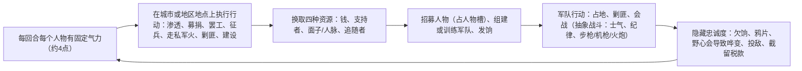

# 对标游戏研究：白日升 / 朴正熙纪事 / Suzerain / Democracy 4

> [!NOTE]
> **研究日期**：2026-10-15。**数据来源**：Steam 商店 API（`appdetails`）、Steam 评测 API（`appreviews`，含每条评测的游玩时长）、Steam 全球成就解锁率 API（`GetGlobalAchievementPercentagesForApp`）、Steam 开发者公告（`GetNewsForApp`）、维基百科、Positech 官方网站与开发者博客。
> **没能用上的渠道**：Reddit、B站、知乎、NGA、贴吧、Fandom 维基在抓取时被拦截（403或需要登录）。中文玩家的声音主要来自 Steam 简中评测：白日升 775 条评测里有 559 条简中，朴正熙纪事 245 条里有 98 条简中，Suzerain 抽样 800 条里有 184 条简中。
> **标注规则**：没有直接出处的数字标为 **〔推断〕**，拿不准的标为 **〔未证实〕**，并给出依据。
> **成就率当代理指标的注意事项**：成就解锁率按“拥有该游戏的账号”计算，包括买了没玩的人，所以它低估了“玩过的人”中的比例。朴正熙纪事发售只有6周，开发者公告提到过成就解锁失败的bug，数据有噪声。

---

## 0. 一页结论

| 游戏 | 在本项目中的角色 | 一句话结论 |
|---|---|---|
| **白日升**（*Rise of the White Sun*） | **规模锚点** | 法国独立开发者做的**1920年代中国军阀混战**回合制大战略。“剧本 + 省/城两级地图 + 人物行动点 + 事件”，结构和规模都跟本项目最像。玩家最常说的问题是：**10–30回合后变成机械重复**、UI很难用、事件和风味文本太少。 |
| **为了祖国：朴正熙纪事**（*For the Fatherland: Chronicle of Park Chung-hee*） | **深度和重复可玩性的及格线** | 韩国单人开发者2026-09-03发售。一个20年的剧本里有**24–28个结局、247条决议、41个国家目标**。拥有者平均只解锁约**1个结局成就**；玩家流失的原因是 **AI腔文本、UI难找、月度冷却决议要反复点、数值很容易顶满、外交只能被动解锁**。 |
| **Suzerain**（Torpor Games） | **观感与UI锚点** | 用“总统的办公桌”这个比喻统一全部界面，**小整数资源**（预算1–3档）、**关键词超链接到百科**、打字机动画、按局势切换的配乐、氛围底噪，读起来像一本好书。短板是：**多周目要重读相同文本**、经济底层不透明、主线回合固定。 |
| **Democracy 4**（Positech） | **政治深度锚点** | 所有东西都是同一张**带惯性的加权因果网**里的节点，悬停就能看到因果连线；虚拟选民同时属于多个集团；部长忠诚度决定政治资本的产出；激进化的极端分子可能刺杀玩家。常见批评是：**像电子表格**、没有叙事、经济模型有天花板、存在“正确答案”。 |

**本项目要做的组合**：Democracy 4 的因果网深度 + 白日升的地图、人物与剧本规模 + Suzerain 的呈现 + 一套事件系统，它在**重复可玩性**上要明显超过朴正熙纪事（量化门槛见第6节）。

---

## 1. 白日升（Rise of the White Sun）

### 1.1 它到底是哪款游戏

| 项 | 内容 | 来源 |
|---|---|---|
| 正式名 | **Rise Of The White Sun - 白日升**（Steam AppID 1189100） | [Steam](https://store.steampowered.com/app/1189100) |
| 开发 | **Maestro Cinetik**（法国，单人开发）；发行：Gaming at Work / Cinetique | Steam appdetails |
| 题材 | **中国军阀混战时代（1920年代起）**，以北洋、国民党、共产党、地方军阀、土匪、蒙古、西藏、新疆等势力为主角的大战略。“白日”取自青天白日旗。所以它正是用户说的**民国政治题材**独立策略游戏，不过重点是军阀割据和革命，不是议会政治 | Steam 描述 |
| 时间线 | 2021-12 公布 → 2022-04 试玩版 → **2022-09-26 抢先体验** → **2023-09-21 正式版**（随“北伐”剧本推出）→ 2025-08 首个付费DLC *Taming the Tigers*（1929–30，中原大战、中东路事件）→ 2026-03 北伐沙盒 → 下一个DLC *Two Suns Under the Sky*（1931–33，可玩日本）开发中 | Steam 公告 |
| 价格 / 评价 | 24.99美元；**775条评测，86%好评（特别好评）** | Steam API，2026-10-15 |
| 语言 | 英、简中、韩、法；简中约**90%由社区翻译**，10%机翻 | Steam 描述，2024-04 公告 |
| 引擎 | 旧作所用引擎〔未证实〕；作者在2023-09公告中说**下一个大项目改用 Godot** | [2023-09-21 公告](https://store.steampowered.com/news/app/1189100) |

### 1.2 规模

| 维度 | 数据 | 说明 |
|---|---|---|
| 可玩势力 | **40+** | Steam 描述：“超过40个可玩势力”，包括共产党起义军、农民军、军阀、蒙古骑兵、恩琴、上海帮会、装甲列车 |
| 剧本 | 至少 **9–10个**：1920沙盒（全中国）、上海起义、广东革命根据地（1925）、1925沙盒、北伐（1926）、红色根据地（1927）、统一战线（1923）、免费DLC *The Yellow Way*、付费DLC *Taming the Tigers*（1929）、北伐沙盒（2026），另有西藏、蒙古等局部剧本 | 公告汇总〔剧本总数为推断〕 |
| 剧本长度 | 有回合上限：西藏剧本 **103回合**；1925沙盒“**超过400回合**”。按1925–1933年折算，**一回合约等于一周**〔推断〕 | 2023-06、2024-02 公告 |
| 地图 | **两级**：全国 → 省地图（省内分区）→ 少数**城市地图**（上海、广州、香港、汉口），城市地图上能直接操作大学、工厂、商会、码头等具体地点 | 2022-06、2023-06 公告与评测 |
| 人物 | 每个剧本有大量历史人物，*Taming the Tigers* 新增 **50+** 名；玩家同时能直接操作的人物上限约 **6–7个**（评测反复提到“人物槽”） | 评测 |
| 成就 | 43个。最常见的成就只有 **24%**；“首次胜利”**9.0%**；各条统一中国路线 **0.2–0.3%** | 成就API |
| 游玩时长（评测者） | 中位数 **14.3小时**，好评者中位数 **17.5小时**，第75百分位 **38.7小时**，平均50小时（长尾很长）；差评者中位数 **4.3小时** | 775条评测统计 |

### 1.3 核心循环

- **稀缺行动点**是整个游戏的骨架。作者前作 *Cauldron of War* 也是这个模式。好评说“能做的事永远比气力多”。
- **混乱就是设计本身**：欠饷军队会溃散，抽鸦片的将领会误事，人物有隐藏忠诚，土匪剿不完。好评中最有感染力的段落几乎全是这类**涌现故事**，例如“最后一回合将领抽鸦片，没有气力发动反攻，结果小败”。
- **按角色托管给AI**（2024-05 改进）：政治家去发展地方，警察去剿匪，军阀去种鸦片、扩军，以此减轻后期的微操负担。

### 1.4 事件与数值
- **事件**：以剧本为单位的历史事件链（例如中共六大，2024-09 只加了“2个事件、5个行动”）和少量罕见事件（“如果果洛部落拿下北京”）。数量不多，**差评反复说“风味文本几乎没有”“一点事件都没有”**。
- **区级数值**：每个区有**传统**（越高，革命影响越小，经济效率越低，越容易出现红枪会一类神秘主义叛乱）和**活力**（影响收入和征兵）。另有鸦片这类“快但有害”的捷径（2022-06 公告）。
- **军队数值**：人数、步枪/机枪/火炮、士气、纪律、经验、忠诚。士气≤2时结束回合会出现逃兵（评测）。
- **难度**：从低到高为 Green、Seasoned、Elite、Dare Death。高难度直接给AI作弊资源（2024-04 公告）。

### 1.5 评价
**好评集中在**：题材独一无二（中文好评大量是情怀与历史讨论）；“看着四川混战打到满地土匪、重庆税收从200多掉到个位数”这种**历史沉浸感**；人物、军阀名录很考究；涌现叙事。

**差评集中在**（按点赞数排序后归纳）：
1. **前10–30回合之后变成机械重复**。点赞最多的差评（507赞）说：“士气降到2就视察，忠诚到50就发饷……大概第30回合左右就枯燥乏味了。”另一条英文差评说：“几小时就能看出最优用法。”
2. **UI灾难**：提示框挡住内容、多层嵌套菜单、按钮没有文字、通知不会消失、ESC无效、没有撤销。
3. **滚雪球**：正反馈过强，高难度也很容易。
4. **战斗不透明**：“为什么溃退？不知道。”玩家无法形成策略。
5. **人物同质化**，各党派差别小；后期逐个地区规划太繁琐。
6. 翻译质量差（机翻、人名错误）。

### 1.6 本项目应借鉴

| # | 借鉴 | 对应本项目章节 |
|---|---|---|
| W1 | **剧本制、剧本有回合或日期上限、局部剧本和沙盒并存**，可以逐步扩容（白日升三年间从4个剧本扩到10个左右） | §2 第一阶段范围、§3 剧本 |
| W2 | **地图分两级，城市层直接操作具体地点**（大学、工厂、码头）。这和我们的“关键地点决策”（§9.5）一致，证明“地点就是政治行动的入口”做得出效果 | §9.2、§9.5 |
| W3 | **每个人物的行动点有限**，玩家必须把事情委托给部长或AI，这天然造成取舍 | §12 行动系统、§13 AI内阁 |
| W4 | **隐藏忠诚加上涌现失误**（欠饷、鸦片、越权）制造故事。我们的“部长越权”（§13.1）应该同样能**自发**产生，而不只是脚本事件 | §13.1 |
| W5 | **按角色托管给AI**（政治家、警察、军阀各有行为倾向），而且能随时收回 | §15.3 第7条“顾问自动处理” |
| W6 | 社区参与：创意工坊、作弊码（便于测试和复现）、开发路线投票 | 开发流程 |

### 1.7 本项目应避免

| # | 避免 | 对应章节与对策 |
|---|---|---|
| W-x1 | **固定阈值反应式管理**（“士气2就视察，忠诚50就发饷”），等于一个可以背下来的公式 | §10、§11：阈值要随状态浮动，行动要有边际递减和副作用，同一手段反复用会产生“免疫”或反弹修正器 |
| W-x2 | **只有正反馈的滚雪球** | §20 第7条“矛盾联动图”：每个参数都必须有回落机制，强势之后出现“傲慢税”（战略自满度§10.5就是这类机制，应推广） |
| W-x3 | **战斗和结算结果不说明原因** | §8 界面：所有结算给出前5项贡献因子 |
| W-x4 | **通知堆积、菜单嵌套** | §8：每条通知可以一键前往或自动过期；菜单最多2层 |
| W-x5 | **风味文本稀少** | §15.1 风味事件“多，但轻”，量要做足（见 rubric R4） |
| W-x6 | **中文本地化当成二等公民** | 本项目以简中为第一语言 |

---

## 2. 为了祖国：朴正熙纪事（For the Fatherland: Chronicle of Park Chung-hee）

### 2.1 基本信息

| 项 | 内容 | 来源 |
|---|---|---|
| 中文名 | 为了祖国：朴正熙纪事 | Steam 简中商店 |
| **英文名（已查证）** | ***For the Fatherland: Chronicle of Park Chung-hee*** | Steam 英文商店，AppID 5035220 |
| 韩文名 | 조국과 민족을 위하여: 박정희 일대기（评测中引用） | 韩文评测 |
| 开发 | **KMS STUDIO**，**单人开发者“Fultuka”**，开发、发行、运营都是一个人 | 公告 |
| 发售 | **2026-09-03**，14.99美元 | Steam |
| 评价 | **245条评测，88%好评**；韩文111条，简中98条，英文27条 | Steam API |
| AI使用声明 | “代码开发、优化、修bug、部分美术、音乐创作，以及英日中本地化”使用了AI辅助（商店声明，评测转引）；开发者承认文本的“初稿”是自己写的，之后由AI润色 | [2026-09-07 公告](https://store.steampowered.com/news/app/5035220) |
| 灵感 | 英文评测认为它受 *Crisis in the Kremlin*、*Mao's Legacy*、Suzerain 影响；韩文评测称它为“韩国版Suzerain”，也有人说像TNO | 评测 |

### 2.2 核心机制

1. **序章“5·16”行动**（1960–61）：争取部队、筹措资金、躲避防谍队，凌晨3点抵达汉江大桥。这一段可能直接失败，**“政变失败”是最常见的结局成就（21.0%）**。
2. **国家重建最高会议 → 第三共和国**：清算旧政客，组建民主共和党（必须建党才能赢选举，这是**隐性必经条件**，玩家常漏掉，开发者后来补了一个提示事件）。
3. **部门与系统**：经济企划院（五年计划 + 项目资源分配 + 瓶颈）、财务部（税率、利率、特别预算1–30）、国会（法案经过提案、常任委员会、法司委、全体会议，**耗时5–7个月**，表决看执政党席位）、司法（**宪法条文根据选择生成**，修宪后国民会记住）、韩国银行、财阀、新村运动、保健社会部、石油对策、核开发、国防（军团、战线、补给，1.04版大改）、外交（中苏分裂、越战派兵、1971年中国代表权）。
4. **权力关系**：心腹的信任、影响力、权力张力、行政漏损、党内凝聚力；可以委派专项任务（行政监察、协调民主共和党、对日谈判），功劳记在内阁或个人名下。
5. **政治资源**：政治资本、财政余力、民心、正当性等；**决议有冷却和执行间隔**。
6. **结局与史官记录**：结尾由“史官”列出所有历史转折点。
7. **模式与开局**：剧情 / 沙盒；1960、1961、1963、1971四个开局（1.04版新增1971，开发者自己仍推荐从1960开始）。时间范围1960–1979/80，计划延长到1991，并加入金钟泌、金大中视角。

### 2.3 量化：这是我们要超过的线

| 指标 | 朴正熙纪事 | 来源与说明 |
|---|---|---|
| 剧本数 | **1个主剧本**（4个开局点） | 公告 |
| 时间跨度 | 1960–1979/80（约20年） | 商店 |
| **结局数** | **24个**（英文商店）/ **28个**（简中商店与简中评测“多达28个结局”）。两处数字不一致，可能是版本更新所致〔未证实〕 | 商店两种语言 |
| 结局类成就 | **20个**（`ach.end.*`），总成就42个 | 成就API |
| **决议总数** | **284 → 247**（1.04版删掉37条重复或单纯给奖励的决议）；其中**可重复决议 162 → 88** | [1.04 公告](https://store.steampowered.com/news/app/5035220) |
| 国家目标 | **41个** | 1.03 公告 |
| 事件数 | **未公开**〔未证实〕。商店列出的专属事件界面有：5·16、总统选举、韩日请求权谈判、维新讨论、宫井洞晚宴；1.05版新增3·15舞弊、金新朝事件的小游戏 | 商店、公告 |
| 宏观路线 | 约 **6–7条**：政变失败 / 史实维新到10·26 / 1971年主动退休 / 议会和平交接 / 核武装 / 北进统一（可占南满）/ 经济崩溃或债务违约 | 商店、成就 |
| 经济体制 | 5种可切换（1.05版） | 公告 |
| **单周目时长** | 约 **4–8小时**〔推断〕：一名韩文评测者“3周目共约16小时”，英文评测者“一口气6小时打完第一周目”，另一位“到一个结局用时不长”（2.4小时） | 评测 |
| 评测者总时长 | 中位数 **9.5小时**（好评者10.0，差评者4.2），第75百分位16.4小时 | 245条评测统计 |
| **玩家通常玩几周目** | **约1–2个**〔推断〕。全部结局成就解锁率相加 ≈ **100.7%**，即**每个拥有者平均约解锁1个结局**；去掉“政变失败”，平均只有约0.8个“真正的结局”。玩3周目的人在评测中会专门说明自己玩了3次（“史实一次、理想国一次、反向一次”），可见并不常见 | 成就API、评测 |
| 结局分布 | 最常见：政变失败21.0%、核国家16.0%、1979任期结束15.9%、金钟泌继任9.7%、统一9.1%、1971退休7.5%。**史实结局（`end.otl`）只有0.7%**。按结局成就比例计算的**有效结局数 exp(H) ≈ 10.7**，最常见结局占21% | 成就API，本文计算 |
| 上手 | “第三共和国”成就51.1%，说明约一半拥有者活到了1963年 | 成就API |

### 2.4 深度来源
1. **系统数量多**：十几个部门各有一个界面，而且彼此连通（财政余力、行政漏损、财阀集中度互相影响）。
2. **流程有时长**：法案要5–7个月，项目有工期和瓶颈，石油要预付、运输、到港，**用时间换来真实感**。
3. **路线是道德题**：最受好评的评测（120赞）说：“最深的体会是权力很难放手……每到任期快结束，就觉得这个国家还没强到可以离开我。”它把“要不要维新”做成了一个情感难题。
4. **历史细节**：纪录片片段、新闻影像（后期变成彩色电视画面）、历次讲话原文，中韩评测都高度称赞“代入感”。

### 2.5 重复可玩性的来源与短板

**来源**：24–28个结局；几条道德路线（退休、维新、交接、核、统一）；4个开局点；沙盒模式；史官记录促使玩家去想“另一种可能”。

**短板，也就是玩家为什么不再玩**（按评测点赞数归纳）：

| # | 原因 | 证据 |
|---|---|---|
| P1 | **AI腔文本**：中、韩评测点赞最多的差评集中在这里。“不是A，而是B”、“干X的人很多，干Y的人很少”这类句式遍布全篇；阴谋事件里连阴谋者的名字都没有，只写“他”。**在一个以文本为核心的游戏里，文本不可信，玩家就不读了** | 简中差评67赞、51赞、8赞；韩文差评“Not A. It was B, it was C”句式 |
| P2 | **UI难找，记忆成本高**：“内阁在哪？找不到”、“总统秘书室到现在都没找到”、通知永远不消失、UI越更新越难用。开发者在1.04版重做UI后公开道歉，并开放旧版回退 | 多条评测、2026-09-11 公告 |
| P3 | **重复性月度操作**：“每个月都要检查哪些冷却结束了，太烦”；162条可重复决议后来砍到88条，开发者自己也承认这是问题 | 韩文评测43赞、1.04 公告 |
| P4 | **数值很容易顶满，系统失去作用**：“部长都任命之后，正当性、民心很容易到100%，国政栏的设置基本不用了” | 韩文评测（27.9小时） |
| P5 | **经济可以被利用**：汇率不受通胀影响，“1980年韩国GDP能拉到12.8万亿美元，人均36万美元” | 简中差评（30.2小时） |
| P6 | **选择受限、像按剧本读小说**：“这不是大战略或政治模拟，更像按定好的剧本读小说”；外交“更接近按年份解锁的事件”，只能等事件，不能主动出击 | 韩文差评、韩文好评（17.3小时）、英文好评第3条 |
| P7 | **结局多但内容少**：“结局很多但内容很少”（88.8小时的简中差评）；“有些系统复杂但意义不大（权力斗争、科研、军事）” | 简中差评 |
| P8 | **重开的疲劳**：“路线多、鼓励多周目，但重复游玩的疲劳度太高；从1963年开始也太累，希望有更晚的开局” | 韩文评测（3.3小时） |
| P9 | **随机事件简单而且多为负面**：“12月出现梅雨淹水事件”，“随机事件大多是负面的，玩得越久越不舒服” | 同上 |
| P10 | **战争系统混乱**：补给不直观，战线错位 | 多条评测 |
| P11 | 题材本身两极分化（与设计无关，但提醒我们：§17的敏感内容原则必须做到可以示人） | 韩文差评333赞 |

### 2.6 本项目应借鉴

| # | 借鉴 | 对应章节 |
|---|---|---|
| K1 | **把“要不要放手”做成核心道德张力**：朴正熙纪事最动人的就是“维新还是退休”。我们的独裁路线（§6）和卸任/继任（§5）应该共用这个张力，例如“我还没完成愿景”和“任期与制度”之间的冲突 | §5、§6 |
| K2 | **立法流程有时长、有阶段**（5–7个月、委员会、席位），这是把议会做出质感的低成本办法 | §12 法令、§20 第2条 |
| K3 | **宪法或基本法条文根据玩家选择生成并显示**。以色列没有成文宪法、靠基本法逐条累积，正好适合这种做法 | §6.2 掏空制衡、§4.4 本-古里安愿景（成文宪法） |
| K4 | **史官式结尾，列出所有转折点**，并且按时间顺序（朴正熙纪事的bug是随机排序） | §18 历史评价、§5.2 总结画面 |
| K5 | **时代影像与原声**：新闻片、讲话原文 | §17 多视角、§8 界面 |
| K6 | **项目有工期、有瓶颈**（输水工程、迪莫纳） | §7.3 决议执行周期 |

### 2.7 本项目应避免

| # | 避免 | 对应章节与对策 |
|---|---|---|
| K-x1 | **AI腔**：本项目的事件库很可能有LLM参与写作，**这是最大的风险**。必须建立禁用句式表、人工终审和风格抽检（rubric R18） | [events/README.md](../events/README.md) 第4节编写原则 |
| K-x2 | **隐性必经条件**（必须建党才能赢）：应该改成在目标面板上显式列出的里程碑 | §4 三层目标、§8.2 目标面板 |
| K-x3 | **可重复决议和冷却检查**：会让玩家每月巡检一遍 | §12：可重复行动只放在内阁例会（§15.3 第6条）的统一清单里，冷却结束时主动提醒 |
| K-x4 | **数值天花板过低，很快顶满** | §10：核心数值用“目标值 + 衰减”而不是累加；越接近上限，维持成本越高 |
| K-x5 | **外部世界只能被动解锁** | §15.5 历史轨道加扰动、§14：要有主动外交行动 |
| K-x6 | **随机事件多为负面、触发条件简单**（12月梅雨） | §15.1 随机事件：季节和地理前提必须正确；正面和中性事件占比 ≥ 35% |
| K-x7 | **前期重复太长** | §3：提供多个就任点，已读文本快进，序章可以跳过 |

---

## 3. Suzerain（Torpor Games）

### 3.1 概况

| 项 | 内容 | 来源 |
|---|---|---|
| 开发 | Torpor Games（柏林）；本篇2020-12-04发售，最初由 Fellow Traveller 发行，后转为自主发行 | 维基百科、公告 |
| 类型 | 以文字为主的**政府模拟视觉小说**。本篇扮演索德兰总统 Anton Rayne（1950年代架空冷战），DLC《里齐亚王国》扮演国王 Romus Toras | 维基百科 |
| 规模 | 开发者称全作约 **45万词**（与《魔戒》相当；早期商店写的是20万字），**本篇12小时内可以通关**，补充文本不读也能推进 | 维基百科 |
| 评价 | 本篇 **11,981条评测，92%好评**；Metacritic 81；2021年德国电脑游戏奖“最佳专家游戏”；Rizia 获 Games for Change 2025 “Best in Civics” | Steam API、维基百科 |
| Rizia | 2024-03-25发售，**896条评测，91%好评**；首发时日活13,275，同时在线3,382，是本篇首发的3倍以上；预购近9,500份 | Steam API、[2024-04-02 公告](https://store.steampowered.com/news/app/1207650) |
| 时长（评测者） | 中位数 **33.4小时**，第25百分位17.4，第75百分位66.4（含Rizia、多周目） | 800条近期评测统计 |
| 完成率 | 序章91.1% → 第1章52.5% → 第4章 **36.8%**。Rizia：序章18.0% → 第4章10.3% | 成就API |
| 本篇结局分布 | 选举获胜17.9%、被政变9.8%、退休5.8%、选举被迫下台4.8%、弹劾4.7%、流亡3.0%、世界大战3.0%、遇刺2.1%……按成就比例计算的**有效结局数 ≈ 9.4**，最常见结局占23% | 成就API，本文计算 |
| 中文 | **至今没有官方中文**。简中评测里点赞最多的差评正是这一点，民间汉化要分别打剧情、地图、UI三个补丁。Torpor 2025-07 发过《致中文社区的信》 | 简中评测、公告 |

### 3.2 为什么好看、好读、有代入感：逐项拆解

> 以下来自 2.0 “Amendment” 与 3.1 “Sovereign” 的完整更新日志，以及评测中反复出现的描述。

#### (1) 统一的空间比喻：总统的办公桌
- 主界面是一张**有景深的办公桌**，桌上的物件就是入口：文件、地图、报纸、收藏品（威士忌、雪茄盒、收音机、相框……），点物件打开对应界面（2.0版“Interactable objects on the table open UI elements”）。
- **好处**：信息架构可以靠空间记忆，玩家知道“报纸在左边、地图在中间”；而且每个功能都有物理隐喻，不需要抽象的图标栏。朴正熙纪事和白日升被骂“找不到”，Suzerain 很少有人这样说。
- **收藏品**有15–36件，变成成就之后又成了“回桌前看看”的理由，同时强化“这是我的办公室”的感觉。

#### (2) 信息分层：主线、支撑、底层数据
| 层 | 内容 | 是否必读 |
|---|---|---|
| **主线对话** | 与部长、家人、外国领导人的场景对话，配人物立绘和选项 | 必读 |
| **叙事支撑** | 新闻流（数百篇）、城市报告、派系报告（2.0版新增40篇）、国家报告（30篇）、日记 | 选读，但会影响判断 |
| **百科（Codex）** | 人物、地点、组织、历史；对话中的专有名词可以直接跳转〔高亮链接为常见描述，具体交互细节未证实〕 | 选读 |
| **系统数据** | 预算、资源、经济增长**趋势图**、地图状态、修正器提示 | 需要时查看 |

- **关键设计**：叙事支撑不读也能推进；**但玩家漏掉的重大问题会以“危机事件”的形式强制推到面前**（2.0版：“Crisis events to highlight big issues that players missed when not reading narrative support”）。这一条非常关键：**选读不等于会错过要命的信息**。
- **经济图表只显示趋势**，不显示精确状态（2.0版：“The projected economic growth graph shows trends, not economic state”）。数值体验因此更像总统读简报，而不是看电子表格。

#### (3) 小整数资源，让信息可以一眼读懂
- 本篇的政府预算是**整数**：每个部门花费为高3 / 中2 / 低1，起始预算7（2.0版）。决策成本大多是“1预算”或“1个筹码”。
- Rizia 有**权威、能源、预算**三种核心资源，带动态上限，并配修正器提示（3.1版重做提示，“减少杂乱”）。
- 对比：朴正熙纪事把 `(A/0.34)+…` 这样的公式直接放在决议卡上，韩文评测（43赞）原话是“谁会真的照着算……改成‘小幅增加’，公式放到角落的(?)里”。

#### (4) 文本呈现与排版
- **打字机动画**和**关键时刻的文字动画**（2.0版），可以关闭。
- **字体选项**：UI缩放条、**OpenDyslexic**（读写障碍友好字体，2.0版）、字号设置（3.1版）。
- **已读文本快进**、序章跳过（3.1版），回应了“多周目重读”的批评。
- **新闻条目可以展开或收起**（3.1版），总结画面改为**双页版式**，更像一本书。
- 视觉风格：1950年代、偏东欧和地中海感的**手绘人物立绘**；结局用**剪影插画**（2.0版：“Epilogue silhouette images for all endings”）〔具体字体名称未证实〕。

#### (5) 音效与音乐
- **地图音乐分中性和紧张两个变体**（2.0版），局势会改变配乐的情绪。
- **房间环境底噪**、**20多个关键时刻音效**、国歌片段、**音频闪避**（对话或重要音效出现时压低音乐）、Torpor 声音标识（2.0版）。
- 3.1版：**所有新场景都配了音乐**。2025年索德兰和里齐亚主题曲由 **Babelsberg 电影乐团**录制（2025-12 公告）〔作曲者姓名未证实〕。
- 反面意见：少数评测认为配乐“像外包”。整体上音乐不是夸奖的重点，**音画和环境声对代入感的贡献主要体现在“办公室感”上**。

#### (6) 节奏
- 本篇按**固定回合**（序章加若干章）推进，每回合有定时场景（内阁会议、议会、外交访问），回合之间穿插可选的支撑阅读。Rizia 共**11个回合**（3.1版新增第11回合和更深的尾声）。
- **Torpor 模式（铁人）**：第一次通关前不能读档，强迫玩家承担后果，通关后可以关闭。
- **家庭线**（妻子、子女、朋友）穿插在国事之间，提供情感上的缓冲和个人代价（商店：“国与家，哪个更重要？”）。

#### (7) 世界观的一致性
- 架空但自洽的世界（Sordland、Rizia、Rumburg、Lespia……），每个国家都有国旗、国歌、宗教、派系，配合官方 Codex 网站和Steam上的“新闻”公告持续运营，营造一个“活着的世界”。

### 3.3 Rizia DLC 的王国管理玩法

| 子系统 | 内容 | 来源 |
|---|---|---|
| **核心资源** | **权威（Authority）**、**能源（Energy）**、**预算（Budget）**；3.1版全面重做和平衡，引入**动态资源上限**，修正器20多个 | 3.1 日志 |
| **王室法令（Royal Decrees）** | 分秩序、经济、福利、宗教等类别，3.1版**新增45条以上**，有分类和筛选；后期有高成本高收益的福利法令；神权路线有专属法令；签署后有**微型反馈场景** | 3.1 日志、2025-03 公告 |
| **三大王室家族** | Toras、Sazon 等家族的关系与派系诉求（夺回失地、恢复荣光），以及宗教、联姻、恋爱 | 商店 |
| **情势与政策** | 用状态效果表达持续问题（能源危机、毒品犯罪、旅游、宗教幸福度），在经济、福利、秩序、外交上都有新增 | 3.1 日志 |
| **改革强度与激进度** | 3.1版新增系统，改革推得越快，激进度越高 | 3.1 日志 |
| **统一叛乱系统** | 由旧的省级动乱改造而来 | 3.1 日志 |
| **战争** | **回合制格子战**：训练步兵、装甲、空军（3.1版加入战斗机和轰炸机）单位，工厂生产，战争支持度和抵抗度，有引导教程 | 3.1 日志、商店 |
| **跨篇继承** | 本篇存档可以导入，Anton Rayne 的路线会改变 Rizia 的世界状态；也可以选预设原型 | 2024-09 公告 |
| **结局** | 继续统治6.9%（占拥有者）、内战、流亡、入狱、死亡等。**有效结局数约3.3**，Rizia 的结局集中度远高于本篇 | 成就API |

**启示**：Suzerain 用**少量、可数的资源**加上**分类法令卡**，在视觉小说的骨架上加了一层“国家管理”，而且没有变成电子表格。这正好是本项目在“数值全部可见”的前提下需要的平衡。

### 3.4 Suzerain 的短板
1. **多周目要重读**（3.1版前没有快进）：“多周目怎么也绕不开那些不能跳过的家庭关系文本”（简中评测）。
2. **经济和民意的底层机制不透明**：“很多决策后果无法预判，新手很容易莫名其妙崩盘”。
3. **路线依赖站队**：“人物关系就是原始的XY政治倾向划分……在一堆选项里选错一个站队就直接崩盘”。
4. 回合与场景固定，是**分支叙事，不是模拟**，同一回合的大事每局都一样。

### 3.5 本项目应借鉴

| # | 借鉴 | 对应章节 |
|---|---|---|
| S1 | **统一的空间比喻**：以总理办公室或内阁会议室为主界面，物件即入口（电话 = 秘密渠道，报纸 = 舆论，地图 = 第9节，档案柜 = 人物）。顶栏（§8.1）保留关键数值 | §8 界面 |
| S2 | **三层信息：主线必读、支撑选读、数据按需**，再加上“漏读兜底危机” | §8.2、§15.3 第7条 |
| S3 | **核心资源用小整数**（政治资本、预算档位），复杂的底层数值折叠在提示框里 | §10.1 政治资本、§12 预算滑块（可以改成离散档位） |
| S4 | **趋势图优先于精确值**，用于通胀、民调、矛盾漂移 | §10、§18 总结画面曲线 |
| S5 | **关键词超链接到百科**：以色列政党、人物、地名对中文玩家门槛很高，百科是刚需 | §17、§8 |
| S6 | **按局势切换音乐、环境底噪、关键时刻音效、音频闪避** | 新增“音频”小节建议写入§8 |
| S7 | **铁人模式、已读快进、序章跳过、字号和读写障碍字体** | §7 时间系统、§8 |
| S8 | **家庭线和私人代价**：总理的家庭、健康（梅厄、贝京晚年抑郁都有史实依据） | §13.2 人物、§5.1 健康原因下台 |
| S9 | **法令签署后的微型反馈场景**：让数值变化“被看见” | §12 法令、§15 被动事件 |
| S10 | **跨剧本继承世界状态**（本篇到Rizia），和我们“以下一任总理继续”（§5）同构 | §5.3 |

### 3.6 本项目应避免

| # | 避免 | 对策 |
|---|---|---|
| S-x1 | 主线回合固定导致**每局大事相同** | 我们的连续时间加条件触发（§15.1）已经规避，但要验证（rubric R3） |
| S-x2 | **重读成本** | 事件文本出现变体（§15.3 第4条），第二次见面时显示摘要版 |
| S-x3 | **黑箱经济** | 沿用 Democracy 4 式的因果提示（见第4节） |
| S-x4 | **站队一步错满盘输** | 失败要可以挽回，至少给一次“补救”事件链 |

---

## 4. Democracy 4（Positech Games）

### 4.1 概况

| 项 | 内容 |
|---|---|
| 开发 | Positech Games（Cliff Harris）与 Stargazy Studios；自研C++引擎 |
| 发售 | 抢先体验2020-10，正式版2022-01-13；2024年登陆主机 |
| 评价 | **6,428条评测，82%好评**；近期抽样中约26%为差评 |
| 时长（评测者） | 中位数 **13.1小时**（好评者16.7，差评者6.3） |
| 成就 | 40个，多为“打造某类国家”（生态乌托邦1.9%、硅谷天堂1.7%、安·兰德继承人2.6%、联合政府小子0.4%） |

### 4.2 政策-选民网络模型
- **一切都是节点**：政策、统计量（GDP、犯罪、教育）、情势（无家可归、石油抗议）、选民集团、单个选民，都是同一类对象，用**效果（effect）**连接（[官方模组文档](https://www.positech.co.uk/democracy4/modding.html)）。
- **效果的格式**：`目标, 值1 运算 (值2 运算 x) [运算 值4], 惯性`，例如 `Education,0.04+(0.04*x),4` 表示成人教育补贴滑块x对教育的贡献，**惯性4 = 取最近4回合的平均值**，也就是政策要4个季度才完全生效。公式里还可以引用其他节点，例如 `*Technology`。
- **实施进度与部长能力**：新政策要逐步落实，部长的能力会让效果小幅上下浮动（同上文档）。
- 全部数据放在**CSV文本**里，可以编辑、做模组，Steam创意工坊支持。官方把这套系统称为“神经网络”，实际上更接近带延迟的加权有向图。

### 4.3 可视化的因果网
- 主界面是**分区的图标墙**（税收、经济、福利、外交、交通、法治、公共服务），图标颜色表示状态好坏。**悬停任何图标都会画出它的输入线和输出线**，绿色是正面、红色是负面，线的粗细代表强度〔细节以游戏实际为准，属公认描述〕。
- 每条政策的详情页列出受它影响的节点和选民集团，并预估支持者和反对者。
- 4代新增**媒体报道**、**政治罗盘历史**（2022-09）、经济滑块图表（2022-05）、选民感知提醒（2021-07）等可视化（Steam更新标题）。

### 4.4 选民集团
- 维基百科列举：宗教人士、爱国者、父母、资本家、社会主义者、自由派、保守派等。另有环保、退休、年轻人、农民、驾车族、通勤者、工会、少数族裔、个体户、国企员工，以及穷人、中产、富人等收入层〔完整名单与数量未证实，约20个〕。
- **每个虚拟选民同时属于多个集团**（例如“贫穷 + 保守 + 吸烟 + 爱国”），所以不可能讨好所有人；投票取决于个人在各集团满意度上的综合。
- **竞选承诺**：选举前作出承诺，没兑现会推高**犬儒度（cynicism）**，后者压低所有人的满意度。
- 4代新增**抗议票**（2021-10）、联合政府、三党制、紧急权力、压制政治自由等威权选项（维基百科、Steam描述）。

### 4.5 内阁忠诚与政治资本
- **政治资本由忠诚的部长产出**（维基百科）。部长属于某些选民集团，**如果他所属的集团被得罪，忠诚就会下降**，最终辞职或倒戈。
- 改组内阁本身也要花资本，成就“shufflemeister”（32.2%）说明改组是很常见的操作。

### 4.6 暗杀与极端分子
- 某个集团长期极度不满时，会出现**极端分子**，在**情报（Intel）界面**里可以看到威胁程度。投资安全设施（情报机构等）可以降低风险；**遇刺是游戏结束条件之一**（[官方FAQ](https://www.positech.co.uk/democracy4/faq.html)：“玩家想一夜之间激进改造国家时最容易遇刺……注意情报界面里的恐怖组织”）。
- 输掉选举也会结束游戏，官方说法是“输掉选举就是终局（除非你被暗杀）”。

### 4.7 优点
1. **因果透明**：玩家能自己推理出“为什么”，失败可以复盘，这是策略游戏的根本。
2. **系统性矛盾**：多重身份让每个政策都有赢家和输家。
3. **延迟（惯性）**让改革有阵痛期，而选举周期会惩罚阵痛期，这本身就是政治。
4. **模组友好**、教育市场（学校授权）。
5. **玩家自定义目标**：“目标是建成一个你真心自豪的国家”。

### 4.8 常见批评（评测归纳）
| 批评 | 证据 |
|---|---|
| **电子表格感，没有戏剧性** | “最无聊的策略游戏之一……没有激动人心的事件，没有戏剧性的挫折或成功”（28赞）；“像把Excel做成了游戏”（简中） |
| **固定的“正确”玩法** | “游戏强迫你在社会民主和新自由主义之间找答案，超出这个范围最终都会失败”（28赞） |
| **经济模型有天花板，债务没有后果** | “GDP到某个点就封顶”；“债务几乎没有真实后果，毁掉了整个经济挑战”（66赞，146小时）；简中差评批评其经济学立场 |
| **事件陈旧，不分国家** | “美国文化战争式的事件在英国也会出现” |
| **结果反直觉** | 新手“砍了养老金也砍了税，大家为什么恨我”，说明因果网虽然可见，但**前期解释不够** |

### 4.9 本项目应借鉴

| # | 借鉴 | 对应章节 |
|---|---|---|
| D1 | **统一的节点-效果模型，每条效果带惯性**：我们的矛盾参数、修正器、选民集团都应该用同一种“效果”数据结构表达，存成文本表格，方便校准和做模组 | §10、§11 修正器、[contradiction_parameters.md](../contradiction_parameters.md) |
| D2 | **悬停显示因果线**：在社会矛盾面板（§8.2-3）、三难三角（§10.4）里画出输入和输出 | §8.2 |
| D3 | **选民多重身份**：以色列的身份天然交叉（米兹拉希 × 宗教 × 发展城镇），比 Democracy 4 更适合这个模型。我们的8个集团（§10.1）应该允许个体同时属于多个集团，用人口抽样模拟 | §10.1 选民集团、§9.3 人口构成 |
| D4 | **承诺没兑现会推高犬儒度**，再全局压低支持：这和我们的“承诺”层（§4.2）几乎一一对应，可以直接借用 | §4.2 |
| D5 | **部长忠诚和政治资本挂钩**；部长代表某个集团或盟党 | §10.1 政治资本、§13.1 |
| D6 | **极端分子威胁表加情报界面**：对应拉宾遇刺、右翼地下组织（犹太地下组织1980–84）、卡赫党等史实 | §6.4 刺杀、§8.2-6 安全与情报 |

### 4.10 本项目应避免

| # | 避免 | 对策 |
|---|---|---|
| D-x1 | **没有叙事**：数值变化不产生故事 | 关键阈值触发**人物带来的事件**（§15.3 第5条），由部长、盟党出面把数值说成人话 |
| D-x2 | **单一最优区间** | 我们有三层目标，加上剧本的党派走廊和时代约束，最优解会随剧本、政党、时代变化；但必须用策略机器人验证（rubric R7） |
| D-x3 | **经济天花板，债务没有后果** | 以色列有真实的债务和通胀危机（1984年通胀超过400%，1985年稳定计划），**债务必须有后果**，并作为历史锚点 |
| D-x4 | **事件不分国家、不分时代** | 我们的事件全部绑定时代和存在性前提（[events/README.md](../events/README.md) 第5、6节） |
| D-x5 | **只有季度回合的抽象感** | 我们用连续时间、每日推进（§7），但要防止“每日都要点”（见 rubric R26） |

---

## 5. 综合：四款游戏在本项目设计中的位置

| 本项目章节 | 白日升 | 朴正熙纪事 | Suzerain | Democracy 4 |
|---|---|---|---|---|
| §3 剧本 | 多剧本、有回合上限、沙盒 | 多个开局点 | 剧本即“故事包”、跨篇继承 | 国家选择 |
| §4 三层目标 | — | 41个国家目标、隐性必经条件（反面教材） | 意识形态罗盘结算 | 竞选承诺与犬儒度 |
| §5 连任与继任 | — | 退休或继任结局、继任者扩展 | 本篇到Rizia的世界状态继承 | 输掉选举即结束 |
| §6 独裁路线 | — | 维新路线、10·26 | 威权路线、政变结局 | 紧急权力、暗杀 |
| §8 界面 | 反面教材 | 反面教材（账本式UI 1.05版改善） | **正面锚点** | 因果悬停 |
| §9 地图 | **两级地图、城市地点** | 区域经济地图 | 地图作为状态展示 | 无 |
| §10–11 数值与修正器 | 区级传统和活力 | 漏损、凝聚力 | 小整数资源、修正器提示 | **效果加惯性** |
| §13 人物 | 隐藏忠诚、行动点 | 心腹委派 | 立绘人物、关系 | 部长忠诚 |
| §15 事件 | 太少（反面） | AI腔（反面）、小游戏 | 场景对话、危机兜底 | 情势、两难 |
| §18 评价 | 胜利等级 | 史官记录 | 双页总结、罗盘 | 无 |

---

## 6. 可检验的对标标准表（Rubric）

### 6.1 检验方法定义

| 代号 | 方法 | 说明 |
|---|---|---|
| **SIM** | 无头脚本模拟 | Godot 无界面模式批量运行，随机或简单策略，输出事件ID日志、数值轨迹、结局 |
| **BOT** | 策略机器人 | 至少6个原型：①史实派（按史实选项选）②走廊守成派（不离开党的走廊）③愿景冲刺派（全力推进宏大愿景）④承诺民粹派（只追承诺和民调）⑤强人集权派（推高集权度）⑥随机派。每个原型 × 每个剧本 × N个随机种子 |
| **LLM** | LLM文字试玩 | 把游戏状态导出成纯文本界面，由LLM扮演不同玩家人设游玩；同时用LLM和规则检测器给文本风格打分，并回答“为什么X下降”这类理解题 |
| **HUM** | 人工评审 | 设计师、外部试玩者（≥5名新玩家）、历史学者；盲评对比截图和文本 |
| **STA** | 静态统计 | 解析事件库、结局表、UI树，直接计数 |

### 6.2 标准表

> 门槛中的“剧本”默认指旗舰剧本（贝京1977，§3.1首个原型），其余剧本上线前逐个达标。“一局”指从就任到首次卸任。

#### A. 重复可玩性与深度（主锚：朴正熙纪事）

| # | 标准 | 锚定游戏与基线 | 门槛 | 检验方法 |
|---|---|---|---|---|
| **R1** | 单剧本可判定的不同结局数 | 朴正熙纪事：24–28个结局，20个结局成就；Suzerain本篇约13个尾声成就 | **≥ 36个**（朴正熙纪事上限28的1.3倍）。“结局”定义：（结束方式 × 关键状态分支）的唯一组合，并且有**专属总结文本**，换皮不算 | STA：结局表计数；HUM：抽查文本是否互不相同 |
| **R2** | 结局分布的多样性 | 朴正熙纪事有效结局数约10.7，最常见结局占21%；Suzerain本篇约9.4，23% | BOT 6原型 × 500局：**有效结局数 exp(H) ≥ 14**；**最常见结局占比 ≤ 18%**；**≥ 28个结局**至少出现1次（可达性） | BOT |
| **R3** | 每局读到的新事件比例 | 朴正熙纪事与Suzerain的大事基本固定，多周目要重读，这是玩家流失的原因（P8、S-x1） | 同一原型换种子，第2局中**上一局没见过的事件（按ID）≥ 35%**；换原型 **≥ 50%**；第5局相对前4局的并集 **≥ 15%**。重复出现的事件中 **≥ 60%** 显示变体文本或摘要 | BOT：事件ID日志求差集 |
| **R4** | 事件池与单局覆盖 | 朴正熙纪事有247条决议（事件数未公开）；白日升因事件少而被差评 | 旗舰剧本可触发池 **≥ 250条**（含R-随机事件与风味事件）；一局读到 **60–120条**；单局覆盖率 **≤ 45%**。当前事件库为 E- 337条（全部时代）加 R- 59条，按剧本切分后需补足 | STA + BOT |
| **R5** | 宏观路线数与可达性 | 朴正熙纪事约6–7条 | 每剧本 **≥ 8条**可辨识路线（如：守走廊连任、背离走廊、实现愿景、独裁、早期倒台、党分裂另组新党、继任交接、战争失败）；对应机器人的**可达率 ≥ 30%** | BOT |
| **R6** | 分叉密度 | 朴正熙纪事的批评：“像按剧本读小说”（P6） | 每游戏年 **≥ 8个分叉型抉择**，即该选择会改变后续可达事件集合（不同选项的旗标差异会导致 ≥ 1条事件的可达性变化） | STA：事件依赖图；BOT：对比同一种子不同选项的分支 |
| **R7** | 没有支配策略 | Democracy 4 有“正确区间”；白日升“几小时就能看出最优用法” | ①6原型中成功率（连任 ≥ 1次）最高者与第二名相差 **≤ 15个百分点**；②不存在固定行动序列能在 **≥ 80%** 的种子下拿到最高历史评价段；③遗传或贪心搜索找到的最优策略，换剧本后表现下降 **≥ 30%**（证明最优解依赖剧本） | BOT + 搜索 |
| **R8** | 数值不会顶满 | 朴正熙纪事：正当性和民心很容易到100%，系统失去作用（P4） | 任一核心数值在 BOT 局中**连续 ≥ 2游戏年**处于上限或下限的局数 **≤ 5%** | SIM/BOT 数值轨迹 |
| **R9** | 不可被利用的经济 | 朴正熙纪事GDP可刷到12.8万亿美元（P5）；Democracy 4 债务没有后果 | 全部模拟局中，人均GDP、通胀、外汇储备、债务/GDP都落在**史实区间 × [0.33, 3]**；债务/GDP超过阈值时**必然**触发危机链 | SIM：极端策略（只减税、只印钞、无限借债）压力测试 |
| **R10** | 延迟后果 | §15.3 第3条 | **≥ 30%** 的抉择事件至少有1个在 **≥ 3游戏月后**结算的后果 | STA |
| **R11** | 单局时长与重开疲劳 | 朴正熙纪事单周目约4–8小时，重开疲劳是流失原因；Suzerain本篇 < 12小时 | 首个任期（约4年）**3–6小时**；第二次开局到**第一个重大分叉 ≤ 15分钟**；已读快进可以把重玩的阅读时间压缩 **≥ 50%** | HUM计时 + LLM |
| **R12** | 再玩意愿 | 朴正熙纪事每个拥有者平均约1个结局 | 外部试玩者打完一局后，**≥ 60%** 表示想立刻开第二局；**≥ 30%** 在一周内实际玩到第3局 | HUM（试玩问卷与遥测） |

#### B. 政治深度（主锚：Democracy 4）

| # | 标准 | 锚定 | 门槛 | 检验方法 |
|---|---|---|---|---|
| **R13** | 因果网规模 | Democracy 4：全部节点都是带惯性的效果连接（总数未证实） | 节点（政策杠杆 + 统计量 + 矛盾参数 + 集团）**≥ 150**；效果边 **≥ 600**；每个选民集团的输入 **≥ 5**；每条政策杠杆的效果 **≥ 3**；**≥ 50%** 的效果带惯性或延迟 | STA：解析效果表 |
| **R14** | 选民多重身份 | Democracy 4：选民属于多个集团 | 每个模拟选民平均属于 **≥ 2.5** 个集团；没有任何政策能让 **≥ 6/8** 的集团同时满意 | SIM |
| **R15** | 因果可解释 | Democracy 4 的悬停因果线；白日升、朴正熙纪事因“不告诉你为什么”被差评 | **100%** 可见数值支持悬停显示**前5项贡献**（含惯性进度）；LLM试玩回答“为什么X在上个月下降”的**正确率 ≥ 90%**（仅凭界面文本） | STA（UI覆盖）+ LLM |
| **R16** | 承诺与犬儒度闭环 | Democracy 4 竞选承诺 | 承诺没兑现会推高犬儒度并全局压低支持；机器人“承诺民粹派”中，**兑现率每提高10个百分点，连任率提高 ≥ 5个百分点** | BOT 回归分析 |
| **R17** | 刺杀与极端化可预见 | Democracy 4 情报界面 | 每次刺杀或政变事件发生前 **≥ 3个月**，情报界面已显示对应威胁 **≥ 中等**；被刺事件中“完全无预警”的比例 **= 0%** | SIM 日志 |

#### C. 文本质量与叙事（反锚：朴正熙纪事；正锚：Suzerain）

| # | 标准 | 锚定 | 门槛 | 检验方法 |
|---|---|---|---|---|
| **R18** | 去AI腔 | 朴正熙纪事的头号差评 | 禁用句式检测器（“不是……而是……”、“……的人很多，……的人很少”、“与其说……不如说……”、三连排比、无主语的“他”、空洞总结句、“值得注意的是”等）**每千字 ≤ 0.5次**；人工盲评抽检10%事件，“像人写的” **≥ 80%**；每个阴谋或人物事件**必须点名**（无名“他”占比为0） | STA规则 + LLM检测 + HUM |
| **R19** | 人物声音 | Suzerain：每个部长立场清楚、各有道理 | 10–15个深度人物各有**台词风格卡**；盲测中给台词猜说话人的**准确率 ≥ 70%** | HUM |
| **R20** | 多视角 | §17 第1条 | 重大事件（历史锚点）**100%** 附带 **≥ 3个群体视角**，并由历史学者审阅 | STA + HUM |
| **R21** | 随机事件的情绪比例 | 朴正熙纪事：随机事件多为负面（P9） | R-事件中正面和中性 **≥ 35%**；季节和地理前提正确率 **100%**（不出现“12月梅雨”这类错误） | STA |
| **R22** | 史官式结尾 | 朴正熙纪事史官记录（随机排序是bug）；Suzerain双页总结 | 总结画面**按时间排序**列出 **≥ 10个**本局转折点，**至少一半**是玩家亲手造成的 | STA + HUM |

#### D. 观感、UI与可用性（主锚：Suzerain；反锚：白日升、朴正熙纪事）

| # | 标准 | 锚定 | 门槛 | 检验方法 |
|---|---|---|---|---|
| **R23** | 入口可达 | 朴正熙纪事“内阁在哪？”；白日升菜单嵌套 | 任一常用行动从主界面 **≤ 2次点击**；菜单深度 **≤ 2层**；5名新玩家在 **10分钟内**独立完成“任命部长、提交法令、查看承诺进度”，成功率 **≥ 90%** | HUM + LLM代理走查UI树 |
| **R24** | 排版 | Suzerain字号和读写障碍字体选项；朴正熙纪事“字小而密” | 1080p下正文 **≥ 18px**、行距1.5–1.7、每行 **≤ 38个汉字**；字号可调3档以上；中文字体统一（不出现字体混用） | STA + HUM |
| **R25** | 小整数优先 | Suzerain预算1–3档；朴正熙纪事卡片上直接写公式 | 决策卡上的成本和效果用 **≤ 2位整数或定性词**表示；公式只出现在二级提示中 | STA（UI文本扫描） |
| **R26** | 打断频率 | 朴正熙纪事、白日升的通知堆积 | 默认设置下，每游戏月**强制弹窗 ≤ 3个**；已处理的通知自动消失；**100%** 通知可以一键跳到处理界面 | SIM计数 + HUM |
| **R27** | 漏读兜底 | Suzerain的危机事件兜底 | 玩家没打开某个面板 **≥ 3个月**、而相关数值越过危险阈值时，**100%** 会触发一次强制简报 | SIM |
| **R28** | 音频 | Suzerain：配乐分中性和紧张变体、环境底噪、20多个关键音效、音频闪避 | 每个时代 **≥ 3首**主题曲，各有平静和紧张变体；关键时刻专属音效 **≥ 20个**；对话时音乐自动闪避 | STA + HUM |
| **R29** | 整体观感盲评 | Suzerain | 静态截图和30秒视频盲评（≥ 10名评审），本项目对 Suzerain 的**“更好或持平” ≥ 40%**；对白日升、朴正熙纪事 **≥ 80%** | HUM |
| **R30** | 本地化 | Suzerain没有中文；白日升、朴正熙纪事机翻被差评 | 简中是母版语言；术语表覆盖 **100%** 专有名词；百科覆盖事件中出现的 **100%** 人名、党名、地名 | STA |

#### E. 历史与模拟一致性（本项目自定，参照设计文档）

| # | 标准 | 锚定 | 门槛 | 检验方法 |
|---|---|---|---|---|
| **R31** | 历史引力 | §15.4 | 史实派机器人下，重大锚点事件重演率落在 **70–80%**；其他原型下，**至少一个**原型能把每个锚点的重演率压到 **≤ 40%** 或推到 **≥ 90%** | BOT（蒙特卡洛） |
| **R32** | 独裁路线不是最优解 | §6.1、§17 第5条 | 强人集权派的历史评价中位数**低于**其他原型中位数；但在“生存”这一维上**可以领先**，即路线有吸引力但有代价 | BOT |

### 6.3 必须首先通过的十条（发布门槛）
R2、R3、R7、R8、R9、R15、R18、R23、R26、R1。这十条分别针对四款对标游戏最常被诟病的问题，任何一条不达标都不进入外部试玩。

---

## 7. 未证实与数据缺口

| 项 | 状态 | 依据或下一步 |
|---|---|---|
| 朴正熙纪事结局24个还是28个 | 两种语言的商店页不一致 | 英文页“Twenty-four endings”，简中页“二十八种结局”；可能是版本差异 |
| 朴正熙纪事事件总数 | 未公开 | 只知道决议247条、国家目标41个 |
| 朴正熙纪事单周目时长 | 推断（4–8小时） | 由评测自述推算 |
| 白日升一回合 = 一周 | 推断 | 由“1925沙盒400+回合”折算 |
| Democracy 4 政策数、选民集团数 | 未证实 | 一般说法是约20个集团；官方页面没给总数，可以买游戏后解析CSV确认 |
| Suzerain 字体、作曲者、关键词超链接的交互细节 | 未证实 | 建议购买后实机截图拆解 |
| Suzerain 引擎 | 未证实（普遍认为是Unity） | — |
| 中文论坛（NGA、贴吧、知乎、B站） | 未取得 | 抓取被拦截；中文意见来自Steam简中评测（白日升559条、朴正熙纪事98条、Suzerain 184条） |
| 成就率口径 | 按拥有者计算，低估玩过的人中的比例 | 只作相对比较 |

---

## 8. 主要来源

- 白日升：[Steam 商店](https://store.steampowered.com/app/1189100) · [开发者公告](https://store.steampowered.com/news/app/1189100)（2021-12 里程碑、2022-06 省份管理、2023-06 全中国可玩、2023-09 结束抢先体验、2024-05 统一战线与托管、2025-08 DLC、2026-09 下一个DLC）
- 朴正熙纪事：[Steam 商店](https://store.steampowered.com/app/5035220) · [开发者公告](https://store.steampowered.com/news/app/5035220)（1.01–1.051，尤其 2026-09-07 路线图、2026-09-10 1.04、2026-09-11 改进计划、2026-09-15 1.05 beta）
- Suzerain：[Steam 本篇](https://store.steampowered.com/app/1207650) · [Rizia DLC](https://store.steampowered.com/app/2352340) · [维基百科](https://en.wikipedia.org/wiki/Suzerain_(video_game)) · 公告（2023-07-31 2.0 Amendment、2024-04-02 发售后数据、2025-04-17 3.1 UI、2025-05-07 3.1 Sovereign）
- Democracy 4：[Steam](https://store.steampowered.com/app/1410710) · [维基百科](https://en.wikipedia.org/wiki/Democracy_4) · [官方模组文档](https://www.positech.co.uk/democracy4/modding.html) · [官方FAQ](https://www.positech.co.uk/democracy4/faq.html) · [Cliff Harris 博客](https://www.positech.co.uk/cliffsblog/)
- Steam 接口：`store.steampowered.com/api/appdetails`、`store.steampowered.com/appreviews/{id}?json=1`、`api.steampowered.com/ISteamUserStats/GetGlobalAchievementPercentagesForApp/v2`、`api.steampowered.com/ISteamNews/GetNewsForApp/v2`（抓取日期2026-10-15）
