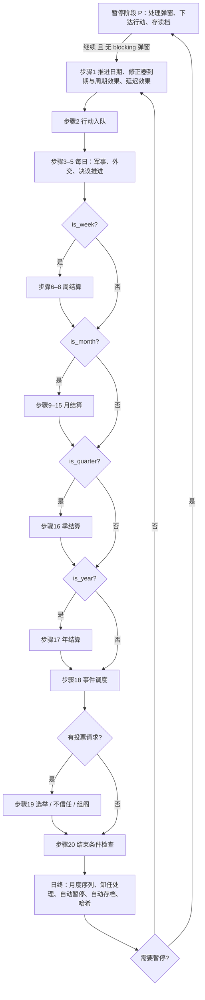
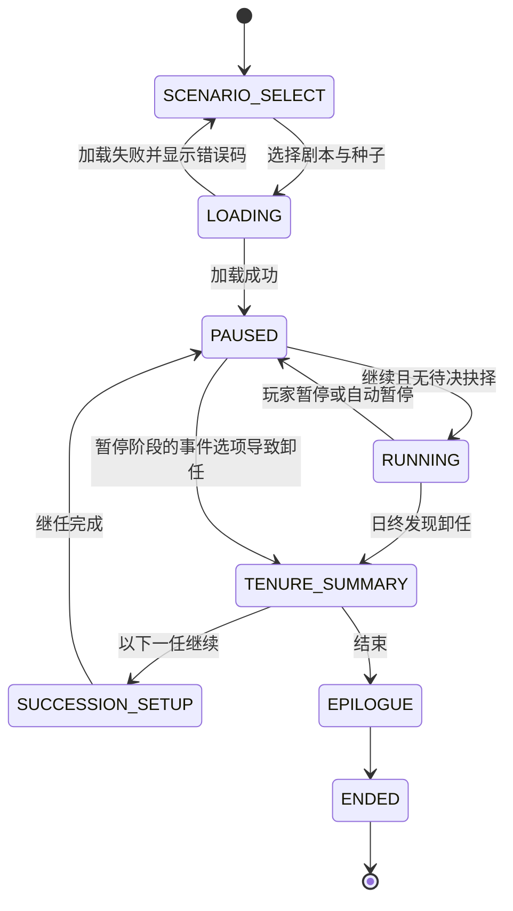

# M01 核心循环与结算顺序

> 本规格是全部模块的运行骨架：游戏状态对象、每日20步结算、效果队列、修正器、时间与暂停、随机数、存档、剧本加载、卸任与继任、custom 处理函数登记表、性能预算、Python/Godot 一致性测试。
> 所有算例与初始数据以 **贝京 1977（1977-06-20 开局）** 为准；规则通用于全部剧本。
> 本文中的"必须/禁止"是硬性要求；所有数字都是初值，校准项列在第12节。

---

## 0. 元信息

| 项 | 内容 |
|---|---|
| 版本 | v1.0（2026-10-16） |
| 作者 | 子代理：商业策略游戏系统设计师（M01） |
| 依赖 | [contracts.md](../contracts.md)（结算顺序、效果格式、表达式语言、读写矩阵）；[registry/parameters.yaml](../registry/parameters.yaml)；M12（表达式语法与事件调度，本文只定义 M01 需要的函数语义）；M14（剧本数据、结局与历史评价）；M15（界面呈现） |
| 被依赖 | M02–M15 全部模块：每个模块的结算函数由 M01 按第4.2节的顺序调用，所有写入通过第4.3节的效果队列 |
| 语言约束 | Python 3.9（禁用 `match`、`X \| Y` 类型标注）；Godot 4.x GDScript |

### 0.1 本模块负责满足的对标标准

| 标准（来源） | 门槛 | M01 的满足方式 | 验收测试 |
|---|---|---|---|
| P1 推进速度（paradox_lessons §5.3-G） | 5档 ≥ 10日/秒 | 5档每日最短间隔50ms（20日/秒上限）；单日结算预算 ≤ 2ms（第4.10节） | T13 |
| P2 后期退化（paradox_lessons §5.3-G） | 第30年单日耗时 ≤ 第1年 × 1.3 | 第4.10节的7条复杂度规则（禁止日结算扫描历史、堆结构管理到期、事件候选增量维护） | T13 |
| P3 存档增长（paradox_lessons §5.3-G） | 线性，30年 ≤ 第1年 × 5 | 历史只存月度摘要序列（第3.9节），事件日志定长记录 | T12 |
| P4 单帧峰值（paradox_lessons §5.3-G） | 月度/年度结算 ≤ 100ms | 月结算 ≤ 30ms、年结算 ≤ 60ms 预算；结算在独立于渲染的逻辑帧中执行 | T13 |
| R26 打断频率（benchmarks §6.2-D） | 默认每游戏月强制弹窗 ≤ 3 | 自动暂停规则表（第4.6节）默认只有"抉择事件、战争、锚点被动事件、危机告警"四类暂停；`forced_popups_month` 计数器供 M12 限流 | T09 |
| R27 漏读兜底（benchmarks §6.2-D） | 100% 触发强制简报 | 自动暂停 AP12 不可关闭为"忽略"（第4.6节） | T09 |
| R15 / U1 / D2 因果可解释（benchmarks、paradox） | 100% 可见数值能拆解前5项贡献 | 效果解释器在每次应用数值效果时写入"贡献账本"（第3.10节），界面直接读取 | T05 |
| R11 单局时长（benchmarks §6.2-A） | 首个任期3–6小时 | 速度档位与自动暂停默认值按"4年任期纯推进时间约8.5分钟（3档）+ 阅读决策时间"设计（第4.5节） | 第12节校准 |
| S7 铁人模式（benchmarks §3.5） | 有 | 铁人存档规则（第4.8.5节） | T11 |
| S10 跨剧本继承 / K1 放手的张力（benchmarks） | 继任者继承世界状态 | 卸任→总结→继任流程（第5.3节），继承表（第4.9.4节） | T14 |
| D18 / 3.11 可模组（paradox_lessons） | 数据驱动 | 剧本、修正器、custom 名称、迁移脚本全部是数据文件；引擎只解释执行 | T10 |
| D19 性能从第一天就测（paradox_lessons） | 每次构建自动跑 | 黄金文件与性能基准纳入 CI（第4.11节） | T13、T15 |
| 移植验收（contracts §1） | Python 与 Godot 跑 N 天误差 ≤ 1e-6 | 自研整数随机数、规范化序列化、量化规则、可移植算术白名单（第4.4、4.11节） | T01、T15 |
| 对标锚点"观感接近P社但复杂度更低"（design_document 开头） | — | P社式日期/速度控件、醒目暂停、可配置消息（第9节）；不引入P社的多层消息设置，只用三档（暂停/通知/忽略） | — |

**要超过或避免的点**：Stellaris/Vic3 后期卡顿（A14）；白日升"通知不会消失"（W-x4）；朴正熙纪事"每月巡检冷却"（K-x3，M01 提供"冷却结束提醒"AP11）；Imperator 点数计时器（A1，M01 不设任何计时型资源）。

---

## 1. 设计意图

- **核心取舍（一句话）**：玩家在"让时间流动以推进进程"与"停下来处理局势"之间取舍；时间本身是资源——承诺有期限、决议有工期、大选有日程，而每一天都可能带来新事件。
- **决策频率**：M01 本身产生的决策是节奏决策（暂停、调速、存档）。在默认设置下，每游戏月平均出现 1–3 次自动暂停（来自抉择事件与告警），玩家每月主动暂停的次数不由系统限制。决策信息来源：顶栏日期与速度、告警条、消息日志、自动暂停原因列表（第9节）。
- **失败状态与恢复路径**：M01 不定义失败，只执行 M14 的结束判定（第4.2节步骤20）。卸任后可以选择以继任者继续（第5.3节），这是"失败后的恢复路径"：玩家留下的矛盾由继任者承接。
- **后期（第10–20年）保持新鲜感的方式**：M01 保证三件事：①第30年的结算速度与第1年相差不超过30%（不因卡顿劝退）；②历史债务型修正器的强度随年数增长（第4.7.6节），后期压力自动加深；③继任流程让一局可以跨越多任总理，每任重置承诺、走廊、愿景。

---

## 2. 读写清单

M01 不是任何 parameters.yaml 参数的 owner（见 contracts §6）。它对参数的"写"全部是**代为应用**其他来源的效果（修正器周期效果、延迟效果），在步骤1提交、步骤1末尾应用，来源记为修正器或原效果的来源。

| 参数ID | 读/写 | 结算步骤 | 说明 |
|---|---|---|---|
| 全部参数 | 写（代应用） | 1、P（暂停阶段） | 修正器周期效果、到期的延迟效果；事件选项效果在暂停阶段由解释器应用 |
| 全部参数 | 写（解释器） | 1–20 每步末尾 | 效果解释器统一应用各步提交的效果（第4.3节）；M01 是解释器的实现者，不是数值决策者 |
| 全部参数 | 读 | 1、20后 | 步骤1：修正器 `remove_if` 表达式；日终：月度历史序列记录、自定义自动暂停条件 |
| `political_capital` | 写（继任重置） | 卸任流程 | 继任者就任时 `set 40`（第4.9.4节），来源记为 `succession` |
| `party_standing` | 写（继任重置） | 卸任流程 | 第4.9.4节继承表 |
| `promise_progress`、`stance_deviation`、`vision_progress` | 写（继任重置） | 卸任流程 | 通过 custom `m04_reset_goals_for_leader`（M04 处理），M01 只负责调用 |
| `historical_rating` | 读 | 卸任流程 | 写入任期档案（TenureRecord） |
| `coalition_seats` | 读 | 日终 | 自动暂停 AP07 |

---

## 3. 状态与数据结构

### 3.1 通用约定

| 约定 | 规则 |
|---|---|
| 数值类型 | 所有参数值、修正器数值、效果数值在内存中一律为 64 位浮点（Python `float`，GDScript `float`）。计数、日序、席位、随机数状态为整数 |
| 量化 | 每一步末尾，被写入的每个参数值执行 `q(x) = floor(x × 1000000 + 0.5) / 1000000`。只对本步被写入的值执行 |
| ID 字符集 | 所有 ID（参数、键、旗标、修正器、事件、人物、政党）只允许 ASCII 字符 `A–Z a–z 0–9 _ - .`；中文名放在 `name_zh` 字段 |
| 遍历顺序 | 任何影响状态的遍历必须先把键按 ASCII 码点升序排序；**禁止**依赖字典插入顺序 |
| 日序 | `day_index` = 自剧本开局日起的天数，开局日为 0。日期与日序的换算见第4.5.1节 |
| 空值 | 表示"永久""无"的整数字段用 `-1`，不用 `null`（Godot JSON 对 null 与数字混用处理不一致） |

### 3.2 GameState 顶层结构

| 字段 | 类型 | 默认值 | 计入状态哈希 | 说明 |
|---|---|---|---|---|
| `meta` | Meta | 见3.3 | 部分 | 版本、剧本、种子 |
| `clock` | Clock | 见3.4 | 是 | 日期与周期标记 |
| `run` | RunControl | 见3.4 | 否 | 速度、暂停（不影响模拟结果） |
| `params` | Dict[str, float 或 Dict[str, float]] | 剧本快照 | 是 | 全国参数直接存值；带 scope 的参数存 `{键: 值}` |
| `param_status` | Dict[str, str] | 按 era 计算 | 是 | `"active"` 或 `"inactive"`（第4.3.6节） |
| `flags` | Dict[str, FlagEntry] | 剧本快照 | 是 | 旗标 |
| `modifiers` | ModifierStore | 剧本快照 | 是 | 见第3.6节 |
| `delayed_effects` | List[DelayedEffect] | `[]` | 是 | 按 `(due_day, seq)` 升序 |
| `scheduled_events` | List[ScheduledEvent] | `[]` | 是 | 按 `(due_day, seq)` 升序 |
| `forced_events` | List[str] | `[]` | 是 | 今日步骤18必须处理的事件ID（来自 `trigger_event` 与到期的 `schedule_event`） |
| `ui_queue` | List[PopupEntry] | `[]` | 是 | 等待玩家处理的弹窗（第3.8节） |
| `rng` | Dict[str, RngState] | 由种子生成 | 是 | 各子流状态（第4.4节） |
| `player` | PlayerSlot | 剧本 | 是 | 当前玩家扮演的总理 |
| `tenures` | List[TenureRecord] | `[]` | 是 | 已结束任期的档案 |
| `history` | History | 空 | 是 | 月度序列、事件日志（第3.9节） |
| `contrib` | ContribLedger | 空 | 是 | 贡献账本（第3.10节） |
| `modules` | Dict[str, dict] | 各模块 `init_module` 生成 | 是 | 各模块私有状态块，键为 `"M02"`…`"M15"`，内部结构由各模块规格定义 |
| `counters` | Counters | 见3.11 | 是 | 唯一编号计数器、月度计数 |
| `pending` | Pending | 空 | 是 | 待处理的卸任、选举请求 |
| `input_log` | List[InputRecord] | `[]` | 否 | 玩家输入记录（复现与黄金测试用） |
| `stats` | Stats | 空 | 否 | 性能计时 |
| `errors` | List[ErrorRecord] | `[]` | 否 | 运行时错误与警告（最多保留最近500条） |

### 3.3 Meta

| 字段 | 类型 | 示例（贝京1977） | 计入哈希 |
|---|---|---|---|
| `save_version` | int | `1` | 是 |
| `game_version` | str | `"0.1.0"` | 否 |
| `scenario_id` | str | `"begin_1977"` | 是 |
| `master_seed` | int（0..4294967295） | `19770620` | 是 |
| `ruleset_hash` | str（SHA-256 十六进制，64字符） | 构建数据文件的哈希 | 否 |
| `ironman` | bool | `false` | 是 |
| `modified` | bool | `false`（存档被外部修改时置真） | 否 |
| `created_real_time` | str（ISO 8601） | `"2026-10-16T18:00:00Z"` | 否 |
| `completed` | bool | `false`（玩家选择"不再继续"后置真，存档只读） | 是 |

### 3.4 Clock 与 RunControl

**Clock**

| 字段 | 类型 | 范围 | 默认（开局） | 说明 |
|---|---|---|---|---|
| `start_date` | str `YYYY-MM-DD` | — | `"1977-06-20"` | 剧本开局日 |
| `date` | str | — | `"1977-06-20"` | **最后一个已结算完毕的日期**（开局日视为已结算） |
| `day_index` | int | 0..40000 | 0 | `date` 对应的日序 |
| `abs_day` | int | — | 2727 | 自 1970-01-01 起的天数（第4.5.1节） |
| `y`、`m`、`d` | int | — | 1977、6、20 | 拆分字段，便于读取 |
| `weekday` | int | 0..6 | 0 | 0=星期一 … 6=星期日；1977-06-20 是星期一 |
| `is_week`、`is_month`、`is_quarter`、`is_year` | bool | — | 全部 false | 今日是否为周/月/季/年结算日（第4.5.2节） |

**RunControl**（不计入哈希，读档时恢复为"暂停、速度沿用存档值"）

| 字段 | 类型 | 范围 | 默认 |
|---|---|---|---|
| `phase` | str | `SCENARIO_SELECT`/`LOADING`/`RUNNING`/`PAUSED`/`TENURE_SUMMARY`/`SUCCESSION_SETUP`/`EPILOGUE`/`ENDED` | `PAUSED` |
| `speed` | int | 1..5 | 2 |
| `paused` | bool | — | true |
| `pause_reasons` | List[str] | 自动暂停规则ID | `["AP00"]`（开局暂停） |
| `headless` | bool | — | false（机器人/批量模拟为 true，此时不发生自动暂停） |

### 3.5 参数存储与 FlagEntry

- 全国参数：`params["inflation"] = 35.0`。
- 带 scope 的参数：`params["bloc_support"] = {"haredi": 60.0, "mizrahi": 52.0, ...}`。字典里只出现**当前存在的键**；新增键只能通过该参数 owner 的 custom 处理函数 `activate_key`（第4.12节）。
- `derived` 参数同样存值，由 owner 在其结算步骤用 owner 写入（第4.3.3节）更新，其他来源写入一律拒绝。

**FlagEntry**

| 字段 | 类型 | 说明 |
|---|---|---|
| `set_day` | int | 设置时的 `day_index`；剧本初始旗标为 0 |
| `value` | float | 默认 1.0；旗标只需"存在"时取 1.0 |
| `source` | str | 例如 `"E-1977-06:A"`、`"scenario"` |

清除旗标即从字典中删除该键。`flag("x")` 当且仅当键存在时为真。

### 3.6 修正器数据结构

#### 3.6.1 修正器定义（`data/modifiers.yaml`，构建为 JSON）

| 字段 | 类型 | 必填 | 默认 | 说明 |
|---|---|---|---|---|
| `id` | str | 是 | — | 英文ID |
| `name_zh` | str | 是 | — | 界面名称，与事件库一致 |
| `category` | str | 是 | — | `economic`/`security`/`social`/`political`/`diplomatic`/`religious`/`personal`/`debt`，界面分组用 |
| `scope_type` | str | 是 | — | parameters.yaml 的 scope 取值之一；`national` 时实例 `scope_key = ""` |
| `hidden` | bool | 否 | false | 隐藏修正器不进入界面列表、不出现在贡献账本的可见来源中（显示为"未知因素"） |
| `duration` | Duration | 否 | 永久 | `{unit: days, n: 180}` 或 `{unit: months, n: 36}`；省略即永久 |
| `remove_on` | List[str] | 否 | `[]` | 生命周期信号（第4.7.4节） |
| `remove_if` | str | 否 | — | 表达式；每月结算日的步骤1求值，为真时移除 |
| `stacking` | str | 否 | `refresh` | `refresh`/`extend`/`stack`/`ignore`（第4.7.2节） |
| `max_stacks` | int | 否 | 1 | 仅 `stack` 有效，上限 10 |
| `periodic` | List[Periodic] | 否 | `[]` | `{period: daily/weekly/monthly/quarterly/yearly, effects: [Effect...]}` |
| `factors` | List[Factor] | 否 | `[]` | `{key: str, mode: add_pct/mult/add_flat, value: float}`（第4.7.5节） |
| `hooks` | List[Hook] | 否 | `[]` | `{on: action_completed/event_option_chosen, tag: str, effects: [Effect...]}` |
| `debt` | Debt | 否 | — | `{growth_per_year: float, cap: float}`，历史债务型（第4.7.6节） |
| `desc_zh` | str | 是 | — | 提示框文字；必须写出每条效果 |

**完整示例**（贝京1977相关）：

```yaml
modifiers:
  - id: indexation_spiral
    name_zh: 指数化螺旋
    category: economic
    scope_type: national
    duration: {unit: months, n: 36}
    remove_if: 'has_modifier("new_shekel")'
    stacking: refresh
    periodic:
      - period: quarterly
        effects:
          - {op: add, target: inflation, value: 3}
    desc_zh: "工资与物价互相追赶。每季度通胀 +3。打破工资指数化或推出新谢克尔后移除。"

  - id: silent_pm
    name_zh: 沉默的总理
    category: personal
    scope_type: national
    remove_on: [leader_change]
    factors:
      - {key: pc_income, mode: add_pct, value: -30}
      - {key: oratory_effect, mode: add_pct, value: -50}
    periodic:
      - period: monthly
        effects:
          - {op: trigger_event, target: event, key: "E-1983-08", chance: 0.10}
    desc_zh: "政治资本月产出 −30%，演说类效果 −50%，每月10%概率触发「我不能再继续了」。"

  - id: uncapped_exemption
    name_zh: 无上限豁免
    category: debt
    scope_type: national
    periodic:
      - period: yearly
        effects:
          - {op: add, target: draft_exemption, value: 1}
    debt: {growth_per_year: 0.25, cap: 3.0}
    desc_zh: "取消耶希瓦学生豁免上限。每年兵役豁免规模 +1，强度每年 +0.25 倍，最高3倍。"

  - id: settlement_freeze_dispute
    name_zh: 冻结之争
    category: diplomatic
    scope_type: national
    duration: {unit: months, n: 12}
    hooks:
      - on: action_completed
        tag: settlement
        effects:
          - {op: add, target: us_admin_relation, value: -3}
    desc_zh: "每次完成定居点决议，美国政府关系 −3。"
```

#### 3.6.2 修正器实例（存于 `state.modifiers.active`）

| 字段 | 类型 | 说明 |
|---|---|---|
| `uid` | int | 来自 `counters.next_modifier_uid`，从1开始递增，永不复用 |
| `def_id` | str | 定义ID |
| `scope_key` | str | 例如 `"mizrahi"`；全国为 `""` |
| `start_day` | int | 生效日序（被应用的那一天） |
| `end_day` | int | 到期日序；永久为 `-1` |
| `stacks` | int | 1..10 |
| `strength` | float | 1.0 起；债务型按第4.7.6节增长 |
| `source` | str | 例如 `"E-1977-10:A"` |

`ModifierStore = {active: List[ModifierInstance]（按 uid 升序）}`。运行时缓存（不存档）：`by_def: Dict[(def_id, scope_key), uid]`、到期最小堆、`factor_cache`。

### 3.7 效果（Effect）在内存中的形态

数据格式遵循 contracts §4；M01 增加的字段见附录B-2。

| 字段 | 类型 | 必填 | 说明 |
|---|---|---|---|
| `op` | str | 是 | contracts §4 的12种 |
| `target` | str | 是 | 参数ID；`add_modifier`/`remove_modifier` 时为 `"modifier"`；旗标操作为 `"flag"`；事件操作为 `"event"`；`custom` 时为 `"custom"` |
| `key` | str | 视 op | scope 键、修正器ID、旗标ID、事件ID、custom 处理函数名 |
| `value` | float / dict | 视 op | 数值；`add_modifier` 时为 `{scope_key, duration?}`；`custom` 时为参数字典 |
| `scale` | str | 否 | 表达式，默认 `"1"` |
| `delay_days` | int | 否 | 默认 0 |
| `chance` | float | 否 | 省略表示不掷骰 |
| `priority` | int | 否 | 默认 0；只对 `set` 冲突有意义；owner 写入固定 100 |
| `source` | str | 引擎填写 | 例如 `"M10:step9"`、`"E-1977-11:A"`、`"mod:12"` |
| `seq` | int | 引擎填写 | 本步内的提交序号，从0开始 |

### 3.8 弹窗队列 PopupEntry

| 字段 | 类型 | 说明 |
|---|---|---|
| `uid` | int | `counters.next_popup_uid` |
| `event_id` | str | 例如 `"E-1977-06"` |
| `kind` | str | `choice`（抉择）/ `passive`（被动，效果已应用，只需确认） |
| `blocking` | bool | 抉择事件为 true：未处理时禁止恢复时间推进 |
| `minor` | bool | 【小】事件为 true：可交给顾问 |
| `created_day` | int | 进入队列的日序 |
| `auto_resolve_day` | int | `minor` 为 true 时 = `created_day + 30`，到期由顾问在步骤18自动选择（M12 定义选择规则）；否则 `-1` |
| `slots` | Dict[str, str] | 随机槽位的抽取结果（R- 事件） |

### 3.9 History（月度摘要与日志）

| 字段 | 类型 | 写入时机 | 上限 |
|---|---|---|---|
| `series_ids` | List[str] | 剧本加载时固定 | 见下表 |
| `series` | Dict[str, List[float]] | 每个月结算日的日终（步骤20之后），追加当日终值 | 每序列每月1个值 |
| `series_start_day` | int | 第一个月结算日的日序 | — |
| `event_log` | List[EventLogEntry] | 每次事件结算 | 每条 ≤ 6 个字段 |
| `event_last_day` | Dict[str, int] | 每次事件结算时更新 | 每个事件ID一项（供 `months_since(event(...))` O(1) 查询） |
| `turning_points` | List[dict] | M14 通过 custom `m14_record_turning_point` 追加 | M14 定义 |

**固定序列表**（共22个全国序列 + 全部 `bloc_support` 键 + 全部 `promise_progress` 键）：
`political_capital, party_standing, coalition_seats, centralization, intl_legitimacy, us_admin_relation, us_congress_relation, inflation, growth, unemployment, budget_balance, public_debt, fx_reserves, readiness, deterrence, public_security, rule_of_law, settler_momentum, economic_model, inequality, pal_hostility, vision_progress`。序列ID写作 `param` 或 `param[key]`。

**EventLogEntry**：`{day: int, id: str, opt: str（"A"/"B"/"C"/"passive"/"auto"）, kind: str（"E"/"R"）, slots_hash: str（槽位组合的前8位十六进制，无槽位为""）}`。

### 3.10 贡献账本 ContribLedger

供界面"前5项贡献"（R15、U1、D2）使用。

| 字段 | 类型 | 说明 |
|---|---|---|
| `month_key` | str | 当前统计月 `"1977-06"` |
| `current` | Dict[str, Dict[str, float]] | `{目标键: {来源: 累计变化量}}`；目标键写作 `param` 或 `param[key]` |
| `previous` | 同上 | 上一个月的完整账本 |

- 每个目标键每月最多记录 32 个来源；第33个起的来源累加到 `"other"`。
- 月结算日的步骤1开始时：`previous = current`，`current = {}`，`month_key` 更新。
- 来源命名：事件选项 `"E-1977-11:A"`，修正器 `"mod:<def_id>"`，模块结算 `"M10:step9"`，玩家行动 `"act:<action_id>"`，继任 `"succession"`。隐藏修正器记为 `"hidden"`。

### 3.11 Counters、Pending、PlayerSlot、TenureRecord

**Counters**：`next_modifier_uid`（1起）、`next_popup_uid`（1起）、`next_delayed_seq`（0起）、`next_input_seq`（0起）、`forced_popups_month`（每月结算日步骤1清零；M12 每弹出一个 `blocking` 弹窗加1）。

**Pending**：

| 字段 | 类型 | 说明 |
|---|---|---|
| `tenure_end` | dict 或空 | `{reason: str, day: int, source: str}`，由 custom `end_tenure` 写入，步骤20之后处理 |
| `vote_requests` | List[dict] | 由事件或行动提交的选举、不信任投票、组阁请求（每项含 `{type, due_day, ...}`，默认 `due_day = day_index`），步骤19仅由 M03 处理并移除 `due_day <= day_index` 的到期请求，未到期者保留（D-042） |
| `signals` | List[str] | 本步提交的生命周期信号，步骤末尾处理后清空（存档时必为空） |

**PlayerSlot**：`{leader_id: "begin", party_id: "likud", tenure_index: 0, tenure_start_day: 0, fictional: false}`。

**TenureRecord**：

| 字段 | 类型 | 说明 |
|---|---|---|
| `tenure_index` | int | 0起 |
| `leader_id`、`party_id` | str | — |
| `fictional` | bool | 是否为生成的虚构继任者 |
| `start_day`、`end_day` | int | — |
| `end_reason` | str | 第4.9.1节枚举 |
| `promises` | List[dict] | `{id, final_progress, fulfilled: bool}`，由 M04 提供 |
| `vision_progress_final` | float | — |
| `historical_rating_final` | float | — |
| `series_range` | [int, int] | 本任期在月度序列中的起止下标 |
| `event_count` | int | 本任期事件数 |

### 3.12 剧本目录与 YAML schema

```
data/scenarios/begin_1977/
  scenario.yaml        剧本元信息（M01 定义，下方示例）
  snapshot.yaml        全部参数初值（M14 维护，M01 校验）
  flags.yaml           初始旗标
  modifiers.yaml       初始修正器实例
  modules/             各模块的初始私有状态（M03 联合政府、M06 人物、M04 目标……）
```

**scenario.yaml 完整示例**：

```yaml
id: begin_1977
name_zh: 贝京 1977
start_date: "1977-06-20"
default_seed: 19770620
leader_id: begin
party_id: likud
era_file: "04_1977_1992"
opening_events: ["E-1977-06"]      # 第0日在暂停阶段弹出，按列表顺序
dynamic_regions: [west_bank, gaza, golan, sinai]
series_extra: []                    # 剧本额外记录的月度序列（可空）
required_modules: [M02, M03, M04, M05, M06, M07, M08, M09, M10, M11, M12, M13, M14, M15]
min_save_version: 1
```

**M01 测试夹具** `tests/fixtures/m01_begin_1977_min.json`：只用于 M01 自身验收测试，数值取史实近似，正式剧本数值以 M14 的 `snapshot.yaml` 为准。

```yaml
params:
  political_capital: 40
  party_standing: 70
  coalition_seats: 61
  centralization: 5
  budget_balance: -2
  public_debt: 120
  fx_reserves: 35
  inflation: 35
  growth: 1.5
  unemployment: 3.5
  readiness: 65
  mobilization: 5
  deterrence: 60
  complacency: 40
  intl_legitimacy: 45
  us_admin_relation: 55
  us_congress_relation: 65
  rule_of_law: 68
  public_security: 60
  economic_model: -45
  inequality: 35
  union_strength: 70
  settler_momentum: 50
  religious_status_quo: 10
  draft_exemption: 8
  pal_hostility: 55
  pal_living_standard: 45
  vision_progress: 0
  historical_rating: 0
  judicial_conflict: 10        # era [1992, null]，开局为 inactive
  state_integration: 80        # era [1948, 1950]，开局为 inactive
  bloc_support: {labor_ashkenazi: 30, mizrahi: 52, kibbutz_moshav: 15, religious_zionist: 55, haredi: 45, arab_citizens: 5, liberal_middle: 38}
  alienation: {mizrahi: 45, ethiopian: 30}
  regime_hostility: {egypt: 58, jordan: 55, syria: 80, lebanon: 40, iraq: 85, saudi: 70}
  promise_progress: {settle_eretz_israel: 0, economic_liberalization: 0, social_justice: 0, peace_and_security: 0}
flags:
  likud_in_power: {set_day: 0, value: 1, source: scenario}
  bank_shares_regulation: {set_day: 0, value: 1, source: scenario}
modifiers: []
```

---

## 4. 规则与公式

### 4.1 运行阶段总览

每个游戏日由三段组成：

1. **暂停阶段 P**（day_index = N 已结算完毕，时间未推进）：玩家处理弹窗、下达行动、存读档。事件选项效果在此阶段立即由解释器应用（子流 `events`）；下达的行动只写入 `modules.M05` 的待入队列表，在第 N+1 日步骤2进入执行队列。
2. **结算阶段**：第 N+1 日的步骤1–20（第4.2节）。
3. **日终阶段**：月度序列记录、卸任处理、自动暂停判定、自动存档、日哈希（第4.2.3节）。

时间推进时没有暂停阶段的输入，直接从日终进入下一日的结算阶段。

### 4.2 每日20步结算

#### 4.2.1 步骤表

每一步的函数签名统一为 `run_step(step_no: int, state: GameState, ctx: TickContext) -> List[Effect]`。多模块步骤（12、17）按表中顺序依次调用，**各子步骤读取同一份步骤开始时的状态**，效果合并后在该步骤末尾一次应用（先提交者 `seq` 小）。

| 步 | 模块（函数） | 运行条件 | 随机子流 | 内容 |
|---|---|---|---|---|
| 1 | M01 `core_advance_day` | 每日 | `core` | 第4.2.2节的8个子动作 |
| 2 | M05 `actions_intake` | 每日 | `core` | 暂停阶段下达的行动进入执行队列 |
| 3 | M09 `military_daily` | 每日 | `combat` | 军事行动、战争推进、动员 |
| 4 | M07 `diplomacy_daily` | 每日 | `world` | 谈判进度、危机倒计时 |
| 5 | M05 `actions_progress` | 每日 | `politics` | 执行中决议推进；完成者结算效果并触发修正器 `hooks`（`action_completed`） |
| 6 | M06 `ai_weekly` | `is_week` | `ai` | AI 部长与人物行动 |
| 7 | M03 `parliament_weekly` | `is_week` | `politics` | 民调、集团支持、议程与投票 |
| 8 | M09 `security_weekly` | `is_week` | `combat` | 公众安全感、区级安全 |
| 9 | M10 `finance_monthly` | `is_month` | `economy` | 财政月度收支、外汇 |
| 10 | M02 `contradictions_monthly` | `is_month` | `politics` | 矛盾参数漂移 |
| 11 | M04 `party_monthly` | `is_month` | `politics` | 立场偏离、党内地位、承诺到期 |
| 12 | M07 `world_monthly` → M08 `palestine_monthly` | `is_month` | `world` | 外部世界轨道与扰动、巴勒斯坦派系 |
| 13 | M11 `regions_monthly` | `is_month` | `world` | 区级数值、人口迁移 |
| 14 | M13 `centralization_monthly` | `is_month` | `politics` | 集权度、阻力方阈值 |
| 15 | M05 `pc_income_monthly` | `is_month` | `politics` | 政治资本月产出（读取 `factor("pc_income")`） |
| 16 | M10 `economy_quarterly` | `is_quarter` | `economy` | 增长、通胀、失业 |
| 17 | M10 `budget_yearly` → M06 `characters_yearly` → M11 `demography_yearly` | `is_year` | `economy` / `ai` / `world`（按子步骤） | 预算期限、年龄健康、人口结构 |
| 18 | M12 `events_daily` | 每日 | 固定事件 `events`；随机事件 `random_events` | 先处理 `forced_events`，再固定事件条件检查，再随机事件掷骰，再顾问自动处理到期的 minor 弹窗 |
| 19 | M03 `votes_on_demand` | `pending.vote_requests` 存在 `due_day <= day_index` 的到期项 | `elections` | 大选、不信任投票、组阁（仅消费到期项，未到期项保留，D-042） |
| 20 | M14 `end_check` | 每日 | `core` | 结束条件检查；需要结束时调用 custom `end_tenure` |

不满足运行条件的步骤直接跳过（不调用模块、不消耗随机数、不执行"步骤末尾应用"）。

**TickContext 字段**：`day_index, date, y, m, d, weekday, is_week, is_month, is_quarter, is_year, days_in_month, step_no, module_id, rng`（`rng` 为该步/子步骤指定子流的生成器对象）。

#### 4.2.2 步骤1的8个子动作（按顺序）

| 子动作 | 内容 |
|---|---|
| 1a | `day_index += 1`；由 `abs_day + 1` 计算 `date, y, m, d, weekday`；计算四个周期标记 |
| 1b | 若 `is_month`：账本轮换（3.10）；`forced_popups_month = 0` |
| 1c | 若 `is_year`：按 era 更新 `param_status`（第4.3.6节） |
| 1d | 移除到期修正器：`end_day != -1 且 end_day <= day_index`；若 `is_month`，按 uid 升序对含 `remove_if` 的修正器求值，为真则移除 |
| 1e | 若 `is_month`：更新债务型修正器强度（第4.7.6节） |
| 1f | 释放到期的延迟效果（`due_day == day_index`，按 `seq` 升序）加入本步效果列表；释放到期的 `scheduled_events` 追加到 `forced_events` |
| 1g | 生成修正器周期效果：遍历 `active`（uid 升序），对每个 `periodic` 条目（定义中的顺序），若其周期今日触发且 `day_index > start_day`，复制其效果（数值乘以 `strength × stacks`），来源 `mod:<def_id>`，加入本步效果列表 |
| 1h | 步骤1末尾按第4.3节应用全部效果 |

周期触发判定：`daily` 每日；`weekly` 为 `is_week`；`monthly` 为 `is_month`；`quarterly` 为 `is_quarter`；`yearly` 为 `is_year`。

#### 4.2.3 日终阶段（步骤20之后，按顺序）

1. 若 `is_month`：对每个 `series_ids` 追加当前值（缺失键记 0.0）。
2. 若 `pending.tenure_end` 非空：进入卸任流程（第4.9节），本日剩余日终动作照常执行。
3. 自动暂停判定（第4.6节，`headless` 时跳过）。
4. 自动存档判定（第4.8.4节，`headless` 时跳过）。
5. 调试/黄金模式下计算并输出日哈希（第4.11节）。
6. 记录性能计时（`stats`）。

**算例（贝京1977第一年）**：开局 `day_index = 0`（1977-06-20，星期一）。第一个结算日是 1977-06-21（day 1）。第一年（day 1–365，1977-06-21 至 1978-06-20）内：周结算日（星期日）52次，首个为 1977-06-26（day 6）；月结算日12次，首个为 1977-07-01（day 11）；季结算日4次，首个为 1977-07-01；年结算日1次，为 1978-01-01（day 195）。

### 4.3 效果队列的应用规则

#### 4.3.1 提交与延迟

- 每步内，模块函数返回的效果按返回顺序编号 `seq = 0, 1, 2…`（多模块步骤按子步骤顺序连续编号）。
- `delay_days > 0` 的效果不在本步应用：写入 `delayed_effects`，`due_day = 当前结算日 day_index + delay_days`，`seq = counters.next_delayed_seq++`。在暂停阶段提交的延迟效果，"当前结算日"取已结算的 `day_index`，所以 `delay_days = 1` 在下一个结算日释放。
- 延迟效果的 `chance` 与 `scale` **在释放时**求值（步骤1，子流 `core`）。

#### 4.3.2 应用算法 `apply_effects(effects, step_ctx, depth=0)`

按以下8个阶段顺序执行，每个阶段内部按 `seq` 升序：

| 阶段 | 动作 |
|---|---|
| A 校验 | 逐条检查：op 已知；target/key 存在；`derived` 参数只接受 owner 写入；`custom` 名称已登记（第4.12节）。不合格者丢弃并记录错误码（第10节）；严格模式（测试与 Python 参考实现默认）下抛出异常 |
| B 掷骰 | 对含 `chance` 字段的效果，从本步子流取一次 `next_float()`，`f < chance` 为成功；失败者丢弃。**只要字段存在就必定消耗一次随机数**（包括 `chance >= 1` 或 `<= 0`），保证系数校准时随机流不错位 |
| C 缩放 | 对每条效果求 `s = eval(scale)`（读本步开始时的状态），缺省 `s = 1` |
| D 结构 | `remove_modifier` → `add_modifier` → `clear_flag` → `set_flag`，各自按 seq 升序；修正器规则见第4.7节 |
| E 数值 | 对 `set/mul/add/add_relation` 按 `(target, key)` 分组，按第4.3.3节聚合 |
| F 席位 | `change_seat` 按 seq 升序交给 M03 处理函数 `m03_apply_seat_change` |
| G 自定义 | `custom` 按 seq 升序调用处理函数；处理函数返回的效果列表以 `depth+1` 递归调用本算法；`depth > 3` 时丢弃并报 `E_CUSTOM_DEPTH` |
| H 事件 | `trigger_event`：若当前步骤 ≤ 17，追加到 `forced_events`（今日步骤18处理）；若在步骤18–20或暂停阶段，追加到 `forced_events` 并在下一结算日步骤18处理。`schedule_event`：写入 `scheduled_events`，`due_day = day_index + max(1, delay_days)` |

阶段 H 之后：处理 `pending.signals`（第4.7.4节）；修正器集合有变化时把 `factor_cache` 标记为失效。

#### 4.3.3 数值聚合公式

对同一 `(target, key)`，设步骤开始时的值为 `v0`：

```
v = v0
若存在 set：取 priority 最大者，priority 相同取 seq 最大者，v = value × s
对每个 mul（seq 升序）：v = v × (1 + (value − 1) × s)
对每个 add / add_relation（seq 升序）：v = v + value × s
v = clamp(v, range_min, range_max)
v = q(v)
```

- **owner 写入**：模块对自己是 owner 的参数提交的 `set` 自动标记 `priority = 100`，所以同一步里其他来源的 `set` 不会覆盖 owner；其他来源的 `add/mul` 仍然叠加在 owner 的结果之上。
- **非 owner 的 set**：只允许来源为事件选项（M12）、玩家行动（M05）、继任流程（M01）；其他模块提交非 owner 的 `set` 报 `E_SET_NOT_ALLOWED`。
- **增量原则**：非 `derived` 参数的 owner 必须用"旧值 + 本期变化"计算新值，不得从零重算，否则其他来源上一期的 `add` 会被抹掉（见附录B-4）。
- `debt` 类型参数：非 owner 的负向 `add` 只接受来源为玩家行动（"主动偿还"），其他来源的负向 `add` 被丢弃并报 `W_DEBT_DECREASE`。

**算例1（聚合）**：`bloc_support[mizrahi]` 开局 52.0。某步提交：`add −3`（事件）、`add −2, scale "0.5"`、`mul 0.9, scale "0.5"`。
`v = 52.0 × (1 + (0.9 − 1) × 0.5) = 52.0 × 0.95 = 49.4`；`v = 49.4 − 3 − 1 = 45.4`；夹紧后 45.4。

**算例2（set 与 add 同步）**：`political_capital` 为 38.0。E-1983-08 选项A提交 `set 40`（priority 0），同时修正器提交 `add 10`。结果 `40 + 10 = 50.0`。

**算例3（夹紧）**：`public_security` 为 8.0，E-1978-03a 被动效果 `add −15` → −7 → 夹紧为 0.0。

**算例4（量化）**：`0.1 + 0.2` 写入后为 `q(0.30000000000000004) = 0.3`；`q(2.0000005) = 2.000001`；`q(−2.0000005) = −2.0`。

#### 4.3.4 贡献账本记录

阶段 E 每个分组写入后：
- 每条 `add` 记 `value × s` 到其来源；
- `set/mul` 造成的变化 `(v_final_before_clamp − v0 − Σadd)` 记到 seq 最大的 `set` 或 `mul` 的来源；
- 夹紧造成的差额 `(v − v_before_clamp)` 记到来源 `"clamp"`。

#### 4.3.5 op 语义速查

| op | target | key | value | 说明 |
|---|---|---|---|---|
| `add` | 参数ID | scope 键 | float | 加法 |
| `set` | 参数ID | scope 键 | float | 覆盖 |
| `mul` | 参数ID | scope 键 | float | 乘法，缩放后 `1 + (value−1) × s` |
| `add_modifier` | `modifier` | 修正器ID | `{scope_key: str, duration?: Duration}` | duration 省略时用定义的值 |
| `remove_modifier` | `modifier` | 修正器ID | `{scope_key: str}` | 移除该定义在该 scope 的全部实例；不存在时无操作 |
| `set_flag` | `flag` | 旗标ID | float（默认1） | 已存在时只更新 value，`set_day` 不变 |
| `clear_flag` | `flag` | 旗标ID | — | 不存在时无操作 |
| `trigger_event` | `event` | 事件ID | — | 见阶段 H |
| `schedule_event` | `event` | 事件ID | — | 需 `delay_days` |
| `add_relation` | `relation` | 人物ID | float | 等价于 `add relation[人物ID]` |
| `change_seat` | `coalition_seats` | 政党ID | float（席位变化） | 交给 M03 |
| `custom` | `custom` | 处理函数名 | dict（参数） | 见第4.12节 |

#### 4.3.6 时代未开放的参数

- `param_status` 在剧本加载时与每个年结算日按 `era` 计算：`era == null` 或 `era[0] <= y <= era[1]`（`era[1] == null` 视为无上限）为 `active`，否则 `inactive`。
- 参数从 `inactive` 变为 `active` 时保持快照中的存值（剧本快照必须给出全部参数的初值，包括未开放参数）。
- 对 `inactive` 参数的写入被丢弃并报 `W_INACTIVE_WRITE`；读取返回存值。
- **算例**：贝京1977开局，`judicial_conflict`（era [1992, null]）为 inactive，存值10；1992-01-01 的步骤1c 变为 active。`state_integration`（era [1948, 1950]）始终 inactive。

### 4.4 随机数子流与可复现性

#### 4.4.1 子流清单

| 子流 | 使用者 | 来源 |
|---|---|---|
| `events` | M12 固定事件；暂停阶段的事件选项效果 | contracts |
| `random_events` | M12 随机事件掷骰与槽位抽取 | contracts |
| `world` | M07、M08、M11 | contracts |
| `elections` | M03 步骤19 | contracts |
| `combat` | M09 | contracts |
| `core` | M01 步骤1、步骤2、步骤20；卸任流程（虚构继任者生成） | 附录B-1 新增 |
| `politics` | M02、M03 周结算、M04、M05、M13 | 附录B-1 新增 |
| `ai` | M06 | 附录B-1 新增 |
| `economy` | M10 | 附录B-1 新增 |
| `cosmetic` | 界面文字变体、音效选择等**不影响状态**的随机 | 附录B-1 新增；不存档、不计入哈希、种子取系统时间 |

#### 4.4.2 算法（Python 与 GDScript 逐位一致）

全部运算在 `[0, 2^32)` 的非负整数上进行，每次运算后与 `M = 0xFFFFFFFF` 按位与。GDScript 的 int 是 64 位有符号整数，下列运算的中间值都小于 2^49，不会溢出。

```
mul32(a, b) = ( a × (b & 0xFFFF) + (((a × (b >> 16)) & 0xFFFF) << 16) ) & M
rotl(x, k)  = ((x << k) & M) | (x >> (32 − k))

fnv1a32(name):              # 对 UTF-8 字节
  h = 0x811C9DC5
  对每个字节 c：h = mul32(h ^ c, 0x01000193)
  返回 h

fmix32(h):
  h ^= h >> 16; h = mul32(h, 0x85EBCA6B)
  h ^= h >> 13; h = mul32(h, 0xC2B2AE35)
  h ^= h >> 16; 返回 h

子流初始化(master_seed, name):
  x = fmix32(master_seed ^ fnv1a32(name))
  重复4次：
    x = (x + 0x9E3779B9) & M
    z = x
    z = mul32(z ^ (z >> 16), 0x85EBCA6B)
    z = mul32(z ^ (z >> 13), 0xC2B2AE35)
    z = z ^ (z >> 16)
    s[i] = z            # i = 0, 1, 2, 3 依次
  若 s 全为 0：s[0] = 1
  draws = 0

next_u32()  (xoshiro128**):
  r = mul32(rotl(mul32(s1, 5), 7), 9)
  t = (s1 << 9) & M
  s2 ^= s0; s3 ^= s1; s1 ^= s2; s0 ^= s3; s2 ^= t
  s3 = rotl(s3, 11)
  draws += 1
  返回 r

next_float() = (next_u32() >> 8) / 16777216.0          # [0,1)，24位精度，两端精确一致
range_int(lo, hi) = lo + next_u32() % (hi − lo + 1)     # 闭区间，hi − lo + 1 ≤ 2^31
chance(p) = next_float() < p                            # 必定消耗一次
weighted_pick(items 已按ID排序, weights) :
  W = Σ weights（按列表顺序求和）；若 W <= 0 返回第一个
  r = next_float() × W；按顺序累加，返回首个累加值 > r 的项
```

**算例（`master_seed = 19770620`）**：

| 子流 | `fnv1a32(name)` 后的种子 x | 初始状态 s0..s3 | 前3个 `next_u32` | 前3个 `next_float` |
|---|---|---|---|---|
| `core` | 418975139 | 2311705362, 4061758689, 2777752420, 1442132208 | 1043188165, 3233761027, 729440262 | 0.24288612604141235, 0.7529186606407166, 0.16983604431152344 |
| `events` | 3458443155 | 2293633261, 1492009143, 2225388946, 3767432158 | 4038072526, 988157684, 1135148507 | 0.9401869773864746, 0.23007333278656006, 0.2642973065376282 |
| `random_events` | 2882297779 | 332415052, 4269816737, 3838996493, 3287173096 | 1161669340, 3993710799, 1889462856 | 0.2704721689224243, 0.9298582077026367, 0.43992483615875244 |

（`fnv1a32("events") = 316203908`。）

#### 4.4.3 可复现性规则

1. 同一 `master_seed` + 同一剧本数据 + 同一输入日志 → 每日状态哈希完全相同。
2. 每个子流只能被第4.4.1节列出的使用者调用。M12 在暂停阶段用 `events`，在步骤18用 `events`/`random_events`。
3. 需要随机的遍历必须先按ID排序；每个元素的随机数消耗次数必须是确定的（例如"对每个候选事件掷一次"，不允许"命中后提前退出循环"导致后续元素少掷——若需要提前退出，未处理的元素仍按顺序各消耗一次）。
4. 存档保存每个子流的 `s0..s3` 与 `draws`；读档后继续生成，结果与不存档时完全相同（T11）。
5. 新增子流不会改变已有子流的序列（每个子流种子只依赖 `master_seed` 与名称）。
6. 玩家在新游戏界面可以输入种子（0..4294967295）；留空时用剧本 `default_seed`。铁人模式下种子由 `cosmetic` 生成器随机生成并写入存档。

### 4.5 时间、速度与日历

#### 4.5.1 日期换算（公历，适用1900–2100年）

```
days_from_civil(y, m, d):
  y = y − (1 if m <= 2 else 0)
  era = y // 400 ; yoe = y − era × 400
  mp = (m + 9) % 12
  doy = (153 × mp + 2) // 5 + d − 1
  doe = yoe × 365 + yoe // 4 − yoe // 100 + doy
  返回 era × 146097 + doe − 719468          # 1970-01-01 → 0

civil_from_days(z):
  z = z + 719468
  era = z // 146097 ; doe = z − era × 146097
  yoe = (doe − doe // 1460 + doe // 36524 − doe // 146096) // 365
  doy = doe − (365 × yoe + yoe // 4 − yoe // 100)
  mp = (5 × doy + 2) // 153
  d = doy − (153 × mp + 2) // 5 + 1
  m = mp + 3 if mp < 10 else mp − 9
  y = yoe + era × 400 + (1 if m <= 2 else 0)

weekday(z) = (z + 3) % 7                    # 0 = 星期一
```

1900–2100 年范围内所有操作数为非负，GDScript 整数除法（向零截断）与 Python `//` 结果相同。**算例**：`days_from_civil(1977, 6, 20) = 2727`，`weekday(2727) = 0`（星期一）。

**加月**：`add_months(y, m, d, n)`：`t = y × 12 + (m − 1) + n`，`y2 = t // 12`，`m2 = t % 12 + 1`，`d2 = min(d, 当月天数)`。算例：1979-11-30 加3个月 = 1980-02-29。

**months_since(日期1, 日期2)** = `(y2 − y1) × 12 + (m2 − m1) − (1 if d2 < d1 else 0)`。算例：E-1977-11 在 1977-11-20 结算，到 1978-09-17 为 9 个月，到 1978-09-20 为 10 个月。

**era()**（供 M12 表达式使用）：日期 < 1955-01-01 → 1；< 1967-06-01 → 2；< 1977-06-01 → 3；< 1992-07-01 → 4；其余 → 5。贝京1977开局 `era() = 4`。

#### 4.5.2 周期标记

| 标记 | 条件 | 说明 |
|---|---|---|
| `is_week` | `weekday == 6`（星期日） | 以色列内阁例会在星期日举行，周结算放在星期日 |
| `is_month` | `d == 1` | 结算上一个月 |
| `is_quarter` | `d == 1` 且 `m ∈ {1, 4, 7, 10}` | — |
| `is_year` | `m == 1` 且 `d == 1` | — |

#### 4.5.3 速度档位

| 档位 | 每游戏日最短真实间隔 | 每秒日数上限 | 4年任期（1461日）纯推进时间 |
|---|---|---|---|
| 1 | 1500 ms | 0.67 | 36.5 分钟 |
| 2（默认） | 750 ms | 1.33 | 18.3 分钟 |
| 3 | 350 ms | 2.86 | 8.5 分钟 |
| 4 | 150 ms | 6.67 | 3.7 分钟 |
| 5 | 50 ms | 20 | 1.2 分钟 |

- 单日结算耗时超过档位间隔时，下一日在本日结束后立即开始；**不跳日、不合并日**。
- 结算在逻辑帧中执行：每个渲染帧最多结算1日；Godot 用 `_process` 累计真实时间。
- 快捷键：空格 = 暂停/继续；数字键 1–5 = 设档位；`+`/`=` 加一档、`-` 减一档（1档和5档处不循环）。

### 4.6 暂停与自动暂停

#### 4.6.1 规则

1. 暂停只在日与日之间发生，结算阶段不可中断。
2. 存在 `blocking == true` 的弹窗时，`继续` 按钮不可用，并提示"有待决的事件：<事件名>"。
3. 自动暂停在日终阶段统一判定；同一日多条规则命中时只暂停一次，`pause_reasons` 列出全部命中的规则ID（按ID升序）。
4. 每条规则的模式：`pause`（暂停并弹出原因）/ `notify`（不暂停，写入消息日志）/ `ignore`。标记为"锁定"的规则不可设为 `ignore`；AP01、AP04 锁定为 `pause`。
5. 自动暂停不改变模拟状态（不计入哈希）；`headless` 下全部跳过。
6. 配置存于用户设置文件 `user://settings.json` 的 `autopause` 字段，跨存档生效；"恢复默认"按钮还原本表默认值。

#### 4.6.2 默认规则表

| ID | 条件（日终求值） | 默认 | 锁定 | 去重 |
|---|---|---|---|---|
| AP00 | 剧本加载、读档、继任完成 | pause | 是 | — |
| AP01 | 本日新增了 `blocking` 弹窗 | pause | 是（只能 pause） | — |
| AP02 | 本日结算了类型为"锚点"的被动事件 | pause | 否 | — |
| AP03 | 本日结算了其他被动事件 | notify | 否 | — |
| AP04 | 本日任一战线进入交战（M09 信号 `war_started`） | pause | 是（只能 pause） | — |
| AP05 | 距法定或已定的大选日 ≤ 30 天 | pause | 否 | 每次选举1次 |
| AP06 | 任一承诺距期限 ≤ 90 天 | notify | 否 | 每条承诺1次 |
| AP07 | `coalition_seats <= 61` 且昨日 > 61 | pause | 否 | 状态翻转时 |
| AP08 | 盟党发出退出威胁（M03 信号 `ally_threat`） | pause | 否 | — |
| AP09 | 预算法案期限 ≤ 60 天（M10 信号 `budget_deadline_60`） | pause | 否 | 每年1次 |
| AP10 | `political_capital >= 200` 且昨日 < 200 | notify | 否 | 状态翻转时 |
| AP11 | 决议完成或可重复行动冷却结束（M05 信号） | notify | 否 | — |
| AP12 | 强制简报：某面板 ≥ 90 天未打开且相关数值越过危险阈值（M15 信号 `briefing_due`） | pause | 是（可设 notify，不可 ignore） | 每阈值每90天1次 |
| AP13 | 新月份 | ignore | 否 | — |
| AP14 | 新年份 | ignore | 否 | — |
| AP15 | 内阁成员或盟党领袖死亡（M06 信号 `character_died`） | pause | 否 | — |
| AP16 | 玩家自定义条件（4.6.3） | 每条自选 | 否 | 见4.6.3 |

模块向自动暂停报告时，通过 custom `m01_raise_signal`（第4.12节）提交信号名；信号在日终被消费后清空。

#### 4.6.3 玩家自定义条件

- 最多 10 条；每条为 `{id: "U1".."U10", label: str, param: str, key: str 或 "", cmp: "<"|"<="|">"|">=", threshold: float, mode: pause|notify}`。只允许比较单个参数（可见性为 `true` 或 `fuzzy` 的参数，`fuzzy` 参数按界面显示的模糊档位中点比较）。
- 触发：条件由假变真的那一日触发；触发后进入"已触发"状态，条件连续 7 天为假后重新武装。
- **算例**：玩家设 U1 = `inflation >= 100, pause`。某次季度结算后通胀从 96 升到 104 → 当日日终暂停，原因 `AP16:U1`；通胀维持在 100 以上期间不再暂停；跌到 98 并保持 7 天后重新武装。

### 4.7 修正器的生命周期

#### 4.7.1 创建

`add_modifier` 在应用阶段 D 执行：
- `start_day = 当前结算日 day_index`（暂停阶段为已结算的 `day_index`）。
- `end_day`：`duration.unit == days` 时 `start_day + n`；`months` 时 `days_from_civil(add_months(当日日期, n)) − abs_day_of_start_date`（即日历月）；永久为 `-1`。
- `strength = 1.0`，`stacks = 1`。
- 新实例从**下一步**起影响 `factor()` 查询（本步模块读的是步骤开始时的状态）；周期效果从严格晚于 `start_day` 的第一个触发日开始。

**算例**：E-1977-10 选项A 在 1977-10-28（day 130）的暂停阶段被选择，`indexation_spiral`（36个月）的 `end_day` = 1980-10-28 的日序 = 1226。季度周期效果在 1978-01-01 至 1980-10-01 之间共触发 **12 次**，每次 `inflation +3`，合计 +36（未提前移除时）。1980-10-28 当日步骤1d移除。

#### 4.7.2 叠加规则（同一 `def_id` + `scope_key` 已存在时）

| stacking | 行为 |
|---|---|
| `refresh`（默认） | 不新建；`end_day` 重设为按新起点计算的值；`source` 更新 |
| `extend` | 不新建；`end_day += 新持续天数`（永久则不变） |
| `stack` | `stacks = min(stacks + 1, max_stacks)`；`end_day` 按 `refresh` 规则重设 |
| `ignore` | 不做任何事 |

#### 4.7.3 移除的四条途径

1. 到期（步骤1d）；2. `remove_if` 月度求值为真（步骤1d）；3. `remove_modifier` 效果；4. 生命周期信号（4.7.4）。移除时记录 `event_log` 外的修正器日志不需要；界面消息日志显示"修正器「名称」已结束"。

#### 4.7.4 生命周期信号

| 信号 | 提交者 | 含义 |
|---|---|---|
| `leader_change` | M01 卸任流程 | 玩家扮演的总理更换 |
| `tenure_end` | M01 卸任流程 | 任期结束（先于 `leader_change`） |
| `election_held` | M03 | 大选结果公布 |
| `war_end` | M09 | 所有战线停火 |
| `event:<事件ID>` | M12 | 指定事件结算 |

提交方式：custom `m01_raise_signal`。在当前应用调用的阶段 H 之后处理：移除所有 `remove_on` 含该信号的实例（uid 升序）。

#### 4.7.5 因子（factor）查询

模块通过 `factor(key, scope_key="")` 读取修正器对某个流量或成本的总影响：

```
P = Σ (value × strength × stacks)        对 mode == add_pct 的条目
X = Π (value ^ stacks)                    对 mode == mult 的条目（stacks 为整数，用连乘实现）
F = Σ (value × strength × stacks)        对 mode == add_flat 的条目
factor_mult(key) = clamp((1 + P / 100) × X, 0, 10)
factor_flat(key) = F
模块使用：结果 = 基础值 × factor_mult(key) + factor_flat(key)
```

- 只统计 `scope_key` 匹配的实例；全国修正器（`scope_key == ""`）对所有 scope 查询都生效。
- 遍历顺序：uid 升序，条目按定义顺序（保证浮点求和顺序一致）。
- 因子键由使用它的模块在其规格中登记；M01 预登记以下5个（供贝京1977事件使用）：`pc_income`（M05 政治资本月产出）、`pc_cost`（M05 行动政治资本成本）、`covert_cost`（M07 秘密行动成本）、`oratory_effect`（M03 演说类效果）、`fx_spend`（M10 外汇消耗）。

**算例**：政治资本月基础产出 15。生效修正器：`silent_pm`（`pc_income add_pct −30`）、`dollarized_daily`（「美元化的日常」，`pc_income add_flat −2`）。`factor_mult = 1 + (−30)/100 = 0.7`；`factor_flat = −2`；月产出 = 15 × 0.7 − 2 = **8.5**。若同时有「双头政府」（`pc_cost mult 1.5`），一项基础成本 20 的行动实际成本 = 20 × 1.5 = 30。

#### 4.7.6 历史债务型修正器

- 每个月结算日的步骤1e：`months_active = months_since(start日期, 今日)`；`strength = min(cap, 1 + growth_per_year × months_active / 12)`，量化后存入实例。
- 周期效果数值、`add_pct`/`add_flat` 因子都乘以 `strength`；`mult` 因子不乘。
- M05 取消此类修正器的行动成本 = 基础成本 × `strength`（M05 规格引用本字段）。
- **算例**：E-G04-03 选项A 于 1978-03-15 加入 `uncapped_exemption`（growth 0.25，cap 3.0）。1980-04-01 时 `months_active = 24`，`strength = 1 + 0.25 × 2 = 1.5`；1981-01-01 年结算的周期效果为 `draft_exemption +1 × 1.5 = +1.5`。到 1986-03-15 之后 `strength` 达到上限 3.0。

#### 4.7.7 hooks

- `action_completed`：M05 在步骤5结算一项决议时，对每个含该决议 `tag` 的 hook（遍历 active，uid 升序）把 hook 效果追加到自己的输出列表，来源 `mod:<def_id>`。
- `event_option_chosen`：M12 在应用事件选项时同理，`tag` 为选项标签（例如 `restraint`）。

### 4.8 存档格式与版本迁移

#### 4.8.1 文件

- 路径：`user://saves/<slot>.ipsave.json`；自动存档 `autosave_1..3`；快速存档 `quicksave`；铁人 `ironman_<scenario>_<种子>`。
- 编码：UTF-8 JSON，**不压缩**（Godot 的 `open_compressed` 格式与 Python gzip 不兼容）。
- 结构：

```json
{
  "header": {
    "format": "ipsim-save",
    "save_version": 1,
    "game_version": "0.1.0",
    "scenario_id": "begin_1977",
    "date": "1978-09-17",
    "day_index": 454,
    "leader_id": "begin",
    "leader_name_zh": "梅纳赫姆·贝京",
    "ironman": false,
    "ruleset_hash": "…64位十六进制…",
    "state_hash": "…64位十六进制…",
    "created_real_time": "2026-10-16T18:00:00Z"
  },
  "state": { "meta": {}, "clock": {}, "run": {}, "params": {}, "…": "GameState 全部字段" }
}
```

- `state` 中所有浮点按 Python `repr` / GDScript `var_to_str` 的最短往返表示写出；读档时 Godot JSON 会把整数读成浮点，加载器必须按第3节声明为 int 的字段转回整数。
- `state_hash` = 规范化序列化（第4.11.2节）的 SHA-256，排除"不计入哈希"的字段。

#### 4.8.2 保存与读取

- 只能在暂停阶段保存（时间推进中按保存会先暂停）。`pending.signals` 与 `forced_events` 中"下一结算日处理"的条目照常保存。
- 读取步骤：①解析 JSON；②`format` 必须为 `ipsim-save`，否则 `E_SAVE_FORMAT`；③`save_version > 当前版本` → 拒绝，提示"存档来自更新的版本"；④`save_version < 当前版本` → 依次执行迁移（4.8.3）；⑤按 schema 校验（字段存在、类型、参数在 range 内）；⑥重算 `state_hash`，与 header 不一致时 `meta.modified = true` 并提示（铁人存档被修改后不再计入成就）；⑦重建运行时缓存（`by_def`、到期堆、事件候选索引、表达式编译缓存）；⑧`run.paused = true`，`pause_reasons = ["AP00"]`。读档**不消耗任何随机数**。
- `ruleset_hash` 与当前构建不同：仍可读取，界面提示"游戏数据已更新，后续发展可能与存档时不同"。

#### 4.8.3 版本迁移

- `data/migrations.yaml` 声明式描述，Python 与 Godot 共用同一文件：

```yaml
migrations:
  - from: 1
    to: 2
    steps:
      - {op: add_param, id: example_new_param, default: 50}
      - {op: rename_param, from: old_id, to: new_id}
      - {op: remove_param, id: obsolete_id}
      - {op: rename_flag, from: old_flag, to: new_flag}
      - {op: rename_modifier, from: old_mod, to: new_mod}
      - {op: add_rng_stream, name: new_stream}      # 按 4.4.2 由 master_seed 生成
      - {op: set_field, path: "modules.M05.version", value: 2}
      - {op: custom, handler: migrate_m05_queue_v2} # 只在声明式无法表达时使用，处理函数登记在第4.12节
```

- 规则：迁移按 `from` 连续执行，缺任何一级 → `E_MIGRATION_GAP`；迁移函数是纯数据变换，不读剧本以外的数据，不消耗随机数；已发布的迁移永不删除；每一级迁移必须附带一对夹具 `tests/migrations/v{n}_before.json`、`v{n}_after.json`，测试逐字段相等。

#### 4.8.4 自动存档

| 触发 | 槽位 |
|---|---|
| 每个月结算日日终 | `autosave_1..3` 轮换（写入最旧的槽位） |
| 步骤19开始处理大选前的暂停阶段（即大选日前一日日终） | 额外写 `autosave_election` |
| 卸任流程进入总结画面前 | 额外写 `autosave_tenure_<n>` |

#### 4.8.5 铁人模式

- 新游戏时选择，之后不可关闭；单一槽位，每月结算日日终与退出游戏时覆盖保存；禁用手动读档和快速读档；第一次通关（首个任期结束）后，在总结画面可以把该局转为普通存档（`ironman = false`）。

### 4.9 卸任 → 总结 → 继任

#### 4.9.1 卸任原因枚举

`election_loss`（大选失利）、`coalition_failure`（组阁失败）、`no_confidence`（不信任投票）、`primary_loss`（党内初选落败）、`resignation`（主动辞职，含 E-1983-08 选项A）、`health_incapacity`（健康原因）、`death`（自然死亡）、`assassination`（遇刺）、`coup`（政变）、`overthrow`（被推翻，独裁路线）、`state_collapse`（国家崩溃）、`player_quit`（玩家主动结束本局）。

#### 4.9.2 触发

任何模块或事件通过 custom `end_tenure`（参数 `{reason}`）写入 `pending.tenure_end`；同一日多次写入时保留第一次。M14 在步骤20也可以写入。实际处理在日终阶段第2项。

#### 4.9.3 处理流程（日终）

1. 提交信号 `tenure_end`；调用 custom `m04_finalize_promises`（M04 写入承诺终值）。
2. 生成 TenureRecord，追加到 `tenures`；`series_range = [任期开始时的序列长度, 当前长度 − 1]`。
3. 自动存档 `autosave_tenure_<n>`；`run.phase = TENURE_SUMMARY`；暂停。
4. 总结画面（第9.5节）。玩家选择：
   - **以下一任总理继续**：`state_collapse`、`player_quit` 时不可用；其他原因可用。
   - **结束**：`run.phase = EPILOGUE`，M14 生成跨任期评价；`meta.completed = true`；`run.phase = ENDED`。
5. 继续时 `run.phase = SUCCESSION_SETUP`：
   - 调用 custom `m06_pick_successor` 得到 `{leader_id, party_id, playable: bool}`（规则由 M03/M06 规格定义：同党继续执政时由党内选举产生，否则为新执政党领袖）。
   - `playable == false`（在世或未建模人物）：调用 `m14_generate_fictional_leader`（子流 `core`）生成虚构同党继任者，`fictional = true`。
   - 按继承表（4.9.4）重置；提交信号 `leader_change`；`player` 更新，`tenure_index += 1`，`tenure_start_day = day_index`。
   - 若新总理需要组阁（`election_loss`、`no_confidence`、`coalition_failure`），写入 `pending.vote_requests = [{"type": "formation", "due_day": day_index + 1}]`，在下一结算日步骤19进入 M03 组阁。
   - `run.phase = PAUSED`，`pause_reasons = ["AP00"]`。时间从下一日继续，**不跳过任何天数**。

#### 4.9.4 继承表

| 数据 | 继任者就任时 | 理由 |
|---|---|---|
| 全部矛盾参数、经济、外交、军事、区级参数 | 原样保留 | 矛盾的继承（design_document §1） |
| 全部修正器 | 保留；`remove_on` 含 `leader_change` 的移除 | — |
| 旗标、事件历史、冷却 | 保留 | 固定事件一局只发生一次（E1） |
| `political_capital` | `set 40` | 与 E-1983-08 选项A 一致 |
| `party_standing` | 同党内部继任：`clamp(旧值 − 5, 30, 100)`；换党执政：`set 60` | E-1983-08 "党内地位（继任者）−5" |
| `promise_progress`、`stance_deviation`、`vision_progress` | 调用 `m04_reset_goals_for_leader`：承诺换成继任者的承诺（进度0），偏离全部归0，愿景换成继任者的愿景（进度0） | design_document §5.3 |
| `centralization` | 保留 | 制度损害不随人消失 |
| 随机事件任期计数 `记忆计数[R-xx]` | 清零（M12 实现，监听 `leader_change`） | 06_random_events §0.3 |
| `relation` | 调用 `m06_rebase_relations`（M06 定义） | — |
| 随机数子流 | 继续，不重置 | 可复现 |

**算例（贝京1977）**：1983-08-28（day 2260）E-1983-08 选项A，日终处理卸任，`party_standing` 当时为 42 → 继任者沙米尔（`playable` 由 M14 人物表决定；若沙米尔为已建模的历史人物则直接加载，承诺重设为「吸收移民」「不让一寸土地」）`party_standing = clamp(42 − 5, 30, 100) = 37`，`political_capital = 40`。

### 4.10 性能预算

#### 4.10.1 指标

| 指标 | 门槛 | 参考机器 |
|---|---|---|
| Godot 单日平均结算耗时（非周/月结算日） | ≤ 2 ms | 4核2020年中端笔记本（Intel i5-1135G7 或同级），Godot 无界面模式 |
| Godot 月结算日（含周、季结算重叠） | ≤ 30 ms | 同上 |
| Godot 年结算日 | ≤ 60 ms | 同上 |
| **后期退化比** `R = mean(第30年每日耗时) / mean(第1年每日耗时)` | **≤ 1.3** | 同上 |
| 5档实际推进速度 | ≥ 10 日/秒 | 带界面运行 |
| 存档大小 | 第30年 ≤ 第1年 × 5，且 ≤ 8 MB | — |
| Python 参考实现单日平均耗时 | ≤ 25 ms（不作为发布门槛，只用于黄金文件生成时间预估） | — |

#### 4.10.2 测量方法

- 运行 `tools/perf_bench`：剧本 `begin_1977`，`master_seed = 19770620`，机器人"摆烂型"（事件选第一个选项，不主动行动），连续运行 10957 日（至 2007-06-20）。主角离任时自动以继任者继续（不进入总结画面）。
- 用单调时钟（Python `time.perf_counter_ns`，Godot `Time.get_ticks_usec`）测量步骤1到日终结束；第1年 = day 1–365，第30年 = day 10593–10957；去掉每年耗时最高的 1% 日（GC 抖动）后取平均。
- 退化比在第1年平均耗时 < 0.2 ms 时以 0.2 ms 作为分母（防止分母过小放大噪声）。

**算例**：第1年平均 1.10 ms，第30年平均 1.38 ms → R = 1.38 / 1.10 = 1.25 ≤ 1.3，通过。若第30年为 1.50 ms → R = 1.36，不通过，CI 报警。

#### 4.10.3 复杂度规则（全部模块必须遵守）

1. **日结算禁止扫描历史**：不得遍历 `history.event_log`、`history.series`、`tenures`。`months_since(event(...))` 通过 `history.event_last_day` O(1) 查询。
2. **到期结构用最小堆**：修正器到期、延迟效果、计划事件都按 `(day, seq)` 建堆，步骤1只弹出到期项。
3. **事件候选增量维护**（M12 实现）：固定事件在窗口开启日加入候选集，触发或失效时移出；步骤18只遍历候选集。
4. **表达式预编译**：所有表达式在剧本加载时解析为语法树并缓存；运行时不再解析字符串。
5. **因子缓存**：`factor()` 结果缓存，修正器集合变化时整体失效。
6. **实体归档**：去世人物、解散政党、消失的派系移入 `modules.Mxx.archive`，日结算不遍历归档。
7. **规模上限**：活跃修正器 ≤ 400；`ui_queue` ≤ 50；`delayed_effects` ≤ 2000；`scheduled_events` ≤ 500。超出时报 `W_CAPACITY` 并丢弃新提交（不丢弃已有）。

#### 4.10.4 存档大小估算

每月序列条目数 = 22 + 8 个集团 + 4 条承诺 = 34 个浮点 ≈ 34 × 12 字节 = 408 字节/月；30年 = 360 月 ≈ 147 KB。事件日志约 100 条/年 × 70 字节 = 7 KB/年，30年 ≈ 210 KB。基础状态（参数、人物、政党、模块私有状态）估计 300 KB。第1年存档 ≈ 300 + 5 + 7 = 312 KB；第30年 ≈ 300 + 147 + 210 + 继任产生的新人物 50 = 707 KB，比值 2.3 ≤ 5。

### 4.11 Python 与 Godot 一致性（黄金文件）

#### 4.11.1 可移植算术白名单

| 允许 | 禁止 / 替代 |
|---|---|
| `+ − × ÷`（浮点）、比较、`min`、`max`、`clamp`、`abs`、`floor`、`sqrt` | `round()`（两端舍入规则不同）→ 用 `q()` 或 `floor(x + 0.5)` |
| 整数 `ipow(x, n)`（n 为非负整数，连乘实现） | 浮点 `pow`、`exp`、`log`、`sin` 等超越函数（不同 libm 末位可能不同）；确需时由 M01 提供查表实现并登记 |
| 正余数 `posmod(a, b) = a − b × floor(a / b)` | 负数上的 `%`（Python 与 GDScript 结果不同） |
| 全部模拟算术用浮点字面量（GDScript 写 `2.0` 不写 `2`） | 整数相除（GDScript `5 / 2 == 2`） |
| 求和、连乘按规格指定的顺序 | `sum()` 对无序集合求和 |

#### 4.11.2 规范化序列化（用于哈希与比较）

- 字典：键按 ASCII 码点升序；无空白；分隔符 `,` 与 `:`。
- **所有数字**（含整数）写为整数 `floor(x × 1000000 + 0.5)`（无小数点）。
- 布尔 `true/false`；空值 `null`；字符串用双引号，转义 `"`、`\`，控制字符 `\b \f \n \r \t` 用短转义，其余 < 0x20 的用 `\u00xx`（小写十六进制），非 ASCII 原样输出 UTF-8。
- 排除字段：`meta.game_version`、`meta.ruleset_hash`、`meta.modified`、`meta.created_real_time`、`run`、`input_log`、`stats`、`errors`。
- 哈希 = SHA-256（Python `hashlib`，Godot `HashingContext.HASH_SHA256`），十六进制小写。

**算例**：对象 `{"day_index": 3, "params": {"inflation": 35.0, "political_capital": 40.5}, "flags": {"likud_in_power": {"set_day": 0}}}` 的规范化串为
`{"day_index":3000000,"flags":{"likud_in_power":{"set_day":0}},"params":{"inflation":35000000,"political_capital":40500000}}`，
SHA-256 = `56493b2c7cda6b4471e631c696b6a9eb5f2f584980e4ada00f09f7e031777880`。

#### 4.11.3 黄金文件格式

目录 `tests/golden/<case_id>/`：

| 文件 | 内容 |
|---|---|
| `case.json` | `{scenario_id, master_seed, days, bot: null 或 机器人名, inputs: [InputRecord...], checkpoints: [30, 365, …]}` |
| `trace.jsonl` | 每结算日一行：`{"day":454,"date":"1978-09-17","hash":"…","effects":37,"events":["E-1978-09"],"draws":{"core":12,"events":3,…}}`，`draws` 为当日各子流消耗数 |
| `state_<day>.json` | 检查点日的规范化状态全文（第4.11.2节格式） |

**InputRecord**：`{after_day: int, seq: int, type: "event_choice"|"action"|"cancel_action"|"seed_override", payload: dict}`。速度、暂停、存读档不进入输入日志（它们不影响模拟）。存读档测试通过 `case.json` 的 `save_load_at: [day...]` 字段表达：运行器在这些日的日终执行"存档→清空内存→读档"。

#### 4.11.4 比较流程（`tools/golden_diff`）

1. Python 参考实现生成黄金文件（Python 是黄金标准，contracts §1）。
2. Godot 无界面运行同一 `case.json`，输出同格式 `trace.jsonl` 与检查点。
3. 逐行比较 `trace.jsonl`：`hash` 全部一致 → 通过。
4. 出现第一处 `hash` 不一致的日 D：两端各导出第 D−1 日和第 D 日的完整状态，逐字段比较：数值字段 `|a − b| ≤ 1`（单位：百万分之一，即 1e-6）、其余字段完全相等。全部字段都在容差内 → 记为"量化边界抖动"，**允许继续**并以 Godot 当日状态替换为 Python 状态后接着比较（最多容忍 3 次/万日）；否则失败，报告首个超差字段路径、两端值、该日 `draws` 差异。
5. `draws` 不一致直接失败（说明随机数消耗顺序不同，这类错误会导致后续全部分叉）。

#### 4.11.5 黄金用例清单

| 用例 | 内容 | 天数 |
|---|---|---|
| G1 | 贝京1977，无输入 | 30 |
| G2 | 贝京1977，无输入 | 365 |
| G3 | 贝京1977，每个抉择事件选A | 1461 |
| G4 | 同 G3，`save_load_at: [100, 700]`，结果必须与 G3 每日哈希相同 | 1461 |
| G5 | 机器人"随机型"，种子 7 | 3650 |
| G6 | 机器人"摆烂型"，含继任，种子 19770620 | 10957 |
| G7 | 表达式与随机数单元向量（M01 随机数算例表 + M12 表达式用例） | — |

### 4.12 custom 效果处理函数登记表

**规则**：
- 效果 `op: custom` 的 `key` 必须是本表中的名称（contracts §4）；未登记 → `E_UNKNOWN_CUSTOM`。
- 处理函数签名：`handler(state, args: dict, ctx: TickContext) -> List[Effect]`。处理函数可以直接修改**其 owner 模块的私有状态块** `modules.Mxx`；对参数的修改必须以返回效果的方式进行。
- 处理函数使用调用它的那一步的子流（暂停阶段为 `events`）。
- 新增处理函数：在各模块规格中声明（名称以 `mXX_` 开头），并在本表的后续版本登记；名称以 `m01_` 开头或无前缀的为 M01 实现。

| 名称 | owner | 参数 | 行为 | 随机 |
|---|---|---|---|---|
| `random_branch` | M01 | `{branches: [{weight: float, effects: [Effect]}]}` | 用 `weighted_pick` 选一个分支，返回其效果。用于"50%概率达扬拒绝入阁（效果同B）" | 1次 |
| `if_then` | M01 | `{cond: 表达式, then: [Effect], else: [Effect]}` | 按当前状态求值，返回对应列表 | 0 |
| `add_all_keys` | M01 | `{target: 参数ID, value: float, keys?: [str]}` | 对该参数所有当前键（或指定键，按ID排序）各生成一条 `add`。用于"选民集团支持全体 −2" | 0 |
| `schedule_event_window` | M01 | `{event: str, chance: float, min_days: int, max_days: int}` | 掷 `chance`；成功则 `range_int(min_days, max_days)` 天后计划事件。用于"30%概率在6个月内泄露" | 1–2次 |
| `end_tenure` | M01 | `{reason: 枚举}` | 写入 `pending.tenure_end`（第4.9.2节） | 0 |
| `m01_raise_signal` | M01 | `{signal: str}` | 加入 `pending.signals` 或自动暂停信号表 | 0 |
| `m01_force_pause` | M01 | `{reason_zh: str}` | 日终强制暂停（视同锁定规则），事件文本需要玩家立即注意时使用 | 0 |
| `activate_key` | 参数 owner | `{param: str, key: str, value: float}` | 为 scope 参数新增键（例如1990年后开放 `bloc_support[russian]`）；只能由 owner 模块或剧本事件调用 | 0 |
| `deactivate_key` | 参数 owner | `{param: str, key: str}` | 删除键（例如政党解散） | 0 |
| `m03_apply_seat_change` | M03 | `{party: str, delta: float}` | `change_seat` 的实现 | M03 定义 |
| `m03_request_vote` | M03 | `{type: "election"\|"no_confidence"\|"formation"\|"early_election", due_day?: int}` | 追加 `pending.vote_requests`（缺省 `due_day = day_index`，D-042） | 0 |
| `m04_add_promise_by_tag` | M04 | `{tag: "economy"\|"security"\|"social"\|"peace"\|"religion"\|"immigration", value: float}` | 作用于当前带该标签的承诺；无对应承诺时无操作 | 0 |
| `m04_add_stance_by_corridor` | M04 | `{axis: str, magnitude: float, direction: "toward_left"\|"toward_right"\|...}` | 按当前执政党走廊判断正负后写 `stance_deviation` | 0 |
| `m04_finalize_promises` | M04 | `{}` | 卸任时结算承诺终值 | 0 |
| `m04_reset_goals_for_leader` | M04 | `{leader_id: str}` | 继任者目标重置 | 0 |
| `m06_pick_successor` | M06 | `{}` | 返回继任者（写入 `modules.M06.successor`） | `core` |
| `m06_rebase_relations` | M06 | `{leader_id: str}` | 新总理的人物关系基线 | 0 |
| `m06_health_check` | M06 | `{character: str, threshold: float, on_fail: [Effect]}` | 健康检定，失败返回 `on_fail`（E-1983-08 选项B/C） | M06 定义 |
| `m07_set_world_track` | M07 | `{track: str, value: str}` | 切换外部世界轨道（例如美国政府更替） | 0 |
| `m09_start_war` / `m09_ceasefire` | M09 | `{front: str, ...}` | 开战与停火 | M09 定义 |
| `m11_create_region` / `m11_remove_region` | M11 | `{region: str}` | 动态区生成与移除（例如归还西奈） | 0 |
| `m14_record_turning_point` | M14 | `{text_key: str, player_caused: bool}` | 追加转折点（R22） | 0 |
| `m14_generate_fictional_leader` | M14 | `{party_id: str}` | 生成虚构继任者 | `core` |
| `m14_grant_achievement` | M14 | `{id: str}` | 成就 | 0 |

**算例（`random_branch`）**：E-1977-06 选项C "50%概率达扬拒绝入阁"在暂停阶段写作
`{op: custom, key: random_branch, value: {branches: [{weight: 0.5, effects: [选项B的效果]}, {weight: 0.5, effects: [{op: add_modifier, target: modifier, key: foreign_minister_reservation, value: {scope_key: ""}}]}]}}`。
子流 `events` 开局后第一次取数为 0.9401869773864746，`r = 0.94018… × 1.0 = 0.94018…`；累加第一项 0.5 不大于 r，第二项累加 1.0 > r → 选第二个分支（达扬接受，修正器生效）。

---

## 5. 流程 / 状态机

### 5.1 单日结算流程



每个步骤框内部都遵循：读取步骤开始时状态 → 模块返回效果 → 步骤末尾 `apply_effects`。

### 5.2 会话状态机



- 暂停阶段的事件选项写入 `pending.tenure_end` 时（例如 E-1983-08 选项A 在暂停阶段被选），立即执行第4.9.3节流程（不等待下一个日终）。

### 5.3 剧本加载流程（LOADING）

| 步 | 动作 | 失败错误码 |
|---|---|---|
| L1 | 读取 `data/scenarios/<id>/scenario.yaml` 构建的 JSON | `E_SCN_MISSING` |
| L2 | 校验 `min_save_version <= 当前 save_version`；校验 `required_modules` 全部已实现 | `E_SCN_VERSION` / `E_SCN_MODULE` |
| L3 | 读取参数登记表（`data/parameters.json`），建立 range、type、owner、era 索引 | `E_REGISTRY` |
| L4 | 建立空 GameState；`meta.master_seed = 玩家输入或 default_seed`；按第4.4.2节初始化全部子流（按子流名 ASCII 升序） | — |
| L5 | `clock`：`start_date`、`day_index = 0`、`abs_day`、`weekday`；周期标记全为 false | — |
| L6 | 载入 `snapshot`：每个登记参数都必须有值（全国值或键字典）；缺失 → 错误；值超出 range → 夹紧并报 `W_SNAPSHOT_CLAMP` | `E_SNAPSHOT_MISSING` |
| L7 | 计算 `param_status`（第4.3.6节） | — |
| L8 | 载入初始旗标（`set_day = 0`）、初始修正器（`start_day = 0`，uid 按文件顺序从1分配） | `E_SCN_MODIFIER`（定义不存在） |
| L9 | 按固定顺序 M02, M03, …, M15 调用各模块 `init_module(state, scenario_dir)`，生成 `modules.Mxx`；`init_module` 不得消耗随机数，需要随机初始化的模块使用剧本数据中的确定值 | 模块自定义 |
| L10 | 预编译全部表达式（事件条件、修正器 `remove_if`、效果 `scale`）；任一解析失败 → 错误 | `E_EXPR_PARSE` |
| L11 | 初始化 `history.series_ids`；`player`；`counters` | — |
| L12 | 把 `opening_events` 依次加入 `ui_queue`（暂停阶段弹出，事件按 M12 规则判定可用性；不可用时跳过）；`run.phase = PAUSED`，`pause_reasons = ["AP00"]` | — |

**贝京1977**：L12 弹出 E-1977-06（达扬出任外长），玩家在第0日暂停阶段作出选择；之后按"继续"开始结算 1977-06-21。

---

## 6. 玩家可用的操作

M01 的操作都不消耗政治资本、财政或游戏时间，AI 不使用（AI 不控制时间）。

| 操作 | 前提 | 成本 | 冷却 | 效果 |
|---|---|---|---|---|
| 暂停 / 继续 | 继续时 `ui_queue` 无 `blocking` 弹窗 | 无 | 无 | `run.paused` 切换；不改变模拟状态 |
| 设定速度 1–5 | 任何时候 | 无 | 无 | `run.speed` |
| 保存 | 暂停阶段；非铁人或铁人自动保存 | 无 | 无 | 写存档（第4.8节） |
| 读取 | 非铁人 | 无 | 无 | 读档（第4.8.2节） |
| 快速保存 F5 / 快速读取 F9 | 非铁人 | 无 | 无 | `quicksave` 槽位 |
| 配置自动暂停 | 任何时候 | 无 | 无 | 修改 `user://settings.json`（第4.6节） |
| 新增自定义暂停条件 | 已有条件 < 10 条 | 无 | 无 | 第4.6.3节 |
| 结束本局 | 暂停阶段；二次确认 | 无 | 无 | `{op: custom, key: end_tenure, value: {reason: player_quit}}`，总结画面不可"继续" |
| 以下一任总理继续 / 结束 | 总结画面 | 无 | 无 | 第4.9.3节 |
| 新游戏时输入种子、选择铁人 | 新游戏界面 | 无 | — | 第4.4.3节第6条、第4.8.5节 |

---

## 7. AI 行为

不适用：M01 不包含任何 AI 行动者，不做决策。AI 决策分别由 M03、M06、M07、M08、M09 规格定义。M01 只提供以下与 AI 相关的运行支撑：

- **无界面批量模拟接口**（供 benchmarks §6.1 的 BOT/SIM 检验）：`run_headless(scenario_id, seed, days, policy)`，`policy` 是一个函数 `policy(state, popup) -> 选项ID` 与 `policy_actions(state) -> List[行动]`，在每个暂停点被调用代替玩家；`headless = true` 时不发生自动暂停，抉择弹窗出现即调用 `policy`。
- 内置两个最简策略供 M01 自测：`first_option`（"摆烂型"：每个抉择选第一个选项，不下达行动）、`random_option`（"随机型"：用 `cosmetic` 以外的独立生成器 `fnv1a32("bot")` 种子随机选，**不占用任何模拟子流**）。

---

## 8. 事件钩子

### 8.1 M01 向表达式语言提供的值与函数（M12 解析器调用）

| 名称 | 返回 | 定义 |
|---|---|---|
| `year` | int | `clock.y` |
| `month`、`day` | int | `clock.m`、`clock.d`（附录B-6 建议加入 contracts §5 白名单） |
| `era()` | int | 第4.5.1节 |
| `flag("x")` | bool | 第3.5节 |
| `has_modifier("id")` | bool | 存在任一 scope 的实例 |
| `event_done("E-…")` | bool | `history.event_last_day` 含该ID |
| `months_since(event("E-…"))` | int | 以最近一次结算日为日期1，今日为日期2；未发生返回 9999 |
| `character_in_office("id")` | bool | 委托 M06 |
| 参数引用 `inflation`、`bloc_support[mizrahi]` | float | 读取 `params`；不存在的键返回 0.0 并在调试模式报 `W_MISSING_KEY` |

### 8.2 M01 产生的信号与旗标

| 名称 | 类型 | 时机 |
|---|---|---|
| `tenure_end`、`leader_change` | 信号 | 第4.9.3节 |
| `succession_<n>` | 旗标 | 第 n 次继任完成时设置（`value = n`），供"继任者开局"类事件读取 |
| `fictional_leader` | 旗标 | 当前总理为虚构人物时存在，换回历史人物时清除 |

### 8.3 引用的事件

| 事件 | 与 M01 的关系 |
|---|---|
| E-1977-06 达扬出任外长 | 剧本 `opening_events`；选项C 用 `random_branch` |
| E-1977-10 经济"翻转" | 修正器 `indexation_spiral` 生命周期算例 |
| E-1978-03a 海滨公路屠杀 | 夹紧算例；锚点被动事件 → AP02 |
| E-1978-04 军官信 | 选项C "30%概率在6个月内泄露" → `schedule_event_window` |
| E-1982-11 阿丽扎之死 | 修正器「沉默的总理」`remove_on: [leader_change]`、因子 `pc_income` |
| E-1983-08 "我不能再继续了" | 选项A → `end_tenure(resignation)` 与继任流程；`political_capital set 40` |
| E-1984-07 1984年大选 | `m03_request_vote`；修正器「双头政府」→ 因子 `pc_cost mult 1.5` |
| E-G04-01 通胀螺旋 | "选民集团支持（执政党）全体 −2" → `add_all_keys` |
| E-G04-03 宗教党的账单 | 债务型修正器 `uncapped_exemption` 算例 |
| E-G04-15 领导人健康危机 | `m06_health_check` → `end_tenure(health_incapacity)` |

---

## 9. 界面需求

### 9.1 日期与速度控件（右上角，常驻）

- 显示 `1977年6月21日 星期二`（简中为母版，R30）；右侧5个速度刻度（实心表示当前档），左侧暂停按钮。
- **暂停状态醒目**（paradox_lessons §4-#3）：暂停时屏幕四周出现 4px 暗金色边框，日期下方显示"已暂停"字样；有 `blocking` 弹窗时显示"等待决定：<事件名>"并可点击跳转。
- 悬停日期：提示下一个周/月/季/年结算日、距下次大选天数、下一个承诺期限。

### 9.2 自动暂停原因条

- 自动暂停时在日期控件下方弹出原因列表（每条一行：图标 + 中文原因 + "前往"按钮），点击"前往"打开对应面板。对标 P社告警条：红色 = 危险（AP04、AP07、AP08、AP12），黄色 = 机会或期限（AP05、AP06、AP09、AP11），灰色 = 信息。
- 原因条在继续推进后自动消失（避免 W-x4 通知堆积）。

### 9.3 自动暂停设置面板

- 一张表：规则名 / 三档单选（暂停、通知、忽略）；锁定规则的"忽略"置灰并在提示中说明理由（"抉择事件必须由您决定"）。
- 自定义条件区：参数下拉框（只列可见参数）、比较符、阈值输入、模式；上限10条。
- "恢复默认"按钮。

### 9.4 消息日志（右下角）

- `notify` 模式的消息进入日志；每条显示日期、图标、一句话、"前往"按钮；30个游戏日后自动淡出，最多保留200条（R26"已处理的通知自动消失"）。

### 9.5 总结画面（卸任后）

- 双页版式（对标 Suzerain 3.1 的双页总结，benchmarks §3.2-(4)）：左页 = 本任期的史官式转折点列表（按时间排序，R22，数据来自 M14），右页 = 承诺兑现（逐条打勾/打叉）、愿景进度条、历史评价各维度、10条核心序列的折线图（来自 `history.series` 的 `series_range`，趋势优先于精确值 S4）。
- 底部两个按钮："以下一任总理继续（<继任者姓名>）"/"结束并查看国家评价"；不可继续时前者置灰并说明原因。

### 9.6 存读档界面

- 每个存档显示：总理肖像、日期、剧本名、真实保存时间、铁人标记、"数据已更新"警告图标（`ruleset_hash` 不同）。
- 读档前若 `save_version` 低于当前，显示"将自动升级存档格式"。

### 9.7 tooltip：数字为什么是这样

- 任何可见数值悬停时显示贡献账本前5项（本月）与上月合计：例如"通胀 +3.0（指数化螺旋）、+15.0（E-1977-10 选项A：一夜之间全面放开）……"，隐藏来源显示为"未知因素"。第6项起合并为"其他"。

---

## 10. 边界情况

| 情况 | 规则 |
|---|---|
| 数值到达上下限 | 每次写入后按 range 夹紧（4.3.3）；夹紧差额记入账本来源 `"clamp"` |
| 写入 `derived` 参数（非 owner） | 丢弃，`E_DERIVED_WRITE`；严格模式抛异常 |
| 非 owner 模块提交 `set` | 丢弃，`E_SET_NOT_ALLOWED` |
| 写入不存在的参数或键 | 丢弃，`E_UNKNOWN_TARGET` / `W_MISSING_KEY` |
| 写入 `inactive` 参数 | 丢弃，`W_INACTIVE_WRITE` |
| `debt` 参数被非行动来源减少 | 丢弃，`W_DEBT_DECREASE` |
| 计算结果为 NaN 或 ±∞ | 该效果丢弃，保持原值，`E_NAN`；表达式除以零由 M12 返回 0.0 |
| `scale` 表达式求值出错 | `s = 0`（效果无作用），`E_EXPR_EVAL` |
| 同一步多个 `set` 打到同一目标 | priority 最大者生效，相同取 seq 最大者（4.3.3） |
| 同一日多个事件 | 由 M12 在步骤18排序；M01 保证 `ui_queue` 按 `uid` 顺序呈现，玩家逐个处理；AP01 只暂停一次 |
| 同一日多次卸任请求 | 保留第一次（4.9.2） |
| 暂停阶段事件选项导致卸任 | 立即进入卸任流程（5.2） |
| 待决弹窗中包含已失效事件（例如人物已死） | M12 在弹出时判定；已在 `ui_queue` 中的弹窗仍可处理，其效果中引用不存在实体的条目按"不存在的键"规则丢弃 |
| 闰日与加月 | `add_months` 把日夹到当月最后一天（1979-11-30 + 3个月 = 1980-02-29）；`duration.unit = days` 不受影响 |
| 2100年以后 | 日期函数只保证到 2100-12-31；到达 2100-12-31 时 M14 必须结束游戏（`state_collapse` 以外的原因 `player_quit` 视同） |
| 修正器周期效果与到期同日 | 步骤1d 先移除，1g 再生成周期效果，所以到期当日不再触发 |
| 修正器在暂停阶段创建 | `start_day` = 已结算日；当日不触发周期效果（要求 `day_index > start_day`） |
| `ui_queue` 超过50条 | 新的 minor 弹窗直接由顾问处理（`opt: "auto"`）；新的 blocking 弹窗仍加入并报 `W_CAPACITY` |
| 存档时有未消费信号 | 不可能发生：信号在步骤末尾处理完毕，暂停阶段的信号在该次应用调用末尾处理完毕 |
| 读档后 `ruleset_hash` 不同 | 可继续，提示（4.8.2） |
| 剧本切换（返回主菜单后开新剧本） | 丢弃整个 GameState；**禁止**任何模块使用全局/静态变量保存局内状态；运行时缓存随 GameState 重建 |
| 继任者与原总理为同一人（例如轮值后回任） | 视为新任期：生成新的 TenureRecord，继承表照常执行 |
| 继任时没有可用继任者 | `m06_pick_successor` 返回空 → 必须调用 `m14_generate_fictional_leader`；若仍失败 → `state_collapse` |
| `headless` 模式遇到 blocking 弹窗 | 立即调用 `policy`；policy 返回无效选项 → 取第一个选项并报 `W_BOT_OPTION` |
| 玩家在铁人模式下崩溃退出 | 读取最近一次月度铁人存档；丢失的天数重新结算（结果与崩溃前一致，因为可复现） |

---

## 11. 验收测试

除 T13、T15 外，所有测试使用夹具 `tests/fixtures/m01_begin_1977_min.json`，**M02–M15 的结算函数替换为空桩（返回空列表、不消耗随机数）**，以隔离 M01 行为。

| 编号 | 初始状态 | 操作 / 经过时间 | 期望结果（可自动判定） |
|---|---|---|---|
| T01 随机数向量 | `master_seed = 19770620` | 初始化子流 `core`、`events`、`random_events`，各取3次 `next_u32` 和（重新初始化后）3次 `next_float` | 与第4.4.2节算例表逐位相等；`fnv1a32("events") == 316203908`；Python 与 GDScript 结果相同 |
| T02 日历 | 夹具，day 0 = 1977-06-20 | 推进365日 | day 365 日期为 1978-06-20；周结算日52次、月12次、季4次、年1次；首个周结算日为 day 6（1977-06-26）；首个月结算日 day 11；年结算日 day 195；`days_from_civil(1977,6,20) == 2727`，`weekday == 0` |
| T03 效果聚合 | `bloc_support[mizrahi] = 52.0`，`political_capital = 38.0`，`public_security = 8.0` | 同一步提交：mizrahi `add −3`、`add −2 scale "0.5"`、`mul 0.9 scale "0.5"`；PC `set 40`（priority 0）与 `add 10`；安全感 `add −15` | mizrahi = 45.4；PC = 50.0；安全感 = 0.0；再提交 owner `set 70`（priority 100）与事件 `set 20`（priority 0）到 PC → PC = 70.0 |
| T04 写入拒绝 | 夹具 | 事件来源提交 `add 5` 到 `strategic_dependence`（derived）；M02 提交 `set 50` 到 `inflation`（M10 所有）；提交 `add 5` 到 `judicial_conflict`（1977 年为 inactive） | 严格模式下三者分别抛出 `E_DERIVED_WRITE`、`E_SET_NOT_ALLOWED`、`W_INACTIVE_WRITE`（非严格模式下丢弃且值不变）；1992-01-01 步骤1c 后 `param_status["judicial_conflict"] == "active"` |
| T05 贡献账本 | 同 T03 的 mizrahi 提交，来源依次为 `E-1977-10:A`、`mod:dollarized_daily`、`E-G04-01:passive` | 应用后读取 `contrib.current["bloc_support[mizrahi]"]` | `{"E-1977-10:A": −3.0, "mod:dollarized_daily": −1.0, "E-G04-01:passive": −2.6}`（set/mul 残差 45.4 − 52 − (−4) = −2.6 记到 mul 的来源）；三项之和 = −6.6 = 45.4 − 52.0；下一个月结算日后该数据位于 `contrib.previous` |
| T06 修正器生命周期 | 夹具，`inflation = 35.0`；在 day 130（1977-10-28）暂停阶段提交 `add_modifier indexation_spiral` | 推进到 day 1300 | 实例 `end_day == 1226`；季度周期效果共触发12次；`inflation == 71.0`（35 + 36，空桩下无其他来源）；day 1226 之后 `active` 中不再有该实例；另跑一次：在 day 400（1978-07-25）暂停阶段加入永久修正器 `new_shekel`，则 `indexation_spiral` 在其后首个月结算日（1978-08-01，day 407）被 `remove_if` 移除，`inflation == 35 + 3 × 3 = 44.0`（1978-01-01、1978-04-01、1978-07-01 三次） |
| T07 债务修正器与因子 | 1978-03-15 加入 `uncapped_exemption`；另加入 `silent_pm` 与 `dollarized_daily`（`pc_income add_flat −2`） | 推进到 1980-04-01 | `uncapped_exemption.strength == 1.5`；`factor_mult("pc_income") == 0.7`，`factor_flat("pc_income") == −2.0`，基础15时产出 8.5；推进到 1986-04-01 后 `strength == 3.0` |
| T08 延迟与掷骰 | 夹具，`readiness = 65.0` | day 0 暂停阶段提交 `{op: add, target: readiness, value: 5, delay_days: 3, chance: 0.25}`；推进到 day 3 | 效果在 day 3 步骤1释放；`core` 子流第1次取数 0.24288612604141235 < 0.25 → 应用，`readiness == 70.0`；`rng.core.draws == 1`；若 `chance = 0.24` 则不应用但 `draws` 仍为 1 |
| T09 暂停规则 | 夹具；`ui_queue` 含一个 `blocking` 弹窗 | 尝试继续；处理弹窗后以 `headless = false` 推进；设 U1 = `inflation >= 100` | 有 blocking 弹窗时继续被拒绝；inflation 由 96 改为 104 的那一日日终暂停，原因含 `AP16:U1`；之后在 ≥100 期间不再触发；降到 98 持续7日后再升到 101 时再次触发；同一种子分别在"开启全部自动暂停"与 `headless` 下推进365日，day 365 状态哈希相同；AP12 设为 `ignore` 的请求被拒绝 |
| T10 custom 登记 | 夹具 | 提交 `{op: custom, key: not_registered}`；在 day 0 暂停阶段提交 E-1977-06 选项C 的 `random_branch`（两分支各 0.5） | 前者 `E_UNKNOWN_CUSTOM`；后者选中第二分支（`events` 首次取数 0.9401869773864746），修正器 `foreign_minister_reservation` 存在，`rng.events.draws == 1`；嵌套 custom 深度4时报 `E_CUSTOM_DEPTH` |
| T11 存读档确定性 | 夹具，空桩替换为"每日从各自子流取1次随机数并 `add` 到一个测试参数"的桩 | 连续推进 730 日得哈希 H1；另一次在 day 100、day 500 日终执行"存档→清空→读档"后推进到 730 得 H2 | `H1 == H2`；读档不改变任何子流 `draws`；铁人存档调用读取接口被拒绝；手工改动存档中一个参数后读取 → `meta.modified == true` |
| T12 存档增长 | 正式剧本数据，机器人"摆烂型"，种子 19770620 | 推进到 day 365 存档得大小 S1；推进到 day 10957 存档得 S30 | `S30 / S1 <= 5` 且 `S30 <= 8 MB`；`history.series["inflation"]` 长度等于经过的月结算日数 |
| T13 性能 | 正式剧本数据，按第4.10.2节 | 运行 10957 日 | 退化比 `R <= 1.3`；非周/月日平均 ≤ 2 ms；月结算日最大值 ≤ 30 ms（去除最高1%后）；年结算日 ≤ 60 ms；带界面5档实测 ≥ 10 日/秒 |
| T14 继任 | 夹具；`party_standing = 42`，`political_capital = 12`；存在 `silent_pm`（`remove_on: [leader_change]`）与 `indexation_spiral` | 在 day 2260 的暂停阶段提交 `end_tenure(resignation)`；`m06_pick_successor` 桩返回 `{leader_id: shamir, party_id: likud, playable: true}`；选择"继续" | `tenures` 长度1，`end_reason == "resignation"`，`end_day == 2260`；`party_standing == 37.0`，`political_capital == 40.0`；`silent_pm` 被移除、`indexation_spiral` 保留；`player.tenure_index == 1`，`tenure_start_day == 2260`；旗标 `succession_1` 存在；下一结算日为 day 2261；以 `player_quit` 卸任时"继续"不可用 |
| T15 跨实现一致性 | 黄金用例 G1–G7（4.11.5） | Godot 无界面运行 | `trace.jsonl` 每日 `hash` 与 `draws` 与 Python 相同；允许的"量化边界抖动"≤ 3 次/万日 |
| T16 规范化哈希 | 第4.11.2节算例对象 | 两端计算 | 规范化串与 SHA-256 与算例相同 |
| T17 迁移 | 版本1存档；`migrations.yaml` 含 1→2；当前版本设为3且缺 2→3 | 读取 | 1→2 后与夹具 `v1_after.json` 逐字段相等；缺 2→3 时报 `E_MIGRATION_GAP`；`save_version = 99` 的存档被拒绝 |
| T18 剧本加载 | 夹具删掉 `inflation` | 加载 | `E_SNAPSHOT_MISSING`，会话回到 `SCENARIO_SELECT`；完整夹具加载后 `ui_queue[0].event_id == "E-1977-06"`、`run.paused == true`、所有子流 `draws == 0` |

---

## 12. 待校准系数

| 系数 | 初值 | 合理范围 | 由哪项验证指标校准 |
|---|---|---|---|
| 速度档位间隔（1–5档） | 1500 / 750 / 350 / 150 / 50 ms | 各档 ±50% | R11（首个任期3–6小时）、P1；HUM 试玩计时 |
| 默认速度 | 2档 | 1–3 | HUM：新玩家前30分钟的调速记录 |
| 自定义暂停重新武装天数 | 7 日 | 3–30 | HUM：自定义条件的重复触发投诉 |
| minor 弹窗自动处理期限 | 30 日 | 7–60 | R26、E5 |
| 消息日志淡出 | 30 日；上限200条 | 14–90；100–500 | U3、R26 |
| 贡献账本每目标来源上限 | 32 | 16–64 | R15（"其他"占比 ≤ 10%） |
| 自动存档轮换槽位 | 3 | 2–10 | — |
| 继任政治资本 | 40 | 20–60 | S6（政治资本健康度）、S4（继任后12个月可恢复性） |
| 同党继任党内地位偏移 / 下限 | −5 / 30 | −15–0 / 20–40 | S1、L3 |
| 换党执政党内地位 | 60 | 50–75 | S1 |
| 活跃修正器上限 | 400 | 200–1000 | P2 |
| 性能门槛（日/月/年） | 2 / 30 / 60 ms | — | P1、P4（硬指标，不放宽） |
| 后期退化比门槛 | 1.3 | 硬指标 | P2 |
| 分母下限 | 0.2 ms | 0.1–0.5 | P2 测量噪声 |
| 量化精度 | 1e-6 | 1e-6（与 contracts §1 容差一致） | T15 抖动次数 |
| 量化边界抖动容忍 | 3 次/万日 | 0–10 | T15 |

---

## 13. 实现任务拆分（供阶段4）

每个任务只改1–2个文件；Python 先行，Godot 移植以 Python 为准。

| 序 | 任务 | 文件 | 依赖 | 完成判定 |
|---|---|---|---|---|
| 1 | 随机数与哈希工具 | `sim/core/rng.py` | — | T01 |
| 2 | 日历 | `sim/core/calendar.py` | — | T02 |
| 3 | 规范化序列化与哈希 | `sim/core/canonical.py` | — | T16 |
| 4 | 参数登记表加载与 GameState 数据类 | `sim/core/registry.py`、`sim/core/state.py` | 1、2 | 夹具可构建 |
| 5 | 效果解释器（阶段 A–H、聚合、账本） | `sim/core/effects.py` | 4 | T03、T04、T05、T08 |
| 6 | 修正器存储、生命周期、因子、hooks | `sim/core/modifiers.py` | 5 | T06、T07 |
| 7 | custom 登记表与 M01 自有处理函数 | `sim/core/custom.py` | 5 | T10 |
| 8 | 20步主循环、TickContext、空桩模块 | `sim/core/loop.py`、`sim/modules/stubs.py` | 5、6、7 | T02 全流程 |
| 9 | 剧本加载 | `sim/core/scenario.py` | 8 | T18 |
| 10 | 存读档与迁移 | `sim/core/save.py`、`data/migrations.yaml` | 3、9 | T11、T17 |
| 11 | 卸任与继任 | `sim/core/succession.py` | 8、10 | T14 |
| 12 | 自动暂停判定（逻辑层，无界面） | `sim/core/autopause.py` | 8 | T09 |
| 13 | 无界面运行器与黄金文件生成 | `tools/golden_run.py` | 8–12 | 生成 G1–G7 |
| 14 | 黄金比较器 | `tools/golden_diff.py` | 13 | 自比较通过 |
| 15 | 性能基准 | `tools/perf_bench.py` | 13 | 输出 R 与各项耗时 |
| 16 | Godot 移植：rng、calendar、canonical | `game/core/rng.gd`、`game/core/calendar.gd` | 1–3 | T01、T02、T16（Godot） |
| 17 | Godot 移植：state、effects、modifiers、custom | `game/core/effects.gd`、`game/core/modifiers.gd` | 16 | 单元测试同 Python |
| 18 | Godot 移植：loop、scenario、save、succession、autopause | `game/core/loop.gd`、`game/core/save.gd` | 17 | T11、T14、T18 |
| 19 | Godot 无界面黄金运行与 CI 接入 | `game/tools/golden_run.gd`、`.ci/golden.yml` | 18、14 | T15、T13 |
| 20 | 界面：日期速度控件、暂停边框、原因条、设置面板 | `game/ui/time_controls.gd`、`game/ui/autopause_panel.gd` | 18 | 第9节逐项走查 |
| 21 | 界面：存读档、总结画面 | `game/ui/save_menu.gd`、`game/ui/tenure_summary.gd` | 18 | 第9.5、9.6节走查 |

---

## 附录A：新增参数提案

无。M01 的全部状态（时钟、修正器、队列、随机数、历史、账本、任期档案）都是引擎结构，不是政治/经济模型参数，不进入 parameters.yaml。M01 使用的参数全部已在 parameters.yaml 中登记。

---

## 附录B：接口变更提案（contracts.md）

### B-1 随机数子流（修改 contracts §1"随机数"一行）

在现有 `events、world、elections、combat、random_events` 之外新增：

| 子流 | 使用者 |
|---|---|
| `core` | M01 步骤1/2/20、卸任流程 |
| `politics` | M02、M03 周结算、M04、M05、M13 |
| `ai` | M06 |
| `economy` | M10 |
| `cosmetic` | 不影响状态的界面随机；不存档、不计入哈希 |

理由：若 M02/M04/M05/M06/M10 共用现有子流，任何一个模块增加一次随机调用都会让其他模块的序列错位，校准结果不可比；按模块分流后各模块的改动互不影响。随机数算法固定为第4.4.2节的 xoshiro128** + mul32（GDScript 64位有符号整数下无溢出）。

### B-2 效果格式（contracts §4）新增字段与语义

- `priority: int`（默认0；owner 写入固定100；只对同步 `set` 冲突有效）。
- `source: str`、`seq: int`：引擎填写，数据文件中不写。
- `mul` 的缩放语义：`1 + (value − 1) × scale`。
- `add_modifier.value = {scope_key: str, duration?: {unit: days|months, n: int}}`；`remove_modifier.value = {scope_key: str}`。
- `chance` 只要字段存在就必定消耗一次随机数。
- `delay_days` 的效果，其 `chance`/`scale` 在释放时求值。

### B-3 结算顺序（contracts §3）补充

1. 增加"暂停阶段 P"：事件选项效果在 P 立即应用（子流 `events`）；玩家行动在 P 登记、在下一日步骤2入队。
2. 步骤1的内容明确为第4.2.2节的8个子动作（含修正器到期、周期效果、延迟效果释放、era 更新）。
3. 多模块步骤（12、17）的各子步骤读取同一份步骤开始时状态，效果在步骤末尾合并应用。
4. 周结算日固定为星期日；月/季/年结算日为每月1日/季首1日/1月1日。

### B-4 owner 写入的增量原则（contracts §6 补充）

"只有 owner 模块可以直接写入"具体化为：owner 以 `set`（priority 100）提交新值；非 `derived` 参数的 owner 必须用"旧值 + 本期变化"计算，不得从零重算，以保证其他来源的 `add` 不被抹掉。对"由收支计算"的流量型参数（`budget_balance`），需要主代理决定口径（见下方问题1）。

### B-5 数值量化（contracts §1"移植验收"补充）

每步末尾对被写入的值执行 `q(x) = floor(x × 1e6 + 0.5) / 1e6`；规范化序列化把所有数字写成百万分之一整数（第4.11.2节）；黄金比较允许"量化边界抖动"≤ 3次/万日。

### B-6 表达式语言（contracts §5 白名单补充，交 M12 定稿）

- 新增 `month`、`day` 两个只读值。
- `months_since` 的精确定义见第4.5.1节；事件从未发生时返回 9999。
- `era()` 的日期边界见第4.5.1节。

### B-7 修正器登记表结构化（registry/modifiers.yaml）

现有 `registry/modifiers.yaml` 是自动生成的中文名清单。建议结构化转换时按第3.6.1节 schema 生成 `data/modifiers.yaml`（英文 `id` + `name_zh`），`registry/modifiers.yaml` 保留"名称 → set_by/read_by"的交叉索引用途。

### B-8 债务型参数的减少规则（contracts §4 补充）

`type: debt` 参数的负向 `add` 只接受来源为玩家行动（"主动偿还"）与 owner 自身的衰减计算（例如 `historical_grievance` "−0.1/month otherwise"）；其他来源的负向 `add` 丢弃并报 `W_DEBT_DECREASE`。

---

## 附录C：需要主代理决定的问题

1. **流量型参数口径**：`budget_balance` 注明"事件效果'财政 −3%'表示一次性支出"，但它又是 M10 每月"由收支计算"的值。若 M10 每月重算，事件的一次性 `add` 会在下个月被覆盖。建议二选一：(a) M10 每月把上月账本中非 owner 来源的合计计入"一次性收支"并累加到 `public_debt`；(b) 新增参数"本月一次性收支"。本规格暂按 B-4 增量原则执行。
2. **新增4个模拟子流**（core、politics、ai、economy）与 `cosmetic`：是否批准（B-1）。
3. **周结算日放在星期日**（以色列内阁例会日）还是星期一：影响全部周结算模块的算例日期。
4. **继任初值**：政治资本 40、同党继任党内地位 −5（下限30）、换党执政党内地位 60，是否与 M04/M05 的经济设计一致。
5. **存档不压缩**：为保证 Python/Godot 互读，存档使用明文 JSON（预计第30年约0.7 MB）；若主代理希望压缩，需要两端各实现同一种压缩格式（例如由 M01 规定使用 Godot `FileAccess.COMPRESSION_GZIP` 并在 Python 端实现其块格式）。
