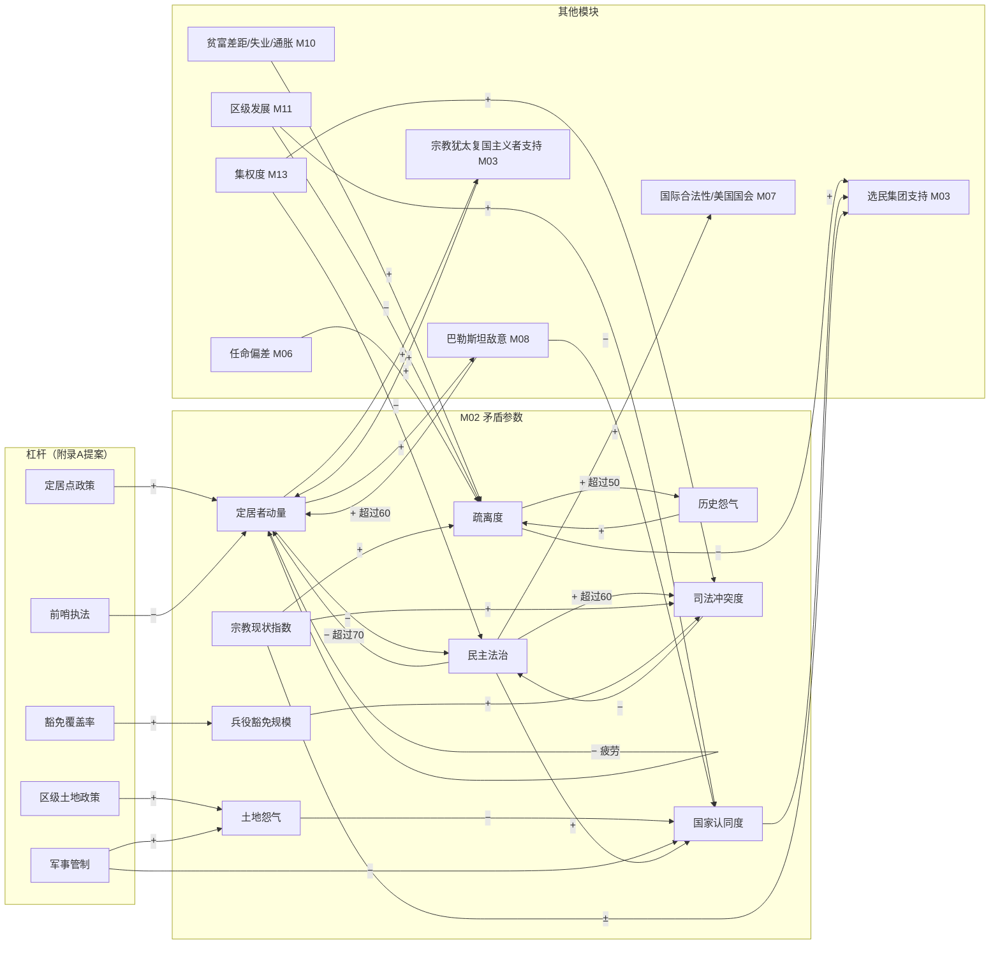
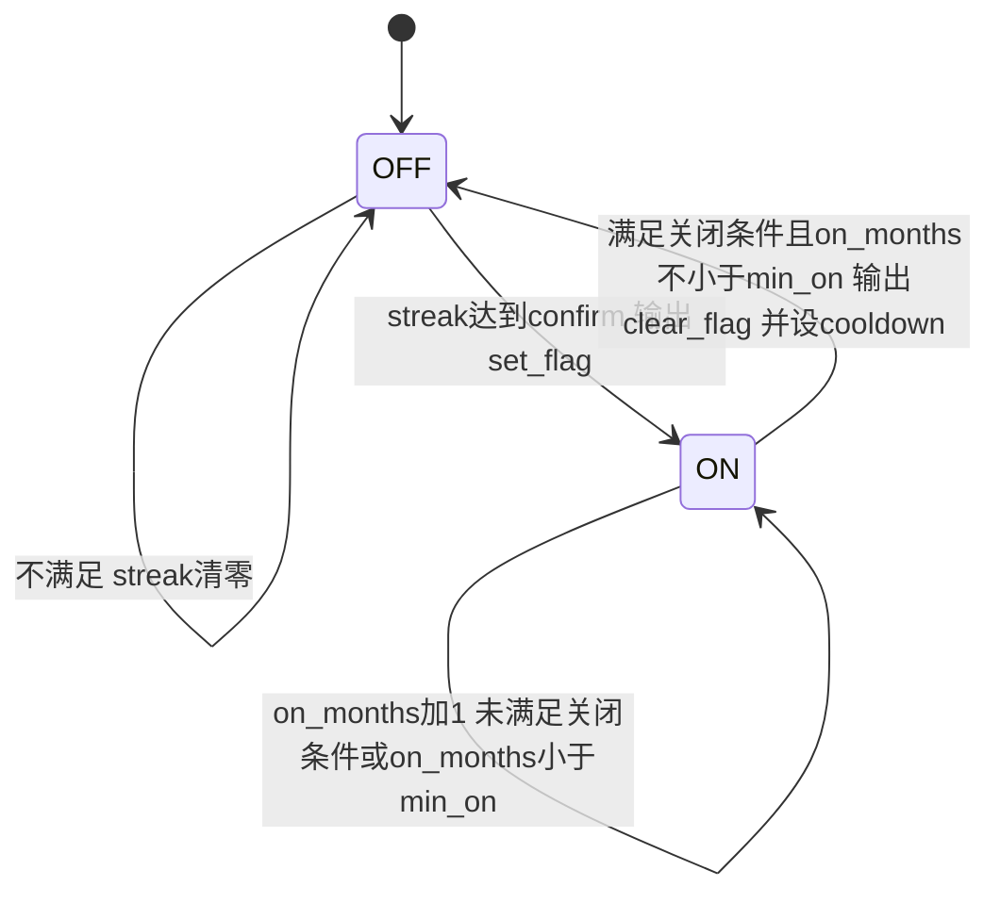
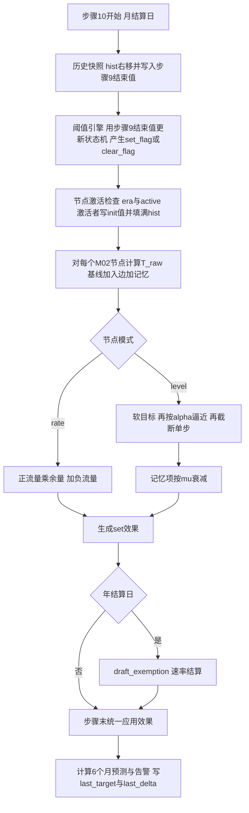

# M02 数值模型与矛盾联动（numbers_model）

## 0. 元信息

| 项 | 内容 |
|---|---|
| 版本 | v1.0（2026-10-16） |
| 作者 | 子代理：商业策略游戏资深系统设计师（M02 规格） |
| 文件 | `docs/specs/M02_numbers_model.md` |
| 机器数据 | `data/causal_edges.yaml`（节点表 + 边表，草案见附录C）、`data/thresholds.yaml`（阈值表，草案见附录D） |
| 依赖的模块规格 | M01（日期、结算日判定、`custom` 处理函数登记）、M12（表达式解析器、效果解释器）、M14（开局快照）、M15（tooltip 与因果图的呈现）；作为数据来源读取 M03、M04、M05、M06、M07、M08、M09、M10、M11、M13 拥有的参数 |
| 被依赖 | 所有拥有“漂移”参数的模块都调用本模块提供的因果网引擎（§3.6 API）结算自己的参数 |
| 约束文件 | `docs/contracts.md`（结算顺序 §3、效果格式 §4、表达式 §5、读写权限 §6）、`docs/registry/parameters.yaml` |

### 0.1 本模块负责满足的对标标准

| 标准（出处） | 内容 | 本模块的满足方式 |
|---|---|---|
| R8（benchmarks §6.2） | 核心数值连续 ≥2 游戏年处于上下限的局数 ≤5% | §4.6 六重防顶满机制（软目标 tanh 压缩、饱和型边、存量余量缩放、单步上限、习惯化边、自我疲劳边）；验收测试 T03、T12 |
| R13（benchmarks §6.2） | 节点 ≥150、边 ≥600、≥50% 边带惯性或延迟 | §3 统一节点/边结构，所有模块共用同一张网；M02 自身提供 17 个节点实例、68 行入边（展开后 72 条）、25 条跨模块出边草案；M02 入边中 45 条（66%）带 `inertia>1` 或 `delay>0` 或 `habit` |
| R15（benchmarks §6.2） | 100% 可见数值支持“前5项贡献”（含惯性进度） | §4.9 `explain()` 接口；对无入边的事件型参数，用效果日志给出“最近5次改变”；验收测试 T09 |
| R17、R27（benchmarks §6.2） | 刺杀/政变/危机前 ≥3 个月可见预警；漏读兜底 | §4.10 `project()` 预测：6 个月内预计越过阈值即发黄色告警；阈值确认月数 `confirm` 给出缓冲期 |
| R7、D-x2（benchmarks） | 没有支配策略、没有单一最优区间 | 每条杠杆至少有一条负号出边进入另一矛盾（§4.4 入边表与附录C 跨模块边）；§4.8 列出每个杠杆的“代价边” |
| K-x4（benchmarks §2.7） | 核心数值用“目标值+衰减”，越接近上限维持成本越高 | §4.1 统一机制正是“目标值 + 惯性逼近”；§4.6 软目标使上限附近需要成倍的入边贡献 |
| W-x1、W-x2、W-x3（benchmarks §1.7） | 不可背诵的固定阈值；防滚雪球；结算给出前5项原因 | 阈值带滞回且随状态的目标值浮动（§4.11）；§4.7 反馈环清单与阻尼；§4.9 前5项 |
| D1、D2（benchmarks §4.9） | 统一节点-效果模型，每条效果带惯性；悬停显示因果线 | §3.2 边结构含 `inertia`/`delay`；§9 因果图悬停规则 |
| D2、D12、A11、S5、U1、U2（paradox_lessons §5） | 顶栏可拆解；内生负反馈；无指数增长；正反馈回路静态检查；派生数值100%可拆解；溯源 ≤3 层 | §4.9 拆解到边→来源参数→效果日志（3层）；§4.7 回路检查工具 `tools/check_loops.py`；全部积分型节点带余量缩放，不存在指数增长 |
| P2、P4（paradox_lessons §5.3 G） | 后期单日耗时 ≤ 第1年 1.3 倍；月结帧时 ≤100ms | 边数固定、历史缓冲区固定 24 格；每月计算量 O(边数)，与游戏年数无关（§10.9） |

### 0.2 对标定位

- **Democracy 4**：借用“所有东西都是同一张带惯性的加权有向图”的思想（模组文档的 `目标, 公式, 惯性` 三元组）。我们比它多两样：**滞回阈值**（D4 的情势开关会抖动）与**事件冲击记忆项**（D4 没有叙事事件，本作事件需要和因果网合流）。我们要避免它的“电子表格感”：主界面只显示整数和箭头，公式只出现在二级 tooltip（R25）。
- **朴正熙纪事**：它的数值是累加式，导致“正当性和民心很容易到100%”（P4）。本模块用目标值模型替代累加模型，任何数值都会回到由结构决定的目标值附近。
- **白日升**：“士气2就视察、忠诚50就发饷”是固定阈值反应式管理。本模块的阈值作用于**目标值在移动的参数**，并带确认期与冷却期，玩家无法用一条固定规则维持。
- **规模**：M02 只拥有 9 个参数（17 个实例），比 Democracy 4 少一个数量级；复杂度集中在“边”上，而边对玩家只以“前5项”的形式出现，符合“观感接近P社但复杂度更低”。

---

## 1. 设计意图

### 1.1 核心取舍（一句话）
**事件可以把一个矛盾数值暂时压下去，但冲击会衰减；只有改变结构性入边（杠杆、预算、任命、法律）才能移动目标值，而每一个能移动目标值的杠杆都会抬高另一个矛盾的目标值。**

### 1.2 决策频率与信息来源
- M02 本身不提供行动按钮。玩家每月平均做 **2–4 次**会进入 M02 入边的决策（调整区级滑块、定居点政策、豁免覆盖率、任命、事件选项）。
- 信息来源（全部由本模块计算，M15 呈现）：
  1. 每个数值旁的**目标值标记**（数值正朝哪里走）。
  2. tooltip 的**前5项贡献**（为什么目标值在这里）。
  3. **6 个月预测**与阈值告警（什么时候会出事）。
  4. 因果图悬停的入线/出线（动这个杠杆会牵动谁）。

### 1.3 失败状态与恢复路径

| 失败状态 | 判定 | 恢复路径 |
|---|---|---|
| 群体疏离爆发 | `thr.alien_protest.<群体>` 为开 | 提高该群体相关区的 `region_development`、降低 `appointment_gap`；冲击记忆每月衰减 5%；疏离度降到关闭线 54 以下且已开满 3 个月后旗标关闭 |
| 历史怨气固化 | `thr.grievance_swing.<群体>` 为开 | 怨气为债务型，只在疏离度 ≤50 时每月 −0.1，或由“偿还型”行动（M05 定义）直接扣减；恢复需要多年，这是设计意图（历史债务） |
| 土地日式对抗 | `thr.landday.<阿拉伯群体>` 为开 | 降低 `region_land_policy`；提高相关区发展；土地怨气每月 −0.1 |
| 定居者半自治 | `thr.settler_autonomy` 为开 | 降低 `settlement_policy`、提高 `outpost_enforcement`；自我疲劳边在动量长期 >60 时自动拉低目标值 |
| 法治下滑 | `thr.rol_watch` 为开 | 停止集权行动（`centralization` 每月 −0.5 由 M13 负责）；法治每月最多回升 1 点 |
| 宪政危机 | `thr.judicial_crisis` 为开 | 降低集权度、宗教现状指数、豁免规模；司法冲突度每月最多下降 1 点 |

### 1.4 第10–20年如何保持新鲜感
1. **债务型参数持续累积**：`draft_exemption`、`historical_grievance`、`land_grievance` 只会缓慢下降，前任和早期决策的后果在后期才显现（设计文档 §1“历史债务”）。
2. **时代激活新节点**：`alienation[russian]`（1989年起）、`judicial_conflict`（1992年起）在后期加入网络，带来新的入边与阈值。
3. **习惯化边**：发展投资的效果相对于过去 23 个月的平均值计算，“好政策”的边际效果会随时间衰减，迫使玩家持续投入（期望上调，paradox D12）。
4. **自我疲劳边**：定居者运动长期高涨后自动出现疲劳，局势会自己转向，同一套打法不能用 20 年。

---

## 2. 读写清单

> “写”只指 M02 作为 owner 在步骤 10 直接写入；M02 对其他模块参数**没有写权限**。表中“读”指作为因果网入边来源读取，读取的值是步骤 9 结束时的状态（contracts §3）。

### 2.1 M02 拥有并写入的参数

| 参数ID | 读/写 | 结算步骤 | 说明 |
|---|---|---|---|
| religious_status_quo | 读写 | 无漂移（事件型） | registry `drift: none`；只由效果改变；M02 只维护效果日志与阈值 |
| draft_exemption | 写 | 步骤10（仅年结算日） | 速率型节点，每年一次 |
| alienation[mizrahi/russian/ethiopian] | 写 | 步骤10（月） | 目标型节点；russian 键 1989 年起激活 |
| historical_grievance[同上] | 写 | 步骤10（月） | 速率型节点 |
| civic_identification[arab/druze/bedouin] | 写 | 步骤10（月） | 目标型节点 |
| land_grievance[同上] | 写 | 步骤10（月） | 速率型节点 |
| settler_momentum | 写 | 步骤10（月） | 目标型节点；1967 年起 |
| rule_of_law | 写 | 步骤10（月） | 目标型节点，带单步上限 |
| judicial_conflict | 写 | 步骤10（月） | 目标型节点，1992 年起 |
| 旗标 `thr.*` | 写（经效果队列 `set_flag`/`clear_flag`） | 步骤10（月） | 阈值引擎输出，见 §4.11 与附录B-B5 |

### 2.2 M02 读取的其他模块参数（作为入边来源）

| 参数ID | 读/写 | 读取时机 | 用于哪些入边 |
|---|---|---|---|
| inequality | 读 | 步骤10 | 疏离度、国家认同度 |
| unemployment | 读 | 步骤10 | 疏离度 |
| inflation | 读 | 步骤10 | 疏离度[米兹拉希] |
| region_development[negev/galilee/haifa/triangle] | 读 | 步骤10 | 疏离度、国家认同度 |
| absorption_capacity | 读 | 步骤10 | 疏离度[俄裔/埃塞俄比亚裔] |
| historical_grievance、land_grievance、alienation | 读 | 步骤10 | M02 内部互相引用 |
| religious_status_quo | 读 | 步骤10 | 疏离度、司法冲突度 |
| rule_of_law | 读 | 步骤10 | 国家认同度、定居者动量、司法冲突度 |
| pal_hostility | 读 | 步骤10 | 国家认同度、定居者动量 |
| mobilization | 读 | 步骤10 | 国家认同度、民主法治 |
| bloc_support[religious_zionist] | 读 | 步骤10 | 定居者动量 |
| centralization | 读 | 步骤10 | 民主法治、司法冲突度 |
| public_security | 读 | 步骤10 | 民主法治 |
| judicial_conflict、settler_momentum、draft_exemption | 读 | 步骤10 | M02 内部互相引用 |
| 提案杠杆：settlement_policy、region_land_policy、military_government、exemption_coverage、outpost_enforcement | 读 | 步骤10 | 见附录A |
| 提案参数：appointment_gap、haredi_cohort | 读 | 步骤10 | 见附录A |
| 全部 registry 参数与杠杆 | 读 | 步骤10 | 历史快照（§3.4），供趋势图、惯性、阈值“骤降”判定 |

---

## 3. 状态与数据结构

### 3.1 节点（Node）

“节点”= 一个 registry 参数在一个键上的实例（例如 `alienation[mizrahi]`）。节点表在 `data/causal_edges.yaml` 的 `nodes:` 段，每个参数一条记录，按键展开。

| 字段 | 类型 | 范围 / 取值 | 默认 | 说明 |
|---|---|---|---|---|
| param | string | registry id | 必填 | 目标参数 |
| owner | string | M01–M15 | 必填 | 必须等于 registry 的 owner，否则加载报错 |
| keys | list[string] 或 null | 该参数 scope 的实体 | null（national） | 展开的键 |
| mode | enum | `level` / `rate` / `derived` / `none` | 必填 | 见 §4.1 |
| tick | enum | `daily`/`weekly`/`monthly`/`quarterly`/`yearly` | 与 registry 相同 | 结算周期 |
| alpha | float | (0, 1] | 0.10 | 仅 `level`：每个周期向目标值靠拢的比例 |
| baseline | float 或 dict[key→float] | 任意 | 0 | 基线；`rate` 模式下为每周期的基础流量 |
| soft | dict | `{lo_s, hi_s, w}` | 存量 `{15, 85, 13}`；轴 `{-80, 80, 18}` | 软目标压缩，§4.6 |
| max_step_up | float 或 null | >0 | null | 每周期最大上升量 |
| max_step_down | float 或 null | >0 | null | 每周期最大下降量（正数） |
| memory_rho | float | [0, 1] | `level`:0.30；其他:0 | 事件冲击写入记忆项的比例 |
| memory_mu | float | [0, 1] | 0.05 | 记忆项每月衰减比例 |
| memory_cap | float | >0 | 30 | 记忆项绝对值上限 |
| headroom | bool | — | `rate`:true | 仅 `rate`：正流量是否按余量缩放 |
| active | dict[key→表达式] 或 表达式 或 null | contracts §5 表达式 | null | 额外的激活条件；registry `era` 总是先判定 |
| init_on_activate | float 或 dict | 范围内 | 必填（若有 active 或 era 起始年晚于剧本） | 激活当月写入的初值 |

### 3.2 边（Edge）

| 字段 | 类型 | 范围 / 取值 | 默认 | 说明 |
|---|---|---|---|---|
| id | string | 全局唯一，格式 `<owner>.<目标缩写>.<两位序号>` | 必填 | 排序与结算顺序依据 |
| target | string | 节点表中的 param | 必填 | |
| target_key | string | 键名 或 `"*"` | null（national） | `"*"` 表示对该节点全部键展开 |
| source | string | `param:<id>` / `lever:<id>` / `flag:<名>` / `modifier:<名>` / `const` | 必填 | 来源 |
| source_key | string 或 null | 键名 / `"$key"` / null | null | `"$key"` 表示与目标同键 |
| key_map | dict 或 null | 目标键→来源键 | null | 跨 scope 映射（例：group→bloc）；与 `$key` 二选一 |
| shape | enum | 见 §4.2 九种 | 必填 | 函数形状 |
| pivot | float | 来源单位 | 形状需要时必填 | 拐点 |
| coef | float | \|coef\| ≤ 10 | 必填 | 系数；单位 = 目标单位 / 来源单位（`flag`/`step` 形状为目标单位） |
| w | float | >0 | sat:必填；quad_above:10；habit:23 | 宽度或窗口 |
| inertia | int | 1–12 | 1 | 来源取最近 n 个月快照的平均值；1 = 只用本月快照 |
| delay | int | 0–12 | 0 | 来源整体后移 d 个月 |
| gate | 表达式 或 null | contracts §5；结果夹紧到 [0, 2]，布尔 true=1、false=0 | null（=1） | 乘在贡献上的门控 |
| label_zh | string | — | 必填 | tooltip 显示名 |
| status | enum | `active` / `proposed` | `active` | `proposed` = 跨模块草案，目标模块未采纳前引擎忽略 |
| note | string | — | 可选 | 设计说明 |

**合法性校验（加载时，任一失败即报错退出）**：
1. `target` 已在节点表中，且边所在文件段的 owner = 目标节点 owner（`proposed` 边除外）。
2. `source` 的参数/杠杆/修正器/旗标已登记（`thr.` 前缀旗标以 `data/thresholds.yaml` 为准）。
3. 形状必填字段齐全；`inertia + delay ≤ 24`；`habit` 的 `w ≤ 23`。
4. 自环边（来源节点 = 目标节点且同键）必须 `delay ≥ 1`。
5. `coef` 为有限数且 \|coef\| ≤ 10。
6. 目标节点 `mode` 为 `none` 时不得有入边。
7. `$key` 只能用于来源与目标 scope 的实体列表完全相同的情况（group↔group、arab_group↔arab_group）；其他跨 scope 必须用 `key_map`。

### 3.3 运行时状态（M02 持有，写入存档）

| 字段 | 类型 | 范围 | 默认 | 说明 |
|---|---|---|---|---|
| `memory[param][key]` | float | [−memory_cap, +memory_cap] | 0 | 事件冲击记忆项 |
| `hist[ref]` | list[float 或 null]，长度 24 | — | 开局时 24 格全部填入开局值 | 月度快照，`hist[0]` 为最近一次；`ref` = `param:id[key]` 或 `lever:id[key]` |
| `effect_log[param][key]` | list[dict]，长度 ≤10 | — | 空 | 最近 10 次直接改变：`{date, delta, source_id}`；`source_id` 为事件ID、行动ID 或修正器名 |
| `thr_state[thr_id]` | dict | 见 §4.11 | `{state: off, streak: 0, on_months: 0, cooldown_left: 0}` | 阈值状态机 |
| `last_target[param][key]` | float | — | 开局时计算 | 上次结算的目标值（UI 用） |
| `last_delta[param][key]` | float | — | 0 | 上次结算的变化量（顶栏箭头） |

### 3.4 历史快照规则
- 时机：每个月结算日的步骤 10 开始时，**先于**目标值计算。
- 内容：registry 全部参数（全部键）+ 全部杠杆（全部键）在步骤 9 结束时的值。
- 操作：每个 `hist[ref]` 右移一格（丢弃第 24 格），新值写入 `hist[0]`。键不存在（如动态区已消失）写入 `null`。
- 开局与读档：开局时 24 格全部填开局值；节点激活当月 24 格全部填 `init_on_activate`。

### 3.5 数据文件 schema 与完整示例

```yaml
# data/causal_edges.yaml（节选；完整草案见附录C）
schema_version: 1
nodes:
  - param: alienation
    owner: M02
    keys: [mizrahi, russian, ethiopian]
    mode: level
    tick: monthly
    alpha: 0.10
    baseline: {mizrahi: 18.0, russian: 15.0, ethiopian: 16.0}
    soft: {lo_s: 15, hi_s: 85, w: 13}
    memory_rho: 0.30
    memory_mu: 0.05
    active: {russian: "year >= 1989"}
    init_on_activate: {russian: 35.0}
edges:
  - id: M02.ALN.04
    target: alienation
    target_key: mizrahi
    source: param:region_development
    source_key: negev
    shape: below
    pivot: 50
    coef: 0.20
    inertia: 6
    delay: 0
    gate: null
    label_zh: 内盖夫发展滞后
    status: active
    note: 发展城镇集中在内盖夫
```

### 3.6 引擎 API（Python 参考实现 `sim/causal_net.py`，GDScript `game/scripts/causal_net.gd` 同名同参）

| 函数 | 输入 | 输出 | 调用者 |
|---|---|---|---|
| `load(nodes_path, edges_path, thresholds_path)` | 三个文件路径 | 无；校验失败抛异常 | M01 启动时 |
| `init_scenario(state)` | 开局状态 | 填充 hist、memory=0、thr_state 默认 | M14 加载剧本后 |
| `snapshot_history(state)` | 当前状态 | 更新 hist | M02 步骤10（月） |
| `compute_target(state, param, key)` | — | `TargetResult{raw, soft, baseline, memory, terms:list[Term]}` | 引擎内部、`explain` |
| `step_nodes(state, owner, params, tick_unit)` | owner 模块与其参数列表 | `list[Effect]`（全部为 `op: set`） | 各 owner 模块在自己的结算步骤 |
| `on_effect_applied(param, key, delta, source_id, date)` | 效果解释器在每次 `add`/`mul`/`set` 后调用 | 更新 memory（仅 add/mul，且仅 level 节点）与 effect_log | M12 效果解释器（附录B-B2） |
| `explain(state, param, key, top_n=5)` | — | `Explanation`（§4.9） | M15 |
| `project(state, param, key, months)` | months ≤ 24 | `list[float]`，长度 = months | M15 告警、机器人 |
| `preview(state, effects)` | 一组拟议效果 | `dict[(param,key) → ΔT]` 目标值变化 | M15 行动预览、M06 AI |
| `evaluate_thresholds(state)` | — | `list[Effect]`（`set_flag`/`clear_flag`） | M02 步骤10（月） |

`Term` 结构：`{edge_id, label_zh, source_ref, source_now, source_eff, amount, inertia_progress}`。

---

## 4. 规则与公式

### 4.1 统一机制：目标值 + 惯性

**触发时机**：节点所属 owner 模块的结算步骤，按节点 `tick` 周期。M02 自己的节点在步骤 10（每月；`draft_exemption` 仅年结算日）。

**目标值公式（所有模式共用）**：

$$T_{raw} = B + \sum_{e \in \text{入边}} c_e + M$$

- \(B\)：基线（`baseline`，该键的值）。
- \(c_e\)：第 e 条入边的贡献（§4.2–4.3）；`status: proposed` 的边不计。
- \(M\)：事件冲击记忆项（§4.5），仅 `level` 模式；其他模式 M=0。
- 求和顺序：按边 `id` 字符串升序；`"*"` 展开的边在同一 id 下按 registry `entities` 列表顺序。所有节点用**步骤开始时的状态**计算（Jacobi 式，节点之间无先后依赖）。

**四种更新模式**：

| mode | 含义 | 更新公式 | 用于（M02） |
|---|---|---|---|
| `level` | 水平型：数值向目标值靠拢 | \(T = \text{soft}(T_{raw})\)；\(\Delta = \alpha (T - x)\)；\(\Delta\) 再按 `max_step_up/down` 截断；\(x' = \text{clamp}(x + \Delta, lo, hi)\) | alienation、civic_identification、settler_momentum、rule_of_law、judicial_conflict |
| `rate` | 速率型：目标值解释为每周期的变化量 | \(F^+ = \sum\) 正项（含正基线），\(F^- = \sum\) 负项（含负基线）；\(x' = \text{clamp}(x + F^+ \cdot \frac{hi - x}{hi - lo} + F^-, lo, hi)\)（`headroom: false` 时不乘余量） | draft_exemption、historical_grievance、land_grievance |
| `derived` | 派生型：数值直接等于软目标 | \(x' = \text{clamp}(\text{soft}(T_{raw}), lo, hi)\)；禁止效果写入 | M02 无；供 M07/M08/M11 的派生参数接入 |
| `none` | 事件型：不漂移 | 无 | religious_status_quo |

**registry `drift` 文字的换算规则**（本规格对全部模块生效，附录B-B4）：

| registry 写法 | 换算 |
|---|---|
| `toward X at k%/month` | `mode: level`，`baseline` 使无外力时 \(T = X\)，`alpha: 0.10`，`max_step_up = max_step_down = k × (hi − lo) / 100` |
| `−k/month`（无目标） | `mode: level`，基线取该参数的“平静值”，`alpha: 0.10`，`max_step_down = k` |
| `+ A; −k/month` | `mode: rate`，`baseline: −k`，A 作为正向入边 |
| `none` | `mode: none` |
| 其他描述性文字 | 由 owner 模块规格在节点表中给出具体模式与数值 |

**算例 4.1-a（level，alienation[mizrahi]，贝京 1977 开局后第一次月结 1977-07-01）**：
开局值 x=38；按 §4.4.1 计算 \(T_{raw} = 37.879\)；\(M = 0\)；软目标区间 [15, 85] 内，\(T = 37.879\)。\(\Delta = 0.10 × (37.879 − 38) = −0.0121\)；\(x' = 37.988\)。单位：疏离度点。

**算例 4.1-b（rate，land_grievance[bedouin]）**：x=40，\(F^+ = 0.25\)（征地·内盖夫），\(F^- = −0.10\)（基线）。\(x' = 40 + 0.25 × (100 − 40)/100 − 0.10 = 40 + 0.15 − 0.10 = 40.05\)。单位：土地怨气点/月。

**算例 4.1-c（level 单步上限，rule_of_law）**：x=66，假设集权行动使 T=40。\(\alpha(T − x) = 0.10 × (−26) = −2.6\)，`max_step_down = 1.0` → \(\Delta = −1.0\)，\(x' = 65.0\)。

**周期换算（供周结算模块使用）**：若某模块把节点设为 `weekly`，`alpha_week = 1 − (1 − alpha_month)^{12/52}`。算例：alpha_month=0.10 → alpha_week = 1 − 0.9^{0.23077} = 0.02402。速率型的周流量 = 月流量 × 12/52。

### 4.2 函数形状（9 种）

记 \(s\) = 来源有效值（§4.3），\(p\) = pivot，\(c\) = coef，\(w\) = w。

| shape | 公式 | 典型用途 | 算例 |
|---|---|---|---|
| `linear` | \(c (s - p)\) | 双向连续影响 | c=0.15, p=50, s=66 → +2.4 |
| `above` | \(c \cdot \max(0, s - p)\) | 超过阈值才起作用 | c=0.30, p=30, s=38 → +2.4 |
| `below` | \(c \cdot \max(0, p - s)\) | 低于阈值才起作用（系数正号=来源越低目标越高） | c=0.20, p=50, s=32 → +3.6 |
| `sat` | \(c \cdot w \cdot \tanh((s - p)/w)\) | 边际递减，双向饱和于 \(\pm c w\) | c=0.10, p=15, w=60, s=35 → 6×tanh(0.3333)=+1.929 |
| `quad_above` | \(c \cdot \max(0, s - p)^2 / w\) | 加速上升（力度越大反作用越强） | c=0.5, p=50, w=10, s=60 → 0.5×100/10=+5.0 |
| `step_above` | \(c\) 若 \(s \ge p\)，否则 0 | 开关 | c=−0.1, p=50, s=55 → −0.1 |
| `step_below` | \(c\) 若 \(s \le p\)，否则 0 | 开关 | c=−0.1, p=50, s=38 → −0.1 |
| `flag` | \(c\) 若旗标或修正器存在，否则 0 | 旗标/修正器 | c=+5，旗标存在 → +5 |
| `habit` | \(c \cdot (\text{hist}[0] - \overline{\text{hist}[1..w]})\) | 习惯化：只对相对过去 w 个月平均值的变化起作用 | c=−0.30, w=23，过去23月平均32，本月38 → −1.8 |

最终贡献：\(c_e = \text{shape}(s) \times g\)，\(g\) = `gate` 求值后夹紧到 [0, 2]（无 gate 时 g=1）。

### 4.3 来源有效值（惯性与延迟）

- `param:`/`lever:` 来源：\(s = \text{mean}(\text{hist}[d], \text{hist}[d+1], …, \text{hist}[d+n-1])\)，\(n\)=inertia，\(d\)=delay；忽略 `null`；若全为 `null` 则该边贡献 = 0。
- 注意：`hist[0]` 是**本月**步骤10开始时的快照，所以 `inertia: 1, delay: 0` 即“当前值”。
- `flag:`/`modifier:` 来源：只看当前是否存在，`inertia`/`delay` 忽略。
- `const`：\(s = 1\)。
- **来源节点未激活**（registry `era` 不含当年、或节点 `active` 为 false、或键不存在）：贡献 = 0。

**惯性进度**（tooltip 显示“已生效 x%”）：
\[\text{inertia\_progress} = \text{clamp}\left(\frac{\text{shape}(s_{eff})}{\text{shape}(s_{now})}, 0, 1\right)\]
\(s_{now} = \text{hist}[0]\)。当 \(\text{shape}(s_{now}) = 0\) 时：若 \(\text{shape}(s_{eff}) = 0\) 记 100%，否则记 0%（表示正在消退）。`flag`/`const`/`habit` 恒为 100%。

**算例 4.3（贝京把西岸定居点政策从 40 调到 80）**：边 M02.SM.01（linear, p=50, c=0.30, inertia=3）。1977-06-25 调整。
- 1977-07-01：hist = [80, 40, 40, …] → \(s = 53.33\)，贡献 = 0.30 × 3.33 = +1.00；惯性进度 = 1.00 / 9.00 = 11%。
- 1977-08-01：hist = [80, 80, 40, …] → \(s = 66.67\)，贡献 +5.00；进度 56%。
- 1977-09-01：\(s = 80\)，贡献 +9.00；进度 100%。

### 4.4 M02 拥有参数的完整入边表

> 列说明：形状/拐点/系数/宽度/惯性/延迟。开局值见 §4.4.0；“开局贡献”按贝京 1977 开局值计算。

#### 4.4.0 贝京 1977 开局值（算例基准；M14 快照若另定数值，以 M14 为准并按 §12 重新标定基线使 T03 通过）

| 参数[键] | 开局值 | 参数[键] | 开局值 |
|---|---|---|---|
| alienation[mizrahi] | 38 | inequality | 38 |
| alienation[ethiopian] | 30 | unemployment | 3.9 |
| alienation[russian] | 未激活 | inflation | 35 |
| historical_grievance[mizrahi] | 55 | region_development[negev] | 32 |
| historical_grievance[ethiopian] | 10 | region_development[galilee] | 38 |
| historical_grievance[russian] | 0 | region_development[haifa] | 55 |
| civic_identification[arab] | 38 | region_development[triangle] | 30 |
| civic_identification[druze] | 72 | absorption_capacity | 55 |
| civic_identification[bedouin] | 50 | pal_hostility | 55 |
| land_grievance[arab] | 55 | mobilization | 10.0（D-080） |
| land_grievance[druze] | 15 | public_security | 62.0（D-080） |
| land_grievance[bedouin] | 40 | centralization | 5 |
| settler_momentum | 45 | bloc_support[religious_zionist] | 60 |
| rule_of_law | 66 | lever settlement_policy[west_bank] | 40 |
| judicial_conflict | 未激活 | lever outpost_enforcement | 50 |
| religious_status_quo | 10 | lever region_land_policy[galilee/triangle/negev] | 35 / 30 / 35 |
| draft_exemption | 8.0（≈8000名累计豁免者） | lever military_government[arab/druze/bedouin] | 0 / 0 / 0 |
| haredi_cohort | 1.6（千人/年） | lever exemption_coverage | 50 |
| appointment_gap[mizrahi/ethiopian/russian] | 45 / 100 / 100 | | |

#### 4.4.1 alienation（疏离度）——`level`，α=0.10，ρ=0.30，μ=0.05

**[mizrahi]** 基线 18.0

| 边ID | 来源 | 形状 | p | c | w | 惯性 | 延迟 | 开局贡献 |
|---|---|---|---|---|---|---|---|---|
| M02.ALN.01 | inequality | above | 30 | 0.30 | — | 6 | 0 | 0.30×8 = +2.400 |
| M02.ALN.02 | unemployment | above | 4 | 1.50 | — | 3 | 0 | 0 |
| M02.ALN.03 | inflation | sat | 15 | 0.10 | 60 | 3 | 0 | 6×tanh(20/60) = +1.929 |
| M02.ALN.04 | region_development[negev] | below | 50 | 0.20 | — | 6 | 0 | 0.20×18 = +3.600 |
| M02.ALN.05 | region_development[galilee] | below | 50 | 0.10 | — | 6 | 0 | 0.10×12 = +1.200 |
| M02.ALN.06 | region_development[negev] | habit | — | −0.30 | 23 | — | — | 0（历史全为开局值） |
| M02.ALN.07 | appointment_gap[mizrahi] | above | 20 | 0.10 | — | 1 | 0 | 0.10×25 = +2.500 |
| M02.ALN.08 | historical_grievance[mizrahi] | linear | 0 | 0.15 | — | 1 | 0 | 0.15×55 = +8.250 |

\(T_{raw} = 18 + 2.4 + 0 + 1.929 + 3.6 + 1.2 + 0 + 2.5 + 8.25 = 37.879\)（开局值 38，差 −0.121）。

**[ethiopian]** 基线 16.0

| 边ID | 来源 | 形状 | p | c | w | 惯性 | 延迟 | 开局贡献 |
|---|---|---|---|---|---|---|---|---|
| M02.ALN.11 | inequality | above | 30 | 0.20 | — | 6 | 0 | +1.600 |
| M02.ALN.12 | appointment_gap[ethiopian] | above | 20 | 0.10 | — | 1 | 0 | +8.000 |
| M02.ALN.13 | absorption_capacity | below | 50 | 0.30 | — | 3 | 0 | 0 |
| M02.ALN.14 | religious_status_quo | above | 0 | 0.15 | — | 3 | 0 | +1.500（犹太身份争议） |
| M02.ALN.15 | historical_grievance[ethiopian] | linear | 0 | 0.15 | — | 1 | 0 | +1.500 |
| M02.ALN.16 | region_development[negev] | below | 50 | 0.10 | — | 6 | 0 | +1.800 |
| M02.ALN.17 | unemployment | above | 6 | 1.00 | — | 3 | 0 | 0 |

\(T_{raw} = 16 + 1.6 + 8 + 0 + 1.5 + 1.5 + 1.8 + 0 = 30.4\)（开局 30，差 +0.4）。

**[russian]** 基线 15.0；`active: year >= 1989`；`init_on_activate: 35`

| 边ID | 来源 | 形状 | p | c | w | 惯性 | 延迟 |
|---|---|---|---|---|---|---|---|
| M02.ALN.21 | absorption_capacity | below | 50 | 0.40 | — | 3 | 0 |
| M02.ALN.22 | unemployment | above | 6 | 1.50 | — | 3 | 0 |
| M02.ALN.23 | religious_status_quo | above | 0 | 0.20 | — | 3 | 0 |
| M02.ALN.24 | appointment_gap[russian] | above | 20 | 0.10 | — | 1 | 0 |
| M02.ALN.25 | inequality | above | 30 | 0.15 | — | 6 | 0 |
| M02.ALN.26 | historical_grievance[russian] | linear | 0 | 0.15 | — | 1 | 0 |
| M02.ALN.27 | region_development[haifa] | below | 50 | 0.10 | — | 6 | 0 |

算例（假设 1990-12 状态：吸收容量 25、失业 10、宗教现状 15、任命偏差 70、贫富差距 45、怨气 0、海法发展 55）：\(T_{raw} = 15 + 0.4×25 + 1.5×4 + 0.2×15 + 0.1×50 + 0.15×15 + 0 + 0 = 15 + 10 + 6 + 3 + 5 + 2.25 = 41.25\)。

> 设计说明：`contradiction_parameters.md` §2 的“过渡营地比例”由 `absorption_capacity`（吸收容量不足=营地化）表达；“在野党煽动”由事件修正器经 §4.5.3 换算进入目标值。

#### 4.4.2 historical_grievance（历史怨气）——`rate`，基线 0，headroom=true

| 边ID | 目标键 | 来源 | 形状 | p | c | 惯性 | 延迟 | 说明 |
|---|---|---|---|---|---|---|---|---|
| M02.HGR.01 | `*` | alienation[$key] | above | 50 | 0.10 | 6 | 0 | registry：“+ when alienation > 50” |
| M02.HGR.02 | `*` | alienation[$key] | step_below | 50 | −0.10 | 6 | 0 | registry：“−0.1/month otherwise” |

算例（开局 mizrahi）：疏离度 6 月平均 38 → HGR.01 = 0，HGR.02 = −0.10 → \(x' = 55 − 0.10 = 54.90\)。
算例（压力情形）：疏离度 6 月平均 70、怨气 55 → \(F^+ = 0.10×20 = 2.0\)，\(x' = 55 + 2.0×0.45 = 55.90\)。

#### 4.4.3 civic_identification（国家认同度）——`level`，α=0.05，ρ=0.30，μ=0.03

**[arab]** 基线 56.5

| 边ID | 来源 | 形状 | p | c | 惯性 | 延迟 | 开局贡献 |
|---|---|---|---|---|---|---|---|
| M02.CIV.01 | land_grievance[arab] | linear | 0 | −0.25 | 1 | 0 | −13.750 |
| M02.CIV.02 | lever military_government[arab] | linear | 0 | −0.20 | 6 | 0 | 0 |
| M02.CIV.03 | region_development[galilee] | linear | 50 | 0.20 | 6 | 0 | −2.400 |
| M02.CIV.04 | region_development[triangle] | linear | 50 | 0.15 | 6 | 0 | −3.000 |
| M02.CIV.05 | rule_of_law | linear | 50 | 0.15 | 6 | 0 | +2.400 |
| M02.CIV.06 | pal_hostility | above | 50 | −0.20 | 3 | 0 | −1.000 |
| M02.CIV.07 | mobilization | above | 30 | −0.15 | 1 | 0 | 0（战时下降） |
| M02.CIV.08 | inequality | above | 30 | −0.10 | 6 | 0 | −0.800 |

\(T_{raw} = 56.5 − 13.75 − 2.4 − 3.0 + 2.4 − 1.0 − 0.8 = 37.95\)（开局 38）。

**[druze]** 基线 77.0

| 边ID | 来源 | 形状 | p | c | 惯性 | 延迟 | 开局贡献 |
|---|---|---|---|---|---|---|---|
| M02.CIV.11 | land_grievance[druze] | linear | 0 | −0.30 | 1 | 0 | −4.500 |
| M02.CIV.12 | region_development[galilee] | linear | 50 | 0.10 | 6 | 0 | −1.200 |
| M02.CIV.13 | rule_of_law | linear | 50 | 0.05 | 6 | 0 | +0.800 |
| M02.CIV.14 | mobilization | above | 30 | 0.05 | 1 | 0 | 0（“血盟”：战时上升） |

\(T_{raw} = 77 − 4.5 − 1.2 + 0.8 = 72.1\)（开局 72）。

**[bedouin]** 基线 65.0

| 边ID | 来源 | 形状 | p | c | 惯性 | 延迟 | 开局贡献 |
|---|---|---|---|---|---|---|---|
| M02.CIV.21 | land_grievance[bedouin] | linear | 0 | −0.30 | 1 | 0 | −12.000 |
| M02.CIV.22 | region_development[negev] | linear | 50 | 0.20 | 6 | 0 | −3.600 |
| M02.CIV.23 | rule_of_law | linear | 50 | 0.05 | 6 | 0 | +0.800 |
| M02.CIV.24 | pal_hostility | above | 50 | −0.05 | 3 | 0 | −0.250 |

\(T_{raw} = 65 − 12 − 3.6 + 0.8 − 0.25 = 49.95\)（开局 50）。

#### 4.4.4 land_grievance（土地怨气）——`rate`，基线 −0.10/月，headroom=true

| 边ID | 目标键 | 来源 | 形状 | p | c | 惯性 | 延迟 | 开局流量 |
|---|---|---|---|---|---|---|---|---|
| M02.LGR.01 | arab | lever region_land_policy[galilee] | above | 30 | 0.03 | 1 | 0 | +0.15 |
| M02.LGR.02 | arab | lever region_land_policy[triangle] | above | 30 | 0.03 | 1 | 0 | 0 |
| M02.LGR.03 | arab | lever military_government[arab] | above | 0 | 0.01 | 1 | 0 | 0 |
| M02.LGR.11 | druze | lever region_land_policy[galilee] | above | 30 | 0.01 | 1 | 0 | +0.05 |
| M02.LGR.21 | bedouin | lever region_land_policy[negev] | above | 30 | 0.05 | 1 | 0 | +0.25 |

开局算例：
- arab：\(F^+ = 0.15\)，\(x' = 55 + 0.15×0.45 − 0.10 = 54.9675\)。
- druze：\(x' = 15 + 0.05×0.85 − 0.10 = 14.9425\)。
- bedouin：\(x' = 40 + 0.25×0.60 − 0.10 = 40.05\)。
戈兰德鲁兹的土地怨气由事件（E-1981-12 后续）直接加值。

#### 4.4.5 settler_momentum（定居者运动动量）——`level`，α=0.15，ρ=0.30，μ=0.05；registry era [1967, null]；基线 45.5

| 边ID | 来源 | 形状 | p | c | w | 惯性 | 延迟 | 开局贡献 |
|---|---|---|---|---|---|---|---|---|
| M02.SM.01 | lever settlement_policy[west_bank] | linear | 50 | 0.30 | — | 3 | 0 | −3.000 |
| M02.SM.02 | bloc_support[religious_zionist] | linear | 50 | 0.25 | — | 3 | 0 | +2.500 |
| M02.SM.03 | lever outpost_enforcement | linear | 50 | −0.15 | — | 3 | 0 | 0 |
| M02.SM.04 | rule_of_law | above | 70 | −0.30 | — | 6 | 0 | 0（法院约束，阻尼） |
| M02.SM.05 | pal_hostility | above | 60 | 0.15 | — | 3 | 0 | 0（袭击动员定居者） |
| M02.SM.06 | flag:定居点合法化先例 | flag | — | 5.0 | — | — | — | 0 |
| M02.SM.07 | settler_momentum（自环） | above | 60 | −0.25 | — | 12 | 1 | 0（运动疲劳，阻尼） |
| M02.SM.08 | modifier:亚米特创伤 | flag | — | 4.0 | — | — | — | 0（撤离后激进化） |

\(T_{raw} = 45.5 − 3.0 + 2.5 = 45.0\)（开局 45）。连续三个月的数值演化见 §4.3 与测试 T07：45 → 45.60 → 46.71 → 48.2535。

#### 4.4.6 rule_of_law（民主法治指数）——`level`，α=0.10，max_step_up=max_step_down=1.0，ρ=0.30，μ=0.02；基线 70

| 边ID | 来源 | 形状 | p | c | 惯性 | 延迟 | 开局贡献 |
|---|---|---|---|---|---|---|---|
| M02.ROL.01 | centralization | above | 30 | −0.50 | 3 | 0 | 0（registry“unless centralization > 30”） |
| M02.ROL.02 | judicial_conflict | above | 50 | −0.10 | 3 | 0 | 0（未激活） |
| M02.ROL.03 | public_security | below | 30 | −0.15 | 3 | 0 | 0（安全恐慌下的紧急措施） |
| M02.ROL.04 | settler_momentum | above | 60 | −0.05 | 6 | 0 | 0（前哨侵蚀法律秩序） |
| M02.ROL.05 | modifier:起义 | flag | — | −3.0 | — | — | 0 |
| M02.ROL.06 | mobilization | above | 50 | −0.05 | 1 | 0 | 0（战时紧急状态） |
| M02.ROL.07 | centralization | linear | 0 | −0.10 | 3 | 0 | −0.500 |

\(T_{raw} = 70 − 0.5 = 69.5\)；首月 \(\Delta = 0.10×3.5 = 0.35\)（小于单步上限 1.0），\(x' = 66.35\)。

#### 4.4.7 judicial_conflict（司法冲突度）——`level`，α=0.10，max_step_down=1.0，ρ=0.30，μ=0.05；registry era [1992, null]；基线 10；`init_on_activate: 10`

| 边ID | 来源 | 形状 | p | c | 惯性 | 延迟 |
|---|---|---|---|---|---|---|
| M02.JUD.01 | centralization | above | 20 | 0.40 | 3 | 0 |
| M02.JUD.02 | rule_of_law | above | 60 | 0.20 | 6 | 0 |
| M02.JUD.03 | religious_status_quo | above | 20 | 0.15 | 3 | 0 |
| M02.JUD.04 | draft_exemption | above | 25 | 0.30 | 1 | 0 |
| M02.JUD.05 | settler_momentum | above | 60 | 0.10 | 6 | 0 |
| M02.JUD.06 | modifier:第7A条 | flag | — | 3.0 | — | — |

算例（假设 1992-07：集权度 10、法治 72、宗教现状 25、豁免 26、动量 65、第7A条存在）：\(T_{raw} = 10 + 0 + 2.4 + 0.75 + 0.3 + 0.5 + 3.0 = 16.95\)；x=10 → \(\Delta = 0.695\)，\(x' = 10.695\)。

#### 4.4.8 draft_exemption（兵役豁免规模）——`rate`，tick yearly，基线 0，headroom=true；单位：千名累计豁免者

| 边ID | 来源 | 形状 | p | c | gate | 说明 |
|---|---|---|---|---|---|---|
| M02.DEX.01 | haredi_cohort | linear | 0 | 1.0 | `exemption_coverage / 100` | registry：“+ haredi_cohort × exemption_rate” |
| M02.DEX.02 | modifier:无上限豁免 | flag | — | 1.0 | — | E-G04-03 A：每年 +1 |

算例（1978-01-01 年结算）：\(F^+ = 1.6 × 0.5 = 0.8\)；\(x' = 8 + 0.8 × (100 − 8)/100 = 8.736\)。
若 E-G04-03 选 A：\(F^+ = 1.8\)，\(x' = 8 + 1.8 × 0.92 = 9.656\)。
减少只能来自“偿还型”效果（M05 的行动，例如哈雷迪职业教育计划，以 `op: add, value: 负数` 写入）。

#### 4.4.9 religious_status_quo（宗教现状指数）——`none`
无入边（registry `drift: none`）。只由法令、组阁交易、事件效果改变。tooltip 用效果日志（§4.9.3）。

### 4.5 事件冲击与修正器如何进入因果网

#### 4.5.1 冲击记忆项（仅 `level` 节点）
- 当效果解释器对节点应用 `add v`（或 `mul`，以实际变化量为 v）：
  1. \(x \leftarrow \text{clamp}(x + v, lo, hi)\)（效果解释器完成）；
  2. \(M \leftarrow \text{clamp}(M + \rho \cdot v_{actual}, −\text{memory\_cap}, +\text{memory\_cap})\)，\(v_{actual}\) 为夹紧后的实际变化量。
- `set` 不写记忆项。
- 每次本节点结算时：先用当前 M 计算目标值，然后 \(M \leftarrow M (1 - \mu)\)。

**算例 4.5（E-1978-06 选 A：疏离度[米兹拉希] −6）**：x=38 → 32；M = 0.30 × (−6) = −1.8；下次结算 \(T = 37.879 − 1.8 = 36.079\)，\(x' = 32 + 0.1×(36.079 − 32) = 32.4079\)；M → −1.71。12 个月后 M = −1.8 × 0.95^{12} = −0.97265。

含义：事件的 30% 进入“余波”，以每月 5% 衰减（半衰期约 13.5 个月）；其余 70% 会随惯性回到结构目标。事件编写者想要永久效果时，应改用 `add_modifier` 并给修正器挂边（§4.5.2）。

#### 4.5.2 修正器挂边
修正器可带 `edges:` 字段（schema 同 §3.2，`source` 省略，等价于 `modifier:<自身>` + `flag` 形状），修正器存续期间这些边生效（附录B-B3）。

#### 4.5.3 “每月/每年 ±v”型修正器的换算
事件库中写作“修正器「X」（N个月：参数 每月 +v）”的效果，在结构化转换时按下表换算为修正器挂边，**不**每月产生 `add` 效果：

| 目标节点模式 | 换算 |
|---|---|
| `level` | 挂一条 `flag` 边，`coef = v / alpha`（“每年 v”先除以 12） |
| `rate` | 挂一条 `flag` 边，`coef = v`（“每年 v”且节点为月结算时除以 12；节点为年结算时不除） |
| `none` | 保留为每月 `add` 效果（M12 执行） |

算例：「判决未执行」（6个月：民主法治指数 每月 −0.5）→ ROL 挂边 coef = −0.5 / 0.10 = −5.0。「结对社群」（60个月：每年 疏离度[米兹拉希] −1）→ coef = (−1/12) / 0.10 = −0.833。

### 4.6 防止数值顶满（六重机制）

| # | 机制 | 公式 / 规则 | 系数初值 | 算例 |
|---|---|---|---|---|
| 1 | 软目标压缩 | 若 \(T_{raw} > hi_s\)：\(T = hi_s + w \tanh((T_{raw} - hi_s)/w)\)；若 \(T_{raw} < lo_s\)：\(T = lo_s - w \tanh((lo_s - T_{raw})/w)\)；否则 \(T = T_{raw}\) | 存量 lo_s=15, hi_s=85, w=13（T∈(2, 98)）；轴 −80/80/18（T∈(−98, 98)） | \(T_{raw}=110\) → 85 + 13×tanh(1.9231) = 85 + 13×0.95817 = 97.456 |
| 2 | 饱和型边 | `sat` 形状上限 \(\pm c w\) | 例：通胀→疏离度最多 ±6 | 通胀 400 → 6×tanh(6.42) = +6.0 |
| 3 | 速率型余量 | 正流量 × \((hi - x)/(hi - lo)\) | 全部 `rate` 节点 | 怨气 90、正流量 2 → 实际 +0.2 |
| 4 | 单步上限 | \(\Delta\) 截断到 `max_step` | rule_of_law ±1.0；judicial_conflict 下降 1.0 | 见算例 4.1-c |
| 5 | 习惯化边 | `habit` 形状：只奖励相对过去 23 个月的改善 | M02.ALN.06 c=−0.30, w=23 | 内盖夫发展从 32 升到 52 并保持：第1月 hist[1..23] 均为 32，habit = −0.30×(52 − 32) = −6.0；第24个月起 hist[1..23] 均为 52，habit = 0，只剩 ALN.04 的结构项 |
| 6 | 自我疲劳边 | 自环边，延迟 1，惯性 12 | M02.SM.07 c=−0.25, p=60 | 动量 12 月平均 80 → −5.0 |

**顶满的定义（用于 R8 与 T12）**：存量/债务型参数 ≥99 或 ≤1；轴型 ≥99 或 ≤ −99。机制 1 保证 level 节点的目标值永远在 (2, 98) 内，所以顶满只能来自持续的事件冲击，而冲击会被惯性拉回。

**每个 M02 参数的回落机制（设计文档 §20 第7条）**：

| 参数 | 回落机制 |
|---|---|
| religious_status_quo | 无自动回落（制度性现状只在政治交易中改变）；≥40/≥60 触发世俗反弹与人才外流阈值，世俗政党崛起（M03）会压回交易空间 |
| draft_exemption | 债务：只能由偿还型行动降低；≥28 触发最高法院介入阈值（需 rule_of_law ≥60），法院事件提供偿还入口；余量缩放使增长减速 |
| alienation | 向结构目标回落（α=0.10）；冲击记忆衰减 5%/月；软目标 |
| historical_grievance | 疏离度 ≤50 时 −0.1/月；余量缩放 |
| civic_identification | 向结构目标回落（α=0.05）；软目标 |
| land_grievance | 基线 −0.1/月；余量缩放 |
| settler_momentum | α=0.15 回落；自我疲劳边；法院约束边；软目标 |
| rule_of_law | 基线 70；单步 ±1；软目标 |
| judicial_conflict | 基线 10；每月最多下降 1 |

### 4.7 反馈环分析

**环增益定义**：环上每条边取“局部最大斜率”（linear/above/below/sat 取 \|c\|；quad_above 取 \(2|c|(hi - p)/w\)；step/flag/habit 取 0，因为它们不是连续放大器），相乘得环增益 \(G\)。符号 = 各边符号之积（来源↑使目标↑记正）。
- **静态检查规则**（`tools/check_loops.py`，T13）：全部有向环中，(a) 正号且 \(G \ge 0.5\)，或 (b) 正号且含 `rate` 节点（积分器），必须出现在下表“已批准正反馈”中并至少列出 2 个阻尼；否则检查失败。
- **动态检查**（T12 的一部分）：全部系数同时 ±20% 随机扰动，跑 500 局 × 20 年，任一参数 5 年内单调发散到上下限的局数 = 0（paradox S5）。

#### 4.7.1 已批准的正反馈环

| 环ID | 环路 | 增益 G | 阻尼（≥2） | 最大环路贡献 |
|---|---|---|---|---|
| P1 | alienation[g] →(HGR.01, +0.10/月) historical_grievance[g] →(ALN.08等, +0.15) alienation[g] | 含积分器 | ① HGR.01 只在疏离度 >50 时起作用；② 怨气余量缩放；③ 疏离度 ≤50 时怨气 −0.1/月；④ 软目标 | 怨气最多 100 → 对疏离度目标最多 +15 |
| P2 | settler_momentum →(X.SM→BLOC, +0.20, 跨模块草案) bloc_support[religious_zionist] →(SM.02, +0.25) settler_momentum | 0.05 | ① SM.07 自我疲劳；② 软目标；③ bloc_support 由 M03 的多项入边稀释 | 稳态放大系数 1/(1−0.05) = 1.053 |
| P3 | settler_momentum →(X.SM→PAL, +0.10) pal_hostility →(SM.05, +0.15) settler_momentum | 0.015 | ① SM.05 只在敌意 >60 时起作用；② SM.07；③ pal_hostility 的 M08 回落（−0.3/月向50） | 放大系数 1.015 |
| P4 | settler_momentum ≥70 → E-G04-04 选A（+3） → settler_momentum（事件环） | 事件型 | ① 事件冷却 6 个月；② 冲击只有 30% 进入记忆；③ 阈值关闭线 64、冷却 6 个月；④ SM.07 | 每 6 个月最多 +3 冲击、+0.9 目标 |
| P5 | rule_of_law ↓ →（M13 入边）centralization ↑ →(ROL.01/07) rule_of_law ↓ | \(0.6 k\)，k = M13 中法治→集权的系数 | ① 要求 M13 的 k ≤ 0.5（G ≤ 0.3）；② 法治单步 ±1；③ M13 的阻力方阈值；④ 集权度 −0.5/月 | 这是独裁路线的“滑坡”，有意保留但有界（R32） |
| P6 | settler_momentum ↑ →(ROL.04, −0.05) rule_of_law ↓ →(SM.04, −0.30) settler_momentum ↑ | 0.015 | ① SM.04 只在法治 >70 时起作用；② 法治单步上限 | 可忽略 |
| P7 | draft_exemption ↑ →（M03）bloc_support[haredi]、ally_satisfaction[agudat] ↑ → 组阁交易事件 E-G04-03 → exemption_coverage ↑ | 事件/玩家介导 | ① thr.exemption_court（≥28 且法治 ≥60）引出法院事件；② 中产自由派支持的负号出边；③ 余量缩放 | — |
| P8 | alienation[mizrahi] ↑ →（M03）bloc_support ↓ →（M05）political_capital ↓ → 发展投资减少 → region_development ↓ → alienation ↑ | 玩家介导 | ① 习惯化边 ALN.06 让小额投资也有即时效果；② 冲击记忆衰减 | — |

#### 4.7.2 负反馈环（自然阻尼，无需批准）

| 环ID | 环路 | 作用 |
|---|---|---|
| N1 | judicial_conflict ↑ →(ROL.02, −0.10) rule_of_law ↓ →(JUD.02, +0.20) judicial_conflict ↓ | 冲突削弱法院，法院的冲突能力随之下降 |
| N2 | settler_momentum 自环（SM.07） | 长期高涨后疲劳 |
| N3 | region_development 的习惯化（ALN.06） | 期望上调 |
| N4 | 所有 level 节点的 α 回归 | 冲击消退 |

#### 4.7.3 因果网概览



### 4.8 杠杆的代价边（保证没有免费杠杆）

| 杠杆 | 降低哪个矛盾 | 同时抬高哪个矛盾（边ID） |
|---|---|---|
| settlement_policy ↑ | 承诺进度[定居以色列地]（M04） | settler_momentum ↑（SM.01）→ pal_hostility ↑（X.SM.02）→ us_admin_relation ↓（X.SM.03） |
| settlement_policy ↓ | us_admin_relation（M07） | 党内立场偏离（M04）；bloc_support[religious_zionist] ↓（M03） |
| region_land_policy ↑ | 区级发展/定居（M11） | land_grievance ↑（LGR.*）→ civic_identification ↓（CIV.01/11/21） |
| military_government ↑ | region_security（M11） | civic_identification ↓（CIV.02）；land_grievance ↑（LGR.03） |
| exemption_coverage ↑ | ally_satisfaction[agudat]（M03） | draft_exemption ↑（DEX.01）→ judicial_conflict ↑（JUD.04）；bloc_support[liberal_middle] ↓（X.DEX.01） |
| outpost_enforcement ↑ | settler_momentum ↓（SM.03） | bloc_support[religious_zionist] ↓（M03 规格定义）；党内地位（M04） |
| 发展投资（region_development ↑） | alienation ↓、civic ↑ | budget_balance ↓（M10）；习惯化使效果逐渐消退（ALN.06） |

### 4.9 tooltip“前5项贡献”接口

#### 4.9.1 `explain(state, param, key, top_n=5)` 输出

```text
Explanation {
  param, key, label_zh,
  value: float,            # 当前值
  target: float,           # 软目标 T（rate 节点：本期净流量）
  target_raw: float,
  baseline: float,
  soft_adjust: float,      # T − T_raw（饱和压缩量，非零时显示）
  memory: float,           # 冲击记忆项（level 节点）
  next_delta: float,       # 下次结算的预计变化量（含单步上限）
  eta_months: int | null,  # 到达 |T − x| ≤ 1 所需月数；rate 节点为 null
  top: list[Term],         # 按 |amount| 降序取前 top_n；并列按 edge_id 升序
  others_count: int,       # 其余非零项数
  others_sum: float,
  recent_effects: list[{date, delta, source_id}]  # effect_log 最近5条
}
```

规则：
1. 候选项 = 全部入边贡献（amount ≠ 0）+ 记忆项（label“近期事件余波”，若 \|M\| ≥ 0.05）。基线不参与排序，永远单独显示在第一行。
2. 显示精度：value、target 显示 1 位小数；amount 显示 1 位小数并带正负号；惯性进度显示整数百分比。
3. rate 节点：top 列的是流量项，单位“每月”（draft_exemption 为“每年”），正项显示的是余量缩放**后**的实际值。
4. `none` 节点（religious_status_quo）：`top` 为空，`recent_effects` 列最近 5 条效果，作为“为什么是这个数”的解释（R15）。
5. ETA：\(n = \lceil \ln(1/|T - x|) / \ln(1 - \alpha) \rceil\)，\(|T − x| ≤ 1\) 时为 0；有单步上限时改为逐月迭代计数，最多 120。

#### 4.9.2 算例（开局 alienation[mizrahi]）

| 行 | 内容 |
|---|---|
| 标题 | 疏离度[米兹拉希] 38.0 → 目标 37.9（下月 −0.0） |
| 基线 | 18.0 |
| 1 | 历史怨气 55 → +8.3（已生效 100%） |
| 2 | 内盖夫发展滞后 32 → +3.6（100%） |
| 3 | 任命构成偏差 45 → +2.5（100%） |
| 4 | 贫富差距 38 → +2.4（100%） |
| 5 | 通胀 35 → +1.9（100%） |
| 其他 | 1 项，合计 +1.2 |
| ETA | \|T − x\| = 0.121 ≤ 1 → 0 个月 |

#### 4.9.3 效果日志
效果解释器每次对任意 registry 参数应用 `add`/`mul`/`set`，调用 `on_effect_applied`，在 `effect_log[param][key]` 头部插入 `{date, delta, source_id}`，超过 10 条丢弃最旧的。溯源层数：顶栏数值 → 边/效果项（第1层）→ 来源参数的 explain（第2层）→ 来源参数的效果日志或事件（第3层），满足 U2 ≤3。

### 4.10 预测与告警接口

`project(state, param, key, months)`：冻结全部入边贡献与记忆项（记忆项按 μ 衰减），level 节点按 \(x_{n+1} = x_n + \text{clampstep}(\alpha (T_n - x_n))\) 迭代，rate 节点按 §4.1 迭代。返回长度为 months 的列表。

**告警规则**（M15 显示，M02 计算）：每月步骤 10 结束后，对 `data/thresholds.yaml` 中每个阈值的源节点调用 `project(…, 6)`：
- 阈值当前为关、且 6 个月内任一月满足开启条件 → 黄色告警“预计 N 个月后 [阈值名]”，N = 首次满足的月序号。
- 阈值当前为开 → 红色告警。
- 同时显示数 ≤ 8（U3），超出按 N 升序保留前 8。

算例：x=32、T=36.08（算例 4.5 之后），阈值 alien_riot 开启线 40：6 个月预测最大约 34.0，不告警。

### 4.11 阈值事件的滞回（防抖动）

#### 4.11.1 阈值记录字段（`data/thresholds.yaml`）

| 字段 | 说明 | 默认 |
|---|---|---|
| id | 阈值ID；输出旗标名 = `thr.<id>`（含键时 `thr.<id>.<key>`） | 必填 |
| type | `level` / `drop` / `compound` | level |
| param, key | 源节点；key 可为 `"*"` 展开 | 必填（compound 除外） |
| direction | `up`（越大越危险）/ `down` | up |
| on_at | 开启线 | 必填 |
| off_at | 关闭线；up 时必须 ≤ on_at − gap，down 时 ≥ on_at + gap；gap 默认：存量/债务 6、轴 10 | 必填 |
| confirm | 连续满足开启条件的月结次数 | 2 |
| min_on | 开启后至少保持的月结次数 | 3 |
| cooldown | 关闭后禁止再次开启的月结次数 | 6 |
| gate | 表达式；为假时不累计 streak（不影响关闭） | null |
| latch | true = 开启后永不关闭 | false |
| drop_size, drop_window | 仅 drop：\(x - \max(\text{hist}[1..window]) \le -\text{drop\_size}\) 视为满足 | — |
| all_of | 仅 compound：子阈值ID列表；compound 旗标 = 子旗标全部为开 | — |

#### 4.11.2 状态机（每月步骤10开始时，用步骤9结束时的值）



伪代码（Python 3.9，不用 match）：

```python
def step_threshold(th, st, x):
    if st["state"] == "off":
        if st["cooldown_left"] > 0:
            st["cooldown_left"] -= 1
            st["streak"] = 0
            return None
        cond_on = (x >= th.on_at) if th.direction == "up" else (x <= th.on_at)
        if cond_on and gate_ok(th):
            st["streak"] += 1
            if st["streak"] >= th.confirm:
                st["state"] = "on"; st["on_months"] = 0; st["streak"] = 0
                return ("set_flag", th.flag)
        else:
            st["streak"] = 0
        return None
    # state == "on"
    st["on_months"] += 1
    if th.latch:
        return None
    cond_off = (x <= th.off_at) if th.direction == "up" else (x >= th.off_at)
    if cond_off and st["on_months"] >= th.min_on:
        st["state"] = "off"; st["cooldown_left"] = th.cooldown
        return ("clear_flag", th.flag)
    return None
```

- `drop` 型：满足条件即开启（confirm=1），开启后 `min_on` 个月自动关闭（视同关闭条件恒真），然后进入冷却。
- `compound` 型：无自身状态，每月在全部子阈值结算后计算；旗标由假变真输出 `set_flag`，由真变假输出 `clear_flag`。

**算例 4.11**（alien_riot：on 40、off 34、confirm 2、min_on 3、cooldown 6；连续 8 次月结的值 39、41、41、39、36、33、41、41）：
旗标序列 = 0、0、1、1、1、0、0、0。第 3 月开启；第 6 月 on_months=3 且 33 ≤ 34 → 关闭，冷却 6；第 7、8 月虽 ≥40，冷却中不开启。

#### 4.11.3 M02 的阈值清单（对应 `contradiction_parameters.md` 各节阈值事件）

| 阈值ID | 源 | 方向 | on | off | confirm | min_on | cooldown | 其他 | 含义 |
|---|---|---|---|---|---|---|---|---|---|
| rsq_secular_party | religious_status_quo | up | 40 | 30 | 2 | 3 | 6 | — | 世俗抗议政党崛起 |
| rsq_brain_drain | religious_status_quo | up | 60 | 50 | 2 | 3 | 6 | — | 人才外流修正器 |
| exemption_court | draft_exemption | up | 28 | 22 | 1 | 3 | 12 | gate `rule_of_law >= 60` | 最高法院介入 |
| alien_riot.* | alienation[*] | up | 40 | 34 | 2 | 3 | 6 | — | 地方骚乱 |
| alien_protest.* | alienation[*] | up | 60 | 54 | 2 | 3 | 6 | — | 社会抗议运动 |
| grievance_swing.* | historical_grievance[*] | up | 70 | 64 | 1 | 6 | 12 | — | 群体整体倒向反对派 |
| russian_party | alienation[russian] | up | 50 | 44 | 2 | — | — | latch | 俄裔自建政党（一次性） |
| landday_lg.* | land_grievance[*] | up | 60 | 54 | 2 | 3 | 6 | — | 土地日子条件1 |
| landday_ci.* | civic_identification[*] | down | 35 | 41 | 2 | 3 | 6 | — | 土地日子条件2 |
| landday.* | compound | — | — | — | — | — | — | all_of [landday_lg.*, landday_ci.*] | 大罢工与冲突 |
| civic_low.* | civic_identification[*] | down | 30 | 36 | 1 | 3 | 6 | — | 与战争同时 → 混居城市骚乱（事件条件再加战争旗标） |
| druze_drop | civic_identification[druze] | drop | — | — | 1 | 6 | 12 | drop_size 10, window 6 | 血盟破裂 |
| settler_autonomy | settler_momentum | up | 70 | 64 | 1 | 3 | 6 | — | 自主建点频繁 |
| settler_autonomy_low | settler_momentum | up | 60 | 54 | 1 | 3 | 6 | — | 有“定居点合法化先例”时的低阈值 |
| settler_underground | settler_momentum | up | 50 | 44 | 12 | 6 | 12 | — | 动量 ≥50 持续12个月 → 地下网络（E-1980-06 前置） |
| rol_watch | rule_of_law | down | 40 | 46 | 2 | 3 | 6 | — | 美国国会与欧洲关注 |
| judicial_crisis | judicial_conflict | up | 70 | 64 | 2 | 3 | 6 | — | 宪政危机 |

其他模块可向 `data/thresholds.yaml` 添加自己参数的阈值，统一由本引擎在步骤10结算。

### 4.12 步骤10主流程伪代码

```python
def m02_step10(state, cal):
    if not cal.is_month_day:
        return []
    effects = []
    net.snapshot_history(state)                         # §3.4
    effects += net.evaluate_thresholds(state)           # §4.11，读步骤9结束时的值
    activate_or_deactivate_nodes(state)                 # §10.6
    m02_monthly = ["alienation", "historical_grievance", "civic_identification",
                   "land_grievance", "settler_momentum", "rule_of_law", "judicial_conflict"]
    effects += net.step_nodes(state, "M02", m02_monthly, "month")
    if cal.is_year_day:
        effects += net.step_nodes(state, "M02", ["draft_exemption"], "year")
    return effects                                      # 步骤末统一应用

def step_nodes(state, owner, params, unit):
    out = []
    for node in nodes_of(owner, params):                # 按 param 在节点表中的顺序，键按 registry 实体顺序
        for key in active_keys(node, state):
            x = state.get(node.param, key)
            res = compute_target(state, node.param, key)
            if node.mode == "level":
                T = soft(res.raw, node.soft)
                d = node.alpha * (T - x)
                if node.max_step_up is not None:   d = min(d, node.max_step_up)
                if node.max_step_down is not None: d = max(d, -node.max_step_down)
                x2 = clamp(x + d, node.lo, node.hi)
                memory[node.param][key] *= (1 - node.memory_mu)
            elif node.mode == "rate":
                fp = sum(t for t in res.flow_terms_incl_baseline if t > 0)
                fn = sum(t for t in res.flow_terms_incl_baseline if t < 0)
                scale = (node.hi - x) / (node.hi - node.lo) if node.headroom else 1.0
                x2 = clamp(x + fp * scale + fn, node.lo, node.hi)
            elif node.mode == "derived":
                x2 = clamp(soft(res.raw, node.soft), node.lo, node.hi)
            else:
                continue
            out.append({"op": "set", "target": node.param, "key": key, "value": x2})
    return out
```

> 说明：以 `op: set` 写回 owner 自己的参数是 contracts §6 允许的 owner 直接写入；这些 `set` 不触发记忆项（§4.5.1）。

---

## 5. 流程 / 状态机



逐步说明：
1. 只在 M01 判定的月结算日执行；其他日子步骤10为空。
2. 快照先于一切计算，所以本月的 `hist[0]` 就是步骤9结束时的状态。
3. 阈值读取的是步骤9结束时的值（即上月结算结果 + 本月至今的事件效果），旗标在步骤10末尾应用，步骤18的事件调度当天即可读到。
4. 节点结算全部基于步骤开始时的状态（Jacobi），M02 节点之间互相引用时不存在顺序依赖。
5. 步骤末效果应用后，计算预测与告警（只读，不改状态），供 M15 当天显示。

---

## 6. 玩家可用的操作

M02 **不定义行动**（行动归 M05，区级滑块归 M11）。下表列出进入 M02 入边的操作及其归属，供实现者交叉核对；成本与冷却以归属模块规格为准。

| 操作 | 归属模块 | 改变的杠杆/参数 | 进入的 M02 边 | AI 是否使用 |
|---|---|---|---|---|
| 设定西岸定居点政策 | M11 | settlement_policy[west_bank] | SM.01 | AI 继任总理使用（M06） |
| 设定区级土地政策 | M11 | region_land_policy[*] | LGR.* | 同上 |
| 恢复/取消军事管制 | M11 | military_government[*] | CIV.02、LGR.03 | 同上 |
| 豁免覆盖率法令 | M05 | exemption_coverage | DEX.01 | 盟党在组阁交易中要求（M03） |
| 前哨执法力度 | M05 | outpost_enforcement | SM.03 | 国防部长越权可改（M06） |
| 区级投资 | M11 | region_development | ALN.04/05/06、CIV.03/04/12/22 | 是 |
| 任命 | M06 | appointment_gap | ALN.07/12/24 | 是 |
| 偿还兵役豁免债务（如职业教育计划） | M05 | draft_exemption（add 负值） | — | 否 |

M02 提供的界面操作（零成本、无冷却、不改变状态）：
- **预览**：悬停任一行动或事件选项时，调用 `preview()` 显示受影响节点的目标值变化（整数，±1 以下显示“微小”）。
- **锁定 tooltip**：中键或按住 Alt 锁定（P社嵌套 tooltip 约定，M15 实现）。
- **打开因果图**：点击 tooltip 底部“因果图”。

---

## 7. AI 行为

**不适用（理由）**：M02 不包含独立的 AI 行动者，它是被所有 AI 与玩家共同驱动的状态层。定居者运动的“半自治”通过阈值 `thr.settler_autonomy` 触发事件 E-G04-04 表达，事件由 M12 调度。

M02 向 AI 提供两个评估接口，AI 模块（M03、M06、M07、M08）按自身规格使用：

| 接口 | 规则 |
|---|---|
| `preview(state, effects)` | 返回每个受影响节点的 ΔT。AI 对候选行动的 M02 部分效用 = \(\sum_i w_i \cdot \Delta T_i\)，\(w_i\) 由该 AI 的规格给出 |
| `project(state, param, key, 12)` | AI 判断“12 个月后是否越过某阈值”的唯一合法方式；禁止 AI 读取随机数子流 |

机器人（benchmarks §6.1 BOT）使用同一接口；本模块不使用任何随机数子流（M02 的全部计算是确定性的）。

---

## 8. 事件钩子

### 8.1 向事件引擎暴露的内容
1. 全部 M02 参数可在表达式中直接引用（contracts §5）。
2. 阈值旗标 `thr.<id>[.<key>]`，用 `flag("thr.alien_riot.mizrahi")` 读取。**规则**：凡是 `contradiction_parameters.md` 中列出的阈值事件，其结构化条件应优先使用 `thr.*` 旗标而不是裸数值比较，以获得滞回保护；锚点事件可继续使用裸数值（它们只发生一次，不存在抖动）。
3. `custom` 处理函数（需在 M01 登记）：`m02_add_baseline_shift(param, key, value)`——**不提供**。永久效果一律用修正器挂边（§4.5.2），保证 tooltip 可解释。

### 8.2 引用本模块参数的事件（贝京 1977 时期）

| 事件 | 使用的 M02 条件/效果 | 建议改用的旗标 |
|---|---|---|
| E-1977-07 承认古什埃穆尼姆定居点 | 条件 定居者动量 ≥40；效果 动量 +8 | — |
| E-1978-04 军官信 | 条件 民主法治 ≥40 | — |
| E-1978-06 街区复兴计划 | 条件 疏离度[米兹拉希] ≥30；效果 −6/−8/+4，历史怨气 | — |
| E-1979-10 埃隆莫雷案 | 条件 动量 ≥45 且 法治 ≥50 | — |
| E-1980-05b / E-1980-06 | 条件 动量 ≥50、法治 ≤65；“动量 ≥50 持续12个月” | `thr.settler_underground` |
| E-1981-06b 齐楚齐姆 | 条件 疏离度[米兹拉希] ≥35；效果 历史怨气 +3 | — |
| E-1981-12 戈兰高地法 | 效果 国家认同度[德鲁兹人] −8、土地怨气[德鲁兹人] +5 | 后续可由 `thr.druze_drop` 触发“血盟破裂” |
| E-1985-08 卡赫禁令 | 条件 国家认同度[阿拉伯人] ≤50；修正器「第7A条」→ JUD.06 | — |
| E-1987-12a 第一次起义 | 修正器「起义」→ ROL.05 | — |
| E-G04-03 宗教党的账单 | 效果 宗教现状 +8、豁免 +3、修正器「无上限豁免」→ DEX.02 | — |
| E-G04-04 前哨自建 | 条件 动量 ≥70（有先例 ≥60） | `thr.settler_autonomy` / `thr.settler_autonomy_low` |
| E-G04-06 工厂倒闭 | 效果 疏离度[米兹拉希] ±、历史怨气 +1 | — |
| E-G04-08 新移民住房危机 | 效果 疏离度[俄裔] +4 | — |
| E-G04-13 “谁是犹太人” | 条件 宗教现状 ≥10 | — |
| E-1992（总理直选法） | 效果“司法冲突度 开启（初始10）” | 节点按 registry era 1992 激活，init 10 |

### 8.3 触发点
- 每月步骤10末尾：`thr.*` 旗标变化（set/clear）。
- 节点激活当月：效果日志写入 `{source_id: "M02.activate"}`，M12 可据此弹出风味事件（例如俄裔疏离度首次出现）。

---

## 9. 界面需求

### 9.1 社会矛盾面板（M15 实现，数据来自 M02）

| 元素 | 规则 |
|---|---|
| 数值卡 | 每个节点一张卡：名称、当前值（整数）、目标值标记（空心三角，位置 = T）、阈值刻度（开启线红色细线、关闭线灰色虚线）、月变化箭头 |
| 月变化箭头 | `last_delta ≥ +0.5` ▲；`≤ −0.5` ▼；否则 ●；箭头颜色：变化方向朝危险阈值为红，远离为绿 |
| 趋势图 | 卡片展开后显示 `hist` 24 个月折线 + 6 个月预测虚线（Suzerain“趋势优先于精确值”S4） |
| 主界面数字 | 只显示整数与箭头（R25）；小数只在 tooltip |

### 9.2 tooltip（“这个数为什么是这样”）
- 版式按 §4.9.2：标题行、基线行、前5项（每项：来源名可悬停嵌套、来源当前值、贡献、惯性进度）、“其他N项”、记忆项、饱和压缩、ETA、最近效果。
- 来源名是超链接，悬停打开来源参数的 tooltip（嵌套，P社第三代 UI 标志，paradox §3.8）。
- 记忆项文字：“近期事件余波 −1.7（来自 E-1978-06，每月消退5%）”——来源取 effect_log 中贡献最大的一条。

### 9.3 因果图
- 悬停节点：画入线（实线）与出线（虚线）；正贡献绿色、负贡献红色；线宽 = clamp(\|amount\| / 2, 1, 6) 像素；每次悬停最多画 8 条（按 \|amount\| 取前 8），避免 Democracy 4 式线团。
- 未激活节点灰显，不画线。

### 9.4 告警
- 告警条图标：黄色（6 个月内预计越线）、红色（阈值已开）；悬停显示“疏离度[米兹拉希] 预计 5 个月后达到 40：地方骚乱。主要推手：内盖夫发展滞后 +3.6”。点击跳到社会矛盾面板对应卡片（R26“一键前往”）。

### 9.5 对标呈现
- Suzerain：小整数 + 趋势图；文字说明用人话（“发展城镇的不满在上升”）放在卡片副标题，按节点值所在区间从 4 句模板中选择（模板由 M15/本地化提供，区间：<25、25–40、40–60、≥60）。
- P社：嵌套 tooltip、顶栏月变化量、告警条。
- Democracy 4：悬停因果线。

---

## 10. 边界情况

| # | 情况 | 处理 |
|---|---|---|
| 10.1 | 数值到达上下限 | `clamp` 到 registry range；level 节点之后会被拉回目标值；rate 节点正流量因余量 = 0 停止增长 |
| 10.2 | 除零 | 余量公式分母 hi − lo 恒 >0（加载时校验）；`gate` 表达式除零时按 M12 规则返回 0，该边贡献 0；`inertia_progress` 分母为 0 按 §4.3 规则 |
| 10.3 | NaN / 无穷 | 任一贡献为 NaN 或无穷：该边贡献置 0，写错误日志 `M02.NAN <edge_id>`；测试模式下抛异常 |
| 10.4 | 同日多个事件 | 效果按 M12 队列顺序依次应用；记忆项逐条累加并按 ±30 夹紧；effect_log 逐条记录 |
| 10.5 | 存档/读档 | 存档写入：全部参数值、memory、hist（24格）、effect_log、thr_state、last_target、last_delta。读档后不重新计算快照，直接从存档继续，保证与不存档的运行逐位一致 |
| 10.6 | 节点激活/失活 | 每月步骤10检查：registry era 与 `active` 表达式均为真才激活。由失活变激活：写入 `init_on_activate`、memory=0、该节点 hist 24 格填 init 值、thr_state 重置。由激活变失活（例如动态区消失使某键不存在）：数值冻结、不再结算、作为来源贡献 0、旗标保持最后状态直到重新激活 |
| 10.7 | 杠杆来源所在动态区消失（如西岸归还） | 该键 hist 写 null；边贡献 0（例如 SM.01 不再给 −3，动量目标回到 45.5 + 其他项） |
| 10.8 | 剧本切换 | `init_scenario` 用新剧本快照重建 hist、memory、thr_state；节点表、边表不变 |
| 10.9 | 性能 | 每月计算量 = 边数 × 键数；1000 条边时预计 <2ms（Python）/ <1ms（GDScript）；hist 固定 24 格，存档大小不随年数增长 |
| 10.10 | 继任（玩家换人） | M02 状态全部保留（矛盾由继任者承接，设计文档 §5.3）；不重置记忆项与阈值 |
| 10.11 | 效果试图写入 derived 节点 | 效果解释器报错（contracts §4）；本模块不额外处理 |
| 10.12 | 自环边 | 校验要求 delay ≥1，所以自环只读上月及更早的快照，不会形成同步代数环 |
| 10.13 | 跨模块 `proposed` 边 | 目标模块未在其节点表中采纳（未把 status 改为 active）前，引擎忽略并在加载日志列出 |
| 10.14 | 浮点一致性 | Python `float` 与 GDScript `float` 均为 IEEE 754 双精度；求和顺序固定（§4.1）；`tanh`/`ln` 实现差异 ≤1 ulp，满足 contracts §1 的 1e-6 容差 |
| 10.15 | 历史长度不足 | 不会出现：开局与激活时 hist 已填满 |

---

## 11. 验收测试

> 全部测试在 `sim/tests/test_m02.py` 中实现；数值比较容差 1e-6（除注明外）。“开局状态”= §4.4.0 表。

| 编号 | 初始状态 | 操作/经过时间 | 期望结果 |
|---|---|---|---|
| T01 | 开局状态 | `compute_target(alienation, mizrahi)` | `raw` = 37.879 ± 0.001；terms 共 8 项；贡献依次为 ALN.01 2.4、ALN.02 0、ALN.03 1.9287 ± 0.001、ALN.04 3.6、ALN.05 1.2、ALN.06 0、ALN.07 2.5、ALN.08 8.25 |
| T02 | x=32、T_raw=36.079、α=0.10、M 已计入 T_raw | 一次 level 更新 | x' = 32.4079 |
| T03 | 开局状态 | 计算全部已激活 M02 level 节点的 T | 每个节点 \|T − x0\| ≤ 5（开局稳态检验）；rule_of_law 的差 = 3.5 |
| T04 | 存量节点 soft 默认值 | soft(110)、soft(300)、soft(−50) | 97.456 ± 0.001；≤ 98.0 且 > 97.99；≥ 2.0 且 < 2.01 |
| T05 | rule_of_law x=66，人为令 T_raw=40 | 一次更新 | x' = 65.0 |
| T06 | land_grievance[bedouin]=40，region_land_policy[negev]=35，其余开局 | 一次月结 | 40.05 |
| T07 | 开局状态；1977-06-25 把 settlement_policy[west_bank] 设为 80；其余来源保持不变；无事件 | 跑 3 次月结（07-01、08-01、09-01） | settler_momentum 依次 = 45.60、46.71、48.2535 |
| T08 | 阈值 alien_riot（40/34/2/3/6） | 依次输入 39、41、41、39、36、33、41、41 | 旗标序列 0,0,1,1,1,0,0,0；第3次输出 set_flag，第6次输出 clear_flag |
| T09 | 开局状态 | `explain(alienation, mizrahi)` | top 的 edge_id 顺序 = [ALN.08, ALN.04, ALN.07, ALN.01, ALN.03]；others_count = 1；others_sum = 1.2；baseline = 18；eta_months = 0 |
| T10 | 开局状态；固定种子；固定玩家输入脚本 | Python 与 Godot 各跑 240 个月 | 全部 M02 参数逐月差 ≤ 1e-6 |
| T11 | 开局状态（1977） | 跑 12 次月结 | judicial_conflict 不出现在 step 输出中；ROL.02 贡献恒为 0；alienation[russian] 未结算 |
| T12 | SIM：500 局 × 20 年，杠杆每 6 个月在 [0,100] 均匀随机；另 500 局全部系数 ±20% 扰动 | 统计 | 任一 M02 level 节点连续 ≥24 个月 ≥99 或 ≤1 的局数 ≤ 5%（R8）；扰动组中 5 年内单调发散到上下限的局数 = 0 |
| T13 | 附录C 边表 + 跨模块草案 | 运行 `tools/check_loops.py` | 未批准正反馈环数量 = 0；输出列出 P1–P6 且标记“已批准” |
| T14 | alienation[mizrahi]=38、M=0 | 应用 `add −6`，然后经过 12 次月结（期间无其他事件） | 应用后 M = −1.8；12 次月结后 M = −0.97265 ± 1e-5 |
| T15 | 修正器「判决未执行」存在（转换后挂边） | `compute_target(rule_of_law)` | 该修正器项贡献 = −5.0 |
| T16 | draft_exemption=8.0、haredi_cohort=1.6、exemption_coverage=50 | 1978-01-01 年结算 | 8.736；若同时存在修正器「无上限豁免」= 9.656 |
| T17 | 开局 historical_grievance[mizrahi]=55，alienation hist 全为 70 | 一次月结 | 55.9 |
| T18 | 加载一个自环边 delay=0 的边表 | `load()` | 抛出校验异常，信息含边ID |
| T19 | civic_identification[druze] hist[1..6] 最大值 72，本月 61 | `evaluate_thresholds` | 输出 `set_flag thr.druze_drop`；6 次月结后输出 `clear_flag` |
| T20 | 开局状态，存档于 1978-03-15，读档后与不读档各跑到 1980-01-01 | 比较 | 全部 M02 参数、memory、thr_state 逐位相等 |

---

## 12. 待校准系数

| 系数 | 初值 | 合理范围 | 由哪项验证指标校准 |
|---|---|---|---|
| alienation α | 0.10 | 0.05–0.20 | 史实派机器人下 E-1981-06b 条件（疏离度 ≥35）在 1981-06 的满足率 60–80% |
| civic_identification α | 0.05 | 0.02–0.10 | 史实派下 1987-12 前 `thr.landday.arab` 开启次数 1–2 |
| settler_momentum α | 0.15 | 0.08–0.25 | 史实派下 E-G04-04 在 1977–1984 触发 2–5 次 |
| rule_of_law max_step | 1.0 | 0.5–2.0 | 强人集权派机器人 5 年内把法治压到 <40 的比例 40–70%（R32、X3） |
| memory_rho | 0.30 | 0.15–0.50 | LLM 试玩“为什么X下降”正确率 ≥90%（R15）；同时事件效果在 12 个月后残余 10–25% |
| memory_mu | 0.05（civic 0.03，rol 0.02） | 0.02–0.10 | 同上 |
| soft hi_s / w | 85 / 13 | 80–90 / 8–15 | R8 顶满局数 ≤5%（T12） |
| ALN.08 怨气→疏离 c | 0.15 | 0.08–0.25 | 环 P1 最大贡献 ≤20；S4 可恢复性 30–70% |
| HGR.01 c | 0.10 | 0.05–0.20 | 史实派下 historical_grievance[mizrahi] 1977–1992 变化在 −10 到 +10 |
| SM.01 c | 0.30 | 0.15–0.45 | 愿景型机器人（冻结定居）12 个月内动量下降 8–15 |
| SM.07 c | −0.25 | −0.10 – −0.40 | 动量 ≥70 的月份占比（贪心型）≤30% |
| CIV.01 c | −0.25 | −0.15 – −0.40 | 土地怨气 +10 使阿拉伯认同度稳态下降 2–4 |
| LGR.* c | 0.03/0.01/0.05 | ×0.5–×2 | 史实派下 land_grievance[arab] 15 年变化 −10 到 +10 |
| DEX.01 gate（覆盖率默认 50） | 1.0 | — | draft_exemption 在 1999 年（史实约 28–30）落在 22–35 |
| 阈值确认月数 confirm | 2 | 1–3 | E5：每月强制弹窗 ≤3（R26）；阈值抖动（30 天内开关各一次）次数 = 0 |
| 基线（全部节点） | 见 §4.4 | — | T03 开局稳态（每次修改入边或开局值后重新求解：基线 = x0 − Σ开局贡献，取 0.5 的整数倍） |

---

## 13. 实现任务拆分（供阶段4）

| 序号 | 任务 | 改动文件 | 依赖 | 完成判定 |
|---|---|---|---|---|
| 1 | 把附录C、附录D 写成数据文件 | `data/causal_edges.yaml`、`data/thresholds.yaml` | 附录A/B 获批 | 文件可被 YAML 解析 |
| 2 | 校验器（§3.2 七条规则） | `tools/validate_causal.py` | 1 | T18 通过 |
| 3 | 引擎核心：形状、来源有效值、目标值、软目标、三种模式更新 | `sim/causal_net.py` | 2 | T01–T07、T15–T17 通过 |
| 4 | 记忆项与效果日志钩子 | `sim/causal_net.py`、`sim/effects.py`（M12 解释器中加一行调用） | 3 | T14 通过 |
| 5 | 阈值引擎 | `sim/thresholds.py` | 3 | T08、T19 通过 |
| 6 | 步骤10集成、节点激活、存档字段 | `sim/m02_numbers.py` | 3、4、5 | T11、T20 通过 |
| 7 | explain / project / preview | `sim/explain.py` | 3 | T09 通过 |
| 8 | 环路静态检查 | `tools/check_loops.py` | 1 | T13 通过 |
| 9 | 批量模拟与扰动测试 | `sim/tests/test_m02_sim.py` | 6 | T12 通过 |
| 10 | GDScript 移植：引擎 | `game/scripts/causal_net.gd` | 3、4 | 与 Python 共用 T01–T07 用例 |
| 11 | GDScript 移植：阈值与步骤10 | `game/scripts/thresholds.gd`、`game/scripts/m02_numbers.gd` | 5、6、10 | T10 通过 |
| 12 | UI 绑定（tooltip、因果图、告警） | 由 M15 规格拆分 | 7、11 | R15 覆盖率静态检查 100% |

---

## 附录A：新增参数提案

> 字段与 `parameters.yaml` 相同。`type: lever` 为新类型，见附录B-B1。开局值为贝京 1977 建议值（§4.4.0）。

```yaml
parameters_proposed:
  - {id: settlement_policy, zh: 定居点政策, type: lever, scope: region, range: [0, 100], tick: event, owner: M11, visible: true, era: [1967, null], drift: none,
     note: "只对动态区（west_bank/gaza/golan/sinai）有效。0=冻结，50=自然增长，100=积极扩张。贝京1977开局 west_bank=40（继承工党阿隆计划），gaza=30，golan=40，sinai=30。M02 边 SM.01 读取 west_bank"}
  - {id: region_land_policy, zh: 土地政策, type: lever, scope: region, range: [0, 100], tick: event, owner: M11, visible: true, era: null, drift: none,
     note: "征地与规划执法力度（设计文档§9.4）。0=不征地并补发规划许可，100=大规模征地与拆除。开局 galilee=35, triangle=30, negev=35, 其余=20。M02 边 LGR.* 读取"}
  - {id: military_government, zh: 军事管制强度, type: lever, scope: arab_group, range: [0, 100], tick: event, owner: M11, visible: true, era: null, drift: none,
     note: "1948–1966 剧本开局为 70–90；1966-12 取消后为 0；贝京1977开局 arab/druze/bedouin 全为 0。恢复军事管制属于集权类行动（M13 判定）"}
  - {id: exemption_coverage, zh: 豁免覆盖率, type: lever, scope: national, range: [0, 100], tick: event, owner: M05, visible: true, era: null, drift: none,
     note: "哈雷迪适龄男性中获得耶希瓦豁免的比例（%）。贝京1977开局=50（每年约800名新增豁免，与史实上限一致）。由法令改变"}
  - {id: outpost_enforcement, zh: 前哨执法力度, type: lever, scope: national, range: [0, 100], tick: event, owner: M05, visible: true, era: [1967, null], drift: none,
     note: "0=默许并事后追认，100=全部拆除并起诉。开局=50。M02 边 SM.03 读取"}
  - {id: appointment_gap, zh: 任命构成偏差, type: derived, scope: group, range: [0, 100], tick: monthly, owner: M06, visible: true, era: null, drift: "computed from current appointments",
     note: "公式建议：clamp(100 × (1 − 该群体在部长/总司长/总参谋部高层中的占比 ÷ 该群体占犹太人口比), 0, 100)。贝京1977：mizrahi = 100×(1 − 0.25/0.45) = 44.4 → 取整45；ethiopian=100；russian=100（未激活）。设计文档称其“实时计算、不单独存储”，登记为 derived 只为让因果网与 tooltip 能引用它"}
  - {id: haredi_cohort, zh: 哈雷迪适龄男性, type: count, scope: national, range: [0, 100], tick: yearly, owner: M11, visible: true, era: null, drift: "×1.05/年（生育率），M11 校准",
     note: "单位：千人/年（每年年满18岁的哈雷迪男性）。贝京1977开局=1.6。M02 边 DEX.01 读取"}
```

共 **7** 项提案（5 个杠杆、1 个派生、1 个计数）。

---

## 附录B：接口变更提案

| 编号 | 变更对象 | 内容 | 理由 |
|---|---|---|---|
| B1 | `parameters.yaml` 字段说明 `type` | 新增类型 `lever`：玩家或 AI 通过行动设定的政策杠杆，无漂移，只能由 owner 模块的行动效果以 `op: set` 改变，范围 [0,100] | `contradiction_parameters.md` §0 把“政策杠杆”与参数分开，但杠杆必须有ID才能成为因果网来源和存档字段 |
| B2 | contracts §4 效果解释器 | 每次对 registry 参数应用 `add`/`mul`/`set` 后，调用 `CausalNet.on_effect_applied(param, key, delta_actual, source_id, date)`；效果必须携带 `source_id`（事件ID、行动ID 或修正器名） | 实现冲击记忆项（§4.5.1）与“最近5次改变”（R15、§4.9.3） |
| B3 | 修正器 schema（`modifiers.yaml` 结构化后） | 新增可选字段 `edges:`（schema 同 §3.2，source 省略）；事件库中“每月/每年 参数 ±v”的修正器按 §4.5.3 换算为挂边，不再每月产生 `add` 效果 | 修正器的持续影响进入目标值，tooltip 可解释，并避免累加式顶满 |
| B4 | `parameters.yaml` 的 `drift` 字段 | 改为描述性文字；权威数据是 `data/causal_edges.yaml` 的 `nodes:` 段；registry 文字按 §4.1 换算表转写 | 统一全部模块的漂移机制 |
| B5 | `flags.yaml` 生成器 | 读取 `data/thresholds.yaml`，自动登记 `thr.<id>[.<key>]` 旗标（set_by: M02） | 阈值旗标需要登记才能被事件引用 |
| B6 | contracts §3 步骤10 | 步骤10 的内容扩充为：(a) 全部参数与杠杆的月度历史快照；(b) 全部模块阈值的滞回结算；(c) M02 节点漂移。其他模块在自己的步骤中调用 `CausalNet.step_nodes()` 结算自己的节点；周结算模块读取的 `hist` 为上一个月结算日的快照 | 一个引擎、一份历史、一套阈值，保证 Python/Godot 一致 |
| B7 | contracts §6 读写矩阵 | 注明：各模块写入自己参数的 `op: set`（由引擎生成）属于 owner 直接写入，不经过记忆项 | 防止引擎回写被误当成事件冲击 |

---

## 附录C：data/causal_edges.yaml 草案

```yaml
# data/causal_edges.yaml —— 草案 v1（M02 规格附录C）
# 所有模块共用。各模块只编辑自己 owner 的 nodes 与 edges；跨模块草案放在 proposed_cross_edges。
schema_version: 1

defaults:
  soft_stock: {lo_s: 15, hi_s: 85, w: 13}
  soft_axis:  {lo_s: -80, hi_s: 80, w: 18}
  memory_rho_level: 0.30
  memory_mu: 0.05
  memory_cap: 30
  hist_length: 24

nodes:
  - param: religious_status_quo
    owner: M02
    keys: null
    mode: none
    tick: event

  - param: draft_exemption
    owner: M02
    keys: null
    mode: rate
    tick: yearly
    baseline: 0.0
    headroom: true

  - param: alienation
    owner: M02
    keys: [mizrahi, russian, ethiopian]
    mode: level
    tick: monthly
    alpha: 0.10
    baseline: {mizrahi: 18.0, russian: 15.0, ethiopian: 16.0}
    soft: {lo_s: 15, hi_s: 85, w: 13}
    memory_rho: 0.30
    memory_mu: 0.05
    active: {russian: "year >= 1989"}
    init_on_activate: {russian: 35.0}

  - param: historical_grievance
    owner: M02
    keys: [mizrahi, russian, ethiopian]
    mode: rate
    tick: monthly
    baseline: 0.0
    headroom: true
    active: {russian: "year >= 1989"}
    init_on_activate: {russian: 0.0}

  - param: civic_identification
    owner: M02
    keys: [arab, druze, bedouin]
    mode: level
    tick: monthly
    alpha: 0.05
    baseline: {arab: 56.5, druze: 77.0, bedouin: 65.0}
    soft: {lo_s: 15, hi_s: 85, w: 13}
    memory_rho: 0.30
    memory_mu: 0.03

  - param: land_grievance
    owner: M02
    keys: [arab, druze, bedouin]
    mode: rate
    tick: monthly
    baseline: -0.10
    headroom: true

  - param: settler_momentum
    owner: M02
    keys: null
    mode: level
    tick: monthly
    alpha: 0.15
    baseline: 45.5
    soft: {lo_s: 15, hi_s: 85, w: 13}
    memory_rho: 0.30
    memory_mu: 0.05
    init_on_activate: 20.0          # 1967 剧本中节点激活时

  - param: rule_of_law
    owner: M02
    keys: null
    mode: level
    tick: monthly
    alpha: 0.10
    baseline: 70.0
    soft: {lo_s: 15, hi_s: 85, w: 13}
    max_step_up: 1.0
    max_step_down: 1.0
    memory_rho: 0.30
    memory_mu: 0.02

  - param: judicial_conflict
    owner: M02
    keys: null
    mode: level
    tick: monthly
    alpha: 0.10
    baseline: 10.0
    soft: {lo_s: 15, hi_s: 85, w: 13}
    max_step_down: 1.0
    memory_rho: 0.30
    memory_mu: 0.05
    init_on_activate: 10.0

edges:
  # ───── alienation[mizrahi] ─────
  - {id: M02.ALN.01, target: alienation, target_key: mizrahi, source: param:inequality, source_key: null, shape: above, pivot: 30, coef: 0.30, inertia: 6, delay: 0, gate: null, label_zh: 贫富差距, status: active}
  - {id: M02.ALN.02, target: alienation, target_key: mizrahi, source: param:unemployment, source_key: null, shape: above, pivot: 4, coef: 1.50, inertia: 3, delay: 0, gate: null, label_zh: 失业, status: active}
  - {id: M02.ALN.03, target: alienation, target_key: mizrahi, source: param:inflation, source_key: null, shape: sat, pivot: 15, coef: 0.10, w: 60, inertia: 3, delay: 0, gate: null, label_zh: 生活成本（通胀）, status: active}
  - {id: M02.ALN.04, target: alienation, target_key: mizrahi, source: param:region_development, source_key: negev, shape: below, pivot: 50, coef: 0.20, inertia: 6, delay: 0, gate: null, label_zh: 内盖夫发展滞后, status: active}
  - {id: M02.ALN.05, target: alienation, target_key: mizrahi, source: param:region_development, source_key: galilee, shape: below, pivot: 50, coef: 0.10, inertia: 6, delay: 0, gate: null, label_zh: 加利利发展滞后, status: active}
  - {id: M02.ALN.06, target: alienation, target_key: mizrahi, source: param:region_development, source_key: negev, shape: habit, coef: -0.30, w: 23, gate: null, label_zh: 内盖夫近期改善, status: active, note: 习惯化，只奖励相对过去23个月的改善}
  - {id: M02.ALN.07, target: alienation, target_key: mizrahi, source: param:appointment_gap, source_key: mizrahi, shape: above, pivot: 20, coef: 0.10, inertia: 1, delay: 0, gate: null, label_zh: 任命构成偏差, status: active}
  - {id: M02.ALN.08, target: alienation, target_key: mizrahi, source: param:historical_grievance, source_key: mizrahi, shape: linear, pivot: 0, coef: 0.15, inertia: 1, delay: 0, gate: null, label_zh: 历史怨气, status: active}

  # ───── alienation[ethiopian] ─────
  - {id: M02.ALN.11, target: alienation, target_key: ethiopian, source: param:inequality, source_key: null, shape: above, pivot: 30, coef: 0.20, inertia: 6, delay: 0, gate: null, label_zh: 贫富差距, status: active}
  - {id: M02.ALN.12, target: alienation, target_key: ethiopian, source: param:appointment_gap, source_key: ethiopian, shape: above, pivot: 20, coef: 0.10, inertia: 1, delay: 0, gate: null, label_zh: 任命构成偏差, status: active}
  - {id: M02.ALN.13, target: alienation, target_key: ethiopian, source: param:absorption_capacity, source_key: null, shape: below, pivot: 50, coef: 0.30, inertia: 3, delay: 0, gate: null, label_zh: 安置能力不足, status: active}
  - {id: M02.ALN.14, target: alienation, target_key: ethiopian, source: param:religious_status_quo, source_key: null, shape: above, pivot: 0, coef: 0.15, inertia: 3, delay: 0, gate: null, label_zh: 犹太身份争议, status: active}
  - {id: M02.ALN.15, target: alienation, target_key: ethiopian, source: param:historical_grievance, source_key: ethiopian, shape: linear, pivot: 0, coef: 0.15, inertia: 1, delay: 0, gate: null, label_zh: 历史怨气, status: active}
  - {id: M02.ALN.16, target: alienation, target_key: ethiopian, source: param:region_development, source_key: negev, shape: below, pivot: 50, coef: 0.10, inertia: 6, delay: 0, gate: null, label_zh: 内盖夫发展滞后, status: active}
  - {id: M02.ALN.17, target: alienation, target_key: ethiopian, source: param:unemployment, source_key: null, shape: above, pivot: 6, coef: 1.00, inertia: 3, delay: 0, gate: null, label_zh: 失业, status: active}

  # ───── alienation[russian]（1989年起）─────
  - {id: M02.ALN.21, target: alienation, target_key: russian, source: param:absorption_capacity, source_key: null, shape: below, pivot: 50, coef: 0.40, inertia: 3, delay: 0, gate: null, label_zh: 安置能力不足, status: active}
  - {id: M02.ALN.22, target: alienation, target_key: russian, source: param:unemployment, source_key: null, shape: above, pivot: 6, coef: 1.50, inertia: 3, delay: 0, gate: null, label_zh: 失业, status: active}
  - {id: M02.ALN.23, target: alienation, target_key: russian, source: param:religious_status_quo, source_key: null, shape: above, pivot: 0, coef: 0.20, inertia: 3, delay: 0, gate: null, label_zh: 宗教强制, status: active}
  - {id: M02.ALN.24, target: alienation, target_key: russian, source: param:appointment_gap, source_key: russian, shape: above, pivot: 20, coef: 0.10, inertia: 1, delay: 0, gate: null, label_zh: 任命构成偏差, status: active}
  - {id: M02.ALN.25, target: alienation, target_key: russian, source: param:inequality, source_key: null, shape: above, pivot: 30, coef: 0.15, inertia: 6, delay: 0, gate: null, label_zh: 贫富差距, status: active}
  - {id: M02.ALN.26, target: alienation, target_key: russian, source: param:historical_grievance, source_key: russian, shape: linear, pivot: 0, coef: 0.15, inertia: 1, delay: 0, gate: null, label_zh: 历史怨气, status: active}
  - {id: M02.ALN.27, target: alienation, target_key: russian, source: param:region_development, source_key: haifa, shape: below, pivot: 50, coef: 0.10, inertia: 6, delay: 0, gate: null, label_zh: 海法发展滞后, status: active}

  # ───── historical_grievance[*] ─────
  - {id: M02.HGR.01, target: historical_grievance, target_key: "*", source: param:alienation, source_key: "$key", shape: above, pivot: 50, coef: 0.10, inertia: 6, delay: 0, gate: null, label_zh: 长期高疏离, status: active}
  - {id: M02.HGR.02, target: historical_grievance, target_key: "*", source: param:alienation, source_key: "$key", shape: step_below, pivot: 50, coef: -0.10, inertia: 6, delay: 0, gate: null, label_zh: 怨气缓慢消退, status: active}

  # ───── civic_identification[arab] ─────
  - {id: M02.CIV.01, target: civic_identification, target_key: arab, source: param:land_grievance, source_key: arab, shape: linear, pivot: 0, coef: -0.25, inertia: 1, delay: 0, gate: null, label_zh: 土地怨气, status: active}
  - {id: M02.CIV.02, target: civic_identification, target_key: arab, source: lever:military_government, source_key: arab, shape: linear, pivot: 0, coef: -0.20, inertia: 6, delay: 0, gate: null, label_zh: 军事管制, status: active}
  - {id: M02.CIV.03, target: civic_identification, target_key: arab, source: param:region_development, source_key: galilee, shape: linear, pivot: 50, coef: 0.20, inertia: 6, delay: 0, gate: null, label_zh: 加利利发展, status: active}
  - {id: M02.CIV.04, target: civic_identification, target_key: arab, source: param:region_development, source_key: triangle, shape: linear, pivot: 50, coef: 0.15, inertia: 6, delay: 0, gate: null, label_zh: 三角地带发展, status: active}
  - {id: M02.CIV.05, target: civic_identification, target_key: arab, source: param:rule_of_law, source_key: null, shape: linear, pivot: 50, coef: 0.15, inertia: 6, delay: 0, gate: null, label_zh: 民主法治, status: active}
  - {id: M02.CIV.06, target: civic_identification, target_key: arab, source: param:pal_hostility, source_key: null, shape: above, pivot: 50, coef: -0.20, inertia: 3, delay: 0, gate: null, label_zh: 巴勒斯坦认同牵引, status: active}
  - {id: M02.CIV.07, target: civic_identification, target_key: arab, source: param:mobilization, source_key: null, shape: above, pivot: 30, coef: -0.15, inertia: 1, delay: 0, gate: null, label_zh: 战时猜疑, status: active}
  - {id: M02.CIV.08, target: civic_identification, target_key: arab, source: param:inequality, source_key: null, shape: above, pivot: 30, coef: -0.10, inertia: 6, delay: 0, gate: null, label_zh: 贫富差距, status: active}

  # ───── civic_identification[druze] ─────
  - {id: M02.CIV.11, target: civic_identification, target_key: druze, source: param:land_grievance, source_key: druze, shape: linear, pivot: 0, coef: -0.30, inertia: 1, delay: 0, gate: null, label_zh: 土地怨气, status: active}
  - {id: M02.CIV.12, target: civic_identification, target_key: druze, source: param:region_development, source_key: galilee, shape: linear, pivot: 50, coef: 0.10, inertia: 6, delay: 0, gate: null, label_zh: 加利利发展, status: active}
  - {id: M02.CIV.13, target: civic_identification, target_key: druze, source: param:rule_of_law, source_key: null, shape: linear, pivot: 50, coef: 0.05, inertia: 6, delay: 0, gate: null, label_zh: 民主法治, status: active}
  - {id: M02.CIV.14, target: civic_identification, target_key: druze, source: param:mobilization, source_key: null, shape: above, pivot: 30, coef: 0.05, inertia: 1, delay: 0, gate: null, label_zh: 血盟（战时）, status: active}

  # ───── civic_identification[bedouin] ─────
  - {id: M02.CIV.21, target: civic_identification, target_key: bedouin, source: param:land_grievance, source_key: bedouin, shape: linear, pivot: 0, coef: -0.30, inertia: 1, delay: 0, gate: null, label_zh: 土地怨气, status: active}
  - {id: M02.CIV.22, target: civic_identification, target_key: bedouin, source: param:region_development, source_key: negev, shape: linear, pivot: 50, coef: 0.20, inertia: 6, delay: 0, gate: null, label_zh: 内盖夫发展, status: active}
  - {id: M02.CIV.23, target: civic_identification, target_key: bedouin, source: param:rule_of_law, source_key: null, shape: linear, pivot: 50, coef: 0.05, inertia: 6, delay: 0, gate: null, label_zh: 民主法治, status: active}
  - {id: M02.CIV.24, target: civic_identification, target_key: bedouin, source: param:pal_hostility, source_key: null, shape: above, pivot: 50, coef: -0.05, inertia: 3, delay: 0, gate: null, label_zh: 巴勒斯坦认同牵引, status: active}

  # ───── land_grievance[*]（流量，单位：点/月）─────
  - {id: M02.LGR.01, target: land_grievance, target_key: arab, source: lever:region_land_policy, source_key: galilee, shape: above, pivot: 30, coef: 0.03, inertia: 1, delay: 0, gate: null, label_zh: 征地·加利利, status: active}
  - {id: M02.LGR.02, target: land_grievance, target_key: arab, source: lever:region_land_policy, source_key: triangle, shape: above, pivot: 30, coef: 0.03, inertia: 1, delay: 0, gate: null, label_zh: 征地·三角地带, status: active}
  - {id: M02.LGR.03, target: land_grievance, target_key: arab, source: lever:military_government, source_key: arab, shape: above, pivot: 0, coef: 0.01, inertia: 1, delay: 0, gate: null, label_zh: 军事管制下的土地封闭, status: active}
  - {id: M02.LGR.11, target: land_grievance, target_key: druze, source: lever:region_land_policy, source_key: galilee, shape: above, pivot: 30, coef: 0.01, inertia: 1, delay: 0, gate: null, label_zh: 征地·加利利, status: active}
  - {id: M02.LGR.21, target: land_grievance, target_key: bedouin, source: lever:region_land_policy, source_key: negev, shape: above, pivot: 30, coef: 0.05, inertia: 1, delay: 0, gate: null, label_zh: 拆除未承认村庄·内盖夫, status: active}

  # ───── settler_momentum ─────
  - {id: M02.SM.01, target: settler_momentum, target_key: null, source: lever:settlement_policy, source_key: west_bank, shape: linear, pivot: 50, coef: 0.30, inertia: 3, delay: 0, gate: null, label_zh: 政府定居点政策, status: active}
  - {id: M02.SM.02, target: settler_momentum, target_key: null, source: param:bloc_support, source_key: religious_zionist, shape: linear, pivot: 50, coef: 0.25, inertia: 3, delay: 0, gate: null, label_zh: 宗教犹太复国主义者实力, status: active}
  - {id: M02.SM.03, target: settler_momentum, target_key: null, source: lever:outpost_enforcement, source_key: null, shape: linear, pivot: 50, coef: -0.15, inertia: 3, delay: 0, gate: null, label_zh: 前哨执法, status: active}
  - {id: M02.SM.04, target: settler_momentum, target_key: null, source: param:rule_of_law, source_key: null, shape: above, pivot: 70, coef: -0.30, inertia: 6, delay: 0, gate: null, label_zh: 法院约束, status: active}
  - {id: M02.SM.05, target: settler_momentum, target_key: null, source: param:pal_hostility, source_key: null, shape: above, pivot: 60, coef: 0.15, inertia: 3, delay: 0, gate: null, label_zh: 袭击引发动员, status: active}
  - {id: M02.SM.06, target: settler_momentum, target_key: null, source: flag:定居点合法化先例, source_key: null, shape: flag, coef: 5.0, gate: null, label_zh: 合法化先例, status: active}
  - {id: M02.SM.07, target: settler_momentum, target_key: null, source: param:settler_momentum, source_key: null, shape: above, pivot: 60, coef: -0.25, inertia: 12, delay: 1, gate: null, label_zh: 运动疲劳, status: active, note: 自环阻尼}
  - {id: M02.SM.08, target: settler_momentum, target_key: null, source: modifier:亚米特创伤, source_key: null, shape: flag, coef: 4.0, gate: null, label_zh: 撤离创伤, status: active}

  # ───── rule_of_law ─────
  - {id: M02.ROL.01, target: rule_of_law, target_key: null, source: param:centralization, source_key: null, shape: above, pivot: 30, coef: -0.50, inertia: 3, delay: 0, gate: null, label_zh: 集权（超过30）, status: active}
  - {id: M02.ROL.02, target: rule_of_law, target_key: null, source: param:judicial_conflict, source_key: null, shape: above, pivot: 50, coef: -0.10, inertia: 3, delay: 0, gate: null, label_zh: 司法冲突, status: active}
  - {id: M02.ROL.03, target: rule_of_law, target_key: null, source: param:public_security, source_key: null, shape: below, pivot: 30, coef: -0.15, inertia: 3, delay: 0, gate: null, label_zh: 安全恐慌下的紧急措施, status: active}
  - {id: M02.ROL.04, target: rule_of_law, target_key: null, source: param:settler_momentum, source_key: null, shape: above, pivot: 60, coef: -0.05, inertia: 6, delay: 0, gate: null, label_zh: 前哨侵蚀法律秩序, status: active}
  - {id: M02.ROL.05, target: rule_of_law, target_key: null, source: modifier:起义, source_key: null, shape: flag, coef: -3.0, gate: null, label_zh: 起义镇压, status: active}
  - {id: M02.ROL.06, target: rule_of_law, target_key: null, source: param:mobilization, source_key: null, shape: above, pivot: 50, coef: -0.05, inertia: 1, delay: 0, gate: null, label_zh: 战时紧急状态, status: active}
  - {id: M02.ROL.07, target: rule_of_law, target_key: null, source: param:centralization, source_key: null, shape: linear, pivot: 0, coef: -0.10, inertia: 3, delay: 0, gate: null, label_zh: 集权（基础侵蚀）, status: active}

  # ───── judicial_conflict（1992年起）─────
  - {id: M02.JUD.01, target: judicial_conflict, target_key: null, source: param:centralization, source_key: null, shape: above, pivot: 20, coef: 0.40, inertia: 3, delay: 0, gate: null, label_zh: 政府压制法院, status: active}
  - {id: M02.JUD.02, target: judicial_conflict, target_key: null, source: param:rule_of_law, source_key: null, shape: above, pivot: 60, coef: 0.20, inertia: 6, delay: 0, gate: null, label_zh: 法院能动, status: active}
  - {id: M02.JUD.03, target: judicial_conflict, target_key: null, source: param:religious_status_quo, source_key: null, shape: above, pivot: 20, coef: 0.15, inertia: 3, delay: 0, gate: null, label_zh: 宗教立法诉讼, status: active}
  - {id: M02.JUD.04, target: judicial_conflict, target_key: null, source: param:draft_exemption, source_key: null, shape: above, pivot: 25, coef: 0.30, inertia: 1, delay: 0, gate: null, label_zh: 兵役豁免诉讼, status: active}
  - {id: M02.JUD.05, target: judicial_conflict, target_key: null, source: param:settler_momentum, source_key: null, shape: above, pivot: 60, coef: 0.10, inertia: 6, delay: 0, gate: null, label_zh: 前哨诉讼, status: active}
  - {id: M02.JUD.06, target: judicial_conflict, target_key: null, source: modifier:第7A条, source_key: null, shape: flag, coef: 3.0, gate: null, label_zh: 参选资格审查（第7A条）, status: active}

  # ───── draft_exemption（流量，单位：千人/年）─────
  - {id: M02.DEX.01, target: draft_exemption, target_key: null, source: param:haredi_cohort, source_key: null, shape: linear, pivot: 0, coef: 1.0, inertia: 1, delay: 0, gate: "exemption_coverage / 100", label_zh: 新增豁免（适龄人数×覆盖率）, status: active}
  - {id: M02.DEX.02, target: draft_exemption, target_key: null, source: modifier:无上限豁免, source_key: null, shape: flag, coef: 1.0, gate: null, label_zh: 取消豁免上限, status: active}

# 跨模块出边草案：目标模块在其规格中采纳（改 status: active 并移入 edges）或改写。
# 未采纳前引擎忽略。系数为 M02 建议初值。
proposed_cross_edges:
  - {id: X.RSQ.01, target: bloc_support, target_key: haredi, source: param:religious_status_quo, source_key: null, shape: linear, pivot: 0, coef: 0.15, inertia: 3, delay: 0, label_zh: 宗教现状, owner_of_target: M03, status: proposed}
  - {id: X.RSQ.02, target: bloc_support, target_key: liberal_middle, source: param:religious_status_quo, source_key: null, shape: linear, pivot: 0, coef: -0.15, inertia: 3, delay: 0, label_zh: 宗教强制, owner_of_target: M03, status: proposed}
  - {id: X.RSQ.03, target: bloc_support, target_key: russian, source: param:religious_status_quo, source_key: null, shape: linear, pivot: 0, coef: -0.10, inertia: 3, delay: 0, label_zh: 宗教强制, owner_of_target: M03, status: proposed}
  - {id: X.RSQ.04, target: ally_satisfaction, target_key: agudat, source: param:religious_status_quo, source_key: null, shape: linear, pivot: 0, coef: 0.20, inertia: 1, delay: 0, label_zh: 宗教现状, owner_of_target: M03, status: proposed}
  - {id: X.RSQ.05, target: ally_satisfaction, target_key: nrp, source: param:religious_status_quo, source_key: null, shape: linear, pivot: 0, coef: 0.10, inertia: 1, delay: 0, label_zh: 宗教现状, owner_of_target: M03, status: proposed}
  - {id: X.RSQ.06, target: power_relation, target_key: diaspora, source: param:religious_status_quo, source_key: null, shape: above, pivot: 20, coef: -0.10, inertia: 3, delay: 0, label_zh: 改革派与保守派犹太人的不满, owner_of_target: M07, status: proposed}
  - {id: X.DEX.01, target: bloc_support, target_key: liberal_middle, source: param:draft_exemption, source_key: null, shape: above, pivot: 15, coef: -0.20, inertia: 1, delay: 0, label_zh: 兵役负担不公, owner_of_target: M03, status: proposed}
  - {id: X.DEX.02, target: bloc_support, target_key: haredi, source: param:draft_exemption, source_key: null, shape: linear, pivot: 0, coef: 0.10, inertia: 1, delay: 0, label_zh: 豁免保障, owner_of_target: M03, status: proposed}
  - {id: X.DEX.03, target: readiness, target_key: null, source: param:draft_exemption, source_key: null, shape: above, pivot: 30, coef: -0.05, inertia: 1, delay: 0, label_zh: 兵源流失, owner_of_target: M09, status: proposed}
  - {id: X.ALN.01, target: bloc_support, target_key: "*", key_map: {mizrahi: mizrahi, russian: russian}, source: param:alienation, shape: above, pivot: 30, coef: -0.25, inertia: 3, delay: 0, label_zh: 群体疏离, owner_of_target: M03, status: proposed, note: 未出现在 key_map 中的目标键不展开}
  - {id: X.CIV.01, target: bloc_support, target_key: arab_citizens, source: param:civic_identification, source_key: arab, shape: linear, pivot: 50, coef: 0.20, inertia: 3, delay: 0, label_zh: 国家认同, owner_of_target: M03, status: proposed}
  - {id: X.CIV.02, target: region_security, target_key: galilee, source: param:civic_identification, source_key: arab, shape: linear, pivot: 50, coef: 0.10, inertia: 3, delay: 0, label_zh: 阿拉伯公民认同, owner_of_target: M11, status: proposed}
  - {id: X.CIV.03, target: region_security, target_key: triangle, source: param:civic_identification, source_key: arab, shape: linear, pivot: 50, coef: 0.10, inertia: 3, delay: 0, label_zh: 阿拉伯公民认同, owner_of_target: M11, status: proposed}
  - {id: X.CIV.04, target: region_security, target_key: negev, source: param:civic_identification, source_key: bedouin, shape: linear, pivot: 50, coef: 0.05, inertia: 3, delay: 0, label_zh: 贝都因人认同, owner_of_target: M11, status: proposed}
  - {id: X.LGR.01, target: region_security, target_key: galilee, source: param:land_grievance, source_key: arab, shape: above, pivot: 40, coef: -0.10, inertia: 1, delay: 0, label_zh: 土地冲突, owner_of_target: M11, status: proposed}
  - {id: X.SM.01, target: bloc_support, target_key: religious_zionist, source: param:settler_momentum, source_key: null, shape: above, pivot: 40, coef: 0.20, inertia: 3, delay: 0, label_zh: 定居者动员, owner_of_target: M03, status: proposed}
  - {id: X.SM.02, target: pal_hostility, target_key: null, source: param:settler_momentum, source_key: null, shape: above, pivot: 40, coef: 0.10, inertia: 3, delay: 0, label_zh: 定居扩张, owner_of_target: M08, status: proposed}
  - {id: X.SM.03, target: us_admin_relation, target_key: null, source: param:settler_momentum, source_key: null, shape: above, pivot: 50, coef: -0.10, inertia: 6, delay: 0, label_zh: 定居点争议, owner_of_target: M07, status: proposed}
  - {id: X.SM.04, target: intl_legitimacy, target_key: null, source: param:settler_momentum, source_key: null, shape: above, pivot: 60, coef: -0.10, inertia: 6, delay: 0, label_zh: 占领区定居, owner_of_target: M07, status: proposed}
  - {id: X.SM.05, target: ally_satisfaction, target_key: nrp, source: param:settler_momentum, source_key: null, shape: linear, pivot: 50, coef: 0.15, inertia: 3, delay: 0, label_zh: 定居事业, owner_of_target: M03, status: proposed}
  - {id: X.ROL.01, target: intl_legitimacy, target_key: null, source: param:rule_of_law, source_key: null, shape: linear, pivot: 50, coef: 0.15, inertia: 6, delay: 0, label_zh: 民主形象, owner_of_target: M07, status: proposed}
  - {id: X.ROL.02, target: us_congress_relation, target_key: null, source: param:rule_of_law, source_key: null, shape: linear, pivot: 50, coef: 0.15, inertia: 6, delay: 0, label_zh: 共同价值, owner_of_target: M07, status: proposed}
  - {id: X.ROL.03, target: us_congress_relation, target_key: null, source: param:rule_of_law, source_key: null, shape: below, pivot: 40, coef: -0.30, inertia: 3, delay: 0, label_zh: 法治危机关注, owner_of_target: M07, status: proposed}
  - {id: X.ROL.04, target: power_relation, target_key: diaspora, source: param:rule_of_law, source_key: null, shape: linear, pivot: 50, coef: 0.10, inertia: 6, delay: 0, label_zh: 民主形象, owner_of_target: M07, status: proposed}
  - {id: X.JUD.01, target: ally_satisfaction, target_key: shas, source: param:judicial_conflict, source_key: null, shape: above, pivot: 30, coef: -0.10, inertia: 3, delay: 0, label_zh: 法院与宗教政党对抗, owner_of_target: M03, status: proposed}
```

统计：节点 9 条记录（17 个实例）；M02 入边 68 行（`"*"` 展开后 72 条）；其中带惯性/延迟/习惯化 45 行（66%）；跨模块草案 25 条。

---

## 附录D：data/thresholds.yaml 草案

```yaml
# data/thresholds.yaml —— 草案 v1（M02 规格附录D）
schema_version: 1
defaults: {type: level, direction: up, confirm: 2, min_on: 3, cooldown: 6, gate: null, latch: false}
thresholds:
  - {id: rsq_secular_party, param: religious_status_quo, key: null, direction: up, on_at: 40, off_at: 30}
  - {id: rsq_brain_drain, param: religious_status_quo, key: null, direction: up, on_at: 60, off_at: 50}
  - {id: exemption_court, param: draft_exemption, key: null, direction: up, on_at: 28, off_at: 22, confirm: 1, cooldown: 12, gate: "rule_of_law >= 60"}
  - {id: alien_riot, param: alienation, key: "*", direction: up, on_at: 40, off_at: 34}
  - {id: alien_protest, param: alienation, key: "*", direction: up, on_at: 60, off_at: 54}
  - {id: grievance_swing, param: historical_grievance, key: "*", direction: up, on_at: 70, off_at: 64, confirm: 1, min_on: 6, cooldown: 12}
  - {id: russian_party, param: alienation, key: russian, direction: up, on_at: 50, off_at: 44, latch: true}
  - {id: landday_lg, param: land_grievance, key: "*", direction: up, on_at: 60, off_at: 54}
  - {id: landday_ci, param: civic_identification, key: "*", direction: down, on_at: 35, off_at: 41}
  - {id: landday, type: compound, key: "*", all_of: [landday_lg, landday_ci]}      # 按同键组合，例如 thr.landday.arab = thr.landday_lg.arab 且 thr.landday_ci.arab
  - {id: civic_low, param: civic_identification, key: "*", direction: down, on_at: 30, off_at: 36, confirm: 1}
  - {id: druze_drop, type: drop, param: civic_identification, key: druze, drop_size: 10, drop_window: 6, confirm: 1, min_on: 6, cooldown: 12}
  - {id: settler_autonomy, param: settler_momentum, key: null, direction: up, on_at: 70, off_at: 64, confirm: 1}
  - {id: settler_autonomy_low, param: settler_momentum, key: null, direction: up, on_at: 60, off_at: 54, confirm: 1}
  - {id: settler_underground, param: settler_momentum, key: null, direction: up, on_at: 50, off_at: 44, confirm: 12, min_on: 6, cooldown: 12}
  - {id: rol_watch, param: rule_of_law, key: null, direction: down, on_at: 40, off_at: 46}
  - {id: judicial_crisis, param: judicial_conflict, key: null, direction: up, on_at: 70, off_at: 64}
```

贝京 1977 开局时各阈值状态（按 §4.4.0 开局值，`init_scenario` 直接设定，不经确认期）：全部为 OFF；最接近开启的是 `alien_riot.mizrahi`（38 / 40）与 `settler_underground`（45 / 50）。

---

## 附录E：需要主代理决定的问题

1. **registry 漂移文字的换算**：本规格把 “toward X at k%/month” 统一解释为 α=0.10 且单步上限 k%×量程（§4.1），这会影响 M04、M07 的参数。是否全局采用？
2. **杠杆的登记方式**：提案把政策杠杆登记为 registry 新类型 `lever`（附录A、B1）；另一种做法是单独建 `levers.yaml`。请选定一种。
3. **事件效果的持久性**：冲击记忆项只保留 30% 且会衰减（§4.5.1），这意味着事件库中写的“+8”在一年后大部分会消失。是否接受，还是要求事件编写者把需要永久化的效果改写为修正器挂边？
4. **开局值归属**：§4.4.0 的贝京 1977 开局值是 M02 为算例提出的建议；需要 M14 确认或替换（替换后按 §12 重新求解基线）。
5. **跨模块出边草案**：附录C 的 25 条 `proposed_cross_edges` 是否作为 M03、M07、M08、M09、M11 的默认值（这些模块规格未覆盖时直接采用）？
