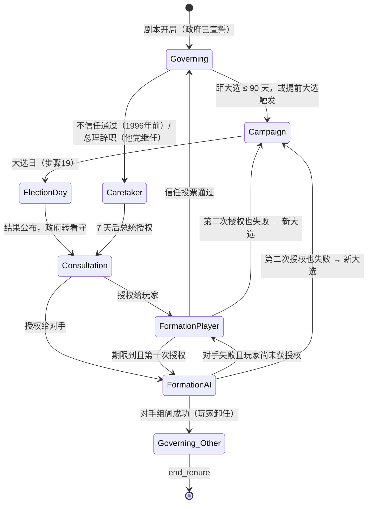
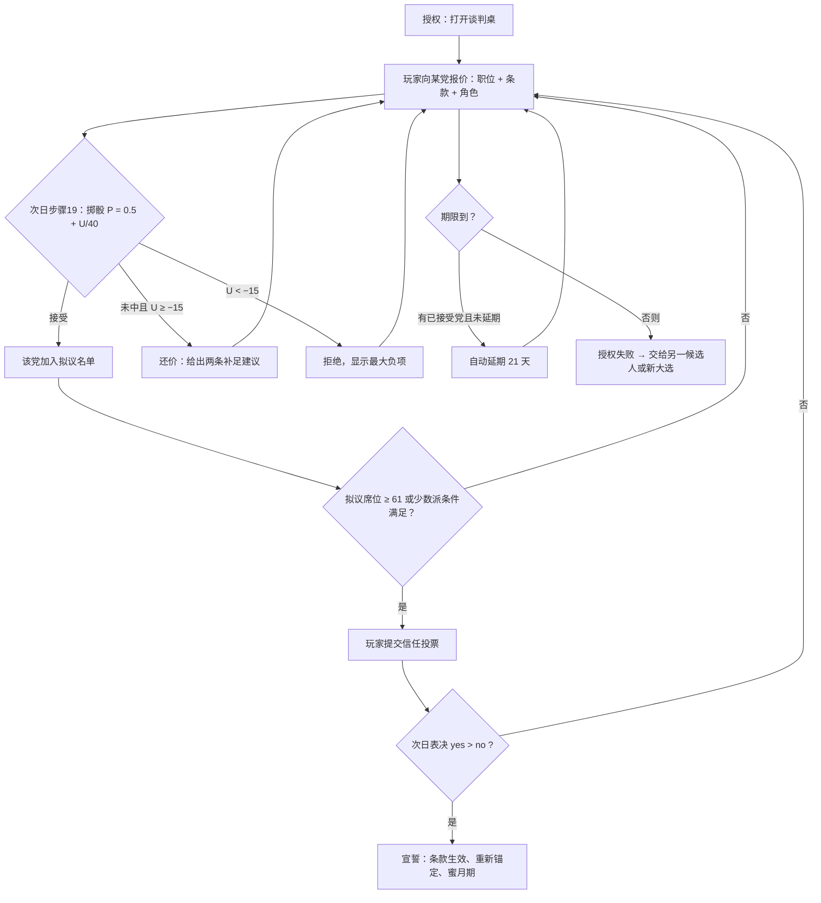
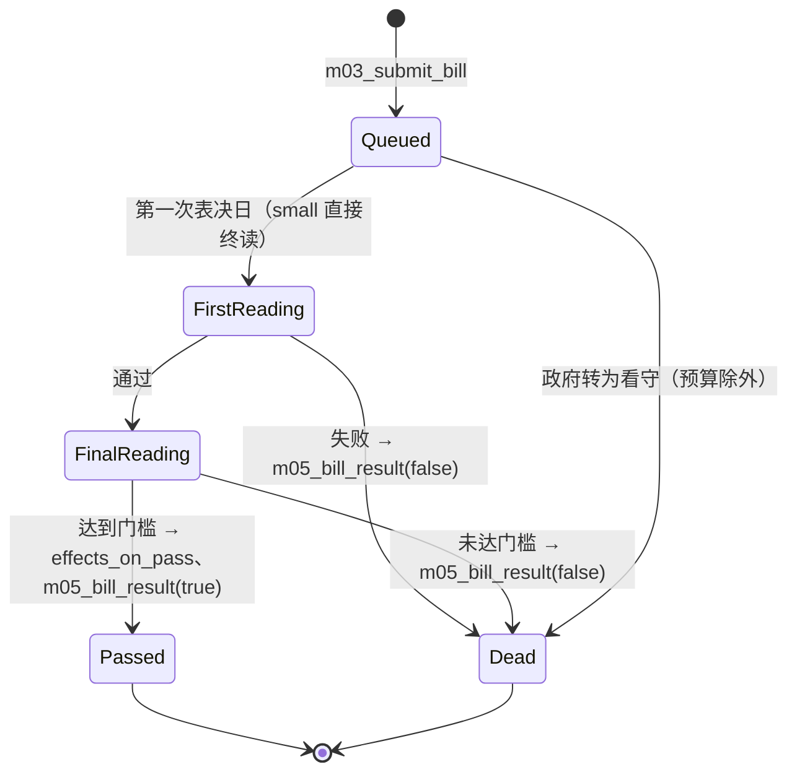
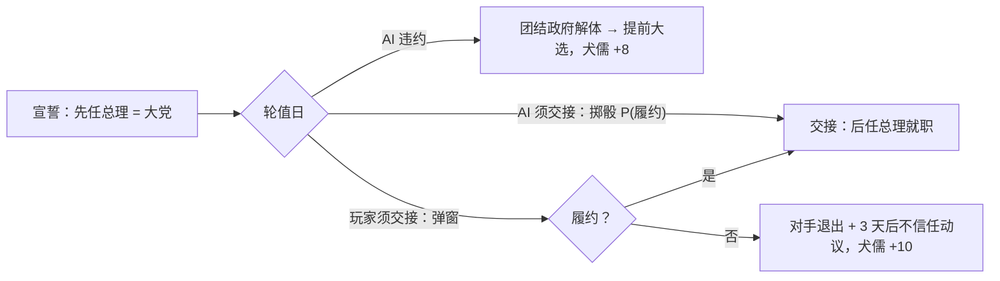

# M03 议会、选举与组阁（parliament）

## 0. 元信息

| 项 | 内容 |
|---|---|
| 版本 | v1.0（2026-10-16） |
| 作者 | 子代理：商业策略游戏资深系统设计师（M03 规格） |
| 文件 | `docs/specs/M03_parliament.md` |
| 机器数据 | `data/parties.yaml`（政党表）、`data/blocs.yaml`（选民集团表）、`data/portfolios.yaml`（部长职位表）、`data/clauses.yaml`（联合协议条款表）、`data/era_rules.yaml`（时代制度表）、`data/scenarios/<id>/modules/M03.yaml`（剧本开局状态）、`data/causal_edges.yaml` 中 owner 为 M03 的 `nodes`/`edges` 段（§3.8） |
| 依赖的模块规格 | M01（结算顺序、效果格式、随机子流、custom 登记、`pending.vote_requests`）、M02（因果网引擎 `step_nodes`/`explain`/`project`、冲击记忆、修正器挂边）、M12（表达式语言、钩子、事件选项立即应用）、M04（承诺列表与立场偏离方向，接口见 §8.4）、M05（法令行动交给 M03 表决，政治资本扣减）、M06（党魁、部长人选、继任者）、M10（预算法案）、M11（区级人口）、M14（开局快照、结束条件） |
| 被依赖 | M04（党内地位读取民调）、M05（政治资本产出读取 `bloc_support`）、M06（部长职位配额）、M12（`term_months()`、`party_has_tag()`、钩子）、M13（推迟选举、议会阻力）、M14（卸任原因、历史评价中的“连任次数”）、M15（议会面板） |
| 约束文件 | `docs/contracts.md`、`docs/registry/DECISIONS.md`（效力高于 contracts）、`docs/registry/parameters.yaml` |
| 跨模块边（D-005） | 采纳 M02 附录C 中目标为 M03 的全部 12 条草案，系数不变，改 `status: active`：X.RSQ.01、X.RSQ.02、X.RSQ.03、X.RSQ.04、X.RSQ.05、X.DEX.01、X.DEX.02、X.ALN.01、X.CIV.01、X.SM.01、X.SM.05、X.JUD.01。**没有替换任何一条** |

### 0.1 本模块负责满足的对标标准

| 标准（出处） | 内容 | 本模块的满足方式 |
|---|---|---|
| R14（benchmarks §6.2） | 每个模拟选民平均属于 ≥2.5 个集团；没有政策能让 ≥6/8 集团同时满意 | §4.3.2 集团交叉矩阵 X：每个集团的“投票用支持度”混合 2–3 个集团的支持度；1977 年平均隶属数 2.71（计算见 §4.3.2）；§4.2 入边表中每个共享来源对不同集团的系数符号相反（静态检查 T14） |
| R16（benchmarks §6.2） | 承诺没兑现推高犬儒度并全局压低支持；兑现率每 +10 个百分点，连任率 +≥5 个百分点 | §4.8.2 `voter_cynicism`（承诺失败 +8）→ 全部集团支持的负向边 M03.BS.10；§4.2.3 `bloc_promise_score` → 正向边 M03.BS.08；验收测试 T15（机器人回归） |
| S1（paradox_lessons §5.3B） | 第1次大选胜率 55–75%；**第3次及以后 ≤ 第1次 + 5 个百分点** | §4.8 执政疲劳（按连续任期加速）、选民期望漂移、每次大选重新锚定；§4.8.4 给出“维持现状时每届吸引力乘数约 0.82–0.84”的推导；验收测试 T08（500 局蒙特卡洛） |
| L3（paradox_lessons §5.3A） | 威胁在场率每任期 25–60%，第3任期起不低于第1任期的 80% | 民调落后、联合政府余量 ≤3 席、预算期限 <60 天三项危险区都由本模块产生；疲劳与期望使后期民调更常落后；T08 同时统计 L3 |
| S3、S4（paradox_lessons §5.3B） | “全绿”月份 ≤15%；从 58 席困境 12 个月内恢复概率 30–70% | 盟党在关键时刻抬价（§4.12.4 枢纽系数 1.15）、满意度随诉求兑现漂移；困境恢复路径：扩大联合政府谈判（§6 操作 O-07）、拉拢倒戈议员、提前大选；验收测试 T16 |
| I1、I2（paradox_lessons §5.3E） | AI 行动 100% 带理由；盟党满意度 <30 时退出率 ≥ 满意度 >70 时的 5 倍 | §7 每个 AI 决策输出 `reason` 结构；退出只在满意度 <20 时可能发生（§4.7.3），满意度 >70 时退出概率为 0 |
| D10、D12（paradox_lessons §5.1） | 重要行动至少两种成本；内生负反馈（疲劳、期望上调、强势招致制衡） | §6 操作表每项列出 ≥2 种成本（政治资本 + 盟党满意度/党内地位/犬儒度/时间）；§4.8 疲劳与期望；§4.12.4 越需要谁，谁开价越高 |
| K2（benchmarks §2.6） | 立法有阶段、有时长 | §4.14.1 法案分 1–3 个表决阶段，2–16 周 |
| D3、D4（benchmarks §4.9） | 选民多重身份；竞选承诺与犬儒度 | 同 R14、R16 |
| R15（benchmarks §6.2） | 100% 可见数值能显示前5项贡献 | `bloc_support`、`ally_satisfaction`、`govt_fatigue`、`voter_cynicism` 走 M02 `explain()`；政党得票率用 §4.3.6 的六因子分解 |
| R5、R6（benchmarks §6.2） | ≥8 条可辨识路线；每年 ≥8 个分叉型抉择 | 本模块提供 5 条路线终点：大选失利、组阁失败、不信任倒台、轮值团结政府、党分裂（§4.16）；组阁时的条款选择写旗标，改变后续事件可达性 |
| R26（benchmarks §6.2） | 每月强制弹窗 ≤3 | 民调每周更新但**不弹窗**；只有大选结果、组阁、不信任投票、盟党退出威胁 4 类强制弹窗 |
| W-x2、S-x4（benchmarks） | 防滚雪球；站队一步错不能满盘输 | 疲劳与期望；组阁失败后还有第二次授权、扩大联合政府、少数派政府三条补救 |
| Suzerain S3、S4（benchmarks §3.5） | 小整数、趋势图优先 | 界面只显示整数席位与“±n 席”区间；民调用 26 周趋势带（§9） |

### 0.2 对标定位

- **朴正熙纪事**：它的国会只看执政党席位，法案过程 5–7 个月但没有盟党。我们比它多一层：**每个盟党有自己的立场、部长胃口和红线**，同一项法案在 61 席与 70 席的政府里难度完全不同；选举结果来自集团模型，不是剧本。
- **Democracy 4**：借用“选民同时属于多个集团、对政府的满意度决定投票”和“竞选承诺 + 犬儒度”。避免它的单一多数制：以色列是全国单一选区比例代表制，赢得大选不等于执政，组阁才是第二场选举。
- **Suzerain**：议会面板以“谈判桌上的档案夹”呈现每个盟党；数值只显示整数席位、三档满意度颜色。
- **P社**：账本式政党表可排序；每个 AI 盟党的行动带理由提示。
- **规模（白日升）**：1977–1992 共 30 个政党条目，但同时活跃的不超过 15 个；玩家每月平均只需处理 1–2 个议会决策。

---

## 1. 设计意图

### 1.1 核心取舍（一句话）

**多数从来不是你的**：每一个法案、每一次组阁都要用部长职位、宗教条款或领土立场去“租”盟党的席位，而租金越付越多，选民却只看结果并且越来越挑剔。

### 1.2 决策频率与信息来源

| 决策 | 频率（贝京 1977 实测估计） | 信息来源 |
|---|---|---|
| 是否把法案提交表决、是否动用党鞭或信任投票 | 每月 0.5–1 次 | 法案卡上的“通过可能性：高/中/低”与预计票数区间（§4.14.4） |
| 回应盟党要价、处理退出威胁 | 每月 0.3–0.5 次 | 盟党档案夹：满意度、诉求满足度六项拆解（§4.7.2） |
| 扩大/改组联合政府 | 每任期 1–2 次 | 议会半圆图 + 可拉拢政党清单（距离、席位、要价） |
| 提前大选 | 每任期 0–1 次 | 民调趋势带、席位预测区间 |
| 竞选决策（承诺、主题、辩论、集会） | 每次大选 5–8 个决策，集中在选前 90 天 | 民调、集团支持、主题可信度（§4.10.2） |
| 组阁谈判 | 每次大选后 3–6 轮报价 | 各党接受度预估（“很可能接受/犹豫/会拒绝”） |

### 1.3 失败状态与恢复路径

| 失败状态 | 触发 | 恢复路径 |
|---|---|---|
| 大选失利 | 大选后总统授权对手组阁且对手成功 | 对手组阁失败时，玩家获得第二次授权（§4.12.6）；对手席位不足时可提议轮值团结政府（§4.13） |
| 组阁失败 | 两次授权都失败 | 自动进入新的大选（90 天以上），玩家以看守总理身份参选 |
| 联合政府跌破 61 席 | 盟党退出、议员倒戈 | 扩大联合政府谈判（O-07 或 M05 `coalition_invite`）、策反议员（M05 `court_defector`）、少数派政府（靠外部支持）、提前大选（M05 `call_early_election`） |
| 不信任投票通过 | §4.15 | 1996 年前：总统重新授权，玩家可能再次获得授权；之后按时代规则 |
| 预算未在期限内通过 | §4.9.3 | 议会自动解散，进入大选 |

### 1.4 后期（第10–20年）如何保持新鲜感

1. **执政疲劳按连续任期加速**（§4.8.1）：第3个任期的疲劳增速是第1个任期的 2 倍。
2. **选民期望持续上调**（§4.8.3）：同一政党连续执政时，选民用来衡量政府的参照点每月上移 0.15 点，并追随政绩上涨。
3. **政党版图随时代变化**：1977–1992 年间有 15 个政党诞生、分裂或合并（§3.3.3），每次分裂都改变组阁算术。
4. **制度变化**：选举门槛 1%→1.5%→2%，1996–2001 年总理直选，2001 年后建设性不信任（§3.6）。
5. **集团人口结构变化**：哈雷迪与阿拉伯选民比重逐年上升，1990 年起俄裔集团出现（§4.18）。

---

## 2. 读写清单

> “写”指 owner 写入（引擎在本模块结算步骤中提交的 `op: set`，priority 100）；“效果”指通过效果队列请求他模块参数变化。步骤编号见 M01 §4.2.1。

### 2.1 M03 拥有并写入的参数

| 参数ID | 读/写 | 结算步骤 | 说明 |
|---|---|---|---|
| `bloc_support[*]` | 写 | 7（每周） | 集团对政府的支持度（**定义**：该集团中认可现政府施政的人所占百分比，0–100）。因果网 `level` 节点，周结算（§4.2） |
| `ally_satisfaction[*]` | 写 | 7（每月子结算，§4.1） | 各党对政府的满意度；在野党的值表示“合作意愿”。`level` 节点（§4.7） |
| `coalition_seats` | 写 | 7、19、暂停阶段的 custom | 联合政府成员党（含支持政府的无党派议员）席位之和，每次席位或成员变化后重算（§4.7.5） |
| `region_vote_share[*]` | 写 | 7（每周） | 派生：总理所属政党在该区的得票率（§4.6） |
| 附录A 新增：`knesset_seats[*]`、`poll_share[*]`、`poll_seats[*]`、`poll_lead`、`months_to_election`、`govt_fatigue`、`voter_cynicism`、`bloc_policy_gap[*]`、`bloc_promise_score[*]`、`ally_deal_score[*]`、`seat_expectation_bonus[*]` | 写 | 见附录A各条 | |

### 2.2 M03 读取的参数

| 参数ID | 读/写 | 读取时机 | 用途 |
|---|---|---|---|
| `inflation`、`unemployment`、`growth`、`inequality`、`union_strength`、`economic_model` | 读 | 步骤7（经 M02 历史快照） | 集团支持入边；政府实际政策位置（经济轴） |
| `public_security` | 读 | 步骤7 | 集团支持入边；集团理想点右移（§4.3.3） |
| `rule_of_law`、`intl_legitimacy` | 读 | 步骤7 | 中产自由派、劳工派入边 |
| `religious_status_quo`、`draft_exemption` | 读 | 步骤7 | 宗教相关入边；政府实际政策位置（宗教轴） |
| `alienation[mizrahi]`、`alienation[russian]`、`historical_grievance[mizrahi]` | 读 | 步骤7、竞选 | X.ALN.01；竞选主题“族群尊严”可信度 |
| `civic_identification[arab]`、`land_grievance[arab]` | 读 | 步骤7 | X.CIV.01、M03.BS.18 |
| `settler_momentum` | 读 | 步骤7、竞选 | X.SM.01、X.SM.05；主题“定居” |
| `judicial_conflict` | 读 | 步骤7 | X.JUD.01（1992 年起） |
| lever `settlement_policy[west_bank]`（M02 附录A，已由 D-002 批准） | 读 | 步骤7 | 政府实际政策位置（领土轴） |
| `stance_deviation[*]`（M04） | 读 | 步骤7、19 | 执政党有效位置（§4.3.3）、党纪（§4.14.3） |
| `party_standing`（M04） | 读 | 步骤7、19 | 执政党党纪 |
| `promise_progress[*]`（M04） | 读 | 步骤7 | 经 M04 接口算 `bloc_promise_score` |
| `vision_progress`（M04） | 读 | 竞选 | 主题“和平”可信度 |
| `political_capital`（M05） | 读；效果 | 暂停阶段 | 操作成本以 `add political_capital −x` 效果提交 |
| `immigration_inflow`（M07） | 读 | 每年1月子结算 | 俄裔集团权重（§4.18） |
| `centralization`（M13） | 读 | 步骤19 | 推迟选举的门槛（§4.9.5） |
| `relation[*]`（M06） | 读 | 步骤19 | 电视辩论（对手口才）、轮值履约 |

### 2.3 M03 通过效果写入他模块参数

| 目标参数 | 来源 | 说明 |
|---|---|---|
| `political_capital` | 玩家操作（§6） | `add` 负值 |
| `party_standing` | 党鞭、拒绝轮值、组阁结果 | `add` |
| `religious_status_quo`、`economic_model`、`union_strength`、lever `settlement_policy`、lever `exemption_coverage`、`power_relation[diaspora]`、`civic_identification[arab]` | 联合协议条款签署效果（§3.5） | 按条款表 |
| `one_off_flows[budget_balance]` | 条款中的拨款（D-010） | 由 M10 月结计入 |
| `rule_of_law` | 拒绝轮值、推迟选举 | `add` |
| `centralization` | 推迟选举 | `add` |

---

## 3. 状态与数据结构

### 3.1 本模块私有状态 `state.modules.M03`

| 字段 | 类型 | 范围 / 取值 | 默认（贝京1977开局） | 说明 |
|---|---|---|---|---|
| `version` | int | ≥1 | 1 | 私有状态版本，供迁移 |
| `parties` | Dict[str, PartyState] | 键为政党ID | 见 §3.9 | 活跃政党的动态状态（不含 `data/parties.yaml` 静态字段） |
| `archive` | Dict[str, PartyState] | — | `{shlomtzion: …}` | 已解散/并入的政党（M01 §4.10.3 第6条） |
| `factions` | Dict[str, FactionState] | — | `{liberals: {host: likud, seats: 15}, mapam: {host: labor, seats: 4}}` | 名单内派系：席位计入宿主政党的 `knesset_seats`，但有独立的 `ally_satisfaction` |
| `government` | GovState | — | 见下 | 当前政府 |
| `anchor` | AnchorState | — | 见 §3.9 | 投票模型的锚点（§4.3.1） |
| `blocs` | BlocState | — | 见 §3.9 | 集团权重与选民数 |
| `poll` | PollState | — | 见 §3.9 | 民调内部状态 |
| `exp_drift` | Dict[str, float] | [0, 25] | 全部 0.0 | 各集团的选民期望漂移（§4.8.3） |
| `calendar` | CalendarState | — | 见下 | 选举日历 |
| `campaign` | CampaignState 或空 | — | 空 | 竞选阶段状态（§4.10） |
| `formation` | FormationState 或空 | — | 空 | 组阁状态机（§4.12） |
| `agenda` | List[BillState] | ≤ 20 条 | `[]` | 议会议程（§4.14） |
| `clauses_active` | List[ClauseInstance] | ≤ 40 | 见 §3.9 | 生效中的联合协议条款 |
| `broken_clauses` | List[{clause, parties, day}] | 只保留 730 天内的 | `[]` | 违约记忆（§4.7.2） |
| `term_count` | int | ≥0 | 1 | 现执政党连续获得组阁权的届数（含当前届）；换党执政重置为 1 |
| `last_month_key` | str | `"YYYY-MM"` | `"1977-06"` | 最近一次月度子结算所在月（§4.1） |
| `last_year` | int | — | 1977 | 最近一次年度子结算的年份 |
| `founded` | List[str] | — | `[]` | 已触发的政党生命周期规则ID（每条只触发一次） |
| `delay_until` | Dict[party, int] | 日序 | `{}` | `m03_delay_demand` 的到期日（§4.19.3）；人情账本本身由 M05 的 `favor_party` 持有 |
| `forced_until` | Dict[party, int] | 日序 | `{}` | `m03_force_support` 的到期日（§4.19.4） |
| `demands` | Dict[party, {policy, open_day}] | — | `{}` | 未决盟党诉求（§4.19.3） |

**PartyState**

| 字段 | 类型 | 范围 | 说明 |
|---|---|---|---|
| `seats` | int | 0–120 | 镜像 `knesset_seats[id]`（以参数为准，私有字段只作缓存，读档后重建） |
| `role` | str | `pm` / `partner` / `support` / `opp` | 总理党 / 联合政府成员 / 外部支持（不入阁、在信任投票中投赞成或弃权）/ 反对党 |
| `portfolios` | List[str] | 部长职位ID | 本党持有的部长职位 |
| `deputies` | int | 0–10 | 副部长数 |
| `pos_shift` | List[float]（5） | 每轴 [−30, 30] | 政党位置相对静态 `pos` 的漂移（只由事件或分裂改变） |
| `seed_base` | Dict[str, float] | — | 新党成立时的种子份额（已并入 `anchor.base` 后清空） |
| `exit_threat_months` | int | ≥0 | 满意度连续低于 30 的月数 |

**GovState**：`{pm_party: "likud", members: ["agudat", "likud", "nrp"], support: [], indep_in_coalition: 0, sworn_day: 0, caretaker: false, unity: null}`。`unity` 非空时为 `{first_pm_party, second_pm_party, rotation_day, rotated: bool}`。

**CalendarState**：`{last_election_day: -34, statutory_day: 1597, scheduled_day: 1597, early: false, dissolution_day: -1, postponed: false}`（日序；1977-05-17 为 −34，1981-11-03 为 1597）。

**AnchorState**：`{base: Dict[bloc, Dict[party, float]], roles: Dict[party, role], svote: Dict[bloc, float], s_raw: Dict[bloc, float], pm_mult: float, prox: Dict[bloc, Dict[party, float]]}`（§4.3.1）。

**其他私有字段**：`true_share: Dict[bloc, Dict[party, float]]`（最近一次步骤7e 的真实份额，玩家不可见，存档以保证读档后民调可复现）；`pairs: List[[party, party]]`（本次大选的剩余票协议）。

### 3.2 选民集团数据（`data/blocs.yaml`）

8 个集团（registry `entities.blocs`）。轴的方向：**−100 = 左/鸽派/世俗/集体主义/顺从外部压力，+100 = 右/鹰派/宗教律法/市场/主权强硬**；五条轴依次为 `territory, security, economy, religion, foreign`（README §2.8）。

| 集团 | 1977 权重 w | 理想点 ideal [领土, 安全, 经济, 宗教, 外交] | 显著度 sal | 开局支持度（建议值，M14 定稿） |
|---|---|---|---|---|
| `labor_ashkenazi` 劳工派阿什肯纳兹 | 0.20 | [−20, 20, −30, −40, −20] | [1.0, 1.0, 1.2, 0.8, 0.6] | 30 |
| `mizrahi` 米兹拉希 | 0.30 | [50, 60, −20, 30, 30] | [0.8, 1.2, 1.2, 0.8, 0.5] | 52 |
| `kibbutz_moshav` 基布兹与莫沙夫 | 0.05 | [−20, 30, −70, −50, −20] | [1.0, 1.0, 1.4, 0.6, 0.5] | 15 |
| `religious_zionist` 宗教犹太复国主义者 | 0.09 | [85, 60, 0, 70, 40] | [1.6, 0.8, 0.4, 1.2, 0.5] | 60 |
| `haredi` 哈雷迪 | 0.05 | [10, 10, −30, 95, 0] | [0.3, 0.3, 0.8, 2.0, 0.2] | 45 |
| `arab_citizens` 阿拉伯公民 | 0.10 | [−90, −70, −40, −20, −70] | [1.4, 1.0, 1.0, 0.3, 0.8] | 15 |
| `liberal_middle` 中产自由派 | 0.21 | [−10, 20, 50, −60, −30] | [1.0, 0.8, 1.2, 1.0, 0.8] | 38 |
| `russian` 俄裔（1990 年起） | 0（未激活） | [60, 70, 40, −60, 30] | [0.8, 1.2, 1.2, 1.0, 0.4] | 激活值 40 |

- 权重 = 该集团占**有效选票**的比例（已含投票率差异），合计为 1。
- `arab_citizens` 开局 15 与 M01 测试夹具中的 5 不同：本模块把 `bloc_support` 定义为“对政府的支持度”，阿拉伯公民对利库德政府的支持度取 15 更合理，且落在软目标区间内（附录C 问题1）。`religious_zionist` 采用 M02 §4.4.0 的 60。

**集团交叉矩阵 X**（每行和为 1；列为未激活集团时，该列删除后整行按剩余元素之和重新归一）：

| 行（集团） | 成分 |
|---|---|
| labor_ashkenazi | labor_ashkenazi 0.70，kibbutz_moshav 0.10，liberal_middle 0.20 |
| mizrahi | mizrahi 0.70，religious_zionist 0.15，haredi 0.05，labor_ashkenazi 0.10 |
| kibbutz_moshav | kibbutz_moshav 0.70，labor_ashkenazi 0.20，religious_zionist 0.10 |
| religious_zionist | religious_zionist 0.70，mizrahi 0.20，haredi 0.10 |
| haredi | haredi 0.80，religious_zionist 0.10，mizrahi 0.10 |
| arab_citizens | arab_citizens 0.85，mizrahi 0.15（德鲁兹人与边缘城镇共同的经济处境） |
| liberal_middle | liberal_middle 0.70，labor_ashkenazi 0.20，russian 0.10 |
| russian | russian 0.70，liberal_middle 0.20，mizrahi 0.10 |

**区级集团构成**（`region_vote_share` 用；俄裔激活后按 §4.6 插入）：

| 区 | 构成（比例，合计 1） |
|---|---|
| galilee | arab_citizens 0.38，mizrahi 0.30，kibbutz_moshav 0.12，labor_ashkenazi 0.10，religious_zionist 0.05，liberal_middle 0.05 |
| haifa | labor_ashkenazi 0.30，mizrahi 0.25，liberal_middle 0.25，arab_citizens 0.12，religious_zionist 0.05，haredi 0.03 |
| tel_aviv | liberal_middle 0.35，labor_ashkenazi 0.25，mizrahi 0.25，haredi 0.07，religious_zionist 0.05，arab_citizens 0.03 |
| triangle | arab_citizens 0.45，mizrahi 0.25，kibbutz_moshav 0.10，labor_ashkenazi 0.10，liberal_middle 0.10 |
| jerusalem | mizrahi 0.30，haredi 0.20，religious_zionist 0.15，liberal_middle 0.15，labor_ashkenazi 0.10，arab_citizens 0.10 |
| negev | mizrahi 0.55，arab_citizens 0.10，kibbutz_moshav 0.10，labor_ashkenazi 0.10，liberal_middle 0.10，religious_zionist 0.05 |
| west_bank | religious_zionist 0.70，haredi 0.10，mizrahi 0.10，liberal_middle 0.10（只计以色列公民） |
| gaza | religious_zionist 0.85，mizrahi 0.15 |
| golan | kibbutz_moshav 0.50，labor_ashkenazi 0.20，religious_zionist 0.20，liberal_middle 0.10 |
| sinai | kibbutz_moshav 0.40，religious_zionist 0.20，liberal_middle 0.20，labor_ashkenazi 0.20 |

### 3.3 政党数据（`data/parties.yaml`）

#### 3.3.1 字段

| 字段 | 类型 | 必填 | 说明 |
|---|---|---|---|
| `id` | str | 是 | registry `entities.parties` 中的ID（新增ID见附录B-1） |
| `name_zh` | str | 是 | 界面名 |
| `kind` | str | 是 | `list`（独立名单）/ `faction`（名单内派系，`host` 必填）/ `residual`（“其他名单”，永远不过门槛） |
| `host` | str | 派系必填 | 宿主名单 |
| `era` | [int, int 或 null] | 是 | 史实存续年份，只用于编辑器提示；运行时以生命周期规则为准 |
| `pos` | List[float]（5） | 是（residual 除外） | 五轴位置，范围 [−100, 100] |
| `sal` | List[float]（5） | 是（residual 除外） | 五轴显著度，范围 [0.1, 2.5] |
| `tags` | List[str] | 否 | 见下表 |
| `discipline` | float | 是 | 党纪基础值，0–100 |
| `office` | float | 是 | 入阁欲望，0–25（接受度公式常数项） |
| `pf_mult` | Dict[portfolio, float] | 否 | 对某些部长职位的估值倍数，默认 1.0 |
| `want` | Dict[clause, float] | 否 | 想要的条款及权重（0–30） |
| `red` | List[clause] | 否 | 红线条款：出现在协议中则接受度 −40，且在野时投票反对 |
| `veto` | List[party] | 否 | 拒绝与之同处联合政府的政党 |
| `list_size` | int | 否 | 名单人数上限，默认 120（Flatto-Sharon 名单只有 1 人） |
| `orator` | float | 否 | 党魁口才（电视辩论用），0–1，默认 0.5；剧本中由 M06 人物覆盖 |

**标签表**：`major`（两大党，参与竞选主题与电视辩论）、`religious`、`haredi_party`、`arab_party`、`no_ministers`（只入联合政府不出任部长，例：以色列正教党）、`no_recommend`（不向总统推荐总理人选；`arab_party` 在 1992 年前自动带此标签）、`labor_satellite`（工党的阿拉伯卫星名单，只与 `labor` 兼容）、`personal_list`（个人名单：每次大选锚定份额 ×0.5）、`racist`（卡赫：1984 年后所有政党 `veto`）。

#### 3.3.2 1977–1992 政党表（五轴位置与组阁属性）

> 位置为“该党在本时期的典型立场”，单位为轴点；sal 为显著度。`want` 与 `red` 的条款ID见 §3.5。

| ID | 中文名 | 类型/宿主 | 史实存续 | pos [领土, 安全, 经济, 宗教, 外交] | sal | 标签 | 党纪 | 入阁欲 | pf_mult | want | red | veto |
|---|---|---|---|---|---|---|---|---|---|---|---|---|
| likud | 利库德 | list | 1973– | [70, 60, 35, 15, 40] | [1.4, 1.2, 0.8, 0.5, 0.8] | major | 80 | 20 | defense 1.5, finance 1.3 | settlement_freedom 15, no_territorial_concession 10 | settlement_freeze | rakah_hadash, plp, adp, kach(1984+) |
| liberals | 自由党 | faction/likud | 1961–1988 | [50, 40, 70, 0, 30] | [1.0, 0.8, 1.6, 0.6, 0.6] | — | 70 | 20 | finance 1.5, industry_trade 1.2 | econ_liberalization 20, budget_discipline 10 | union_protection | 同 likud |
| labor | 工党（联盟） | list | 1968– | [−20, 30, −40, −30, −20] | [1.0, 1.2, 1.2, 0.6, 0.8] | major | 85 | 20 | defense 1.5, foreign 1.3, finance 1.3 | peace_talks_mandate 20, union_protection 15 | no_territorial_concession | tehiya, moledet, kach, rakah_hadash, plp |
| mapam | 统一工人党 | faction/labor（1984 起 list） | 1948–1992 | [−55, −10, −70, −60, −40] | [1.2, 0.8, 1.4, 0.8, 0.8] | — | 85 | 10 | agriculture 1.5 | settlement_freeze 20, union_protection 15 | settlement_freedom, no_territorial_concession | likud, tehiya, kach, moledet |
| dash | 民主变革运动 | list | 1976–1981 | [−10, 20, 20, −40, −10] | [0.8, 0.8, 1.0, 1.0, 0.6] | — | 55 | 15 | justice 1.5 | electoral_reform 15, peace_talks_mandate 10 | who_is_jew | rakah_hadash, kach |
| shinui | 变革党 | list | 1978– | [−20, 10, 50, −60, −10] | [0.8, 0.6, 1.2, 1.2, 0.6] | — | 70 | 10 | justice 1.3 | electoral_reform 15, econ_liberalization 15 | status_quo_protect, sabbath_elal, yeshiva_cap_lift, who_is_jew | kach, tehiya, moledet |
| nrp | 国家宗教党 | list | 1956– | [60, 40, −10, 80, 30] | [1.2, 0.8, 0.5, 1.6, 0.5] | religious | 75 | 20 | religious_affairs 2.0, education 1.5, interior 1.5 | settlement_freedom 15, status_quo_protect 10, yeshiva_budget 5, who_is_jew 5 | settlement_freeze, peace_talks_mandate(1981+) | rakah_hadash, plp, adp, kach |
| agudat | 以色列正教党 | list | 1949– | [10, 0, −20, 95, 0] | [0.3, 0.3, 0.8, 2.0, 0.2] | religious, haredi_party, no_ministers | 90 | 15 | — | yeshiva_cap_lift 20, status_quo_protect 15, sabbath_elal 10, yeshiva_budget 10, who_is_jew 15 | electoral_reform, direct_election | rakah_hadash, plp, adp, kach, ratz, shinui |
| poalei_agudat | 正教工人党 | list | 1949–1984 | [0, 0, −40, 90, 0] | [0.3, 0.3, 1.0, 1.8, 0.2] | religious, haredi_party | 85 | 15 | labor_welfare 1.5 | status_quo_protect 15, yeshiva_budget 10 | electoral_reform | rakah_hadash, kach |
| rakah_hadash | 和平与平等民主阵线 | list | 1977– | [−90, −70, −90, −70, −80] | [1.4, 1.0, 1.2, 0.5, 1.0] | arab_party | 95 | 0 | — | arab_equality 25, settlement_freeze 15 | settlement_freedom, golan_sovereignty | likud, tehiya, moledet, kach, nrp |
| arab_lists | 阿拉伯联合名单 | list | –1981 | [−60, −40, −30, −10, −50] | [1.2, 0.8, 1.0, 0.3, 0.6] | arab_party, labor_satellite | 85 | 10 | — | arab_equality 20 | settlement_freedom | likud, tehiya, kach |
| ratz | 公民权利运动 | list | 1973–1992 | [−60, −30, −10, −80, −40] | [1.0, 0.8, 0.6, 1.4, 0.8] | — | 80 | 10 | — | settlement_freeze 20, kach_ban 10, peace_talks_mandate 15 | status_quo_protect, who_is_jew, yeshiva_cap_lift, settlement_freedom | likud, tehiya, kach, moledet, agudat |
| sheli | 谢利 | list | 1977–1984 | [−80, −40, −50, −60, −60] | [1.6, 1.0, 0.8, 0.6, 1.0] | — | 80 | 5 | — | peace_talks_mandate 25, settlement_freeze 20 | settlement_freedom, golan_sovereignty | likud, tehiya, nrp, kach |
| ilp | 独立自由党 | list | 1965–1984 | [−20, 10, 20, −40, −20] | [0.8, 0.6, 1.0, 1.0, 0.6] | — | 85 | 15 | tourism 1.5 | electoral_reform 10 | who_is_jew | kach, tehiya |
| flatto_sharon | 弗拉托-沙龙名单 | list | 1977–1981 | [20, 20, 40, 0, 0] | [0.5, 0.5, 1.0, 0.3, 0.3] | personal_list | 60 | 25 | — | budget_discipline 5 | — | — |
| shlomtzion | 什洛姆锡安 | list | 1977（开局即并入 likud，归档） | [80, 80, 20, 10, 50] | [1.4, 1.4, 0.6, 0.4, 0.8] | — | 80 | 20 | agriculture 1.5 | settlement_freedom 20 | settlement_freeze | — |
| tehiya | 复兴党 | list | 1979–1992 | [95, 85, 20, 20, 80] | [2.0, 1.2, 0.4, 0.6, 1.0] | — | 85 | 15 | science 1.5 | no_territorial_concession 25, settlement_freedom 25, golan_sovereignty 15 | peace_talks_mandate, settlement_freeze | labor, mapam, ratz, sheli, rakah_hadash, plp, adp |
| tami | 以色列传统运动 | list | 1981–1988 | [40, 40, −30, 60, 20] | [0.6, 0.6, 1.2, 1.4, 0.4] | religious | 80 | 20 | labor_welfare 1.5, absorption 1.5 | dev_towns 20, union_protection 10 | — | kach |
| telem | 国家复兴运动（达扬） | list | 1981–1984 | [0, 30, 20, −20, 0] | [1.0, 1.0, 0.8, 0.6, 0.8] | — | 60 | 15 | foreign 1.5 | peace_talks_mandate 10 | no_territorial_concession | kach |
| kach | 卡赫 | list | 1984–1988 | [100, 100, 0, 60, 100] | [2.0, 2.0, 0.2, 1.0, 1.0] | racist | 95 | 10 | — | no_territorial_concession 25 | kach_ban, arab_equality | 全部 arab_party、labor、mapam、ratz、shinui |
| shas | 沙斯 | list | 1984– | [20, 20, −40, 90, 10] | [0.4, 0.4, 1.2, 1.8, 0.3] | religious, haredi_party | 85 | 25 | interior 2.0, religious_affairs 1.5, labor_welfare 1.3 | yeshiva_budget 20, yeshiva_cap_lift 15, status_quo_protect 15, dev_towns 10 | electoral_reform, direct_election | kach, rakah_hadash |
| morasha | 莫拉沙 | list | 1984–1986 | [80, 60, −10, 85, 50] | [1.4, 0.8, 0.4, 1.6, 0.6] | religious | 80 | 15 | religious_affairs 1.5 | settlement_freedom 20, status_quo_protect 15 | peace_talks_mandate, settlement_freeze | labor, mapam, ratz, kach |
| yahad | 亚哈德（魏茨曼） | list | 1984–1987 | [−30, 20, 10, −30, −20] | [1.0, 1.0, 0.8, 0.6, 0.8] | — | 70 | 20 | — | peace_talks_mandate 15 | no_territorial_concession | kach, tehiya |
| ometz | 奥梅茨 | list | 1984–1988 | [20, 30, 50, −10, 10] | [0.6, 0.6, 1.6, 0.4, 0.4] | — | 70 | 20 | finance 1.5 | budget_discipline 15, econ_liberalization 20 | union_protection | kach |
| plp | 争取和平进步名单 | list | 1984–1992 | [−95, −70, −50, −60, −80] | [1.6, 1.0, 0.8, 0.4, 1.0] | arab_party | 90 | 0 | — | arab_equality 25, peace_talks_mandate 25 | settlement_freedom | likud, tehiya, nrp, kach, moledet |
| tzomet | 佐梅特 | list | 1983– | [80, 80, 50, −50, 50] | [1.4, 1.4, 0.8, 1.0, 0.8] | — | 75 | 15 | agriculture 1.5 | no_territorial_concession 15, electoral_reform 10, golan_sovereignty 15 | yeshiva_cap_lift, peace_talks_mandate | rakah_hadash, plp, adp, kach |
| moledet | 故土党 | list | 1988– | [100, 95, 20, 10, 90] | [2.0, 1.4, 0.3, 0.4, 1.0] | — | 85 | 15 | — | no_territorial_concession 25, settlement_freedom 20 | peace_talks_mandate, arab_equality | labor, mapam, ratz, rakah_hadash, plp, adp |
| degel_hatorah | 托拉旗帜 | list | 1988–1992 | [0, 0, −20, 100, 0] | [0.2, 0.2, 0.8, 2.2, 0.2] | religious, haredi_party | 90 | 15 | — | yeshiva_cap_lift 20, yeshiva_budget 15, status_quo_protect 15 | electoral_reform | rakah_hadash, kach, ratz, shinui |
| adp | 阿拉伯民主党 | list | 1988– | [−85, −60, −40, 0, −70] | [1.4, 1.0, 1.0, 0.4, 0.8] | arab_party | 85 | 5 | — | arab_equality 25 | settlement_freedom | likud, tehiya, moledet, kach |
| meretz | 梅雷茨 | list | 1992– | [−60, −30, 0, −80, −40] | [1.0, 0.8, 0.8, 1.4, 0.8] | — | 80 | 15 | education 1.5 | settlement_freeze 20, peace_talks_mandate 20, kach_ban 5 | status_quo_protect, yeshiva_cap_lift, who_is_jew | likud, tehiya, moledet, kach |
| utj | 圣经犹太教联盟 | list | 1992– | [10, 0, −20, 100, 0] | [0.2, 0.2, 0.8, 2.2, 0.2] | religious, haredi_party | 90 | 10 | — | yeshiva_cap_lift 20, yeshiva_budget 15, status_quo_protect 15 | electoral_reform | rakah_hadash, kach, meretz |
| independents | 无党派议员 | list（无选举名单） | — | 不参与投票模型 | — | — | 0 | 0 | — | — | — | — |
| other_lists | 其他名单 | residual | — | — | — | — | — | — | — | — | — | — |

- `independents` 只承载脱党议员；它在大选中没有得票，大选后席位清零。
- 其他剧本（1948、1963、1969、1992、2001）的政党（mapai、ahdut_haavoda、rafi、herut、gahal、general_zionists、progressives、maki、yisrael_baalia、kadima 等）使用同一 schema，数据由各剧本的 M14 规格提供；本规格的规则对它们同样适用。

#### 3.3.3 政党生命周期规则（1977–1992）

每月子结算（§4.1）按规则ID升序检查一次；条件为真时执行动作，并把规则ID写入 `founded`（每条只触发一次）。动作使用的 custom 处理函数见 §4.16。

| 规则ID | 条件（M12 表达式） | 动作 |
|---|---|---|
| LC-1977-SHL | 剧本加载时 | `m03_merge_parties {members: [likud, shlomtzion], into: likud}`（史实：1977-06 并入） |
| LC-1978-DSH | `year >= 1978 and month >= 8 and knesset_seats[dash] >= 10` | `m03_split_party {parent: dash, new: shinui, seat_move: 7, base_frac: {liberal_middle: 0.40, labor_ashkenazi: 0.40, kibbutz_moshav: 0.30}}`；另 `m03_mk_defect {from: dash, to: independents, n: 1}` |
| LC-1979-TEH | `flag("复兴党成立")` | `m03_split_party {parent: likud, new: tehiya, seat_move: 2, base_frac: {religious_zionist: 0.10, mizrahi: 0.02, liberal_middle: 0.02}}`；并从 nrp 再取 `base_frac {religious_zionist: 0.08}`（第二次调用，`seat_move: 0`） |
| LC-1981-TAM | `year >= 1981 and alienation[mizrahi] >= 33 and knesset_seats[nrp] >= 6` | `m03_split_party {parent: nrp, new: tami, seat_move: 1, base_frac: {mizrahi: 0.30}}`；并从 likud 取 `{mizrahi: 0.02}`（`seat_move: 0`） |
| LC-1981-TEL | `year >= 1981 and character_alive("dayan") and not character_in_office("dayan")` | 新党 telem：`m03_found_party {id: telem, seed: {liberal_middle: 2.0, labor_ashkenazi: 1.0}, seat_from: {independents: 1}}`（单位：集团内百分点，从各党按比例扣除） |
| LC-1981-DIS | `year >= 1981 and month >= 4` | 解散 dash（剩余部分）、flatto_sharon 的 `list_size` 规则照旧；`m03_dissolve_party {party: dash}`（份额按 §4.16.4 分给最近的政党，席位转 independents） |
| LC-1981-KCH | `year >= 1981` | 新党 kach：`m03_found_party {id: kach, seed: {mizrahi: 0.4, religious_zionist: 0.5}, from_residual: true}`（份额从 other_lists 扣除） |
| LC-1983-SHS | `year >= 1983 and alienation[mizrahi] >= 30` | `m03_split_party {parent: agudat, new: shas, seat_move: 0, base_frac: {haredi: 0.30, mizrahi: 0.50}}`；并从 likud 取 `{mizrahi: 0.03}`、从 nrp 取 `{mizrahi: 0.10}` |
| LC-1983-MOR | `year >= 1983 and settler_momentum >= 55 and ally_satisfaction[nrp] < 50` | `m03_split_party {parent: nrp, new: morasha, seat_move: 1, base_frac: {religious_zionist: 0.20}}`；poalei_agudat 并入 morasha：`m03_merge_parties {members: [morasha, poalei_agudat], into: morasha}` |
| LC-1983-YAH | `year >= 1983 and character_alive("weizman") and not character_in_office("weizman")` | `m03_found_party {id: yahad, seed: {liberal_middle: 3.0, labor_ashkenazi: 1.5}}` |
| LC-1983-OMZ | `year >= 1983 and inflation >= 150` | `m03_found_party {id: ometz, seed: {liberal_middle: 1.5}}` |
| LC-1983-TZM | `year >= 1983` | `m03_split_party {parent: tehiya, new: tzomet, seat_move: 0, base_frac: {kibbutz_moshav: 0.50, liberal_middle: 0.30, mizrahi: 0.20}}` |
| LC-1984-PLP | `year >= 1984` | `m03_found_party {id: plp, seed: {arab_citizens: 6.0}}`；sheli、arab_lists 若仍存在则 `m03_merge_parties {members: [plp, sheli], into: plp}` |
| LC-1984-ILP | `year >= 1984` | `m03_merge_parties {members: [labor, ilp], into: labor}` |
| LC-1984-MPM | `flag("团结政府") and has_faction("mapam")`（`has_faction` 为 M03 私有判断，不进表达式；此条在代码中硬编码） | 派系 mapam 升格为独立名单：席位 6（不足 6 时取派系现有席位）从 labor 移出；份额 `base_frac {kibbutz_moshav: 0.25, labor_ashkenazi: 0.08}`；mapam 角色设为 `opp` |
| LC-1985-KBN | `flag("卡赫已取缔")` | `m03_dissolve_party {party: kach}`（份额分给 tehiya 与 moledet 中存在者） |
| LC-1987-MOL | `year >= 1987 and pal_hostility >= 60` | `m03_found_party {id: moledet, seed: {religious_zionist: 1.5, mizrahi: 0.8, liberal_middle: 0.5}}` |
| LC-1988-DGL | `year >= 1988` | `m03_split_party {parent: agudat, new: degel_hatorah, seat_move: 0, base_frac: {haredi: 0.40}}` |
| LC-1988-ADP | `year >= 1988 and civic_identification[arab] <= 45` | `m03_split_party {parent: labor, new: adp, seat_move: 1, base_frac: {arab_citizens: 0.20}}` |
| LC-1988-LIB | `year >= 1988 and month >= 8` | 派系 liberals 解散，席位全部归 likud 本体（史实：利库德 1988 年成为统一政党）；`ally_satisfaction[liberals]` 调用 `deactivate_key` |
| LC-1992-MRZ | `year >= 1992` | `m03_merge_parties {members: [meretz, ratz, mapam, shinui], into: meretz}`（meretz 为新ID；`pos` 取表中值） |
| LC-1992-UTJ | `year >= 1992` | `m03_merge_parties {members: [utj, agudat, degel_hatorah], into: utj}` |

规则只在对应政党存在时执行；父党不存在或已被归档时，该规则跳过并记入 `founded`。玩家路线偏离史实时（例如没有签埃以和约），`flag("复兴党成立")` 永远不出现，复兴党也就不会诞生。

### 3.4 部长职位表（`data/portfolios.yaml`）

| ID | 中文 | 点数 | ID | 中文 | 点数 |
|---|---|---|---|---|---|
| defense | 国防 | 10 | industry_trade | 工贸 | 4 |
| foreign | 外交 | 9 | justice | 司法 | 4 |
| finance | 财政 | 9 | health | 卫生 | 3 |
| interior | 内政 | 6 | transport | 交通 | 3 |
| education | 教育文化 | 6 | police | 警察 | 3 |
| housing | 住房建设 | 5 | absorption | 移民吸收 | 3 |
| religious_affairs | 宗教事务 | 4 | deputy_pm | 副总理（头衔，可与其他职位叠加） | 3 |
| agriculture | 农业 | 4 | communications | 通讯 | 2 |
| labor_welfare | 劳工福利 | 4 | energy | 能源 | 2 |
| tourism | 旅游 | 2 | science | 科学 | 1 |

- **可分配点数池 Π = 87**（20 项合计）。总理本人不占点数。副部长每人 1 点，另计，不进入 Π。
- 职位到人的映射由 M06 决定（M06 从持有该职位的政党中挑人）；本模块只管“哪个党拿哪个职位”。
- 空缺职位由总理党代管，不计入任何盟党的得分。

### 3.5 联合协议条款表（`data/clauses.yaml`）

| 字段 | 说明 |
|---|---|
| `id`、`name_zh` | — |
| `era` | [起, 止] 年 |
| `on_sign` | 签署当日提交的效果列表（contracts §4 格式；拨款写 `one_off_flows`，D-010） |
| `obligation` | 布尔表达式，月度检查，必须保持为真；空表示无持续义务 |
| `on_break` | 违约效果（另有通用违约处理 §4.7.4） |

| ID | 名称 | 时代 | on_sign | obligation |
|---|---|---|---|---|
| status_quo_protect | 维护宗教现状 | 全 | `religious_status_quo +2` | `religious_status_quo >= sign_value - 3`（`sign_value` 在签署时代入数字） |
| sabbath_elal | 以色列航空安息日停飞 | 全 | `religious_status_quo +4`；`growth` 无直接效果（由 M10 读取旗标 `elal_sabbath` 处理） | 旗标 `elal_sabbath` 保持 |
| yeshiva_cap_lift | 取消耶希瓦豁免上限 | 全 | `add_modifier uncapped_exemption`；lever `exemption_coverage` `add +15` | `has_modifier("uncapped_exemption")` |
| yeshiva_budget | 宗教教育网络拨款 | 全 | `one_off_flows[budget_balance] −0.5` | 无 |
| who_is_jew | 修改“谁是犹太人”定义 | 全 | `religious_status_quo +6`；`power_relation[diaspora] −8` | 无 |
| settlement_freedom | 犹太与撒马利亚定居自由 | 1967– | lever `settlement_policy[west_bank]` `add +15` | `settlement_policy[west_bank] >= 50` |
| settlement_freeze | 冻结新建定居点 | 1967– | lever `settlement_policy[west_bank]` `add −20` | `settlement_policy[west_bank] <= 40` |
| no_territorial_concession | 不交还任何领土 | 1967– | 无 | `not flag("西岸归还") and not flag("戈兰归还")`；另：任何选项被 M04 标为“领土让步”且执行时视为违约 |
| peace_talks_mandate | 授权以土地换和平谈判 | 1967– | 旗标 `peace_mandate` | 无 |
| electoral_reform | 选举制度改革 | 全 | 旗标 `选举改革运动` | 签署后 36 个月内须完成 M05 行动 `electoral_reform_law`，否则违约 |
| econ_liberalization | 经济自由化纲领 | 全 | `economic_model +5` | `economic_model >= sign_value - 5` |
| union_protection | 保障总工会与工资指数化 | 全 | `union_strength +3` | `union_strength >= sign_value - 8` |
| dev_towns | 发展城镇投资计划 | 全 | `one_off_flows[budget_balance] −1.0`；`region_development[negev] +2`（效果，M11） | 无 |
| arab_equality | 阿拉伯市镇预算平等 | 1975– | `one_off_flows[budget_balance] −0.5`；`civic_identification[arab] +3` | 无 |
| golan_sovereignty | 戈兰高地适用以色列法律 | 1967– | 无（由 M05 行动执行） | 签署后 24 个月内须完成 M05 行动 `golan_heights_law` |
| kach_ban | 取缔种族主义名单 | 1984– | 无 | 签署后 12 个月内须设置旗标 `卡赫已取缔` |
| direct_election | 总理直选 | 1990–2001 | 旗标 `选举改革运动` | 无 |
| budget_discipline | 财政纪律 | 全 | 无 | `not flag("选前透支")` |
| absorption_housing | 新移民住房计划 | 1989– | `one_off_flows[budget_balance] −1.0`；`absorption_capacity +5` | 无 |

### 3.6 时代制度表（`data/era_rules.yaml`）

| 规则 | 1949 | 1951–1972 | 1973–1991 | 1992–1995 | 1996–2001.03 | 2001.03–2005 | 2006– |
|---|---|---|---|---|---|---|---|
| 选举门槛（有效票占比） | 1% | 1% | 1% | 1.5% | 1.5% | 1.5% | 2% |
| 席位分配方法 | d'Hondt | 黑尔数额 + 最大余数 | Bader-Ofer（= d'Hondt + 剩余票协议） | 同左 | 同左 | 同左 | 同左 |
| 组阁期限（授权后天数 + 最长延期） | 21 + 21 | 21 + 21 | 21 + 21 | 21 + 21 | 45 + 0（直选总理组阁） | 28 + 14 | 28 + 14 |
| 不信任投票规则 | 简单多数，政府倒台 | 同左 | 同左 | 同左 | 61 票，议会与总理同时改选 | 建设性：61 票且须提名继任总理 | 同左 |
| 财政年度起点 | 4 月 1 日 | 4 月 1 日 | 4 月 1 日（1992 年起 1 月 1 日） | 1 月 1 日 | 1 月 1 日 | 1 月 1 日 | 1 月 1 日 |
| 民调误差倍数 κ | 2.0（只有顾问估计） | 2.0（1969 年起 1.5） | 1.5（1981 年起 1.0） | 1.0 | 1.0 | 1.0 | 1.0 |
| 电视辩论 | 无 | 无（1969 年起可用） | 可用 | 可用 | 可用 | 可用 | 可用 |
| 总理直选 | 否 | 否 | 否 | 否 | 是 | 否 | 否 |

- 判定以**大选日或事件发生日**的日期为准。“1996–2001.03”只在旗标 `总理直选` 存在时生效（E-1992-03 设置）；旗标不存在则沿用 1992–1995 列。
- 黑尔数额 + 最大余数（1951–1972）：数额 q = 过线名单总票 / 120；各名单先得 `floor(v/q)` 席，剩余席位按余数 `v − q × floor(v/q)` 从大到小分配；余数相同按得票多者优先，再按政党ID升序。
- 1973 年起的剩余票协议：两党可以签订协议，在分配剩余席位时合并计算（§4.5）。

### 3.7 选举日历常数

| 常数 | 值 | 说明 |
|---|---|---|
| 法定大选日 | 上次大选年份 + 4 年的 11 月第一个星期二 | 近似“第四年的赫舍汪月第三个星期二”。算例：1977-05-17 → 1981-11-03；1984-07-23 → 1988-11-01（与史实一致） |
| 提前大选日 | 触发日 + 90 天之后（含当天）的第一个星期二 | 算例：1983-06-30 触发 → 1983-09-28（星期三）→ 1983-10-04 |
| 竞选期 | 大选日前 90 天起 | 提前大选时从触发日起 |
| 总统磋商 | 大选日后 7 天 | 第 7 天授权 |
| 新政府蜜月期 | 宣誓日起 6 个月 | 修正器 `honeymoon` |

### 3.8 因果网节点与边（`data/causal_edges.yaml` 中 owner = M03 的部分）

```yaml
nodes:
  - param: bloc_support
    owner: M03
    keys: [labor_ashkenazi, mizrahi, kibbutz_moshav, religious_zionist, haredi, arab_citizens, russian, liberal_middle]
    mode: level
    tick: weekly
    alpha: 0.024021          # = 1 − 0.9^(12/52)，等价于月 α 0.10（M02 §4.1 周期换算）
    baseline: {labor_ashkenazi: 32.709, mizrahi: 56.209, kibbutz_moshav: 15.352, religious_zionist: 59.609,
               haredi: 47.326, arab_citizens: 31.620, liberal_middle: 41.705, russian: 40.0}
    soft: {lo_s: 15, hi_s: 85, w: 13}
    memory_rho: 0.30
    memory_mu: 0.05
    active: {russian: "year >= 1990"}
    init_on_activate: {russian: 40.0}

  - param: ally_satisfaction
    owner: M03
    keys: "*"                # 全部活跃政党与派系；键随 activate_key/deactivate_key 增减
    mode: level
    tick: monthly
    alpha: 0.10
    baseline: "solved"       # 由 tools/calibrate_m03.py 在构建期按 §4.7.6 求解并写成数字
    soft: {lo_s: 15, hi_s: 85, w: 13}
    memory_rho: 0.30
    memory_mu: 0.05

  - param: govt_fatigue
    owner: M03
    keys: null
    mode: rate
    tick: monthly
    baseline: 0.0
    headroom: true

  - param: voter_cynicism
    owner: M03
    keys: null
    mode: rate
    tick: monthly
    baseline: -0.5
    headroom: true

edges:
  # ── bloc_support（所有 "*" 边对 8 个集团展开；未激活集团贡献为 0）──
  - {id: M03.BS.01, target: bloc_support, target_key: "*", source: param:inflation, shape: sat, pivot: 15, coef: -0.10, w: 80, inertia: 3, delay: 0, label_zh: 通胀}
  - {id: M03.BS.02, target: bloc_support, target_key: "*", source: param:unemployment, shape: above, pivot: 4, coef: -1.5, inertia: 3, delay: 0, label_zh: 失业}
  - {id: M03.BS.03, target: bloc_support, target_key: "*", source: param:growth, shape: linear, pivot: 3, coef: 0.6, inertia: 3, delay: 0, label_zh: 经济增长}
  - {id: M03.BS.04, target: bloc_support, target_key: labor_ashkenazi, source: param:inequality, shape: above, pivot: 35, coef: -0.20, inertia: 6, delay: 0, label_zh: 贫富差距}
  - {id: M03.BS.05, target: bloc_support, target_key: mizrahi, source: param:inequality, shape: above, pivot: 35, coef: -0.20, inertia: 6, delay: 0, label_zh: 贫富差距}
  - {id: M03.BS.06, target: bloc_support, target_key: "*", source: param:public_security, shape: linear, pivot: 50, coef: 0.25, inertia: 1, delay: 0, label_zh: 公众安全感}
  - {id: M03.BS.07, target: bloc_support, target_key: "*", source: param:bloc_policy_gap, source_key: "$key", shape: above, pivot: 25, coef: -0.40, inertia: 1, delay: 0, label_zh: 政府政策与本集团的距离}
  - {id: M03.BS.08, target: bloc_support, target_key: "*", source: param:bloc_promise_score, source_key: "$key", shape: linear, pivot: 0, coef: 0.15, inertia: 1, delay: 0, label_zh: 承诺兑现感}
  - {id: M03.BS.09, target: bloc_support, target_key: "*", source: param:govt_fatigue, shape: linear, pivot: 0, coef: -0.12, inertia: 1, delay: 0, label_zh: 执政疲劳}
  - {id: M03.BS.10, target: bloc_support, target_key: "*", source: param:voter_cynicism, shape: above, pivot: 20, coef: -0.15, inertia: 1, delay: 0, label_zh: 犬儒情绪}
  - {id: M03.BS.11, target: bloc_support, target_key: liberal_middle, source: param:rule_of_law, shape: linear, pivot: 60, coef: 0.20, inertia: 6, delay: 0, label_zh: 民主法治}
  - {id: M03.BS.12, target: bloc_support, target_key: liberal_middle, source: param:intl_legitimacy, shape: linear, pivot: 50, coef: 0.10, inertia: 3, delay: 0, label_zh: 国际形象}
  - {id: M03.BS.13, target: bloc_support, target_key: labor_ashkenazi, source: param:intl_legitimacy, shape: linear, pivot: 50, coef: 0.10, inertia: 3, delay: 0, label_zh: 国际形象}
  - {id: M03.BS.14, target: bloc_support, target_key: kibbutz_moshav, source: param:union_strength, shape: linear, pivot: 50, coef: 0.10, inertia: 3, delay: 0, label_zh: 总工会与合作社}
  - {id: M03.BS.15, target: bloc_support, target_key: labor_ashkenazi, source: param:union_strength, shape: linear, pivot: 50, coef: 0.05, inertia: 3, delay: 0, label_zh: 总工会}
  - {id: M03.BS.16, target: bloc_support, target_key: religious_zionist, source: param:religious_status_quo, shape: linear, pivot: 0, coef: 0.10, inertia: 3, delay: 0, label_zh: 宗教现状}
  - {id: M03.BS.17, target: bloc_support, target_key: labor_ashkenazi, source: param:religious_status_quo, shape: linear, pivot: 0, coef: -0.10, inertia: 3, delay: 0, label_zh: 宗教强制}
  - {id: M03.BS.18, target: bloc_support, target_key: arab_citizens, source: param:land_grievance, source_key: arab, shape: above, pivot: 40, coef: -0.15, inertia: 3, delay: 0, label_zh: 土地怨气}
  - {id: M03.BS.19, target: bloc_support, target_key: russian, source: param:absorption_capacity, shape: linear, pivot: 50, coef: 0.20, inertia: 3, delay: 0, label_zh: 吸收安置}
  # 采纳的 M02 跨模块边（系数不变）
  - {id: X.RSQ.01, target: bloc_support, target_key: haredi, source: param:religious_status_quo, shape: linear, pivot: 0, coef: 0.15, inertia: 3, delay: 0, label_zh: 宗教现状}
  - {id: X.RSQ.02, target: bloc_support, target_key: liberal_middle, source: param:religious_status_quo, shape: linear, pivot: 0, coef: -0.15, inertia: 3, delay: 0, label_zh: 宗教强制}
  - {id: X.RSQ.03, target: bloc_support, target_key: russian, source: param:religious_status_quo, shape: linear, pivot: 0, coef: -0.10, inertia: 3, delay: 0, label_zh: 宗教强制}
  - {id: X.DEX.01, target: bloc_support, target_key: liberal_middle, source: param:draft_exemption, shape: above, pivot: 15, coef: -0.20, inertia: 1, delay: 0, label_zh: 兵役负担不公}
  - {id: X.DEX.02, target: bloc_support, target_key: haredi, source: param:draft_exemption, shape: linear, pivot: 0, coef: 0.10, inertia: 1, delay: 0, label_zh: 豁免保障}
  - {id: X.ALN.01, target: bloc_support, target_key: "*", key_map: {mizrahi: mizrahi, russian: russian}, source: param:alienation, shape: above, pivot: 30, coef: -0.25, inertia: 3, delay: 0, label_zh: 群体疏离}
  - {id: X.CIV.01, target: bloc_support, target_key: arab_citizens, source: param:civic_identification, source_key: arab, shape: linear, pivot: 50, coef: 0.20, inertia: 3, delay: 0, label_zh: 国家认同}
  - {id: X.SM.01, target: bloc_support, target_key: religious_zionist, source: param:settler_momentum, shape: above, pivot: 40, coef: 0.20, inertia: 3, delay: 0, label_zh: 定居者动员}

  # ── ally_satisfaction ──
  - {id: M03.AS.01, target: ally_satisfaction, target_key: "*", source: param:ally_deal_score, source_key: "$key", shape: linear, pivot: 0, coef: 0.50, inertia: 1, delay: 0, label_zh: 诉求满足度}
  - {id: M03.AS.02, target: ally_satisfaction, target_key: "*", source: param:govt_fatigue, shape: above, pivot: 40, coef: -0.10, inertia: 3, delay: 0, label_zh: 与疲惫的政府绑在一起}
  - {id: X.RSQ.04, target: ally_satisfaction, target_key: agudat, source: param:religious_status_quo, shape: linear, pivot: 0, coef: 0.20, inertia: 1, delay: 0, label_zh: 宗教现状}
  - {id: X.RSQ.05, target: ally_satisfaction, target_key: nrp, source: param:religious_status_quo, shape: linear, pivot: 0, coef: 0.10, inertia: 1, delay: 0, label_zh: 宗教现状}
  - {id: X.SM.05, target: ally_satisfaction, target_key: nrp, source: param:settler_momentum, shape: linear, pivot: 50, coef: 0.15, inertia: 3, delay: 0, label_zh: 定居事业}
  - {id: X.JUD.01, target: ally_satisfaction, target_key: shas, source: param:judicial_conflict, shape: above, pivot: 30, coef: -0.10, inertia: 3, delay: 0, label_zh: 法院与宗教政党对抗}

  # ── govt_fatigue（流量，点/月）──
  - {id: M03.FT.01, target: govt_fatigue, source: const, shape: linear, pivot: 0, coef: 0.50, label_zh: 执政时间}
  - {id: M03.FT.02, target: govt_fatigue, source: flag:m03_term2, shape: flag, coef: 0.25, label_zh: 第二个任期}
  - {id: M03.FT.03, target: govt_fatigue, source: flag:m03_term3p, shape: flag, coef: 0.50, label_zh: 第三个及以后任期}
  - {id: M03.FT.04, target: govt_fatigue, source: param:voter_cynicism, shape: above, pivot: 40, coef: 0.01, inertia: 1, delay: 0, label_zh: 犬儒加速疲劳}

  # ── voter_cynicism（流量，点/月）── 基线 −0.5；正向冲击由效果直接写入（§4.8.2）
  - {id: M03.CY.01, target: voter_cynicism, source: param:centralization, shape: above, pivot: 30, coef: 0.02, inertia: 3, delay: 0, label_zh: 集权引发冷感}
```

- `const` 来源的 `linear` 形状：`s = 1`，贡献 = `coef × (1 − 0)` = 0.50（M02 §4.3）。
- 统计：M03 入边 38 条（"*" 展开前），其中带 `inertia > 1` 的 24 条（63%），满足 R13 的“≥50% 带惯性或延迟”。
- 修正器挂边（M02 B3）：`honeymoon` 修正器带 `edges: [{target: bloc_support, target_key: "*", shape: flag, coef: 4.0, label_zh: 新政府蜜月期}]`。

### 3.9 剧本开局状态完整示例（`data/scenarios/begin_1977/modules/M03.yaml`）

```yaml
version: 1
knesset_seats:            # 1977-06-20 宣誓日：什洛姆锡安已并入利库德
  likud: 45
  labor: 32
  dash: 15
  nrp: 12
  rakah_hadash: 5
  agudat: 4
  sheli: 2
  flatto_sharon: 1
  poalei_agudat: 1
  ilp: 1
  ratz: 1
  arab_lists: 1
  independents: 0         # E-1977-06 选项A 执行后达扬从 labor 转入，见 §8.3
factions:
  liberals: {host: likud, seats: 15}
  mapam: {host: labor, seats: 4}
government:
  pm_party: likud
  members: [agudat, likud, nrp]
  support: []
  indep_in_coalition: 0
  sworn_day: 0
  caretaker: false
  unity: null
portfolios:               # 空缺：justice, transport, labor_welfare（留给民主变革运动），由总理党代管
  likud: [defense, agriculture, industry_trade, health, absorption, communications, police, science]
  liberals: [finance, housing, energy, tourism]
  nrp: [interior, education, religious_affairs]
  independents: []        # 达扬入阁后得到 foreign
  agudat: []              # no_ministers；议会财政委员会主席不计点数
clauses_active:
  - {clause: status_quo_protect, sign_day: 0, sign_value: 10, parties: [agudat, nrp]}
  - {clause: settlement_freedom, sign_day: 0, sign_value: 40, parties: [nrp]}
  - {clause: econ_liberalization, sign_day: 0, sign_value: -45, parties: [liberals]}
ally_satisfaction:        # 开局值（建议，M14 定稿）
  nrp: 65
  agudat: 60
  liberals: 60
  dash: 45
  labor: 15
  mapam: 10
  flatto_sharon: 50
  poalei_agudat: 45
  ilp: 30
  ratz: 15
  sheli: 8
  rakah_hadash: 5
  arab_lists: 20
  likud: 50               # 总理党自身的值不使用（党内情况见 M04 party_standing），冻结在 50
calendar:
  last_election_day: -34   # 1977-05-17
  statutory_day: 1597      # 1981-11-03
  scheduled_day: 1597
  early: false
  dissolution_day: -1
term_count: 1
govt_fatigue: 0
voter_cynicism: 20
exp_drift: {labor_ashkenazi: 0, mizrahi: 0, kibbutz_moshav: 0, religious_zionist: 0, haredi: 0, arab_citizens: 0, liberal_middle: 0}
blocs:
  electorate: 2236293
  russian_voters: 0
  weights: {labor_ashkenazi: 0.20, mizrahi: 0.30, kibbutz_moshav: 0.05, religious_zionist: 0.09, haredi: 0.05, arab_citizens: 0.10, liberal_middle: 0.21}
anchor:
  roles: {likud: pm, nrp: partner, agudat: partner}     # 未列出的政党为 opp
  svote: {labor_ashkenazi: 30.1, mizrahi: 50.65, kibbutz_moshav: 22.5, religious_zionist: 56.9, haredi: 47.2, arab_citizens: 20.55, liberal_middle: 36.222}
  s_raw: {labor_ashkenazi: 30, mizrahi: 52, kibbutz_moshav: 15, religious_zionist: 60, haredi: 45, arab_citizens: 15, liberal_middle: 38}
  pm_mult: 1.0             # 锚定时总理党的疲劳乘数 E = 1 − 0.004 × 0
  prox: "computed_at_load" # 加载时按 §4.3.3 计算并写入
  base: "see_table_3.9"
poll:
  bias: {}                 # 全部政党 0.0
  raw_hist: "3 copies of true share at load"
seat_expectation_bonus: {} # 全部 0
```

**锚定份额表 `anchor.base`（单位：集团内得票 %；行和为 100；以 1977 年大选结果为校准点，什洛姆锡安 1.9% 并入利库德）**

| 集团 \ 政党 | likud | labor | dash | nrp | rakah_hadash | agudat | flatto_sharon | sheli | arab_lists | poalei_agudat | ilp | ratz | other_lists |
|---|---|---|---|---|---|---|---|---|---|---|---|---|---|
| arab_citizens（0.10） | 6.1 | 28.0 | 1.0 | 0.9 | 42.8 | 0 | 0 | 2.7 | 14.0 | 0 | 0 | 0 | 4.5 |
| haredi（0.05） | 7.1 | 0 | 0 | 7.6 | 0 | 59.4 | 0 | 0 | 0 | 20.6 | 0 | 0 | 5.3 |
| kibbutz_moshav（0.05） | 9.3 | 67.2 | 9.6 | 3.3 | 0 | 0 | 0 | 5.1 | 0 | 0 | 1.1 | 1.8 | 2.6 |
| labor_ashkenazi（0.20） | 20.6 | 47.0 | 17.1 | 2.5 | 0.4 | 0 | 1.6 | 2.5 | 0 | 0 | 2.6 | 2.7 | 3.0 |
| liberal_middle（0.21） | 43.3 | 17.0 | 27.5 | 1.6 | 0.4 | 0 | 2.1 | 1.8 | 0 | 0 | 2.5 | 2.2 | 1.6 |
| mizrahi（0.30） | 60.6 | 16.9 | 5.5 | 7.1 | 0.4 | 1.2 | 4.1 | 0.6 | 0 | 0.7 | 0.3 | 0.3 | 2.3 |
| religious_zionist（0.09） | 28.2 | 4.4 | 2.1 | 62.5 | 0 | 0.7 | 0 | 0 | 0 | 1.1 | 0 | 0 | 1.0 |
| **全国（按权重求和）** | **35.361** | **24.596** | **11.614** | **9.226** | **4.564** | **3.393** | **1.991** | **1.583** | **1.400** | **1.339** | **1.190** | **1.182** | **2.561** |

史实（什洛姆锡安并入后）：利库德 35.3、联盟 24.6、民主变革运动 11.6、国家宗教党 9.2、哈达什 4.6、正教党 3.4、弗拉托-沙龙 2.0、谢利 1.6、阿拉伯联合名单 1.4、正教工人党 1.35、独立自由党 1.2、公民权利运动 1.2、其他 2.55。每项误差 ≤ 0.07 个百分点。该表由 `tools/calibrate_m03.py` 用双比例迭代（RAS，500 轮）从设计师先验矩阵求得，结果四舍五入到 0.1 并把舍入差补到每行最大项。


---

## 4. 规则与公式

> 记号：`clamp(x, a, b)`；`D(x, y; s) = sqrt(Σ_a s_a (x_a − y_a)² / Σ_a s_a)`（加权距离，单位轴点，范围 0–200）；`gap = D / 2`（0–100）。所有求和按键的 ASCII 升序（M01 §3.1）。所有浮点字面量在 GDScript 中写成带小数点形式。

### 4.1 步骤7（每周日）主流程

M03 在步骤7按以下顺序计算，**全部读取步骤开始时的状态**，产生的效果在步骤末尾统一应用（M01 §4.3）。随机子流 `politics`。

| 子步 | 条件 | 内容 | 节 |
|---|---|---|---|
| 7a | `month_key(今天) != last_month_key` | **月度子结算**：① 政党生命周期规则 → ② 条款义务检查 → ③ 计算 `ally_deal_score`（owner set）→ ④ `CausalNet.step_nodes(M03, [ally_satisfaction, govt_fatigue, voter_cynicism], monthly)` → ⑤ 退出威胁与退出 → ⑥ 盟党诉求生成与到期检查（§4.19.3）→ ⑦ `exp_drift` 更新 → 写 `last_month_key` | §3.3.3、4.7、4.8 |
| 7b | `year(今天) != last_year` 且 7a 已执行 | **年度子结算**：集团权重与选民数（§4.18）→ 写 `last_year` | §4.18 |
| 7c | 每周 | 计算 `bloc_policy_gap`、`bloc_promise_score`（owner set） | §4.2.2、4.2.3 |
| 7d | 每周 | `CausalNet.step_nodes(M03, [bloc_support], weekly)` | §4.2.1 |
| 7e | 每周 | 投票模型：各集团各党真实份额 `true_share`（私有）→ 全国真实份额 | §4.3 |
| 7f | 每周 | 民调：`poll_share`、`poll_seats`、`poll_lead` | §4.4 |
| 7g | 每周 | `region_vote_share`、`months_to_election`、`coalition_seats`（重算） | §4.6、4.9.1、4.7.5 |
| 7h | 每周 | 议程：本周到期的法案表决 | §4.14 |
| 7i | 每周 | AI：反对党是否提出不信任动议 | §4.15.1 |
| 7j | 竞选期内 | 钩子 `election_campaign_week`（距大选 ≤ 28 天）；AI 竞选行动 | §4.10.5 |

- 月度子结算放在“本月第一个周日”，而不是每月1日。这样 M03 的月度节点读取的是步骤10在本月1日（或之前）写入的历史快照（M02 §3.4），时序确定。剧本开局（1977-06-20，星期一）后第一次 7a 发生在 1977-07-03（星期日）。
- 7c 计算出的派生值在本步末尾才写入，7d 使用的是上周的 `bloc_policy_gap` 与 `bloc_promise_score`（一周滞后，可接受）。
- 步骤19（`elections` 子流）只处理 `pending.vote_requests` 中 `due_day <= 今天` 的请求（附录B-3），类型见 §4.9.6。

### 4.2 集团支持度 `bloc_support`

#### 4.2.1 节点结算

- **触发**：步骤7d，每周。
- **公式**：M02 §4.1 `level` 模式，`α_week = 0.024021`：`T_raw = B_b + Σ 入边贡献 + M_b`；`T = soft(T_raw)`（区间 [15, 85]，w = 13）；`x' = clamp(x + α_week × (T − x), 0, 100)`。
- **基线**：§3.8 的数字是按贝京 1977 开局值求解的，使开局时 `T = x`（无外力时不漂移）。求解式：`B_b = 开局值_b − Σ 入边贡献(开局)`。
- **单位**：支持度点（百分比）。
- 基线按“无修正器”求解。M05 开局自带的 `honeymoon` 实例（§4.19.7）使前 6 个月全部集团目标值 +4，到期后回落——这是有意的蜜月期曲线。

**算例 4.2-a（开局基线，mizrahi）**：开局来源值：通胀 35、失业 3.9、增长 1.5、贫富差距 38、公众安全感 55、`bloc_policy_gap[mizrahi]` = 7.692、`alienation[mizrahi]` = 38、疲劳 0、犬儒 20、承诺兑现感 0。
入边：BS.01 = −0.10 × 80 × tanh((35 − 15)/80) = −8 × 0.24492 = −1.959；BS.02 = −1.5 × max(0, 3.9 − 4) = 0；BS.03 = 0.6 × (1.5 − 3) = −0.900；BS.05 = −0.20 × (38 − 35) = −0.600；BS.06 = 0.25 × (55 − 50) = +1.250；BS.07 = −0.40 × max(0, 7.692 − 25) = 0；BS.08 = 0；BS.09 = 0；BS.10 = −0.15 × max(0, 20 − 20) = 0；X.ALN.01 = −0.25 × (38 − 30) = −2.000。合计 −4.209。`B = 52 − (−4.209) = 56.209`。

**算例 4.2-b（通胀冲击）**：其他条件同开局，通胀在一个季度结算中从 35 跳到 100 并保持。BS.01 的来源取最近 3 个月快照平均（惯性 3）：第1个月 (100 + 35 + 35)/3 = 56.67 → −8 × tanh(41.67/80) = −8 × 0.47847 = −3.828；第3个月起 100 → −8 × tanh(1.0625) = −8 × 0.78636 = −6.291。完全生效后 mizrahi 目标值下降 6.291 − 1.959 = 4.332 点，第一周变化 `0.024021 × (−4.332) = −0.104` 点。

**各集团开局基线（与 §3.8 一致）**

| 集团 | 开局值 | 入边合计 | 基线 | 主要入边（开局贡献） |
|---|---|---|---|---|
| labor_ashkenazi | 30 | −2.709 | 32.709 | 通胀 −1.959，增长 −0.900，贫富 −0.600，安全 +1.250，国际 −0.500，工会 +1.000，宗教强制 −1.000 |
| mizrahi | 52 | −4.209 | 56.209 | 见算例 4.2-a |
| kibbutz_moshav | 15 | −0.352 | 15.352 | 通胀 −1.959，增长 −0.900，安全 +1.250，政策距离 −0.743，工会 +2.000 |
| religious_zionist | 60 | +0.391 | 59.609 | 通胀 −1.959，增长 −0.900，安全 +1.250，宗教现状 +1.000，定居者动员 +1.000 |
| haredi | 45 | −2.326 | 47.326 | 通胀 −1.959，增长 −0.900，安全 +1.250，政策距离 −3.017，宗教现状 +1.500，豁免保障 +0.800 |
| arab_citizens | 15 | −16.620 | 31.620 | 通胀 −1.959，增长 −0.900，安全 +1.250，政策距离 −10.361，国家认同 −2.400，土地怨气 −2.250 |
| liberal_middle | 38 | −3.705 | 41.705 | 通胀 −1.959，增长 −0.900，安全 +1.250，政策距离 −1.296，法治 +1.200，国际 −0.500，宗教强制 −1.500 |
| russian | 激活值 40 | — | 40.0 | 1990 年激活当月由 `tools/calibrate_m03.py` 按当时状态重解一次并写回（同 M02 §12 的做法） |

#### 4.2.2 政策距离 `bloc_policy_gap[b]`

- **触发**：步骤7c，每周；owner set。
- **政府有效位置 `gpos`**（五轴）：

```
pe[a]   = pos[pm, a] + pos_shift[pm, a] + sdir[a] × 0.5 × stance_deviation[a]
            # sdir[a] ∈ {−1, +1} 由 M04 接口 deviation_sign(a) 提供：M04 走廊中“正偏离”在 M03 轴上的方向
            # 贝京 1977：领土 −1（正偏离 = 向让步），经济 −1（正偏离 = 向国家干预），安全 −1（正偏离 = 软弱），宗教 +1，外交 −1
pa[territory] = 2 × settlement_policy[west_bank] − 100     # 杠杆未激活（1967 年前）时 pa = pe
pa[economy]   = economic_model
pa[religion]  = religious_status_quo
gpos[territory] = 0.5 × pe + 0.5 × pa；gpos[economy]、gpos[religion] 同理
gpos[security] = pe[security]；gpos[foreign] = pe[foreign]
```

- **集团理想点的安全漂移**：`ideal'[b, security] = ideal[b, security] + 0.5 × max(0, 45 − public_security)`；`ideal'[b, territory] = ideal[b, territory] + 0.3 × max(0, 45 − public_security)`（公众安全感低时全社会右移，contradiction_parameters §7）。
- **公式**：`bloc_policy_gap[b] = D(ideal'[b], gpos; sal[b]) / 2`，范围 0–100，单位：距离点。

**算例 4.2-c（贝京 1977 开局）**：`pos[likud] = [70, 60, 35, 15, 40]`，偏离全为 0；`settlement_policy[west_bank] = 40` → pa = −20 → gpos 领土 = 0.5×70 + 0.5×(−20) = 25；经济 = 0.5×35 + 0.5×(−45) = −5；宗教 = 0.5×15 + 0.5×10 = 12.5；安全 60；外交 40。`gpos = [25, 60, −5, 12.5, 40]`。公众安全感 55 ≥ 45，理想点不漂移。
mizrahi：差值 [−25, 0, −15, 17.5, −10]，加权平方和 = 0.8×625 + 1.2×0 + 1.2×225 + 0.8×306.25 + 0.5×100 = 500 + 0 + 270 + 245 + 50 = 1065，除以 Σsal = 4.5 → 236.67，开方 15.384，`gap = 7.692`。
全部集团开局值：labor_ashkenazi 21.794，mizrahi 7.692，kibbutz_moshav 26.857，religious_zionist 23.259，haredi 32.543，arab_citizens 50.901，liberal_middle 28.239。

#### 4.2.3 承诺兑现感 `bloc_promise_score[b]`

- **触发**：步骤7c，每周；owner set。
- **输入**：M04 接口 `promise_list()` 返回当前承诺 `{key, progress (0–100), start_day, deadline_day, blocs: {集团: 权重 0–1}}`（§8.4）。
- **公式**：

```
对每条承诺 k：expected_k = 100 × clamp((today − start_day) / (deadline_day − start_day), 0, 1)
               score_k    = progress_k − expected_k
bloc_promise_score[b] = clamp( Σ_k ω[k,b] × score_k / Σ_k ω[k,b], −100, 100 )；Σ_k ω[k,b] = 0 时为 0
```

- 已结算（到期）的承诺不再计入，其效果改由 `voter_cynicism` 承担（§4.8.2）。
- **单位**：进度点。

**算例 4.2-d**：承诺「社会公正」`blocs: {mizrahi: 1.0}`，期限 48 个月，第 24 个月进度 30 → expected 50 → score −20。若 mizrahi 只关联这一条承诺，`bloc_promise_score[mizrahi] = −20`，边 BS.08 贡献 0.15 × (−20) = −3.0 点目标值。

### 4.3 投票模型（集团 → 政党偏好）

#### 4.3.1 锚点与比值结构

每个政党在每个集团的**吸引力**写成“锚定份额 × 相对锚点时刻的变化”：

\[
A_{b,p} = \text{base}_{b,p} \times G_{b,p} \times E_p \times P_{b,p} \times C_{b,p} \times K_p
\]

\[
s_{b,p} = 100 \times A_{b,p} / \sum_q A_{b,q}
\]

| 因子 | 含义 | 锚点时刻取值 | 节 |
|---|---|---|---|
| base | 锚定份额（集团内 %） | 上次锚定时的实际份额 | 本节 |
| G | 政府表现：角色 × 支持度相对锚点的变化 | 1 | §4.3.4 |
| E | 总理党的执政疲劳相对锚点的变化 | 1 | §4.3.4 |
| P | 政党位置与集团理想点的接近度相对锚点的变化 | 1 | §4.3.3 |
| C | 竞选效果（只在竞选期非 1） | 1 | §4.10 |
| K | 修正器因子 `factor_mult("vote_attraction", p)` | 1（无修正器时） | §4.17 |

`other_lists`（残余）的吸引力固定为 base，不乘任何因子。份额为 0 的格子不参与计算。

**锚定（re-anchor）规则**：

| 时机 | base 取值 | 其他锚点字段 |
|---|---|---|
| 剧本加载 | 剧本给出的表（§3.9） | roles = 开局政府角色；svote、s_raw = 开局值；pm_mult = 开局 E；prox = 开局接近度 |
| 大选结果公布（§4.11） | 本次大选各集团实际份额（含选举日冲击） | roles = **投票日**的政府角色；svote、s_raw = 投票日值；pm_mult = 投票日 E；prox = 投票日值；C 清回 1 |
| 每次政府组成变化（宣誓、盟党加入或退出、轮值交接） | 变化前一刻按本模型算出的 `s_{b,p}` | roles = 新角色；svote、s_raw、pm_mult、prox 取变化时刻的值 |
| 政党分裂、合并、成立、解散 | 按 §4.16 转移 base | 新党 prox 取当前值，roles 取其当前角色 |

含义：**“守住支持度不变 = 复制上次结果”**；之后任何偏离都来自相对变化。锚定在每次组成变化时进行，保证切换角色时份额连续，不会跳变。

#### 4.3.2 投票用支持度（多重身份）

\[
S^{eff}_b = \text{bloc\_support}_b - \text{exp\_drift}_b
\qquad
S^{vote}_b = \sum_{b'} X_{b,b'} \, S^{eff}_{b'}
\]

X 见 §3.2（未激活集团的列删除并对行重新归一）。

**R14 隶属数**：把 `X[b,b'] ≥ 0.10` 视为“属于该集团”。1977 年（7 个激活集团）每行隶属数：labor_ashkenazi 3、mizrahi 3（haredi 0.05 不计）、kibbutz_moshav 3、religious_zionist 3、haredi 3、arab_citizens 2、liberal_middle 2（russian 未激活）。平均 (3+3+3+3+3+2+2)/7 = **2.714 ≥ 2.5**。1990 年俄裔激活后：liberal_middle 变为 3，russian 3，平均 (19 + 1 + 3)/8 = 2.875。

**算例 4.3-a（开局锚点）**：mizrahi：0.70×52 + 0.15×60 + 0.05×45 + 0.10×30 = 36.4 + 9.0 + 2.25 + 3.0 = **50.65**。liberal_middle（russian 未激活，行内 0.70 与 0.20 重新归一为 0.7778 与 0.2222）：0.7778×38 + 0.2222×30 = 29.556 + 6.667 = **36.222**。全部开局值见 §3.9 `anchor.svote`。

#### 4.3.3 接近度因子 P

```
pos_eff[p] = gpos（p 为总理党）；否则 pos[p] + pos_shift[p]
d_{b,p}    = D(ideal'[b], pos_eff[p]; sal[b])
prox_{b,p} = 1 / (1 + (d_{b,p} / 80)²)
P_{b,p}    = clamp(prox_{b,p} / anchor.prox_{b,p}, 0.5, 2.0)
```

- 单位：无量纲。系数 80 表示距离 80 轴点时接近度减半。
- **算例 4.3-b**：mizrahi 对利库德的锚点距离 d = 15.384（即 gap 的 2 倍）→ prox = 1/(1 + 0.03698) = 0.96434。若玩家把西岸定居点政策从 40 调到 80（gpos 领土从 25 升到 45），新差值 [−5, 0, −15, 17.5, −10]，加权平方和 = 20 + 0 + 270 + 245 + 50 = 585，/4.5 = 130，d = 11.402，prox = 1/(1 + 0.02031) = 0.98010；P = 0.98010 / 0.96434 = **1.01634**（利库德在米兹拉希中的吸引力 +1.6%）。同一调整让 liberal_middle 的 P 下降，这就是 R14 要求的“没有让所有集团都满意的政策”。

#### 4.3.4 政府表现因子 G 与疲劳因子 E

```
g(pm, S)      = 0.40 + 1.20 × S/100
g(partner, S) = 0.85 + 0.30 × S/100
g(support, S) = 1.00
g(opp, S)     = 1.15 − 0.30 × S/100
G_raw_{b,p}   = g(role_now[p], S^vote_b) / g(anchor.roles[p], anchor.svote_b)
G_{b,p}       = 1 + (G_raw_{b,p} − 1) × factor_mult("swing_sensitivity", b)
E_p           = (1 − 0.004 × govt_fatigue) / anchor.pm_mult   （p 为当前总理党；其他政党 E = 1）
```

- `swing_sensitivity` 是本模块登记的因子键（scope bloc），E-1981-06b 的修正器「族群投票」按 `add_pct −20` 作用于 mizrahi 与 labor_ashkenazi（“中间摇摆票 −20%”）。
- 单位：无量纲。

#### 4.3.5 全国份额与“大选席位期望”

```
v_p = Σ_b w_b × s_{b,p}                         （w 为 §4.18 的当年集团权重）
若 seat_expectation_bonus[p] = n ≠ 0（按政党ID升序逐个处理）：
    v'_p = clamp(v_p + n × 100/120, 0, 100)
    其他政党 q：v'_q = v_q × (100 − v'_p) / (100 − v_p)
```

- 单位：有效选票 %。`seat_expectation_bonus` 在大选结果公布后清零（§4.11）。
- **算例 4.3-c**：E-G04-07 选项A 给利库德 +3。v = 32.208 → v' = 34.708；其他政党 × 65.292/67.792 = 0.96312。

**算例 4.3-d（完整：期望上调与疲劳的效果）**：从贝京 1977 开局锚点出发，假设 48 个月后只有 mizrahi 支持度从 52 升到 58，其他集团支持度不变；全部集团 `exp_drift = 7.2`（0.15 × 48）；`govt_fatigue = 20`；位置不变（P = 1）；无竞选（C = 1）。
- mizrahi 的 S^vote：S^eff = mizrahi 50.8、religious_zionist 52.8、haredi 37.8、labor_ashkenazi 22.8 → 0.70×50.8 + 0.15×52.8 + 0.05×37.8 + 0.10×22.8 = **47.65**。
- 利库德（pm）：G = (0.40 + 1.20×0.4765) / (0.40 + 1.20×0.5065) = 0.97180 / 1.00780 = 0.96428；E = 1 − 0.08 = 0.92；A = 60.6 × 0.96428 × 0.92 = 53.760。
- 工党（opp）：G = (1.15 − 0.14295)/(1.15 − 0.15195) = 1.00705/0.99805 = 1.00902；A = 16.9 × 1.00902 = 17.052。国家宗教党（partner）：G = 0.99295/1.00195 = 0.99102；A = 7.1 × 0.99102 = 7.036。
- 归一后利库德在米兹拉希中的份额 **57.593%**（锚点 60.6%）：支持度涨了 6 点，但期望涨了 7.2 点、疲劳 20 点，利库德反而在本集团丢掉 3 个百分点。
- 全国：利库德 32.208，工党 25.898，民主变革运动 12.457，国家宗教党 9.556，哈达什 4.643，正教党 3.419，弗拉托-沙龙 2.145，谢利 1.664，阿拉伯联合名单 1.419，正教工人党 1.405，独立自由党 1.270，公民权利运动 1.258，其他 2.657 → 席位（§4.5）：利库德 42，工党 33，民主变革运动 16，国家宗教党 12，哈达什 6，正教党 4，谢利 2，弗拉托-沙龙 1，阿拉伯联合名单 1，正教工人党 1，独立自由党 1，公民权利运动 1。

#### 4.3.6 tooltip：政党得票的六因子分解（R15）

界面在“利库德在米兹拉希中的支持”上显示：锚定份额 60.6%；政府表现 ×0.964（支持度 58，期望 +7.2）；执政疲劳 ×0.920；立场接近度 ×1.000；竞选 ×1.000；修正器 ×1.000；归一后 57.6%。前5项按 `|ln(因子)|` 排序；`ln` 只在界面层用（不进入状态，可用任何数学库）。

### 4.4 民调（含误差）

- **触发**：步骤7f，每周。随机子流 `politics`。
- **近似正态数**：`z = (u1 + u2 + u3 + u4 − 2) × 1.7320508`，u 为 `next_float()`（4 个均匀数之和的方差为 1/3，乘 √3 得单位方差）。
- **公式**（对除 `other_lists` 外的政党，按ID升序，每党恰好消耗 8 个随机数）：

```
v       = 本周真实全国份额（§4.3.5 之后）
m       = sqrt(max(v, 0.5) / 10)
bias'   = 0.9 × bias + 0.25 × z1 × m              # 机构偏差，AR(1)，平稳标准差 ≈ 0.574 × m
se      = κ × sqrt(v × (100 − v) / 1000)          # 样本量 1000；κ 见 §3.6（1977：1.5）
raw     = max(0, v + bias' + z2 × se)
raw_hist 追加 raw，只保留最近 4 个
poll_ma = mean(raw_hist)
other_lists：poll_ma = v（无误差）
poll_share[p] = 100 × poll_ma[p] / Σ_q poll_ma[q]
poll_seats    = allocate(poll_share)（§4.5，用当前时代的门槛与方法，不含剩余票协议）
poll_lead     = poll_seats[总理党] − max{ poll_seats[q] : q 不是联合政府成员 }
```

- 开局时 `raw_hist` 填 3 个开局真实份额，`bias = 0`。
- **界面区间**：席位区间 = `allocate(poll_share ± 1.645 × sqrt(se²/4 + (0.574 m)²))` 的上下界（90% 区间，只用于显示）。

**算例 4.4（1977-06-26 第一次民调；假设 politics 子流此前未被消耗）**：政党按ID升序第一个是 agudat，消耗第 1–8 个随机数：u = 0.779435, 0.482115, 0.420336, 0.724500 → z1 = (2.406386 − 2) × 1.7320508 = 0.703881；u = 0.897084, 0.683806, 0.619846, 0.592802 → z2 = 1.374448。v = 3.393，m = 0.58249，bias' = 0.25 × 0.703881 × 0.58249 = 0.102502；se = 1.5 × sqrt(3.393 × 96.607/1000) = 0.858791；raw = 3.393 + 0.102502 + 1.374448 × 0.858791 = 4.675865。
likud 是第7个（第 49–56 个随机数）：z1 = −1.114028，z2 = −1.159875；v = 35.361，bias' = −0.523719，se = 2.267780，raw = 32.206941；poll_ma = (32.206941 + 3 × 35.361)/4 = 34.572。
全部政党归一后：利库德 34.444、工党 25.007、民主变革运动 11.713、国家宗教党 9.145、哈达什 4.266、正教党 3.700、其他 2.551、弗拉托-沙龙 2.020、谢利 1.812、正教工人党 1.599、阿拉伯联合名单 1.509、独立自由党 1.078、公民权利运动 1.155 → `poll_seats`：利库德 45、工党 32、民主变革运动 15、国家宗教党 11、哈达什 5、正教党 4、谢利 2、正教工人党 2、弗拉托-沙龙 1、阿拉伯联合名单 1、独立自由党 1、公民权利运动 1；`poll_lead = 45 − 32 = 13`。

### 4.5 席位换算 `allocate(shares, year, pairs)`

**输入**：各名单得票（份额或票数均可，方法对比例不敏感）；当年门槛 θ 与方法（§3.6）；剩余票协议 `pairs`（大选时使用，民调不使用）；`list_size`。

```
1. Q = { p : kind(p) == list，p ≠ independents，v_p ≥ θ × Σ_all v }      # Σ_all 含 other_lists
2. 方法 = d'Hondt 或 Bader-Ofer：
   a. 单位 U：在 pairs 中且双方都 ∈ Q 的配对合并为一个单位（票数相加）；其余名单各为一个单位
   b. 对单位做 d'Hondt：重复 120 次，选商 v_U / (seats_U + 1) 最大的单位加 1 席
        - 单位的席位已达其成员 list_size 之和时跳过
        - 商相同（|差| ≤ 1e-12）：票数多者优先，再按单位ID（成员ID用 "+" 连接）ASCII 升序
   c. 配对单位内部：对两名单再做一次 d'Hondt，席位数 = 单位席位，规则同 b
3. 方法 = 黑尔最大余数：见 §3.6
4. 输出 Dict[party → int]，合计 120
```

**剩余票协议的生成**（竞选开始时，AI 自动配对；玩家可通过 O-15 为总理党选择配对对象）：活跃名单按上次民调席位降序，每个尚未配对的名单与“gap 最小且尚未配对、且不在其 veto 列表中”的名单配对；`arab_party` 只与 `arab_party` 配对；`major` 之间不配对。

**校准点（验收测试 T01、T02）**：
- 1977 年实际票数（有效票 1,747,820）：利库德 583,968、联盟 430,023、民主变革运动 202,265、国家宗教党 160,787、哈达什 80,118、正教党 58,652、弗拉托-沙龙 35,049、什洛姆锡安 33,947、谢利 27,281、阿拉伯联合名单 24,185、正教工人党 23,571、独立自由党 21,277、公民权利运动 20,621、其他 46,076。门槛 1% = 17,478 票，13 个名单全部过线。d'Hondt（无配对；弗拉托-沙龙 `list_size = 1`）→ 利库德 **43**、联盟 **32**、民主变革运动 **15**、国家宗教党 **12**、哈达什 5、正教党 4、什洛姆锡安 2、谢利 2、弗拉托-沙龙 1、阿拉伯联合名单 1、正教工人党 1、独立自由党 1、公民权利运动 1，与史实完全一致。若不设 `list_size`，弗拉托-沙龙会得 2 席、国家宗教党只得 11 席——名单人数上限是这次结果的关键细节。
- 1992 年实际票数（有效票 2,616,841，门槛 1.5% = 39,253 票）：工党 906,810、利库德 651,229、梅雷茨 250,667、佐梅特 166,366、国家宗教党 129,663、沙斯 129,347、圣经犹太教联盟 86,167、哈达什 62,546、故土党 62,269、阿拉伯民主党 40,788、复兴党 31,957（1.22%，未过线）。d'Hondt（无配对）→ 工党 44、利库德 32、梅雷茨 12、佐梅特 8、国家宗教党 6、沙斯 6、圣经犹太教联盟 4、哈达什 3、故土党 3、阿拉伯民主党 2，与史实一致。
- 开局民调（无噪声，什洛姆锡安已并入）：用 §3.9 全国份额 → 利库德 46、工党 31、民主变革运动 15、国家宗教党 12、哈达什 5、正教党 4、谢利 2、弗拉托-沙龙 1、阿拉伯联合名单 1、正教工人党 1、独立自由党 1、公民权利运动 1。利库德多 1 席、工党少 1 席是合并名单在 d'Hondt 下的规模红利（合并后实际票数也得 46 席）。

### 4.6 区级选民倾向 `region_vote_share[r]`

- **触发**：步骤7g，每周；owner set（derived）。
- **公式**：`region_vote_share[r] = Σ_b comp[r,b] × s_{b,pm} + Σ 修正器 terms`；comp 见 §3.2；修正器 `terms`（M12 附录B-4）以“点”为单位直接相加；结果夹紧到 [0, 100]。
- **俄裔激活后**：`r_reg = w_russian × k_r`，k：haifa 1.3、negev 1.3、tel_aviv 1.0、jerusalem 0.8、galilee 0.8、west_bank 0.5、golan 0.5、gaza 0.5、sinai 0.5、triangle 0.3；该区其他集团比例乘以 (1 − r_reg)，再加入 russian = r_reg。
- 动态区不存在时（`region_exists` 为假）不写该键。
- **算例 4.6（开局 negev，利库德）**：0.55×60.6 + 0.10×6.1 + 0.10×9.3 + 0.10×20.6 + 0.10×43.3 + 0.05×28.2 = 33.33 + 0.61 + 0.93 + 2.06 + 4.33 + 1.41 = **42.67**。

### 4.7 盟党满意度、诉求满足度与联合政府席位

#### 4.7.1 节点结算

- **触发**：7a 第④步，每月。`level`，α = 0.10，软目标 [15, 85]。
- **目标值**：`T_raw[p] = B_p + 0.5 × ally_deal_score[p] + AS.02 + X 边 + M_p`。
- **总理党**：键存在但冻结（不结算，值保持 50），界面隐藏。

#### 4.7.2 诉求满足度 `ally_deal_score[p]`（7a 第③步，owner set）

联合政府成员（`partner`）与派系：

```
E_p    = seats_p / coalition_seats × 87                               # 应得点数（Gamson 法则）
V_p    = Σ_{持有职位} 点数 × pf_mult[p, 职位] + deputies_p × 1
F_pf   = 40 × clamp(V_p / (1.2 × E_p) − 1, −1, 0.5)                   # 带 no_ministers 标签：F_pf = 0
F_cl   = min(40, Σ_{生效条款 c} want[p, c]) − 30 × |生效条款 ∩ red[p]|
F_br   = −20 × (近 730 天内被违约、且 parties 含 p 的条款数)
F_gap  = −0.4 × gap_p，gap_p = D(pos[p], gpos; sal[p]) / 2
F_ask  = §4.19.3（M05 政策 ask 与当前档位的差；拖延期内为 0）
deal   = clamp(F_pf + F_cl + F_br + F_gap + F_ask, −100, 100)
```

外部支持（`support`）与反对党（`opp`）：`deal = clamp(F_cl + F_br − 0.4 × gap_p − 10, −100, 100)`（只有 `support` 政党的 F_cl 计入条款；`opp` 的 F_cl 只计红线部分）。

单位：满足度点。

**算例 4.7-a（国家宗教党，贝京 1977 开局）**：持有 interior 6×1.5 + education 6×1.5 + religious_affairs 4×2.0 = 26；E = 12/61 × 87 = 17.115；V/(1.2E) = 26/20.538 = 1.2659 → F_pf = 40 × 0.2659 = **10.64**。条款 status_quo_protect（want 10）+ settlement_freedom（want 15）→ F_cl = **25**。F_br = 0。gap：差值 [35, 20, 5, −67.5, 10]，加权平方和 = 1.2×1225 + 0.8×400 + 0.5×25 + 1.6×4556.25 + 0.5×100 = 1470 + 320 + 12.5 + 7290 + 50 = 9142.5，/4.6 = 1987.5，开方 44.581，gap = 22.291 → F_gap = **−8.92**。deal = 10.64 + 25 − 8.92 = **26.72**（开局 F_ask 取 0：M14 开局政策档位满足国家宗教党的 ask）。

#### 4.7.3 退出威胁与退出（7a 第⑤步）

| 条件 | 动作 |
|---|---|
| 成员或外部支持党 `ally_satisfaction < 30` | `exit_threat_months += 1`；否则归 0 |
| `exit_threat_months == 2` | 设旗标 `exit_threat_<党ID>`（registry 中文名“{政党}退出威胁”）；`religious` 标签政党另设 `宗教党退出威胁`；信号 `ally_threat`（M01 AP08）；弹出 M12 事件 R-28 的变体或界面告警 |
| 旗标存在且 `ally_satisfaction < 20` | 掷骰 `p_exit = 0.25 + 0.02 × (20 − sat)`；成功则**退出**：角色改为 `opp`，部长职位交还总理党代管，清条款中的 parties 关联，`ally_satisfaction −10`（冲击），清旗标，重新锚定（§4.3.1），提交 `coalition_seats` 重算 |
| `ally_satisfaction ≥ 35` | 清除威胁旗标 |

- 满意度 > 70 时退出概率为 0；满意度 < 30 才可能进入威胁（I2）。
- **算例 4.7-b**：沙斯满意度 18，威胁旗标已存在 → p_exit = 0.25 + 0.04 = 0.29。掷出 0.2412 < 0.29 → 退出。

#### 4.7.4 条款义务与违约（7a 第②步）

对每个生效条款（按条款ID升序）求 `obligation`；为假则违约：应用 `on_break`；对 `parties` 中每个党 `ally_satisfaction add −want[p, c]`；`voter_cynicism +2`；条款移入 `broken_clauses`；从生效列表删除。
**算例 4.7-c**：国家宗教党签了 settlement_freedom（义务：`settlement_policy[west_bank] ≥ 50`）。玩家为戴维营把政策降到 35 → 次月子结算违约：`ally_satisfaction[nrp] −15`，犬儒 +2，此后 24 个月 F_br = −20，诉求满足度再降 20 点（目标值 −10）。

#### 4.7.5 联合政府席位

`coalition_seats = Σ_{p ∈ members} knesset_seats[p] + indep_in_coalition`。在步骤7g、每次 custom 席位/成员变化之后、步骤19组阁结束时用 owner set 重算。外部支持党不计入，界面单独显示“+n 外部支持”。

#### 4.7.6 基线求解（构建期）

`tools/calibrate_m03.py`：`B_p = T*_p − 0.5 × deal_open[p] − Σ X 边开局贡献`，其中 `T*_p` = 开局值（15 ≤ 开局值 ≤ 85 时），否则 `T*_p = 15 − 13 × atanh((15 − 开局值)/13)`（开局值 < 15）或对称式（> 85）。atanh 只在构建期用 Python 计算，结果以数字写入数据文件，运行时不用超越函数。
**算例**：国家宗教党 `B = 65 − 0.5 × 26.72 − (0.10 × 10 + 0.15 × (45 − 50)) = 65 − 13.36 − 0.25 = 51.39`。其他：agudat 57.01（deal 1.98，X.RSQ.04 +2.0）、liberals 57.16（deal 5.69）、dash 54.12（opp，gap 20.62）、labor 24.22（opp，gap 21.09）。

### 4.8 执政疲劳、犬儒度与选民期望（防后期无聊）

#### 4.8.1 执政疲劳 `govt_fatigue`

- **触发**：7a 第④步，每月；`rate` 节点，余量缩放。
- **公式**：`F' = F + (0.50 + 0.25·[m03_term2] + 0.50·[m03_term3p] + 0.01 × max(0, voter_cynicism − 40)) × (100 − F)/100`。旗标：`term_count == 2` 时设 `m03_term2`；`term_count ≥ 3` 时设 `m03_term3p`（清 `m03_term2`）。
- **重置**：总理所属政党改变时 `F := 0.2 × F`（owner set）；同党换总理（继任）时 `F := max(0, F − 15)`。
- **作用**：投票模型 E（§4.3.4，每点 −0.4% 吸引力）；集团支持边 BS.09（每点 −0.12）；盟党满意度边 AS.02（超过 40 后每点 −0.10）。
- **算例 4.8-a**：从 0 起，第一任期 48 个月后 F = 100 × (1 − 0.995⁴⁸) = **21.385**；连任后第二任期再 48 个月 F = **45.226**；第三任期结束 **66.189**。对应 E：0.9145、0.8191、0.7352。

#### 4.8.2 犬儒度 `voter_cynicism`

- **触发**：7a 第④步，每月；`rate`，基线 −0.5/月（负流量不乘余量）。开局 20。
- **正向冲击**（效果直接 `add`，非记忆项）：

| 来源 | 冲击 |
|---|---|
| 承诺到期未兑现（M04 信号 `promise_failed`，每条） | +8 |
| 承诺到期兑现（M04 信号 `promise_fulfilled`，每条） | −3 |
| 联合协议条款违约 | +2 |
| 拒绝轮值（§4.13.4） | +10 |
| 上次大选后 24 个月内由总理发起提前大选 | +3 |
| 负面竞选（O-18） | +2 |
| 策反议员失败（M05 `court_defector` 的失败分支，由 M03 在 `fail` 效果之外追加） | +2 |

- **作用**：BS.10（超过 20 后每点 −0.15，所有集团）；竞选承诺吸引力 × (1 − voter_cynicism/150)（§4.10.3）；FT.04。
- **算例 4.8-b**：两条承诺同时到期未兑现：20 → 36。此后每月 −0.5，32 个月后回到 20。期间各集团目标值 −0.15 × 16 = −2.4 点。

#### 4.8.3 选民期望漂移 `exp_drift[b]`

- **触发**：7a 第⑦步，每月。
- **公式**：`exp_drift'[b] = min(25, exp_drift[b] + 0.15 + 0.02 × max(0, bloc_support[b] − (anchor.s_raw[b] + exp_drift[b])))`。
- **重置**：总理所属政党改变时全部归 0。政府组成变化（同一总理党）不重置。
- **作用**：投票模型中 `S^eff = S − exp_drift`（§4.3.2）。界面在集团卡上显示为“选民期望 +7”。
- **算例 4.8-c**：mizrahi 支持度 60，锚点 52，当前漂移 3 → 0.15 + 0.02 × (60 − 55) = 0.25 → 3.25。

#### 4.8.4 S1 约束的结构性推导（第3次及以后大选胜率 ≤ 第1次 + 5 个百分点）

设玩家“守住所有集团支持度不变”，以 mizrahi 为例（锚点 S^vote = 50.65）：

| 届 | 本届新增期望漂移 | S^vote：锚点 → 投票日 | G（总理党） | E 比值 | 吸引力乘数 G×E |
|---|---|---|---|---|---|
| 第1次大选（1981） | 7.2 | 50.65 → 43.45 | 0.9214/1.0078 = 0.9143 | 0.9145/1 = 0.9145 | **0.836** |
| 第2次 | 7.2 | 43.45 → 36.25 | 0.8350/0.9214 = 0.9062 | 0.8191/0.9145 = 0.8957 | **0.812** |
| 第3次 | 7.2 | 36.25 → 29.05 | 0.7486/0.8350 = 0.8965 | 0.7352/0.8191 = 0.8976 | **0.805** |

- 每届大选都重新锚定，所以“不进步就退步”，而且**门槛逐届累加**。要让总理党吸引力乘数回到 1.0，需要的投票用支持度（原始值，含期望漂移）：
  - 第1次：需 g = 1.0078/0.9145 = 1.1020 → S^eff = 58.50 → 原始 S^vote = 58.50 + 7.2 = **65.7**（比开局 50.65 高 15.1 点）；
  - 第2次（以第1次的 58.50 为锚点）：需 g = 1.1020/0.8957 = 1.2303 → S^eff = 69.19 → 原始 = 69.19 + 14.4 = **83.6**（再高 17.9 点，已接近软目标上沿 85）；
  - 第3次：需 g = 1.2303/0.8976 = 1.3706 → S^eff = 80.88 → 原始 = 80.88 + 21.6 = **102.5**，超过 100，**结构上不可能**靠支持度本身守住，只能靠对手失误、事件、盟党与竞选。
- 因此第3次及以后的胜率在结构上低于第1次。“≤ 第1次 + 5 个百分点”的门槛由 T08 的 500 局蒙特卡洛检验；若不达标，按 §12 依次调大 FT.03（0.50 → 0.75）与漂移速度（0.15 → 0.20）。

### 4.9 选举日历、提前大选与预算期限

#### 4.9.1 日历

- `statutory_day` = 上次大选年份 + 4 的 11 月第一个星期二（§3.7）。
- `scheduled_day` = 法定日或提前大选日中较早者。
- `months_to_election` = M12 `months_since` 公式（今天为起点、`scheduled_day` 为终点），步骤7g owner set。开局 1977-06-20 → 1981-11-03：(1981−1977)×12 + (11−6) − 1 = **52**。
- 旗标：`months_to_election ≤ 12` 设 `大选年`；`scheduled_day − 今天 ≤ 90` 设 `campaign_active`；大选结束清除两者。
- 设定（或改变）`scheduled_day` 时，向 `pending.vote_requests` 追加 `{type: election, due_day: scheduled_day}`（替换已有的 election 请求），并信号给 M01（AP05 自动暂停在 ≤ 30 天时触发）。

#### 4.9.2 提前大选的入口

| 入口 | 条件 | 结果 |
|---|---|---|
| 总理解散议会（M05 `call_early_election` → `m03_request_vote {type: early_election}`） | M05 的前提与成本 | `scheduled_day` = 提前大选日；旗标 `提前大选` |
| 解散议会法案（反对党 AI） | 法案 `kind: dissolution`，终读须 yes ≥ 61 | 通过：同上 |
| 预算未在期限内通过 | §4.9.3 | 自动解散，同上 |
| 组阁两次授权均失败 | §4.12.6 | 同上 |
| 1996–2001：不信任投票 61 票 | §4.15 | 议会与总理同时改选 |

反对党 AI 提出解散法案：反对党最大党 `poll_lead ≤ −8`（即反对党领先 ≥ 8 席）且距上次大选 ≥ 24 个月时，每周 5% 概率提出；联合政府成员中满意度 < 30 的政党在此表决中的立场值 +0.5（倾向赞成）。

#### 4.9.3 预算期限

- M10 每年通过 custom `m03_submit_bill` 提交 `kind: budget` 的法案，附 `deadline_day` = 财政年度起点 + 3 个日历月 − 1 天（1992 年前：6 月 30 日；1992 年起：3 月 31 日）。
- 表决时间表：提交后第 3 周一读、第 8 周终读（§4.14.1）。失败可以由 M10/M05 修改后重新提交（重新计时，但不得晚于期限）。
- 步骤7h：`今天 > deadline_day` 且预算未通过 → 提交 `m03_request_vote {type: early_election}`，大选日按 §3.7 计算。
- **算例 4.9-a**：1983 年度预算到 1983-06-30 仍未通过 → 1983-07-03（星期日）步骤7h 触发 → 大选日 = 1983-07-03 + 90 天 = 1983-10-01（星期六）→ 第一个星期二 1983-10-04。

#### 4.9.4 法定大选的推迟

- 默认按期举行。推迟只能经 M05 行动 `postpone_election`：其法案按 §4.19.1 映射为 `entrenched80`（终读须 yes ≥ 80，《基本法：议会》延长任期的门槛）；通过后 M05 的 `fx` 调用 `m03_postpone_election {months}`（§4.19.5）。每届最多 1 次。集权度、法治、美国国会关系等代价由 M05 行动承担。

#### 4.9.5 请求类型（`pending.vote_requests`）

| type | 由谁追加 | due_day | 处理 |
|---|---|---|---|
| `election` | M03 设定日历时 | 大选日 | §4.11 |
| `early_election` | 预算期限、事件、custom | 当天 | 计算提前大选日，转成 `election` 请求 |
| `designation` | 大选后 | 大选日 + 7 | §4.12.1 |
| `formation_tick` | 组阁开启期间每天 | 当天 | §4.12.3 |
| `investiture` | 玩家 O-05 或 AI 组阁成功 | 次日 | §4.12.5 |
| `no_confidence` | AI（§4.15）、事件、玩家对手 | 提出日 + 3 | §4.15 |
| `debate` | 竞选开始时 | 大选日 − 14 | §4.10.4 |
| `rotation` | 轮值政府宣誓时 | 轮值日 | §4.13.4 |
| `formation`（M01 §4.9.3 写入） | M01 继任流程 | 当天 | 等同 `designation`，候选人为新总理 |

### 4.10 竞选阶段

#### 4.10.1 开始与结束

- 开始：`scheduled_day − 今天 ≤ 90` 的第一个步骤7；提前大选时为触发当日。建立 `campaign = {themes: {}, promises_done: false, rallies: 0, negatives: 0, debate: null, C: {}}`。
- 结束：大选结果公布后清空；C 因子回到 1。

#### 4.10.2 竞选主题（玩家 O-16，AI 见 §7）

两大党（`major`）各选 2 个主题（共 8 个）。主题对政党 p 在集团 b 的效果：

\[
\Delta C_{b,p} = \sum_{t \in \text{themes}(p)} 0.04 \times \text{resp}_{b,t} \times \text{own}_{p,t} \times \text{cred}_{p,t}
\]

**可信度 cred（−1 到 1）**：

| 主题 | 总理党的 cred | 反对党的 cred |
|---|---|---|
| security 安全 | `clamp((public_security − 45)/25, −1, 1)` | 取负 |
| economy 经济 | `clamp((40 − inflation)/60 + (growth − 2)/6, −1, 1)` | 取负 |
| peace 和平 | `clamp((cat_peace 平均进度 − 30)/40, −1, 1)`（M04 `promise_category_avg("cat_peace")`，无此类承诺时用 `vision_progress`） | 取负 |
| ethnic_pride 族群尊严 | `clamp((historical_grievance[mizrahi] − 40)/30, −1, 1)` | 同左（不取负） |
| tradition 传统 | `clamp(religious_status_quo / 40, −1, 1)` | 同左 |
| clean_gov 清廉 | `−clamp((voter_cynicism − 20)/30, −1, 1)` | `clamp((voter_cynicism − 20)/30, −1, 1)` |
| settlement 以色列地 | `clamp((settler_momentum − 40)/30, −1, 1)` | 同左 |
| change 变革 | 不可选 | `clamp((govt_fatigue − 20)/30, −1, 1)` |

**议题所有权 own（−1 到 1）**：likud：security 0.8、economy 0.2、peace 0.3、ethnic_pride 1.0、tradition 0.5、clean_gov 0.3、settlement 1.0、change 0.5；labor：security 0.6、economy 0.6、peace 0.8、ethnic_pride −0.5、tradition −0.3、clean_gov 0.3、settlement −0.5、change 0.5。其他剧本的大党在 `parties.yaml` 中给出 `own`。

**集团响应 resp（0 到 1）**：

| 集团 | security | economy | peace | ethnic_pride | tradition | clean_gov | settlement | change |
|---|---|---|---|---|---|---|---|---|
| labor_ashkenazi | 0.6 | 0.8 | 0.8 | 0.2 | 0.1 | 0.6 | 0.2 | 0.4 |
| mizrahi | 0.8 | 0.9 | 0.4 | 1.0 | 0.6 | 0.3 | 0.5 | 0.5 |
| kibbutz_moshav | 0.6 | 0.7 | 0.7 | 0.1 | 0.0 | 0.4 | 0.3 | 0.3 |
| religious_zionist | 0.6 | 0.3 | 0.2 | 0.3 | 0.8 | 0.2 | 1.0 | 0.2 |
| haredi | 0.2 | 0.5 | 0.1 | 0.4 | 1.0 | 0.1 | 0.2 | 0.1 |
| arab_citizens | 0.1 | 0.6 | 0.9 | 0.0 | 0.0 | 0.3 | 0.6 | 0.4 |
| liberal_middle | 0.6 | 0.9 | 0.7 | 0.1 | 0.2 | 0.9 | 0.3 | 0.7 |
| russian | 0.8 | 0.9 | 0.3 | 0.2 | 0.0 | 0.6 | 0.5 | 0.6 |

（`arab_citizens` 对 settlement 的响应 0.6 搭配 cred 的符号：利库德讲“以色列地”时 own 为正、cred 为正，但阿拉伯公民的吸引力变化应为负，因此 `arab_citizens` 的 settlement 与 security 两列在计算时取 `−resp`。）

**算例 4.10-a（1981 年，利库德选 ethnic_pride + security）**：historical_grievance[mizrahi] = 58 → cred = 0.6；public_security = 50 → cred = 0.2。mizrahi：0.04 × (1.0 × 1.0 × 0.6 + 0.8 × 0.8 × 0.2) = 0.04 × (0.6 + 0.128) = **+0.0291**；liberal_middle：0.04 × (0.1 × 1.0 × 0.6 + 0.6 × 0.8 × 0.2) = 0.04 × 0.156 = +0.0062。

#### 4.10.3 竞选承诺（玩家 O-17）

M04 提供候选承诺池（≥ 8 条，每条有 `appeal: {集团: −1..1}` 与期限、衡量指标）。玩家选 3–5 条。

\[
\Delta C_{b,pm} = \sum_{k} 0.02 \times \text{appeal}_{k,b} \times (1 - \text{voter\_cynicism}/150)
\]

选中的承诺在新政府宣誓时由 M04 生效（custom `m04_set_promises`）。**算例**：选「通胀降到 50% 以下」（mizrahi 0.8、liberal_middle 0.6），犬儒 30 → mizrahi +0.02 × 0.8 × 0.8 = +0.0128。

#### 4.10.4 电视辩论（时代 ≥ 1969）

- 竞选开始时追加 `debate` 请求（大选日 − 14 天）。玩家选择立场（O-19）：`attack` 攻击、`statesman` 稳健、`policy` 政策细节；不选默认 `statesman`。玩家作为民调领先 ≥ 8 席的一方可以拒绝辩论（liberal_middle C −0.01）。
- **胜率**：`p_win = clamp(0.5 + 0.15 × (orator_player − orator_rival) × 2 + 0.002 × (party_standing − 50) + stance_bonus, 0.10, 0.90)`；stance_bonus：attack +0.05、statesman 0、policy −0.05。
- **掷骰**（子流 `elections`，1 次）：赢：赢家全部集团 C +0.03；输家 −0.02（attack 输时 −0.04）。policy 立场无论胜负 liberal_middle C +0.02。
- **算例**：贝京口才 0.9，佩雷斯 0.6，党内地位 60，选 attack：p = 0.5 + 0.15 × 0.6 + 0.02 + 0.05 = 0.66。

#### 4.10.5 集会、负面竞选与 C 的上下限

- 集会（O-20）：选定一个集团，C +0.02 × `factor_mult("oratory_effect")`（演说家特质 +50% → 0.03）；冷却 14 天；每次竞选最多 4 次。15% 概率发生冲突事件（`rule_of_law −1`，子流 `politics` 在下一个步骤7掷骰）。
- 负面竞选（O-18）：对手在 liberal_middle、labor_ashkenazi、mizrahi 的 C −0.03；自己在 liberal_middle C −0.01；犬儒 +2；最多 2 次。
- 每个 (b, p)：`C = clamp(1 + ΣΔC, 0.85, 1.15)`。
- AI 竞选（反对党大党）：在竞选开始当周选主题，规则见 §7.3；民调落后 ≥ 5 席时在第 2 周与第 6 周各发起一次负面竞选。

### 4.11 大选日（步骤19，`election` 请求到期）

```
1. 计算当天的真实份额 s_{b,p}（§4.3，含 C 与 seat_expectation_bonus）
2. 选举日冲击（子流 elections）：
     对每个政党（ID 升序，跳过 other_lists、independents）：z_p（4 个随机数）→ mult_p = max(0.30, 1 + 0.08 × z_p)
     共同冲击：z_c（4 个随机数）→ 总理党额外乘 max(0.50, 1 + 0.04 × z_c)
     s^e_{b,p} = s_{b,p} × mult_p（× 共同冲击）→ 每个集团内重新归一
3. 全国 v^e、席位 allocate(v^e, year, pairs)（§4.5）
4. 写 knesset_seats（independents 清零；派系席位按派系在宿主名单中的原比例取整，余数归宿主本体）
5. 重新锚定（§4.3.1 第二行），roles = 投票日角色
6. seat_expectation_bonus 全部 set 0；campaign 清空；旗标 campaign_active、大选年 清除
7. 旗标：kach 席位 > 0 → 卡赫进入议会；tami 或 shas 席位 ≥ 3 → 族群政党崛起
8. 信号 election_held；last_election_day = 今天；statutory_day 重算；追加 designation 请求（今天 + 7）
9. 弹出大选结果事件（P0，强制）：议会半圆图、各党席位变化、可能的联合政府组合（§9.3）
10. 政府转为看守（caretaker = true，修正器 caretaker，直到新政府宣誓）
```

- 总理党吸引力的选举日标准差：`v × sqrt(0.08² + 0.04²) = 0.0894 v`；v = 32% 时约 2.9 个百分点（约 3.5 席）。
- **“胜选”定义**（S1、T08 统计口径）：大选后由玩家担任（或按轮值协议先后担任）总理的政府宣誓成立。

### 4.12 组阁谈判

#### 4.12.1 总统授权（`designation` 请求）

1. 候选人 = 席位最多的两个政党的党魁（席位相同按 v^e 大者在前）。
2. 每个有席位的政党推荐一位候选人（`no_recommend`、`racist` 标签与 `independents` 不推荐；`arab_party` 在 1992 年起可以推荐）：
   `rec[p, c] = −gap(p, c党) + (c党 == 总理党 ? 0.2 × (ally_satisfaction[p] − 50) : 0) + (p == c党 ? 1000 : 0)`，gap 用 p 的显著度、c党的有效位置（总理党用 gpos）。取最大者；相同时推荐席位多的候选人。
3. 某候选人的推荐席位 ≥ 61 → 授权给他；否则授权给**第一大党**党魁。
4. 授权给玩家：打开组阁面板，`formation = {formateur: 玩家党, deadline_day: 今天 + 期限, extended: false, offers: {}, accepted: {}, attempt: 1}`；钩子 `coalition_formation`（M12：E-1977-06、E-G04-03、E-1984-07 等在此判定）。
5. 授权给 AI：`formation.formateur = 对手党`，按 §4.12.7 运行。

**校验**：1984 年席位下，利库德候选人的推荐 = 利库德 41 + 复兴党 5 + 国家宗教党 4 + 沙斯 4 + 莫拉沙 2 + 正教党 2 + 塔米 1 + 奥梅茨 1 = 60（卡赫 1 席不推荐）< 61 → 授权给第一大党联盟（佩雷斯），与史实一致。1992 年工党 44 + 梅雷茨 12 + 哈达什 3 + 阿拉伯民主党 2 = 61 → 授权给拉宾。

#### 4.12.2 报价（玩家 O-04）

报价 = `{party, portfolios: [职位ID], deputies: int, clauses: [条款ID], role: partner|support}`。职位必须来自尚未承诺给其他党的池子。每个党同一时间只能有一份未答复报价。报价在**下一个结算日的步骤19**（`formation_tick`）答复。

#### 4.12.3 接受度

\[
U_p = 30\left(\frac{V_p}{1.2\,E_p\,\lambda_p} - 1\right) + \sum_{c \in O} \text{want}_{p,c} - 40\,|O \cap \text{red}_p| - 0.5\,\text{gap}(p, \text{center}) + 0.3\,(\text{sat}_p - 50) + \text{office}_p - \text{alt}_p
\]

| 项 | 定义 |
|---|---|
| `E_p` | `seats_p / 拟议联合政府席位 × 87`（拟议席位 = 组阁人党 + 已接受党 + 本党） |
| `λ_p` | 枢纽系数：拟议席位 − seats_p < 61 时 1.15，否则 1.00 |
| `V_p` | 同 §4.7.2；`no_ministers` 政党此项改为 0（该项整体为 0） |
| `center` | 拟议联合政府各党有效位置按席位加权的平均（组阁人党用 gpos） |
| `alt_p` | 对手为本党准备的最优替代报价的 U 值（只在对手持有授权或玩家执行 O-08 时非 0），否则 0 |
| `role: support` | 第一项改为 0；office 项减半；条款照算 |

- **答复**（子流 `elections`，每份报价 1 次）：`P = clamp(0.5 + U/40, 0, 1)`；掷中 → 接受；未掷中且 U ≥ −15 → **还价**：列出使 U 再增加 `−U + 5`（U ≥ 0 时为 5）的两条建议（一条加职位：缺口点数 = ΔU / 30 × 1.2 E λ，取整向上；一条加本党未入列的最高权重条款）；U < −15 → **拒绝**，理由为最大的负项。
- **算例 4.12-a（1977-10 民主变革运动入阁）**：拟议席位 76，E = 15/76 × 87 = 17.171；无本党仍有 61 席 → λ = 1.00。报价：deputy_pm 3 + justice 4×1.5 + transport 3 + labor_welfare 4 = 16 → 30 × (16/20.605 − 1) = **−6.71**；条款 electoral_reform（want 15）→ **+15**；center = 利库德 45、国家宗教党 12、正教党 4、民主变革运动 15 按席位加权 = [49.47, 45.79, 22.04, 18.62, 26.45]，gap = 21.27 → **−10.63**；满意度 45 → **−1.50**；office **+15**；alt 0。U = **11.16**，P = 0.5 + 0.279 = **0.779**。

#### 4.12.4 “越需要谁，谁开价越高”

λ = 1.15 使枢纽党的应得点数上浮 15%；当联合政府恰好 61 席时，每个盟党都是枢纽。这是 D12 要求的强势制衡：多数越薄，同样的职位换来的接受度越低。

#### 4.12.5 信任投票（`investiture`）

- 玩家 O-05：已接受各党席位 + 本党 ≥ 61，或（≥ 55 且外部支持党席位使“赞成 + 不反对”超过半数）时可提交。
- 表决用 §4.14.2 模型，`kind: investiture`，政党立场值：成员 +0.5、外部支持 +0.2、反对党 −0.5，加 `(sat − 50)/100`；无政策项。通过条件：yes > no。
- **通过**：政府宣誓：角色、职位、条款生效（`on_sign` 效果）；`sworn_day = 今天`；重新锚定；`honeymoon` 修正器（6 个月）；若总理党改变：`bloc_support` 重置（下式）、`govt_fatigue := 0.2F`、`exp_drift := 0`、`term_count := 1`；同党：`term_count += 1`（仅当本次组阁紧接大选）。`caretaker = false`。钩子 `pm_change`（若总理换人，M14）。
- **支持度重置（总理党改变时）**：`bloc_support[b] := clamp(20 + 0.5 × Σ_{p ∈ 新政府成员} s_{b,p}, 5, 85)`。**算例**：若 1977 年用此式，mizrahi = 20 + 0.5 × (60.6 + 7.1 + 1.2) = 54.45；labor_ashkenazi = 20 + 0.5 × (20.6 + 2.5) = 31.55。
- **失败**：已接受各党满意度 −5；组阁继续直到期限。

#### 4.12.6 期限与失败

- 期限到达：若玩家是组阁人、未延期、且至少一个党已接受 → 自动延期（§3.6 第二个数）；否则本次授权失败。
- 第一次授权失败 → 总统把授权交给另一位候选人（`attempt = 2`，全长期限）。
- 第二次也失败 → `m03_request_vote {type: early_election}`；现政府继续看守；玩家若是看守总理，任期不中断。
- 对手组阁成功 → 玩家卸任：大选后为 `election_loss`；不信任倒台后为 `no_confidence`；其他情形为 `coalition_failure`（custom `end_tenure`）。
- **补救**（S-x4）：玩家在对手组阁期间可执行 O-08（截胡报价）；对手失败时玩家获得第二次授权。

#### 4.12.7 AI 组阁人算法

```
在授权后第 7、14、21、28、35、42 天（不超过期限）各运行一次，第 k 次的报价放宽系数 r = 1 + 0.10 × (k − 1)
1. 候选伙伴 = 与组阁人兼容（§4.13.1）的政党，按 gap(p, 组阁人) 升序，相同按席位降序、再按ID
2. 依次加入，直到拟议席位 ≥ 61；若此时 ≤ 62 席，且下一个候选 ≤ 4 席，再加 1 个作为余量
3. 对每个伙伴：职位 = 按 pf_mult 降序挑选，点数凑到 1.2 × E × λ × r；条款 = 该党 want 最高的 2 条中不在组阁人 red 里的
4. 逐个掷骰（同 §4.12.3）；拒绝者从候选移除，继续补位
5. 达到 61 席 → 追加 investiture 请求；否则等下一次
```

#### 4.12.8 中途组阁：继任与扩大联合政府

- **同党继任**（M01 信号 `leader_change`，新总理与旧总理同党）：14 天后重新宣誓；每个成员党若满意度 < 30，以概率 `(30 − sat)/30` 退出（`elections`，每党 1 次）；其余保留原职位与条款；疲劳 −15；钩子 `coalition_formation`。
- **扩大或改组联合政府**（玩家 O-07，任意时候）：打开无期限的组阁面板，只对新伙伴报价；每份报价消耗政治资本 3；接受后宣誓手续即时完成（无需信任投票，1990 年前史实如此；1992 年起新入阁政党须议会批准，用一次 `investiture` 表决）。

### 4.13 悬峙议会与团结政府轮值

#### 4.13.1 兼容性与“够不够 61”

- **兼容**：`compat(F, p)` 为真当且仅当 p 不在 F 的 veto 中、F 不在 p 的 veto 中、`gap(p, F) ≤ 45`（p 的显著度），且 p 不是另一个大党。
- **归属**：p 属于 F 的阵营当且仅当 `compat(F, p)` 且 `gap(p, F) < gap(p, F')`（F' 为另一个大党）。
- **可达席位**：`reach(F) = seats_F + Σ_{p ∈ F 阵营} seats_p`；1992 年起，`arab_party` 且领土轴 ≤ 0 的政党可以作为外部支持计入 F（若 F 的领土位置 ≤ 0）。
- **悬峙** `hung = reach(F1) < 61 且 reach(F2) < 61`；大选后计算，设/清旗标 `hung_parliament`。

**校验**：1984：联盟可达 44 + 变革党 3 + 公民权利运动 3 + 亚哈德 3 = 53（沙斯 gap 至联盟 40.5、至利库德 33.8，归利库德）；利库德可达 41 + 复兴党 5 + 国家宗教党 4 + 沙斯 4 + 莫拉沙 2 + 正教党 2 + 塔米 1 + 奥梅茨 1 = 60（卡赫被 veto）→ **悬峙**。1981：利库德 48 + 国家宗教党 6 + 正教党 4 + 塔米 3 + 复兴党 3 = 64 → 不悬峙。1992：工党 44 + 梅雷茨 12 + 外部支持（哈达什 3、阿拉伯民主党 2）= 61 → 不悬峙。

#### 4.13.2 团结政府的条件

| 情形 | 可选形式 | 对手 AI 是否接受 |
|---|---|---|
| hung 且两大党席位差 ≤ 4 | **轮值团结政府**：席位多者先任总理 | 接受（对手先任时恒接受；玩家要求先任而玩家席位较少时 P = 0.30，且玩家须再让出 defense/foreign/finance 中的一个并花政治资本 30） |
| hung 且席位差 > 4 | 不轮值团结政府：大党总理任满全期 | 小党接受概率 0.80 |
| 不 hung，但双方都同意 | 不轮值团结政府（1988 年式） | 对手为小党时：其 reach < 61 则 P = 0.70，否则 0.20 |

- 职位分配：两大党各得高级职位（defense、foreign、finance）中的一到两个，其余点数按席位比例；小伙伴按 §4.12.3 照常报价。
- E-1984-07 选项 A 调用 custom `m03_form_unity_rotation`，等同本节的轮值形式。

#### 4.13.3 轮值日

`rotation_day = sworn_day + floor((statutory_day − sworn_day) / 2)`。**算例**：1984-09-13 宣誓，法定日 1988-11-01，相差 1510 天 → 755 天后 = **1986-10-08**（史实 1986-10-20）。

#### 4.13.4 交接（`rotation` 请求）

- **AI 须交接给玩家**：`P(履约) = clamp(0.75 + (ally_satisfaction[AI党] − 50)/100, 0.30, 0.95)`（子流 `elections`）。履约：玩家成为总理，清 `player_not_pm`，移除修正器 `double_head`，重新锚定。违约：团结政府解体 → 提前大选；犬儒 +8；AI 党在 liberal_middle 与 labor_ashkenazi 的 base × 0.95（集团内重新归一）。
- **玩家须交接给 AI**：强制弹窗二选一：履约（玩家转任副总理兼外长）或拒绝（`ally_satisfaction[AI党] set 0`，`rule_of_law −3`，犬儒 +10，`party_standing +3`，AI 党退出并在 3 天后提出不信任动议）。
- **玩家不是总理的半段**：旗标 `player_not_pm`，修正器 `double_head`（`pc_cost` mult 1.5；事件库 0.3 节的规则）。玩家仍控制本党在政府中的部长与议会投票，事件照常以政府名义弹出；M01 任期不中断。

### 4.14 立法与议会投票

#### 4.14.1 法案与议程

**BillState schema**：

```yaml
id: golan_heights_law          # 唯一
name_zh: 戈兰高地法
source: "act:golan_heights_law" # M05 行动ID 或 "M10:budget_1978"
kind: ordinary                 # ordinary | basic_law | entrenched | entrenched80 | budget | dissolution
size: small                    # small | medium | large（budget/dissolution 忽略）
shift: {territory: 20, foreign: 15}   # 对政府政策的推动方向（轴点）；正 = 向右
party_bias: {labor: 0.0}       # 法案特有的政党倾向修正（−1..1），可空
free_vote: false
whip: false                    # M05 修正器 confidence_linked 存续时为 true（§4.19.7）
confidence: false              # M05 vote: confidence（§4.19.1）
deals: []                      # 保留字段：事件可写入 [{party, bias}]；M05 call_in_favor 走 m03_force_support（§4.19.4）
stage: 0                       # 已通过的阶段数
next_vote_day: 1650
deadline_day: -1               # 预算才有
effects_on_pass: []            # 效果列表（contracts §4）
effects_on_fail: []
```

| size / kind | 阶段与表决日（提交后第 n 周的周日） | 通过门槛 |
|---|---|---|
| small | 第 2 周终读 | yes > no |
| medium | 第 2 周一读，第 8 周终读 | yes > no |
| large | 第 2 周一读，第 16 周终读 | yes > no |
| basic_law | 第 2 周一读，第 12 周终读 | yes > no |
| entrenched | 同 basic_law | 终读 yes ≥ 61 |
| entrenched80 | 第 1 周一读，第 3 周终读 | 终读 yes ≥ 80 |
| budget | 第 3 周一读，第 8 周终读 | yes > no |
| dissolution | 第 1 周一读，第 2 周终读 | 终读 yes ≥ 61 |

- 议程最多 20 条；超出时 M05 行动被拒并提示。任一阶段失败 → 法案失效，`effects_on_fail`，信号 `bill_failed`（M05）。终读通过 → `effects_on_pass`，信号 `bill_passed`。
- 看守政府期间（`caretaker`）只能表决 budget 与 dissolution。

#### 4.14.2 表决模型

对政党 p（按ID升序；派系在宿主内按 §4.14.3 处理）：

```
cur[a]   = gpos[a]（§4.2.2）
dir[p,a] = clamp((pos_eff[p,a] − cur[a]) / 25, −1, 1)
gain[p]  = Σ_a sal[p,a] × dir[p,a] × shift[a] / Σ_a sal[p,a]                 # 单位：轴点
pref[p]  = clamp(gain[p] / 10 + party_bias[p], −1, 1)
R[p]     = pm: +0.8；partner: +0.5 + (sat − 50)/100；support: +0.2 + (sat − 50)/200；opp: −0.3 + (sat − 50)/200
L[p]     = pref[p] + R[p] + Σ deals[p].bias + (red 条款相关法案：−1.0)
线        = 赞成（L ≥ 0.15）/ 反对（L ≤ −0.15）/ 弃权（其余）；free_vote 时无党线
```

每位议员（政党内按 0..seats−1 编号，**每人恰好消耗 3 个随机数**，子流：步骤7为 `politics`，步骤19为 `elections`）：

```
u1：出席？ u1 < att（ordinary 0.92；其他 kind 0.97）
有党线（±1）时：c = max(0, −pref × 线)；q = (1 − d/100) × (0.15 + 0.85 × c)
    u2 < q → 倒戈：u3 < 0.5 投反向票，否则弃权；否则按党线投票
弃权线或 free_vote：yes_prob = clamp(0.5 + pref/2, 0.05, 0.95)
    弃权线：u2 < (1 − d/100) 时按 u3 < yes_prob 投票，否则弃权
    free_vote：u3 < yes_prob 投赞成，否则投反对（u2 不使用但仍消耗）
```

**协作代价**（成本落在世界里，D10）：终读通过后，对每个 `partner`：若 pref < 0 且其党线为赞成，`ally_satisfaction add −5 × |pref|`。

#### 4.14.3 党纪 d

```
d[p] = discipline[p] + 时代修正（1977 年前 +10；1996–2001 −10）
总理党：+ 0.3 × (party_standing − 50) − 0.4 × max_a stance_deviation[a]
成员党：+ 0.2 × (ally_satisfaction[p] − 50)
whip：总理党与成员党 +15；confidence：成员党 +25
d = clamp(d, 30, 98)
派系（liberals、1984 年前的 mapam）：派系议员用派系自己的 d（以派系 ally_satisfaction 代入成员党公式），党线与宿主相同
```

**算例 4.14-a**：利库德基础 80，党内地位 60，最大偏离 10 → d = 80 + 3 − 4 = **79**。

#### 4.14.4 期望票数与通过可能性（界面与 AI 用，不消耗随机数）

```
对每个政党：p_yes、p_no = 上述规则下单个议员投赞成/反对的概率
E[yes] = Σ seats × p_yes；Var[yes] = Σ seats × p_yes × (1 − p_yes)；E[no]、Var[no] 同理
z = (E[yes] − E[no]) / sqrt(Var[yes] + Var[no])          # 门槛为 61/80 时用 (E[yes] − 门槛 + 0.5)/sqrt(Var[yes])
P(通过) = Φ(z)，Φ 用下表线性插值（|z| > 3 时取端点）
```

| z | −3 | −2.5 | −2 | −1.5 | −1 | −0.5 | 0 | 0.5 | 1 | 1.5 | 2 | 2.5 | 3 |
|---|---|---|---|---|---|---|---|---|---|---|---|---|---|
| Φ | 0.0013 | 0.0062 | 0.0228 | 0.0668 | 0.1587 | 0.3085 | 0.5 | 0.6915 | 0.8413 | 0.9332 | 0.9772 | 0.9938 | 0.9987 |

界面显示词：P ≥ 0.85 “几乎必过”；0.65–0.85 “很可能通过”；0.35–0.65 “难以预料”；0.15–0.35 “很可能失败”；< 0.15 “几乎必败”。同时显示 `E[yes]`、`E[no]` 取整。

**算例 4.14-b（主权法案，1981 年议会）**：shift = {territory +20, foreign +15}；cur = [45, 60, 0, 15, 40]；联合政府 利库德 48、国家宗教党 6、正教党 4、塔米 3（满意度 60、60、55）。

| 政党 | 席位 | gain | pref | R | L | 线 | d | p_yes | p_no |
|---|---|---|---|---|---|---|---|---|---|
| likud | 48 | 5.957 | 0.596 | 0.80 | 1.396 | 赞成 | 79 | 0.8910 | 0.0145 |
| nrp | 6 | 2.478 | 0.248 | 0.60 | 0.848 | 赞成 | 77 | 0.8883 | 0.0159 |
| agudat | 4 | −2.500 | −0.250 | 0.60 | 0.350 | 赞成 | 92 | 0.8933 | 0.0133 |
| tami | 3 | −1.714 | −0.171 | 0.55 | 0.379 | 赞成 | 81 | 0.8683 | 0.0258 |
| tehiya | 3 | 10.577 | 1.000 | −0.275 | 0.725 | 赞成 | 85 | 0.8993 | 0.0104 |
| labor | 47 | −6.667 | −0.667 | −0.475 | −1.142 | 反对 | 85 | 0.0104 | 0.8993 |
| rakah_hadash | 4 | −8.431 | −0.843 | −0.55 | −1.393 | 反对 | 95 | 0.0035 | 0.9131 |
| shinui | 2 | −5.682 | −0.568 | −0.40 | −0.968 | 反对 | 70 | 0.0207 | 0.8786 |
| telem | 2 | −7.619 | −0.762 | −0.375 | −1.137 | 反对 | 60 | 0.0276 | 0.8648 |
| ratz | 1 | −6.957 | −0.696 | −0.50 | −1.196 | 反对 | 80 | 0.0138 | 0.8924 |

E[yes] = 57.59，E[no] = 51.25，标准差 3.593，z = 1.763 → Φ = 0.9332 + (0.263/0.5) × 0.0440 = **0.956**（“几乎必过”）。（史实 63 比 21：工党多数议员抗议程序而离场；需要复现时给法案加 `party_bias: {labor: 0.9}`，使工党党线变为弃权。）

### 4.15 不信任投票

#### 4.15.1 AI 提出动议（步骤7i，`politics`，每周 1 次掷骰）

```
avg_support = Σ_b w_b × bloc_support[b]
p_motion = clamp(0.02 + 0.03 × max(0, 61 − coalition_seats) + 0.002 × max(0, 40 − avg_support)
                 + 0.05 × [近 30 天有锚点类丑闻事件] , 0, 0.50)
1996 年前：联合政府席位 ≥ 64 时 p_motion = 0（象征性动议不建模）
```

成功 → `m03_request_vote {type: no_confidence, due_day: 今天 + 3}`；理由文本列出触发项。**算例**：开局 avg_support = 0.20×30 + 0.30×52 + 0.05×15 + 0.09×60 + 0.05×45 + 0.10×15 + 0.21×38 = 39.48；联合政府 61 席 → p = 0.02 + 0 + 0.002 × 0.52 = **0.021**/周。

#### 4.15.2 表决

政党立场值 `Lg = R_g + (sat − 50)/100`，R_g：pm +1.0、partner +0.5、support +0.2、opp −0.5；`Lg ≥ 0.15` 反对动议（保政府）、`Lg ≤ −0.15` 赞成动议、其余弃权。pref = 0，倒戈概率 `q = (1 − d/100) × 0.15`；出席率 0.97；每位议员 3 个随机数（`elections`）。盟党要倒阁，必须先退出联合政府（§4.7.3）。

| 时代 | 通过条件 | 后果 |
|---|---|---|
| 1996 年前 | 赞成 > 反对 | 政府倒台转为看守；`designation` 请求（今天 + 7）；玩家可能再次获得授权（1990 年史实：佩雷斯组阁失败后沙米尔复位） |
| 1996–2001.03 | 赞成 ≥ 61 | 议会与总理同时改选（提前大选） |
| 2001.03 起 | 赞成 ≥ 61 且动议提名的继任总理组阁名单已就绪 | 继任政府当日宣誓，玩家 `end_tenure(no_confidence)` |

### 4.16 政党生命周期与议员流动（custom 处理函数）

| 处理函数 | 参数 | 行为 | 随机 |
|---|---|---|---|
| `m03_split_party` | `{parent, new, seat_move, base_frac: {集团: 0..1}, joins_coalition?: false}` | 对每个集团：`moved = base[b,parent] × frac`；parent 减、new 加；`knesset_seats` 转 seat_move；new 的 `ally_satisfaction` 激活为 `ally_satisfaction[parent] − 20`（parent 为成员时）或等于 parent 值；new 角色 = `opp`（或 `partner`）；new 的 `anchor.prox` 取当前值、`anchor.roles` 取当前角色 | 0 |
| `m03_found_party` | `{id, seed: {集团: 百分点}, seat_from?: {党: n}, from_residual?: false}` | 对每个集团：从该集团其他政党按 base 比例扣除 seed（`from_residual` 时只从 other_lists 扣，不足则扣到 0 为止）；新党 base = seed；其余同上 | 0 |
| `m03_merge_parties` | `{members: [..], into}` | base 相加、席位相加；角色取 into 原角色（into 是新ID时取席位最多成员的角色）；`ally_satisfaction` 取席位加权平均；其他成员归档并 `deactivate_key` | 0 |
| `m03_dissolve_party` | `{party}` | 各集团 base 按 `base[b,q] × prox_party(party, q)` 分给剩余政党，`prox_party = 1/(1 + (D(pos_party, pos_q; sal_party)/80)²)`；席位转 independents（原为成员时计入 `indep_in_coalition`）；归档 | 0 |
| `m03_mk_defect` | `{from, to, n, join_coalition?: false}` | 席位转移；to = independents 且 join_coalition 时 `indep_in_coalition += n`；重算 `coalition_seats` | 0 |
| `m03_apply_seat_change` | `{party, delta, from?}` | `change_seat` 的实现；`from` 缺省规则见 §4.19.8 | 0 |
| `m03_request_vote` | `{type, due_day?}` | 见 §4.9.5 | 0 |
| `m03_submit_bill` | `{bill: BillState}` | 进入议程，计算 `next_vote_day` | 0 |
| `m03_form_unity_rotation` | `{first: party}` | §4.13 | 0 |
| `m03_set_role` | `{party, role}` | 事件直接改变某党角色（例如 E-1990-03 工党离开政府） | 0 |

**算例 4.16（LC-1979-TEH 复兴党成立）**：religious_zionist：从利库德 28.2 × 0.10 = 2.82，从国家宗教党 62.5 × 0.08 = 5.00 → 复兴党 7.82；mizrahi：60.6 × 0.02 = 1.212；liberal_middle：43.3 × 0.02 = 0.866。全国 = 0.09 × 7.82 + 0.30 × 1.212 + 0.21 × 0.866 = **1.249%**（史实 1981 年 2.3%，其余增长来自之后的接近度变化与定居者动量）。议会席位：利库德 −2，复兴党 +2，`coalition_seats` 61 → 59（若当时只有原始三党）。

**议员倒戈（R-29）**：事件的“联合政府席位 −1”在转换时改写为 `m03_mk_defect`（附录B-5），不直接写 `coalition_seats`。即使有效果直接写了 `coalition_seats`，下一个步骤7g 的 owner set 也会按成员席位改回。

### 4.17 总理直选时代（旗标 `总理直选`，1996–2001.03 的大选）

- 修正器「直选时代」（E-1992-03 设置）：`factors: [{key: vote_attraction, mode: mult, value: 0.85}]` 只挂在带 `major` 标签的政党上（以 `scope_key` = 政党ID 的实例各挂一份），表示分裂投票。
- **总理选票**：候选人 = 两大党党魁。玩家得票率 `Q = Σ_b w_b × q_b`，

\[
q_b = \text{clamp}\left(\frac{\sum_{p \in \text{camp}_{me}} s_{b,p}}{\sum_{p \in \text{camp}_{me} \cup \text{camp}_{rival}} s_{b,p}} + 0.006\,(S^{vote}_b - 50)\,\sigma,\ 0.02,\ 0.98\right)
\]

  camp 为按 §4.12.1 推荐规则推荐该候选人的政党；σ = +1（玩家是现任总理）或 −1（玩家是挑战者）。选举日冲击：`Q × (1 + 0.03 z)`（`elections`，4 个随机数）。Q > 50 当选；= 50 时 14 天后第二轮再掷一次冲击。
- 当选者获 45 天组阁期；失败则总理与议会同时改选。

### 4.18 集团权重与选民数（年度子结算，7b）

```
electorate' = electorate × 1.022 + 0.75 × immigration_inflow       # immigration_inflow 为年人数（M07）
若 year ≥ 1989：russian_voters' = russian_voters + 0.75 × immigration_inflow × 0.85   # 85% 来自前苏联
w 漂移（百分点/年）：haredi +0.10，arab_citizens +0.05，religious_zionist +0.03，liberal_middle +0.02，kibbutz_moshav −0.05，labor_ashkenazi −0.15，mizrahi 0
russian 激活后：w_russian = russian_voters / electorate'；其余 7 个集团先加漂移，再按和为 (1 − w_russian) 等比缩放
```

**算例 4.18（1991-01）**：假设 1990-01 时 electorate = 3,000,000、russian_voters = 15,300；1990 年 `immigration_inflow = 200,000`。electorate' = 3,066,000 + 150,000 = 3,216,000；russian_voters' = 15,300 + 127,500 = 142,800；w_russian = 0.0444。


### 4.19 与 M05 行动系统的对接（M05 附录B-2，DECISIONS 第2批）

#### 4.19.1 法案接口 `m03_submit_bill` 与回调 `m05_bill_result`

- **调用方**：M05 在法案起草完成（步骤5）时提交效果 `{op: custom, key: m03_submit_bill, value: {bill_uid, action_uid, vote, hint}}`；M10 提交预算法案时附加 `deadline_day`（附录B-9）。
- **参数**：

| 参数 | 类型 | 说明 |
|---|---|---|
| `bill_uid` | int | M05 分配的法案号（M10 预算用 `900000 + 年份`） |
| `action_uid` | int | M05 行动实例号；M03 通过 M05 接口 `action_def(action_uid)` 读取行动ID、`w`（major/minor）、`ax`（轴冲量） |
| `vote` | str | `simple` / `absolute61` / `confidence`；本规格另接受 `absolute80`、`budget`（附录B-9） |
| `hint` | Dict[party, −1/0/+1] | M05 给出的各党利益方向 |
| `deadline_day` | int | 仅预算；其他为 −1 |

- **映射为 BillState**（§4.14.1）：

| 条件 | kind | size / 时间表 |
|---|---|---|
| 行动ID = `coalition_invite` | ordinary + `confidence: true` | 单次表决：提交后第一个间隔 ≥ 3 天的周日 |
| `vote: simple`，行动 `w: major` | ordinary | medium（第 2 周一读、第 8 周终读） |
| `vote: simple`，其他 | ordinary | small（第 2 周终读） |
| `vote: confidence` | ordinary + `confidence: true` | 同 `simple` 的规则 |
| `vote: absolute61` | entrenched | 第 2 周一读、第 12 周终读，终读 yes ≥ 61 |
| `vote: absolute80`，或行动ID = `postpone_election` | entrenched80 | 第 1 周一读、第 3 周终读，终读 yes ≥ 80（《基本法：议会》延长任期须 80 票） |
| `vote: budget` | budget | 第 3 周一读、第 8 周终读 |

- `shift[a] = 10 × ax[a]`（M05 行动没有 `ax` 时全为 0）；`party_bias[p] = 0.6 × hint[p]`；`free_vote = has_modifier("free_vote_next")`（该法案终读后 `remove_modifier free_vote_next`）。
- **回调时机**：法案在某次表决失败、或终读通过的**同一步骤**（步骤7h，周日）输出效果 `{op: custom, key: m05_bill_result, value: {bill_uid, passed: true|false}}`；预算法案改为 `m10_budget_result {year, passed}`。看守政府开始时，议程中非预算法案全部以 `passed: false` 回调。
- **`confidence: true` 的法案失败**：视同不信任投票通过，按 §4.15.2 时代规则处理（政府倒台或改选），同一步骤内先回调 `m05_bill_result` 再提交后果。
- **算例 4.19-a（1977-10 邀请民主变革运动入阁）**：M05 示例中 day 161 起草完成，提交 `{bill_uid: 1, action_uid: 3, vote: confidence, hint: {dash: 1}}`。day 161 = 1977-11-28（星期一）→ 第一个间隔 ≥ 3 天的周日 = 1977-12-04（day 167）表决。party_bias[dash] = +0.6。终读通过 → 同步骤输出 `m05_bill_result {bill_uid: 1, passed: true}`，M05 在下一次步骤5执行 `m03_add_to_coalition {party: dash}`。

#### 4.19.2 `m03_add_to_coalition {party}` 与 `m03_remove_from_coalition {party}`

- **加入**：角色改为 `partner`；自动职位包：从空缺职位池按该党 `pf_mult × 点数` 降序挑选，直到点数 ≥ `ceil(E_p)`（E 按加入后的联合政府席位）；池子不够时从总理党持有的职位中按点数升序补足；不签任何条款。重新锚定；重算 `coalition_seats`；钩子 `coalition_formation`（E-G04-03 等）。
- 想要自定义职位与条款时，玩家改用 O-07（§6）走谈判面板，接受后由 M03 内部执行同一加入流程。
- **移出**：角色改为 `opp`；职位交还总理党；`ally_satisfaction add −15`；其条款中的该党关联删除（条款本身保留）；重新锚定；重算席位。

#### 4.19.3 盟党诉求：`ask`、`m03_delay_demand`

- M05 `policies.yaml` 的 `ask: Dict[party, 档位下标]` 表示盟党偏好的政策档位。§4.7.2 的诉求满足度在 `partner` 与 `support` 政党上再加一项：

```
F_ask[p] = max(−30, −4 × Σ_{含 ask[p] 的政策} |m05_policy_index(policy) − ask[p][policy]|)
           若 today < delay_until[p]：F_ask[p] = 0
```

- **诉求生成**（7a 第⑤步之后）：成员党 `F_ask < 0`、满意度 < 55 且没有未决诉求时，生成一条诉求（档位差最大的政策），写入盟党档案夹并发消息（不弹窗）。90 天未处理 → `ally_satisfaction −5`（冲击）并重新计时。玩家用 M05 `concede_demand`（关闭诉求）或 `delay_demand` 处理。
- `m03_delay_demand {party, days}`：`delay_until[p] = today + days`，关闭该党未决诉求。

#### 4.19.4 `m03_force_support {party, days}`

`forced_until[p] = today + days`。期间：该党在政府法案与不信任投票中 `L += 2.0`（必定保政府），不进入退出威胁计数。

#### 4.19.5 `m03_postpone_election {months}`

前提：本届尚未推迟过（`calendar.postponed == false`）。执行：`scheduled_day` = 原日期 + `floor(months × 30.4375)` 天之后的第一个星期二；替换 `election` 请求；`calendar.postponed = true`；设旗标 `推迟选举`。表决门槛按 §4.19.1 为 80 票。集权度、法治等代价由 M05 行动的 `fx`/`cost` 承担，M03 不重复结算。

#### 4.19.6 `m03_split_party {}`（参数为空：总理退党另组新党，M05 `found_new_party`）

```
old = 玩家当前政党；new = 时代 ≥ 2005 时 kadima，否则 pm_new_party（附录B-1）
frac_b     = clamp(0.25 + 0.005 × (bloc_support[b] − 40), 0.10, 0.60)       # 对 old 在各集团的 base
seat_move  = floor(seats_old × clamp(0.20 + 0.003 × max_a stance_deviation[a], 0.20, 0.50) + 0.5)
new.pos    = 当前 gpos；new.sal = old.sal；new 角色 = pm；old 角色 = opp；ally_satisfaction[old] = 10
调用 custom m01_set_player_party {party: new}（附录B-10）；M04 以 gpos 为中心重设走廊
```

**算例**：利库德 40 席、最大偏离 45 → seat_move = floor(40 × 0.335 + 0.5) = 13（史实 2005 年沙龙带走 14 人）。

#### 4.19.7 M05 修正器的读取

| 修正器 | M03 的处理 |
|---|---|
| `confidence_linked`（信任案捆绑） | 存续期间：`partner` 的 L 取 `max(L, 0)`（最多弃权，不投反对）；总理党与成员党的 d +15（等同党鞭） |
| `free_vote_next`（自由投票） | 下一项政府法案 `free_vote = true`；该法案终读后移除修正器 |
| `honeymoon`（M05 开局实例） | 与 M03 的 `honeymoon` 是同一个修正器定义（附录B-7）；M03 在新政府宣誓时刷新 |

#### 4.19.8 `change_seat`（例：M05 `court_defector`）

`m03_apply_seat_change {party, delta, from?}` 的 `from` 缺省规则：delta > 0 且 party 是联合政府成员或总理党 → 从席位最多的非联合政府政党（不含 residual、independents）取；delta > 0 且 party 不在联合政府 → 从总理党取；delta < 0 → 交给 independents。算例：`court_defector` 的 `{party: likud, delta: +1}` → 从工党取 1 席，`coalition_seats` +1。

---

## 5. 流程 / 状态机

### 5.1 选举周期



文字说明：
1. **Governing**：每周步骤7更新支持度、民调、议程；每月子结算盟党满意度、疲劳、犬儒、期望。
2. **Campaign**：竞选操作开放；钩子 `election_campaign_week` 在最后 4 周的每个周日发出。
3. **ElectionDay**：§4.11 十步。
4. **Consultation**：7 天；第 7 天 `designation`。
5. **FormationPlayer / FormationAI**：§4.12；每天 `formation_tick`。
6. 任何状态下，玩家若因健康、辞职等离任，M01 继任流程接管；同党继任走 §4.12.8 快速组阁。

### 5.2 组阁谈判（玩家为组阁人）



### 5.3 法案



### 5.4 轮值团结政府



---

## 6. 玩家可用的操作

> M05 已定义的议会类行动（`coalition_invite`、`concede_demand`、`delay_demand`、`coalition_whip`、`call_early_election`、`free_vote`、`court_defector`、`found_new_party`、`postpone_election`、`call_in_favor`）的成本与冷却以 M05 为准，M03 只负责它们调用的 custom（§4.19）。下表是**M03 自有**的操作，全部在暂停阶段下达；成本以效果 `add political_capital −x` 等形式立即应用（D-021）；需要掷骰的结果在下一个步骤19（`elections`）或步骤7（`politics`）结算。AI 列说明 AI 是否使用同一操作。

| ID | 操作 | 前提 | 成本（≥2 种，D10） | 冷却 | 效果 | AI |
|---|---|---|---|---|---|---|
| O-01 | 查看议会、民调、盟党档案 | 无 | 无 | — | 无 | — |
| O-04 | 组阁报价 | 玩家持有组阁授权，或 O-07 面板打开 | 职位与条款本身（转化为其他党的不满与政策约束）；O-07 时另付政治资本 3 | 同一党同时只有一份报价 | §4.12.2–4.12.3 | AI 组阁人用 §4.12.7 |
| O-05 | 提交信任投票 | 拟议席位 ≥ 61，或 ≥ 55 且外部支持足够 | 失败时已接受党满意度 −5；时间（次日表决） | 失败后 3 天 | §4.12.5 | 是 |
| O-06 | 提议 / 接受团结政府 | §4.13.2 的条件 | 政治资本 10；党内地位 −5；轮值时 `double_head` | 每次组阁 1 次 | §4.13 | 是 |
| O-07 | 扩大或改组联合政府（谈判面板） | 执政期间，非看守 | 每份报价政治资本 3；职位让出；条款 | — | §4.12.8 | 是（AI 总理） |
| O-08 | 截胡：在对手组阁期间向其潜在盟友递交影子报价 | 对手持有授权 | 政治资本 10；若对手组阁成功，被截胡的党 `ally_satisfaction −10` | 每党每次组阁 1 次 | 该党 `alt_p` = 玩家报价的 U | AI 对手同样会对玩家组阁使用（§7.2） |
| O-10 | 轮值日：履约 / 拒绝 | 玩家是先任总理且轮值日到 | 履约：失去总理职位；拒绝：犬儒 +10、法治 −3、对手满意度归 0 | — | §4.13.4 | — |
| O-12 | 解除盟党 | 该党为 `partner` | 政治资本 8；`coalition_seats` 减少；该党满意度 −15；其他盟党满意度 −3 | 90 天 | `m03_remove_from_coalition` | 是 |
| O-14 | 延期组阁 | 组阁期内至少一个党已接受、尚未延期 | 政治资本 5；已接受党满意度 −2 | 每次授权 1 次 | 期限延长（§3.6） | 自动 |
| O-15 | 选择剩余票协议对象 | 竞选期，总理党 | 被拒绝的候选党满意度 −2；政治资本 2 | 每次大选 1 次 | 覆盖 §4.5 自动配对 | 自动配对 |
| O-16 | 选择竞选主题（2 个） | 竞选期 | 改选一次：政治资本 10、党内地位 −2 | 首选免费 | §4.10.2 | 是 |
| O-17 | 选择竞选承诺（3–5 条） | 竞选期，竞选开始后 21 天内 | 每条承诺：未来的兑现义务（M04）；犬儒越高收益越低 | 每次大选 1 次 | §4.10.3 | AI 对手自动选 3 条 |
| O-18 | 负面竞选 | 竞选期 | 政治资本 5；犬儒 +2；自己在中产自由派 C −0.01 | 最多 2 次 | §4.10.5 | 是 |
| O-19 | 电视辩论立场 / 拒绝辩论 | 竞选期，时代 ≥ 1969 | 拒绝：中产自由派 C −0.01；攻击失败：C −0.04 | 每次大选 1 次 | §4.10.4 | 是 |
| O-20 | 竞选集会（与 M05 `rally_bloc` 独立，冷却不共享） | 竞选期 | 政治资本 10；15% 冲突概率（法治 −1） | 14 天，最多 4 次 | §4.10.5 | 是 |
| O-21 | 回应盟党诉求 | 有未决诉求 | 跳转 M05 `concede_demand` / `delay_demand` | — | §4.19.3 | 是（AI 总理） |

**O-04 的效果格式示例（暂停阶段提交）**：

```yaml
- {op: custom, target: custom, key: m03_offer, value: {party: dash, portfolios: [deputy_pm, justice, transport, labor_welfare], deputies: 1, clauses: [electoral_reform], role: partner}}
```

`m03_offer` 只写入 `formation.offers`，答复在次日步骤19生成（`elections` 子流 1 次）。

---

## 7. AI 行为

所有 AI 决策都输出 `reason = {code, terms: [{label_zh, value}]}`，界面原样展示（I1）。

### 7.1 盟党（成员与外部支持）

| 决策 | 规则 | reason 示例 |
|---|---|---|
| 投票立场 | §4.14.2 | “国家宗教党反对：法案把领土轴推离本党 1.7 个刻度（−0.25），满意度 60（+0.10）” |
| 退出威胁 / 退出 | §4.7.3 | “沙斯威胁退出：满意度 28，连续 2 个月低于 30；主因：宗教教育拨款未兑现（−20）” |
| 提出诉求 | §4.19.3 | “正教党要求：以色列航空安息日停飞（档位差 2）” |
| 组阁时接受报价 | §4.12.3 | “民主变革运动接受（U = 11.2）：选举改革 +15，职位 −6.7，立场距离 −10.6” |

### 7.2 反对党（最大反对党为“对手”）

| 决策 | 规则 |
|---|---|
| 不信任动议 | §4.15.1 |
| 解散议会法案 | §4.9.2 |
| 竞选主题 | 在 8 个主题中选使 `Σ_b w_b × resp[b,t] × own[对手,t] × cred_opp[t]` 最大的 2 个；相同按主题表顺序 |
| 竞选承诺 | 从本党承诺池选 appeal 加权和最高的 3 条 |
| 电视辩论 | 立场 `statesman`；民调落后 ≥ 5 席时 `attack` |
| 负面竞选 | 民调落后 ≥ 5 席：竞选第 2 周、第 6 周各一次 |
| 截胡（玩家组阁时） | 对手 reach ≥ 55 时，对 U 最接近 0 的两个党递交影子报价（`alt_p` = 对手报价 U，按 §4.12.7 的职位包计算） |
| 组阁 | §4.12.7 |
| 轮值履约 | §4.13.4 |

### 7.3 AI 总理（玩家不是总理的半段、或机器人测试）

- 每月子结算后：若 `coalition_seats ≤ 62`，对 `reach` 内 U 最大的非成员党执行 O-07（报价按 §4.12.7，r = 1.0）。
- 若某成员党满意度 < 30：先执行 M05 `concede_demand`（政治资本 ≥ 20 时），否则 `delay_demand`。
- `poll_lead ≥ 8` 且距上次大选 ≥ 30 个月：执行 `call_early_election`。

---

## 8. 事件钩子

### 8.1 本模块向表达式语言提供的数据

| 名称 | 类型 | 说明 |
|---|---|---|
| 参数 `knesset_seats[p]`、`poll_share[p]`、`poll_seats[p]`、`poll_lead`、`months_to_election`、`govt_fatigue`、`voter_cynicism`、`bloc_policy_gap[b]`、`bloc_promise_score[b]`、`ally_deal_score[p]`、`seat_expectation_bonus[p]`、`coalition_seats`、`bloc_support[b]`、`ally_satisfaction[p]`、`region_vote_share[r]` | number | 附录A 与 registry |
| `term_months()` | number | `months_since(government.sworn_day)`；M03 接口 `government_start_date()` |
| `party_has_tag(p, t)` | bool | 静态标签（§3.3.1）+ 动态标签 `pm`、`coalition`、`support`、`opp`、`in_knesset`（席位 > 0） |
| M03 接口 `bloc_weights() -> Dict[bloc, float]` | — | 供 M05 计算政治资本（M05 §4 引用） |

### 8.2 旗标与信号

| 旗标 / 信号 | 设置 / 清除 |
|---|---|
| `大选年` | `months_to_election ≤ 12` 设；大选后清 |
| `campaign_active` | 竞选期 |
| `提前大选` | 提前大选日确定时设；大选后清 |
| `hung_parliament` | 大选后 §4.13.1 计算 |
| `团结政府` | 团结政府宣誓时设；解体时清 |
| `player_not_pm` | 轮值中玩家不是总理时 |
| `exit_threat_<党>`、`宗教党退出威胁` | §4.7.3 |
| `卡赫进入议会`、`族群政党崛起` | §4.11 第7步 |
| `m03_term2`、`m03_term3p` | §4.8.1 |
| `推迟选举` | §4.19.5 |
| `elal_sabbath`、`peace_mandate` | 条款 `on_sign` |
| 信号 `election_held`、`ally_threat` | M01 §4.7.4、AP08 |
| 钩子 `coalition_formation` | 组阁面板打开时、`m03_add_to_coalition` 时 |
| 钩子 `election_campaign_week` | 大选前最后 4 周的每个周日（附录B-4） |

### 8.3 引用的事件与转换规则

| 事件 | M03 的角色 |
|---|---|
| E-1977-06 达扬出任外长 | 钩子 `coalition_formation`；选项A 转换为 `m03_mk_defect {from: labor, to: independents, n: 1, join_coalition: true}` + `m03_assign_portfolio {party: independents, portfolio: foreign}` → `coalition_seats` 62 |
| E-1977-07、E-1977-10 等 | 只读：通过参数影响 `bloc_support` |
| E-1979-03 埃以和约 | 旗标 `复兴党成立` → LC-1979-TEH；选项B“右翼小党席位 +1” → 复兴党成立后再 `m03_mk_defect {from: likud, to: tehiya, n: 1}` |
| E-1981-06b 齐楚齐姆 | 钩子 `election_campaign_week`；条件“民调两大党差距 ≤ 5 席” → `abs(poll_seats[likud] - poll_seats[labor]) <= 5`；修正器「族群投票」→ `swing_sensitivity add_pct −20`（scope mizrahi、labor_ashkenazi）；“大选席位期望 −1” → `seat_expectation_bonus[总理党] −1` |
| E-1983-08 “我不能再继续了” | 选项A → M01 继任 → §4.12.8 同党快速组阁 |
| E-1982-09d 选项C | “50%概率在12个月内触发不信任投票” → `schedule_event_window` 改为 `m03_request_vote {type: no_confidence}` 的计划效果 |
| E-1984-07 1984年大选与团结政府 | 条件改写为 `flag("hung_parliament")`；选项A → `m03_form_unity_rotation {first: <席位多的大党>}`；选项B → 继续常规组阁（沙斯的条款要价在谈判桌上体现）；选项C → `m03_request_vote {type: early_election}` |
| E-1985-08 卡赫禁令 | 条件“卡赫民调 ≥ 2 席” → `poll_seats[kach] >= 2`；选项B“席位期望 +2” → `seat_expectation_bonus[kach] +2` |
| E-1990-03 肮脏伎俩 | 选项A：`m03_set_role {party: labor, role: opp}` + `m03_request_vote {type: no_confidence}`；事件文本中的“60%概率通过”“60%概率组阁失败”**不再由事件掷骰**，改由 M03 表决与组阁模型决定（附录B-5） |
| E-1992-03 选举改革 | 修正器「直选时代」、旗标 `总理直选` → §4.17 |
| E-G04-03 宗教党的账单 | 钩子 `coalition_formation`；条件 `coalition_seats <= 64` |
| E-G04-07 选前经济学 | 条件 `months_to_election >= 6 and months_to_election <= 12 and poll_lead <= -5`；“大选席位期望 ±n” → `seat_expectation_bonus[总理党]` |
| R-28 小党要价 | k = 1 + 5/(coalition_seats − 60)（coalition_seats ≤ 61 时取 2）读取 M03 参数 |
| R-29 议员倒戈 | 改写为 `m03_mk_defect` |
| R-30 媒体调查（第4次） | “反对党提出不信任案” → `m03_request_vote {type: no_confidence}` |
| R-31 民调突变 | 只改 `bloc_support`；下一次步骤7的民调自然反映 |

### 8.4 M03 依赖的他模块接口

| 接口 | 提供者 | 用途 |
|---|---|---|
| `promise_list()`、`promise_category_avg(cat)`、`deviation_sign(axis)`、承诺候选池（含 `appeal`）、custom `m04_set_promises` | M04 | §4.2.3、4.10.2、4.10.3、4.2.2 |
| `action_def(action_uid)`、`m05_policy_index(policy)`、`policies.yaml.ask`、custom `m05_bill_result` | M05 | §4.19 |
| `holder_of(office)`、党魁人物与口才、`m06_pick_successor` | M06 | 辩论、继任 |
| 预算法案提交、custom `m10_budget_result` | M10 | §4.9.3 |
| `region_exists(r)` | M11 | §4.6 |

---

## 9. 界面需求

### 9.1 议会面板（主面板“内阁与联合政府”的子页）

| 区域 | 内容 | 对标 |
|---|---|---|
| 议会半圆图 | 120 个圆点按政党着色；联合政府外框加粗；外部支持虚线框；悬停圆点显示该党席位、角色、满意度 | P社地图式的一眼信息 |
| 61 席标尺 | 横条：联合政府席位 / 61 / 余量；余量 ≤ 3 席时变红并进入告警条 | — |
| 盟党档案夹 | 每个成员党一个档案夹（Suzerain 桌面物件）：满意度三档颜色（≥60 绿、30–59 黄、<30 红）、诉求满足度六项拆解（职位、条款、违约、立场距离、政策诉求、疲劳）、未决诉求、红线 | Suzerain |
| 政党账本 | 全部政党的可排序表：席位、民调、满意度、五轴位置、可拉拢度（U 的估计词） | P社账本（paradox_lessons D5） |

### 9.2 民调与集团

- 民调趋势图：最近 26 周，每党一条线 + 90% 区间带（Suzerain S4“趋势优先”）；数值只显示整数席位与“±n 席”。
- 集团卡：支持度（整数）、本月变化箭头、**选民期望 +n**、前5项贡献（M02 `explain()`）、该集团各党份额条。
- tooltip 规则：每个数字都能拆到“边 → 来源参数 → 效果日志”三层（U2）。政党得票按 §4.3.6 六因子拆解。

### 9.3 大选之夜与组阁谈判桌

- 大选之夜：报纸头版式结果页（打字机动画可关闭）：席位变化、门槛线下的名单、“可能的联合政府组合”（列出 reach ≥ 61 的最多 3 种组合，按 gap 之和升序）。
- 谈判桌：左侧职位卡（点数与偏好倍数），中间各党档案夹，玩家把职位卡拖到档案夹上；报价按钮旁显示接受可能性词（≥0.75“很可能接受”、0.40–0.75“犹豫”、<0.40“会拒绝”），不显示精确 U（D9“成功率只给区间”）；悬停可展开各项正负贡献的方向与粗略大小。
- 条款以“协议条文”的版式列出，签署后进入“联合协议”档案（K3 类“条文由选择生成”）。

### 9.4 法案卡

标题、阶段进度（一读/终读与日期）、通过可能性词、预计票数“约 58 : 51”、反对风险最大的两个联合政府伙伴及原因。

### 9.5 告警条（P社 alerts）

| 告警 | 条件 | 颜色 |
|---|---|---|
| 多数危险 | `coalition_seats − 60 ≤ 3` | 红 |
| 盟党退出威胁 | `exit_threat_*` 旗标 | 红 |
| 预算期限 | 距期限 ≤ 60 天且预算未通过 | 红 |
| 民调落后 | `poll_lead ≤ −3` | 黄 |
| 不信任动议已排期 | `no_confidence` 请求存在 | 红 |
| 轮值日临近 | ≤ 60 天 | 黄 |
| 竞选决策未完成 | 竞选期且主题或承诺未选 | 黄 |

### 9.6 音效

大选之夜计票钟声、组阁签字的盖章声、议会表决的电子计票“嘀”声（每次表决一次，不随票数重复）。

---

## 10. 边界情况

| 情况 | 处理 |
|---|---|
| 名单人数上限 | d'Hondt 中跳过已满名单（§4.5）；派系席位不受上限限制 |
| 所有名单都未过门槛 | 不可能（模型中两大党份额 > 10%）；断言失败时记 `E_M03_NO_LIST` 并按最大 2 个名单分配 |
| 同分 | §4.5 规则：票数多者 → ID 升序 |
| `E_p` 分母为 0 | 拟议席位至少包含组阁人党席位；若组阁人党 0 席（理论上），F_pf 与第一项均取 0 |
| 政党连续两次大选 0 席且份额 < 0.5% | 自动 `m03_dissolve_party`（避免僵尸政党拖慢民调循环） |
| 总理党跌破门槛 | 玩家 `end_tenure(election_loss)`（无法组阁） |
| 同日多个请求 | 按 `(due_day, 类型优先级)` 处理：election > no_confidence > designation > investiture > formation_tick > rotation > debate；同类按加入顺序 |
| 大选日与战争重合 | 照常举行，除非已执行推迟（§4.19.5） |
| 组阁期间总理死亡 | M01 继任；新党魁继承组阁授权与已接受名单，剩余期限不变 |
| 竞选中途换党魁 | 主题保留；承诺由 M04 重设，O-17 重新开放 7 天；辩论用新党魁口才 |
| 读档 | `modules.M03` 全部字段（含 `raw_hist`、`bias`、`anchor`、`formation.offers`）存档；派生值在下一步骤7重算；T22 验证 |
| 随机数消耗 | 民调每党 8 个；每位议员每次表决 3 个；大选 4×N+4 个；报价每份 1 个；退出掷骰每党 1 个（只对有威胁旗标且满意度 < 20 者）。政党解散后民调循环少一个党，消耗相应减少——这是状态决定的确定性变化，不违反 M01 §4.4.3 第3条 |
| 集团激活（俄裔） | `activate_key` 于 1990-01 第一次 7b；X 矩阵行列按 §3.2 重新归一；`anchor.svote` 同步重算一次（避免 G 跳变）；`anchor.base` 中 russian 行由 `tools/calibrate_m03.py` 给出的 1990 先验填充（利库德 30、工党 25、梅雷茨前身各党合计 15、复兴党/佐梅特/故土党合计 20、其他 10，按当时存在的政党比例展开） |
| 政党键增减 | `knesset_seats`、`poll_share`、`poll_seats`、`ally_satisfaction`、`ally_deal_score`、`seat_expectation_bonus` 六个参数同步 `activate_key`/`deactivate_key`；`poll.bias` 同步增删 |
| 剧本切换 / 继任换党 | 政党表与锚点来自新剧本或延续；换党执政时按 §4.12.5 重置支持度、疲劳、期望 |
| 外部效果直接写 `coalition_seats` | 下一个步骤7g 被 owner set 覆盖；同时写 `W_M03_SEATS_OVERRIDDEN` 警告，提示事件转换遗漏 |
| 轮值中一方党魁更换 | 协议继续；新党魁继承先后顺序 |
| 玩家在少数派政府中 | 允许（≥ 55 席 + 外部支持）；不信任动议概率按 §4.15.1 正常计算（61 − 席位 的项变大） |

---

## 11. 验收测试

> 所有测试在 Python 参考实现中以 `pytest` 运行；数值容差 1e-6（标注者除外）。夹具：M01 `m01_begin_1977_min.json` + 本规格 §3.9 的 M03 开局 + §4.2.2 的 gpos 来源值。

| 编号 | 初始状态 | 操作 / 经过时间 | 期望结果 |
|---|---|---|---|
| T01 | §4.5 的 1977 年实际票数；`list_size[flatto_sharon] = 1`；无配对；门槛 1% | `allocate` | likud 43、labor 32、dash 15、nrp 12、rakah_hadash 5、agudat 4、shlomtzion 2、sheli 2、flatto_sharon 1、arab_lists 1、poalei_agudat 1、ilp 1、ratz 1；去掉 list_size 后 flatto_sharon 2、nrp 11 |
| T02 | §4.5 的 1992 年实际票数；门槛 1.5% | `allocate` | labor 44、likud 32、meretz 12、tzomet 8、nrp 6、shas 6、utj 4、rakah_hadash 3、moledet 3、adp 2；tehiya 0（1.22% 未过线） |
| T03 | 开局；民调误差关闭（κ = 0，bias 更新系数 0） | 第一个步骤7 | 全国真实份额与 §3.9 全国行逐项差 ≤ 0.001；`poll_seats` = likud 46、labor 31、dash 15、nrp 12、rakah_hadash 5、agudat 4、sheli 2、flatto_sharon 1、arab_lists 1、poalei_agudat 1、ilp 1、ratz 1 |
| T04 | 两个名单份额 {a: 50, b: 50}，3 席，d'Hondt | `allocate` | a 2、b 1（第三席平局按ID升序给 a） |
| T05 | 开局；所有入边来源冻结在开局值；移除 `honeymoon` 修正器 | 运行 52 周（只执行 M03 步骤7） | 每个 `bloc_support` 变化绝对值 ≤ 0.01 |
| T06 | §4.3-d 的状态（mizrahi 58，exp_drift 全 7.2，疲劳 20） | 计算投票模型 | `s[mizrahi, likud]` = 57.593 ± 0.001；全国 likud 32.208 ± 0.001；席位与 §4.3-d 列表一致 |
| T07 | 开局；`politics` 子流（种子 19770620）未被消耗 | 第一次民调 | agudat raw = 4.675865；likud raw = 32.206941；`poll_seats[likud] = 45`、`[labor] = 32`、`[nrp] = 11`、`[poalei_agudat] = 2`；`poll_lead = 13` |
| T08 | 贝京 1977；贪心型机器人；500 个种子；每局 30 年（继任接续） | 统计第 n 次大选的胜选率 p_n（§4.11 定义） | `0.55 ≤ p_1 ≤ 0.75`；对所有 n ≥ 3：`p_n ≤ p_1 + 0.05`；第 3 任期的威胁在场率 ≥ 第 1 任期的 80%（L3） |
| T09 | 1984 年席位；1981 年席位；1992 年席位（§4.13.1 校验） | 计算 `hung` | 1984 true；1981 false；1992 false（工党 reach = 61，含外部支持 5） |
| T10 | 同 T09 三组席位 | `designation` | 1984 → labor；1981 → likud；1992 → labor |
| T11 | 1977-10 状态（政府 61 席，dash 满意度 45） | 报价 §4.12-a | U = 11.16 ± 0.01；P = 0.779 ± 0.001 |
| T12 | 开局 | 7a 第③步 | `ally_deal_score[nrp]` = 26.72 ± 0.01；构建期基线 `B[nrp]` = 51.39 ± 0.01 |
| T13 | ① 上次大选 1984-07-23；② 1983 年预算期限 1983-06-30 未通过；③ 1984-09-13 宣誓、法定日 1988-11-01 | 日历计算 | ① statutory = 1988-11-01；② 1983-07-03 步骤7 触发，大选日 1983-10-04；③ rotation_day = 1986-10-08 |
| T14 | 开局 | ① 计算 R14 平均隶属数；② 把 `religious_status_quo` 从 10 改为 30（同时更新 gpos 与历史快照），重算各集团目标值 | ① 2.714 ± 0.001；② 至少 2 个集团目标值上升、至少 2 个下降（haredi ≥ +3.0、religious_zionist ≥ +2.0 上升；liberal_middle ≤ −3.0、labor_ashkenazi ≤ −2.0 下降） |
| T15 | 机器人“承诺民粹派”，500 局 | 回归：首个任期承诺兑现率 vs 是否连任 | 兑现率每 +10 个百分点，连任率 +≥ 5 个百分点（线性回归斜率 ≥ 0.5） |
| T16 | 开局改为联合政府 58 席（agudat、1 个 nrp 议员离开）；贪心型机器人；200 个种子 | 12 个月 | 恢复到 ≥ 61 席的比例在 [0.30, 0.70] |
| T17 | `govt_fatigue = 0`，旗标按届设置 | 每月结算 48、96、144 个月 | 21.385、45.226、66.189（± 0.001） |
| T18 | §4.14-b 的 1981 年议会 | 期望票数 | E[yes] = 57.59 ± 0.01；E[no] = 51.25 ± 0.01；P = 0.956 ± 0.001 |
| T19 | 任意状态 | 一次 120 名议员出席的普通表决；一次 12 个名单参选（不含 other_lists）的大选 | `politics` 恰好消耗 360 个随机数；大选 `elections` 恰好消耗 4 × 12 + 4 = 52 个（不计结果公布后的组阁掷骰） |
| T20 | 沙斯为成员党，满意度 18，威胁旗标存在，`elections` 下一个随机数 0.2412 | 月度子结算 | 沙斯退出；角色 opp；`coalition_seats` 减少沙斯席位数；旗标清除 |
| T21 | 开局 + 旗标 `复兴党成立` | LC-1979-TEH | 复兴党全国份额 1.249 ± 0.001；`knesset_seats[likud]` 43、`[tehiya]` 2；`coalition_seats` 59 |
| T22 | 组阁谈判进行中（2 份报价未答复），竞选状态非空 | 存档 → 清空 → 读档，继续 30 天 | 与不存档的对照运行每日状态哈希完全一致 |
| T23 | M05 提交 `{bill_uid: 1, action_uid: 3, vote: confidence, hint: {dash: 1}}`（day 161） | 推进到 day 167 | day 167 步骤7 表决；同一步骤输出 `m05_bill_result {bill_uid: 1, passed: …}` 恰好 1 次 |

---

## 12. 待校准系数

| 系数 | 初值 | 合理范围 | 由哪项验证指标校准 |
|---|---|---|---|
| 投票模型 `g(pm)` 斜率 | 1.20 | 0.8–1.6 | T08 p_1 ∈ [0.55, 0.75]；史实复现：贝京 1981 年 ±4 席内（史实派机器人） |
| `g(opp)` 斜率 | 0.30 | 0.15–0.50 | 同上 |
| 疲劳流量 FT.01 / FT.02 / FT.03 | 0.50 / 0.25 / 0.50 | 0.3–0.8 / 0.1–0.5 / 0.3–1.0 | T08 的 S1 门槛；L3 |
| 疲劳对吸引力 | −0.004/点 | −0.002 至 −0.006 | T08 |
| 期望漂移速度 / 追随系数 / 上限 | 0.15 / 0.02 / 25 | 0.08–0.25 / 0–0.05 / 15–35 | T08、R8（支持度不顶满） |
| 犬儒冲击：承诺失败 | +8 | 4–12 | T15（R16 斜率） |
| 接近度距离尺度 | 80 | 50–120 | 1981 年复兴党份额（史实 2.3%）、1984 年沙斯（3.1%） |
| 选举日个党冲击 / 共同冲击 | 0.08 / 0.04 | 0.04–0.12 / 0.02–0.06 | T08；史实派机器人的大选结果分布覆盖史实 |
| 民调 κ（1969–1980） | 1.5 | 1.0–2.0 | 玩家试玩：民调与结果平均偏差 2–4 席 |
| 接受度：职位系数 30、红线 −40、gap −0.5、满意度 0.3、枢纽 1.15 | 见左 | 20–40、−60 至 −25、−0.8 至 −0.3、0.1–0.5、1.05–1.30 | 组阁平均用时 25–40 天（史实 1977：34 天；1984：52 天）；T11 |
| 不信任动议基础概率 | 0.02/周 | 0.005–0.04 | 1977–1992 史实派机器人中动议通过次数 ≤ 1 |
| 退出概率 `0.25 + 0.02 × (20 − sat)` | — | 0.1–0.4 | I2；S3（全绿月份 ≤ 15%） |
| 竞选主题 0.04、承诺 0.02、辩论 ±0.03 | — | 0.02–0.06、0.01–0.03、0.01–0.05 | 竞选决策能改变 1–4 席（试玩问卷“竞选有意义”≥ 70%） |
| 表决出席率 0.92 / 0.97 | — | 0.85–0.98 | 史实：普通表决平均出席约 90 人 |
| 党纪基础值（表 §3.3.2） | 见表 | ±15 | 倒戈事件频率：每届 2–6 次 |
| 集团权重年漂移 | §4.18 | ±50% | 1988、1992 年集团构成与选举结果（史实派机器人 ±5 席） |

---

## 13. 实现任务拆分（供阶段4）

| 序 | 任务 | 文件（Python / GDScript 各一份，同名） | 依赖 | 验收 |
|---|---|---|---|---|
| 1 | 数据 schema 与加载：parties、blocs、portfolios、clauses、era_rules、剧本 M03.yaml | `sim/m03_data.py` | M01 加载器 | 加载贝京 1977 无错误 |
| 2 | 席位分配 `allocate`（d'Hondt、Bader-Ofer、黑尔） | `sim/m03_allocate.py` | 1 | T01、T02、T04 |
| 3 | 构建期标定工具：RAS 矩阵、bloc_support 与 ally_satisfaction 基线 | `tools/calibrate_m03.py` | 1 | §3.9 表、T12 基线 |
| 4 | 派生量：gpos、policy_gap、promise_score | `sim/m03_derived.py` | 1、M04 桩 | 算例 4.2-c、4.2-d |
| 5 | 投票模型（锚点、G/E/P/C/K、全国份额） | `sim/m03_vote_model.py` | 4 | T03、T06 |
| 6 | 民调 | `sim/m03_polls.py` | 2、5 | T07 |
| 7 | 盟党满意度、诉求满足度、条款义务、退出 | `sim/m03_allies.py` | 4、M02 引擎 | T12、T20 |
| 8 | 疲劳、犬儒、期望、集团权重 | `sim/m03_fatigue.py` | M02 引擎 | T17、T05 |
| 9 | 表决模型与议程（含 M05 接口） | `sim/m03_votes.py` | 5、7 | T18、T19、T23 |
| 10 | 日历、大选日、竞选 | `sim/m03_elections.py` | 2、5、6 | T13、T19 |
| 11 | 组阁（授权、报价、AI 组阁人、信任投票）与团结政府 | `sim/m03_formation.py` | 7、9、10 | T09、T10、T11 |
| 12 | 政党生命周期与 custom 处理函数 | `sim/m03_lifecycle.py` | 5、7 | T21 |
| 13 | 步骤7 / 步骤19 主流程与存档 | `sim/m03_main.py` | 1–12 | T22 |
| 14 | 机器人统计测试 | `tests/m03_bot_tests.py` | 13、M05/M04 机器人 | T08、T15、T16 |
| 15 | Godot 移植（逐文件对应 1–13） | `game/scripts/m03/*.gd` | Python 黄金文件 | M01 §4.11 黄金对比 |

---

## 附录A：新增参数提案

```yaml
parameters_proposed:
  - {id: knesset_seats, zh: 议会席位, type: seats, scope: party, range: [0, 120], tick: event, owner: M03, visible: true, era: null, drift: none,
     note: "各名单在议会中的席位（派系席位计入宿主名单）。大选、分裂、倒戈时改变。贝京1977开局见 M03 §3.9"}
  - {id: poll_share, zh: 民调支持率, type: percent, scope: party, range: [0, 100], tick: weekly, owner: M03, visible: true, era: null, drift: "computed weekly with error, see M03 §4.4"}
  - {id: poll_seats, zh: 民调席位预测, type: seats, scope: party, range: [0, 120], tick: weekly, owner: M03, visible: true, era: null, drift: "allocate(poll_share)"}
  - {id: poll_lead, zh: 执政党民调领先, type: derived, scope: national, range: [-120, 120], tick: weekly, owner: M03, visible: true, era: null, drift: "poll_seats[pm] − 最大反对党 poll_seats",
     note: "单位：席。贝京1977开局约 +13"}
  - {id: months_to_election, zh: 距大选月数, type: derived, scope: national, range: [0, 60], tick: weekly, owner: M03, visible: true, era: null, drift: "calendar",
     note: "开局 52"}
  - {id: govt_fatigue, zh: 执政疲劳, type: stock, scope: national, range: [0, 100], tick: monthly, owner: M03, visible: true, era: null, drift: "rate node: +0.5/month (+0.25 term2, +0.5 term3+), headroom; see M03 §4.8.1",
     note: "开局 0（新政府）。换党执政 ×0.2；同党换总理 −15"}
  - {id: voter_cynicism, zh: 犬儒度, type: stock, scope: national, range: [0, 100], tick: monthly, owner: M03, visible: true, era: null, drift: "rate node: −0.5/month; shocks from failed promises (+8)",
     note: "开局 20"}
  - {id: bloc_policy_gap, zh: 政策距离, type: derived, scope: bloc, range: [0, 100], tick: weekly, owner: M03, visible: true, era: null, drift: "D(ideal, gpos; sal)/2",
     note: "开局 mizrahi 7.692，arab_citizens 50.901"}
  - {id: bloc_promise_score, zh: 承诺兑现感, type: derived, scope: bloc, range: [-100, 100], tick: weekly, owner: M03, visible: true, era: null, drift: "progress − expected, weighted by promise-bloc links"}
  - {id: ally_deal_score, zh: 诉求满足度, type: derived, scope: party, range: [-100, 100], tick: monthly, owner: M03, visible: true, era: null, drift: "portfolios + clauses + asks − breaches − policy gap",
     note: "开局 nrp 26.72"}
  - {id: seat_expectation_bonus, zh: 大选席位期望修正, type: seats, scope: party, range: [-10, 10], tick: event, owner: M03, visible: true, era: null, drift: "cleared to 0 after each election",
     note: "事件库“大选席位期望 ±n”的落点"}
```

共 **11** 项。

---

## 附录B：接口变更提案

| 编号 | 变更对象 | 内容 | 理由 |
|---|---|---|---|
| B-1 | `parameters.yaml` `entities.parties` | 新增：`shlomtzion, flatto_sharon, sheli, ilp, ratz, tami, telem, morasha, yahad, ometz, plp, tzomet, moledet, degel_hatorah, adp, independents, other_lists, pm_new_party`（共 18 个） | 1977–1992 年全部参选并进入议会的名单；`independents` 承载脱党议员；`other_lists` 承载过不了门槛的票（门槛计算需要它）；`pm_new_party` 用于 2005 年前的“退党另组新党” |
| B-2 | M01 §4.12 custom 登记表 | 新增 M03 处理函数：`m03_offer`、`m03_form_unity_rotation`、`m03_split_party`、`m03_found_party`、`m03_merge_parties`、`m03_dissolve_party`、`m03_mk_defect`、`m03_set_role`、`m03_assign_portfolio`、`m03_submit_bill`、`m03_add_to_coalition`、`m03_remove_from_coalition`、`m03_delay_demand`、`m03_force_support`、`m03_postpone_election`（随机数均为 0）；`m03_apply_seat_change`、`m03_request_vote` 已登记 | §4.16、§4.19 |
| B-3 | M01 §3.11 `pending.vote_requests` | 每条请求增加 `due_day` 字段；步骤19 只处理 `due_day ≤ 今天` 的请求并从列表删除，未到期的保留；步骤19 的运行条件改为“存在到期请求” | 大选、轮值、辩论都是未来日期的请求；不加此字段就得每天额外扫描日历 |
| B-4 | M12 §8.2 钩子 `election_campaign_week` | 发出日由“每周一”改为“每周日”（M03 的周结算日，D-012） | 与步骤7同日，避免另设每日检查 |
| B-5 | M12 §4.9 事件转换规则 | “联合政府席位 ±n” → `m03_mk_defect`；“大选席位期望 ±n” → `seat_expectation_bonus[总理党]`（指名政党时用该党）；“选民集团支持（全体犹太集团）” → `add_all_keys` 排除 `arab_citizens`；“不信任投票（x%概率通过）” → `m03_request_vote {type: no_confidence}`，概率文字删除；“盟党满意度[X]”中 X 当前不存在时丢弃并记 `W_INACTIVE_KEY` | 席位与表决结果必须由 M03 模型产生，否则议会算术与事件文字会互相矛盾 |
| B-6 | M01 §4.7.5 因子键登记 | 新增 `swing_sensitivity`（scope bloc，M03 投票模型）、`vote_attraction`（scope party，M03 投票模型）；`oratory_effect` 已预登记，M03 用于竞选集会 | §4.3.4、§4.17 |
| B-7 | `flags.yaml` / `modifiers.yaml` | 旗标：`m03_term2`、`m03_term3p`、`campaign_active`、`hung_parliament`、`player_not_pm`、`exit_threat_<party>`（模式化）、`elal_sabbath`、`peace_mandate`；修正器：`honeymoon`（与 M05 开局实例同一定义，附带 §3.8 的挂边）、`caretaker`（`pc_cost` mult 1.3） | §8.2 |
| B-8 | M04 规格 | 需要提供：`promise_list()`（含 `blocs` 权重）、`deviation_sign(axis)`、`promise_category_avg(cat)`、候选承诺池（每条含 `appeal: {集团: −1..1}`）、custom `m04_set_promises`；信号 `promise_failed`、`promise_fulfilled` | §4.2.3、§4.8.2、§4.10.3 |
| B-9 | M05 附录B-2 | `vote` 枚举增加 `absolute80`；`postpone_election` 的 `vote` 由 `absolute61` 改为 `absolute80`；允许 M10 以 `vote: budget` 加 `deadline_day` 调用 `m03_submit_bill`，回调改为 `m10_budget_result {year, passed}`（M10 登记） | 《基本法：议会》延长任期须 80 票；预算期限由 M03 执行 |
| B-10 | M01 §3.11 PlayerSlot | 新增 custom `m01_set_player_party {party}`：修改 `player.party_id`，提交信号 `party_change`（M04 据此重设走廊） | M05 `found_new_party` |
| B-11 | contracts §6 读写矩阵 | M03 的主写参数增加附录A 的 11 项 | 附录A |

---

## 附录C：需要主代理决定的问题

1. **`bloc_support` 的语义**：本规格定义为“集团对政府的支持度（认可率）”，不是“总理党在该集团的得票率”；后者由投票模型从支持度推出。据此建议 `arab_citizens` 开局值从 M01 夹具的 5 改为 15（落在软目标区间内）。请确认，并请 M14 按此定稿开局值。
2. **政党实体扩充**：附录B-1 新增 18 个政党ID（含 `independents`、`other_lists`、`pm_new_party`），需要改 registry 的 `entities.parties`。
3. **步骤19 的未来请求**：附录B-3 给 `pending.vote_requests` 加 `due_day`；以及 M12 钩子由周一改周日（B-4）。两项都涉及已完成的 M01/M12 规格。
4. **M03 的月度节点放在“每月第一个周日的步骤7”结算**，而不是新增一个月度步骤。这样不改 contracts 结算顺序，代价是盟党满意度比其他月度参数晚 0–6 天结算。是否接受，还是在 contracts §3 增加“M03 月度”步骤？
5. **轮值期间玩家不是总理的半段**：本规格让玩家继续操作（以副总理身份，资本成本 ×1.5，事件照常弹出），任期不中断；S1/T08 的“胜选”把轮值政府算作胜选。是否接受这两条口径？
