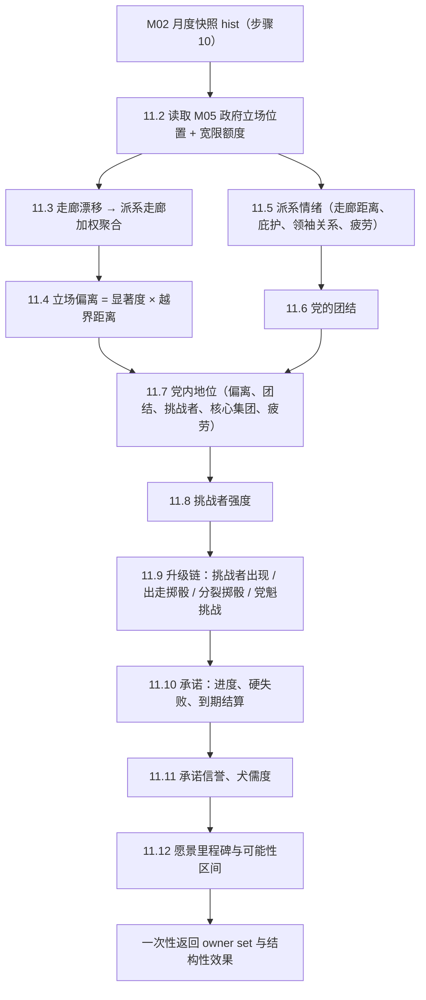
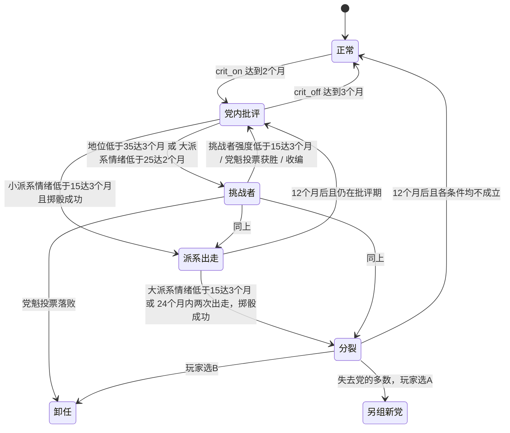
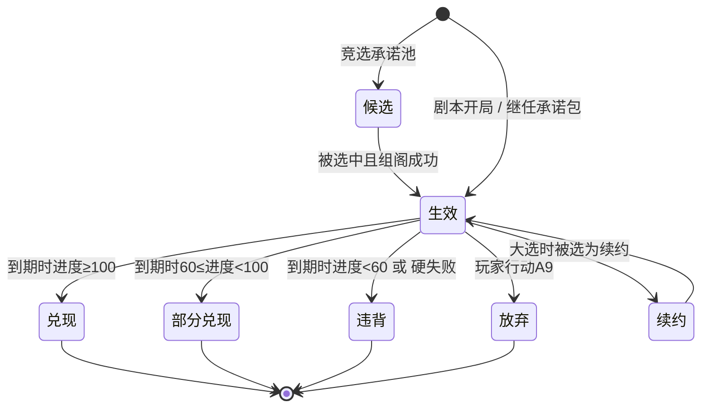

# M04 党内政治、承诺与立场走廊（party_promises）

## 0. 元信息

| 项 | 内容 |
|---|---|
| 版本 | v1.0（第2批规格） |
| 作者 | 子代理：商业策略游戏系统设计师（M04） |
| 依赖的模块规格 | M01（结算顺序、效果格式、custom 登记、继任流程）、M02（目标值 + 惯性引擎、因果边、`explain`/`preview`）、M12（表达式语言 §4.4、事件转换 C-13、顾问打分 §7.1）；读取 M03（席位、选举日、组阁）、M05（`gov_axis_position` 政府立场位置、行动目录与执行、政治资本、`m05_add_axis_impulse`）、M06（人物、职位、野心、关系）、M14（开局快照）拥有的数据 |
| 决议遵循 | DECISIONS.md D-001（漂移换算）、D-002（lever 类型）、D-003（事件冲击 30% 进入记忆项；长期效果写成修正器挂边）、D-006（修正器 `edges` 字段）、D-013（继任初值）、D-021（玩家选择立即应用）、D-022（**承诺键以本规格为准**，见 §3.6）、D-025（`stance_shift_by_corridor` 由 M04 实现）、D-033（五轴绝对刻度；政府立场位置由 M05 计算，M04 读取）、D-034（行动与事件不重复结算）、D-035（采纳 M05 附录A 与 B-6 `cat_territory`、B-7 `m04_push_corridor`） |
| 本模块拥有的参数 | `party_standing`、`promise_progress`、`stance_deviation`、`vision_progress`（registry）；附录A新增 `faction_mood`、`faction_weight`、`party_cohesion`、`challenger_strength`、`cynicism`、`promise_credit` |
| 结算步骤 | contracts §3 / M01 §4.2.1 步骤 11 `party_monthly`（每月，随机子流 `politics`）；另有 M03 在步骤 19 调用的 custom（大选结算、竞选承诺池），暂停阶段的玩家行动与事件选项通过 custom 处理函数进入 |

### 0.1 本模块负责满足的对标标准

| 标准（出处） | 本模块的满足方式 | 验证 |
|---|---|---|
| **R5** 每剧本 ≥ 8 条可辨识路线（benchmarks §6.2） | 本模块直接提供其中 4 条：守走廊连任、背离走廊、党分裂/派系出走、退党另组新党；并为“实现愿景”“党内初选落败”提供判定 | BOT：§11 T15 |
| **R7** 没有支配策略 | 三层目标互相冲突，张力指标 TI-1…TI-4（§4.12）每次构建自动跑；走廊随派系权重与时代变化，最优解依赖剧本 | BOT + §11 T11、T16 |
| **R8** 数值不顶满 | 全部 M04 节点用 M02 的“目标值 + 惯性 + 软目标”；`party_standing` 单步上限 ±2；走廊有弹性回归 | §11 T17 |
| **R15** 因果可解释 | `gov_axis_position`（M05 解释）、`stance_deviation`、`faction_mood`、`party_standing` 全部通过 M02 `explain` 或本模块 `explain_m04`（§4.13）给出前5项贡献 | STA |
| **R16** 承诺与犬儒度闭环（Democracy 4） | 承诺违背 → `cynicism` 上升 → 全体选民集团支持下降；兑现 → `promise_credit[集团]` 上升 | BOT 回归：§11 T18 |
| **D8** 剧本风味即任务树（paradox §5.1） | 贝京1977的4条承诺、4个利库德派系、7个愿景里程碑全部是剧本数据；其他剧本换数据不换代码 | STA |
| **D9 / A3** 愿景走条件不走按钮；成功率只给区间 | 里程碑全部由系统状态判定，含失败条件；界面只显示 6 档区间（§4.11.5） | §11 T10 |
| **D10** 重要行动至少两种成本 | §6 的 10 个党内行动全部是“政治资本 + 第二成本”（派系情绪、党内地位、时间、席位、人物关系） | STA：§11 T19 |
| **D12** 内生负反馈（防雪球） | 执政疲劳项（党内地位、派系情绪、挑战者）、强势招致挑战者（挑战者野心项）、走廊弹性回归 | BOT：S1、S3 |
| **K-x2** 不设隐性必经条件 | 愿景里程碑、承诺度量表达式、走廊区间全部在目标面板显式列出 | HUM |
| **L3** 威胁在场率 25%–60% | 升级链 0–4 级与挑战者强度提供持续的“党内地位 < 40”危险区来源 | BOT |
| **S3** 全绿占比 ≤ 15% | 张力指标 TI-3 直接复用该定义（§4.12） | BOT |
| **S4** 可恢复性 30%–70% | 升级链每一级都有退出条件与对应行动（§5.2、§6） | BOT |
| **F4** 路线达成率 5%–40% | 愿景型机器人达成贝京愿景的目标区间 5%–40%，用 §12 系数校准 | BOT |
| **E6** 免费选项检测 | 本模块提供 `preview_layers(effects)`（§4.12.1），M12 用它判定每个选项触及的三层 | BOT |
| **K1** “要不要放手”的道德张力（朴正熙纪事） | 退党另组新党、党魁挑战与“我还没完成愿景”直接冲突：愿景随主角离任而失败（§4.11.4） | HUM |
| **I1** AI 行动理由 100% | 挑战者出现、派系出走、分裂、党魁选举的每次结果都附带触发数值（§9.4） | 运行时断言 |
| **Suzerain 观感** | 党部面板以“党中央委员会会议桌”为空间比喻，走廊用五条横向刻度尺，承诺做成竞选海报卡（§9） | HUM |
| **P社观感** | 告警条（6类 M04 告警）、嵌套提示、账本（派系表可排序） | HUM |

### 0.2 对标定位
- **超过朴正熙纪事**：朴正熙纪事的“国家目标”是静态清单（41个），党内政治只有“凝聚力”一个数。本模块把党拆成有权重、有走廊、会出走的派系，承诺按大选重新生成，愿景可失败，三者之间的冲突用机器人可量化（§4.12）。
- **接近 Democracy 4**：承诺与犬儒度闭环（R16）；所有数值都是带惯性的因果节点。
- **避免 HOI4 的“按钮政治”**：没有一个行动能直接让愿景里程碑完成，也没有一个行动能直接把偏离清零（退党另组新党除外，但它的代价是席位、政治资本和党组织）。

---

## 1. 设计意图

### 1.1 核心取舍（一句话）
**选民要你兑现承诺，党要你留在走廊里，你自己想实现愿景——三者在贝京1977里互相拉扯：和平要让出西奈（背离走廊），定居要得罪华盛顿（损害和平承诺与愿景），经济自由化要砍补贴（违背社会公正承诺）。**

### 1.2 决策频率与信息来源

| 决策 | 频率（贝京1977第1年估计） | 信息来源 |
|---|---|---|
| 选择会改变立场的事件选项 | 每月 1–2 次 | 事件弹窗选项上的三层图标（M12 §9.1）+ 悬停预览 `preview_layers` |
| 党内行动（演说、派系交易、党代会、收编等） | 每月 0–1 次 | 党部面板：走廊图、派系表、升级链状态 |
| 调整影响立场的政策杠杆（定居点政策、前哨执法等） | 每季度 1 次 | 走廊图上的“政府立场”菱形及其前5项贡献 |
| 承诺取舍（放弃承诺、选择竞选承诺） | 每任期 1–3 次 | 承诺卡（进度环、期限倒计时、到期预估） |
| 愿景推进 | 由其他模块的行动间接推进 | 愿景路线图（里程碑状态、可能性区间） |

### 1.3 失败状态与恢复路径

| 失败状态 | 判定 | 恢复路径 |
|---|---|---|
| 党内批评（1级） | §5.2 表 | 回到走廊内、派系交易、党内演说；3个月达标即退回0级 |
| 挑战者（2级） | §5.2 表 | 收编挑战者、提前党魁选举先发制人、提升党内地位使挑战者强度 < 15 |
| 派系出走（3级） | §4.8 | 出走后党走廊向玩家方向移动（剩余派系重新加权），偏离反而下降；代价是席位 |
| 党分裂（4级） | §4.9 | 若玩家一方保留多数：党“净化”，党内地位 +5；若失去多数：退党另组新党或辞职 |
| 党魁选举落败 | §4.7 | 卸任（`primary_loss`），可以继任者身份继续（M01 §4.9） |
| 承诺违背 | §4.10.5 | 承诺信誉按 2%/月 回归；下次大选可以作出新承诺 |
| 愿景失败 | §4.11.4 | 不惩罚，只是失去成就与历史评价加成 |

### 1.4 后期（第10–20年）如何保持新鲜感
1. **每次大选重抽承诺**：候选池按时代、政党、当前选民集团支持加权抽 8 条（§4.10.6），同一剧本两次大选的候选集合 Jaccard 相似度目标 ≤ 0.6。
2. **派系权重随党代会与出走改变**，走廊因此漂移；1993年起利库德改为初选（§3.3 `selection_method`），党魁挑战的规则随之改变。
3. **执政疲劳**：任期满48个月后，党内地位、非主角派系情绪、挑战者强度都有逐月加深的疲劳项（§4.5、§4.6、§4.7）。
4. **继任者带来新的承诺与愿景**（§4.14），走廊重新居中，但矛盾与修正器全部继承。

---

## 2. 读写清单

> “写”指本模块是 owner，在步骤11以 owner `set` 写入（M01 §4.3.3），或在 custom 处理函数中返回效果。“效果”指本模块向非自有参数提交 `add`/`set` 效果。

| 参数ID | 读/写 | 结算步骤 | 说明 |
|---|---|---|---|
| `gov_axis_position[*]`（M05 附录A，D-035） | 读 | 11 | 政府在五条轴上的当前立场位置（M05 §4.9.4 计算；本规格 §4.2） |
| `stance_deviation[*]` | 写 | 11 | 派生：政府立场偏出执政党走廊的程度（§4.4）；附录B-1 改类型为 `derived` |
| `party_standing` | 写 | 11 | M02 level 节点（§4.5） |
| `faction_mood[*]`（新） | 写 | 11；事件效果 | M02 level 节点 + 本模块项提供器（§4.6） |
| `faction_weight[*]`（新） | 写 | 11；custom | 派系在党中央的权重（%）（§4.3.4） |
| `party_cohesion`（新） | 写 | 11 | 派生：派系情绪加权平均（§4.6.4） |
| `challenger_strength`（新） | 写 | 11；custom | 挑战者强度（§4.7） |
| `promise_progress[*]` | 写 | 11；事件效果；custom | 承诺进度（§4.10） |
| `promise_credit[*]`（新，scope bloc） | 写 | 11；custom | 各选民集团对承诺兑现的记忆（§4.10.5） |
| `cynicism`（新） | 写 | 11；custom | 犬儒度（§4.10.5） |
| `vision_progress` | 写 | 11 | 愿景进度（§4.11） |
| `settlement_policy[west_bank]` | 读 | 11 | 承诺度量（杠杆，owner M11） |
| `economic_model` | 读 | 11 | 承诺度量（owner M10） |
| M05 私有 `axis_impulse`（经 custom `m05_add_axis_impulse`） | 效果 | 暂停阶段；custom | 事件的“立场偏离 ±N”转写后进入 M05 行动冲量（§4.2.3） |
| `bloc_support[*]` | 读 | 11 | 核心集团项（党内地位）、竞选承诺池权重 |
| `bloc_support[*]` | 效果（经 M03 因果边） | — | 本模块不直接写；`cynicism` 与 `promise_credit` 通过附录B-5 的 M03 边影响它 |
| `regime_hostility[egypt/jordan/syria]`、`pal_hostility`、`pal_living_standard`、`faction_legitimacy[notables]`、`uprising_risk`、`public_security`、`alienation[mizrahi]`、`region_development[negev]`、`settler_momentum`、`rule_of_law`、`centralization`、`immigration_inflow`、`inflation`、`us_admin_relation` | 读 | 11 | 承诺度量与愿景里程碑条件 |
| `political_capital` | 读；效果 | 暂停阶段；11 | 行动成本由 M05 扣除；承诺兑现奖励 `add +10` |
| `relation[*]` | 读；效果（`add_relation`） | 11；custom | 派系领袖关系项；行动副作用 |
| `coalition_seats`、各党席位（M03 私有） | 读；效果（`change_seat`） | custom | 派系出走、分裂、新党的席位转移 |
| `ally_satisfaction[*]` | 效果（`set`，仅来自行动） | 暂停阶段 | 新党成立后旧党对政府的满意度 |
| 修正器 `factor("pc_income")`、`factor("oratory_effect")` | 读 / 通过修正器写 | 11；行动 | 党内批评、挑战者降低政治资本产出；演说行动乘以演说效果 |

---

## 3. 状态与数据结构

### 3.1 五条全局轴的方向约定（所有剧本通用）

| 轴ID | −100 端 | +100 端 | 与已有参数的关系 |
|---|---|---|---|
| `territory` 领土 | 归还全部占领地、以土地换和平 | 吞并全部占领地、大以色列 | — |
| `security` 安全 | 克制、谈判优先、限制武力 | 最大限度用武、先发制人 | — |
| `economy` 经济 | 集体与国有 | 市场 | 与 `economic_model` 同向 |
| `religion` 宗教 | 世俗 | 律法 | 与 `religious_status_quo` 同向 |
| `foreign` 外交 | 顺从盟友与国际压力 | 违抗压力、单边行事 | — |

刻度与 M05 §4.9.4 完全相同（D-033：绝对刻度，`axis_base = 0`）。本模块的全部走廊区间与理想点都写在这一刻度上。贝京1977开局的政府立场位置由 M05 的开局政策档位算出（§4.2.1）。

### 3.2 模块私有状态 `modules.M04`（写入存档）

| 字段 | 类型 | 范围 | 默认 | 说明 |
|---|---|---|---|---|
| `player_party` | str | parties 实体 | 剧本给定 | 玩家所在执政党 |
| `parties` | Dict[str, PartyState] | — | 数据文件 | 已建模政党的派系结构（§3.3） |
| `factions` | Dict[str, FactionState] | — | 数据文件 | 全部派系（§3.3） |
| `stage` | int | 0–4 | 0 | 升级链等级；每月在 11.9 末尾按 §5.2 表重新计算（缓存值，存档只为界面） |
| `crit_active` | bool | — | false | 是否处于党内批评期（§5.2 滞回） |
| `split_days` | List[int] | — | [] | 最近分裂的日序（只保留 12 个月内的） |
| `streaks` | Dict[str, int] | ≥ 0 | 全 0 | 连续满足月数计数器，键见 §5.2 |
| `challenger` | dict 或 null | — | null | `{char_id, faction, since_day, immune_until_day}` |
| `exit_days` | List[int] | — | [] | 最近派系出走的日序（只保留 24 个月内的） |
| `promises` | List[PromiseState] | ≤ 8 条 | 剧本给定 | 当前承诺（§3.5） |
| `promise_archive` | List[dict] | — | [] | 已结算承诺 `{key, status, final_progress, day}`，供 TenureRecord |
| `campaign` | dict | — | `{open: false, candidates: [], chosen: [], close_day: -1}` | 竞选承诺池（§4.10.6） |
| `vision` | VisionState | — | 剧本给定 | §3.7 |
| `cooldowns` | Dict[str, int] | 日序 | {} | 键 `"<action_id>:<target>"`，值为可再次使用的日序 |
| `deals` | List[dict] | — | [] | 派系交易 `{faction, axis, widen, until_day, anchor_stance}` |
| `new_party_used` | bool | — | false | 本任期是否已退党另组新党（每任期 1 次） |
| `metric_last` | Dict[str, float] | — | {} | 每条 `level` 型承诺上月的度量值 |
| `months_in_office` | int | ≥ 0 | 0 | 主角就任以来的月结算次数（继任时清零） |
| `grace0` | Dict[str, Dict[axis, float]] | ≥ 0 | 就任时计算 | 宽限期基准距离；键为 `"party"` 或派系ID（§4.2.2） |

**PartyState**：

| 字段 | 类型 | 说明 |
|---|---|---|
| `id` | str | 政党ID（registry `parties`） |
| `factions` | List[str] | 当前派系ID列表（按数据文件顺序；出走后删除） |
| `selection_method` | List[{from_year, to_year, method}] | `central_committee`（中央委员会投票）或 `primary`（全体党员初选） |
| `deviation_side` | Dict[axis, int] | 每条轴取 −1 或 +1：事件库里“立场偏离[轴] +N”对该党意味着向哪一侧移动（§4.2.3） |
| `core_blocs` | Dict[bloc, float] | 核心选民集团权重，和为 1（§4.5） |
| `ai_led` | bool | 玩家离开后由 AI 领导（新党成立后的旧党） |

**FactionState**：

| 字段 | 类型 | 范围 | 说明 |
|---|---|---|---|
| `id` | str | `party_factions` 实体 | — |
| `party` | str | parties | 所属政党 |
| `name_zh` | str | — | 界面名 |
| `leader_role` | str | M06 人物ID或职位ID | 派系领袖（M06 解析） |
| `home` | Dict[axis, {lo, hi, c, s}] | lo,hi,c ∈ [−100,100]；s ∈ [0, 2] | 数据文件给出的“本色”走廊、理想点、显著度 |
| `cur` | Dict[axis, {lo, hi}] | 同上 | 当前走廊（受推动、漂移、交易影响） |
| `rigid` | bool | — | 为 true 时不受“正当性牵引”（§4.3.3），也不加入新党 |
| `exit_target` | str | parties | 出走时成立或回归的政党ID |
| `low_streak` | int | ≥ 0 | 情绪 < 15 的连续月数 |

### 3.3 数据文件 `data/parties/corridors.yaml`（贝京1977所需的完整示例）

```yaml
schema_version: 1
axes: [territory, security, economy, religion, foreign]
parties:
  likud:
    factions: [herut_core, herut_hawks, liberal_wing, laam]
    selection_method:
      - {from_year: 1973, to_year: 1992, method: central_committee}
      - {from_year: 1993, to_year: 2100, method: primary}
    deviation_side: {territory: -1, security: -1, economy: -1, religion: -1, foreign: -1}
    core_blocs: {mizrahi: 0.5, religious_zionist: 0.2, liberal_middle: 0.3}
  labor:
    factions: [labor_peres, labor_rabin, ahdut_haavoda, labor_doves]
    selection_method:
      - {from_year: 1968, to_year: 1991, method: central_committee}
      - {from_year: 1992, to_year: 2100, method: primary}
    deviation_side: {territory: 1, security: 1, economy: 1, religion: 1, foreign: 1}
    core_blocs: {labor_ashkenazi: 0.5, kibbutz_moshav: 0.2, liberal_middle: 0.3}
factions:
  # 字段：weight 为开局 faction_weight（%）；home 每轴 [lo, hi, c, s]
  herut_core:   {party: likud, name_zh: 赫鲁特主流（贝京派）, leader_role: begin, rigid: false, exit_target: new_party_a, weight: 38,
                 home: {territory: [0, 100, 50, 1.2], security: [-20, 70, 20, 1.0], economy: [-60, 40, -10, 0.5], religion: [-30, 40, 5, 0.6], foreign: [-25, 40, 10, 0.8]}}
  herut_hawks:  {party: likud, name_zh: 以色列地派（赫鲁特强硬派）, leader_role: geula_cohen, rigid: true, exit_target: tehiya, weight: 12,
                 home: {territory: [30, 100, 75, 1.8], security: [0, 100, 40, 1.2], economy: [-70, 40, -20, 0.3], religion: [-20, 50, 10, 0.5], foreign: [-10, 100, 25, 1.0]}}
  liberal_wing: {party: likud, name_zh: 自由党, leader_role: ehrlich, rigid: false, exit_target: liberals, weight: 32,
                 home: {territory: [-40, 80, 20, 0.7], security: [-35, 50, 10, 0.7], economy: [-20, 100, 40, 1.5], religion: [-60, 5, -25, 0.8], foreign: [-40, 25, -10, 0.9]}}
  laam:         {party: likud, name_zh: 拉姆派（国家名单与自由中心）, leader_role: hurvitz, rigid: false, exit_target: new_party_b, weight: 18,
                 home: {territory: [-15, 90, 35, 0.9], security: [-25, 60, 15, 0.9], economy: [-45, 70, 10, 1.0], religion: [-50, 20, -15, 0.5], foreign: [-35, 35, 0, 0.6]}}
  labor_peres:  {party: labor, name_zh: 佩雷斯派, leader_role: peres, rigid: false, exit_target: new_party_a, weight: 40,
                 home: {territory: [-70, 10, -30, 1.0], security: [-30, 50, 10, 0.8], economy: [-80, 0, -40, 0.8], religion: [-50, 10, -20, 0.6], foreign: [-40, 20, -15, 0.8]}}
  labor_rabin:  {party: labor, name_zh: 拉宾派, leader_role: rabin, rigid: false, exit_target: new_party_b, weight: 30,
                 home: {territory: [-65, 15, -25, 1.0], security: [-15, 60, 20, 1.1], economy: [-80, -10, -45, 0.8], religion: [-50, 5, -25, 0.5], foreign: [-40, 20, -15, 0.8]}}
  ahdut_haavoda: {party: labor, name_zh: 团结劳工派（阿隆派）, leader_role: ahdut_haavoda_leader, rigid: false, exit_target: new_party_c, weight: 15,
                 home: {territory: [-50, 25, -10, 1.1], security: [-10, 65, 25, 1.0], economy: [-95, -30, -65, 1.0], religion: [-50, 5, -25, 0.4], foreign: [-30, 25, -5, 0.6]}}
  labor_doves:  {party: labor, name_zh: 鸽派青年一代, leader_role: labor_doves_leader, rigid: true, exit_target: new_party_c, weight: 15,
                 home: {territory: [-100, -35, -70, 1.4], security: [-60, 20, -25, 1.0], economy: [-70, 10, -30, 0.6], religion: [-66, -10, -40, 0.8], foreign: [-44, 5, -25, 0.8]}}
```

- `leader_role` 中的 `labor_doves_leader`、`ahdut_haavoda_leader` 是职位ID：鸽派领袖在世（design_document §17 第8条），以职位代替人名；人物ID与职位ID最终以 M06 规格为准（D-022）。
- 刻度参照（M05 附录C 政策表）：政策档位能达到的范围约为 领土 ±100、安全 ±100、经济 ±97、宗教 ±66、外交 ±44（再加行动冲量 ±60）。贝京继承的工党政策在领土 −42、经济 −54；利库德纲领（西岸定居 100、山地布局、宽松前哨执法、民政当局）约在领土 +45。走廊据此设定。
- `new_party_a/b/c` 是附录A 提议的政党占位实体，供出走、分裂、新党使用；`tehiya`、`liberals` 已在 registry。

**利库德与劳工党的派系结构依据**：利库德1973年由赫鲁特、自由党、拉姆（国家名单、自由中心、以色列地运动）组成；1979年格乌拉·科恩、摩西·沙米尔因戴维营与和约出走另组复兴党；1980年胡尔维茨因经济政策辞去财长。劳工党内部以佩雷斯、拉宾两大阵营为主，团结劳工派（阿隆）在领土问题上偏强硬，1980年代后期出现以贝林为代表的鸽派一代。

### 3.4 其他政党的立场中心（供 M03 计算意识形态距离，M04 不对这些党计算派系）

| 政党 | territory | security | economy | religion | foreign | 说明 |
|---|---|---|---|---|---|---|
| nrp 国家宗教党 | 55 | 25 | −20 | 40 | 15 | 1977年后青年派主导，转向定居运动 |
| agudat 以色列正教党 | 5 | 0 | −20 | 60 | 0 | 领土议题显著度低 |
| tehiya 复兴党 | 85 | 55 | −15 | 10 | 35 | 1979年成立 |
| dash 争取变革民主运动 | −25 | 5 | 15 | −30 | −15 | 1977年中间派 |
| shinui 变革党 | −25 | 5 | 35 | −45 | −15 | — |
| mapam 统一工人党 | −65 | −25 | −80 | −50 | −30 | — |
| shas 沙斯 | 0 | 5 | −35 | 55 | 0 | 1984年起 |

显著度（M03 使用）：政党数据中每轴默认 1.0，宗教党宗教轴 1.8、领土轴 0.6（agudat、shas）；本表数值写入 `data/parties/corridors.yaml` 的 `other_parties:` 段，字段 `{center: {axis: value}, salience: {axis: value}}`。

### 3.5 承诺状态 PromiseState 与模板 schema

| 字段 | 类型 | 说明 |
|---|---|---|
| `key` | str | 承诺键（`promise_progress[key]`），全局唯一，snake_case |
| `name_zh` | str | 卡片标题 |
| `category` | str | `economy`/`security`/`social`/`peace`/`religion`/`immigration`/`territory` 之一（M12 类别键 `cat_<category>`；`territory` 为 D-035 采纳的 M05 B-6） |
| `kind` | str | `level`（度量达到目标）/ `accumulate`（逐月累积）/ `maintain`（任期内维持）/ `once`（条件一旦为真即兑现，附录B-10） |
| `cond` | 表达式（bool） | 仅 `once`：为真的那个月进度设为 100 |
| `metric` | 表达式（number） | `level`：度量值，结果夹紧到 [0,100]；`accumulate`：每月增量；`maintain`：不用 |
| `hold` | 表达式（bool） | 仅 `maintain`：维持条件 |
| `hard_fail` | 表达式（bool）或 null | 为真时立即按违背结算 |
| `violation` | 表达式（bool）或 null | 每月为真时进度 −`violation_penalty` |
| `violation_penalty` | float | 默认 5 |
| `blocs` | Dict[bloc, float] | 来源选民集团权重，和为 1 |
| `boldness` | int | 1–3，越大竞选加成越大、违背惩罚越重 |
| `party_aligned` | bool | 为 true 时兑现/违背还影响党内地位 |
| `deadline_day` | int | 期限日序（由 `deadline` 日期或 `deadline_months` 换算） |
| `created_day` | int | 生效日序 |
| `status` | str | `active`/`kept`/`partial`/`broken`/`renounced` |
| `stance_hint` | {axis, value} 或 null | 承诺隐含的立场点，用于候选池对齐（§4.10.6） |

**`$start()` 预处理**：度量表达式中可以写 `$start(参数[键])`。承诺生效时，M04 把它替换为当日该参数值的数字字面量（保留 6 位小数），再交给 M12 表达式编译器。`$` 不是表达式语言的合法字符（M12 §4.4.1），所以未替换的模板不能直接编译——这是故意的，防止漏替换。

### 3.6 贝京1977 全部承诺（D-022：承诺键以此为准）

> M01 测试夹具已使用这 4 个键；M12 范例中的 `peace_security` 是占位，统一改为 `peace_and_security`。

```yaml
# data/scenarios/begin_1977/modules/M04.yaml（承诺部分）
promises:
  - key: settle_eretz_israel
    name_zh: 定居以色列地
    category: territory
    kind: accumulate
    metric: "max(0, settlement_policy[west_bank] - 50) / 25"
    hard_fail: 'flag("west_bank_returned")'
    blocs: {religious_zionist: 0.7, mizrahi: 0.3}
    boldness: 2
    party_aligned: true
    deadline: "1981-10-31"
    stance_hint: {axis: territory, value: 60}
  - key: economic_liberalization
    name_zh: 经济自由化
    category: economy
    kind: level
    metric: "clamp((economic_model - $start(economic_model)) * 2, 0, 100)"
    blocs: {liberal_middle: 0.8, mizrahi: 0.2}
    boldness: 2
    party_aligned: true
    deadline: "1981-10-31"
    stance_hint: {axis: economy, value: 40}
  - key: social_justice
    name_zh: 社会公正（“第二以色列”）
    category: social
    kind: level
    metric: "clamp(($start(alienation[mizrahi]) - alienation[mizrahi]) * 5 + (region_development[negev] - $start(region_development[negev])) * 3, 0, 100)"
    blocs: {mizrahi: 0.9, haredi: 0.1}
    boldness: 2
    party_aligned: false
    deadline: "1981-10-31"
    stance_hint: null
  - key: peace_and_security
    name_zh: 和平与安全（“利库德不是战争党”）
    category: peace
    kind: level
    metric: "clamp(($start(regime_hostility[egypt]) - regime_hostility[egypt]) * 1.2 + (public_security - $start(public_security)) * 1.0, 0, 100)"
    violation: "at_war()"
    violation_penalty: 5
    blocs: {liberal_middle: 0.4, mizrahi: 0.3, labor_ashkenazi: 0.3}
    boldness: 2
    party_aligned: false
    deadline: "1981-10-31"
    stance_hint: {axis: territory, value: -10}
```

- 期限 1981-10-31：第九届议会1977-05-17当选，法定任期4年，最晚1981年11月改选；若大选提前（史实1981-06-30），按 §4.10.4 的“大选评判”规则处理。
- `settle_eretz_israel` 归入 `territory` 类别（D-035 采纳 M05 B-6 新增的第七类 `cat_territory`），M05 的定居类行动按类别推进它。

**继任者承诺包（04 文件 §0.3）**：

```yaml
leader_goal_packs:
  shamir:
    promises:
      - {key: absorb_immigration, name_zh: 吸收移民, category: immigration, kind: accumulate,
         metric: "immigration_inflow / 24000", blocs: {russian: 0.5, mizrahi: 0.2, religious_zionist: 0.3},
         boldness: 2, party_aligned: false, deadline_months: 48, stance_hint: null}
      - {key: not_one_inch, name_zh: 不让一寸土地, category: territory, kind: maintain,
         hold: "gov_axis_position[territory] >= 20",
         hard_fail: 'flag("west_bank_returned") or not region_exists("gaza") or not region_exists("golan")',
         blocs: {religious_zionist: 0.5, mizrahi: 0.5}, boldness: 3, party_aligned: true, deadline_months: 48,
         stance_hint: {axis: territory, value: 50}}
    vision: shamir_land_and_return     # 「守住以色列地，迎回散居者」，里程碑数据由 M14 剧本扩展时补齐
```

### 3.7 愿景数据 schema 与贝京愿景（全部里程碑）

| 字段 | 类型 | 说明 |
|---|---|---|
| `id` | str | 愿景ID |
| `name_zh` | str | — |
| `leader` | str | 所属主角；主角离任 → 愿景失败（§4.11.4） |
| `milestones` | List[Milestone] | 见下 |
| `achieve_rule` | {required: [id], guards: [id], optional: [id]} | 完成规则 |
| `achievement_ids` | {base, full} | M14 成就ID |

**Milestone**：`{id, name_zh, weight, type: once|hold|guard, requires: [id], cond: 表达式, hold_months: int, fail: 表达式 或 null, fail_mode: permanent|block, closeness: 表达式（number，0–1）}`。

```yaml
# data/visions/begin_peace_in_eretz_israel.yaml
id: begin_peace_in_eretz_israel
name_zh: 以色列地上的和平
leader: begin
achieve_rule: {required: [m1_cairo, m2_rooted, m3_autonomy, m4_jordan], guards: [m6_eretz, m7_law], optional: [m5_damascus]}
achievement_ids: {base: begin_vision, full: begin_vision_full}
milestones:
  - id: m1_cairo
    name_zh: 开罗之路：埃以和约
    weight: 15
    type: once
    requires: []
    cond: 'flag("egypt_peace_treaty_signed")'
    alt_cond_hold: {cond: "regime_hostility[egypt] <= 20", hold_months: 12}
    fail: 'flag("sadat_missed") and regime_hostility[egypt] >= 50'
    fail_hold_months: 24
    fail_mode: permanent
    closeness: "clamp((70 - regime_hostility[egypt]) / 50, 0, 1)"
  - id: m2_rooted
    name_zh: 和约生根：两年无战事
    weight: 10
    type: hold
    requires: [m1_cairo]
    cond: 'regime_hostility[egypt] <= 30 and not at_war("egypt")'
    hold_months: 24
    fail: 'at_war("egypt")'
    fail_mode: permanent
    closeness: "held / 24"            # held 由引擎提供（本里程碑已连续满足的月数），不是参数
  - id: m3_autonomy
    name_zh: 自治落地：巴勒斯坦自治实施一年
    weight: 20
    type: hold
    requires: []
    cond: 'flag("autonomy_framework_signed") and pal_hostility <= 45 and pal_living_standard >= 55 and faction_legitimacy[notables] >= 35 and uprising_risk <= 40'
    hold_months: 12
    fail: 'flag("first_intifada_active")'
    fail_mode: permanent
    closeness: '(clamp((65 - pal_hostility) / 20, 0, 1) + clamp((pal_living_standard - 35) / 20, 0, 1) + clamp((faction_legitimacy[notables] - 15) / 20, 0, 1) + clamp((60 - uprising_risk) / 20, 0, 1)) / 4 * (0.5 + 0.5 * auto_flag)'
  - id: m4_jordan
    name_zh: 约旦河两岸：与约旦缔结和平
    weight: 20
    type: hold
    requires: []
    cond: 'regime_hostility[jordan] <= 20 and region_exists("west_bank")'
    hold_months: 6
    fail: 'flag("west_bank_annexed") or flag("jordan_option_ended")'
    fail_mode: permanent
    closeness: "clamp((60 - regime_hostility[jordan]) / 40, 0, 1)"
  - id: m5_damascus
    name_zh: 大马士革：与叙利亚媾和（可选）
    weight: 15
    type: hold
    requires: []
    cond: "regime_hostility[syria] <= 35"
    hold_months: 12
    fail: null
    fail_mode: block
    closeness: "clamp((80 - regime_hostility[syria]) / 45, 0, 1)"
  - id: m6_eretz
    name_zh: 以色列地：保住对犹太与撒马利亚的主张（守护条件）
    weight: 15
    type: guard
    requires: []
    cond: 'region_exists("west_bank") and gov_axis_position[territory] >= -10 and settler_momentum >= 35'
    fail: 'flag("west_bank_returned") or not region_exists("west_bank")'
    fail_mode: permanent
    closeness: "1"
  - id: m7_law
    name_zh: 法治下的和平（守护条件，「守法者」）
    weight: 5
    type: guard
    requires: []
    cond: "rule_of_law >= 60 and centralization <= 20"
    fail: null
    fail_mode: block
    closeness: "1"
```

- `closeness` 表达式中的 `held`（已连续满足月数）与 `auto_flag`（`autonomy_framework_signed` 存在时为 1，否则为 0）是 M04 在求值前代入的局部变量，用 `$start` 同样的文本替换方式实现（替换为数字字面量后再编译求值，每月一次）。
- 旗标英文ID按 M12 §4.9.3 规则拟定（`egypt_peace_treaty_signed`、`sadat_missed`、`autonomy_framework_signed` 来自 M12 映射示例；`first_intifada_active`、`west_bank_returned`、`west_bank_annexed`、`jordan_option_ended` 按 ID-3 规则由“第一次起义”“西岸归还”“西岸吞并”“约旦方案终结”转写），最终以 `data/events/id_map.yaml` 为准。

**VisionState**：`{id, status: active|achieved|failed, milestones: {mid: {status: pending|done|failed, held: int, fail_streak: int, done_day: int}}, tier: 0|1|2}`。

### 3.8 YAML：派系开局情绪等初值（贝京1977，供 M14 快照引用）

```yaml
# data/scenarios/begin_1977/modules/M04.yaml（其余部分）
player_party: likud
faction_mood_init: {herut_core: 64, herut_hawks: 50, liberal_wing: 52, laam: 56}
party_standing_init: 70          # 与 M01 夹具一致；以 M14 快照为准（D-004）
cynicism_init: 25
promise_credit_init: {labor_ashkenazi: 0, mizrahi: 0, kibbutz_moshav: 0, religious_zionist: 0, haredi: 0, arab_citizens: 0, russian: 0, liberal_middle: 0}
opening_modifiers:
  - {id: mahapach_mandate, scope_key: ""}     # 「翻盘的授权」，见 §4.5.2
vision: begin_peace_in_eretz_israel
```

开局政府立场位置不由 M04 设定：它来自 M05 的开局政策档位（D-033）。贝京继承的是工党政府的政策，所以开局时领土、经济两轴落在利库德走廊外；§4.2.2 的宽限期保证这不会在第一天就变成惩罚，但玩家必须在 24 个月内用政策把位置拉回走廊。

---

## 4. 规则与公式

### 4.1 步骤11 `party_monthly` 主流程（每月，子流 `politics`）

步骤11读取步骤10结束时的状态（含 M02 刚写入的月度快照 `hist`）。下面的子步骤按顺序执行；子步骤之间传递的是**本函数内的局部变量**（新算出的值），全部结果在函数末尾以 owner `set` 效果一次性返回（M01 §4.3.3，priority 100）。

| 子步骤 | 内容 | 读取 | 产出（局部变量 → 效果） |
|---|---|---|---|
| 11.1 | `months_in_office += 1`；清理 `exit_days` 中超过 24 个月的项；到期的派系交易移除（§4.3.5） | 私有状态 | — |
| 11.2 | 读取政府立场位置 `g[a] = gov_axis_position[a]`；计算宽限额度（§4.2.2） | 当前状态 | `g[a]`、`allow[scope][a]` |
| 11.3 | 走廊：漂移（§4.3.3）→ 聚合（§4.3.1） | `g`、`party_standing`、私有走廊 | `cur'`、`lo[a]`、`hi[a]`、`sP[a]` |
| 11.4 | `stance_deviation`（§4.4） | `g`、`lo`、`hi`、`sP` | `dev[a]` |
| 11.5 | `faction_mood`（§4.6） | `g`、`cur'`、M06 数据、`hist` | `mood'[f]` |
| 11.6 | `party_cohesion`（§4.6.4） | `mood'`、`faction_weight` | `coh` |
| 11.7 | `party_standing`（§4.5） | `hist`、修正器、本模块项 | `ps'` |
| 11.8 | `challenger_strength`（§4.7.2） | `ps'`、`mood'`、M06 | `ch'` |
| 11.9 | 升级链状态机（§5.2）：挑战者出现 → 派系出走掷骰（§4.8）→ 分裂掷骰（§4.9）→ 党魁挑战掷骰与投票（§4.7.3） | 上述局部变量 | 结构性效果（custom） |
| 11.10 | 承诺：进度更新 → 硬失败 → 到期结算（§4.10） | 当前状态（表达式快照，M12 §4.4.4） | `promise_progress`、`promise_credit`、`cynicism`、`political_capital`、`party_standing` 的效果 |
| 11.11 | `promise_credit`、`cynicism` 节点结算（§4.10.5） | `hist` | `set` 效果 |
| 11.12 | 愿景里程碑评估与 `vision_progress`（§4.11） | 当前状态、`g` | `set vision_progress`、旗标、成就 |

**随机数消耗顺序（固定，保证 Python/Godot 一致）**：11.9 中依次为：①每个满足出走资格的派系各 1 次（按 `parties[player_party].factions` 列表顺序）；②分裂掷骰 0 或 1 次；③党魁挑战掷骰 0 或 1 次；④党魁投票噪声 0 或 1 次。11.10–11.12 不消耗随机数。

**算术约定**：全部用浮点；求和顺序按数据文件中的派系顺序与 `axes` 顺序（territory, security, economy, religion, foreign）；写入时由 M01 量化 `q()`。

### 4.2 政府当前立场：读取 M05 `gov_axis_position`，加新政府宽限期

#### 4.2.1 来源（D-033、D-035）

\(g_a = \text{gov\_axis\_position}[a]\)。该参数由 M05 计算（M05 §4.9.4）：

$$\text{gov\_axis\_position}[a] = \text{clamp}\big(\text{base}_a + P_a + \text{axis\_impulse}_a,\ -100,\ 100\big)$$

- \(\text{base}_a = 0\)；\(P_a\) = 全部政策档位的立场贡献（每条政策的 `ax` 系数 × 键权重 × 档位相对中性值的位置）；\(\text{axis\_impulse}_a\) = 行动与事件的冲量，夹紧 [−60, 60]，每月结算日步骤15 × 0.95。
- M05 在步骤5（政策或带 `ax` 的行动完成后）与步骤15 重算；M04 在步骤11 读取当时的值。**M04 不再自己计算立场**，只把它与走廊比较。
- 玩家通过三类操作移动立场：调整政策档位（M05 政策目录，例如西岸定居点政策、定居布局、前哨执法）；执行带 `ax` 的一次性行动（M05 行动目录）；在事件中做选择（§4.2.3）。

**算例 4.2-a（贝京1977开局，按 M05 附录C 的开局档位计算）**：

| 轴 | 主要贡献（M05 政策 → 贡献） | g |
|---|---|---|
| territory | 西岸定居点 40 → −4.0；加沙 30 → −4.0；戈兰 40 → −2.0；西奈 30 → −4.0；征地方式 档0 → −8.0；定居者住房激励 33 → −2.04；定居布局 档0 → −10.0；区级土地政策（加利利35/三角地带30/内盖夫35）→ −1.333；民政当局 档0 → −3.0；村庄联盟 档0 → −4.0 | **−42.3733** |
| security | 义务兵役期 +6；核信号 −5；辛贝特监督 +6；开放桥梁 −3；军事管制（三群体均为0）−10 | **−6.0** |
| economy | 外汇制度 −12；食品补贴 −2.72；工资指数化 −10；增值税 −2；私有化 −12；资本市场 −8；银行股支持 +2；进口保护 −8；央行 −6；开发区激励 +1.36；最低工资 +6；商业电视 −3 | **−54.36** |
| religion | 安息日航班 −4；堕胎社会条款 −4；哈雷迪学校自治 +5；安息日广播 −3；回归法范围 −4 | **−10.0** |
| foreign | 核信号 −8；第三世界援助 +4 | **−4.0** |

单位：立场点（绝对刻度）。这组数值来自 M05 规格附录C 草案；M05 数据变动时按同一公式重算，测试夹具以本表为准。
含义：贝京继承的是工党政府的政策。在绝对刻度上，开局位置位于工党走廊之内、利库德走廊之外（领土差 30.47 点，经济差 8.66 点）——这就是“兑现纲领”的开局压力。

#### 4.2.2 新政府宽限期

就任时刻（剧本加载、`leader_change`、玩家政党改变——另组新党、轮值换党）记录基准距离：
\[\text{grace0}[\text{party}][a] = \text{dist}_{P,a}(g),\qquad \text{grace0}[f][a] = \text{dist}_{f,a}(g)\ \ (\text{每个派系})\]
每个步骤11：
\[k = \text{clamp}\Big(\frac{24 - \text{months\_in\_office}}{18},\ 0,\ 1\Big),\qquad \text{allow}[\cdot][a] = \text{grace0}[\cdot][a] \times k\]

- 前 6 个月 k = 1（全额宽限），第 24 个月起 k = 0。
- 宽限额度是一个**距离数值**，不是区间：玩家把位置往更远处推（距离超过 grace0）会立即被计入；把位置拉回走廊会让距离小于额度，偏离为 0。
- 走廊改变（出走、推动、漂移）后，`grace0` 不重算，额度照常递减。

**算例 4.2-b**：开局领土 dist0 = 30.4733。若位置一直不变：第 6 个月 allow = 30.4733 → 偏离 0；第 15 个月 k = 0.5 → allow = 15.23665 → 有效距离 15.23665 → 偏离 1.058 × 15.23665 = **16.1204**；第 24 个月 → 偏离 1.058 × 30.4733 = **32.2408**。若玩家在第 15 个月前把位置推到 −5.3733（见算例 4.6-b），距离 = 0 → 偏离 0。

#### 4.2.3 事件如何移动立场：custom `stance_shift_by_corridor`（D-025，M04 实现，在 M01 §4.12 登记）

```yaml
{op: custom, target: custom, key: stance_shift_by_corridor,
 value: {axis: territory, amount: 15, direction: away}}
```

| direction | Δ（立场点） | 用途 |
|---|---|---|
| `away`（默认） | `amount × deviation_side[player_party][axis]` | 事件库“立场偏离[轴] ±N”与“±N（按走廊）”的统一转写：正数 = 朝本党认为是“背离”的那一侧移动 |
| `toward_left` | `−abs(amount)` | 事件明确要求向 −100 端移动 |
| `toward_right` | `+abs(amount)` | 事件明确要求向 +100 端移动 |
| `toward_center` | `sign(cP − g) × min(abs(amount), abs(cP − g))`，`cP = Σ w_f × c_f`（§4.3.1） | “向党的主流靠拢” |

处理函数返回 `{op: custom, target: custom, key: m05_add_axis_impulse, value: {axis: <axis>, value: Δ}}`（M05 附录B-3），即事件的立场效果进入 M05 的行动冲量：夹紧 [−60, 60]，每月 × 0.95（半衰期 13.5 个月）。M01 登记表中的 `m04_add_stance_by_corridor`（参数 `{axis, magnitude, direction}`）是本函数的别名，`magnitude` 等同 `amount`。

**算例 4.2-c**：E-1978-09 选项A“立场偏离[领土] +15”转写为 `away 15`。利库德 `deviation_side.territory = −1` → Δ = −15 → `m05_add_axis_impulse{territory, −15}`。轮值期玩家以佩雷斯身份执政时，玩家政党为工党（`deviation_side.territory = +1`）→ Δ = +15：04 文件 §0.3 所说的“正负号取反”自动成立，事件数据不需要两套。

**行动**：M05 行动与政策自带 `ax`（M05 §3.2、附录C/D），M04 不再另设立场表。D-034：行动完成时设置旗标 `act.<action_id>`，对应事件失效，同一史实的立场效果不会结算两次。

**继任**：M05 在 `leader_change` 时把冲量归 0；M04 重新计算 `grace0`（§4.14）。

### 4.3 立场走廊

#### 4.3.1 党走廊 = 派系走廊的权重平均

对玩家政党 P 的当前派系集合 F（`parties[P].factions`），\(w_f = \text{faction\_weight}[f] / \sum_{h \in F} \text{faction\_weight}[h]\)：

$$lo_{P,a} = \sum_{f} w_f \cdot lo_{f,a},\quad hi_{P,a} = \sum_f w_f \cdot hi_{f,a},\quad c_{P,a} = \sum_f w_f \cdot c_{f,a},\quad s_{P,a} = \sum_f w_f \cdot s_{f,a}$$

其中 \(lo_{f,a}, hi_{f,a}\) 取**有效走廊**：`cur` 加上派系交易的临时放宽（§4.3.5）。若 \(hi_{P,a} - lo_{P,a} < 10\)，两端各向外扩到宽度 10（再夹紧到 [−100, 100]）。

**算例 4.3-a（贝京1977开局，权重 38/12/32/18）**：

| 轴 | lo | hi | 显著度 sP |
|---|---|---|---|
| territory | 0.38×0 + 0.12×30 + 0.32×(−40) + 0.18×(−15) = **−11.9** | 38 + 12 + 25.6 + 16.2 = **91.8** | 0.456 + 0.216 + 0.224 + 0.162 = **1.058** |
| security | −7.6 + 0 − 11.2 − 4.5 = **−23.3** | 26.6 + 12 + 16 + 10.8 = **65.4** | **0.910** |
| economy | −22.8 − 8.4 − 6.4 − 8.1 = **−45.7** | 15.2 + 4.8 + 32 + 12.6 = **64.6** | **0.886** |
| religion | −11.4 − 2.4 − 19.2 − 9.0 = **−42.0** | 15.2 + 6 + 1.6 + 3.6 = **26.4** | **0.634** |
| foreign | −9.5 − 1.2 − 12.8 − 6.3 = **−29.8** | 15.2 + 12 + 8 + 6.3 = **41.5** | **0.820** |

劳工党开局（权重 40/30/15/15）：territory [−70.0, 7.0]（显著度 1.075）、economy [−80.75, −6.0]。贝京开局的领土位置 −42.37 落在工党走廊内、利库德走廊外 30.47 点：继承的政策属于前任。轮值时换成工党走廊计算，不需要额外编码。

#### 4.3.2 推动走廊的通用规则 `shift_toward(f, a, amount)`

所有推动类行动都用同一个函数修改派系 f 在轴 a 的 `cur`：

| 情况 | 修改 |
|---|---|
| \(g_a < lo_{f,a}\) | \(lo \leftarrow \max(g_a - 5,\ lo - \text{amount})\) |
| \(g_a > hi_{f,a}\) | \(hi \leftarrow \min(g_a + 5,\ hi + \text{amount})\) |
| \(lo \le g_a \le hi\) | 离 \(g_a\) 较近的一端向外移动 \(0.5 \times \text{amount}\)（相等时移动 lo） |

- `rigid` 派系的 amount 乘以 0.25。
- 修改后保证 \(hi - lo \ge 10\)（不足时把未移动的一端反向扩展）。

#### 4.3.3 走廊的每月内生漂移（子步骤 11.3，先漂移再聚合）

对每个派系 f、每条轴 a、每个端点 b ∈ {lo, hi}（`home` 值记为 \(b_0\)）：

$$\Delta b = \underbrace{0.03 \times (b_0 - b)}_{\text{弹性回归}} + \underbrace{\text{dir} \times \min(|g_a - b|,\ 0.3 \times L \times m)}_{\text{正当性牵引}}$$

- 正当性 \(L = \text{clamp}((\text{party\_standing} - 55)/30, 0, 1)\)（用 `hist[0]`）。
- 牵引只作用于 \(g_a\) 在走廊外的那一侧端点：\(g_a < lo\) 时 lo 向下（dir = −1），\(g_a > hi\) 时 hi 向上（dir = +1）；\(g_a\) 在走廊内时牵引为 0。
- \(m = 2\) 若修正器 `convention_mandate` 存在，否则 1。`rigid` 派系牵引为 0。
- 两项都用本月漂移前的端点值计算，再同时加上。

**算例 4.3-b**：自由党派 economy 当前 lo = −20 = home；E-1977-10 选A 后政府经济位置 g = −30.36（在走廊外，偏左）；party_standing = 64 → L = 0.3。弹性项 0；牵引 = −min(10.36, 0.3×0.3×1) = −0.09 → lo = **−20.09**。若同时有 `convention_mandate`：−0.18 → −20.18。含义：党内地位高、政府立场站得住时，党会慢慢接受总理的路线；地位低时只剩弹性回归，推出去的走廊会弹回来（每月回3%）。

#### 4.3.4 派系权重 `faction_weight`

- 单位：%（0–100）。只在以下时刻改变：党代会内部选举（§6 A2）、安插亲信（§6 A4）、派系出走或分裂（§4.8、§4.9）、事件效果（`add faction_weight[f]`，写入后由 M04 在下一个步骤11重新归一到和为100）。
- **党代会内部选举**：\(w_f \leftarrow w_f \times (0.9 + 0.2 \times \text{mood}_f / 100)\)，再归一到 100。算例：情绪 66/44.8/50/58、权重 38/12/32/18 → 乘数 1.032/0.9896/1.0/1.016 → 39.216/11.875/32.0/18.288，和 101.379 → 归一 **38.68/11.71/31.56/18.04**。

#### 4.3.5 派系交易的临时放宽

`deals` 每项 `{faction, axis, widen: 8, until_day, anchor_stance}`：有效走廊中，离 `anchor_stance`（交易时的 \(g_a\)）较近的一端向外扩 8。每个步骤11检查：若 \(|g_a - \text{anchor}| > 10\) 且 \(g_a\) 是朝远离该派系理想点 \(c_{f,a}\) 的方向移动 → **背约**：`faction_mood[f]` add −15，`add_relation[领袖]` −15，交易删除。到期（`day_index ≥ until_day`）正常删除。

### 4.4 立场偏离 `stance_deviation`

$$\text{dist}_{P,a} = \max(0,\ lo_{P,a} - g_a,\ g_a - hi_{P,a}),\quad \text{eff}_{P,a} = \max(0,\ \text{dist}_{P,a} - \text{allow}_{P,a}),\quad \text{stance\_deviation}[a] = \text{clamp}(s_{P,a} \times \text{eff}_{P,a},\ 0,\ 100)$$

- 单位：偏离点。0 表示在走廊内。附录B-1 把它改为 `derived`：除 M04 外任何来源都不能写入；事件库里所有“立场偏离[轴] ±N”在转换时统一改写为 `stance_shift_by_corridor`（§4.2.3）。
- 只对玩家政党计算。派系层面的不满不进入本参数，而进入 `faction_mood`（§4.6）。

**算例 4.4**：利库德开局走廊。①开局 g[territory] = −42.3733：dist = 30.4733，宽限额度 = 30.4733 → 偏离 **0**。②位置不变到第15个月：k = 0.5，额度 15.23665 → 偏离 = 1.058 × 15.23665 = **16.1204**。③宽限期结束后（在任 ≥ 24 个月）g = −30：dist = −11.9 − (−30) = 18.1，偏离 = 1.058 × 18.1 = **19.1498**。

### 4.5 党内地位 `party_standing`

#### 4.5.1 节点
`level`，α = 0.10，基线 50，`max_step_up = max_step_down = 2`（D-001：registry “toward 50 at 2%/month” → 2% × 量程100），软目标存量默认 {15, 85, 13}，记忆项 ρ = 0.30、μ = 0.05（事件的 add 照常进入记忆项）。

#### 4.5.2 入边与本模块项

| ID | 来源 | 形状 | 拐点 | 系数 | 惯性 | 说明 |
|---|---|---|---|---|---|---|
| M04.PS.01–05 | param:stance_deviation[a]（5条轴各一条） | linear | 0 | −0.6 | 1 | 当前偏离 |
| M04.PS.06–10 | param:stance_deviation[a] | linear | 0 | −0.4 | 12 | 长期偏离（偏离越久扣得越多） |
| M04.PS.11–15 | param:stance_deviation[a] | quad_above | 15 | −0.5 | 1（w = 10） | 远距离偏离加速 |
| M04.PS.16 | param:party_cohesion | linear | 50 | 0.3 | 1 | 党的团结 |
| M04.PS.17 | param:challenger_strength | above | 30 | −0.2 | 1 | 挑战者 |
| 项 TP.core | \(\sum_b \text{core\_blocs}_b \times \text{bloc\_support}[b]\)（`hist[0]`） | linear | 45 | 0.3 | — | 核心选民的支持 |
| 项 TP.fatigue | `months_in_office` | — | — | \(-0.08 \times \max(0, n - 48)\)，下限 −10 | — | 执政疲劳 |
| 修正器边 | `mahapach_mandate`（24个月） | flag | — | +15 | — | 翻盘的授权（贝京1977开局） |

“项”（TP）由 M04 的项提供器 `m04_terms(param, key)` 计算，以 Term 结构交给 M02 引擎加进目标值（附录B-3）。

**算例 4.5-a（1977-07-01 第一次月结）**：x = 70；偏离全 0；cohesion 快照 57.04（开局情绪 64/50/52/56 加权）→ 0.3×7.04 = 2.112；核心集团（夹具 mizrahi 52、religious_zionist 55、liberal_middle 38）：0.5×52 + 0.2×55 + 0.3×38 = 48.4 → 0.3×3.4 = 1.02；疲劳 0；`mahapach_mandate` +15。
\(T = 50 + 2.112 + 1.02 + 15 = 68.132\)；\(\Delta = 0.10 × (68.132 − 70) = −0.1868\)（未超过 ±2）；\(x' = \mathbf{69.8132}\)。

**算例 4.5-b（偏离的持续性）**：领土偏离 10 已持续 12 个月，其余为 0：PS.01 = −6，PS.06 = −4，PS.11 = 0 → −10；若偏离 25：−15 − 10 − 0.5×(25−15)²/10 = −15 − 10 − 5 = **−30**。

### 4.6 派系情绪 `faction_mood`

#### 4.6.1 节点
`level`，α = 0.10，基线 55，软目标存量默认，记忆项 ρ = 0.30、μ = 0.05。键 = 玩家政党的当前派系（出走后 `deactivate_key`）。

#### 4.6.2 本模块项（`m04_terms("faction_mood", f)`）

| 项 | 公式 | 单位 |
|---|---|---|
| 走廊距离（每轴一项，共5项） | \(-1.0 \times s_{f,a} \times \max(0, \text{dist}_{f,a} - \text{allow}_{f,a})\)，\(\text{dist}_{f,a} = \max(0, lo_{f,a} - g_a, g_a - hi_{f,a})\)（有效走廊；allow 见 §4.2.2） | 情绪点 |
| 理想点奖励（每轴） | 若 \(|g_a - c_{f,a}| \le 10\)：\(+2 \times s_{f,a}\)，否则 0 | 情绪点 |
| 庇护 | \(\text{clamp}(30 \times (ms_f - w_f), -9, 9)\)；\(ms_f\) = 本党内阁部长中 `faction_id = f` 的比例（M06）；本党无部长时为 0 | 情绪点 |
| 领袖关系 | 领袖不是玩家：\(0.08 \times \text{relation}[\text{leader}_f]\)；领袖是玩家：+6 | 情绪点 |
| 疲劳 | 领袖不是玩家：\(-0.05 \times \max(0, \text{months\_in\_office} - 48)\) | 情绪点 |

另有修正器边：`faction_deal`（scope party_faction，24个月，+8）、`leadership_challenge_survived`（scope party_faction，12个月，挑战者派系 −5）。

#### 4.6.3 算例（1977-07-01，g = −42.3733 / −6 / −54.36 / −10 / −4，在任1个月，宽限 k = 1）

| 派系 | 走廊距离项 | 理想点奖励 | 领袖 | 目标 T | 新值（α=0.1） |
|---|---|---|---|---|---|
| herut_core | 0（距离 ≤ 宽限额度） | 0 | +6 | 61.0 | 64 − 0.3 = **63.70** |
| herut_hawks | 0 | 0 | relation 0 → 0 | 55.0 | 50 + 0.5 = **50.50** |
| liberal_wing | 0 | foreign（\|−4 − (−10)\| = 6 ≤ 10）+1.8 | 0 | 56.8 | 52 + 0.48 = **52.48** |
| laam | 0 | religion +1.0、foreign +1.2 | 0 | 57.2 | 56 + 0.12 = **56.12** |

（庇护项假设开局部长按权重分配 = 0。宽限期内派系不会因继承的政策而不满，只奖励靠近理想点的轴。）

#### 4.6.4 党的团结 `party_cohesion`（derived）
\(\text{coh} = \sum_f w_f \times \text{mood}'_f\)。算例：0.38×63.7 + 0.12×50.5 + 0.32×52.48 + 0.18×56.12 = 24.206 + 6.06 + 16.7936 + 10.1016 = **57.1612**。

**算例 4.6-b（戴维营之后，强硬派为什么出走）**：假设玩家在头一年把西岸定居点政策从 40 调到 70（领土位置 +12）、定居布局调到“山地腹地优先”（+20）、前哨执法降到“宽松”（+5），领土位置 = −42.3733 + 37 = −5.3733。1978-09（在任第15个月，k = 0.5）戴维营选A，`away 15` → M05 冲量 −15 → 位置 **−20.3733**。强硬派：开局距离 72.3733，额度 36.1867，当前距离 30 − (−20.3733) = 50.3733，有效距离 14.1867 → 走廊项 −1.8 × 14.1867 = **−25.536**，目标 29.46。和约（E-1979-03 再 `away 10`）之后进入第21个月（k = 0.1667），额度只剩 12.06，有效距离超过 40，走廊项低于 −70，目标落到软目标下沿，情绪连续 3 个月 < 15 后进入出走掷骰（§4.8）。1979年复兴党出走由此从系统推出，而不是脚本。

### 4.7 挑战者与党魁选举

#### 4.7.1 挑战者出现（子步骤 11.9，见 §5.2 进入2级的条件）
候选人 = M06 提供的、属于玩家政党、在世、不是玩家、野心 ≥ 60 的人物。打分：

$$\text{score}_c = \text{ambition}_c + 0.5 \times (60 - \text{mood}_{f(c)}) - 0.2 \times \text{relation}[c] + (\text{是派系领袖} ? 10 : 0)$$

取最高者（并列取人物ID字典序靠前者）；无候选人时不出现挑战者（停留在1级）。写入 `challenger = {char_id, faction: f(c), since_day, immune_until_day: since_day}`；`challenger_strength` add +20（初始冲击）。

#### 4.7.2 挑战者强度 `challenger_strength`
`level`，α = 0.15，基线 0，软目标存量默认，记忆项 ρ = 0.30。挑战者存在时的本模块项：

| 项 | 公式 |
|---|---|
| 基础 | +20 |
| 党内地位 | \(0.8 \times \max(0, 50 - \text{party\_standing})\) |
| 派系怨气 | \(0.5 \times \max(0, 50 - \text{mood}_{cf})\) |
| 野心 | \(0.3 \times (\text{ambition}_c - 50)\) |
| 关系 | \(-0.1 \times \text{relation}[c]\) |
| 执政疲劳（强势招致制衡） | \(+0.15 \times \max(0, \text{months\_in\_office} - 48)\)，上限 +12 |

挑战者不存在时全部项为 0（强度按 α 衰减到 0）。修正器边 `challenger_cooled`（−20）。

**算例 4.7-a**：党内地位 38、挑战者派系情绪 20、野心 85、关系 −30、在任 80 个月：T = 20 + 9.6 + 15 + 10.5 + 3 + 4.8 = **62.9**；现值 40 → 40 + 0.15×22.9 = **43.435**。

#### 4.7.3 党魁挑战的发起
- **中央委员会挑战**：`challenger_strength ≥ 60` 且 `day_index ≥ immune_until_day` 时，每月掷骰 \(p = \min(0.40,\ 0.05 + (\text{strength} - 60)/50)\)。算例：强度 70 → p = 0.25。
- **初选**：玩家政党当年 `selection_method = primary` 时，M03 在竞选开始日调用 `m04_open_campaign_pool`；若此时挑战者存在且强度 ≥ 40，先进行党魁投票（不掷骰）。
- **事件强制**：事件库“X%概率党内发起对总理的挑战”（E-1987-04 B、E-1990-03 B 等）转写为 custom `m04_force_challenge{chance: X}`：成功时若无挑战者则按 §4.7.1 产生并把强度设为 max(当前, 65)，若已有则设为 max(当前, 65)；下一个步骤11的发起掷骰改为必定发起。

#### 4.7.4 党魁投票 `m04_leadership_vote{method}`

派系对现任的支持率：
$$v_f = \text{clamp}\Big(0.5 + \frac{\text{mood}_f - 50}{80} + \frac{\text{party\_standing} - 50}{160},\ 0.05,\ 0.95\Big)$$
挑战者所在派系 \(v_{cf} \leftarrow \min(v_{cf}, 0.15)\)。

| 方法 | 现任得票 V |
|---|---|
| `central_committee` | \(V = \sum_f w_f v_f - (\text{strength} - 50)/500\) |
| `primary` | \(V = 0.5 \times \sum_f w_f v_f + 0.5 \times \text{clamp}(0.5 + (\text{party\_standing} - 50)/100 + (\text{core} - 45)/100, 0.05, 0.95) - (\text{strength} - 50)/500\)，core 同 §4.5.2 TP.core |

噪声 \(\varepsilon = -0.04 + 0.08 \times r\)，r 来自 `politics` 子流的 `next_float()`。\(V + \varepsilon \ge 0.5\) → 现任胜。

**算例 4.7-b（中央委员会）**：情绪 75/20/55/55（挑战者属强硬派），权重 38/12/32/18，党内地位 45，强度 65。
\(v\) = 0.78125 / 0.09375 / 0.53125 / 0.53125；\(\sum w v\) = 0.296875 + 0.01125 + 0.17 + 0.095625 = 0.57375；减 (65−50)/500 = 0.03 → V = 0.54375；r = 0.25 → ε = −0.02 → 0.52375 ≥ 0.5，**现任胜**。

**结果**：

| 结果 | 效果 |
|---|---|
| 现任胜 | `set challenger_strength 0`；修正器 `challenger_cooled`（18个月）；`party_standing` add +5；修正器 `leadership_challenge_survived`（scope = 挑战者派系）；`add_relation[c]` −20；`challenger = null`；转折点记录 |
| 现任负 | custom `end_tenure{reason: primary_loss}`；`modules.M04.successor_hint = c`（供 M06 `m06_pick_successor` 优先选择） |

### 4.8 派系出走

**资格**（每月，每个派系独立判定）：不是玩家所领导的派系；`low_streak ≥ 3`（情绪 < 15 连续3个月）；`stage ≥ 1`；`faction_weight ≤ 35`。

**概率**：\(p = \min(0.40,\ 0.10 + 0.02 \times (15 - \text{mood}_f))\)。

**出走 `m04_faction_exit{faction, target_party}`**：
1. 席位：\(n = \max(1, \lfloor w_f \times S \times 0.6 + 0.5 \rfloor)\)，S 为玩家政党当前议席（M03）。提交 `change_seat` 两条：玩家政党 −n，`exit_target` +n（不存在的政党由 M03 创建，附录B-5）。
2. 派系从 `parties[P].factions` 删除；`deactivate_key faction_mood[f]`、`deactivate_key faction_weight[f]`；剩余权重在下一次聚合时自动归一。
3. `exit_days` 追加今天；`set_flag party_faction_exit_recent`（`exit_days` 清空时 M04 清除）。
4. 若 f = herut_hawks 且目标为 tehiya：`set_flag tehiya_founded`。反过来，若事件（E-1979-03）先设置了 `tehiya_founded` 而 herut_hawks 仍在利库德，下一个步骤11直接执行本出走（不掷骰）。
5. 若挑战者属于该派系：`challenger = null`，强度按 α 衰减。
6. 转折点 `m14_record_turning_point{text_key: "faction_exit_<f>", player_caused: true}`。

**算例 4.8**：强硬派情绪 9，已满足资格；p = 0.10 + 0.02×6 = **0.22**；r = 0.1834 < 0.22 → 出走。利库德 43 席：n = ⌊0.12 × 43 × 0.6 + 0.5⌋ = ⌊3.596⌋ = **3**。剩余权重归一：38/88 = 0.431818，32/88 = 0.363636，18/88 = 0.204545。新的领土走廊：lo = 0 − 14.54545 − 3.06818 = **−17.61364**，hi = 43.1818 + 29.0909 + 18.4091 = **90.6818**，显著度 = 0.518182 + 0.254545 + 0.184091 = **0.956818**。含义：强硬派走了，党的领土走廊下限从 −11.9 降到 −17.61——**出走以席位为代价换来路线空间**。

### 4.9 党的分裂与退党另组新党

#### 4.9.1 被动分裂（升级链4级）
**发起**（每月）：`stage ≥ 2` 且满足其一：
- (a) 某个非玩家领导派系 `faction_weight > 35`、`low_streak ≥ 3`：掷骰 \(p = \min(0.40, 0.08 + 0.02 \times (15 - \text{mood}))\)；
- (b) 24 个月内已有 2 次出走，且存在非玩家领导派系情绪 < 25：掷骰 p = 0.25。

**结算 `m04_party_split`**：叛离方 R = 全部情绪 < 30 的非玩家领导派系；\(W_R = \sum_{f \in R} w_f\)。

| 情况 | 结果 |
|---|---|
| \(W_R < 0.5\) 或 party_standing ≥ 40 | 叛离方带走 \(\lfloor W_R \times S \times 0.7 + 0.5 \rfloor\) 席组成新党（第一个未使用的 `new_party_a/b/c`），派系删除同 §4.8；玩家政党 `party_standing` add +5（“净化”）；`split_days` 追加今天；`set_flag party_split_done` |
| \(W_R \ge 0.5\) 且 party_standing < 40 | 玩家失去党的多数：触发阻塞抉择事件 E-G04-24「分裂之夜」（§8.3）：A 带走忠于自己的人另组新党（执行 §4.9.2，免除前提与政治资本成本）；B 辞职（`end_tenure{reason: resignation}`）；C 在中央委员会决战（立即 `m04_leadership_vote`） |

#### 4.9.2 退党另组新党 `m04_found_new_party{slot, invite, early_election}`（玩家行动 A8 的结算）

**前提**（全部满足）：玩家是玩家政党的领袖；本任期未用过（`new_party_used = false`）；`months_in_office ≥ 6`；距下次法定或已定大选 > 30 天（M03 `days_to_election()`）；并且满足其一：\(\sum_a \text{stance\_deviation}[a] \ge 15\)、`party_standing ≤ 40`、`stage ≥ 2`。

**派系是否跟随**：对玩家邀请名单中的每个非 rigid 派系，\(D_f = \sum_a s_{f,a} \times \text{dist}_{f,a}(g)\)。跟随当且仅当：玩家领导该派系；或（\(D_f \le 20\) 且 relation[领袖] ≥ 0）；或 mood ≥ 65。

**席位**：\(n = \min\big(S - 1,\ \lfloor \sum_{\text{跟随}} w_f \times S \times 0.7 + S \times 0.1 \times \text{party\_standing}/100 + 0.5 \rfloor\big)\)。

**新党结构**：
- 政党ID：剧本指定（沙龙2005 → `kadima`），否则第一个未使用的 `new_party_a/b/c`。
- 派系：新派系 `founders_<slot>`（附录A 实体），每轴走廊 \([g_a - 30, g_a + 30]\)（夹紧到 [−100,100]），理想点 \(g_a\)，显著度 1.0，权重 50；跟随派系保留原走廊，权重合计 50，按原权重比例分配。
- `deviation_side`、`core_blocs`、`selection_method` 继承原党。

**效果**：

```yaml
- {op: change_seat, target: coalition_seats, key: likud, value: -20}        # 数值为算例
- {op: change_seat, target: coalition_seats, key: new_party_a, value: 20}
- {op: set, target: party_standing, value: 65}
- {op: set, target: ally_satisfaction, key: likud, value: 25}              # 旧党对政府的满意度；来源为玩家行动，允许非 owner set
- {op: add_modifier, target: modifier, key: fledgling_party, value: {scope_key: ""}}
- {op: set_flag, target: flag, key: player_party_founded}
- {op: custom, target: custom, key: m14_record_turning_point, value: {text_key: "player_new_party", player_caused: true}}
- {op: custom, target: custom, key: m03_request_vote, value: {type: early_election}}   # 仅 early_election = true
```

私有状态：`player_party = 新党`；`crit_active = false`；按新党走廊重算 `grace0`；`challenger = null`；`streaks` 清零；`new_party_used = true`；旧党 `ai_led = true`。承诺全部保留（选民记得），`party_aligned` 按新走廊重算（`stance_hint` 落在新党走廊内为 true）。愿景不受影响。修正器 `fledgling_party`（24个月）：`party_standing` 边 −5，因子 `pc_income add_flat −2`。

**算例 4.9**：利库德 43 席，跟随派系为赫鲁特主流（38%）与拉姆派（18%），党内地位 65：n = ⌊0.56 × 43 × 0.7 + 43 × 0.1 × 0.65 + 0.5⌋ = ⌊16.856 + 2.795 + 0.5⌋ = ⌊20.151⌋ = **20**。新党领土走廊（g = 15）：founders [−15, 45] 权重 50，赫鲁特主流 [0, 100] 权重 33.929，拉姆 [−15, 90] 权重 16.071 → lo = 0.5×(−15) + 0.33929×0 + 0.16071×(−15) = **−9.911**，hi = 22.5 + 33.929 + 14.464 = **70.893**；偏离 0。

### 4.10 承诺系统

#### 4.10.1 生成
| 来源 | 时机 | 规则 |
|---|---|---|
| 剧本开局 | 剧本加载 | `data/scenarios/<id>/modules/M04.yaml` 的 `promises`（贝京1977：§3.6） |
| 继任者承诺包 | `m04_reset_goals_for_leader` | `leader_goal_packs[leader_id]`；无包时按 §4.14 |
| 竞选承诺 | 大选前 | §4.10.6 |

生效时：`$start()` 替换 → 编译 → `created_day = day_index`；`deadline_day` = 日期换算或 `created_day + floor(deadline_months × 30.4375)`；`level` 型 `metric_last[key] = m0` 且进度初值 = m0；`accumulate` 与 `once` 型进度初值 0；`maintain` 型进度初值 100。

#### 4.10.2 每月进度更新（11.10，按承诺列表顺序）

| kind | 本月变化 Δ |
|---|---|
| `level` | \(m = \text{clamp}(\text{eval(metric)}, 0, 100)\)；\(\Delta = m - \text{metric\_last}\)；然后 `metric_last = m` |
| `accumulate` | \(\Delta = \text{eval(metric)}\) |
| `maintain` | hold 为真：\(+5\)；为假：\(-25\) |
| `once` | `cond` 为真：\(\Delta = 100 - \text{当前进度}\)；为假：\(0\) |
| 共同 | `violation` 为真：再 \(-\text{violation\_penalty}\) |

写入：`set promise_progress[key] = clamp(old + Δ, 0, 100)`（owner set，同一步其他来源的 add 叠加在其上，满足 M01 增量原则）。事件对承诺的 `add` 直接累积在进度上，不会被度量覆盖——这是 `level` 型用“度量增量”而不是“度量值”的原因。

**算例 4.10-a（经济自由化）**：开局 economic_model = −45 → `$start` = −45，m0 = 0。E-1977-10 选A：economic_model +15（→ −30），承诺 +15（直接 add）。1977-11-01：m = clamp((−30 + 45) × 2, 0, 100) = 30；Δ = 30 − 0 = 30；进度 = 15 + 30 = **45**。

**算例 4.10-b（定居以色列地，累积型）**：1977-06-25 把西岸定居点政策设为 80，E-1977-07 选A（+10）。从 1977-07-01 到 1981-11-01 共 53 次月结，每次 +(80−50)/25 = 1.2 → 63.6 + 10 = **73.6** → 部分兑现。设为 100：+2.0/月 → 106 + 10 → 夹紧 100 → **兑现**；设为 70：0.8×53 + 10 = **52.4** → 违背。玩家必须在“定居政策力度”与“美国关系、和平承诺、愿景”之间选一个点。

#### 4.10.3 硬失败与到期
- `hard_fail` 为真 → 立即按“违背”结算（不论进度）。
- `day_index ≥ deadline_day` → 按 §4.10.5 结算（进度更新之后判定）。

#### 4.10.4 大选评判 `m04_election_settle`（M03 在步骤19、计票之前调用）
- 期限 ≤ 大选日 + 30 天的未结算承诺：立即结算。
- 其余承诺：期望进度 \(e = 100 \times (\text{今天} - \text{created}) / (\text{deadline} - \text{created})\)。若 \(p \ge e\)：每个来源集团 `promise_credit[b]` add \(+1 \times w_b\)（“按计划推进”）；否则 add \(-\min(3, (e - p)/25) \times w_b\)。承诺继续有效。

#### 4.10.5 结算效果、承诺信誉与犬儒度

设进度 p、大胆度 b、来源集团权重 \(w_b\)：

| 结果 | 判定 | `promise_credit[b]` | `cynicism` | 其他 |
|---|---|---|---|---|
| 兑现 kept | p ≥ 100 | add \(+(3 + b) \times w_b\) | add −3 | `political_capital` add +10；`party_aligned` 时 `party_standing` add +2 |
| 部分 partial | 60 ≤ p < 100 | add \(+1 \times w_b \times (p - 60)/40\) | add +1 | — |
| 违背 broken | p < 60 或硬失败 | add \(-(4 + 2b) \times w_b \times (1 - p/100)\) | add \(+(2 + 2b) \times (1 - \min(p, 60)/60)\) | `party_aligned` 时 `party_standing` add −3 |
| 放弃 renounced | 行动 A9 | 违背效果 × 0.75 | 违背效果 × 0.75 | 同违背 × 0.75 |

结算后：`status` 更新，移入 `promise_archive`，界面保留卡片 6 个月（灰色）。M12 钩子 `m04_promise_settled{key, status}`。

**节点**：
- `promise_credit`（scope bloc）：`level`，α = 0.02，基线 0，记忆项 ρ = 0（结算的 add 本身就是记录），半衰期 34 个月。
- `cynicism`：`level`，α = 0.05，基线 20，ρ = 0；入边 M04.CY.01：`param:centralization`，above，拐点 30，系数 0.3，惯性 3（集权引发的犬儒）。
- 闭环（附录B-5，M03 采纳的边）：X.M04.01 `bloc_support[*] ← cynicism`，linear，拐点 20，系数 −0.15，惯性 3；X.M04.02 `bloc_support[$key] ← promise_credit[$key]`，linear，拐点 0，系数 1.0，惯性 1。

**算例 4.10-c（违背）**：社会公正 p = 40，b = 2，集团 mizrahi 0.9 / haredi 0.1：信誉 −(4+4) × 0.9 × 0.6 = **−4.32**（mizrahi），−8 × 0.1 × 0.6 = **−0.48**（haredi）；犬儒度 +(2+4) × (1 − 40/60) = **+2.0**；不与党对齐 → 党内地位不变。经 X.M04.02，米兹拉希集团支持的目标值 −4.32，按 2%/月 衰减。

**算例 4.10-d（兑现）**：和平与安全 p = 100，b = 2：信誉 +5×0.4 = **+2.0**（liberal_middle）、**+1.5**（mizrahi）、**+1.5**（labor_ashkenazi）；犬儒度 −3；政治资本 +10。

#### 4.10.6 大选时的新一轮承诺：候选池

**开启**：M03 在竞选开始日（大选日前 100 天；提前大选在确定日期当天）调用 custom `m04_open_campaign_pool`（使用调用步的子流 `elections`）。

1. **续约项**：当前未结算承诺全部列为“续约”选项。
2. **候选**：模板库 `data/promises/templates.yaml` 中满足：`era_from ≤ year ≤ era_to`；`parties` 含玩家政党或为 `any`；`eligible` 为真；键当前未生效。
3. **权重**：\(\text{wt} = \text{base} \times (1 + \text{gap}/100) \times \text{align}\)；\(\text{gap} = \sum_b w_b \times \max(0, 60 - \text{bloc\_support}[b])\)；align = 1.5（`stance_hint` 落在玩家政党走廊内）/ 0.5（落在走廊外）/ 1.0（无提示）。
4. **抽取**：按 M01 `weighted_pick` 不放回抽 8 条（不足 8 条全取）。
5. **选择**：阻塞抉择弹窗（M12 钩子 `m04_campaign_pool`），总数（续约 + 新）3–5 条；截止于大选日前 7 天；超时或无界面（机器人）时按 wt 从高到低补足到 3 条，续约项优先。
6. **竞选效应**：每条被选中的新承诺立即 `promise_credit[b]` add \(+(2 + 1.5b) \times w_b\)（承诺越大胆，竞选加成越大，违背惩罚也越大）。
7. **生效**：组阁成功后 M03 调用 `m04_activate_campaign_promises`：新承诺按 §4.10.1 生效；续约承诺 `deadline_day = 今天 + floor(48 × 30.4375)`，进度保留。大选失利则不生效（任期结束）。

**模板库（1977–1992 时代，16 条；每条可带 `boldness_variants` 改变目标值 X）**：

| 键 | 类别 | kind | 度量 / 维持条件（b=1 / 2 / 3 的 X） | 来源集团 | 政党 | stance_hint | 期限（月） |
|---|---|---|---|---|---|---|---|
| `inflation_down` | economy | level | `clamp(100 * ($start(inflation) - inflation) / ($start(inflation) - X), 0, 100)`；X = 80/40/20 | liberal_middle .4, mizrahi .3, labor_ashkenazi .3 | any | — | 36 |
| `not_one_inch` | territory | maintain | `gov_axis_position[territory] >= X`；X = 10/20/30；硬失败同 §3.6 | religious_zionist .5, mizrahi .5 | likud, tehiya, nrp | territory 50 | 48 |
| `absorb_immigration` | immigration | accumulate | `immigration_inflow / X`；X = 36000/24000/16000 | russian .5, mizrahi .2, religious_zionist .3 | any | — | 48 |
| `peace_with_jordan` | peace | level | `clamp((60 - regime_hostility[jordan]) * 100 / (60 - X), 0, 100)`；X = 40/30/20 | liberal_middle .5, labor_ashkenazi .5 | any | territory −10 | 48 |
| `leave_lebanon` | security | once | cond：`flag("lebanon_withdrawal_done")` | labor_ashkenazi .4, liberal_middle .3, kibbutz_moshav .3 | any | security −10 | 24 |
| `settle_more` | territory | accumulate | `max(0, settlement_policy[west_bank] - 50) / X`；X = 35/25/18 | religious_zionist .7, mizrahi .3 | likud, tehiya, nrp | territory 60 | 48 |
| `jobs_for_all` | economy | level | `clamp(100 * ($start(unemployment) - unemployment) / X, 0, 100)`；X = 1/2/3（百分点） | mizrahi .6, labor_ashkenazi .4 | any | — | 36 |
| `negev_development` | social | level | `clamp((region_development[negev] - $start(region_development[negev])) * 100 / X, 0, 100)`；X = 8/12/18 | mizrahi .8, kibbutz_moshav .2 | any | — | 48 |
| `protect_status_quo` | religion | maintain | `religious_status_quo >= $start(religious_status_quo) - X`；X = 8/5/2 | haredi .5, religious_zionist .5 | any | religion 30 | 48 |
| `cap_exemptions` | religion | level | `clamp(($start(exemption_coverage) - exemption_coverage) * 100 / X, 0, 100)`；X = 10/20/30 | liberal_middle .7, labor_ashkenazi .3 | labor, liberals, shinui, dash | religion −30 | 48 |
| `restore_security` | security | level | `clamp((public_security - $start(public_security)) * 100 / X, 0, 100)`；X = 5/10/15 | mizrahi .4, religious_zionist .3, liberal_middle .3 | any | security 50 | 36 |
| `mend_washington` | peace | level | `clamp((us_admin_relation - $start(us_admin_relation)) * 100 / X, 0, 100)`；X = 5/10/15 | liberal_middle .6, labor_ashkenazi .4 | any | foreign −30 | 36 |
| `privatize` | economy | level | `clamp((economic_model - $start(economic_model)) * 100 / X, 0, 100)`；X = 10/20/30 | liberal_middle .8, mizrahi .2 | likud, liberals, shinui | economy 40 | 48 |
| `housing_for_olim` | immigration | level | `clamp((absorption_capacity - $start(absorption_capacity)) * 100 / X, 0, 100)`；X = 5/10/15 | russian .6, mizrahi .4 | any | — | 36 |
| `mizrahi_equality` | social | level | `clamp(($start(alienation[mizrahi]) - alienation[mizrahi]) * 100 / X, 0, 100)`；X = 5/10/15 | mizrahi 1.0 | any | — | 48 |
| `start_peace_talks` | peace | level | `clamp((55 - pal_hostility) * 100 / X, 0, 100)`；X = 15/10/5（pal_hostility 降到 55−X 即兑现） | liberal_middle .5, labor_ashkenazi .3, arab_citizens .2 | labor, mapam, dash, shinui | territory −30 | 48 |

- 全部模板 `base = 1.0`，`eligible` 默认 `true`；`leave_lebanon` 的 `eligible` 为 `flag("south_lebanon_proxy_militia") and not flag("lebanon_withdrawal_done")`。
- 每条模板默认 `party_aligned` = `stance_hint` 是否落在玩家政党走廊内（生效时计算）。

#### 4.10.7 类别键的读写（M12 §4.4.4 的 `cat_*`）
- **写**：`add promise_progress[cat_economy] v` 由效果解释器改写为 custom `m04_add_promise_by_tag{tag: economy, value: v}`（附录B-2）：每条该类别的生效承诺各 add v；无对应承诺时无操作。
- **读**：`promise_progress[cat_economy]` = 该类别生效承诺进度的算术平均；无对应承诺时为 0。

### 4.11 宏大愿景

#### 4.11.1 评估（11.12，按里程碑数据顺序）
对每个状态为 `pending` 且 `requires` 全部 `done` 的里程碑：

1. **失败判定**：`fail` 为真时 `fail_streak += 1`，否则清零；`fail_streak ≥ fail_hold_months`（缺省 1）时：`fail_mode = permanent` → 状态 `failed`；`block` → 本月不推进。
2. **once**：`cond` 为真，或 `alt_cond_hold.cond` 连续满足 `alt_cond_hold.hold_months` 个月（`held` 计数）→ `done`。
3. **hold**：`cond` 为真 → `held += 1`，否则 `held = 0`；`held ≥ hold_months` → `done`。
4. **guard**：只计算 `cond` 当前真假（供完成判定与界面），永久失败同第1条。

任何 `required` 或 `guard` 里程碑永久失败 → 愿景 `failed`：`set_flag vision_failed`，`vision_progress` 冻结，M12 钩子 `m04_vision_failed`。

#### 4.11.2 完成
`required` 全部 `done` 且全部 guard 的 `cond` 为真 → `achieved`，tier 1（`m14_grant_achievement{id: begin_vision}`）；`optional` 全部 `done`（可在完成后继续达成）→ tier 2（`begin_vision_full`）。`set_flag vision_achieved`。

#### 4.11.3 愿景进度
$$\text{vision\_progress} = \text{clamp}\Big(\sum_{\text{done, 非 guard}} \text{weight} + \sum_{\text{hold 进行中}} 0.5 \times \text{weight} \times \frac{\text{held}}{\text{hold\_months}} + [\text{achieved}] \sum_{\text{guard}} \text{weight} + \text{momentum},\ 0,\ 100\Big)$$

- `momentum`：事件库里的“愿景进度 ±N”由效果解释器改写为 custom `m04_vision_event{amount: N}`（附录B-2），累加到私有 `vision_momentum`（夹紧 [−15, +15]，每月 ×0.97）。**它只影响显示，不影响里程碑与完成判定**——愿景只能靠系统条件达成（D9）。
- 贝京愿景：完成前上限 15+10+20+20+15 = 80（+ momentum）；完成时加上守护 15+5 → 至少 85，可选里程碑完成 → 100。

**算例 4.11-a（1981-04-01）**：m1 已完成（15），m2 已完成（10），m3 已连续满足 3 个月（0.5 × 20 × 3/12 = 2.5），m4 未满足，momentum = 0 → **27.5**。

#### 4.11.4 失败与离任
- 主角离任（任何原因）→ 本愿景 `failed`（愿景属于人，不属于党）；继任者加载自己的愿景（§4.14）。
- 贝京愿景的永久失败途径：西岸被归还或不再存在（m6）；签约前错失萨达特且埃及敌意 ≥ 50 持续 24 个月（m1）；和约后与埃及开战（m2）；自治实施前爆发第一次起义（m3）；吞并西岸或约旦方案终结（m4）。

**三层冲突的结构性来源（贝京愿景内部）**：m4（约旦和平）要求约旦政权敌意 ≤ 20，而 m6（保住犹太与撒马利亚）要求政府领土立场位置 ≥ −10 且定居者动量 ≥ 35；定居点政策同时推高 `settle_eretz_israel` 进度与约旦/巴勒斯坦敌意（M07/M08 边），降低 m3、m4 的接近度。

#### 4.11.5 成功可能性：只给区间（D9）

接近度 \(c_m\) 按里程碑 `closeness` 表达式计算（已完成 = 1）。
$$p_{est} = \prod_{m \in \text{required},\ \text{pending}} (0.15 + 0.85\,c_m) \times \prod_{\text{guard}} \gamma_m,\qquad \gamma_m = \begin{cases}1 & \text{cond 为真}\\ 0.5 & \text{cond 为假且 fail\_mode = permanent}\\ 0.7 & \text{cond 为假且 fail\_mode = block}\end{cases}$$
愿景已失败 → 0；已完成 → 不显示。

| \(p_{est}\) | 界面文字 |
|---|---|
| [0, 0.10) | 可能性：极低（0–10%） |
| [0.10, 0.25) | 低（10–25%） |
| [0.25, 0.45) | 中低（25–45%） |
| [0.45, 0.65) | 中（45–65%） |
| [0.65, 0.85) | 中高（65–85%） |
| [0.85, 1] | 高（85–100%） |

精确值不在界面、提示框或存档中出现（机器人通过 `vision_estimate()` 读取）。

**算例 4.11-b（开局；测试夹具：regime_hostility egypt 58 / jordan 55，pal_hostility 55，pal_living_standard 45，faction_legitimacy[notables] 40，uprising_risk 35，settler_momentum 45，rule_of_law 66，centralization 5）**：
c1 = (70 − 58)/50 = 0.24 → 0.354；c2 = 0（m1 未完成，held = 0）→ 0.15；c3 = (0.5 + 0.5 + 1.0 + 1.0)/4 × 0.5 = 0.375 → 0.46875；c4 = (60 − 55)/40 = 0.125 → 0.25625；守护 m6 为假（领土位置 −42.37 < −10，fail_mode permanent → γ = 0.5），m7 为真。\(p_{est}\) = 0.354 × 0.15 × 0.46875 × 0.25625 × 0.5 = **0.003189** → “极低（0–10%）”。

**算例 4.11-c（1981-04-01 续算例 4.11-a）**：m1、m2 完成；c3 = (0.75 + 0.75 + 0.75 + 1.0)/4 × 1 = 0.8125 → 0.840625（pal_hostility 50、生活水平 50、显要合法性 30、起义风险 35、已签自治框架；领土位置 ≥ −10，守护全部为真）；c4（约旦敌意 45）= 0.375 → 0.46875。\(p_{est}\) = 0.840625 × 0.46875 = **0.394** → “中低（25–45%）”。

### 4.12 三层目标的张力指标（机器人可检验）

#### 4.12.1 选项层面的三层增量 `preview_layers(effects, state)`
对一组拟议效果（事件选项或行动），按 M12 §7.1 的期望值规则（`chance` 加权、`random_branch` 按权重、`if` 取当前分支）计算：

| 层 | 增量 |
|---|---|
| ΔP（承诺） | 直接 `promise_progress` 增量（含类别改写）+ 对每条 `level` 型承诺：把直接参数增量加到当前状态后重新求值度量的差 |
| ΔC（走廊） | \(-\big[\sum_a \Delta\text{stance\_deviation}[a] + \sum_f w_f \sum_a s_{f,a}\,\Delta\text{dist}_{f,a}\big]\)，其中立场变化 = `stance_shift_by_corridor` 换算的冲量 + 政策档位变化按 M05 §4.9.4 换算的位置增量；走廊用当前值；运行时计入宽限额度，静态 TI-1 不计（allow = 0，衡量结构性张力） |
| ΔV（愿景） | momentum 增量 + \(\sum_{m \in \text{required, pending}} \text{weight}_m \times \Delta c_m\)（直接参数增量后重算接近度） |

一个层在某个决策中**有效**：该层在各选项间的增量极差 ≥ 0.5。

#### 4.12.2 四个张力指标

| 编号 | 指标 | 定义 | 门槛（贝京1977） |
|---|---|---|---|
| TI-1 | 选项冲突率 CR | 决策 = 一个抉择事件或一个月的行动菜单；只统计 ≥ 2 个有效层的决策；若各有效层的最优选项（并列取选项ID靠前者）不全相同则为“冲突”；CR = 冲突数 / 统计数 | 静态（开局状态、假定前置满足，1977–1983 事件）≥ 0.45；BOT 实测 ≥ 0.40 |
| TI-2 | 专才矩阵 | 承诺型、走廊型、愿景型三个机器人（每月按 ΔP、ΔC、ΔV 取最优），各 500 个种子、首任最多 72 个月；得分 P = 兑现率×100（兑现 1、部分 0.5），C = 100 − 月均 \(\sum_a\)偏离（夹紧 0–100），V = 第72个月或卸任时的愿景进度 | 每一层上，专才的中位得分比另外两个机器人的中位得分高 ≥ 15；任何机器人三项都 ≥ 70 的种子比例 ≤ 10% |
| TI-3 | 全绿月份 | 当月全部生效承诺 p ≥ e（§4.10.4）且 \(\sum\)偏离 = 0 且愿景进度高于 3 个月前 | 贪心型机器人 ≤ 15%（对应 S3） |
| TI-4 | 层间相关 | 随机型机器人 500 局的 Spearman 相关 | ρ(C, V) ≤ −0.15；ρ(P, C) ≤ +0.30 |

**算例 4.12（TI-1 静态，三个开局期事件，开局状态 g[territory] = −42.3733，不计宽限；领土轴显著度合计 1.058 + 0.456 + 0.216 + 0.224 + 0.162 = 2.116）**：

| 事件 | 有效层与各选项增量 | 各层最优 | 冲突？ |
|---|---|---|---|
| E-1977-07 | P：A +10，B +4，C −10；C：A 0，B 0，C −21.16（2.116 × 10）；V：无 | P→A，C→A | 否 |
| E-1977-11 | P：A +39（+10 直接 + 度量 24 + 5），B 0，C −10 − 6 = −16；C：A 0，B +6.208（党 3.174 + 主流 1.368 + 强硬派 0.648 + 自由党 0.32×0.7×2.3733 = 0.532 + 拉姆 0.486），C 0；V：A +16，B −0.6，C −1.5 | P→A，C→B，V→A | **是** |
| E-1978-09 | P：A > 0，C < 0；C：A −31.74（2.116 × 15），B −5.078（0.3 × 8 × 2.116），C 0；V：A +21，C −23 | P→A，C→C，V→A | **是** |

CR = 2/3 = **0.667** ≥ 0.45。（E-1977-11 选项C 的 P：承诺 −10，埃及敌意 +5 使度量 −6。）

### 4.13 解释接口 `explain_m04(param, key, top_n=5)`
- `gov_axis_position`：由 M05 解释（政策档位贡献与冲量）。
- `party_standing`、`faction_mood`、`challenger_strength`、`cynicism`、`promise_credit`：调用 M02 `explain`（本模块项以 Term 形式出现，`edge_id` 写作 `M04.TP.<名>`）。
- `stance_deviation[a]`：返回 5 行固定结构：“政府立场位置 g（M05 给出前3项来源）”、“宽限额度 allow（剩余月数）”、“党走廊下限 lo / 上限 hi”、“对 lo（或越界一侧）贡献最大的3个派系：\(w_f \times lo_{f,a}\)”、“显著度 sP”。
- `promise_progress[k]`：最近 5 次直接改变（来源与数值）+ 度量当前值与上月值。
- `vision_progress`：每个里程碑一行（状态、held/hold_months、接近度的定性词：c < 0.33“遥远”、< 0.66“有进展”、否则“接近”）。

### 4.14 继任、轮值与虚构继任者

**`m04_finalize_promises`**（M01 §4.9.3 第1步）：对生效承诺写出 `{id, final_progress, fulfilled: progress ≥ 100}` 到 TenureRecord；不产生效果（选民已在大选中评判）；愿景若未完成则 `failed`。

**`m04_reset_goals_for_leader{leader_id}`**：

| 数据 | 处理 |
|---|---|
| 承诺 | 有 `leader_goal_packs[leader_id]` → 加载；否则同党继任（“继承的使命”）→ 前任未结算承诺中进度最高的至多 3 条，按原模板重新生效（进度归0，`maintain` 为100），期限 = 下次法定大选日；换党执政 → 从模板库按 §4.10.6 第3步的 wt 取最高 3 条（不掷骰，b = 2） |
| 宽限期 | M05 在 `leader_change` 时把行动冲量归0；M04 用新的位置与新玩家政党的走廊重新计算 `grace0`（§4.2.2），继任者重新获得 6 + 18 个月宽限 |
| `stance_deviation` | 全部 `set 0`（M01 继承表要求；下一次月结按新立场重算，必为 0） |
| 愿景 | 加载承诺包中的愿景；无愿景（虚构继任者，由 M14 生成）时 `vision = null`，面板显示“无愿景” |
| 派系 | 保留；同党继任时全部派系情绪 add +5（新领袖蜜月）；`crit_active = false`；继任者若是挑战者本人则 `challenger = null` |
| 其他 | `months_in_office = 0`；`new_party_used = false`；`cooldowns` 清空；`party_standing`、`political_capital` 由 M01 处理（D-013） |

**轮值（E-1984-07 选A）**：`player_party` 始终指玩家本人的政党。玩家选择以对立大党领袖身份执政时，M14 切换主角与 `player_party`，偏离自动按新政党走廊计算（算例 4.2-c），并重新计算 `grace0`。

---

## 5. 流程 / 状态机

### 5.1 步骤11数据流



### 5.2 升级链（党内批评 → 挑战者 → 派系出走 → 分裂）

`stage` 每月在 11.9 末尾重新计算，不单独存储状态转移：

| stage | 名称 | 成立条件（按优先级从高到低取第一个） |
|---|---|---|
| 4 | 分裂 | 12 个月内发生过 §4.9.1 分裂 |
| 3 | 派系出走 | 12 个月内发生过派系出走（`exit_days` 中有 12 个月内的项） |
| 2 | 挑战者 | `challenger != null` |
| 1 | 党内批评 | `crit_active = true` |
| 0 | 正常 | 以上都不成立 |

**滞回计数器（私有 `streaks`）**：

| 计数器 | 每月加1的条件（否则清零） | 作用 |
|---|---|---|
| `crit_on` | `party_standing < 45` 或（权重 ≥ 10 的派系中最低情绪 < 35） | ≥ 2 → `crit_active = true`：加修正器 `party_criticism`（因子 `pc_income add_flat −2`），`set_flag party_criticism_active`，钩子 `m04_stage_changed{stage: 1}` |
| `crit_off` | `party_standing ≥ 50` 且最低情绪 ≥ 40 | ≥ 3 → `crit_active = false`：移除修正器、清除旗标 |
| `low_ps` | `party_standing < 35` | 见下方“挑战者出现” |
| `fac_low25[f]` | 权重 ≥ 15 的派系 f 情绪 < 25 | 见下方 |
| `ch_low` | `challenger_strength < 15` | ≥ 3 → 挑战者退场：`challenger = null`，移除修正器 `party_challenger` |
| `low_streak`（存于 FactionState） | 情绪 < 15 | 出走、分裂资格 |

**挑战者出现**：`crit_active` 且（`low_ps ≥ 3` 或任一 `fac_low25[f] ≥ 2`）且无挑战者且不在 `challenger_cooled` 期内 → §4.7.1；加修正器 `party_challenger`（因子 `pc_income add_flat −3`），`set_flag party_challenger_active`，钩子 `m04_challenger_emerged`。



**文字说明**：
1. 批评期只降低政治资本产出并开放出走资格；玩家回到走廊或安抚派系 3 个月即可退出。
2. 挑战者让党内地位多一条负边（M04.PS.17），并每月可能发起党魁挑战。
3. 出走是“以席位换路线”：党的走廊在剩余派系上重新加权（算例 4.8）。
4. 分裂只在挑战者或出走之后才可能发生；失去多数时玩家必须当场决定另组新党、辞职或决战。

### 5.3 承诺生命周期



### 5.4 愿景生命周期
`active` →（全部必需里程碑完成且守护条件为真）→ `achieved`（tier 1；可选里程碑完成后 tier 2）；`active` →（必需或守护里程碑永久失败，或主角离任）→ `failed`。

---

## 6. 玩家可用的操作

> 全部由 M05 执行（暂停阶段下达，步骤2入队，步骤5完成）；政治资本成本乘以 `factor("pc_cost")`。每个行动至少两种成本（D10）。冷却键写作 `"<action_id>:<target>"`。AI 行动者不使用这些行动；策略机器人可以使用。
>
> **与 M05 行动目录的对应**（D-035；M05 附录D 是行动定义的唯一事实来源，下表的“改动”在附录B-4 提交）：

| 本节 | M05 目录ID | 状态 | 改动 |
|---|---|---|---|
| A1 党内演说 | `party_speech` | 新增 | 整条新增 |
| A2 召开党代会 | `party_convention` | 已有 | 增加参数 `axis`；`fx` 改为 `m04_party_convention{axis}`（原 `party_standing +5` 并入本函数的成功分支 +4） |
| A2b 推动党的立场走廊 | `push_corridor` | 已有 | 不改；`m04_push_corridor` 语义由本规格定义（D-035 / M05 B-7） |
| A3 派系交易 | `faction_deal` | 已有 | 增加参数 `axis` 与 `concession`；`fx` 追加 `m04_faction_deal{character, axis, concession}`；原有 `party_standing +4`、关系 +10 保留 |
| A4–A7、A9 | `promote_loyalists`、`coopt_challenger`、`call_leadership_vote`、`expel_rebels`、`renounce_promise` | 新增 | 整条新增 |
| A8 退党另组新党 | `found_new_party` | 已有 | `pre` 改为 §4.9.2；`fx` 改为 `m04_found_new_party`；删除成本中的 `standing: -30`（新党党内地位直接设为 65，扣减无意义） |


### A1 党内演说 `act_party_speech`
- **前提**：玩家是玩家政党领袖；目标派系 f 属于玩家政党；冷却未到期。
- **成本**：政治资本 8；时间 7 天（准备与巡回）。
- **冷却**：30 天（键 `act_party_speech:<f>:<axis>`）。
- **效果**（完成时）：

```yaml
- {op: custom, target: custom, key: m04_shift_corridor, value: {faction: "<f>", axis: "<axis>", amount: 3.0, use_oratory: true}}
- {op: add, target: faction_mood, key: "<f>", value: 2, scale: "<dist_f_axis <= 10 ? 1 : -1>"}   # M04 在生成效果时直接代入 +2 或 −2
```
- `use_oratory: true`：amount × (1 + `factor("oratory_effect")` 的 add_pct / 100)。贝京「演说家」特质 +50% → 4.5。

### A2 召开党代会 `act_party_convention`
- **前提**：`not at_war()`；`party_standing ≥ 45`；365 天内未开过；`days_to_election() > 60`。
- **成本**（M05 目录）：政治资本 10、财政 0.05%；时间 30 天；风险（失败时党内地位 −6、挑战者 +10）。
- **效果**（完成时，玩家事先选定一条轴 a）：
  - 支持率 \(V = \sum_f w_f \times \text{clamp}(0.5 + (\text{mood}_f - 50)/80 - \text{dist}_{f,a}/60, 0.05, 0.95)\)。
  - V ≥ 0.5：每个派系 `shift_toward(f, a, 6 × clamp((V − 0.3)/0.4, 0, 1))`；`party_standing` add +4；修正器 `convention_mandate`（12个月，正当性牵引 ×2）。
  - V < 0.5：每个派系的走廊在 a 轴上向远离 g 的方向移动 2（`shift_toward` 的反向）；`party_standing` add −6；若有挑战者，`challenger_strength` add +10。
  - 无论成败：内部选举（§4.3.4）。
- **算例**：情绪 64/40/52/56，a = territory，g = 10（宽限期已过）：v = 0.675 / 0.05（0.5 − 0.125 − 20/60 = 0.0417 → 夹紧）/ 0.525 / 0.575；V = 0.2565 + 0.006 + 0.168 + 0.1035 = **0.534** → 通过；amount = 6 × 0.585 = 3.51。强硬派（rigid，g 在走廊外）lo = max(5, 30 − 0.8775) = 29.1225；赫鲁特主流（g 在走廊内，较近端为 lo）0 → −1.755；自由党 −40 → −41.755；拉姆 −15 → −16.755。党的领土走廊 lo = −0.6669 + 3.4947 − 13.3616 − 3.0159 = **−13.5497**（原 −11.9）。

### A2b 推动党的立场走廊（M05 目录 `push_corridor`）
- **前提**（M05）：`not at_war()`。
- **成本**（M05）：政治资本 25、党内地位 −3；时间 90 天；冷却 180 天；演说加成。
- **效果** `m04_push_corridor{axis, direction, amount: 8}`：对玩家政党每个派系 f，
  \[a_f = 	ext{amount} 	imes (1 + 	ext{oratory\_pct}/100) 	imes 	ext{clamp}(0.25 + 	ext{mood}_f/100,\ 0.25,\ 1.0) 	imes (	ext{rigid} ? 0.25 : 1)\]
  `toward_left`：\(lo_f \mathrel{-}= a_f\)，\(hi_f \mathrel{-}= 0.5 a_f\)；`toward_right`：\(hi_f \mathrel{+}= a_f\)，\(lo_f \mathrel{+}= 0.5 a_f\)；然后执行最小宽度 10 的规则。与 A2 的区别：A2 按派系投票、朝政府位置移动；A2b 不投票、按玩家指定方向整体平移，情绪低的派系跟得少。
- **算例**：利库德领土轴 `toward_left`，情绪 64/50/52/56，贝京演说 +50%（12 = 8 × 1.5）：a = 12×0.89 = 10.68 / 12×0.75×0.25 = 2.25 / 12×0.77 = 9.24 / 12×0.81 = 9.72；新 lo = −10.68 / 27.75 / −49.24 / −24.72；党的领土走廊 lo = −4.0584 + 3.33 − 15.7568 − 4.4496 = **−20.9348**（原 −11.9）。弹性回归每月收回差额的 3%。

### A3 派系交易 `act_faction_deal`
- **前提**：目标派系 f 不由玩家领导。
- **成本**：政治资本 8 + 欠该派系领袖人情 1（M05 目录）+ 三选一的让步：(a) 部长职位：通过 M06 把 f 的一名成员任命为部长（被替换部长所属派系情绪 −3）；(b) 预算承诺：`one_off_flows[budget_balance]` −0.5（D-010）；(c) 名单席位：`faction_weight[f]` +3，玩家派系 −3。
- **冷却**：120 天（M05 目录，键 `faction_deal:<f>`）。
- **效果**：修正器 `faction_deal`（scope f，24个月，情绪边 +8）；`deals` 追加 `{faction: f, axis: 玩家选定, widen: 8, until_day: 今天+720, anchor_stance: g_a}`；`add_relation[领袖_f]` +10。背约规则见 §4.3.5。

### A4 安插亲信 `act_promote_loyalists`
- **前提**：`party_standing ≥ 50`；目标派系 t 不由玩家领导。
- **成本**：政治资本 15；`faction_mood[t]` add −6；`add_relation[领袖_t]` −5。
- **冷却**：180 天。
- **效果**：`faction_weight[玩家派系]` +3，`faction_weight[t]` −3（t 的权重下限 2）。

### A5 收编挑战者 `act_coopt_challenger`
- **前提**：挑战者存在且在世；有可分配的高级部长职位（国防、财政、外交之一，M06）。
- **成本**：政治资本 15；任命挑战者（M06）；挑战者派系权重 +2（给了他权力基础）。
- **冷却**：365 天。
- **效果**：`challenger_strength` add −25；修正器 `challenger_cooled`（12个月，强度边 −20）；`faction_mood[cf]` add +8；`add_relation[c]` +15。

### A6 提前党魁选举 `act_call_leadership_vote`
- **前提**：`stage ≥ 1`。
- **成本**：政治资本 20；失去总理职位的风险。
- **效果**：立即 `m04_leadership_vote{method: 当年方法}`。无挑战者时，对手按 §4.7.1 选出，强度取 max(当前, 30)。结果见 §4.7.4；获胜时 `challenger_cooled` 为 18 个月。

### A7 开除反叛者 `act_expel_rebels`
- **前提**：目标派系情绪 < 30，不由玩家领导。
- **成本**：政治资本 20；席位（带走 40% 而不是 60%）；`party_standing` add −3；`add_relation[领袖]` −30。
- **效果**：`m04_faction_exit{faction, target_party: exit_target, seat_factor: 0.4}`（不需要掷骰与资格）。

### A8 退党另组新党 `act_found_new_party`
- **前提、计算与效果**：§4.9.2。
- **成本**（M05 目录，删除 `standing −30` 后）：政治资本 40、联合政府盟党满意度 −10（`ally_coal`）；时间 30 天；席位（旧党剩余议员）；旧党满意度设为 25；修正器 `fledgling_party`（24个月）；本任期仅一次。
- **玩家输入**：新党槽位（自动）、邀请名单（多选派系）、是否立即请求提前大选。

### A9 公开放弃承诺 `act_renounce_promise`
- **前提**：承诺状态为 `active`。
- **成本**：政治资本 5；违背效果 × 0.75（§4.10.5）。
- **效果**：立即结算为 `renounced`；该承诺不再产生到期压力。用途：背离时刻（贝京在戴维营之后放弃“定居”承诺的极端版本），以较小代价止损。

### 行动成本汇总（D10 检查）

| 行动 | 政治资本 | 第二成本 |
|---|---|---|
| A1 | 8 | 7 天 |
| A2 | 10 | 财政 0.05% + 30 天 + 失败风险 |
| A2b | 25 | 党内地位 −3 + 90 天 |
| A3 | 8 | 人情 1 + 部长职位 / 预算 / 名单席位 |
| A4 | 15 | 派系情绪、人物关系 |
| A5 | 15 | 部长职位 + 挑战者派系权重 |
| A6 | 20 | 失去职位的风险 |
| A7 | 20 | 席位、党内地位、关系 |
| A8 | 40 | 盟党满意度、席位、旧党关系、新党虚弱期 |
| A9 | 5 | 承诺信誉、犬儒度 |

---

## 7. AI 行为

### 7.1 派系与派系领袖
派系不做离散决策：情绪由 §4.6 公式驱动，出走与分裂由 §4.8–4.9 的资格与掷骰决定。M06 可以基于 `faction_mood` 生成人物事件（领袖发表公开信、拒绝出席内阁），条件写在事件里。

### 7.2 挑战者
出现（§4.7.1 打分取最高）、强度（§4.7.2）、发起（§4.7.3 掷骰）全部为规则；这保证 R17 式的可预见性：挑战前强度必然先连续上升到 60 以上，界面告警 AL-M04-03 至少提前 1 个月出现。

### 7.3 顾问（M12 §7.1）对接
顾问打分中的 \(\sum_a \Delta\text{stance\_deviation}[a]\) 改为调用 M04 `preview_layers` 的 ΔC 中党层部分 \(\sum_a \Delta\text{stance\_deviation}[a]\)（`stance_shift_by_corridor` 换算为冲量后的偏离变化）；派系项不进入顾问打分。

### 7.4 策略机器人（benchmarks §6.1 BOT）使用的 M04 策略

| 机器人 | M04 相关规则 |
|---|---|
| ②走廊守成派 | 事件选 ΔC 最大；任一偏离 > 0 时优先 A1（对显著度最高的派系），每年一次 A2 |
| ③愿景冲刺派 | 事件选 ΔV 最大；Σ偏离 ≥ 15 且 `party_standing ≤ 40` 时执行 A8 |
| ④承诺民粹派 | 事件选 ΔP 最大；承诺 p < e − 30 且距期限 < 180 天时执行 A9 |
| 贪心型 | 价值 = ΔP + ΔC + ΔV + Δparty_standing，取最大 |
| 摆烂型 | 不执行 M04 行动 |

### 7.5 理由文本（I1）
每次 AI 结果写入事件日志与通知，模板（数值由当时状态代入，整数显示）：
- 挑战者出现：“{人物}向总理发难：党内地位{ps}，{派系}情绪{mood}，野心{amb}。”
- 派系出走：“{派系}宣布脱党另组{政党}：情绪连续{n}个月低于15（主要原因：{最大负项名称} {数值}）。”
- 党魁投票：“中央委员会投票：现任 {V%}，各派系支持率 {列表}。”
- 承诺结算：“{承诺}{兑现/部分兑现/违背}：进度{p}/100。”

---

## 8. 事件钩子

### 8.1 M04 向其他模块与事件引擎提供的接口

| 函数 | 返回 | 使用者 |
|---|---|---|
| `promise_keys()` | 生效承诺键列表 | M12（表达式键校验） |
| `promise_category(key)` | 类别 | M12 |
| `player_party()` | 政党ID | M03、M12、M14 |
| `corridor(axis)` | `{lo, hi, c, s}`（玩家政党） | M03、M15 |
| `preview_layers(effects)` | `{dP, dC, dV}` | M12 顾问、M15 选项图标、机器人 |
| `vision_estimate()` | \(p_{est}\)（仅机器人与测试） | BOT |
| `explain_m04(param, key)` | Explanation | M15 |

**表达式内置函数提案（附录B-7）**：`party_stage()`（number 0–4）、`promise_active(s)`（bool）、`vision_milestone_done(s)`（bool）、`corridor_lo(s)` / `corridor_hi(s)`（number，参数为轴ID）。

### 8.2 M04 设置的旗标与钩子

| 旗标 / 钩子 | 时机 |
|---|---|
| `party_criticism_active` | 进入/退出批评期 |
| `party_challenger_active` | 挑战者出现/退场 |
| `party_faction_exit_recent` | 出走后，24 个月内无新出走时清除 |
| `party_split_done` | 分裂（永久） |
| `player_party_founded` | 退党另组新党（永久） |
| `tehiya_founded` | 强硬派出走至复兴党（与 E-1979-03 共用） |
| `vision_achieved` / `vision_failed` | 愿景结算 |
| 钩子 `m04_stage_changed{stage}` | stage 变化 |
| 钩子 `m04_challenger_emerged{char}` | 挑战者出现 |
| 钩子 `m04_exit_warning{faction}` | 某派系 `low_streak` 首次达到 2 |
| 钩子 `m04_faction_exited{faction}` | 出走完成 |
| 钩子 `m04_promise_due{key}` | 距期限 90 天（每条承诺一次） |
| 钩子 `m04_promise_settled{key, status}` | 承诺结算 |
| 钩子 `m04_vision_milestone{id}` / `m04_vision_failed` | 里程碑完成 / 愿景失败 |
| 钩子 `m04_campaign_pool` | 竞选承诺池开启 |

### 8.3 需要新增的结构性事件（交给事件编写者，本规格只定触发与选项方向）

| 建议ID | 名称 | 触发 | 选项方向（每个选项都得罪一方） |
|---|---|---|---|
| E-G04-20 | 中央委员会的公开信 | 钩子 `m04_stage_changed{stage: 1}`；冷却 12 个月 | A 公开认错并回到走廊：`stance_shift_by_corridor toward_center 5`，承诺进度[本轴相关] −5；B 硬顶：党内地位 −3，最不满派系情绪 −5；C 私下交易：政治资本 −10，最不满派系情绪 +6 |
| E-G04-21 | 挑战者出现 | 钩子 `m04_challenger_emerged` | A 正面回应（立即 A6，政治资本免）；B 拉拢（等同 A5，成本减半，但承诺“下届让位”旗标）；C 无视：挑战者强度 +5 |
| E-G04-22 | 派系的最后通牒 | 钩子 `m04_exit_warning` | A 满足要求：`stance_shift_by_corridor` 向该派系理想点移动 8；B 让他们走：党内地位 +2，下月该派系出走概率 ×1.5；C 开除（A7，免政治资本） |
| E-G04-23 | 党魁之争 | 党魁投票发起前 1 天（`m04_leadership_vote` 之前插入） | 演说动员（+0.03 得票，政治资本 −10）；许诺职位（+0.05 得票，事后部长任命被锁定）；不作为 |
| E-G04-24 | 分裂之夜 | §4.9.1 失去多数 | §4.9.1 表中的 A/B/C |
| E-G04-25 | 承诺到期前的追问（小事件） | 钩子 `m04_promise_due` 且 p < e − 20 | A 加码（该承诺相关杠杆可立即调整，政治资本 −5）；B 放弃（A9）；C 拖延：犬儒度 +1 |
| E-G04-26 | 新党的名字 | `player_party_founded` 设置当日 | 风味选择：新党名称（3 个历史风格选项），影响 `core_blocs` 权重 ±0.1 |

### 8.4 引用的现有事件（04 文件）与转写方式

| 事件 | 涉及 M04 的效果 | 转写 |
|---|---|---|
| E-1977-06 A | 立场偏离[领土] +5；党内地位 −5 | `stance_shift_by_corridor away 5`（→ `m05_add_axis_impulse`）；`party_standing` add −5 |
| E-1977-07 A/B/C | 承诺进度[定居以色列地]；C 立场偏离[领土] +10 | `promise_progress[settle_eretz_israel]`；`away 10` |
| E-1977-10 A/B/C | 承诺进度[经济自由化]；C 立场偏离[经济] +10 | `promise_progress[economic_liberalization]`；`away 10`（利库德经济轴 −1 → 向国家干预） |
| E-1977-11 A/B/C | 承诺进度[和平与安全]；愿景进度；B 立场偏离[领土] −3 | `peace_and_security`；`m04_vision_event`；`away -3` |
| E-1978-03b C | 立场偏离[安全] +5 | `away 5`（安全轴 −1 → 向克制） |
| E-1978-04 A/B/C | 党内地位；C 愿景 −2（「守法者」） | 直接 add；`m04_vision_event{-2}` |
| E-1978-06 A/B/C | 承诺进度[社会公正]、[经济自由化]；B 立场偏离[经济] +5 | 直接 add；`away 5` |
| E-1978-09 A/B/C | 立场偏离[领土] +15 / +8；愿景；承诺 | `away 15` / `away 8`；`m04_vision_event`；直接 add |
| E-1979-03 A/B | 立场偏离[领土] +10；旗标：复兴党成立 | `away 10`；`tehiya_founded` → §4.8 第4条 |
| E-1980-05b C | 立场偏离[安全] +8 | `away 8` |
| E-1983-08 A | 主角辞职 | `end_tenure{resignation}` → §4.14 |
| E-1984-07 A | 轮值 | §4.14 轮值 |
| E-1987-04 B | “30%概率党内发起挑战” | `m04_force_challenge{chance: 0.3}` |
| E-1990-03 B | “30%概率沙龙等人发起党内挑战” | `m04_force_challenge{chance: 0.3}` |
| E-1991-09 B、E-1991-10 A | 立场偏离[领土] +15 / +5 | `away 15` / `away 5` |
| 06 随机事件“承诺进度[X类]” | 类别承诺 | §4.10.7 |

---

## 9. 界面需求

### 9.1 党部面板（主面板“目标面板”的第二页；对标 Suzerain 的空间比喻）
**空间比喻**：党中央委员会的长会议桌俯视图。桌边按派系坐着领袖立绘（统一插画风格；在世人物用职位剪影），座位数与派系权重成比例；领袖头像边框颜色 = 情绪（≥ 60 绿，35–59 黄，15–34 橙，< 15 红并闪烁）。

**信息层级**：
1. **必读层**：五条横向刻度尺（−100 到 +100，每条轴一行）。深色宽带 = 党走廊 [lo, hi]；派系走廊为细线（线粗 = 权重）；政府立场位置为菱形（数据来自 M05），旁边箭头表示行动冲量衰减的方向；宽限期内走廊带外侧画浅色“宽限区”（宽度 = 宽限额度，并标注剩余月数）；越界时菱形变红并显示整数偏离值。
2. **支撑层**：派系表（账本式，可排序）：名称、领袖、权重%、情绪（含上月变化箭头）、最大负项、出走风险（“无/观察/高”：low_streak 0 / 1–2 / ≥ 3）。
3. **数据层**：悬停任一数字 → 前5项贡献（§4.13）；悬停走廊端点 → 贡献最大的 3 个派系。

**升级链梯子**：会议桌右侧竖排 5 格（正常、批评、挑战者、出走、分裂），当前格高亮；悬停显示进入下一级还差的条件（例如“党内地位 < 35 已持续 1/3 个月”）。

### 9.2 承诺卡（对标 Suzerain 小整数原则 R25）
- 每条承诺一张“竞选海报”卡：标题、来源集团图标、进度环（整数 0–100）、期限倒计时（月）、到期预估（按当前月均增量线性外推：“预计兑现 / 部分 / 违背”）。
- 卡片背面（点击翻转）：度量公式的中文说明（例如“西岸定居点政策每高于50一档，每月+1.2”），公式原文只出现在二级提示。
- 竞选承诺池：8 张候选卡排成两行，选中卡上显示“竞选加成：米兹拉希 +3”“违背风险：重”。

### 9.3 愿景路线图
- 横向路线图，7 个里程碑节点：完成（实心金色）、进行中（显示 held/hold_months 的扇形）、未开始（空心）、永久失败（裂开的灰色印章）；守护条件画成路线下方的两根“支柱”，为假时支柱变红。
- 右上角只显示可能性文字区间（§4.11.5），不显示百分比数字。

### 9.4 告警（P社告警条，M15 实现）

| ID | 条件 | 颜色 | 点击跳转 |
|---|---|---|---|
| AL-M04-01 | 任一 `stance_deviation > 0` | 黄（> 15 红） | 走廊刻度尺 |
| AL-M04-02 | `crit_active` 或 `crit_on = 1`（下月可能进入批评期） | 黄 | 升级链 |
| AL-M04-03 | `challenger_strength ≥ 45`（≥ 60 红） | 黄/红 | 挑战者人物卡 |
| AL-M04-04 | 任一派系 `low_streak ≥ 1` | 橙（≥ 3 红） | 派系表 |
| AL-M04-05 | 任一承诺距期限 ≤ 180 天且预估为违背 | 橙 | 承诺卡 |
| AL-M04-06 | 愿景守护条件为假 | 红 | 愿景路线图 |

### 9.5 选项上的三层图标
M12 §9.1 规定的三个小图标，M04 补充颜色规则：用 `preview_layers` 的符号着色（正绿、负红、0 灰），图标下方显示整数增量（ΔP、ΔC、ΔV 四舍五入用 `floor(x + 0.5)`）。

---

## 10. 边界情况

| 情况 | 处理 |
|---|---|
| 派系权重和为 0（全部出走） | 不可能发生：玩家领导的派系不能出走；若数据错误导致和为 0，使用 `home` 等权平均并记录错误 `E_M04_NO_FACTIONS` |
| 玩家不领导任何派系（例如继任者不是派系领袖） | 权重最大的派系视为玩家派系（领袖项 +6 改给该派系），不能出走 |
| 走廊宽度 < 10 | §4.3.1 扩展规则 |
| `gov_axis_position` 到达 ±100 | M05 夹紧；距离照常计算 |
| 就任时位置已在走廊外很远（例如继承前任政策） | 宽限期 §4.2.2；第 24 个月起全额计算 |
| 偏离与目标值越界 | M01 写入夹紧 |
| 表达式除数为 0（例如 `$start(inflation) - X = 0`） | M12 `E_DIV0` 返回 0，承诺度量为 0；构建时 `tools/validate_promises.py` 检查模板在开局快照下除数不为 0 |
| 同一月多个派系满足出走 | 按派系顺序逐个掷骰；第一个出走后，后续派系仍用本步开始时的权重计算席位（席位效果在步骤末尾统一应用，M03 按顺序执行 `change_seat`） |
| 同一月出走与分裂同时满足 | 先出走掷骰，再分裂掷骰；分裂结算时排除本月已出走派系 |
| 同一月挑战投票与分裂 | 分裂先结算；若玩家失去多数，本月不再进行党魁投票 |
| 挑战者死亡或离开政党（M06 信号 `character_removed`） | `challenger = null`；强度按 α 衰减 |
| 承诺度量引用的参数时代未开放（例如 `bloc_support[russian]` 1990 年前） | 读取存值（M01 §4.3.6）；模板 `eligible` 中加 `year >= 1990` 避免进入候选池 |
| 承诺引用的动态区消失 | `region_exists()` 为 false；杠杆键不存在时表达式读取返回 0（M11 定义） |
| 大选日与承诺期限同日 | 先 `m04_election_settle`（步骤19），步骤11已在当月1日跑过，不重复结算 |
| 存档读档 | 私有状态全部存档；`$start` 已替换后的表达式文本存档（不存编译结果），读档时重新编译 |
| 剧本切换 / 新剧本 | 私有状态由剧本 `modules/M04.yaml` 重新初始化 |
| 继任 | §4.14 |
| 轮值期间玩家不是总理 | `player_party` 仍为玩家政党；升级链照常；党魁落败时卸任原因仍为 `primary_loss` |
| 退党另组新党后再次满足前提 | `new_party_used = true` 时行动不可用，直到下一位主角 |
| 新党槽位用尽（new_party_a/b/c 均已存在） | 行动 A8 与被动分裂改为并入 registry 中已存在但已解散的政党ID（按 parties 列表顺序第一个席位为 0 的政党）；仍无可用ID时 A8 不可用，分裂改为出走（席位进入席位最少的友党） |
| 事件直接写 `stance_deviation` 或 `vision_progress`（未经转写） | 构建期校验报错（附录B-1、B-2）；运行期被解释器拒绝（derived）或被下一次 owner set 覆盖并记录 `W_M04_DIRECT_WRITE` |

---

## 11. 验收测试（≥ 8 条，可自动判定）

> 夹具：M01 `tests/fixtures/m01_begin_1977_min.json` + §3.3、§3.6、§3.7、§3.8 的数据；除注明外随机数用 `politics` 子流并以“强制下一次取数”的测试钩子固定。数值比较容差 1e-6（量化后）。

| 编号 | 初始状态 | 操作 / 经过时间 | 期望结果 |
|---|---|---|---|
| T01 | 贝京1977开局（M05 附录C 开局档位） | 剧本加载 | M04 读到的 `gov_axis_position` = territory −42.3733、security −6.0、economy −54.36、religion −10.0、foreign −4.0；`grace0.party` = territory 30.4733、economy 8.66，其余 0 |
| T02 | 同 T01 | 剧本加载 | 利库德走廊：territory [−11.9, 91.8]、security [−23.3, 65.4]、economy [−45.7, 64.6]、religion [−42.0, 26.4]、foreign [−29.8, 41.5]；全部 `stance_deviation = 0`（宽限）；工党 territory 走廊 [−70.0, 7.0] |
| T03 | 开局 | 应用 `stance_shift_by_corridor{territory, 15, away}`（玩家政党 likud）；再把玩家政党设为 labor 重做 | 处理函数返回 `m05_add_axis_impulse{territory, −15}`；第二次返回 `{territory, +15}` |
| T04 | 开局，`months_in_office` = 24，强制 g[territory] = −30（测试钩子覆盖 M05 派生值）；另一组 `months_in_office` = 15、g 不变（−42.3733） | 计算偏离 | 第一组 `stance_deviation[territory]` = 19.1498；第二组 = 16.1204 |
| T05 | 开局 | 运行到 1977-07-01 日终 | `party_standing` = 69.8132；`faction_mood[herut_core]` = 63.7、`[herut_hawks]` = 50.5；`party_cohesion` = 57.1612 |
| T06 | 开局，`faction_mood[herut_hawks]` = 9 且 `low_streak` = 3，`crit_active` = true，利库德 43 席，强制 r = 0.1834 | 运行一个月结 | 强硬派出走；`change_seat` likud −3、tehiya +3；旗标 `tehiya_founded`；新领土走廊 lo = −17.61364、hi = 90.6818、sP = 0.956818 |
| T07 | 情绪 75/20/55/55，权重 38/12/32/18，党内地位 45，挑战者属强硬派、强度 65，方法 central_committee，强制 r = 0.25 | `m04_leadership_vote` | V = 0.54375，ε = −0.02，现任胜；`challenger_strength` = 0；修正器 `challenger_cooled` 存在；`party_standing` 记录 +5 效果 |
| T08 | 开局，E-1977-10 选A（economic_model −45 → −30，承诺 +15） | 运行到 1977-11-01 日终 | `promise_progress[economic_liberalization]` = 45.0 |
| T09 | `social_justice` 进度 40，到期日 = 今天 | 步骤11 | 状态 broken；`promise_credit[mizrahi]` 记录 −4.32、`[haredi]` −0.48；`cynicism` 记录 +2.0；`party_standing` 无该来源效果 |
| T10 | 算例 4.11-b 夹具 | `vision_estimate()` 与界面文字 | 0.003189（±1e-6）；界面文字“可能性：极低（0–10%）”；界面文本中不出现数字“0.003” |
| T11 | 开局状态，E-1977-07、E-1977-11、E-1978-09 三个事件的选项效果 | `preview_layers` + TI-1 判定 | 冲突判定为 否 / 是 / 是；CR = 0.6667 |
| T12 | 1983-08-28 主角辞职，继任者 shamir，当时 g[territory] = −20，利库德走廊 lo = −11.9 | `m04_reset_goals_for_leader{shamir}` | 承诺键集合 = {absorb_immigration, not_one_inch}；`not_one_inch` 进度 100；`grace0.party.territory` = 8.1；全部 `stance_deviation` = 0；`months_in_office` = 0；愿景ID = shamir_land_and_return |
| T13 | 开局，西岸定居点政策 80、E-1977-07 选A | 运行到 1981-11-01 日终 | `settle_eretz_israel` 状态 partial，最终进度 73.6；`cynicism` 有 +1 的结算记录 |
| T14 | 利库德 43 席，跟随派系赫鲁特主流+拉姆，党内地位 65，Σ偏离 ≥ 15，在任 ≥ 6 个月 | 行动 A8 | 新党 `new_party_a` 获 20 席；`party_standing` = 65；`player_party` = new_party_a；新领土走廊（g = 15）lo = −9.911、hi = 70.893；`new_party_used` = true；再次下达 A8 被拒（前提不满足） |
| T15 | 6 原型 × 500 种子，贝京1977，首任至卸任 | BOT | 以下路线各自的可达率 ≥ 5%：守走廊连任、背离走廊（任一月 Σ偏离 ≥ 20 且仍连任）、派系出走、退党另组新党（愿景型）、党魁落败 |
| T16 | 同 T15 | BOT | TI-2：每层专才中位得分领先 ≥ 15；三项都 ≥ 70 的种子 ≤ 10%；TI-3 贪心型 ≤ 15%；TI-4 ρ(C,V) ≤ −0.15 |
| T17 | 同 T15，贪心型与随机型 | BOT 数值轨迹 | `party_standing`、`faction_mood[*]`、`challenger_strength`、`cynicism` 连续 ≥ 24 个月处于 ≥ 99 或 ≤ 1 的局数 ≤ 5%（R8） |
| T18 | 承诺民粹派 500 局 | 回归 | 兑现率每提高 10 个百分点，首次连任率提高 ≥ 5 个百分点（R16） |
| T19 | 静态 | 扫描 §6 行动定义 | 10 个行动（A1–A9 与 A2b）全部有政治资本以外的第二成本（D10） |
| T20 | 开局，愿景型机器人 500 种子 | BOT | 贝京愿景 tier 1 达成率在 5%–40%（F4）；达成局中 100% 满足 m6、m7 守护条件 |

---

## 12. 待校准系数

| 系数 | 初值 | 合理范围 | 校准指标 |
|---|---|---|---|
| 宽限期（全额月数 / 线性归零月数） | 6 / 24 | 3–12 / 12–36 | 摆烂型在第 24–30 个月领土偏离 > 0 的比例 60%–90%（“不兑现纲领就会滑出走廊”） |
| 利库德强硬派领土下限 | 30 | 15–45 | 史实型机器人：1979-03 前后强硬派出走发生率 50%–80% |
| 自由党经济下限 | −20 | −35–0 | 自由党派情绪 < 35 的月份占比 20%–50%（史实：财长埃利希、胡尔维茨先后去职） |
| 偏离→党内地位系数（当前/长期/加速） | −0.6/−0.4/−0.5 | −1.5–−0.2 | design_document §20 第1条：走廊守成派与愿景派的连任率差 ≤ 15 个百分点（R7） |
| 党内地位单步上限 | 2 | 1–4 | S4 可恢复性 30%–70% |
| 派系走廊距离系数 k_d | 1.0 | 0.5–2.0 | 每局出走次数中位 0–1；强硬派出走史实重演率 |
| 理想点奖励 | 2 × s | 0–4 × s | S3 全绿占比 ≤ 15% |
| 弹性回归率 | 0.03/月 | 0.01–0.06 | A2 党代会效果 12 个月后保留 50%–80% |
| 正当性牵引上限 | 0.3/月 | 0.1–0.6 | 走廊守成派 10 年内走廊中心移动 ≤ 15 点 |
| 出走概率 | 0.10 + 0.02×(15 − mood)，上限 0.40 | 基数 0.05–0.20 | 每 4 年任期出走 ≥ 1 次的局占 20%–45% |
| 分裂概率 | 0.08 + 0.02×(15 − mood) / 0.25 | 0.04–0.40 | 分裂局占 3%–12% |
| 挑战发起概率 | 0.05 + (s − 60)/50，上限 0.40 | — | L3 威胁在场率 25%–60% |
| 党魁投票噪声 | ±0.04 | ±0.02–0.08 | 挑战中现任胜率 50%–70% |
| 出走席位比例 | 0.6 | 0.4–0.8 | 复兴党出走 2–4 席 |
| 新党席位公式 0.7 / 0.1 | — | 0.5–0.9 / 0.05–0.2 | 前进党类比：带走原党 30%–40% 议席 |
| 承诺结算系数（3+b、4+2b、2+2b） | — | ±50% | R16 回归斜率 ≥ 0.5 |
| 竞选加成 2 + 1.5b | — | 1–5 | 承诺民粹派与随机型的首次连任率差 10–25 个百分点 |
| promise_credit α | 0.02 | 0.01–0.05 | 违背效果在下一次大选时剩余 40%–70% |
| cynicism 基线 / α / 对集团系数 | 20 / 0.05 / −0.15 | 10–30 / 0.02–0.1 / −0.3–−0.05 | R16 |
| 愿景接近度下限 0.15 与守护 γ | 0.15 / 0.5 / 0.7 | — | 愿景可能性显示档位与实际达成率的一致性：显示“中”的局实际达成率 35%–75% |
| 贝京愿景 hold 月数（24/12/6/12） | — | ±50% | F4：5%–40% |

---

## 13. 实现任务拆分（供阶段4）

| # | 任务 | 文件 | 依赖 |
|---|---|---|---|
| 1 | 数据：派系、走廊、政党（§3.3、§3.4） | `data/parties/corridors.yaml` | — |
| 2 | 数据：贝京承诺、继任承诺包、模板库 | `data/scenarios/begin_1977/modules/M04.yaml`、`data/promises/templates.yaml` | — |
| 3 | 数据：贝京愿景 | `data/visions/begin_peace_in_eretz_israel.yaml` | — |
| 4 | 因果边：M04 节点与边（§4.5.2、§4.6、§4.7.2、§4.10.5） | `data/causal_edges.yaml`（M04 段） | M02 引擎 |
| 5 | 校验脚本：承诺模板 `$start` 替换、除数检查、集团权重和为1 | `tools/validate_promises.py` | 2 |
| 6 | 走廊模块：聚合、`shift_toward`、漂移、交易 | `sim/m04_corridor.py` | 1 |
| 7 | 立场：读取 `gov_axis_position`、宽限期、`stance_shift_by_corridor`、`m04_push_corridor`、项提供器 `m04_terms` | `sim/m04_stance.py` | 4、6、M05 §4.9.4 |
| 8 | 派系：情绪项、团结、出走、分裂、新党 | `sim/m04_factions.py` | 6、7 |
| 9 | 挑战者与党魁投票 | `sim/m04_leadership.py` | 8 |
| 10 | 承诺：生效、进度、结算、大选评判、候选池、类别路由 | `sim/m04_promises.py` | 2、5 |
| 11 | 愿景：里程碑、进度、可能性区间 | `sim/m04_vision.py` | 3 |
| 12 | 步骤11编排与 custom 登记、继任重置 | `sim/m04_party.py` | 6–11 |
| 13 | 张力指标与 `preview_layers` | `sim/m04_tension.py`、`tools/bot_tension_report.py` | 12 |
| 14 | 单元测试 T01–T14 | `tests/test_m04.py` | 12 |
| 15 | BOT 测试 T15–T20 | `tests/bot/test_m04_bot.py` | 13、M05 机器人框架 |
| 16 | Godot 移植（同名同参） | `game/scripts/m04_*.gd` | 14 通过 |
| 17 | 界面：党部面板、承诺卡、愿景路线图（M15 规格接口） | `game/ui/party_panel.tscn` 等 | 16、M15 |

---

## 附录A：新增参数提案

```yaml
parameters_proposed:
  - {id: faction_mood, zh: 派系情绪, type: stock, scope: party_faction, range: [0, 100], tick: monthly, owner: M04, visible: true, era: null,
     drift: "level，基线55，α 0.10，项提供器 m04_terms（走廊距离、理想点、庇护、领袖关系、疲劳）",
     note: "贝京1977开局 herut_core 64 / herut_hawks 50 / liberal_wing 52 / laam 56"}
  - {id: faction_weight, zh: 派系权重, type: percent, scope: party_faction, range: [0, 100], tick: event, owner: M04, visible: true, era: null,
     drift: none, note: "党中央委员会中的份额，同党派系合计100。贝京1977开局 38/12/32/18"}
  - {id: party_cohesion, zh: 党的团结, type: derived, scope: national, range: [0, 100], tick: monthly, owner: M04, visible: true, era: null,
     drift: "Σ 权重 × 派系情绪", note: "贝京1977开局 57.04"}
  - {id: challenger_strength, zh: 挑战者强度, type: stock, scope: national, range: [0, 100], tick: monthly, owner: M04, visible: true, era: null,
     drift: "level，基线0，α 0.15；挑战者存在时由 m04_terms 提供项", note: "开局0"}
  - {id: cynicism, zh: 犬儒度, type: stock, scope: national, range: [0, 100], tick: monthly, owner: M04, visible: true, era: null,
     drift: "level，基线20，α 0.05，memory_rho 0；入边 M04.CY.01", note: "承诺违背推高；经 M03 边压低全部选民集团支持。贝京1977开局25（以 M14 为准）"}
  - {id: promise_credit, zh: 承诺信誉, type: axis, scope: bloc, range: [-100, 100], tick: monthly, owner: M04, visible: true, era: null,
     drift: "level，目标0，α 0.02，memory_rho 0", note: "各选民集团对承诺兑现与竞选承诺的记忆；经 M03 边进入 bloc_support。开局全0"}

entities_proposed:
  party_factions: [herut_core, herut_hawks, liberal_wing, laam, labor_peres, labor_rabin, ahdut_haavoda, labor_doves, founders_a, founders_b, founders_c]
  parties_append: [new_party_a, new_party_b, new_party_c]
  scopes_append: [party_faction]
```

共 **6** 项参数提案，另有 1 个新 scope、2 组实体扩充。政府立场位置使用 M05 的 `gov_axis_position`（D-035），本模块不再提案立场参数。

---

## 附录B：接口变更提案

| 编号 | 变更对象 | 内容 | 理由 |
|---|---|---|---|
| B-1 | registry `stance_deviation`；M12 转换规则 C-13 | `type` 由 `stock` 改为 `derived`。事件库中**所有**“立场偏离[轴] ±N”（不论是否标注“按走廊”）转写为 `{op: custom, target: custom, key: stance_shift_by_corridor, value: {axis, amount: N, direction: away}}`；M12 C-13 的 `handler/key/direction: todo` 写法统一为 M01 custom 格式，`direction` 默认 `away`，不再人工填写；M12 校验 V-23 把 `stance_shift_by_corridor` 的 `away` 且 amount > 0 视为“不利效果” | 偏离必须由“政府立场 vs 走廊”算出（registry drift 原文），直接加减会与派生冲突；`away` + `deviation_side` 让同一条事件在轮值时自动取反 |
| B-2 | 效果解释器（M01 §4.3.2 阶段A之前的改写） | ①`add promise_progress[cat_*] v` → custom `m04_add_promise_by_tag{tag, value: v}`；②`add vision_progress v` → custom `m04_vision_event{amount: v}`；改写在构建期完成，运行期遇到未改写的写入时记录 `W_M04_DIRECT_WRITE` | 类别键（M12 B-3）与“愿景只靠系统条件”（D9）的落地方式 |
| B-3 | M02 节点 schema | 新增可选字段 `term_provider: <custom 处理函数名>`：引擎在计算目标值时调用 `handler(state, param, key) -> List[Term]`，把返回项加进 \(T_{raw}\) 并进入 `explain` | 派系走廊距离、核心集团、执政疲劳等项依赖私有数据（走廊、人物属性），无法写成静态边 |
| B-4 | M05 行动目录（附录D） | 按 §6 开头的对应表：新增 `party_speech`、`promote_loyalists`、`coopt_challenger`、`call_leadership_vote`、`expel_rebels`、`renounce_promise`；修改 `party_convention`（参数 axis，fx → `m04_party_convention`）、`faction_deal`（参数 axis/concession，追加 `m04_faction_deal`）、`found_new_party`（pre → §4.9.2，fx → `m04_found_new_party`，删除 `standing: -30`；原 fx `m03_split_party` 改由 `m04_found_new_party` 在内部调用 M03 的席位与组阁接口） | 党内行动的结算规则在 M04；退党另组新党的派系跟随与席位计算属于党内政治 |
| B-5 | M03 | ①采纳边 X.M04.01（cynicism → bloc_support[*]）与 X.M04.02（promise_credit → bloc_support[$key]）；②在竞选开始日调用 `m04_open_campaign_pool`、计票前调用 `m04_election_settle`、组阁成功后调用 `m04_activate_campaign_promises`；③`m03_apply_seat_change` 遇到不存在的政党时创建该党（继承 `corridors.yaml` 或新党结构）；④提供 `days_to_election()`、`party_seats(id)`；⑤意识形态距离使用 `corridor(axis)` 与 §3.4 | 承诺闭环（R16）与出走、新党的席位转移 |
| B-6 | M06 | 人物新增字段 `faction_id`；`holder_of()` 接受派系领袖职位ID（`labor_doves_leader` 等）；提供 `ambition(id)`；信号 `character_removed`；`m06_pick_successor` 读取 `modules.M04.successor_hint` | 派系领袖、庇护项、挑战者 |
| B-7 | M12 表达式内置函数 | 新增 `party_stage()`、`promise_active(s)`、`vision_milestone_done(s)`、`corridor_lo(s)`、`corridor_hi(s)` | 事件条件需要读取升级链、承诺与走廊 |
| B-8 | M01 custom 登记表 | 登记：`stance_shift_by_corridor`（`m04_add_stance_by_corridor` 为别名）、`m04_push_corridor`、`m04_party_convention`、`m04_faction_deal`、`m04_shift_corridor`、`m04_faction_exit`、`m04_party_split`、`m04_found_new_party`、`m04_leadership_vote`、`m04_force_challenge`、`m04_vision_event`、`m04_open_campaign_pool`、`m04_election_settle`、`m04_activate_campaign_promises`、`m04_terms`（项提供器） | contracts §4：custom 必须登记 |
| B-9 | M01 月度序列（§3.9） | 追加 `gov_axis_position[*]`（M05 参数）、`stance_deviation[*]`、`party_cohesion`、`challenger_strength`、`cynicism`（13 个序列；30 年约 +56 KB） | 总结画面曲线与张力指标 |
| B-11 | M12 转换规则（D-034 配套） | `stance_shift_by_corridor` 只在事件效果中出现；与之对应的 M05 行动已设置 `act.<id>` 时事件失效，不会叠加两次立场冲量 | 防止重复结算 |
| B-10 | 承诺模板 `kind` | 新增 `once`：字段 `cond`（bool），为真时进度设为 100（Δ = 100 − 当前），用于“撤出黎巴嫩”这类一次性承诺 | 见 §4.10.6 `leave_lebanon` |

---

## 附录C：旗标与修正器登记提案

**旗标**（set_by: M04）：`party_criticism_active`、`party_challenger_active`、`party_faction_exit_recent`、`party_split_done`、`player_party_founded`、`vision_achieved`、`vision_failed`；共用：`tehiya_founded`（E-1979-03 与 M04）。

**修正器**：

```yaml
modifiers:
  - {id: mahapach_mandate, name_zh: 翻盘的授权, category: political, scope_type: national, duration: {unit: months, n: 24},
     edges: [{target: party_standing, shape: flag, coef: 15, label_zh: 翻盘的授权}],
     desc_zh: "1977年大翻盘带来的党内威望。党内地位目标值 +15，持续24个月。"}
  - {id: party_criticism, name_zh: 党内批评, category: political, scope_type: national,
     factors: [{key: pc_income, mode: add_flat, value: -2}], desc_zh: "党内公开批评总理路线。政治资本月产出 −2。"}
  - {id: party_challenger, name_zh: 党内挑战者, category: political, scope_type: national,
     factors: [{key: pc_income, mode: add_flat, value: -3}], desc_zh: "有人觊觎党魁之位。政治资本月产出 −3。"}
  - {id: challenger_cooled, name_zh: 挑战者偃旗息鼓, category: political, scope_type: national, duration: {unit: months, n: 18},
     edges: [{target: challenger_strength, shape: flag, coef: -20, label_zh: 挑战者偃旗息鼓}], desc_zh: "挑战者强度目标值 −20。"}
  - {id: leadership_challenge_survived, name_zh: 挑战失败的怨气, category: political, scope_type: party_faction, duration: {unit: months, n: 12},
     edges: [{target: faction_mood, target_key: "$scope", shape: flag, coef: -5, label_zh: 挑战失败的怨气}], desc_zh: "该派系情绪目标值 −5。"}
  - {id: faction_deal, name_zh: 派系交易, category: political, scope_type: party_faction, duration: {unit: months, n: 24},
     edges: [{target: faction_mood, target_key: "$scope", shape: flag, coef: 8, label_zh: 派系交易}], desc_zh: "该派系情绪目标值 +8。背约时提前移除。"}
  - {id: convention_mandate, name_zh: 党代会授权, category: political, scope_type: national, duration: {unit: months, n: 12},
     desc_zh: "走廊向政府立场的正当性牵引 ×2（M04 读取本修正器是否存在）。"}
  - {id: fledgling_party, name_zh: 新党草创, category: political, scope_type: national, duration: {unit: months, n: 24},
     edges: [{target: party_standing, shape: flag, coef: -5, label_zh: 新党草创}],
     factors: [{key: pc_income, mode: add_flat, value: -2}], desc_zh: "党组织尚未成形。党内地位目标值 −5，政治资本月产出 −2。"}
```

`target_key: "$scope"`（修正器实例的 scope_key）是对 M02 附录B-B3 修正器挂边的补充约定，随 B-3 一并提交。

---

## 附录D：需要主代理决定的问题

1. **`stance_deviation` 改为 derived（B-1）**：所有事件里的“立场偏离 ±N”都变成移动政府立场；在走廊很宽的利库德，开局阶段很多“+5、+10”不会立刻产生党层偏离，只体现为派系情绪下降。这改变了事件作者“+N 就扣 N”的直觉，是否接受？
2. **开局立场与宽限期**：按 D-033，贝京开局位置完全由 M05 继承的工党政策决定（领土 −42、经济 −54），落在利库德走廊之外；本规格用“6 个月全额 + 18 个月线性归零”的宽限期吸收（§4.2.2），而不是请 M05 设置非零 `axis_base`。请确认宽限期方案与 24 个月的长度。
3. **项提供器（B-3 `term_provider`）**：M04 有 4 个节点依赖它；另一种做法是 M04 自己按 M02 公式更新这些节点、只把结果交给引擎做 `explain`。请选一种。
4. **愿景随主角离任而失败**（§4.11.4）：符合“愿景属于剧本主角”，但会让“以下一任总理继续”的玩家失去前任愿景的成就机会。是否允许同党继任者“继承前任愿景”作为可选承诺包？
5. **新党与出走的政党槽位**：提议 `new_party_a/b/c` 三个占位实体与 `founders_a/b/c` 派系；是否改为由 M03 动态生成政党ID（存档里出现非 registry 的ID）？
