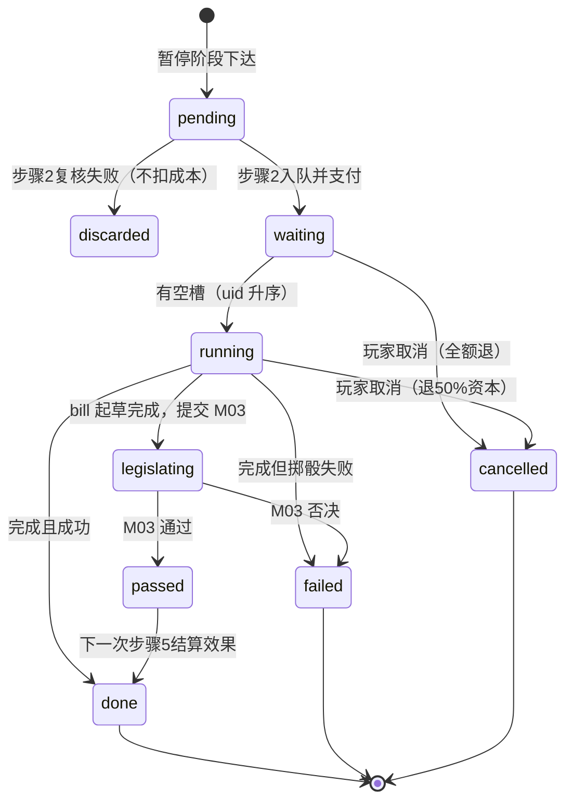
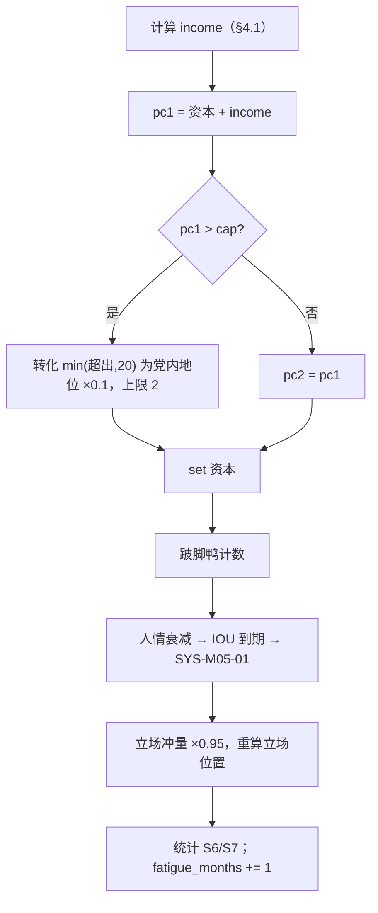

# M05 行动系统、政策目录与政治资本经济

## 0. 元信息

| 项 | 内容 |
|---|---|
| 版本 | v1.0（2026-10-16） |
| 作者 | 子代理：商业策略游戏资深系统设计师（M05 规格） |
| 依赖规格 | M01（结算步骤2/5/15、效果应用、修正器与 `factor()`、`custom` 登记、暂停阶段输入）、M02（因果网：杠杆来源、边 schema、`preview()`、冲击记忆项规则）、M12（表达式语言 §4.4、效果格式 §3.6）、M03（议会投票、盟党满意度、选民集团支持）、M04（立场走廊读取 `gov_axis_position`、承诺类别）、M06（人物ID、职位ID、部长关系、部长提案与越权）、M10（读取政策财政合计、一次性收支 D-010）、M11（区级杠杆 owner）、M13（集权类行动的集权度结算）、M14（开局快照中的 M05 私有状态）、M15（界面） |
| 被依赖 | M03（法案投票请求）、M04（政府立场位置）、M06（AI 部长提案走 M05 管线）、M10（政策财政支出）、M12（事件可读取杠杆、人情、行动旗标；事件可强制改档）、M14（BOT 指标 S6/S7） |
| 适用范围 | 全部剧本；本文所有算例与初始数据以“贝京 1977”（开局 1977-06-20，day 0）为准 |
| 本模块持有的参数 | `political_capital`（registry）；`exemption_coverage`、`outpost_enforcement`（M02 附录A 提出、D-002 已收录的杠杆）；附录A 新增 `policy_level`、`gov_axis_position`、`favor_party`、`favor_character` |
| 决议遵循 | D-001（漂移换算）、D-002（杠杆为 registry `lever` 类型）、D-003（长期效果写成修正器挂边或杠杆边，不依赖一次性 add）、D-010（财政一次性效果进入 `one_off_flows`）、D-011（M05 随机数用 `politics` 子流，步骤2 用 `core`）、D-013（继任时 PC=40）、D-021（暂停阶段下达的行动在次日步骤2入队） |

### 0.1 本模块负责满足的对标标准

| 标准（出处） | 门槛 | 本规格的满足方式 |
|---|---|---|
| **S6 政治资本健康度**（paradox_lessons §5.3） | 贪心型机器人“想做但资本不够”的月份 ≤ 30%；资本处于上限的月份 ≤ 10% | §4.4 三种支付途径（资本、人情抵付、党内透支），只有三者都不足才记“资本不足”；§4.2 上限 = 约6个月产出，溢出按 §4.3 转为党内地位；§4.15 统计口径；§12 校准旋钮 |
| **S7 成本多样性** | 机器人实际使用的行动中只花资本的 ≤ 50% | §4.13 “只花资本”判定式；目录静态约束：只花资本的行动 ≤ 30%（附录D 实际 5/97 = 5.2%）；所有可重复行动中只花资本的 ≤ 40%；运行时统计 |
| **D10 成本落在世界里**（§5.1） | 重要行动至少两种成本 | §4.13 校验 V-03：`w: major` 的行动至少2种“非时间”成本类别；附录D 全部 major 行动满足 |
| **D11 资本设上限，满了要有出口** | 上限约6个月产出；溢出不浪费 | §4.2、§4.3 |
| **A1 资本不是万能计时器**（§5.2） | — | 同 S6/S7；另有 §4.5 人情系统、§4.7 执行槽（时间是独立成本）、§4.6 价格倍率（蜜月期、重复加价） |
| **D12 内生负反馈** | 执政疲劳、强势招致制衡 | §4.1 疲劳项 F；§4.6 重复加价；§4.9 政策翻转惩罚；§4.5 人情债缠身修正器 |
| **D9 / A3 条件而非按钮** | 可能失败，成功率只给区间 | §4.10 成功率表达式 + 界面三档区间；执行期间阻力事件 `resist` |
| **R7 没有支配策略**（benchmarks §6.2） | 不存在万能行动序列 | 边际递减（§4.8）、重复加价（§4.6）、政策边在多个集团之间有赢有输（附录C 每条政策 ≥ 3 条边且同时含正负号） |
| **R8 数值不会顶满** | 核心数值连续2年顶满 ≤ 5% | PC 上限 + 溢出衰减（§4.3）；政策作用经 M02 软目标与惯性 |
| **R13 因果网规模** | 节点 ≥ 150、边 ≥ 600、每条政策杠杆效果 ≥ 3、≥ 50% 带惯性 | 附录C：76 条政策（政策杠杆节点 83 个实例，含区级键），杠杆边 341 条（展开区级键后），每条政策 ≥ 3 条边，全部边默认惯性 3（≥ 50% 满足） |
| **R10 延迟后果** | 抉择后果 ≥ 3 个月后结算 | 人情 IOU 180 天到期（§4.5）；政策边惯性；执行期阻力事件 |
| **R15 因果可解释** | 可见数值 100% 显示前5项贡献 | §9.2 政治资本月产出拆解为 7 项；行动预览调用 M02 `preview()` |
| **R23 入口可达** | 常用行动从主界面 ≤ 2 次点击 | §9.3 常用栏（8格）+ 人物/地图右键菜单：第1次点击打开预填好的行动卡，第2次点击“签署” |
| **R25 小整数优先** | 卡片上成本与效果 ≤ 2 位整数或定性词 | §9.4 卡片显示规则：成本取整，效果用“小/中/大”与箭头，公式只在二级提示 |
| **R26 打断频率** | 每月强制弹窗 ≤ 3 | M05 不产生强制弹窗，只有人情到期事件 SYS-M05-01（`minor: true`，可交顾问）；决议完成走 AP11 notify |
| **K-x3 / P3（朴正熙纪事）每月巡检冷却** | 不要求玩家每月检查冷却 | §4.11 常设指令（最多3条，冷却结束自动续签）；AP11 冷却结束提醒；可重复行动每180天窗口最多2次 |
| **W-x1（白日升）固定阈值反应** | 不存在可背诵的“到X就点Y” | §4.8 边际递减 + §4.6 重复加价 + §4.1 疲劳 |
| **W3（白日升）稀缺行动点** | 能做的事永远比槽位多 | §4.7 执行槽 4 个、法案槽 3 个 |
| **D5 / 4.5（Democracy 4）部长忠诚产出资本** | — | §4.1 项 L：内阁部长平均关系 |
| **K2（朴正熙纪事）立法有时长** | — | §4.12 法案：起草期 + M03 三读（默认 45 天） |
| **F5 政策路线可区分性 / A9** | ≥ 25% 行动只在经济轴一端可用 | 经济与福利类行动、政策档位按 `economic_model` 门控（§4.14，附录D 中经济类 13 项行动有 7 项单端可用 = 54%）；全目录口径见附录E 问题3 |
| **L5 行动多样性** | 第20年类别熵 ≥ 第1年 80% | 13 个行动类别；时代解锁（`era` 字段）；疲劳使舆论类变贵，迫使换手段 |

**对五个总锚点的贡献**

| 总锚点 | 本模块的做法 |
|---|---|
| 深度与重复可玩性超过《朴正熙纪事》 | 朴正熙纪事 247 条决议（88 条可重复）；本模块 76 条持续性政策共 227 个档位 + 97 种行动（带参数实例化后 ≥ 300 个不同行动实例），且每种行动有多重成本、边际递减和失败概率，同一目标有 2–4 条不同代价的路径 |
| UI 观感以 Suzerain 为标准 | 政策是“卷宗柜”中的卡片，档位用 1–5 个圆点；成本是小整数图标；签署后播放微型反馈（Suzerain S9） |
| 规模最接近白日升 | 执行槽 = 白日升“人物行动点”的对应物；每月 4–8 次有意义的决策 |
| 政治深度接近 Democracy 4 | 政策 = 带惯性的因果网杠杆（与 M02 同一引擎）；政治资本由党内地位、民意、席位与部长忠诚共同产出 |
| 观感接近P社但复杂度更低 | 只有 1 种抽象货币（政治资本），其余成本全部是世界里已有的数值（盟党满意度、选民集团、人物关系、财政、国际关系、时间）；人情是唯一新增的“账本” |

---

## 1. 设计意图

### 1.1 核心取舍（一句话）
**政治资本只买“速度”和“主动权”，真正的代价落在盟党、选民、人物、财政和时间上：玩家每做一件事，都要决定这次让谁来买单。**

### 1.2 决策频率与信息来源
| 决策 | 频率（贝京1977第一年设计目标） | 信息来源 |
|---|---|---|
| 下达一次性行动 | 每月 4–8 次（其中 1–2 次是重大行动） | 告警条、内阁文件夹（M12）、部长提案（M06）、承诺进度（M04） |
| 调整持续性政策档位 | 每季度 2–4 次 | 政策卷宗中每条政策的“谁受益/谁受损”预览（M02 `preview()`）、盟党诉求（M03） |
| 人情：兑现、偿还、拖延 | 每月 0–2 次 | 人情账本面板；SYS-M05-01 到期事件 |
| 支付方式选择 | 每次资本不足时 | 行动卡底部的支付栏（资本 / 人情 / 透支） |

### 1.3 失败状态与恢复路径
| 失败状态 | 判定 | 后果 | 恢复路径 |
|---|---|---|---|
| 资本枯竭 | `political_capital < 5` | 只能用人情或透支付款 | 下月产出；花 0 资本的行动（附录D 有 8 项）；兑现人情 |
| 跛脚鸭 | `political_capital < 5` 连续 3 个月结算日 | 修正器 `lame_duck`（§4.3）：`pc_cost` ×1.25，盟党满意度目标 −5 | 资本回到 ≥ 25 时移除；赢得大选时移除 |
| 人情债缠身 | 欠出人情合计 ≥ 8 | 修正器 `favor_debt_burden`：`pc_income` −10% | 偿还到合计 ≤ 5 时移除 |
| 背信者 | 拒绝偿还到期人情 | 该债主旗标 `reneged.<entity>`；此后向其借人情的数量 ×2；其他全部债主关系 −3 | 旗标 730 天后清除 |
| 执行槽堵塞 | 4 个槽全满且等待列表 ≥ 3 | 新行动只能排队 | 取消等待中的行动（全额退款）或暂停中的执行（退 50% 资本） |
| 政策翻转 | 365 天内把同一政策朝相反方向调整 | 党内地位 −3，全体选民集团 −1 | 不可撤销，只能避免 |

### 1.4 第10–20年如何保持新鲜感
1. **执政疲劳**（§4.1 项 F）：每月 −0.1，最多 −4；大选获胜减半。第3个任期的月产出比第1任期低 2–4 点，迫使玩家更多依赖人情与盟党交易。
2. **人情网络随时间变厚**：长期执政积累的被欠人情（每年衰减 1 点）与欠出人情（到期必须处理）形成不同的局面。
3. **时代解锁**：行动与政策带 `era` 字段（例：1985 年后的经济稳定计划、1989 年后的移民吸收紧急计划、1990 年后电视商业频道）。
4. **历史债务修正器**：取消债务型修正器的行动成本 = 基础成本 × 修正器 `strength`（M01 §4.7.6），越晚越贵。
5. **继任者继承**：执行中的决议、政策档位、对政党的人情全部继承（§10），新总理面对的是旧账本。

---

## 2. 读写清单

| 参数ID | 读/写 | 结算步骤（M01 §4.2.1） | 说明 |
|---|---|---|---|
| `political_capital` | 写（owner） | 2（支付）、5（退款）、15（月产出与溢出）；暂停阶段只读 | owner 写入用 `set`（priority 100，值 = 旧值 + 本步变化，M01 B-4） |
| `policy_level[*]` | 写（owner） | 5（政策调整完成时 `set`） | 新增杠杆，附录A |
| `exemption_coverage` | 写（owner） | 5 | 杠杆（M02 附录A，D-002） |
| `outpost_enforcement` | 写（owner） | 5 | 杠杆（同上） |
| `gov_axis_position[*]` | 写（owner） | 5（政策或带立场冲量的行动完成时重算）、15（冲量衰减后重算） | 新增 derived，附录A；M04 步骤11 读取 |
| `favor_party[*]`、`favor_character[*]` | 写（owner） | 2、5、暂停阶段（人情事件选项）、15（衰减） | 新增，附录A |
| `settlement_policy[*]`、`region_land_policy[*]`、`military_government[*]` | 写（非 owner，玩家行动 `set`，M01 §4.3.3 允许） | 5 | owner 为 M11；M05 只在玩家或AI通过 `change_policy` 调整时提交 `set` |
| `religious_status_quo` | 写（非 owner，`add`） | 5 | M02 `mode: none` 节点，不接受边；宗教政策的档位变化以差额 `add` 写入（§4.9.3） |
| `economic_model` | 写（非 owner，`add`） | 5 | M10 轴，`drift: none`；经济政策档位变化以差额 `add` 写入 |
| `party_standing` | 读；写（非 owner，`add`） | 读：15；写：2（透支）、15（溢出转化）、5（翻转惩罚） | — |
| `bloc_support[*]` | 读 | 15 | 计算民意项 A |
| `coalition_seats` | 读 | 15；暂停阶段（前提） | 计算席位项 C |
| `relation[*]` | 读；写（非 owner） | 15（项 L）；2/5（行动成本与效果） | 内阁成员名单由 M06 提供 |
| `budget_balance` | 写（非 owner，一次性） | 2、5 | D-010：解释器记入 `one_off_flows[budget_balance]` |
| 其余全部 registry 参数 | 读（前提、成功率）；写（非 owner，行动效果） | 暂停阶段（前提求值）、2、5 | 效果全部走 M01 效果解释器 |
| 修正器因子 `pc_income`、`pc_cost`、`exec_slots`、`bill_slots`、`exec_speed`、`oratory_effect` | 读 | 2、5、15、暂停阶段 | 前2个由 M01 预登记；后3个本规格登记（§3.5）；`oratory_effect` 为 M03 登记，M05 对 `oratory: true` 行动也读取 |

---

## 3. 状态与数据结构

### 3.1 模块私有状态 `modules.M05`（全部写入存档）

| 字段 | 类型 | 范围 | 默认 | 说明 |
|---|---|---|---|---|
| `version` | int | ≥1 | 1 | 存档迁移用 |
| `pending` | List[PendingOrder] | 长度 ≤ 20 | [] | 暂停阶段下达、等待次日步骤2的行动 |
| `queue` | List[ActionInstance] | 长度 ≤ 40 | [] | 等待、执行中、立法中的行动，按 `uid` 升序 |
| `next_uid` | int | ≥1 | 1 | 行动实例编号，永不复用 |
| `next_seq` | int | ≥0 | 0 | PendingOrder 编号 |
| `history` | Dict[str, HistoryEntry] | — | {} | 键 = `action_id` 或 `action_id:参数串`（§4.6） |
| `policy_state` | Dict[str, PolicyState] | — | 剧本加载时生成 | 键 = `policy_id` 或 `policy_id:区键` |
| `lever_seen` | Dict[str, float] | — | 剧本加载时 = 各杠杆当前值 | 用于检测事件对杠杆的直接改写（§4.9.5） |
| `axis_impulse` | Dict[axis, float] | [−60, 60] | 全 0 | 行动立场冲量记忆（§4.9.4） |
| `iou` | List[IOU] | 长度 ≤ 30 | 剧本快照给出 | 玩家欠出的人情明细 |
| `fatigue_months` | int | [0, 600] | 0 | 执政疲劳计数 |
| `overdraft_last_day` | int | — | −9999 | 上次透支的 day_index |
| `low_pc_streak` | int | ≥0 | 0 | 连续资本 < 5 的月结算日数 |
| `standing_orders` | List[{action_id, args}] | 长度 ≤ 3 | [] | 常设指令（§4.11） |
| `stats` | Stats | — | 全 0 | S6/S7 统计（§4.15） |

**PendingOrder**：`{seq: int, action_id: str, args: Dict[str,str], pay: PayPlan, input_day: int}`。

**PayPlan**：`{pc: int, favors: List[{entity: str, kind: "party"|"character", n: int}], overdraft: int}`。三项之和必须等于行动的最终资本价格（§4.6）。

**ActionInstance**

| 字段 | 类型 | 说明 |
|---|---|---|
| `uid` | int | — |
| `action_id` | str | 附录D 的 `id`；政策调整为 `change_policy` |
| `args` | Dict[str,str] | 参数，例如 `{party: dash}`；政策调整为 `{policy: fx_regime, key: "", to: "2"}` |
| `state` | str | `waiting` / `running` / `legislating` / `passed` / `done` / `failed` / `cancelled` |
| `slot` | str | `exec` / `bill` / `none`（§4.7） |
| `enter_day` | int | 入队日 |
| `start_day` | int | 开始执行日；`waiting` 时为 −1 |
| `progress` | float | 已推进天数 |
| `dur` | int | 执行天数（政策调整与法案为起草天数） |
| `paid_pc` | int | 实付资本（用于退款） |
| `dr` | float | 边际递减系数（§4.8），入队时冻结 |
| `bill_uid` | int | 提交 M03 后的法案号；未提交为 −1 |
| `succ_p` | float | 完成时的成功概率；无成功率为 1.0 |

**HistoryEntry**：`{count: int, last_start: int, last_done: int, uses: List[int]（最近 365 天内的完成日）, cd_ready: int}`。

**PolicyState**：`{tier: float（档位下标；开局值不在档位上时为 x.5，§4.9.1）, last_change: int, last_dir: int（+1/−1/0）, cd_ready: int}`。

**IOU**：`{uid: int, entity: str, kind: "party"|"character", n: int, created: int, due: int, postponed: bool, demand: str}`。`demand` 为到期时的要价类型（§4.5.4）。

**Stats**：`{months: int, blocked_pc_months: int, cap_months: int, used: int, used_pc_only: int, used_by_cat: Dict[str,int], month_blocked: bool}`。

### 3.2 政策定义 schema（`data/policies.yaml`，完整草案见附录C）

| 字段 | 类型 | 必填 | 默认 | 说明 |
|---|---|---|---|---|
| `id` | str | 是 | — | 英文ID；作为 `policy_level` 的键 |
| `zh` | str | 是 | — | 界面名 |
| `cat` | str | 是 | — | `rel` 宗教现状 / `econ` 经济 / `welf` 福利与社会 / `immig` 移民安置 / `terr` 定居与领土 / `sec` 安全 / `occ` 占领区管理 / `arab` 阿拉伯公民 / `media` 媒体与民主 / `fore` 外交 |
| `lever` | str | 否 | `policy_level` | 杠杆参数ID；非默认值时为 `exemption_coverage`、`outpost_enforcement` 或 M11 的区级杠杆 |
| `keys` | List[str] | 否 | null | 区级或群体级杠杆的键；null 表示 `policy_level[id]` 或全国杠杆 |
| `era` | [int, int\|null] | 否 | [1948, null] | 可调整的年份；era 外仍保留档位与边（边按 M02 规则读取杠杆） |
| `law` | bool | 否 | false | true = 调整需议会投票（法令）；false = 内阁决议 |
| `vote` | str | 否 | `simple` | 仅 `law: true` 时有效：`simple` / `absolute61` |
| `tiers` | List[Tier] | 是 | — | 2–5 个档位，按 `v` 升序 |
| `start` | Dict[scenario, int \| Dict[key,float]] | 是 | — | 开局档位下标；区级杠杆写各键的开局**值**（可以不在档位上） |
| `n` | float | 否 | 50 | 中性值：边的默认拐点、立场计算的零点 |
| `pc` | int | 是 | — | 每移动一档的基础资本成本 |
| `up` / `down` | Cost | 否 | {} | 朝 `v` 增大/减小方向每移动一档的附加成本（成本键见 §3.4） |
| `ax` | Dict[axis, float] | 否 | {} | 立场系数：杠杆值从 `n` 变到 100 时对该轴位置的贡献（§4.9.4） |
| `e` | List[EdgeShort] | 是 | — | 杠杆边，≥ 3 条（§3.3） |
| `ask` | Dict[party, int] | 否 | {} | 盟党偏好的档位下标，供 M03 计算诉求满足度 |
| `econ_gate` | Dict[int, str] | 否 | {} | 档位下标 → 表达式；表达式为假时该档不可选（§4.14） |
| `note` | str | 否 | — | 史实依据 |

**Tier**：`{v: float, zh: str, rsq?: float, em?: float, f?: float, mod?: str, flag?: str}`
- `rsq`：该档对 `religious_status_quo` 的贡献（绝对值，§4.9.3）。
- `em`：该档对 `economic_model` 的贡献（同上）。
- `f`：该档的年度财政成本，单位“年度预算 %”，正数为支出（§4.9.6）。
- `mod`：处于该档时存续的修正器ID（定义在附录D 的 `modifiers:` 段）。
- `flag`：处于该档时存在的旗标ID。

### 3.3 杠杆边的简写（EdgeShort）

附录C 中每条边写作 `{t, k, c, i, s, p, d, g}`，构建脚本 `tools/build_policies.py` 展开为 M02 §3.2 的完整边：

| 简写 | 完整字段 | 默认 |
|---|---|---|
| `t` | `target` | 必填 |
| `k` | `target_key` | null |
| `c` | `coef` | 必填 |
| `i` | `inertia` | 3 |
| `s` | `shape` | `linear` |
| `p` | `pivot` | 政策的 `n` |
| `w` | `w` | M02 默认 |
| `d` | `delay` | 0 |
| `g` | `gate` | null |
| — | `id` | `M05.<policy_id>.<两位序号>`（按列表顺序从 01 起） |
| — | `source` / `source_key` | `lever:<lever>` / 政策 `id`（`policy_level`）或 `keys` 中的键（区级杠杆，每个键各展开一条，边ID 追加 `.<key>`）；全国杠杆为 null |
| — | `label_zh` | 政策 `zh` |
| — | `status` | `active` |

边的所有权见附录B-1（杠杆边由 M05 数据声明，目标模块可以在自己的规格中改系数）。

### 3.4 行动定义 schema（`data/actions.yaml`，完整草案见附录D）

| 字段 | 类型 | 必填 | 默认 | 说明 |
|---|---|---|---|---|
| `id` | str | 是 | — | 英文ID |
| `zh` | str | 是 | — | 界面名 |
| `cat` | str | 是 | — | `parl` 议会与政党 / `opin` 舆论与动员 / `pers` 人事 / `econ` 经济与预算 / `soc` 社会宗教族群 / `terr` 定居区域与地点 / `mil` 军事与安全 / `occ` 占领区 / `dipl` 外交 / `infl` 外国影响力 / `cent` 集权 / `favr` 人情 / `pol` 政策调整 |
| `w` | str | 否 | `normal` | `minor` / `normal` / `major`；major 必须有 ≥ 2 种非时间成本（V-03） |
| `args` | Dict[name, type] | 否 | {} | 参数类型：`party`、`bloc`、`region`、`country`（arab_states + peripheral_states）、`character`、`post`、`axis`、`dir`（`toward_left`/`toward_right`）、`faction`、`policy`、`group`、`arab_group`、`power`、`int`、`str`；在 `fx`/`cost`/`pre` 中以槽位 `{name}` 引用 |
| `arg_filter` | Dict[name, 表达式] | 否 | {} | 对每个候选值求值（槽位已代入），为真才出现在下拉框 |
| `pre` | 表达式 | 否 | `"true"` | 前提；暂停阶段与步骤2各求值一次 |
| `era` | [int, int\|null] | 否 | [1948, null] | — |
| `cost` | Cost | 否 | {} | 入队时支付（§4.7） |
| `dur` | int | 否 | 0 | 执行天数；0 = 当日完成 |
| `cd` | int | 否 | 0 | 冷却天数，从完成日起算 |
| `rep` | bool | 否 | false | 可重复行动：每 180 天窗口最多完成 2 次（§4.6） |
| `once` | bool | 否 | false | 一局只能成功完成 1 次 |
| `vote` | str | 否 | `none` | `none` / `simple` / `absolute61` / `confidence`（与信任投票挂钩） |
| `succ` | 表达式 | 否 | — | 完成时的成功概率，结果夹紧到 [0.05, 0.95]；省略 = 必定成功 |
| `fail` | List[Effect] | 否 | [] | 失败时的效果 |
| `fx` | List[Effect] | 是 | — | 完成（且成功）时的效果；M12 §3.6 格式 |
| `cancel_debt` | str | 否 | — | 被取消的债务型修正器ID；资本价格乘以其 `strength`（§4.6） |
| `note` | str | 否 | — | 设计说明，不进入运行时 |
| `fx_m` | List[Effect] | 否 | [] | 执行期间每个月结算日提交一次的效果 |
| `resist` | List[{event: str, p: float}] | 否 | [] | 执行期间每个月结算日以概率 p 触发事件（`trigger_event`） |
| `ax` | Dict[axis, float] | 否 | {} | 完成时的立场冲量（§4.9.4） |
| `oratory` | bool | 否 | false | 效果乘以 `factor_mult("oratory_effect")` |
| `tags` | List[str] | 否 | [] | 供修正器 hooks（M01 §4.7.7 `action_completed`） |
| `fav_from` | List[str] | 否 | `["coalition"]` | 可用人情抵付的债主：实体ID、槽位、`coalition`（全部联合政府伙伴）、`cabinet`（全部内阁成员） |
| `econ_gate` | 表达式 | 否 | — | 经济轴门控（§4.14），与 `pre` 相与 |
| `dom` | str | 否 | — | 负责细化效果的领域模块（M03/M06/M07/M08/M09/M10/M11/M13）；领域模块可改 `fx`，不可改 `cost`/`dur`/`cd`/`rep`/`vote` |
| `ai` | List[str] | 否 | [] | 哪些 AI 可用：`minister`（M06 部长提案）、`ai_pm`（AI 总理）、`bot`（验证机器人，默认全部可用） |

**Cost 字段（成本键）**——入队时转换为效果并立即应用（步骤2）：

| 键 | 值 | 转换为效果 | 成本类别（V-03、S7 计数用） |
|---|---|---|---|
| `pc` | int | `political_capital` 扣减（owner `set`），按 §4.6 定价 | 资本 |
| `fiscal` | float | `{op: add, target: budget_balance, value: −x}`（D-010 一次性） | 财政 |
| `fiscal_m` | float | 执行期间每月 `{op: add, target: budget_balance, value: −x}`（并入 `fx_m`） | 财政 |
| `ally` | Dict[party, float] | `{op: add, target: ally_satisfaction, key: p, value: v}` | 盟党 |
| `ally_coal` | float | 对每个当前联合政府伙伴（不含本党）各一条 `ally_satisfaction` add | 盟党 |
| `bloc` | Dict[bloc, float] | `bloc_support` add | 选民 |
| `rel` | Dict[character/post, float] | `relation` add | 关系 |
| `standing` | float | `party_standing` add | 党内 |
| `fav_incur` | {e: str, n: int} | 欠出人情（§4.5.2） | 人情 |
| `fav_spend` | {e: str, n: int} | 消耗被欠人情（必须 `favor ≥ n`，否则不可下达） | 人情 |
| `par` | Dict[param 或 `param.key`, float] | 对应参数 add，例如 `us_admin_relation: -3`、`power_relation.diaspora: -1`、`inflation: 4` | 参数ID 为 `us_admin_relation`、`us_congress_relation`、`intl_legitimacy`、`power_relation`、`regime_hostility`、`popular_hostility`、`arms_reliability` 时记“对外”；其他记“国情” |
| `rol` | float | `rule_of_law` add | 法治 |
| （`dur ≥ 14`） | — | — | 时间 |

### 3.5 本模块登记的因子键与修正器

| 因子键 | 模式 | 基础值 | 用途 |
|---|---|---|---|
| `exec_slots` | `add_flat` | 4 | 执行槽数 = `4 + factor_flat("exec_slots")`，夹紧 [2, 7] |
| `bill_slots` | `add_flat` | 3 | 法案槽数 = `3 + factor_flat("bill_slots")`，夹紧 [1, 5] |
| `exec_speed` | `mult` / `add_pct` | 1.0 | 每日推进 = `factor_mult("exec_speed")` 天 |

M05 定义的修正器（完整 YAML 见附录D `modifiers:` 段）：`honeymoon`（蜜月，100 天：`pc_cost add_pct −25`）、`lame_duck`（跛脚鸭）、`favor_debt_burden`（人情债缠身）、`war_cabinet`（战时内阁：`exec_slots add_flat +1`，`remove_on: [war_end]`）、`bank_bubble`（银行股泡沫，政策 `bank_share_support` 档1 存续）、`state_tv_line`（广播局政府指导，`oratory_effect add_pct +20`）等共 16 个。

### 3.6 完整示例（一条政策 + 一条行动）

```yaml
# data/policies.yaml 节选
policies:
  - id: sabbath_el_al
    zh: 以色列航空安息日航班
    cat: rel
    law: false
    tiers:
      - {v: 0,   zh: 照常运营, rsq: 0}
      - {v: 100, zh: 安息日停飞, rsq: 3, f: 0.3}
    start: {begin_1977: 0}
    pc: 8
    up:   {bloc: {liberal_middle: -2}}
    down: {ally: {agudat: -6}}
    ax: {religion: 4}
    ask: {agudat: 1}
    e:
      - {t: ally_satisfaction, k: agudat, c: 0.08}
      - {t: bloc_support, k: haredi, c: 0.03}
      - {t: bloc_support, k: liberal_middle, c: -0.03}
      - {t: union_strength, c: 0.02, i: 6}
    note: "E-G04-03 选项A；史实 1982 年停飞"

# data/actions.yaml 节选
actions:
  - id: coalition_invite
    zh: 邀请政党入阁
    cat: parl
    w: major
    args: {party: party}
    arg_filter: {party: "ally_satisfaction[{party}] >= 0"}
    pre: "coalition_seats <= 70"
    cost: {pc: 15, ally_coal: -3, fav_incur: {e: "{party}", n: 2}}
    dur: 30
    cd: 180
    vote: confidence
    fx:
      - {op: custom, key: m03_add_to_coalition, value: {party: "{party}"}}
      - {op: add, target: ally_satisfaction, key: "{party}", value: 10}
    dom: M03
    ai: [ai_pm]
```

展开后的边 `M05.sabbath_el_al.01`：`{target: ally_satisfaction, target_key: agudat, source: lever:policy_level, source_key: sabbath_el_al, shape: linear, pivot: 50, coef: 0.08, inertia: 3, delay: 0, gate: null, label_zh: 以色列航空安息日航班, status: active}`。开局档0（v=0）贡献 `0.08 × (0 − 50) = −4.0`；改为档1（v=100）并经过 3 个月惯性后贡献 `+4.0`，目标值净变化 +8。

---

## 4. 规则与公式

### 4.1 政治资本月产出（步骤15，`is_month`，子流 `politics`，本步不掷骰）

**公式**

```
gross = B0 + S + A + C + L − F
S = kS × party_standing
A = clamp(kA × (approval − A0), A_min, A_max)
approval = Σ_b w_b × bloc_support[b]           （w_b 见下表，按时代）
C = clamp(kC × (coalition_seats − 60), C_min, C_max)
L = clamp(kL × mean_rel, −3, 3)                  mean_rel = 内阁部长对总理关系的算术平均（M06 名单；不含总理本人；空内阁取0）
F = min(F_max, kF × fatigue_months)
income = max(0, gross × factor_mult("pc_income") + factor_flat("pc_income"))
```

| 系数 | 初值 | 单位 |
|---|---|---|
| B0 | 6.0 | 资本/月 |
| kS | 0.08 | 资本/月/党内地位点 |
| kA, A0, A_min, A_max | 0.20, 30, −4, 6 | 资本/月/支持度点 |
| kC, C_min, C_max | 0.5, −3, 4 | 资本/月/席 |
| kL | 0.05 | 资本/月/关系点 |
| kF, F_max | 0.1, 4 | 资本/月/月 |

**选民集团权重 w_b**（M03 规格给出按人口计算的权重后以 M03 为准）：

| 时代 | labor_ashkenazi | mizrahi | kibbutz_moshav | religious_zionist | haredi | arab_citizens | liberal_middle | russian |
|---|---|---|---|---|---|---|---|---|
| 1948–1989 | 0.22 | 0.30 | 0.06 | 0.08 | 0.05 | 0.10 | 0.19 | 0 |
| 1990–2006 | 0.18 | 0.27 | 0.04 | 0.08 | 0.07 | 0.11 | 0.15 | 0.10 |

**执政疲劳**：每个月结算日在计算 income **之后** `fatigue_months += 1`；大选结果公布（信号 `election_held`）且玩家连任时 `fatigue_months = floor(fatigue_months / 2)`；继任时归零。

**算例（贝京1977，1977-07-01，day 11 第一次月结）**：党内地位 70；`bloc_support` = {labor_ashkenazi 30, mizrahi 52, kibbutz_moshav 15, religious_zionist 55, haredi 45, arab_citizens 5, liberal_middle 38}（M01 夹具）；席位 61；内阁平均关系 20（测试假设）；`fatigue_months = 0`；无修正器。
- S = 0.08 × 70 = 5.6
- approval = 0.22×30 + 0.30×52 + 0.06×15 + 0.08×55 + 0.05×45 + 0.10×5 + 0.19×38 = 6.6 + 15.6 + 0.9 + 4.4 + 2.25 + 0.5 + 7.22 = 37.47 → A = 0.20 × 7.47 = 1.494
- C = 0.5 × 1 = 0.5；L = 0.05 × 20 = 1.0；F = 0
- gross = 6 + 5.6 + 1.494 + 0.5 + 1.0 − 0 = **14.594 资本**；之后 `fatigue_months = 1`。
- 若同时存在 `silent_pm`（`pc_income add_pct −30`）与「美元化的日常」（`add_flat −2`）：income = 14.594 × 0.7 − 2 = 8.2158。

### 4.2 资本上限（软上限）

```
cap = clamp(cap0 + kcap × party_standing, cap_min, cap_max)
```
初值 cap0 = 50，kcap = 0.6，cap_min = 60，cap_max = 110。单位：资本。registry 的硬上限 200 保留给事件奖励的短暂溢出。

**算例**：党内地位 70 → cap = 50 + 42 = **92**（约等于 6.3 个月的开局产出 14.594，满足 D11）。党内地位 30 → 68 → 夹紧后 68。

### 4.3 月度入账、溢出转化与跛脚鸭（步骤15，按顺序）

1. `pc1 = political_capital + income`。
2. 若 `pc1 > cap`：`excess = pc1 − cap`；`conv = min(excess, 20)`；`pc2 = pc1 − conv`；提交 `{op: add, target: party_standing, value: min(2.0, 0.1 × conv)}`（来源 `M05:overflow`）。否则 `pc2 = pc1`。
3. 提交 owner `set political_capital = pc2`。
4. 若 `pc2 >= cap`：`stats.cap_months += 1`。
5. 跛脚鸭：若 `pc2 < 5`，`low_pc_streak += 1`，否则 `low_pc_streak = 0`；`low_pc_streak == 3` 时添加修正器 `lame_duck`；`lame_duck` 的 `remove_if: "political_capital >= 25"`，`remove_on: [election_held]`。
6. 人情衰减与到期检查（§4.5.3、§4.5.4）；立场冲量衰减（§4.9.4）；统计（§4.15）。

**算例**：资本 85，产出 14.594 → pc1 = 99.594 > 92 → excess 7.594，conv = 7.594，pc2 = 92.0，党内地位 +0.7594。
**算例（事件奖励溢出）**：E-1978-09 诺贝尔奖使资本从 88 升到 98；下个月结 pc1 = 98 + 14 = 112，excess = 20，conv = 20 → pc2 = 92，党内地位 +2.0（达到 2.0 上限）。

### 4.4 支付：资本、人情抵付、党内透支（暂停阶段下达时选择，步骤2 执行）

行动的资本价格为 `P`（§4.6）。玩家（或 AI）提交 PayPlan `{pc, favors, overdraft}`，必须满足：

| 规则 | 公式 |
|---|---|
| 和 | `pc + 8 × Σ favors.n + overdraft = P` |
| 资本 | `pc ≤ political_capital`（以步骤2开始时的值复核） |
| 人情上限 | `Σ favors.n ≤ floor(0.5 × P / 8)`；每个债主 `n ≤ favor[entity]`；债主必须在行动 `fav_from` 内 |
| 透支 | `overdraft ≤ 15`；`party_standing ≥ 40`；`day_index − overdraft_last_day ≥ 30`；透支成本 `party_standing −0.3 × overdraft` |

**默认支付方案**（界面预填与 AI 使用，按顺序）：先用资本；不足时按债主人情从多到少、同数按实体ID升序抵付到上限；仍不足时透支；仍不足则该行动“资本不足”，不可下达。

**算例1**：行动 P = 20，资本 12，favor_party[nrp] = 2（nrp 在 `fav_from`）。人情上限 floor(10/8) = 1 → 用 1 点 nrp 人情抵 8，资本付 12，透支 0。结果：资本 0，favor_party[nrp] = 1。
**算例2**：P = 25，资本 14，无人情，党内地位 70，上次透支 60 天前。透支 11 → 党内地位 −3.3；资本 0。
**算例3**：P = 40，资本 20，无人情 → 透支上限 15，20 + 15 = 35 < 40 → 资本不足（记入 §4.15 `month_blocked`）。

### 4.5 人情系统（欠与被欠）

#### 4.5.1 数值
- `favor_party[p]`、`favor_character[c]`：整数，范围 [−6, +6]。**正数 = 对方欠总理（被欠）；负数 = 总理欠对方（欠出）**。
- 1 点人情 = 8 资本的抵付价值（§4.4）。
- 欠出的每一点都对应 `iou` 中的明细（同一债主可有多条）。`favor` 的负数部分 = 该债主全部 IOU 的 `n` 之和取负。

#### 4.5.2 获得与欠出

| 来源 | 变化 |
|---|---|
| 行动成本 `fav_incur: {e, n}` | 若 `favor[e] > 0`：先抵消正数部分；剩余部分 `favor[e] −= 剩余`，并新建 IOU `{n: 剩余, due: day + 180, demand: 按 §4.5.4 表}`；旗标 `reneged.<e>` 存在时 `n` ×2 |
| 行动 `grant_favor`、`concede_demand`、部长提案获批（§7.1） | `favor[e] += n`（先偿还该债主最早的 IOU，再加正数） |
| 行动 `repay_favor` | 偿还最早到期的 IOU |
| 事件效果 `custom m05_grant_favor` / `m05_incur_favor` | 同上 |

#### 4.5.3 衰减（步骤15）
- 正数人情：若该实体最近一次获得人情距今 ≥ 365 天，`favor −= 1`，并把“最近一次”记为今天（即每满一年无新往来衰减 1 点）。
- 负数不衰减。

#### 4.5.4 到期与要价（步骤15）
每个月结算日，对 `due ≤ day_index` 且未处理的 IOU（按 `uid` 升序，每月最多处理 2 条，其余顺延到下月）提交 `trigger_event SYS-M05-01`（槽位 `{creditor}` = 债主，`{n}` = 数量，`{demand}` = 要价）。要价表：

| 债主类型 | 要价 `demand`（按条件从上到下取第一个满足的） | 偿还选项 A 的效果 |
|---|---|---|
| 宗教政党（`party_has_tag({creditor}, "religious")`） | 把其 `ask` 中差距最大的一条政策朝其偏好移动 1 档；同差时优先 `law: false` 的政策，再按附录C 出现顺序 | 免费执行该 `change_policy`（不花资本、不进入冷却以外的限制，仍需投票时走法案槽） |
| 其他政党 | 为其选区拨款 | 财政 −0.5 × n；`ally_satisfaction[{creditor}] +3` |
| 人物（部长） | 批准其部门的一项行动（M06 提供 `portfolio_action`） | 该行动按 0 资本入队 |
| 人物（非部长） | 职位 | 任命其为副部长或大使（M06 处理），`relation +5` |

**SYS-M05-01 人情到期**（`minor: true`，30 天未处理由顾问选 A）：
- A「偿还」：执行要价效果；IOU 删除；`favor += n`。
- B「请求宽限90天」（每条 IOU 只能一次）：`due += 90`，`postponed = true`，`relation[债主或其党魁] −5`。
- C「拒绝」：IOU 删除，`favor[债主] = 0`；对政党 `ally_satisfaction −10 × n`（上限 −20），对人物 `relation −15 × n`（上限 −30）；设旗标 `reneged.<债主>`（730 天后清除）；对**其他全部**有 IOU 或正人情的实体 `relation[其党魁或本人] −3`。

#### 4.5.5 人情债缠身
欠出合计 `D = Σ iou.n`。`D ≥ 8` 时添加修正器 `favor_debt_burden`（`pc_income add_pct −10`），`remove_if: "m05_iou_total() <= 5"`（函数见附录B-4）。

**算例（贝京1977 开局）**：快照 IOU `{entity: agudat, kind: party, n: 1, created: 0, due: 180, demand: religious}`（阿古达以不入阁换取的诉求清单），`favor_party[agudat] = −1`。1977-12-17 是 day 180；下一个月结算日 1978-01-01（day 195）提交 SYS-M05-01，要价：在阿古达 `ask` 中差距最大的宗教政策。开局阿古达的 `ask` 与现档差距全部为 1（`sabbath_transport`、`kashrut_state`、`marriage_law`、`conversion_recognition`、`sabbath_el_al`、`exemption_coverage`、`abortion_social_clause`、`autopsy_rules`、`sabbath_commerce`、`sabbath_broadcasting` 等）；其中 `law: false` 的有 `sabbath_el_al`、`exemption_coverage`、`sabbath_broadcasting`，按附录C 顺序最前者 = `sabbath_el_al`。选 A → 安息日停飞，`religious_status_quo` +3，阿古达人情归 0。

### 4.6 资本价格

```
base = action.cost.pc（政策调整见 §4.9.2）
m_rep = 1.0（窗口内首次）| 1.5（窗口内第2次）
m_debt = 被取消的债务型修正器的 strength（仅带 cancel_debt 字段的行动；否则 1）
P = round_half_up( base × factor_mult("pc_cost") × m_rep × m_debt + factor_flat("pc_cost") )，下限 0
round_half_up(x) = floor(x + 0.5)
```
- **蜜月期**：修正器 `honeymoon`（`pc_cost add_pct −25`，100 天）在每个任期开始时添加（贝京1977：剧本快照的初始修正器，day 0 起）。
- **可重复行动窗口**：`rep: true` 的行动，`history[key].uses` 中距今 < 180 天的完成次数为 u；u = 0 → m_rep 1.0；u = 1 → 1.5；u ≥ 2 → 不可下达（“本行动180天内已用2次”）。`key` = `action_id`，若行动有参数则为 `action_id:` + 参数值按参数名升序以 `,` 连接（例：`rally_bloc:mizrahi`）。
- 冷却：`day_index < history[key].cd_ready` 时不可下达；`cd_ready = 完成日 + cd`。

**算例**：
- `change_policy fx_regime` 0→2，day 130，P_base = 25（§4.9.2）；`honeymoon` 已于 day 100 结束 → P = 25。若在 day 50 下达：25 × 0.75 = 18.75 → **19**。
- `national_address`（pc 5）180 天内第2次：5 × 1.5 = 7.5 → **8**；若同时有 `lame_duck`（`pc_cost mult 1.25`）：5 × 1.25 × 1.5 = 9.375 → **9**。
- `restore_exemption_cap`（pc 25，取消 `uncapped_exemption`，其 strength = 1.5）：25 × 1.5 = **38**（37.5 进位）。

### 4.7 执行队列（步骤2 入队，步骤5 推进）

#### 4.7.1 槽位类型
| 条件（按顺序判定） | `slot` |
|---|---|
| `vote != none`，或 `change_policy` 且政策 `law: true` | `bill` |
| `dur > 0` | `exec` |
| 其他 | `none`（不占槽，入队当日步骤5完成） |

容量：`exec` 槽 = `clamp(4 + factor_flat("exec_slots"), 2, 7)`；`bill` 槽 = `clamp(3 + factor_flat("bill_slots"), 1, 5)`。`bill` 实例在起草期（`dur`）和立法期都占 `bill` 槽，不占 `exec` 槽。

#### 4.7.2 步骤2 `actions_intake`（子流 `core`，不掷骰）
按 `pending` 的 `seq` 升序，对每条：
1. 复核 `pre`、`econ_gate`、`era`、冷却、窗口、参数过滤、PayPlan 合法性（§4.4，用步骤开始时状态，并扣除本步前面订单已占用的资本与人情）。不通过 → 丢弃，消息“行动「X」未能执行：<原因>”，不扣任何成本。
2. 通过 → 生成支付效果：资本（owner set，同一步多笔合并为一个 set）、人情（直接改私有状态与 `favor_*`，IOU 生成）、透支（`party_standing` add）、其余 Cost 键（§3.4 表）。
3. 新建 ActionInstance：`state = waiting`，`enter_day = day_index`，`dr` 按 §4.8 冻结，`succ_p` 暂不计算。
4. 记录 `stats.used += 1`、`used_by_cat[cat] += 1`；若该行动“只花资本”（§4.13）则 `used_pc_only += 1`。
5. 清空 `pending`。
然后执行**开槽**：按 `uid` 升序，把 `waiting` 中能放入空槽的实例改为 `running`，`start_day = day_index`；`slot: none` 的实例直接 `running`。

#### 4.7.3 步骤5 `actions_progress`（子流 `politics`）
按 `uid` 升序处理每个 `running` 实例：
1. `progress += factor_mult("exec_speed")`。
2. 若 `progress ≥ dur`：
   - `slot: bill` 且尚未提交（`bill_uid == −1`）→ 提交 `custom m03_submit_bill`（附录B-2），`state = legislating`。
   - 否则 → **完成结算**：若有 `succ`，计算 `succ_p = clamp(eval(succ), 0.05, 0.95)`，取 `politics` 子流一次 `next_float()`，`f < succ_p` 为成功；成功提交 `fx`（数值乘以 `dr`，`oratory: true` 时再乘 `factor_mult("oratory_effect")`；只缩放 `add`/`mul` 的数值，不缩放 `set`、旗标、修正器、事件），失败提交 `fail`。随后：立场冲量（§4.9.4）、旗标 `act.<action_id>`（`set_flag`，value = `history.count + 1`）、修正器 hooks（`action_completed`，按 `tags`）、`history` 更新、`state = done`（失败为 `failed`）、信号 `m01_raise_signal {signal: "action_completed"}`（AP11）。
3. `legislating` 实例由 M03 回调 `m05_bill_result` 改为 `passed` 或 `failed`；`passed` 的实例在**下一次**步骤5执行完成结算（第2步后半），`failed` 的实例：成本不退，`party_standing −2`，进入冷却，`state = failed`。
4. 所有 `done`/`failed`/`cancelled` 实例在本步末尾移出 `queue`，释放槽位；随后按 §4.7.2 末尾规则开槽（新开的实例从明天开始推进）。
5. 若是月结算日：对每个 `running` 实例提交 `fx_m` 与 `fiscal_m`，并对每条 `resist` 掷骰（`politics` 子流，按 `resist` 列表顺序），成功则 `trigger_event`。

#### 4.7.4 取消（暂停阶段，玩家操作 `cancel_action uid`，写入输入日志）
| 状态 | 退款 |
|---|---|
| `waiting` | 全额退还资本、人情（IOU 删除或 `favor` 加回）、透支对应的党内地位；其他成本不退 |
| `running` / `legislating` | 退还 `floor(0.5 × paid_pc)` 资本；其他不退；`party_standing −1`（朝令夕改） |

退款在次日步骤2以 owner set 写入。

**算例（队列）**：day 130 暂停阶段下达三条：`change_policy fx_regime 0→2`（law false，dur 7，exec）、`found_settlement {region: west_bank}`（dur 90，exec）、`coalition_invite {party: dash}`（vote confidence，dur 30，bill）。当时 exec 槽已有 3 个运行中。day 131 步骤2：三条依次入队并支付；开槽：fx_regime 占第4个 exec 槽 → running；found_settlement 无 exec 槽 → waiting；coalition_invite 占 bill 槽 1 → running。day 138 步骤5：fx_regime progress = 7 ≥ 7 → 完成，`policy_level[fx_regime]` set 100；释放槽 → found_settlement 开槽，从 day 139 起推进，day 228 完成。coalition_invite day 161 起草完成 → 提交 M03 → 立法。

### 4.8 边际递减（可重复行动）

```
dr = 1 / (1 + 0.5 × n365)
```
n365 = 入队时 `history[key].uses` 中距今 ≤ 365 天的完成次数。只对 `rep: true` 的行动生效；非重复行动 dr = 1。

**算例**：`visit_dev_town {region: negev}` 一年内第3次（前两次在 day 40、day 210，本次 day 330）：n365 = 2 → dr = 0.5；效果 `bloc_support[mizrahi] +2` 实际 +1.0。

### 4.9 持续性政策（Democracy 4 式杠杆）

#### 4.9.1 档位与当前位置
- 每条政策有 2–5 个档位，`tiers[i].v` 为杠杆值。档位变化 = 杠杆 `set`。
- 当前档位下标：若杠杆值等于某档 `v`（|差| ≤ 1e-6）则为该下标；否则为 `j + 0.5`，j = 满足 `tiers[j].v < 值` 的最大下标（值低于全部档位时为 −0.5）。界面显示“现行（值）”。
- 移动步数 `Δ = ceil(|目标下标 − 当前下标|)`。

**算例**：`region_land_policy[galilee]` 开局 35，档位 v = [0, 30, 50, 75, 100] → 当前下标 1.5；调到档3（75）：Δ = ceil(1.5) = 2。

#### 4.9.2 调整行动 `change_policy`
| 项 | 规则 |
|---|---|
| 参数 | `policy`、`key`（区级杠杆）、`to`（目标档位下标） |
| 前提 | 政策 `era` 包含当年；`day_index ≥ cd_ready`；目标档的 `econ_gate` 为真；同一政策（同键）没有执行中或立法中的 `change_policy` |
| 资本 | `base = pc × (1 + 1.5 × (Δ − 1))`，再按 §4.6 定价 |
| 附加成本 | 方向为增大时 `up` × Δ，减小时 `down` × Δ（每个数值乘以 Δ；人情 `n` 乘以 Δ） |
| 执行 | `law: false` → `dur = 7`，exec 槽；`law: true` → 起草 `dur = 30`，bill 槽，再由 M03 表决（`vote` 字段） |
| 完成效果 | ① 杠杆 `set` 为目标档 `v`；② `rsq`、`em` 差额 `add`（§4.9.3）；③ 移除旧档 `mod`、添加新档 `mod`，清除旧档 `flag`、设置新档 `flag`；④ 立场重算（§4.9.4）；⑤ 翻转检查（§4.9.7）；⑥ `policy_state` 更新，`cd_ready = 今日 + 180`；⑦ `lever_seen` 更新 |
| 冷却 | 同一政策（同键）180 天 |

**算例（E-1977-10 的玩家路线）**：`fx_regime` 档0→档2，`pc` = 10，Δ = 2 → base = 10 × (1 + 1.5 × 1) = 25 资本；附加成本 `up: {bloc: {labor_ashkenazi: -1}, par: {inflation: 4}}` × 2 = 劳工派阿什肯纳兹支持 −2、通胀 +8（入队时一次性应用）；`law: false` → 7 天后完成；完成时 `economic_model` +22（§4.9.3），`gov_axis_position[economy]` 由 12 × (0 − 50)/50 = −12 变为 +12（+24）；杠杆边（`fx_reserves`、`inflation`、`bloc_support`、`ally_satisfaction[liberals]`）在其后 3 个月按惯性生效。

#### 4.9.3 宗教现状与经济模式的差额写入
`religious_status_quo`（M02 `mode: none`）与 `economic_model`（M10 轴，`drift: none`）不接受边。政策档位变化时：
```
Δrsq = tiers[新].rsq − tiers[旧].rsq   （缺省 rsq = 0）
Δem  = tiers[新].em  − tiers[旧].em
```
提交 `{op: add, target: religious_status_quo, value: Δrsq}`、`{op: add, target: economic_model, value: Δem}`。旧档为 x.5 时用下标 floor(x.5) 的值。
**算例**：`sabbath_el_al` 0→1：Δrsq = 3 − 0 = 3；开局 10 → 13。`fx_regime` 0→2：Δem = 12 − (−10) = 22；开局 −45 → −23。

#### 4.9.4 政府立场位置 `gov_axis_position[axis]`（供 M04）
五轴符号约定（全局，与政党无关）：

| 轴 | −100 | +100 |
|---|---|---|
| territory | 最大限度领土让步 | 吞并全部占领区 |
| security | 克制、法治优先 | 武力优先、先发制人 |
| economy | 集体主义与国有（与 `economic_model` 同号） | 市场 |
| religion | 世俗（与 `religious_status_quo` 同号） | 犹太律法 |
| foreign | 迁就大国与国际社会 | 对抗外部压力、单边行动 |

```
P[axis] = Σ_政策 Σ_键 ax[axis] × wk × (v − n) / (100 − n)     （v ≥ n）
                                    × wk × (v − n) / n           （v < n）
gov_axis_position[axis] = clamp(base[axis] + P[axis] + axis_impulse[axis], −100, 100)
```
- `wk`：区级杠杆各键的权重，`settlement_policy`：west_bank 1.0、gaza 0.5、golan 0.5、sinai 0.5；其他区级杠杆每键 1/键数；全国杠杆 1。
- `base[axis]`：剧本常数，放在 `snapshot.yaml` 的 `modules.M05.axis_base`。贝京1977建议值：territory 0、security 0、economy 0、religion 0、foreign 0（即全部由政策决定），M04 用自己的走廊与之比较。
- **行动冲量**：行动完成时 `axis_impulse[axis] += ax[axis]`，夹紧 [−60, 60]；每个月结算日步骤15 `axis_impulse[axis] *= 0.95`。
- 重算时机：步骤5（任一政策或带 `ax` 的行动完成后）与步骤15（衰减后）；以 owner `set` 写入。

**算例**：`sabbath_el_al`（ax religion 4，n 50）0→100：贡献从 4 × (0 − 50)/50 = −4 变为 4 × 50/50 = +4，religion 位置 +8。行动 `autonomy_proposal`（ax territory −12）完成：冲量 −12；12 个月后剩 −12 × 0.95^12 = −6.484。

#### 4.9.5 事件直接改写杠杆
事件（M12）可以对杠杆提交 `set`（非 owner set，M01 允许），也可以调用 `custom m05_change_policy`（附录B-3）。
- 走 `m05_change_policy {policy, key, to, apply_side_effects: bool}`：不花资本、不占槽、不需投票，当日按 §4.9.2 完成效果执行；`apply_side_effects: false` 时跳过第②步（事件作者已自行写了 `religious_status_quo` / `economic_model` 效果，避免重复计算）。
- 直接 `set`：M05 每日步骤5开始时比较 `lever_seen` 与当前值；不同则视为 `m05_change_policy(apply_side_effects: false)` 补做第③–⑦步。
**算例**：E-1977-10 选项A 写 `economic_model +15`，同时调用 `m05_change_policy {policy: fx_regime, to: 2, apply_side_effects: false}` → 杠杆 100，立场重算，冷却 180 天，`economic_model` 只加事件写的 15，不再加 Δem 22。

#### 4.9.6 政策的财政成本
- 当前总额 `F_pol = Σ tiers[当前].f × wk_f`（区级杠杆 `wk_f = 1`，各键分别计入）。
- 剧本加载时记 `F_pol0`。M10 每月把 `(F_pol − F_pol0) / 12` 计入当月支出（年度预算 %）。M05 提供查询 `m05_policy_fiscal_delta()`（附录B-5）。
**算例**：`food_subsidies` 档2（f 0）→档3（f +2）：M10 每月多支出 2/12 = 0.1667 个百分点。

#### 4.9.7 翻转惩罚
若本次方向 `dir` 与 `last_dir` 相反且 `今日 − last_change < 365`：提交 `party_standing −3`，`custom add_all_keys {target: bloc_support, value: −1}`。

> `add_all_keys` 的 `keys` 可写 `["cabinet"]`，表示 `m06_cabinet_members()` 返回的全部人物（附录B-9）。

### 4.10 成功率与区间显示
- `succ` 表达式在暂停阶段每次刷新卡片时求值用于显示，完成时重新求值用于掷骰。
- 界面不显示数字，显示区间：`p < 0.35` “低”，`0.35 ≤ p < 0.65` “中”，`p ≥ 0.65` “高”（D9）。
**算例**：`secret_channel {country: egypt}` 的 `succ = "0.3 + (60 - regime_hostility[egypt]) / 100 + 0.1 * (relation[foreign_minister] >= 20)"`。开局政权敌意 58、外长关系 25（布尔转数：表达式语言中 bool 不能乘，附录D 写作 `max(0, min(1, relation[foreign_minister] - 19)) * 0.1`）→ 0.3 + 0.02 + 0.1 = 0.42 → “中”。

### 4.11 常设指令（反“每月巡检”）
- 最多 3 条 `{action_id, args}`，只允许 `rep: true` 的行动。
- 每日步骤2开始前（同属步骤2），对每条常设指令：若可下达（冷却、窗口、前提、默认支付方案全部满足，且资本支付部分 ≤ `political_capital − 10`，即保留 10 点），则自动生成 PendingOrder（`seq` 接在玩家订单之后）。
- 不满足时不提示、不暂停；连续 90 天未执行则在消息日志提示一次。

### 4.12 法案（与 M03 的接口）
- 起草完成时提交 `custom m03_submit_bill {bill_uid, action_uid, vote, hint}`。`hint: Dict[party, −1|0|+1]`：政策调整按 `Σ_边(target=ally_satisfaction[p]) c × (v_new − v_old)` 的符号；行动按其 `cost.ally` 与 `fx` 中 `ally_satisfaction` 的合计符号。
- M03 负责三读时长与投票；默认（M03 未给出前，供原型使用）：提交后 45 天表决；`simple` 通过条件 = `coalition_seats ≥ 61` 且 hint 为 −1 的联合政府伙伴中没有 `ally_satisfaction < 35` 的政党；`absolute61` 另要求 hint 为 −1 的伙伴席位不使支持数 < 61；`confidence` = `simple` 且失败时 M03 处理倒阁。
- 结果回调 `custom m05_bill_result {bill_uid, passed}`。
- 投票前可用 `call_in_favor`（附录D）消耗 2 点人情，令某伙伴的 hint 改为 +1。

### 4.13 “只花资本”判定与目录静态约束
```
pc_only(action) = (cost 只有 pc 一个键) and (dur < 14) and (vote == none)
```
`change_policy` 按其政策的 `up`/`down` 判定（附录C 中每条政策 `up` 与 `down` 都非空，因此 `change_policy` 永不算只花资本）。

| 校验 | 规则 | 失败处理 |
|---|---|---|
| V-01 | 目录中 `pc_only` 行动占比 ≤ 30% | 构建失败 |
| V-02 | `rep: true` 的行动中 `pc_only` 占比 ≤ 40% | 构建失败 |
| V-03 | `w: major` 的行动非时间成本类别数 ≥ 2 | 构建失败 |
| V-04 | 每条政策 `e` ≥ 3 条，且同时含正系数与负系数的边（或至少一条 `ally_satisfaction`/`bloc_support` 负边） | 构建失败 |
| V-05 | 所有 `t`、`k`、表达式引用存在于 registry / entities | 构建失败 |
| V-06 | 每条政策 `up` 与 `down` 均非空 | 构建失败 |
| V-07 | 目录行动数 ≥ 80，政策数 ≥ 60 | 构建失败 |

### 4.14 经济轴门控（F5、A9）
- 行动 `econ_gate` 与政策档位 `econ_gate` 使用表达式，读取 `economic_model`。
- 约定阈值：“市场端”= `economic_model >= 10`；“集体端”= `economic_model <= -10`。
- 附录D 中经济类行动 13 项：只在市场端可用 4 项（`privatize_company`、`foreign_investment_drive`、`tv_franchise_auction`、`cut_corporate_tax`），只在集体端可用 3 项（`package_deal`、`nationalize_bank_shares`、`price_controls`），合计 7/13 = 54%；附录C 中 4 条政策的极端档带门控（`fx_regime`、`privatization`、`capital_market`、`commercial_tv`）。

### 4.15 统计口径（S6、S7，供 BOT）
- 每个月结算日步骤15末尾：`stats.months += 1`；若本月 `month_blocked` 为真则 `blocked_pc_months += 1`；然后 `month_blocked = false`。
- `month_blocked` 由 `can_issue()`（§6.1）在 BOT 或玩家**尝试下达**某行动且唯一失败原因为“资本不足”（§4.4 算例3）时设为真。界面上点开卡片看到“资本不足”不计入，只有点击“签署”被拒才计入。
- S6 = `blocked_pc_months / months`（门槛 ≤ 0.30）；资本上限月份占比 = `cap_months / months`（≤ 0.10）。
- S7 = `used_pc_only / used`（≤ 0.50）。

**资本经济的预算核算（贝京1977第一年设计目标，贪心型）**

| 项 | 资本/年 |
|---|---|
| 产出（14.6 × 12，疲劳第12月 −1.1） | ≈ 169 |
| 开局存量 | 40 |
| 人情抵付（预计每年获得 4–6 点 × 8） | ≈ 40 |
| 透支（每 30 天最多 15，预计每年 2 次） | ≈ 25 |
| **可用合计** | **≈ 274** |
| 重大行动 6 次 × 平均 22 | 132 |
| 政策调整 8 次 × 平均 14 | 112 |
| 普通/小行动 30 次 × 平均 4（含 8 项 0 资本行动） | 120 |
| **期望支出** | **≈ 364** |

期望支出 / 可用 ≈ 1.33，意味着玩家总有 25% 的愿望做不了（“能做的事永远比资本多”），但因为人情与透支是替代支付，“完全付不起”的月份由 §12 的 B0、`pc` 系数校准到 ≤ 30%。

---

## 5. 流程 / 状态机

### 5.1 行动实例状态机



文字说明：
1. 暂停阶段：玩家打开行动卡，`can_issue()` 计算价格与默认支付方案；点击“签署”后写入 `pending`（不改任何参数）。
2. 次日步骤2：复核并支付；进入 `waiting`；能开槽的立刻 `running`。
3. 每日步骤5：推进；完成则结算；`bill` 先进入 `legislating`。
4. M03 投票后回调；通过的实例在下一个步骤5结算效果。
5. 结束态实例在步骤5末尾移出队列。

### 5.2 月度资本流程（步骤15）



### 5.3 政策调整流程
1. 玩家在政策卷宗选择目标档 → 卡片显示 Δ、价格、附加成本、`preview()` 的受益与受损集团（各取前3）、是否需投票。
2. 签署 → `change_policy` 进入队列（§4.7）。
3. 完成（内阁决议 7 天后，或法案通过后的下一个步骤5）→ §4.9.2 完成效果。
4. 杠杆边按惯性 3 个月逐步生效（M02 §4.3）；卡片显示“已生效 x%”。

---

## 6. 玩家可用的操作

### 6.1 通用接口 `can_issue(state, action_id, args) -> {ok, reasons[], price, default_pay, succ_band}`
- `reasons` 取值：`pre_false`、`era`、`cooldown`（附剩余天数）、`window_full`、`arg_invalid`、`econ_gate`、`insufficient_pc`、`fav_spend_short`、`slot_busy_same_policy`。`insufficient_pc` 只在 §4.4 三种途径合计不足时出现。
- 暂停阶段与 BOT 调用；不改状态（BOT 尝试下达失败时设置 `month_blocked`，见 §4.15）。

### 6.2 操作清单

| 操作 | 前提 | 成本 | 冷却 | 效果 | AI 是否使用 |
|---|---|---|---|---|---|
| 下达行动（97 种，附录D） | 各自 `pre` | 各自 `cost` | 各自 `cd` | 各自 `fx` | 按 `ai` 字段 |
| 调整政策（76 条，附录C） | §4.9.2 | §4.9.2 | 180 天 | §4.9.2 | AI 总理、盟党诉求（M03） |
| 取消行动 | 实例未结束 | 见 §4.7.4 | 无 | 退款 | 否 |
| 调整等待队列顺序 | 实例为 `waiting` | 0 | 无 | 交换 `uid` 顺序之外的“优先”标记：带优先标记者先开槽（同标记按 uid） | 否 |
| 设置常设指令 | `rep: true` | 0 | 无 | §4.11 | 否 |
| 选择支付方案 | — | — | — | §4.4 | AI 用默认方案 |
| 处理人情到期 SYS-M05-01 | 弹窗 | 见 §4.5.4 | — | — | 顾问自动处理（选 A） |

**输入日志**（M01 InputRecord）：`{type: "action", payload: {action_id, args, pay}}`、`{type: "cancel_action", payload: {uid}}`、`{type: "standing_order", payload: {slot: 0..2, action_id|null, args}}`、`{type: "queue_priority", payload: {uid, on: bool}}`。

---

## 7. AI 行为

### 7.1 AI 部长提案（M06 产生，M05 定价）
- M06 每周（步骤6）可以为每位部长生成至多 1 条提案：附录D 中 `ai` 含 `minister` 且 `dom` 属于其部门的行动。提案进入内阁文件夹（M12 §9.4）。
- 玩家批准：行动以资本价格 × 0.5（取整）入队，其余成本照付；`favor_character[部长] += 1`（部长欠总理，因为总理替他扛了政治成本）。
- 玩家否决：`relation[部长] −5`；连续否决同一部长 3 次 → M06 越权检定概率 +20%（M06 规格实现）。
- 部长越权（M06）：直接以该部长名义执行行动（不占槽、不花资本），效果照常；之后由 M06/M12 事件提供“追认 / 斥责 / 撤换”。

### 7.2 盟党诉求（M03 产生，M05 执行）
- M03 根据政策 `ask` 生成诉求；玩家接受 = 执行 `concede_demand {party, policy}`（附录D），即一次 `change_policy`（资本 × 0.5，其余照付）加 `favor_party[p] += 1`。

### 7.3 AI 总理（轮值期或无玩家时的继任政府）与验证机器人 `bot`
每周日（步骤6之后的暂停阶段等价时机，headless 下由 `policy_actions(state)` 调用）：
1. 候选 = 全部 `can_issue().ok` 的行动与政策调整（政策只考虑相邻档）。
2. 效用 `U(a) = Σ_j W_j × ΔT_j(a) − λ × price_pc(a) − μ × nonpc_cost(a)`，其中 `ΔT_j` 来自 M02 `preview()`（目标值 12 个月后的变化），`j` ∈ {连任代理：approval、coalition_seats；承诺：promise_progress[*]；党内：party_standing；安全：public_security；财政：budget_balance}。
3. 权重（贪心型）：W_approval 1.0，W_seats 2.0，W_promise 0.5，W_standing 0.8，W_security 0.5，W_budget 0.3；λ = 0.15 / 资本，μ = 0.10 / 单位非资本成本（成本数值的绝对值之和）。
4. 选 U 最大且 U > 0 的行动下达，重复直到无候选或本周已下达 3 条；资本不足时按 §4.4 默认方案付款。
5. 6 种机器人人格（paradox_lessons §5.3）用不同权重表，由 M14 规格定义；M05 只要求它们都通过 `can_issue()` 下达，从而统计 S6/S7。

---

## 8. 事件钩子

### 8.1 M05 向事件与表达式暴露的数据
| 名称 | 类型 | 说明 |
|---|---|---|
| `policy_level[<id>]`、`exemption_coverage`、`outpost_enforcement` | 参数（lever） | 事件条件可直接比较档位值 |
| `favor_party[<p>]`、`favor_character[<c>]` | 参数（count） | 人情余额 |
| `gov_axis_position[<axis>]` | 参数（derived） | 政府立场位置 |
| `political_capital` | 参数 | — |
| 旗标 `act.<action_id>` | 旗标 | 行动首次完成时设置，value = 累计完成次数 |
| 旗标 `reneged.<entity>` | 旗标 | 背信，730 天后由 M05 清除 |
| 各政策档位的 `flag` | 旗标 | 例：`state_land_declaration`、`tolerate_islamists`、`bank_shares_regulation`、`civil_administration`、`shin_bet_reform` |
| 函数 `m05_iou_total()`、`action_running(s)`、`action_done_count(s)` | 表达式函数 | 附录B-4 |

### 8.2 M05 接收的事件效果
| 效果 | 用途 | 引用事件 |
|---|---|---|
| `custom m05_change_policy` | 事件改变政策档位 | E-1977-10（`fx_regime`、`food_subsidies`、`vat_rate`）；E-G04-03 A（`sabbath_el_al` 档1、`exemption_coverage` 档2）；E-1979-10 A（`land_acquisition_mode` 档1）；E-1981-11（`civil_administration` 档1、`village_leagues` 档1）；E-G04-10 A（`islamic_tolerance` 档2）；E-G04-19 B（`shin_bet_oversight` 档1）；E-1985-07（`wage_indexation` 档0、`central_bank` 档1）；E-G04-13 A（`conversion_recognition` 档2）；E-1985-08（`electoral_threshold` 不变，`press_ordinance` 不变，仅示例） |
| `custom m05_grant_favor {entity, kind, n}` / `m05_incur_favor {entity, kind, n, due_days}` | 事件中的交易产生人情 | E-1977-06 A（`favor_character[dayan] −1`：达扬的条件）；E-G04-03 B（`favor_party[agudat] +1`） |
| `custom m05_cancel_action {action_id}` | 事件中止执行中的行动 | E-1982-04 亚米特撤离被暴力阻挠时中止 `evacuate_settlement` |
| `custom m05_unlock {action_id}` | 解锁 `pre` 中含 `flag("unlock.<id>")` 的行动 | E-1977-06 A 解锁 `secret_channel` 的摩洛哥参数 |
| `add political_capital` | 事件奖惩 | 全部事件库中的“政治资本 ±x” |

### 8.3 M05 产生的事件
- **SYS-M05-01 人情到期**（§4.5.4；M12 格式定义在 `data/events/system_m05.yaml`，选项见 §4.5.4）。
- 行动的 `resist` 字段触发的事件（引用已有事件，例如 `found_settlement` 的 `resist` 引用 E-G04-04，`evacuate_settlement` 引用 E-1982-04）。

### 8.4 信号
`action_completed`（AP11 notify）、`cooldown_ready`（`rep: true` 行动冷却结束且在常用栏中时，AP11 notify）。

---

## 9. 界面需求

### 9.1 总体（对标 Suzerain 办公桌 + P社顶栏）
- 顶栏资本图标：显示整数资本 `floor(political_capital)`、`/上限`、本月预计产出（带 +/− 箭头）。
- 办公桌右侧“文件夹”区：4 个执行槽 = 4 个实体文件夹（白日升人物槽的对应物），每个显示行动名与进度条；法案槽 3 个显示为议会议程纸条（读数：起草 / 一读 / 委员会 / 表决）。
- 政策卷宗柜：10 个抽屉（政策类别），每张卡片显示档位圆点（2–5 个）、当前档、冷却剩余天数。

### 9.2 Tooltip：数字为什么是这样（R15）
- 资本月产出 tooltip：按 §4.1 列出 7 项（基础、党内地位、民意、席位、部长忠诚、执政疲劳、修正器合计）的数值，按绝对值排序取前5，其余合并“其他”；再列上限与溢出规则一句话。
- 政策卡 tooltip：`preview()` 的 12 个月目标值变化，按绝对值取前5（例如“米兹拉希支持 ↓中、通胀 ↓小”）；每条边的惯性进度。
- 行动卡 tooltip：成本逐项、成功率区间及其主要加项（表达式按加项拆开显示）。

### 9.3 入口（R23：常用行动 ≤ 2 次点击）
- **常用栏**：主界面底部 8 格；默认填入最近 30 天使用次数最多的 8 种行动（并列按 `id` 升序），玩家可钉住。第1次点击 → 打开预填参数与默认支付方案的行动卡；第2次点击“签署”。
- **右键菜单**：人物肖像（人情、任命、撤换）、地图区块（定居、投资、安全）、盟党图标（交易、邀请、兑现人情）——第1次点击右键菜单项打开卡片，第2次签署。
- **全目录**：顶栏“行动”按钮 → 按 13 类分栏的网格 + 搜索框（两层菜单，符合 R23 菜单深度 ≤ 2）。

### 9.4 卡片显示规则（R25）
- 成本：每种成本一个图标 + 整数（资本、人情、财政% 保留1位小数、盟党/选民/关系显示整数）。
- 效果：只显示方向与力度词：|Δ| < 2 “小”，2–6 “中”，> 6 “大”；精确数值在二级提示。
- 时间：天数 ≤ 60 显示“N天”，> 60 显示“约N个月”。
- 需要投票的卡片右上角盖“需议会表决”章；`major` 行动签署后播放 1.5 秒盖章动画与微型反馈文字（Suzerain S9）。

### 9.5 告警
- 资本 ≥ 上限 − 5：黄色“资本将溢出”。
- 有 IOU 在 30 天内到期：黄色“人情到期”。
- 执行槽全满且等待 ≥ 2：灰色“执行积压”。

---

## 10. 边界情况

| 情况 | 处理 |
|---|---|
| 资本被事件扣到 < 0 | registry 下限 0 夹紧；不产生负债 |
| 资本被事件加到 > cap | 允许（≤ 200）；月结时按 §4.3 每月转化最多 20 |
| 同日多条订单争用资本 | 步骤2 按 `seq` 依次扣减，后面的订单以剩余资本复核 |
| 支付后、开槽前前提失效 | 不复核（已支付即承诺）；完成时只按 `succ` 判断 |
| 执行中参数槽位消失（例：`found_settlement {region: sinai}` 期间西奈动态区被移除） | 步骤5 检测 `region_exists` 为假 → `cancelled`，退 50% 资本 |
| 执行中政策被事件改档 | 同政策的 `change_policy` 实例 `cancelled`，退 50% 资本 |
| 存档读档 | `modules.M05` 全部字段存档；`factor_cache` 等运行时缓存重建；`lever_seen` 与杠杆值不一致时按 §4.9.5 在下一个步骤5补做 |
| 继任（`leader_change`） | `pending` 清空；`queue` 中 `waiting` 实例全额退款给新总理；`running`/`legislating` 继续；`favor_character` 全部归 0，IOU 中债主为人物的删除；`favor_party` 与政党 IOU 保留；`fatigue_months = 0`；`axis_impulse` 全 0；`history` 保留；添加 `honeymoon`；资本由 M01 设为 40 |
| 换党执政（继任者属于另一党） | 同上，另：全部政党人情与 IOU 清零 |
| 剧本切换 | 全部状态由新剧本快照 `modules.M05` 初始化 |
| 战争开始（信号 `war_started`） | 添加 `war_cabinet`；`cat: parl` 中的 `party_convention`、`call_early_election`、`push_corridor` 的 `pre` 含 `not at_war()` |
| `factor_mult` 为 0 | 价格为 0 时行动仍需其他成本；产出为 0 时只靠人情与透支 |
| `dur = 0` 的 bill（不存在：bill 起草期最少 7 天，构建校验） | V-08：`vote != none` 时 `dur ≥ 7` |
| era 外政策 | 杠杆保留当前值，边按 M02 照常读取；卡片灰显，不可调整 |
| 除零 | `n = 0` 或 `n = 100` 的政策禁止（构建校验 V-09：`0 < n < 100`） |
| 人情满额（+6） | 新获得部分丢弃，消息提示 |
| 欠出超过 −6 | 不允许下达会使任一 `favor < −6` 的行动（`can_issue` 原因 `favor_limit`） |

---

## 11. 验收测试（≥8条，可自动判定）

夹具：M01 `m01_begin_1977_min.json` + 附录C/D 数据 + `modules.M05` 开局（资本 40、`honeymoon` day 0 起、IOU agudat 1 点 due 180）；M06 桩：内阁平均关系 20；M03 桩：§4.12 默认规则。

| 编号 | 初始状态 | 操作/经过时间 | 期望结果 |
|---|---|---|---|
| T01 月产出 | 夹具 | 推进到 day 11（1977-07-01）日终 | `political_capital == 40 + 14.594 = 54.594`；`fatigue_months == 1` |
| T02 上限溢出 | 夹具，资本改为 85 | 推进到 day 11 | 资本 == 92.0；`party_standing == 70 + 0.7594 = 70.7594`（夹具党内地位70，且本月 M04 漂移桩为 0） |
| T03 蜜月定价 | 夹具 | day 50 暂停阶段 `can_issue(change_policy, {policy: fx_regime, to: 2})` | `price == 19`；`reasons == []` |
| T04 人情抵付 | 夹具，资本 12，`favor_party[nrp] = 2` | 下达 P=20 的 `coalition_concede_test`（测试行动，cost {pc: 20}，fav_from [nrp]），默认支付 | 次日步骤2后：资本 0；`favor_party[nrp] == 1`；实例 `running` |
| T05 资本不足 | 夹具，资本 20，无人情，党内地位 70 | `can_issue` P=40 的测试行动 | `ok == false`；`reasons == ["insufficient_pc"]`；尝试签署后本月 `month_blocked == true` |
| T06 执行槽 | 夹具，3 个 exec 槽已占（dur 999 的测试行动） | day 130 下达 `change_policy fx_regime 0→2`、`found_settlement {region: west_bank}` | day 131：前者 `running`、后者 `waiting`；day 138 日终 `policy_level[fx_regime] == 100`，`economic_model == −45 + 22 = −23`；day 139 后者 `running`，`start_day == 138` |
| T07 宗教差额 | 夹具 | 通过 `m05_change_policy {policy: sabbath_el_al, to: 1, apply_side_effects: true}`（暂停阶段） | 次日步骤5后 `religious_status_quo == 13`；`gov_axis_position[religion]` 比前一日 +8 |
| T08 事件不重复计算 | 夹具 | E-1977-10 选项A（含 `economic_model +15` 与 `m05_change_policy {fx_regime, to: 2, apply_side_effects: false}`） | `economic_model == −30`（不是 −8）；`policy_state[fx_regime].cd_ready == 当日 + 180` |
| T09 人情到期 | 夹具 | 推进到 day 195（1978-01-01） | 弹窗队列含 SYS-M05-01，槽位 `{creditor} == agudat`、`{demand}` 对应 `sabbath_el_al` 档1；选 C 后 `favor_party[agudat] == 0`、旗标 `reneged.agudat` 存在、`ally_satisfaction[agudat]` 比选前低 10 |
| T10 重复与递减 | 夹具，蜜月已结束 | `national_address` 完成于 day 120；day 160 再次下达 | 第2次价格 `round(5 × 1.5) = 8`；完成效果乘 `dr == 1/(1+0.5×1) = 0.6667`；day 200 第3次 `can_issue` 原因含 `window_full` |
| T11 翻转惩罚 | 夹具 | `food_subsidies` 档2→1 完成于 day 120；day 310 下达档1→2 | 完成时 `party_standing` −3 且全部 `bloc_support` 各 −1（相对完成前一刻） |
| T12 取消退款 | 夹具 | 下达 `found_settlement`（pc 10）并入队运行 5 天后取消 | 次日资本 +5（floor(0.5×10)）；`party_standing −1` |
| T13 S7 静态 | 附录D | 运行 `tools/build_actions.py` | V-01：`pc_only` 占比 ≤ 0.30（期望 5/97 = 0.052）；V-02：可重复行动中 4/38 = 0.105；V-03 全部 38 项 major 通过；V-07 行动 97 ≥ 80、政策 76 ≥ 60 |
| T14 继任 | 夹具，day 2260，队列：1 waiting、1 running；`favor_character[dayan] = 2`、`favor_party[nrp] = 1` | `end_tenure(resignation)` 同党继任 | waiting 实例退款；running 保留；`favor_character[dayan] == 0`；`favor_party[nrp] == 1`；`fatigue_months == 0`；`honeymoon` 存在 |
| T15 一致性 | 夹具，种子 19770620 | 同一输入日志（20 条行动）运行 1460 天，Python 与 GDScript | 每日哈希一致（M01 §4.11） |

---

## 12. 待校准系数

| 系数 | 初值 | 合理范围 | 由哪项验证指标校准 |
|---|---|---|---|
| B0 | 6.0 | 3–9 | S6（不足月份 ≤ 30%）与资本上限月份 ≤ 10% |
| kS | 0.08 | 0.04–0.12 | S4 可恢复性（党内地位低时不应死亡螺旋） |
| kA, A0 | 0.20, 30 | 0.10–0.30, 25–40 | S1 连任率曲线 |
| kC | 0.5 | 0.3–1.0 | I2 盟党行为一致性 |
| kL | 0.05 | 0.02–0.08 | D5 部长忠诚的可感知度（HUM） |
| kF, F_max | 0.1, 4 | 0.05–0.2, 2–6 | S1 第3任期连任率 ≤ 第1任期 + 5pp |
| cap0, kcap, cap_min, cap_max | 50, 0.6, 60, 110 | — | S6 第二项 ≤ 10% |
| 溢出转化率、月上限 | 0.1, 2.0 | 0.05–0.2, 1–3 | S3 全绿占比 ≤ 15% |
| 人情抵付价值 | 8 | 5–12 | S7、S6 |
| 人情上限占比 | 0.5 | 0.3–0.7 | S6 |
| 透支上限、党内地位率、间隔 | 15, 0.3, 30 | 10–25, 0.2–0.5, 30–60 | S6 与 S4 |
| 重复加价 m_rep | 1.5 | 1.25–2.0 | L5、W-x1 |
| 窗口与次数 | 180 天，2 次 | 120–240，2 | P3（每月巡检次数） |
| 边际递减系数 | 0.5 | 0.3–0.8 | W-x1 |
| 蜜月折扣、时长 | 25%, 100 天 | 15–40%, 60–180 | U4 首个抉择与前期节奏 |
| 执行槽、法案槽 | 4, 3 | 3–6, 2–4 | L2 空转率 ≤ 35% 与 S6 |
| 政策冷却 | 180 天 | 90–365 | F3 同剧本重玩分歧 |
| 多档加价 | 1.5 | 1.0–2.0 | R7 |
| 翻转惩罚 | −3 / −1 | −1~−6 / 0~−2 | E7 选项分化 |
| 立场冲量衰减 | 0.95/月 | 0.90–0.98 | M04 立场偏离的可感知度 |
| 各政策 `pc`、边系数 | 附录C | 每条 ±50% | R13、R7；M02 baseline 重解（D-004） |
| 各行动 `pc`、`dur`、`cd` | 附录D | 每条 ±50% | S6、S7、L5 |

---

## 13. 实现任务拆分（供阶段4）

| # | 任务 | 文件 | 依赖 | 验收 |
|---|---|---|---|---|
| 1 | 政策 YAML schema 与构建脚本（展开 EdgeShort，V-04–V-07、V-09） | `tools/build_policies.py` | M02 边 schema | T13 部分 |
| 2 | 行动 YAML schema 与构建脚本（V-01–V-03、V-05、V-07、V-08） | `tools/build_actions.py` | M12 表达式解析器 | T13 |
| 3 | 私有状态与存档字段 | `sim/m05_state.py` | M01 存档 | T14 |
| 4 | 定价与支付（§4.4、§4.6）、`can_issue` | `sim/m05_pricing.py` | 3、M01 `factor()` | T03、T04、T05、T10 |
| 5 | 队列：步骤2、步骤5、取消（§4.7） | `sim/m05_queue.py` | 4 | T06、T12 |
| 6 | 政策调整与杠杆监测（§4.9） | `sim/m05_policies.py` | 1、5 | T07、T08、T11 |
| 7 | 月产出、上限、跛脚鸭、统计（§4.1–4.3、§4.15） | `sim/m05_capital.py` | 3 | T01、T02 |
| 8 | 人情系统与 SYS-M05-01（§4.5） | `sim/m05_favors.py`、`data/events/system_m05.yaml` | 5、M12 | T09 |
| 9 | 立场位置（§4.9.4）与 M04 读取 | `sim/m05_axis.py` | 6 | T07 |
| 10 | M03 法案接口桩 | `sim/m05_bills.py` | 5 | T06（bill 部分） |
| 11 | AI 与 BOT 接口（§7） | `sim/m05_ai.py` | 4、M02 `preview()` | S6/S7 报告脚本可运行 |
| 12 | GDScript 移植（同名同参） | `game/scripts/m05_*.gd` | 3–11 | T15 |
| 13 | 界面绑定（常用栏、卡片、卷宗、tooltip） | 由 M15 拆分 | 12 | R23、R25 走查 |


---

## 附录A：新增参数提案

> 字段同 `parameters.yaml`。`type: lever` 依 D-002。新 scope `policy` 的实体表为附录C 全部政策 `id`（构建脚本自动生成 `entities.policies`）。

```yaml
parameters_proposed:
  - {id: policy_level, zh: 政策档位, type: lever, scope: policy, range: [0, 100], tick: event, owner: M05, visible: true, era: null, drift: none,
     note: "持续性政策的杠杆值。每个键是 data/policies.yaml 的一条政策；值只能取该政策 tiers[].v（开局快照可例外，§4.9.1）。由 M05 change_policy 或事件 custom m05_change_policy 改变"}
  - {id: gov_axis_position, zh: 政府立场位置, type: derived, scope: axis, range: [-100, 100], tick: event, owner: M05, visible: true, era: null, drift: "computed: base + 政策贡献 + 行动冲量（冲量每月 ×0.95）",
     note: "§4.9.4。M04 步骤11 用它与党的立场走廊比较得到 stance_deviation。符号约定：territory +吞并 / security +武力 / economy +市场 / religion +律法 / foreign +对抗外部压力"}
  - {id: favor_party, zh: 政党人情, type: count, scope: party, range: [-6, 6], tick: event, owner: M05, visible: true, era: null, drift: "正值每满365天无往来 −1；负值不衰减",
     note: "正 = 该党欠总理；负 = 总理欠该党（明细在 modules.M05.iou）"}
  - {id: favor_character, zh: 人物人情, type: count, scope: character, range: [-6, 6], tick: event, owner: M05, visible: true, era: null, drift: "同 favor_party",
     note: "键可为人物ID或职位ID（M12 B-3）；继任时全部归0"}
```

共 **4** 项提案（1 个杠杆、1 个派生、2 个计数）以及 1 个新 scope（`policy`）。

---

## 附录B：接口变更提案

| 编号 | 变更对象 | 内容 | 理由 |
|---|---|---|---|
| B-1 | M02 §3.2 边所有权（contracts §6） | 新增“杠杆边”：在 `data/policies.yaml` 中随政策声明的边（来源必须是该政策的杠杆），构建时并入 `causal_edges.yaml` 的 `lever_edges:` 段，`status: active`，**目标可以属于任何模块**；目标模块可在自己的规格中以“覆盖表”（边ID → 新 coef/inertia）修改系数或停用，但不得删除。合法性校验同 M02 §3.2 第2–7条 | 持续性政策必须直接作用于因果网（Democracy 4）；若每条边都作为 `proposed` 等待 7 个模块采纳，76 条政策无法运转 |
| B-2 | M03 custom 登记 | 新增 `m03_submit_bill {bill_uid, action_uid, vote: simple\|absolute61\|confidence, hint: Dict[party,int]}`、`m03_add_to_coalition {party}`、`m03_remove_from_coalition {party}`；M03 在表决结束当日调用 M05 的 `m05_bill_result {bill_uid, passed}` | §4.12 法案管线 |
| B-3 | M01 §4.12 custom 登记表 | 新增 M05 处理函数：`m05_change_policy {policy, key?, to | toward_ask_of+steps, max_steps?, apply_side_effects, charge_costs?（true 时同时应用政策的 up/down 附加成本）, skip_vote?（true 时 law: true 的政策也不走议会）}`、`m05_grant_favor {entity, kind, n}`、`m05_incur_favor {entity, kind, n, due_days}`、`m05_cancel_action {action_id}`、`m05_unlock {action_id}`、`m05_bill_result {bill_uid, passed}`、`m05_add_axis_impulse {axis, value}`；随机数 0 次 | 事件与其他模块需要改档、交易人情、中止行动 |
| B-4 | M12 §4.4.5 内置函数 | 新增 `m05_iou_total()`（number：欠出人情合计）、`action_running(s)`（bool：该行动有 waiting/running/legislating 实例）、`action_done_count(s)`（number：成功完成次数）、`arg(s)`（string：行动实例中参数 s 的值，与 SLOT `{s}` 等价，供非槽位上下文） | 行动前提与修正器 `remove_if` 需要 |
| B-5 | M10 月度支出 | M10 步骤9 读取 `m05_policy_fiscal_delta()`（= (F_pol − F_pol0)/12，单位年度预算%）计入当月支出 | §4.9.6 政策的持续财政成本 |
| B-6 | M04 承诺类别 | 承诺类别新增 `cat_territory`（领土/定居类承诺，例如贝京的「定居以色列地」）；M12 B-3 的 `promise` 键表同步增加 | 定居类行动需要按类别推进承诺，现有 6 类没有对应项 |
| B-7 | M04 | M04 步骤11 读取 `gov_axis_position[axis]` 作为“政策位置”，并提供 `m04_push_corridor {axis, direction: toward_left\|toward_right, amount}`（供行动 `push_corridor`） | 设计文档 §4.3 推动走廊 |
| B-8 | 旗标登记（`registry/flags.yaml` 生成器） | 自动登记 `act.<action_id>`（set_by: M05）、`reneged.<entity>`、`unlock.<action_id>`、各政策档位 `flag` | 事件可引用 |
| B-9 | M06 | 提供 `m06_cabinet_members()`（List[人物ID]，不含总理）、`m06_portfolio_action(character) -> action_id`（人情要价用）、`m06_minister_of(post)` | §4.1 项 L、§4.5.4、§7.1 |
| B-10 | M01 输入日志 | InputRecord `type` 增加 `standing_order`、`queue_priority` | §6.2 |


---

## 附录C：data/policies.yaml 草案

> 字段见 §3.2、§3.3。`start` 只给 `begin_1977`，其他剧本由 M14 补齐。边系数 `c` 的单位 = 目标单位 / 杠杆点；未写 `i` 的边惯性为 3 个月；未写 `p` 的边拐点为政策 `n`（默认 50）。`up`/`down` 为每移动一档的附加成本（§4.9.2）。所有 `rsq`、`em`、`f` 未写者为 0。

```yaml
# data/policies.yaml —— 草案 v1（M05 规格附录C）
schema_version: 1
policies:

# ───────── 宗教现状（rel）─────────
  - id: sabbath_transport
    zh: 安息日公共交通
    cat: rel
    law: true
    tiers: [{v: 0, zh: 全国运营, rsq: -6}, {v: 50, zh: 现状（海法与私营例外）, rsq: 0}, {v: 100, zh: 全面禁止, rsq: 4}]
    start: {begin_1977: 1}
    pc: 12
    up: {bloc: {liberal_middle: -2}}
    down: {ally: {agudat: -8, nrp: -3}}
    ax: {religion: 8}
    ask: {agudat: 2, nrp: 1}
    e: [{t: ally_satisfaction, k: agudat, c: 0.10}, {t: ally_satisfaction, k: nrp, c: 0.04}, {t: bloc_support, k: haredi, c: 0.06}, {t: bloc_support, k: liberal_middle, c: -0.06}]
    note: "1947 现状协议条款之一"

  - id: sabbath_el_al
    zh: 以色列航空安息日航班
    cat: rel
    law: false
    tiers: [{v: 0, zh: 照常运营}, {v: 100, zh: 安息日停飞, rsq: 3, f: 0.3}]
    start: {begin_1977: 0}
    pc: 8
    up: {bloc: {liberal_middle: -2}}
    down: {ally: {agudat: -6}}
    ax: {religion: 4}
    ask: {agudat: 1}
    e: [{t: ally_satisfaction, k: agudat, c: 0.08}, {t: bloc_support, k: haredi, c: 0.03}, {t: bloc_support, k: liberal_middle, c: -0.03}, {t: union_strength, c: 0.02, i: 6}]
    note: "E-G04-03 A；史实 1982 年停飞并引发工会冲突"

  - id: kashrut_state
    zh: 国家机构洁食规范
    cat: rel
    law: true
    tiers: [{v: 0, zh: 自愿, rsq: -3}, {v: 50, zh: 军队与国企强制（现状）, rsq: 0}, {v: 100, zh: 与营业执照挂钩, rsq: 3}]
    start: {begin_1977: 1}
    pc: 8
    up: {bloc: {liberal_middle: -1}, par: {power_relation.diaspora: -1}}
    down: {ally: {agudat: -5, nrp: -5}}
    ax: {religion: 5}
    ask: {agudat: 2, nrp: 1}
    e: [{t: ally_satisfaction, k: agudat, c: 0.05}, {t: ally_satisfaction, k: nrp, c: 0.05}, {t: bloc_support, k: haredi, c: 0.04}, {t: bloc_support, k: liberal_middle, c: -0.03}]

  - id: marriage_law
    zh: 婚姻与离婚管辖
    cat: rel
    law: true
    tiers: [{v: 0, zh: 引入民事婚姻, rsq: -10}, {v: 50, zh: 现状（只登记海外民事婚姻）, rsq: 0}, {v: 100, zh: 不再登记海外民事婚姻, rsq: 4}]
    start: {begin_1977: 1}
    pc: 15
    up: {bloc: {liberal_middle: -3}, par: {power_relation.diaspora: -3}}
    down: {ally: {nrp: -12, agudat: -12}, bloc: {religious_zionist: -3}}
    ax: {religion: 10}
    ask: {nrp: 1, agudat: 2}
    e: [{t: ally_satisfaction, k: nrp, c: 0.10}, {t: ally_satisfaction, k: agudat, c: 0.10}, {t: bloc_support, k: liberal_middle, c: -0.06}, {t: power_relation, k: diaspora, c: -0.04, i: 6}]

  - id: conversion_recognition
    zh: 皈依认定（“谁是犹太人”）
    cat: rel
    law: true
    tiers: [{v: 0, zh: 承认改革派与保守派皈依, rsq: -5}, {v: 50, zh: 现状（海外皈依可登记）, rsq: 0}, {v: 100, zh: 修改回归法：仅正统派, rsq: 6}]
    start: {begin_1977: 1}
    pc: 15
    up: {par: {power_relation.diaspora: -8, us_congress_relation: -2}}
    down: {ally: {agudat: -10, nrp: -4}}
    ax: {religion: 8}
    ask: {agudat: 2}
    e: [{t: power_relation, k: diaspora, c: -0.12, i: 6}, {t: us_congress_relation, c: -0.03, i: 6}, {t: ally_satisfaction, k: agudat, c: 0.12}, {t: alienation, k: ethiopian, c: 0.04}]
    note: "E-G04-13"

  - id: exemption_coverage
    zh: 耶希瓦学生兵役豁免
    cat: rel
    lever: exemption_coverage
    law: false
    tiers: [{v: 20, zh: 收紧（须服役或国民服役）, rsq: -2}, {v: 50, zh: 维持年度上限（现状）, rsq: 0}, {v: 80, zh: 取消上限, rsq: 2}, {v: 100, zh: 全面豁免, rsq: 3}]
    start: {begin_1977: 1}
    pc: 12
    up: {bloc: {liberal_middle: -2}, standing: -1}
    down: {ally: {agudat: -15}, bloc: {haredi: -5}}
    ax: {religion: 6, security: -2}
    ask: {agudat: 2}
    e: [{t: ally_satisfaction, k: agudat, c: 0.10}, {t: bloc_support, k: haredi, c: 0.06}, {t: bloc_support, k: liberal_middle, c: -0.04}, {t: bloc_support, k: labor_ashkenazi, c: -0.02}]
    note: "M02 边 DEX.01 另读取本杠杆；史实贝京取消上限（E-G04-03 A 附带修正器 uncapped_exemption）"

  - id: abortion_social_clause
    zh: 堕胎“社会理由”条款
    cat: rel
    law: true
    tiers: [{v: 0, zh: 保留社会理由}, {v: 100, zh: 删除社会理由, rsq: 3}]
    start: {begin_1977: 0}
    pc: 8
    up: {bloc: {liberal_middle: -3}}
    down: {ally: {agudat: -6}}
    ax: {religion: 4}
    ask: {agudat: 1}
    e: [{t: ally_satisfaction, k: agudat, c: 0.06}, {t: bloc_support, k: liberal_middle, c: -0.03}, {t: bloc_support, k: haredi, c: 0.02}]
    note: "史实 1979 年应阿古达要求删除"

  - id: autopsy_rules
    zh: 尸检与古墓发掘
    cat: rel
    law: true
    tiers: [{v: 0, zh: 医学与考古优先, rsq: -2}, {v: 50, zh: 现状}, {v: 100, zh: 须家属与拉比同意, rsq: 2}]
    start: {begin_1977: 1}
    pc: 6
    up: {bloc: {liberal_middle: -1}}
    down: {ally: {agudat: -4}}
    ax: {religion: 3}
    ask: {agudat: 2}
    e: [{t: ally_satisfaction, k: agudat, c: 0.04}, {t: bloc_support, k: liberal_middle, c: -0.02}, {t: growth, c: -0.002, i: 12}]

  - id: sabbath_commerce
    zh: 安息日商业营业
    cat: rel
    law: true
    tiers: [{v: 0, zh: 全面放开, rsq: -4}, {v: 50, zh: 地方自定（现状）}, {v: 100, zh: 全国禁止, rsq: 4}]
    start: {begin_1977: 1}
    pc: 10
    up: {bloc: {liberal_middle: -2}, ally: {liberals: -3}}
    down: {ally: {agudat: -6, nrp: -4}}
    ax: {religion: 6}
    ask: {agudat: 2, nrp: 2}
    e: [{t: ally_satisfaction, k: agudat, c: 0.06}, {t: ally_satisfaction, k: nrp, c: 0.04}, {t: bloc_support, k: liberal_middle, c: -0.05}, {t: growth, c: -0.004, i: 6}]

  - id: haredi_school_autonomy
    zh: 哈雷迪独立教育网自主权
    cat: rel
    law: true
    tiers: [{v: 0, zh: 强制核心课程, rsq: -3}, {v: 50, zh: 资助与核心课程挂钩, rsq: -1}, {v: 100, zh: 完全自主（现状）}]
    start: {begin_1977: 2}
    pc: 12
    up: {bloc: {liberal_middle: -1}}
    down: {ally: {agudat: -10}, bloc: {haredi: -4}}
    ax: {religion: 5}
    ask: {agudat: 2}
    e: [{t: ally_satisfaction, k: agudat, c: 0.08}, {t: unemployment, c: 0.01, i: 12, d: 12}, {t: bloc_support, k: liberal_middle, c: -0.02}, {t: growth, c: -0.004, i: 12, d: 12}]

  - id: sabbath_broadcasting
    zh: 安息日电视广播
    cat: rel
    law: false
    tiers: [{v: 0, zh: 照常播出（现状）}, {v: 100, zh: 安息日停播, rsq: 2}]
    start: {begin_1977: 0}
    pc: 6
    up: {bloc: {liberal_middle: -2}}
    down: {ally: {agudat: -3}}
    ax: {religion: 3}
    ask: {agudat: 1}
    e: [{t: ally_satisfaction, k: agudat, c: 0.04}, {t: bloc_support, k: liberal_middle, c: -0.03}, {t: bloc_support, k: arab_citizens, c: -0.01}]

# ───────── 经济（econ）─────────
  - id: fx_regime
    zh: 外汇制度
    cat: econ
    law: false
    tiers: [{v: 0, zh: 全面外汇管制（现状）, em: -10}, {v: 50, zh: 有管理浮动, em: 0}, {v: 100, zh: 自由浮动、取消管制, em: 12}]
    start: {begin_1977: 0}
    pc: 10
    up: {bloc: {labor_ashkenazi: -1}, par: {inflation: 4}}
    down: {ally: {liberals: -6}}
    ax: {economy: 12}
    ask: {liberals: 2}
    econ_gate: {2: "economic_model >= -60"}
    e: [{t: fx_reserves, c: 0.04}, {t: inflation, c: 0.03}, {t: bloc_support, k: liberal_middle, c: 0.04}, {t: ally_satisfaction, k: liberals, c: 0.10}, {t: bloc_support, k: mizrahi, c: -0.02}]
    note: "E-1977-10 经济翻转"

  - id: food_subsidies
    zh: 基本食品补贴
    cat: econ
    law: false
    tiers: [{v: 0, zh: 取消, em: 6, f: -4}, {v: 33, zh: 削减, em: 3, f: -2}, {v: 67, zh: 现水平, em: 0, f: 0}, {v: 100, zh: 扩大, em: -3, f: 2}]
    start: {begin_1977: 2}
    pc: 8
    up: {ally: {liberals: -4}}
    down: {bloc: {mizrahi: -3, labor_ashkenazi: -1}, par: {inflation: 3}}
    ax: {economy: -8}
    ask: {liberals: 1}
    e: [{t: inequality, c: -0.04, i: 6}, {t: bloc_support, k: mizrahi, c: 0.06}, {t: ally_satisfaction, k: liberals, c: -0.06}, {t: inflation, c: -0.02}]

  - id: wage_indexation
    zh: 工资生活费指数化
    cat: econ
    law: false
    tiers: [{v: 0, zh: 暂停, em: 6}, {v: 50, zh: 部分（70%）, em: 2}, {v: 100, zh: 全额（现状）, em: 0}]
    start: {begin_1977: 2}
    pc: 12
    up: {ally: {liberals: -4}}
    down: {par: {union_strength: -4}, bloc: {labor_ashkenazi: -3, mizrahi: -2}}
    ax: {economy: -10}
    ask: {liberals: 0}
    e: [{t: inflation, c: 0.06}, {t: union_strength, c: 0.06, i: 6}, {t: bloc_support, k: labor_ashkenazi, c: 0.04}, {t: ally_satisfaction, k: liberals, c: -0.04}]
    note: "E-G04-02、E-1985-07"

  - id: vat_rate
    zh: 增值税率
    cat: econ
    law: true
    tiers: [{v: 0, zh: 8%（现状）}, {v: 50, zh: 12%, f: -2.5}, {v: 100, zh: 15%, f: -4.5}]
    start: {begin_1977: 0}
    pc: 10
    up: {bloc: {mizrahi: -2}, par: {inflation: 2}}
    down: {ally: {liberals: -2}}
    ax: {economy: 2}
    ask: {liberals: 1}
    e: [{t: inflation, c: 0.02}, {t: bloc_support, k: mizrahi, c: -0.03}, {t: inequality, c: 0.03, i: 6}, {t: growth, c: -0.005}]

  - id: top_income_tax
    zh: 所得税最高边际税率
    cat: econ
    law: true
    tiers: [{v: 0, zh: 50%, em: 5, f: 2}, {v: 50, zh: 60%（现状）}, {v: 100, zh: 70%, em: -4, f: -1.5}]
    start: {begin_1977: 1}
    pc: 10
    up: {ally: {liberals: -6}, bloc: {liberal_middle: -2}}
    down: {bloc: {labor_ashkenazi: -1}, par: {inequality: 1}}
    ax: {economy: -8}
    ask: {liberals: 0}
    e: [{t: bloc_support, k: liberal_middle, c: -0.04}, {t: inequality, c: -0.04, i: 6}, {t: growth, c: -0.01, i: 6}, {t: ally_satisfaction, k: liberals, c: -0.08}]

  - id: privatization
    zh: 国企与总工会企业私有化
    cat: econ
    law: false
    tiers: [{v: 0, zh: 冻结（现状）}, {v: 50, zh: 选择性出售, em: 6, f: -0.5}, {v: 100, zh: 大规模出售, em: 14, f: -1.5}]
    start: {begin_1977: 0}
    pc: 12
    up: {par: {union_strength: -3}, bloc: {labor_ashkenazi: -2}}
    down: {ally: {liberals: -5}}
    ax: {economy: 12}
    ask: {liberals: 2}
    econ_gate: {2: "economic_model >= 10"}
    e: [{t: union_strength, c: -0.10, i: 6}, {t: unemployment, c: 0.02, i: 6}, {t: growth, c: 0.01, i: 12}, {t: ally_satisfaction, k: liberals, c: 0.08}, {t: bloc_support, k: labor_ashkenazi, c: -0.04}]

  - id: capital_market
    zh: 资本市场管制（强制购买政府债券）
    cat: econ
    law: false
    tiers: [{v: 0, zh: 高度管制（现状）}, {v: 50, zh: 部分放宽, em: 4}, {v: 100, zh: 自由化, em: 8}]
    start: {begin_1977: 0}
    pc: 8
    up: {bloc: {labor_ashkenazi: -1}, par: {fx_reserves: -1}}
    down: {ally: {liberals: -3}}
    ax: {economy: 8}
    ask: {liberals: 2}
    econ_gate: {2: "economic_model >= 0"}
    e: [{t: growth, c: 0.01, i: 6}, {t: inflation, c: 0.02}, {t: public_debt, c: 0.02, i: 12}, {t: ally_satisfaction, k: liberals, c: 0.04}, {t: union_strength, c: -0.02, i: 12}]

  - id: bank_share_support
    zh: 银行股托市
    cat: econ
    law: false
    tiers: [{v: 0, zh: 禁止托市}, {v: 100, zh: 默许托市（现状）, flag: bank_shares_regulation, mod: bank_bubble}]
    start: {begin_1977: 1}
    pc: 10
    up: {par: {fx_reserves: -1}, standing: -1}
    down: {bloc: {liberal_middle: -3, labor_ashkenazi: -2}}
    ax: {economy: 2}
    e: [{t: growth, c: 0.01}, {t: inflation, c: 0.01}, {t: bloc_support, k: liberal_middle, c: 0.02}, {t: fx_reserves, c: -0.02, i: 12}]
    note: "E-1983-10 银行股危机读取旗标 bank_shares_regulation；修正器 bank_bubble 每年提高危机概率"

  - id: import_protection
    zh: 进口关税与保护
    cat: econ
    law: true
    tiers: [{v: 0, zh: 高保护（现状）, em: -3}, {v: 50, zh: 降低关税, em: 3}, {v: 100, zh: 自由贸易（欧共体与美国协定）, em: 8}]
    start: {begin_1977: 0}
    pc: 10
    up: {bloc: {kibbutz_moshav: -2}, par: {union_strength: -2}}
    down: {ally: {liberals: -3}, par: {us_admin_relation: -1}}
    ax: {economy: 8}
    ask: {liberals: 2}
    e: [{t: unemployment, c: 0.03, i: 6}, {t: inflation, c: -0.02}, {t: growth, c: 0.01, i: 12}, {t: bloc_support, k: kibbutz_moshav, c: -0.03}, {t: us_admin_relation, c: 0.02, i: 6}]

  - id: central_bank
    zh: 央行与赤字融资
    cat: econ
    law: true
    tiers: [{v: 0, zh: 财政部可强制印钞（现状）}, {v: 50, zh: 限制赤字融资, em: 3}, {v: 100, zh: 法定独立, em: 5}]
    start: {begin_1977: 0}
    pc: 12
    up: {standing: -2, bloc: {mizrahi: -1}}
    down: {ally: {liberals: -4}, par: {inflation: 2}}
    ax: {economy: 6}
    ask: {liberals: 2}
    e: [{t: inflation, c: -0.06, i: 6}, {t: growth, c: -0.01}, {t: ally_satisfaction, k: liberals, c: 0.04}, {t: public_debt, c: -0.02, i: 12}]
    note: "1985 年“不印钞法”"

  - id: dev_zone_incentives
    zh: 发展区资本投资鼓励
    cat: econ
    law: true
    tiers: [{v: 0, zh: 取消, em: 2, f: -0.5}, {v: 33, zh: 现行, f: 0}, {v: 67, zh: 扩大, em: -1, f: 0.8}, {v: 100, zh: 大幅扩大, em: -2, f: 1.6}]
    start: {begin_1977: 1}
    pc: 8
    up: {ally: {liberals: -2}}
    down: {bloc: {mizrahi: -3}}
    ax: {economy: -4}
    e: [{t: region_development, k: negev, c: 0.06, i: 12}, {t: region_development, k: galilee, c: 0.05, i: 12}, {t: alienation, k: mizrahi, c: -0.04, i: 6}, {t: bloc_support, k: mizrahi, c: 0.04}, {t: ally_satisfaction, k: liberals, c: -0.02}]

# ───────── 福利与社会（welf）─────────
  - id: child_allowance
    zh: 多子女津贴
    cat: welf
    law: true
    tiers: [{v: 0, zh: 低水平, em: 2, f: -1}, {v: 50, zh: 现行}, {v: 100, zh: 大幅提高, em: -2, f: 1.5}]
    start: {begin_1977: 1}
    pc: 8
    up: {ally: {liberals: -3}}
    down: {bloc: {mizrahi: -3, haredi: -3}, ally: {agudat: -3}}
    ax: {economy: -4}
    ask: {agudat: 2}
    e: [{t: inequality, c: -0.05, i: 6}, {t: bloc_support, k: mizrahi, c: 0.05}, {t: bloc_support, k: haredi, c: 0.04}, {t: ally_satisfaction, k: agudat, c: 0.04}, {t: ally_satisfaction, k: liberals, c: -0.03}]

  - id: veterans_benefit_gap
    zh: 退伍军人津贴差别
    cat: welf
    law: true
    tiers: [{v: 0, zh: 取消差别（全民同额）, f: 0.4}, {v: 50, zh: 现行（实际排除阿拉伯家庭）}, {v: 100, zh: 扩大差别}]
    start: {begin_1977: 1}
    pc: 8
    up: {bloc: {arab_citizens: -3}, par: {intl_legitimacy: -1}}
    down: {bloc: {religious_zionist: -2}, standing: -1}
    ax: {security: 2}
    e: [{t: civic_identification, k: arab, c: -0.08, i: 12}, {t: bloc_support, k: arab_citizens, c: -0.06}, {t: civic_identification, k: druze, c: 0.02}, {t: bloc_support, k: religious_zionist, c: 0.02}]

  - id: public_housing
    zh: 公共住房与抵押补贴
    cat: welf
    law: false
    tiers: [{v: 0, zh: 削减, em: 3, f: -1}, {v: 50, zh: 现行}, {v: 100, zh: 扩大, em: -3, f: 1.5}]
    start: {begin_1977: 1}
    pc: 8
    up: {ally: {liberals: -2}}
    down: {bloc: {mizrahi: -2}}
    ax: {economy: -4}
    e: [{t: absorption_capacity, c: 0.08, i: 12}, {t: inequality, c: -0.03, i: 12}, {t: bloc_support, k: mizrahi, c: 0.04}, {t: alienation, k: mizrahi, c: -0.03, i: 6}, {t: inflation, c: 0.01}]

  - id: school_integration
    zh: 学校族群融合改革
    cat: welf
    law: false
    tiers: [{v: 0, zh: 放缓}, {v: 50, zh: 现行}, {v: 100, zh: 强化（跨区就学）, f: 0.4}]
    start: {begin_1977: 1}
    pc: 6
    up: {bloc: {liberal_middle: -2}}
    down: {bloc: {mizrahi: -2}}
    e: [{t: alienation, k: mizrahi, c: -0.05, i: 12}, {t: bloc_support, k: liberal_middle, c: -0.02}, {t: inequality, c: -0.02, i: 12, d: 12}]

  - id: free_secondary_education
    zh: 免费高中教育
    cat: welf
    law: true
    tiers: [{v: 0, zh: 部分免费（现状）}, {v: 100, zh: 全面免费, f: 1.0}]
    start: {begin_1977: 0}
    pc: 8
    up: {ally: {liberals: -2}}
    down: {bloc: {mizrahi: -3}}
    e: [{t: alienation, k: mizrahi, c: -0.04, i: 12}, {t: inequality, c: -0.04, i: 12}, {t: growth, c: 0.01, i: 12, d: 12}, {t: ally_satisfaction, k: liberals, c: -0.02}]
    note: "史实 1978 年起分阶段实施"

  - id: minimum_wage
    zh: 法定最低工资
    cat: welf
    law: true
    tiers: [{v: 0, zh: 无法定标准（现状）}, {v: 100, zh: 法定最低工资, em: -4}]
    start: {begin_1977: 0}
    pc: 8
    up: {ally: {liberals: -5}}
    down: {par: {union_strength: -2}, bloc: {mizrahi: -2}}
    ax: {economy: -6}
    e: [{t: inequality, c: -0.04, i: 6}, {t: unemployment, c: 0.02, i: 6}, {t: union_strength, c: 0.03}, {t: bloc_support, k: mizrahi, c: 0.03}, {t: ally_satisfaction, k: liberals, c: -0.05}]
    note: "史实 1987 年立法"

  - id: mizrahi_heritage
    zh: 米兹拉希文化遗产与课程
    cat: welf
    law: false
    tiers: [{v: 0, zh: 无（现状）}, {v: 50, zh: 有限, f: 0.1}, {v: 100, zh: 全面, f: 0.3}]
    start: {begin_1977: 0}
    pc: 6
    up: {bloc: {labor_ashkenazi: -1}}
    down: {bloc: {mizrahi: -3}}
    e: [{t: alienation, k: mizrahi, c: -0.04, i: 6}, {t: historical_grievance, k: mizrahi, c: -0.002, s: above, p: 0}, {t: bloc_support, k: mizrahi, c: 0.03}, {t: bloc_support, k: labor_ashkenazi, c: -0.01}]

# ───────── 移民与安置（immig）─────────
  - id: absorption_basket
    zh: 新移民吸收篮
    cat: immig
    law: false
    tiers: [{v: 0, zh: 精简, f: -0.5}, {v: 50, zh: 现行}, {v: 100, zh: 慷慨, f: 1.0}]
    start: {begin_1977: 1}
    pc: 6
    up: {bloc: {mizrahi: -2}}
    down: {par: {power_relation.diaspora: -3}}
    e: [{t: absorption_capacity, c: 0.08, i: 6}, {t: alienation, k: ethiopian, c: -0.04, i: 6}, {t: immigration_inflow, c: 100, i: 12}, {t: bloc_support, k: mizrahi, c: -0.02}]

  - id: return_law_scope
    zh: 回归法适用范围
    cat: immig
    law: true
    tiers: [{v: 0, zh: 限缩（删除孙辈条款）, rsq: 2}, {v: 100, zh: 现行（含孙辈）}]
    start: {begin_1977: 1}
    pc: 15
    up: {ally: {agudat: -4}}
    down: {par: {power_relation.diaspora: -6}, bloc: {liberal_middle: -2}}
    ax: {religion: -4}
    ask: {agudat: 0}
    e: [{t: immigration_inflow, c: 150, i: 12}, {t: ally_satisfaction, k: agudat, c: -0.06}, {t: power_relation, k: diaspora, c: 0.04, i: 6}]

  - id: ethiopian_aliyah
    zh: 埃塞俄比亚犹太人移民
    cat: immig
    law: false
    tiers: [{v: 0, zh: 不主动}, {v: 50, zh: 秘密通道, f: 0.2}, {v: 100, zh: 国家行动优先, f: 0.6}]
    start: {begin_1977: 0}
    pc: 8
    up: {par: {us_admin_relation: -1}, ally: {agudat: -2}}
    down: {par: {power_relation.diaspora: -4}, bloc: {mizrahi: -1}}
    e: [{t: power_relation, k: diaspora, c: 0.06, i: 6}, {t: immigration_inflow, c: 20, i: 6}, {t: alienation, k: ethiopian, c: -0.03, i: 6}, {t: absorption_capacity, c: -0.02, i: 6}]
    note: "E-1977-08、E-1984-11"

  - id: immigrant_dispersal
    zh: 新移民向周边分散安置
    cat: immig
    law: false
    tiers: [{v: 0, zh: 自由选择}, {v: 50, zh: 激励（现状）}, {v: 100, zh: 指令分配}]
    start: {begin_1977: 1}
    pc: 6
    up: {bloc: {liberal_middle: -1}, par: {power_relation.diaspora: -1}}
    down: {bloc: {mizrahi: -1}}
    e: [{t: region_development, k: negev, c: 0.04, i: 12}, {t: region_development, k: galilee, c: 0.03, i: 12}, {t: alienation, k: ethiopian, c: 0.04, i: 6}, {t: absorption_capacity, c: -0.03, i: 6}]

  - id: diaspora_partnership
    zh: 海外社群与犹太代理处合作
    cat: immig
    law: false
    tiers: [{v: 0, zh: 最小}, {v: 50, zh: 现行}, {v: 100, zh: 深度结对}]
    start: {begin_1977: 1}
    pc: 6
    up: {standing: -1, bloc: {labor_ashkenazi: -1}}
    down: {par: {power_relation.diaspora: -4}}
    e: [{t: power_relation, k: diaspora, c: 0.08, i: 6}, {t: fx_reserves, c: 0.02, i: 6}, {t: alienation, k: mizrahi, c: -0.02, i: 12}, {t: us_congress_relation, c: 0.02, i: 6}]

# ───────── 定居与领土（terr）─────────
  - id: settlement_policy
    zh: 定居点政策（按区）
    cat: terr
    lever: settlement_policy
    keys: [west_bank, gaza, golan, sinai]
    era: [1967, null]
    law: false
    tiers: [{v: 0, zh: 冻结}, {v: 30, zh: 仅加厚现有, f: 0.2}, {v: 40, zh: 阿隆框架内新建, f: 0.4}, {v: 70, zh: 全面扩张, f: 1.0}, {v: 100, zh: 积极扩张（德罗布莱斯计划）, f: 1.8}]
    start: {begin_1977: {west_bank: 40, gaza: 30, golan: 40, sinai: 30}}
    pc: 8
    up: {par: {us_admin_relation: -2, intl_legitimacy: -1}}
    down: {ally: {nrp: -6}, bloc: {religious_zionist: -3}}
    ax: {territory: 20}
    ask: {nrp: 3, tehiya: 4}
    e: [{t: us_admin_relation, c: -0.08, i: 6}, {t: pal_hostility, c: 0.06, i: 6}, {t: intl_legitimacy, c: -0.04, i: 6}, {t: ally_satisfaction, k: nrp, c: 0.10}, {t: bloc_support, k: religious_zionist, c: 0.04}]
    note: "owner M11（M02 附录A）；M02 边 SM.01 读取 west_bank；每个键各展开 5 条边"

  - id: outpost_enforcement
    zh: 前哨执法力度
    cat: terr
    lever: outpost_enforcement
    era: [1967, null]
    law: false
    tiers: [{v: 0, zh: 默许并追认}, {v: 25, zh: 宽松}, {v: 50, zh: 现行}, {v: 100, zh: 全部拆除并起诉}]
    start: {begin_1977: 2}
    pc: 8
    up: {ally: {nrp: -4}, bloc: {religious_zionist: -2}}
    down: {par: {us_admin_relation: -2}, rol: -1}
    ax: {territory: -10}
    ask: {nrp: 1}
    e: [{t: rule_of_law, c: 0.02, i: 6}, {t: ally_satisfaction, k: nrp, c: -0.08}, {t: us_admin_relation, c: 0.03, i: 6}, {t: pal_hostility, c: -0.02, i: 6}]
    note: "M02 边 SM.03 读取"

  - id: land_acquisition_mode
    zh: 占领区土地获取方式
    cat: terr
    era: [1967, null]
    law: false
    tiers: [{v: 0, zh: 仅以军事需要征用私地（现状）}, {v: 50, zh: 国有土地宣告, flag: state_land_declaration}, {v: 100, zh: 大规模国有土地宣告, flag: state_land_declaration}]
    start: {begin_1977: 0}
    pc: 10
    up: {par: {intl_legitimacy: -2, us_admin_relation: -1}}
    down: {ally: {nrp: -4}}
    ax: {territory: 8}
    ask: {nrp: 2}
    e: [{t: pal_hostility, c: 0.06, i: 6}, {t: settler_momentum, c: 0.04}, {t: intl_legitimacy, c: -0.03, i: 6}, {t: rule_of_law, c: 0.01, i: 6}]
    note: "E-1979-10 A 后的史实路径；档1起法院以私地为由叫停的事件不再触发"

  - id: settler_housing_incentives
    zh: 定居点住房补贴与税收优惠
    cat: terr
    era: [1967, null]
    law: false
    tiers: [{v: 0, zh: 无, f: -0.3}, {v: 33, zh: 现行}, {v: 67, zh: 优厚, f: 0.6}, {v: 100, zh: 极优厚, f: 1.2}]
    start: {begin_1977: 1}
    pc: 6
    up: {par: {us_admin_relation: -1}, ally: {liberals: -1}}
    down: {ally: {nrp: -3}}
    ax: {territory: 6}
    e: [{t: settler_momentum, c: 0.04}, {t: bloc_support, k: religious_zionist, c: 0.03}, {t: us_admin_relation, c: -0.03, i: 6}, {t: bloc_support, k: mizrahi, c: 0.01}]

  - id: settlement_layout
    zh: 定居点布局优先
    cat: terr
    era: [1967, null]
    law: false
    tiers: [{v: 0, zh: 阿隆走廊（约旦河谷）优先（现状）}, {v: 50, zh: 均衡}, {v: 100, zh: 山地腹地优先}]
    start: {begin_1977: 0}
    pc: 8
    up: {par: {us_admin_relation: -2}}
    down: {ally: {nrp: -3}}
    ax: {territory: 10}
    ask: {nrp: 2}
    e: [{t: us_admin_relation, c: -0.06, i: 6}, {t: pal_hostility, c: 0.06, i: 6}, {t: settler_momentum, c: 0.04}, {t: ally_satisfaction, k: nrp, c: 0.06}, {t: intl_legitimacy, c: -0.03, i: 6}]

  - id: east_jerusalem_building
    zh: 东耶路撒冷建设与规划
    cat: terr
    era: [1967, null]
    law: false
    tiers: [{v: 0, zh: 冻结}, {v: 50, zh: 现行}, {v: 100, zh: 扩张}]
    start: {begin_1977: 1}
    pc: 8
    up: {par: {intl_legitimacy: -2}}
    down: {bloc: {religious_zionist: -2}, standing: -1}
    ax: {territory: 6}
    e: [{t: pal_hostility, c: 0.04, i: 6}, {t: intl_legitimacy, c: -0.04, i: 6}, {t: popular_hostility, k: jordan, c: 0.04, i: 6}, {t: bloc_support, k: religious_zionist, c: 0.02}]

  - id: region_land_policy
    zh: 土地征用与规划执法（按区）
    cat: terr
    lever: region_land_policy
    keys: [galilee, triangle, negev]
    law: false
    tiers: [{v: 0, zh: 不征地并补发许可}, {v: 30, zh: 克制}, {v: 50, zh: 加强征地}, {v: 75, zh: 大规模征地}, {v: 100, zh: 征地并拆除}]
    start: {begin_1977: {galilee: 35, triangle: 30, negev: 35}}
    pc: 8
    up: {bloc: {arab_citizens: -3}, rol: -1}
    down: {bloc: {religious_zionist: -1}}
    ax: {territory: 4}
    e: [{t: region_development, k: galilee, c: 0.02, i: 12}, {t: bloc_support, k: arab_citizens, c: -0.06}, {t: intl_legitimacy, c: -0.02, i: 6}, {t: bloc_support, k: kibbutz_moshav, c: 0.01}]
    note: "owner M11；M02 边 LGR.* 另读取；本条 4 条边对每个键各展开"

# ───────── 安全（sec）─────────
  - id: reserve_duty
    zh: 预备役年度服役天数
    cat: sec
    law: false
    tiers: [{v: 0, zh: 30天}, {v: 50, zh: 45天（现状）}, {v: 100, zh: 60天}]
    start: {begin_1977: 1}
    pc: 8
    up: {bloc: {liberal_middle: -2, kibbutz_moshav: -1}}
    down: {rel: {chief_of_staff: -8}}
    ax: {security: 6}
    e: [{t: readiness, c: 0.08, i: 3}, {t: growth, c: -0.01}, {t: bloc_support, k: liberal_middle, c: -0.03}, {t: public_security, c: 0.02}]

  - id: conscription_length
    zh: 男性义务兵役年限
    cat: sec
    law: true
    tiers: [{v: 0, zh: 30个月}, {v: 100, zh: 36个月（现状）}]
    start: {begin_1977: 1}
    pc: 10
    up: {bloc: {liberal_middle: -3}}
    down: {rel: {chief_of_staff: -10}, standing: -2}
    ax: {security: 6}
    e: [{t: readiness, c: 0.06, i: 6}, {t: growth, c: -0.01, i: 6}, {t: unemployment, c: -0.01, i: 6}, {t: bloc_support, k: liberal_middle, c: -0.02}]

  - id: retaliation_doctrine
    zh: 报复原则
    cat: sec
    law: false
    tiers: [{v: 0, zh: 克制}, {v: 50, zh: 相称报复（现状）}, {v: 100, zh: 先发制人}]
    start: {begin_1977: 1}
    pc: 10
    up: {par: {intl_legitimacy: -3, us_admin_relation: -2}}
    down: {standing: -3, bloc: {mizrahi: -2}}
    ax: {security: 15}
    e: [{t: deterrence, c: 0.08, i: 3}, {t: intl_legitimacy, c: -0.06, i: 6}, {t: pal_hostility, c: 0.04, i: 6}, {t: us_admin_relation, c: -0.04, i: 6}, {t: public_security, c: 0.04}]

  - id: nuclear_signaling
    zh: 核模糊政策
    cat: sec
    era: [1957, null]
    law: false
    tiers: [{v: 0, zh: 严格模糊（现状）}, {v: 50, zh: 有意泄露信号}, {v: 100, zh: 公开宣示}]
    start: {begin_1977: 0}
    n: 25
    pc: 15
    up: {par: {us_admin_relation: -6, intl_legitimacy: -4}}
    down: {rel: {defense_minister: -3}}
    ax: {security: 5, foreign: 8}
    e: [{t: deterrence, c: 0.06, i: 3}, {t: us_admin_relation, c: -0.06, i: 3}, {t: intl_legitimacy, c: -0.04, i: 6}, {t: nuclear_exposure_risk, c: 0.10}]

  - id: military_censorship
    zh: 军事审查力度
    cat: sec
    law: false
    tiers: [{v: 0, zh: 只删作战机密}, {v: 50, zh: 现行}, {v: 100, zh: 广泛审查}]
    start: {begin_1977: 1}
    pc: 8
    up: {bloc: {liberal_middle: -3}, rol: -1}
    down: {rel: {chief_of_staff: -5}}
    ax: {security: 4}
    e: [{t: rule_of_law, c: -0.03, i: 6}, {t: us_congress_relation, c: -0.02, i: 6}, {t: bloc_support, k: liberal_middle, c: -0.03}, {t: centralization, c: 0.03}]
    note: "E-G04-12"

  - id: shin_bet_oversight
    zh: 辛贝特审讯与内部规则
    cat: sec
    law: false
    tiers: [{v: 0, zh: 议会与法律顾问监督, flag: shin_bet_reform}, {v: 50, zh: 总检察长审查, flag: shin_bet_reform}, {v: 100, zh: 无书面规则（现状）}]
    start: {begin_1977: 2}
    pc: 8
    up: {rol: -2}
    down: {rel: {shin_bet_chief: -10}}
    ax: {security: 6}
    e: [{t: rule_of_law, c: -0.04, i: 6}, {t: region_security, k: west_bank, c: 0.02}, {t: region_security, k: gaza, c: 0.02}, {t: centralization, c: 0.02}]
    note: "E-G04-19；旗标 shin_bet_reform 使其失效"

  - id: arms_sourcing
    zh: 武器来源与国产军工
    cat: sec
    law: false
    tiers: [{v: 0, zh: 依赖美国采购, f: -0.5}, {v: 50, zh: 均衡（现状）}, {v: 100, zh: 国产优先（拉维战机）, f: 1.5}]
    start: {begin_1977: 1}
    pc: 10
    up: {par: {us_admin_relation: -3}}
    down: {bloc: {mizrahi: -1}, par: {unemployment: 0.3}}
    ax: {foreign: 8}
    e: [{t: arms_reliability, k: usa, c: -0.04, i: 12}, {t: us_admin_relation, c: -0.03, i: 6}, {t: unemployment, c: -0.01, i: 12}, {t: strategic_dependence, c: -0.08, i: 12}]

  - id: lebanon_proxy
    zh: 南黎巴嫩代理民兵支持
    cat: sec
    law: false
    tiers: [{v: 0, zh: 不支持}, {v: 50, zh: 有限支持（现状）, f: 0.2}, {v: 100, zh: 大规模扶植, f: 0.6}]
    start: {begin_1977: 1}
    pc: 8
    up: {par: {intl_legitimacy: -2}}
    down: {bloc: {mizrahi: -1}, rel: {chief_of_staff: -3}}
    ax: {security: 6}
    e: [{t: region_security, k: galilee, c: 0.05}, {t: regime_stability, k: lebanon, c: -0.04, i: 6}, {t: intl_legitimacy, c: -0.02, i: 6}, {t: popular_hostility, k: lebanon, c: 0.03, i: 6}]

# ───────── 占领区管理（occ）─────────
  - id: work_permits
    zh: 巴勒斯坦劳工入境许可
    cat: occ
    era: [1967, null]
    law: false
    tiers: [{v: 0, zh: 严格限制}, {v: 50, zh: 现行开放}, {v: 100, zh: 大幅放宽}]
    start: {begin_1977: 1}
    pc: 6
    up: {bloc: {mizrahi: -2}, par: {public_security: -1}}
    down: {par: {pal_living_standard: -3}, bloc: {kibbutz_moshav: -1}}
    ax: {security: -4}
    e: [{t: pal_living_standard, c: 0.10, i: 3}, {t: pal_hostility, c: -0.04, i: 6}, {t: unemployment, c: 0.02}, {t: region_security, k: tel_aviv, c: -0.02}, {t: bloc_support, k: mizrahi, c: -0.02}]

  - id: open_bridges
    zh: 约旦河开放桥梁
    cat: occ
    era: [1967, null]
    law: false
    tiers: [{v: 0, zh: 关闭}, {v: 100, zh: 开放（现状）}]
    start: {begin_1977: 1}
    pc: 6
    up: {par: {region_security.west_bank: -1}}
    down: {par: {regime_hostility.jordan: 3, pal_living_standard: -3}}
    ax: {security: -3}
    e: [{t: pal_living_standard, c: 0.06, i: 3}, {t: regime_hostility, k: jordan, c: -0.04, i: 6}, {t: region_security, k: west_bank, c: -0.02}, {t: faction_strength, k: notables, c: 0.03, i: 6}]

  - id: curfew_closure
    zh: 宵禁与封锁
    cat: occ
    era: [1967, null]
    law: false
    tiers: [{v: 0, zh: 罕用}, {v: 50, zh: 现行}, {v: 100, zh: 频繁}]
    start: {begin_1977: 1}
    pc: 6
    up: {par: {intl_legitimacy: -2, pal_living_standard: -2}}
    down: {bloc: {religious_zionist: -2}, standing: -1}
    ax: {security: 8}
    e: [{t: region_security, k: west_bank, c: 0.05}, {t: region_security, k: gaza, c: 0.05}, {t: pal_hostility, c: 0.16, s: quad_above, w: 50}, {t: pal_living_standard, c: -0.06, i: 3}, {t: intl_legitimacy, c: -0.03, i: 6}]

  - id: home_demolition
    zh: 拆除武装分子住宅
    cat: occ
    era: [1967, null]
    law: false
    tiers: [{v: 0, zh: 停止}, {v: 50, zh: 个案（现状）}, {v: 100, zh: 例行}]
    start: {begin_1977: 1}
    pc: 6
    up: {par: {intl_legitimacy: -2}, rol: -1}
    down: {bloc: {religious_zionist: -2, mizrahi: -1}}
    ax: {security: 6}
    e: [{t: deterrence, c: 0.02}, {t: pal_hostility, c: 0.06, i: 6}, {t: intl_legitimacy, c: -0.04, i: 6}, {t: rule_of_law, c: -0.02, i: 6}]

  - id: deportation
    zh: 驱逐出境
    cat: occ
    era: [1967, null]
    law: false
    tiers: [{v: 0, zh: 停止}, {v: 50, zh: 个案（现状）}, {v: 100, zh: 例行}]
    start: {begin_1977: 1}
    pc: 8
    up: {par: {us_admin_relation: -3, intl_legitimacy: -2}}
    down: {rel: {shin_bet_chief: -5}}
    ax: {security: 6}
    e: [{t: region_security, k: west_bank, c: 0.03}, {t: pal_hostility, c: 0.05, i: 6}, {t: intl_legitimacy, c: -0.05, i: 6}, {t: faction_legitimacy, k: fatah, c: 0.03, i: 6}]
    note: "E-G04-09 B"

  - id: pal_municipalities
    zh: 巴勒斯坦民选市政
    cat: occ
    era: [1967, null]
    law: false
    tiers: [{v: 0, zh: 解散并任命官员}, {v: 50, zh: 维持1976年当选者（现状）}, {v: 100, zh: 扩大地方自治}]
    start: {begin_1977: 1}
    pc: 10
    up: {ally: {nrp: -4}, standing: -2}
    down: {par: {us_admin_relation: -4, intl_legitimacy: -3}}
    ax: {territory: -8}
    e: [{t: pal_hostility, c: -0.06, i: 6}, {t: faction_strength, k: fatah, c: 0.04, i: 6}, {t: us_admin_relation, c: 0.04, i: 6}, {t: ally_satisfaction, k: nrp, c: -0.04}]

  - id: civil_administration
    zh: 占领区管理架构
    cat: occ
    era: [1967, null]
    law: false
    tiers: [{v: 0, zh: 军政府（现状）}, {v: 100, zh: 民政当局（军政分离）, flag: civil_administration}]
    start: {begin_1977: 0}
    pc: 10
    up: {par: {pal_hostility: 2}, rel: {chief_of_staff: -3}}
    down: {par: {intl_legitimacy: -1}, standing: -1}
    ax: {territory: 3}
    e: [{t: pal_living_standard, c: 0.03, i: 6}, {t: faction_strength, k: notables, c: 0.03, i: 6}, {t: pal_hostility, c: 0.02, i: 6}, {t: intl_legitimacy, c: 0.01, i: 6}]
    note: "E-1981-11"

  - id: village_leagues
    zh: 村庄联盟扶持
    cat: occ
    era: [1967, null]
    law: false
    tiers: [{v: 0, zh: 不扶持（现状）}, {v: 50, zh: 有限, f: 0.1}, {v: 100, zh: 大力扶持, f: 0.3}]
    start: {begin_1977: 0}
    pc: 8
    up: {par: {pal_hostility: 1}}
    down: {rel: {defense_minister: -3}}
    ax: {territory: 4}
    e: [{t: faction_strength, k: notables, c: 0.06, i: 3}, {t: faction_legitimacy, k: notables, c: -0.08, i: 3, g: "pal_hostility / 50"}, {t: pal_hostility, c: 0.02, i: 6}, {t: faction_legitimacy, k: fatah, c: 0.02, i: 6}]
    note: "设计文档 §14.2 合作者污名：门控 = 民间敌意/50"

  - id: islamic_tolerance
    zh: 对伊斯兰协会的态度
    cat: occ
    era: [1973, 1987]
    law: false
    tiers: [{v: 0, zh: 打压}, {v: 50, zh: 监控（现状）}, {v: 100, zh: 宽容以制衡巴解, flag: tolerate_islamists}]
    start: {begin_1977: 1}
    pc: 6
    up: {rel: {shin_bet_chief: -3}}
    down: {par: {pal_hostility: 2}}
    ax: {security: -2}
    e: [{t: islamic_assoc_strength, c: 0.08, i: 3}, {t: faction_strength, k: fatah, c: -0.03, i: 6}, {t: pal_living_standard, c: 0.02, i: 6}, {t: pal_hostility, c: -0.01, i: 6}]
    note: "E-G04-10"

  - id: pal_universities
    zh: 巴勒斯坦大学与出版许可
    cat: occ
    era: [1967, null]
    law: false
    tiers: [{v: 0, zh: 关闭与严审}, {v: 50, zh: 许可审查（现状）}, {v: 100, zh: 宽松}]
    start: {begin_1977: 1}
    pc: 6
    up: {bloc: {religious_zionist: -1}, par: {region_security.west_bank: -1}}
    down: {par: {intl_legitimacy: -3, pal_hostility: 2}}
    ax: {security: -3}
    e: [{t: pal_hostility, c: -0.04, i: 6}, {t: faction_strength, k: fatah, c: 0.03, i: 6}, {t: intl_legitimacy, c: 0.03, i: 6}, {t: pal_living_standard, c: 0.01, i: 12}]

# ───────── 阿拉伯公民（arab）─────────
  - id: military_government
    zh: 军事管制（按群体）
    cat: arab
    lever: military_government
    keys: [arab, druze, bedouin]
    law: false
    tiers: [{v: 0, zh: 无（现状）}, {v: 50, zh: 局部安全区管制}, {v: 100, zh: 全面军事管制}]
    start: {begin_1977: {arab: 0, druze: 0, bedouin: 0}}
    pc: 20
    up: {rol: -2, bloc: {arab_citizens: -5, liberal_middle: -2}}
    down: {rel: {shin_bet_chief: -5}}
    ax: {security: 10}
    e: [{t: rule_of_law, c: -0.03, i: 3}, {t: intl_legitimacy, c: -0.03, i: 6}, {t: centralization, c: 0.04}, {t: bloc_support, k: arab_citizens, c: -0.04}]
    note: "owner M11；M02 边 CIV.02、LGR.03 另读取；恢复属于集权类（M13 判定）"

  - id: arab_local_budget
    zh: 阿拉伯地方政府拨款
    cat: arab
    law: false
    tiers: [{v: 0, zh: 低于犹太城镇一半, f: -0.3}, {v: 33, zh: 现行（约六成）}, {v: 67, zh: 缩小差距（八成）, f: 0.5}, {v: 100, zh: 平等, f: 1.0}]
    start: {begin_1977: 1}
    pc: 8
    up: {bloc: {religious_zionist: -1}, ally: {nrp: -1}}
    down: {bloc: {arab_citizens: -3}}
    e: [{t: civic_identification, k: arab, c: 0.08, i: 12}, {t: civic_identification, k: druze, c: 0.04, i: 12}, {t: civic_identification, k: bedouin, c: 0.04, i: 12}, {t: bloc_support, k: arab_citizens, c: 0.06}, {t: bloc_support, k: religious_zionist, c: -0.02}]

  - id: arab_planning
    zh: 阿拉伯城镇规划与建筑许可
    cat: arab
    law: false
    tiers: [{v: 0, zh: 冻结}, {v: 50, zh: 现行}, {v: 100, zh: 扩大规划区}]
    start: {begin_1977: 1}
    pc: 6
    up: {bloc: {religious_zionist: -1}}
    down: {bloc: {arab_citizens: -2}}
    e: [{t: land_grievance, k: arab, c: -0.004}, {t: civic_identification, k: arab, c: 0.04, i: 12}, {t: region_development, k: triangle, c: 0.02, i: 12}, {t: bloc_support, k: religious_zionist, c: -0.01}]

  - id: bedouin_villages
    zh: 贝都因未承认村庄
    cat: arab
    law: false
    tiers: [{v: 0, zh: 强制迁入规划镇}, {v: 50, zh: 现行（不承认、少量拆除）}, {v: 100, zh: 逐步承认, f: 0.3}]
    start: {begin_1977: 1}
    pc: 8
    up: {bloc: {religious_zionist: -1}, ally: {nrp: -1}}
    down: {par: {intl_legitimacy: -1}, bloc: {arab_citizens: -2}}
    e: [{t: land_grievance, k: bedouin, c: -0.006}, {t: civic_identification, k: bedouin, c: 0.05, i: 12}, {t: region_development, k: negev, c: 0.01, i: 12}, {t: bloc_support, k: religious_zionist, c: -0.01}]

  - id: druze_track
    zh: 德鲁兹独立教育与优待
    cat: arab
    law: false
    tiers: [{v: 0, zh: 取消}, {v: 100, zh: 现行}]
    start: {begin_1977: 1}
    pc: 6
    up: {bloc: {arab_citizens: -1}}
    down: {par: {civic_identification.druze: -4}}
    e: [{t: civic_identification, k: druze, c: 0.06, i: 6}, {t: civic_identification, k: arab, c: -0.02, i: 12}, {t: readiness, c: 0.01}]

  - id: arab_civil_service
    zh: 阿拉伯公务员录用
    cat: arab
    law: false
    tiers: [{v: 0, zh: 无政策（现状）}, {v: 50, zh: 目标比例, f: 0.1}, {v: 100, zh: 法定配额, f: 0.2}]
    start: {begin_1977: 0}
    pc: 8
    up: {bloc: {mizrahi: -1, religious_zionist: -1}}
    down: {bloc: {arab_citizens: -2}}
    e: [{t: civic_identification, k: arab, c: 0.06, i: 12}, {t: bloc_support, k: arab_citizens, c: 0.04}, {t: bloc_support, k: mizrahi, c: -0.02}]

# ───────── 媒体与民主（media）─────────
  - id: iba_independence
    zh: 广播局独立性
    cat: media
    law: true
    tiers: [{v: 0, zh: 政府指导, mod: state_tv_line}, {v: 50, zh: 公共理事会（现状）}, {v: 100, zh: 完全独立}]
    start: {begin_1977: 1}
    pc: 10
    up: {standing: -2}
    down: {rol: -2, bloc: {liberal_middle: -3}}
    ax: {security: -2}
    e: [{t: rule_of_law, c: 0.03, i: 6}, {t: bloc_support, k: liberal_middle, c: 0.03}, {t: centralization, c: -0.04}, {t: us_congress_relation, c: 0.01, i: 6}]

  - id: commercial_tv
    zh: 第二电视频道与商业广播
    cat: media
    law: true
    tiers: [{v: 0, zh: 无（现状）}, {v: 50, zh: 试播, f: 0.1}, {v: 100, zh: 商业频道, f: -0.2, em: 2}]
    start: {begin_1977: 0}
    pc: 8
    up: {ally: {agudat: -3}, par: {union_strength: -1}}
    down: {bloc: {liberal_middle: -2}}
    ax: {economy: 3}
    econ_gate: {2: "economic_model >= -20"}
    e: [{t: bloc_support, k: liberal_middle, c: 0.03}, {t: rule_of_law, c: 0.02, i: 12}, {t: ally_satisfaction, k: agudat, c: -0.04}, {t: centralization, c: -0.02}]

  - id: press_ordinance
    zh: 委任统治新闻条例执行
    cat: media
    law: false
    tiers: [{v: 0, zh: 不执行}, {v: 50, zh: 备用（现状）}, {v: 100, zh: 积极执行（报刊许可）}]
    start: {begin_1977: 1}
    pc: 10
    up: {rol: -3, par: {us_congress_relation: -3}}
    down: {rel: {shin_bet_chief: -3}}
    ax: {security: 4}
    e: [{t: rule_of_law, c: -0.05, i: 6}, {t: centralization, c: 0.05}, {t: us_congress_relation, c: -0.03, i: 6}, {t: bloc_support, k: liberal_middle, c: -0.04}, {t: bloc_support, k: arab_citizens, c: -0.02}]

  - id: comptroller_powers
    zh: 国家审计长权限
    cat: media
    law: true
    tiers: [{v: 0, zh: 削弱}, {v: 50, zh: 现行}, {v: 100, zh: 扩大}]
    start: {begin_1977: 1}
    pc: 8
    up: {standing: -2, ally: {agudat: -2}}
    down: {rol: -2, bloc: {liberal_middle: -2}}
    e: [{t: rule_of_law, c: 0.04, i: 12}, {t: centralization, c: -0.04}, {t: bloc_support, k: liberal_middle, c: 0.02}, {t: party_standing, c: -0.01}]

  - id: electoral_threshold
    zh: 选举门槛
    cat: media
    law: true
    vote: absolute61
    tiers: [{v: 0, zh: 1%（现状）}, {v: 50, zh: 1.5%}, {v: 100, zh: 2.5%}]
    start: {begin_1977: 0}
    pc: 15
    up: {ally: {agudat: -6, tehiya: -6}}
    down: {standing: -2}
    e: [{t: ally_satisfaction, k: agudat, c: -0.04}, {t: ally_satisfaction, k: tehiya, c: -0.06}, {t: bloc_support, k: arab_citizens, c: -0.02}, {t: party_standing, c: 0.01}]
    note: "M03 计算席位时直接读取本杠杆"

  - id: emergency_regs_use
    zh: 紧急状态条例使用
    cat: media
    law: false
    tiers: [{v: 0, zh: 最低}, {v: 50, zh: 现行}, {v: 100, zh: 扩大（以条例代替立法）}]
    start: {begin_1977: 1}
    pc: 10
    up: {rol: -3, bloc: {liberal_middle: -2}}
    down: {rel: {defense_minister: -3}}
    ax: {security: 5}
    e: [{t: rule_of_law, c: -0.05, i: 6}, {t: centralization, c: 0.06}, {t: public_security, c: 0.02}, {t: us_congress_relation, c: -0.02, i: 6}]

# ───────── 外交（fore）─────────
  - id: un_posture
    zh: 对联合国态度
    cat: fore
    law: false
    tiers: [{v: 0, zh: 合作}, {v: 50, zh: 冷淡（现状）}, {v: 100, zh: 对抗}]
    start: {begin_1977: 1}
    pc: 6
    up: {par: {intl_legitimacy: -3}}
    down: {bloc: {religious_zionist: -1}, standing: -1}
    ax: {foreign: 10}
    e: [{t: intl_legitimacy, c: -0.06, i: 6}, {t: us_admin_relation, c: -0.02, i: 6}, {t: bloc_support, k: religious_zionist, c: 0.02}, {t: party_standing, c: 0.01}]

  - id: third_world_aid
    zh: 对第三世界技术援助
    cat: fore
    law: false
    tiers: [{v: 0, zh: 收缩（现状）}, {v: 50, zh: 现行, f: 0.1}, {v: 100, zh: 扩大, f: 0.3}]
    start: {begin_1977: 0}
    pc: 6
    up: {ally: {liberals: -1}}
    down: {par: {intl_legitimacy: -1}}
    ax: {foreign: -4}
    e: [{t: intl_legitimacy, c: 0.06, i: 12}, {t: us_admin_relation, c: 0.01, i: 12}, {t: ally_satisfaction, k: liberals, c: -0.01}]

  - id: south_africa_ties
    zh: 与南非合作
    cat: fore
    law: false
    tiers: [{v: 0, zh: 断绝}, {v: 50, zh: 低调合作（现状）}, {v: 100, zh: 公开军事合作}]
    start: {begin_1977: 1}
    pc: 8
    up: {par: {us_congress_relation: -3, intl_legitimacy: -2}}
    down: {par: {fx_reserves: -2}, rel: {defense_minister: -3}}
    ax: {foreign: 6}
    e: [{t: fx_reserves, c: 0.03, i: 6}, {t: intl_legitimacy, c: -0.06, i: 6}, {t: us_congress_relation, c: -0.04, i: 6}, {t: power_relation, k: diaspora, c: -0.02, i: 6}]

  - id: us_lobbying
    zh: 对美国国会游说投入
    cat: fore
    law: false
    tiers: [{v: 0, zh: 低, f: -0.05}, {v: 50, zh: 现行}, {v: 100, zh: 高, f: 0.1}]
    start: {begin_1977: 1}
    pc: 6
    up: {par: {us_admin_relation: -2}}
    down: {par: {us_congress_relation: -2}}
    ax: {foreign: 4}
    e: [{t: us_congress_relation, c: 0.08, i: 6}, {t: us_admin_relation, c: -0.02, i: 6}, {t: power_relation, k: diaspora, c: 0.02, i: 6}]

  - id: periphery_alliances
    zh: 外围联盟（伊朗、埃塞俄比亚、库尔德、苏丹南部）
    cat: fore
    law: false
    tiers: [{v: 0, zh: 收缩}, {v: 50, zh: 维持（现状）}, {v: 100, zh: 扩大, f: 0.3}]
    start: {begin_1977: 1}
    pc: 8
    up: {par: {regime_hostility.iraq: 3}}
    down: {rel: {mossad_chief: -5}}
    ax: {foreign: 4}
    e: [{t: regime_stability, k: iran, c: 0.02, i: 12}, {t: regime_hostility, k: iraq, c: 0.03, i: 6}, {t: deterrence, c: 0.01}, {t: us_admin_relation, c: 0.01, i: 12}]
```


---

## 附录D：data/actions.yaml 草案

> 字段见 §3.4。省略的字段取默认值：`w: normal`、`dur: 0`、`cd: 0`、`rep: false`、`once: false`、`vote: none`、`pre: "true"`、`fav_from: [coalition]`、`ax: {}`、`ai: []`。效果格式为 M12 §3.6（参数类用 `target/key/value`；旗标用 `flag`；修正器用 `modifier`；事件用 `event`）。槽位 `{name}` 由行动参数代入。承诺按类别键写入（`cat_*`，`cat_territory` 见附录B-6）。人物键使用职位ID或占位人物ID（`dayan`、`weizman`、`sharon`、`peres` 等），阶段2按 M06 统一替换（D-022）。成本键 `par` = 任意参数的 add（键为参数ID或 `参数ID.键`）。

```yaml
# data/actions.yaml —— 草案 v1（M05 规格附录D）
schema_version: 1
actions:

# ───────── 政策调整（pol）─────────
  - {id: change_policy, zh: 调整政策档位, cat: pol, args: {policy: policy, key: str, to: int},
     note: "成本、时长、冷却、效果全部由 §4.9.2 按 data/policies.yaml 计算；本条只作登记"}

# ───────── 议会与政党（parl）─────────
  - {id: coalition_invite, zh: 邀请政党入阁, cat: parl, w: major, args: {party: party},
     arg_filter: {party: "ally_satisfaction[{party}] >= 0"}, pre: "coalition_seats <= 70",
     cost: {pc: 15, ally_coal: -3, fav_incur: {e: "{party}", n: 2}}, dur: 30, cd: 180, vote: confidence,
     fx: [{op: custom, target: custom, key: m03_add_to_coalition, value: {party: "{party}"}}, {op: add, target: ally_satisfaction, key: "{party}", value: 10}],
     dom: M03, ai: [ai_pm], note: "史实 1977-10 民主变革运动（dash）入阁"}
  - {id: concede_demand, zh: 满足盟党诉求（政策交易）, cat: parl, args: {party: party, policy: policy},
     cost: {pc: 6, standing: -1}, dur: 7, cd: 60, fav_from: ["{party}"],
     fx: [{op: custom, target: custom, key: m05_change_policy, value: {policy: "{policy}", toward_ask_of: "{party}", steps: 1, apply_side_effects: true, charge_costs: true}},
          {op: custom, target: custom, key: m05_grant_favor, value: {entity: "{party}", kind: party, n: 1}}],
     dom: M03, ai: [ai_pm]}
  - {id: delay_demand, zh: 拖延盟党诉求（“下次组阁再谈”）, cat: parl, args: {party: party},
     cost: {fav_incur: {e: "{party}", n: 1}}, cd: 90,
     fx: [{op: custom, target: custom, key: m03_delay_demand, value: {party: "{party}", days: 180}}], dom: M03}
  - {id: coalition_whip, zh: 召集联合政府党团、强调党纪, cat: parl, cost: {ally_coal: -2}, rep: true, cd: 60,
     fx: [{op: add_modifier, modifier: confidence_linked, duration_days: 30}], dom: M03}
  - {id: reshuffle_cabinet, zh: 内阁改组, cat: parl, w: major, cost: {pc: 20, standing: -2, ally_coal: -2}, dur: 7, cd: 365,
     fx: [{op: custom, target: custom, key: m06_open_reshuffle, value: {}}], dom: M06, ai: [ai_pm]}
  - {id: dismiss_minister, zh: 撤换部长, cat: parl, w: major, args: {character: character},
     arg_filter: {character: "character_in_office({character})"}, cost: {pc: 12, standing: -1, rel: {"{character}": -40}}, cd: 90,
     fx: [{op: custom, target: custom, key: m06_dismiss, value: {character: "{character}"}}], dom: M06, ai: [ai_pm]}
  - {id: party_convention, zh: 召开党代会, cat: parl, pre: "not at_war()", cost: {pc: 10, fiscal: 0.05}, dur: 30, cd: 365,
     fx: [{op: add, target: party_standing, value: 5}, {op: custom, target: custom, key: add_all_keys, value: {target: relation, value: 2, keys: ["cabinet"]}}], dom: M04}
  - {id: push_corridor, zh: 推动党的立场走廊, cat: parl, w: major, args: {axis: axis, dir: dir}, pre: "not at_war()",
     cost: {pc: 25, standing: -3}, dur: 90, cd: 180, oratory: true,
     fx: [{op: custom, target: custom, key: m04_push_corridor, value: {axis: "{axis}", direction: "{dir}", amount: 8}}], dom: M04,
     note: "设计文档 §4.3；amount 单位为走廊边界点数"}
  - {id: faction_deal, zh: 与党内派系交易, cat: parl, args: {character: character}, cost: {pc: 8, fav_incur: {e: "{character}", n: 1}}, cd: 120,
     fx: [{op: add, target: party_standing, value: 4}, {op: add, target: relation, key: "{character}", value: 10}], ai: [ai_pm]}
  - {id: call_early_election, zh: 提前大选, cat: parl, w: major, pre: "term_months() >= 6 and not at_war()",
     cost: {standing: -2, ally_coal: -5}, cd: 365,
     fx: [{op: custom, target: custom, key: m03_request_vote, value: {type: early_election}}], dom: M03, ai: [ai_pm]}
  - {id: free_vote, zh: 允许自由投票, cat: parl, cost: {standing: -2}, cd: 90,
     fx: [{op: add_modifier, modifier: free_vote_next, duration_days: 60}], dom: M03, note: "E-1979-03 选项A 的行动版"}
  - {id: court_defector, zh: 策反反对党议员, cat: parl, w: major, args: {character: character}, cost: {pc: 20, rol: -1, fav_incur: {e: "{character}", n: 2}}, dur: 30, cd: 180,
     succ: "0.40 + relation[{character}] / 400",
     fx: [{op: change_seat, target: coalition_seats, key: likud, value: 1}],
     fail: [{op: add, target: bloc_support, key: liberal_middle, value: -2}, {op: add, target: party_standing, value: -2}], dom: M03}
  - {id: opposition_talks, zh: 与反对党领袖密谈, cat: parl, args: {character: character}, cost: {pc: 5, standing: -2}, rep: true, cd: 60,
     fx: [{op: add, target: relation, key: "{character}", value: 10}], ax: {foreign: -2}}
  - {id: found_new_party, zh: 退党另组新党, cat: parl, w: major, once: true,
     pre: "stance_deviation[territory] >= 40 or stance_deviation[economy] >= 40 or stance_deviation[security] >= 40",
     cost: {pc: 40, standing: -30, ally_coal: -10}, dur: 30,
     fx: [{op: custom, target: custom, key: m03_split_party, value: {}}], dom: M03, note: "设计文档 §4.3 打破走廊；M03 细化"}

# ───────── 舆论与动员（opin）─────────
  - {id: national_address, zh: 全国电视讲话, cat: opin, w: minor, cost: {pc: 5}, rep: true, cd: 30, oratory: true,
     fx: [{op: custom, target: custom, key: add_all_keys, value: {target: bloc_support, value: 1.5}}], ai: [ai_pm]}
  - {id: rally_bloc, zh: 动员选民集团（集会）, cat: opin, args: {bloc: bloc}, cost: {pc: 6, fiscal: 0.05}, rep: true, cd: 45, oratory: true,
     fx: [{op: add, target: bloc_support, key: "{bloc}", value: 3}, {op: add, target: party_standing, value: 1}, {op: add, target: rule_of_law, value: -0.3}], ai: [ai_pm]}
  - {id: media_campaign, zh: 媒体攻势, cat: opin, args: {bloc: bloc}, cost: {pc: 8, fiscal: 0.2}, dur: 30, rep: true, cd: 90,
     fx: [{op: add, target: bloc_support, key: "{bloc}", value: 4}]}
  - {id: trial_balloon, zh: 向媒体放风（试探气球）, cat: opin, w: minor, args: {policy: policy}, cost: {pc: 3}, rep: true, cd: 60,
     fx: [{op: add_modifier, modifier: trial_balloon, key: "{policy}", duration_days: 60}, {op: add, target: party_standing, value: -1, chance: 0.3}],
     note: "60 天内调整该政策资本 −30%"}
  - {id: visit_dev_town, zh: 视察发展城镇, cat: opin, w: minor, args: {region: region}, arg_filter: {region: "{region} == \"negev\" or {region} == \"galilee\" or {region} == \"haifa\" or {region} == \"jerusalem\""},
     cost: {pc: 3}, rep: true, cd: 30, oratory: true,
     fx: [{op: add, target: bloc_support, key: mizrahi, value: 2}, {op: add, target: alienation, key: mizrahi, value: -1}], ai: [ai_pm]}
  - {id: knesset_speech, zh: 议会大辩论演说, cat: opin, w: minor, cost: {pc: 4}, rep: true, cd: 30, oratory: true,
     fx: [{op: add, target: party_standing, value: 2}, {op: add, target: bloc_support, key: liberal_middle, value: 1}]}
  - {id: visit_arab_town, zh: 访问阿拉伯与德鲁兹城镇, cat: opin, w: minor, args: {group: arab_group}, cost: {pc: 4, bloc: {religious_zionist: -1}}, rep: true, cd: 60,
     fx: [{op: add, target: civic_identification, key: "{group}", value: 2}, {op: add, target: bloc_support, key: arab_citizens, value: 2}]}
  - {id: diaspora_tour, zh: 海外犹太社群巡访, cat: opin, cost: {pc: 5}, dur: 14, rep: true, cd: 120, oratory: true,
     fx: [{op: add, target: power_relation, key: diaspora, value: 4}, {op: add, target: us_congress_relation, value: 2}, {op: add, target: fx_reserves, value: 1}]}

# ───────── 人事（pers）─────────
  - {id: appoint_minister, zh: 任命部长（填补空缺）, cat: pers, w: minor, args: {post: post, character: character}, pre: "true", cost: {pc: 4},
     fx: [{op: custom, target: custom, key: m06_appoint, value: {post: "{post}", character: "{character}"}}], dom: M06, ai: [ai_pm]}
  - {id: appoint_security_chief, zh: 任命总参谋长或情报首长, cat: pers, args: {post: post, character: character},
     arg_filter: {post: "{post} == \"chief_of_staff\" or {post} == \"shin_bet_chief\" or {post} == \"mossad_chief\""},
     cost: {pc: 10, rel: {"{post}": -20}}, cd: 365,
     fx: [{op: custom, target: custom, key: m06_appoint, value: {post: "{post}", character: "{character}"}}], dom: M06}
  - {id: appoint_mizrahi_officials, zh: 提拔米兹拉希副部长与总司长, cat: pers, w: major, cost: {pc: 8, standing: -2, ally_coal: -2}, dur: 30, cd: 365,
     fx: [{op: custom, target: custom, key: m06_promote_group, value: {group: mizrahi, n: 3}}, {op: add, target: alienation, key: mizrahi, value: -2}, {op: add, target: bloc_support, key: mizrahi, value: 2}], dom: M06}
  - {id: state_inquiry, zh: 设立国家调查委员会, cat: pers, w: major, args: {character: character}, cost: {pc: 10, rel: {"{character}": -15}}, dur: 120, cd: 365,
     fx: [{op: add, target: rule_of_law, value: 3}, {op: add, target: us_congress_relation, value: 2}, {op: add_modifier, modifier: inquiry_pending, duration_days: 180}],
     note: "被调查对象由参数指定；结论事件由 M12 事件库提供（如 E-1983-02a）"}
  - {id: honor_rival, zh: 授予党内对手要职（安抚）, cat: pers, args: {character: character}, cost: {pc: 6, standing: -1}, cd: 180,
     fx: [{op: custom, target: custom, key: m05_grant_favor, value: {entity: "{character}", kind: character, n: 1}}, {op: add, target: relation, key: "{character}", value: 8}], dom: M06}
  - {id: cabinet_retreat, zh: 内阁务虚会, cat: pers, w: minor, cost: {fiscal: 0.02}, dur: 3, rep: true, cd: 120,
     fx: [{op: custom, target: custom, key: m06_add_relation_cabinet, value: {value: 3}}]}

# ───────── 经济与预算（econ）─────────
  - {id: submit_budget, zh: 提交年度预算案, cat: econ, w: major, pre: "flag(\"budget_due\")", cost: {pc: 10, ally_coal: -2}, dur: 30, cd: 300, vote: simple,
     fx: [{op: custom, target: custom, key: m10_pass_budget, value: {}}], dom: M10, ai: [ai_pm]}
  - {id: emergency_cut, zh: 紧急削减开支, cat: econ, w: major, cost: {pc: 12, bloc: {mizrahi: -3, labor_ashkenazi: -2}, par: {union_strength: 2}}, dur: 14, cd: 180,
     fx: [{op: add, target: budget_balance, value: 2}, {op: add, target: inflation, value: -2}, {op: add, target: growth, value: -0.5}], dom: M10, ai: [ai_pm, minister]}
  - {id: devaluation, zh: 货币贬值, cat: econ, cost: {pc: 10, par: {inflation: 4}, bloc: {mizrahi: -2}}, rep: true, cd: 120,
     fx: [{op: add, target: fx_reserves, value: 6}, {op: add, target: growth, value: 0.3}], dom: M10, ai: [minister]}
  - {id: package_deal, zh: 与总工会签订一揽子协议, cat: econ, econ_gate: "economic_model <= -10", cost: {pc: 10, fiscal: 0.5, ally: {liberals: -4}}, dur: 30, rep: true, cd: 180,
     fx: [{op: add, target: inflation, value: -8}, {op: add, target: union_strength, value: 3}, {op: add, target: economic_model, value: -2}], dom: M10, ai: [minister]}
  - {id: price_controls, zh: 价格管制, cat: econ, econ_gate: "economic_model <= -10", cost: {pc: 8, ally: {liberals: -5}}, rep: true, cd: 180,
     fx: [{op: add, target: inflation, value: -4}, {op: add, target: growth, value: -0.5}, {op: add_modifier, modifier: price_controls_mod, duration_days: 180}], dom: M10}
  - {id: nationalize_bank_shares, zh: 政府接管银行股, cat: econ, w: major, econ_gate: "economic_model <= -10", once: true,
     pre: "flag(\"bank_shares_regulation\")", cost: {pc: 15, fiscal: 5, ally: {liberals: -6}}, dur: 14,
     fx: [{op: clear_flag, flag: bank_shares_regulation}, {op: custom, target: custom, key: m05_change_policy, value: {policy: bank_share_support, to: 0, apply_side_effects: false}}, {op: add, target: economic_model, value: -4}], dom: M10,
     note: "E-1983-10 的政策路线"}
  - {id: privatize_company, zh: 出售一家国企或总工会企业, cat: econ, econ_gate: "economic_model >= 10", cost: {pc: 8, par: {union_strength: -3}, bloc: {labor_ashkenazi: -2}}, dur: 60, rep: true, cd: 180,
     fx: [{op: add, target: budget_balance, value: 0.8}, {op: add, target: economic_model, value: 3}], dom: M10, ai: [minister]}
  - {id: foreign_investment_drive, zh: 外资招商路演, cat: econ, econ_gate: "economic_model >= 10", cost: {pc: 6, fiscal: 0.1}, dur: 30, rep: true, cd: 180,
     fx: [{op: add, target: growth, value: 0.3}, {op: add, target: fx_reserves, value: 2}, {op: add, target: inequality, value: 1}], dom: M10}
  - {id: tv_franchise_auction, zh: 拍卖商业电视特许经营权, cat: econ, once: true, econ_gate: "economic_model >= 10", pre: "policy_level[commercial_tv] >= 100",
     cost: {pc: 6, ally: {agudat: -3}}, dur: 60, fx: [{op: add, target: budget_balance, value: 0.5}, {op: add, target: centralization, value: -1}]}
  - {id: cut_corporate_tax, zh: 削减公司税, cat: econ, econ_gate: "economic_model >= 10", cost: {pc: 10, fiscal: 1.0}, dur: 30, cd: 365, vote: simple,
     fx: [{op: add, target: growth, value: 0.5}, {op: add, target: inequality, value: 2}, {op: add, target: bloc_support, key: liberal_middle, value: 2}], dom: M10}
  - {id: stabilization_plan, zh: 经济稳定计划（冻结工资物价、削减预算、锚定汇率）, cat: econ, w: major, era: [1980, null], once: true, pre: "inflation >= 100",
     cost: {pc: 30, standing: -3, bloc: {labor_ashkenazi: -4, mizrahi: -4}, par: {union_strength: -6}}, dur: 30, vote: simple,
     fx: [{op: add_modifier, modifier: stabilization, duration_days: 730}, {op: custom, target: custom, key: m05_change_policy, value: {policy: wage_indexation, to: 0, apply_side_effects: false}},
          {op: add, target: budget_balance, value: 3}, {op: add, target: unemployment, value: 1.5}], dom: M10, note: "E-1985-07 的行动版"}
  - {id: request_us_aid, zh: 申请美国紧急援助, cat: econ, w: major, cost: {pc: 10, standing: -1, par: {us_admin_relation: -1}}, dur: 60, cd: 365,
     fx: [{op: add, target: fx_reserves, value: 6}, {op: add, target: budget_balance, value: 1}], dom: M07}
  - {id: bonds_drive, zh: 以色列债券与海外募捐, cat: econ, cost: {pc: 4, par: {power_relation.diaspora: -1}}, dur: 30, rep: true, cd: 180,
     fx: [{op: add, target: fx_reserves, value: 3}]}

# ───────── 社会、宗教与族群（soc）─────────
  - {id: haredi_vocational_program, zh: 哈雷迪职业教育计划, cat: soc, w: major, cost: {pc: 20, ally: {agudat: -8}, fiscal: 0.5}, dur: 180, cd: 365,
     fx: [{op: add, target: draft_exemption, value: -1.5}, {op: add, target: unemployment, value: -0.2}, {op: add, target: bloc_support, key: liberal_middle, value: 2}],
     note: "偿还型：debt 参数的负向 add 只接受玩家行动来源（M01 B-8）"}
  - {id: restore_exemption_cap, zh: 恢复耶希瓦豁免上限, cat: soc, w: major, pre: "has_modifier(\"uncapped_exemption\")", cancel_debt: uncapped_exemption,
     cost: {pc: 25, ally: {agudat: -15}, bloc: {haredi: -5}}, dur: 14,
     fx: [{op: remove_modifier, modifier: uncapped_exemption}, {op: custom, target: custom, key: m05_change_policy, value: {policy: exemption_coverage, to: 1, apply_side_effects: false}}],
     note: "价格 = 25 × uncapped_exemption.strength（M01 §4.7.6）"}
  - {id: project_renewal, zh: 启动街区复兴计划, cat: soc, w: major, once: true, pre: "not event_done(\"E-1978-06\")",
     cost: {pc: 12, fiscal: 1.0}, dur: 90,
     fx: [{op: add, target: alienation, key: mizrahi, value: -4}, {op: add, target: power_relation, key: diaspora, value: 5}, {op: add_modifier, modifier: renewal_twinning, duration_days: 1825}]}
  - {id: ethnic_reconciliation, zh: 族群和解与历史委员会, cat: soc, w: major, once: true, cost: {pc: 15, standing: -2, bloc: {labor_ashkenazi: -1}}, dur: 120,
     fx: [{op: add, target: historical_grievance, key: mizrahi, value: -2}, {op: add, target: alienation, key: mizrahi, value: -2}]}
  - {id: land_settlement_agreement, zh: 土地补偿与归还协议, cat: soc, w: major, args: {group: arab_group}, cost: {pc: 10, fiscal: 0.5, bloc: {religious_zionist: -2}}, dur: 90, cd: 365,
     fx: [{op: add, target: land_grievance, key: "{group}", value: -3}, {op: add, target: civic_identification, key: "{group}", value: 3}]}
  - {id: recognize_bedouin_village, zh: 承认一座贝都因村庄, cat: soc, cost: {pc: 6, fiscal: 0.2, bloc: {religious_zionist: -1}}, dur: 60, rep: true, cd: 120,
     fx: [{op: add, target: land_grievance, key: bedouin, value: -2}, {op: add, target: civic_identification, key: bedouin, value: 2}]}
  - {id: druze_veterans_housing, zh: 德鲁兹退伍军人住房与土地, cat: soc, cost: {pc: 5, fiscal: 0.2}, rep: true, cd: 180,
     fx: [{op: add, target: civic_identification, key: druze, value: 3}, {op: add, target: land_grievance, key: druze, value: -1}]}
  - {id: absorption_emergency, zh: 移民吸收紧急计划（活动房与临时就业）, cat: soc, w: major, era: [1989, null], cost: {pc: 10, fiscal: 2}, dur: 60, cd: 180,
     fx: [{op: add, target: absorption_capacity, value: 8}, {op: add, target: alienation, key: russian, value: -3}]}
  - {id: status_quo_committee, zh: 设立宗教现状委员会（搁置争议）, cat: soc, cost: {pc: 5, ally: {agudat: -3}}, cd: 365,
     fx: [{op: custom, target: custom, key: m03_delay_demand, value: {party: agudat, days: 180}}], dom: M03, note: "E-G04-13 选项C 的行动版"}

# ───────── 定居、区域与地点（terr）─────────
  - {id: found_settlement, zh: 新建定居点, cat: terr, args: {region: region},
     arg_filter: {region: "region_exists({region}) and ({region} == \"west_bank\" or {region} == \"gaza\" or {region} == \"golan\" or {region} == \"sinai\")"},
     cost: {pc: 10, fiscal: 0.3, par: {us_admin_relation: -3}}, dur: 90, rep: true, cd: 30, tags: [settlement],
     fx: [{op: add, target: settler_momentum, value: 2}, {op: add, target: promise_progress, key: cat_territory, value: 3}, {op: add, target: ally_satisfaction, key: nrp, value: 3}, {op: add, target: pal_hostility, value: 1}],
     ax: {territory: 4}, dom: M11, ai: [minister, ai_pm]}
  - {id: legalize_outposts, zh: 追认前哨, cat: terr, cost: {pc: 5, rol: -1, par: {us_admin_relation: -2}}, rep: true, cd: 90, tags: [settlement],
     fx: [{op: add, target: settler_momentum, value: 2}, {op: add, target: promise_progress, key: cat_territory, value: 2}, {op: add, target: ally_satisfaction, key: nrp, value: 2}], ax: {territory: 3}, dom: M11}
  - {id: evacuate_settlement, zh: 撤离定居点, cat: terr, w: major, args: {region: region}, arg_filter: {region: "region_exists({region})"},
     cost: {pc: 25, standing: -6, ally: {nrp: -10}, bloc: {religious_zionist: -6}}, dur: 60, resist: [{event: E-1982-04, p: 0.3}],
     fx: [{op: add, target: settler_momentum, value: -3}, {op: add_modifier, modifier: yamit_trauma, duration_days: 1095}, {op: add, target: us_admin_relation, value: 5}, {op: add, target: promise_progress, key: cat_peace, value: 3}],
     ax: {territory: -10}, dom: M11}
  - {id: golan_heights_law, zh: 戈兰高地法, cat: terr, w: major, once: true, pre: "region_exists(\"golan\")",
     cost: {pc: 20, par: {us_admin_relation: -10, intl_legitimacy: -5}}, dur: 14, vote: simple,
     fx: [{op: set_flag, flag: golan_annexed}, {op: add, target: regime_hostility, key: syria, value: 5}, {op: add, target: civic_identification, key: druze, value: -5}, {op: add, target: promise_progress, key: cat_territory, value: 5}],
     ax: {territory: 12}, note: "E-1981-12"}
  - {id: jerusalem_law, zh: 耶路撒冷基本法, cat: terr, w: major, once: true, cost: {pc: 15, par: {intl_legitimacy: -6, us_admin_relation: -4}}, dur: 14, vote: simple,
     fx: [{op: set_flag, flag: jerusalem_basic_law}, {op: add, target: popular_hostility, key: saudi, value: 3}, {op: add, target: bloc_support, key: religious_zionist, value: 3}], ax: {territory: 8}}
  - {id: galilee_lookouts, zh: 加利利观察点定居（犹太化计划）, cat: terr, cost: {pc: 8, fiscal: 0.5, bloc: {arab_citizens: -3}}, dur: 120, rep: true, cd: 180,
     fx: [{op: add, target: region_development, key: galilee, value: 2}, {op: add, target: land_grievance, key: arab, value: 1}, {op: add, target: civic_identification, key: arab, value: -2}], ax: {territory: 2}, dom: M11}
  - {id: new_development_town, zh: 新建发展城镇, cat: terr, w: major, args: {region: region}, arg_filter: {region: "{region} == \"negev\" or {region} == \"galilee\""},
     cost: {pc: 12, fiscal: 1.5}, dur: 365, cd: 365,
     fx: [{op: add, target: region_development, key: "{region}", value: 5}, {op: add, target: absorption_capacity, value: 3}, {op: add, target: alienation, key: mizrahi, value: -2}], dom: M11}
  - {id: med_dead_canal, zh: 地中海—死海运河工程, cat: terr, w: major, once: true, cost: {pc: 15, fiscal_m: 0.25}, dur: 720,
     fx: [{op: add, target: region_development, key: negev, value: 6}, {op: add, target: growth, value: 0.3}, {op: add, target: regime_hostility, key: jordan, value: 3}], dom: M11,
     note: "设计文档 §9.5 大型工程；执行期间每月财政 −0.25"}
  - {id: sinai_withdrawal, zh: 执行西奈撤离, cat: terr, w: major, once: true, pre: "flag(\"egypt_peace_treaty\") and region_exists(\"sinai\")",
     cost: {pc: 15, standing: -4, bloc: {religious_zionist: -4}}, dur: 180,
     fx: [{op: custom, target: custom, key: m11_remove_region, value: {region: sinai}}, {op: add, target: regime_hostility, key: egypt, value: -5}, {op: add, target: us_admin_relation, value: 5}, {op: add, target: promise_progress, key: cat_peace, value: 5}],
     ax: {territory: -10}, dom: M11}
  - {id: temple_mount_prayer, zh: 允许犹太人在圣殿山祈祷, cat: terr, w: major, cost: {pc: 10, par: {intl_legitimacy: -5, popular_hostility.jordan: 5}}, cd: 730,
     fx: [{op: add, target: pal_hostility, value: 6}, {op: add, target: popular_hostility, key: saudi, value: 5}, {op: add, target: bloc_support, key: religious_zionist, value: 3}, {op: add, target: religious_status_quo, value: 2}],
     ax: {religion: 3, territory: 4}}
  - {id: autonomy_talks_team, zh: 组建自治谈判代表团, cat: terr, pre: "flag(\"autonomy_framework\")", cost: {pc: 10, standing: -1}, dur: 90, rep: true, cd: 180,
     fx: [{op: add, target: vision_progress, value: 3}, {op: add, target: us_admin_relation, value: 3}], ax: {territory: -4}, dom: M07}

# ───────── 军事与安全（mil）─────────
  - {id: retaliatory_raid, zh: 报复突袭, cat: mil, args: {country: country}, arg_filter: {country: "{country} == \"lebanon\" or {country} == \"syria\" or {country} == \"jordan\" or {country} == \"egypt\""},
     cost: {pc: 6, par: {intl_legitimacy: -3, readiness: -2}}, rep: true, cd: 30, succ: "0.60 + readiness / 250",
     fx: [{op: add, target: deterrence, value: 4}, {op: add, target: public_security, value: 2}, {op: add, target: popular_hostility, key: "{country}", value: 3}, {op: add, target: faction_strength, key: fatah, value: -2}],
     fail: [{op: add, target: deterrence, value: -2}, {op: add, target: party_standing, value: -2}], ax: {security: 5}, dom: M09, ai: [minister, ai_pm]}
  - {id: limited_incursion, zh: 有限地面入侵, cat: mil, w: major, args: {country: country}, arg_filter: {country: "{country} == \"lebanon\""},
     cost: {pc: 15, fiscal: 1.5, par: {intl_legitimacy: -6, us_admin_relation: -4}}, dur: 30, cd: 365,
     fx: [{op: custom, target: custom, key: m09_start_war, value: {front: "{country}", scope: limited}}], ax: {security: 10}, dom: M09, ai: [minister]}
  - {id: preemptive_strike, zh: 打击敌国核设施, cat: mil, w: major, args: {country: country}, arg_filter: {country: "enemy_nuclear_progress[{country}] >= 50"},
     cost: {pc: 20, fiscal: 1.0, par: {intl_legitimacy: -10, us_admin_relation: -8}}, dur: 7, cd: 730, succ: "0.55 + readiness / 400",
     fx: [{op: add, target: enemy_nuclear_progress, key: "{country}", value: -40}, {op: add, target: deterrence, value: 10}, {op: add, target: public_security, value: 6}],
     fail: [{op: add, target: deterrence, value: -6}, {op: add, target: party_standing, value: -6}], ax: {security: 12}, dom: M09, note: "E-1981-06a 的行动版"}
  - {id: partial_mobilization, zh: 部分动员, cat: mil, cost: {pc: 8, fiscal: 1.0, par: {growth: -0.5}}, cd: 30,
     fx: [{op: custom, target: custom, key: m09_set_mobilization, value: {level: 30}}, {op: add, target: readiness, value: 10}], ax: {security: 4}, dom: M09, ai: [minister]}
  - {id: raise_alert, zh: 提高战备等级, cat: mil, w: minor, cost: {pc: 4, fiscal: 0.3}, rep: true, cd: 60,
     fx: [{op: add, target: readiness, value: 4}, {op: add, target: complacency, value: -5}], dom: M09, ai: [minister]}
  - {id: arms_purchase, zh: 军购, cat: mil, w: major, args: {power: power}, cost: {pc: 10, fiscal: 2.0}, dur: 180, cd: 365,
     fx: [{op: add, target: readiness, value: 6}, {op: add, target: arms_reliability, key: "{power}", value: 3}], dom: M09, ai: [minister]}
  - {id: targeted_killing, zh: 定点清除, cat: mil, args: {faction: faction}, cost: {pc: 8, rol: -1, par: {intl_legitimacy: -4}}, rep: true, cd: 90, succ: "0.50 + deterrence / 400",
     fx: [{op: add, target: faction_strength, key: "{faction}", value: -6}, {op: add, target: faction_legitimacy, key: "{faction}", value: 3}, {op: add, target: deterrence, value: 2}],
     fail: [{op: add, target: intl_legitimacy, value: -3}], ax: {security: 6}, dom: M08, ai: [minister]}
  - {id: rescue_operation, zh: 人质营救行动, cat: mil, w: major, pre: "flag(\"hostages_held\")", cost: {pc: 10, par: {readiness: -2}, rel: {chief_of_staff: -3}}, dur: 3, cd: 365, succ: "0.40 + readiness / 250",
     fx: [{op: add, target: public_security, value: 8}, {op: add, target: deterrence, value: 5}, {op: add, target: political_capital, value: 15}, {op: clear_flag, flag: hostages_held}],
     fail: [{op: add, target: public_security, value: -8}, {op: add, target: party_standing, value: -8}], dom: M09, note: "E-G04-11 选项C 的行动版"}
  - {id: intelligence_review, zh: 情报评估复核（外部审查）, cat: mil, cost: {pc: 5, rel: {chief_of_staff: -5}}, rep: true, cd: 180,
     fx: [{op: add, target: complacency, value: -8}], dom: M09}

# ───────── 占领区（occ）─────────
  - {id: admin_detention_wave, zh: 大规模行政拘留, cat: occ, cost: {pc: 6, rol: -3, par: {intl_legitimacy: -3}}, rep: true, cd: 90,
     fx: [{op: add, target: region_security, key: west_bank, value: 5}, {op: add, target: pal_hostility, value: 4}, {op: add_modifier, modifier: prison_schools, duration_days: 730}],
     ax: {security: 5}, dom: M08, ai: [minister], note: "E-G04-09 A"}
  - {id: release_prisoners, zh: 释放囚犯（善意姿态）, cat: occ, args: {faction: faction}, cost: {pc: 10, standing: -3, bloc: {mizrahi: -2}}, cd: 180,
     fx: [{op: add, target: faction_legitimacy, key: "{faction}", value: 5}, {op: add, target: pal_hostility, value: -4}, {op: add, target: us_admin_relation, value: 2}], ax: {security: -5}, dom: M08}
  - {id: economic_package_occ, zh: 占领区经济一揽子（贷款与工业区）, cat: occ, cost: {pc: 6, fiscal: 0.5, bloc: {religious_zionist: -1}}, rep: true, cd: 120,
     fx: [{op: add, target: pal_living_standard, value: 5}, {op: add, target: pal_hostility, value: -2}], ax: {security: -2}, dom: M08}
  - {id: support_moderates, zh: 扶持温和派, cat: occ, args: {faction: faction}, arg_filter: {faction: "{faction} == \"notables\" or {faction} == \"pa_security\""}, cost: {pc: 8, fiscal: 0.2}, rep: true, cd: 120,
     fx: [{op: add, target: faction_strength, key: "{faction}", value: 5}, {op: add, target: faction_legitimacy, key: "{faction}", value: -4, scale: "pal_hostility / 50"}], dom: M08,
     note: "合作者污名（设计文档 §14.2）"}
  - {id: dismiss_mayors, zh: 解职民选市长, cat: occ, cost: {pc: 8, par: {intl_legitimacy: -4, us_admin_relation: -3}}, cd: 365,
     fx: [{op: add, target: faction_legitimacy, key: fatah, value: 4}, {op: add, target: region_security, key: west_bank, value: 3}, {op: custom, target: custom, key: m05_change_policy, value: {policy: pal_municipalities, to: 0, apply_side_effects: false}}],
     ax: {territory: 4}, dom: M08}
  - {id: close_universities, zh: 关闭巴勒斯坦大学, cat: occ, cost: {pc: 5, par: {intl_legitimacy: -3}}, rep: true, cd: 180,
     fx: [{op: add, target: pal_hostility, value: 4}, {op: add, target: faction_strength, key: fatah, value: -2}, {op: add, target: region_security, key: west_bank, value: 2}], ax: {security: 4}, dom: M08}

# ───────── 外交（dipl）─────────
  - {id: secret_channel, zh: 开辟秘密渠道, cat: dipl, args: {country: country}, pre: "not at_war({country})", cost: {pc: 8}, dur: 60, cd: 180,
     succ: "0.30 + (60 - regime_hostility[{country}]) / 100 + max(0, min(1, relation[foreign_minister] - 19)) * 0.10",
     fx: [{op: add, target: regime_hostility, key: "{country}", value: -5}, {op: set_flag, flag: "channel_{country}"}],
     fail: [{op: add, target: party_standing, value: -2, chance: 0.5}], dom: M07, ai: [ai_pm]}
  - {id: washington_visit, zh: 访问华盛顿, cat: dipl, cost: {pc: 6, fiscal: 0.05}, dur: 14, rep: true, cd: 180, oratory: true,
     fx: [{op: add, target: us_admin_relation, value: 4}, {op: add, target: us_congress_relation, value: 3}], dom: M07, ai: [ai_pm]}
  - {id: host_leader, zh: 接待外国领导人, cat: dipl, args: {country: country}, cost: {pc: 4, fiscal: 0.05}, dur: 7, rep: true, cd: 180,
     fx: [{op: add, target: regime_hostility, key: "{country}", value: -2}, {op: add, target: intl_legitimacy, value: 1}], dom: M07}
  - {id: un_lobbying, zh: 联合国游说, cat: dipl, cost: {pc: 5, fiscal: 0.1}, dur: 30, rep: true, cd: 180,
     fx: [{op: add, target: intl_legitimacy, value: 3}], dom: M07}
  - {id: arms_sale_third, zh: 对第三国军售, cat: dipl, args: {country: country}, cost: {pc: 6, par: {us_admin_relation: -2, intl_legitimacy: -2}}, rep: true, cd: 180,
     fx: [{op: add, target: fx_reserves, value: 2}, {op: add, target: regime_stability, key: "{country}", value: 2}, {op: add, target: intl_legitimacy, value: -3, chance: 0.3}], dom: M07, note: "E-1977-08、E-G04-14"}
  - {id: accept_us_proposal, zh: 接受美国斡旋方案, cat: dipl, w: major, pre: "flag(\"us_mediation_active\")", cost: {pc: 10, standing: -4, ally: {nrp: -5}}, cd: 365,
     fx: [{op: add, target: us_admin_relation, value: 8}, {op: add, target: vision_progress, value: 5}, {op: add, target: promise_progress, key: cat_peace, value: 4}], ax: {territory: -8, foreign: -6}, dom: M07}
  - {id: autonomy_proposal, zh: 提出巴勒斯坦自治方案, cat: dipl, w: major, cost: {pc: 10, standing: -2, ally: {nrp: -3}}, cd: 365,
     fx: [{op: add, target: us_admin_relation, value: 4}, {op: add, target: intl_legitimacy, value: 3}, {op: add, target: vision_progress, value: 4}], ax: {territory: -12}, dom: M07,
     note: "史实 1977-12 伊斯梅利亚方案"}
  - {id: strategic_memorandum, zh: 与美国签署战略合作备忘录, cat: dipl, w: major, once: true, era: [1981, null], pre: "us_admin_relation >= 60",
     cost: {pc: 12, par: {power_relation.ussr: -5, intl_legitimacy: -2}}, dur: 60,
     fx: [{op: add, target: us_admin_relation, value: 6}, {op: add, target: arms_reliability, key: usa, value: 5}, {op: add, target: deterrence, value: 3}], ax: {foreign: -4}, dom: M07}

# ───────── 外国影响力（infl）─────────
  - {id: covert_support_faction, zh: 秘密资助巴勒斯坦派系, cat: infl, args: {faction: faction}, cost: {pc: 8, fiscal: 0.3}, dur: 60, rep: true, cd: 180,
     fx: [{op: add, target: faction_strength, key: "{faction}", value: 6}, {op: add, target: faction_legitimacy, key: "{faction}", value: -6, chance: 0.25}], dom: M08,
     note: "25% 暴露：合作者污名"}
  - {id: lebanon_christian_alliance, zh: 与黎巴嫩基督徒结盟, cat: infl, w: major, era: [1975, 1985], once: true, cost: {pc: 12, fiscal: 0.5, par: {intl_legitimacy: -3}}, dur: 90,
     fx: [{op: set_flag, flag: phalange_alliance}, {op: add, target: regime_stability, key: lebanon, value: -3}, {op: custom, target: custom, key: m05_change_policy, value: {policy: lebanon_proxy, to: 2, apply_side_effects: false}}],
     ax: {security: 6}, dom: M07}
  - {id: kurdish_support, zh: 支持伊拉克库尔德人, cat: infl, cost: {pc: 6, fiscal: 0.2, par: {regime_hostility.iraq: 4}}, dur: 60, rep: true, cd: 365,
     fx: [{op: add, target: regime_stability, key: iraq, value: -3}], dom: M07}

# ───────── 集权（cent，M13 细化）─────────
  - {id: censorship_order, zh: 下达审查令, cat: cent, cost: {pc: 6, rol: -3}, cd: 90,
     fx: [{op: add, target: centralization, value: 3}, {op: add_modifier, modifier: chilling_effect, duration_days: 365}], ax: {security: 3}, dom: M13, note: "E-G04-12 选项C 的行动版"}
  - {id: bypass_attorney_general, zh: 绕过总检察长, cat: cent, cost: {pc: 10, rol: -4, standing: -1}, cd: 180,
     fx: [{op: add, target: centralization, value: 4}, {op: set_flag, flag: ag_bypassed}], dom: M13}
  - {id: emergency_decree, zh: 以紧急条例代替立法, cat: cent, w: major, args: {policy: policy, to: int}, arg_filter: {policy: "true"},
     cost: {pc: 12, rol: -4, par: {us_congress_relation: -3}}, cd: 180,
     fx: [{op: custom, target: custom, key: m05_change_policy, value: {policy: "{policy}", to: "{to}", max_steps: 1, apply_side_effects: true, charge_costs: true, skip_vote: true}}, {op: add, target: centralization, value: 5}],
     dom: M13, note: "绕过议会把一条 law: true 的政策移动 1 档"}
  - {id: shin_bet_surveil_opposition, zh: 辛贝特监控反对派, cat: cent, cost: {pc: 8, rol: -3}, cd: 180,
     fx: [{op: add, target: centralization, value: 4}, {op: add_modifier, modifier: surveillance_risk, duration_days: 365}], dom: M13, note: "E-1978-04 选项C"}
  - {id: pack_judiciary, zh: 操控法官任命, cat: cent, w: major, cost: {pc: 20, rol: -6, bloc: {liberal_middle: -4}}, dur: 90, cd: 1095,
     fx: [{op: add, target: centralization, value: 8}], dom: M13}
  - {id: postpone_election, zh: 以紧急状态推迟选举, cat: cent, w: major, pre: "at_war() or public_security < 30",
     cost: {pc: 30, rol: -8, bloc: {liberal_middle: -6}, par: {us_congress_relation: -8}}, dur: 14, cd: 730, vote: absolute61,
     fx: [{op: custom, target: custom, key: m03_postpone_election, value: {months: 6}}, {op: add, target: centralization, value: 10}], dom: M13}

# ───────── 人情（favr）─────────
  - {id: call_in_favor, zh: 兑现人情（要求表决支持或撤回威胁）, cat: favr, args: {party: party}, cost: {fav_spend: {e: "{party}", n: 2}}, cd: 30,
     fx: [{op: custom, target: custom, key: m03_force_support, value: {party: "{party}", days: 60}}], dom: M03}
  - {id: grant_favor, zh: 帮部长一个忙（批准其项目）, cat: favr, args: {character: character}, arg_filter: {character: "character_in_office({character})"}, cost: {fiscal: 0.3}, rep: true, cd: 90,
     fx: [{op: custom, target: custom, key: m05_grant_favor, value: {entity: "{character}", kind: character, n: 1}}, {op: add, target: relation, key: "{character}", value: 5}]}
  - {id: repay_favor, zh: 偿还人情, cat: favr, args: {party: party}, pre: "favor_party[{party}] < 0", cost: {fiscal: 0.4}, cd: 30,
     fx: [{op: custom, target: custom, key: m05_grant_favor, value: {entity: "{party}", kind: party, n: 1}}, {op: add, target: ally_satisfaction, key: "{party}", value: 2}]}
  - {id: broker_deal, zh: 撮合三方交易, cat: favr, args: {party: party, character: character}, cost: {pc: 4, fav_incur: {e: "{party}", n: 1}}, cd: 120,
     fx: [{op: custom, target: custom, key: m05_grant_favor, value: {entity: "{character}", kind: character, n: 2}}]}

# ═════════ M05 定义的修正器（M01 §3.6.1 schema + M02 B3 edges）═════════
modifiers:
  - {id: honeymoon, name_zh: 蜜月期, category: political, scope_type: national, duration: {unit: days, n: 100}, remove_on: [leader_change],
     factors: [{key: pc_cost, mode: add_pct, value: -25}], desc_zh: "新政府前100天，行动政治资本成本 −25%。"}
  - {id: lame_duck, name_zh: 跛脚鸭, category: political, scope_type: national, remove_if: "political_capital >= 25", remove_on: [election_held, leader_change],
     factors: [{key: pc_cost, mode: mult, value: 1.25}], edges: [{target: ally_satisfaction, target_key: "*", shape: flag, coef: -5, label_zh: 跛脚鸭}],
     desc_zh: "资本连续3个月低于5。行动资本成本 ×1.25，各盟党满意度目标 −5。资本回到25或赢得大选后移除。"}
  - {id: favor_debt_burden, name_zh: 人情债缠身, category: political, scope_type: national, remove_if: "m05_iou_total() <= 5",
     factors: [{key: pc_income, mode: add_pct, value: -10}], desc_zh: "欠出人情合计达到8。政治资本月产出 −10%。偿还到5以下移除。"}
  - {id: war_cabinet, name_zh: 战时内阁, category: security, scope_type: national, remove_on: [war_end],
     factors: [{key: exec_slots, mode: add_flat, value: 1}], desc_zh: "战争期间执行槽 +1。"}
  - {id: bank_bubble, name_zh: 银行股泡沫, category: economic, scope_type: national, debt: {growth_per_year: 0.5, cap: 4.0},
     edges: [{target: fx_reserves, shape: flag, coef: -1.0, label_zh: 托市消耗外汇}], desc_zh: "银行托市股价。外汇目标 −1（强度每年 +0.5 倍，最高4倍）；E-1983-10 概率读取本修正器强度。"}
  - {id: state_tv_line, name_zh: 广播局政府指导, category: political, scope_type: national,
     factors: [{key: oratory_effect, mode: add_pct, value: 20}], edges: [{target: rule_of_law, shape: flag, coef: -2.0, label_zh: 官方口径}], desc_zh: "演说类效果 +20%；民主法治目标 −2。"}
  - {id: confidence_linked, name_zh: 信任案捆绑, category: political, scope_type: national, duration: {unit: days, n: 30},
     desc_zh: "M03 读取：存续期间联合政府伙伴对政府法案的反对提示（hint −1）改为弃权。"}
  - {id: free_vote_next, name_zh: 自由投票, category: political, scope_type: national, duration: {unit: days, n: 60},
     desc_zh: "M03 读取：下一项政府法案按议员个人立场投票，反对党可提供支持。"}
  - {id: trial_balloon, name_zh: 试探气球, category: political, scope_type: policy, duration: {unit: days, n: 60},
     factors: [{key: pc_cost, mode: add_pct, value: -30}], desc_zh: "60天内调整该政策的资本成本 −30%。"}
  - {id: renewal_twinning, name_zh: 结对社群, category: social, scope_type: national, duration: {unit: months, n: 60},
     edges: [{target: alienation, target_key: mizrahi, shape: flag, coef: -0.833, label_zh: 街区复兴结对}], desc_zh: "疏离度[米兹拉希] 目标 −0.833（等价于每年 −1，M02 §4.5.3）。"}
  - {id: prison_schools, name_zh: 监狱学校, category: security, scope_type: national, duration: {unit: months, n: 24},
     edges: [{target: faction_strength, target_key: fatah, shape: flag, coef: 2.5, label_zh: 狱中组织化}], desc_zh: "被拘留者在狱中被组织起来：法塔赫实力目标 +2.5。"}
  - {id: chilling_effect, name_zh: 寒蝉, category: political, scope_type: national, duration: {unit: months, n: 12},
     desc_zh: "M12 读取：负面报道类事件概率 −30%，丑闻曝光冲击 ×2（E-G04-12）。"}
  - {id: surveillance_risk, name_zh: 监控暴露风险, category: political, scope_type: national, duration: {unit: months, n: 12},
     periodic: [{period: monthly, effects: [{op: add, target: rule_of_law, value: -5, chance: 0.05}]}], desc_zh: "每月5%概率泄露：民主法治 −5。"}
  - {id: stabilization, name_zh: 稳定计划, category: economic, scope_type: national, duration: {unit: months, n: 24},
     edges: [{target: inflation, shape: flag, coef: -60, label_zh: 稳定计划}, {target: growth, shape: flag, coef: -1.0, label_zh: 紧缩}], desc_zh: "通胀目标 −60，增长目标 −1（M10 节点模式决定实际速度）。"}
  - {id: price_controls_mod, name_zh: 价格管制, category: economic, scope_type: national, duration: {unit: days, n: 180},
     edges: [{target: inflation, shape: flag, coef: 3.0, label_zh: 管制到期后的反弹压力}], desc_zh: "被压住的通胀压力：通胀目标 +3。"}
  - {id: inquiry_pending, name_zh: 调查进行中, category: political, scope_type: national, duration: {unit: days, n: 180},
     factors: [{key: pc_income, mode: add_flat, value: -1}], desc_zh: "调查委员会工作期间政治资本月产出 −1。"}
```

> `yamit_trauma`（亚米特创伤）、`uncapped_exemption`（无上限豁免）为事件库已有修正器，ID 以 M12 §4.9.3 分配为准，本附录不重复定义。

---

## 附录E：需要主代理决定的问题

1. **杠杆边的所有权（附录B-1）**：76 条政策的 341 条边（展开区级键后）目标分属 M02/M03/M07/M08/M09/M10/M11 等模块。本规格提议由 M05 在 `policies.yaml` 中声明、目标模块只能覆盖系数不能删除；另一方案是全部作为 `proposed` 交各模块采纳（会让政策在其他模块完成前不起作用）。
2. **政治资本的规模**：本规格月产出约 14.6（事件库词典“月产出约10–20”）、软上限 92、继任 40（D-013）。事件库中“政治资本 −30/+40”的极端值约等于 2–3 个月产出，是否接受，还是要求事件库按本规格统一缩放。
3. **F5 的口径**：paradox_lessons F5 要求“至少 25% 的行动只在经济轴一端可用”。若按全目录 97 种计算需要 25 种单端行动，会把安全、外交类行动也绑到经济轴上，不合理。本规格按“经济与福利类行动 + 经济政策档位”计算（经济类 13 种行动中 7 种单端 = 54%）。请确认口径。
4. **`gov_axis_position` 的基准**：本规格让 `base` 全为 0、位置完全由政策档位与行动冲量决定，M04 的走廊要用同一刻度定义（例如利库德领土走廊 [+5, +60]）。是否由 M04 负责给出每党走廊的刻度，或由 M05 给每个剧本一个 `axis_base`。
5. **一次性行动与事件的重叠**：附录D 有 12 种行动是事件选项的“主动版”（如 `stabilization_plan` 对应 E-1985-07、`preemptive_strike` 对应 E-1981-06a）。规则建议：行动完成时设置旗标 `act.<id>`，对应事件把该旗标列入“失效”条件，避免同一史实结算两次；需要 M12 在事件转换时统一加入。请确认。
