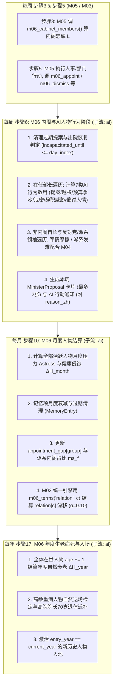
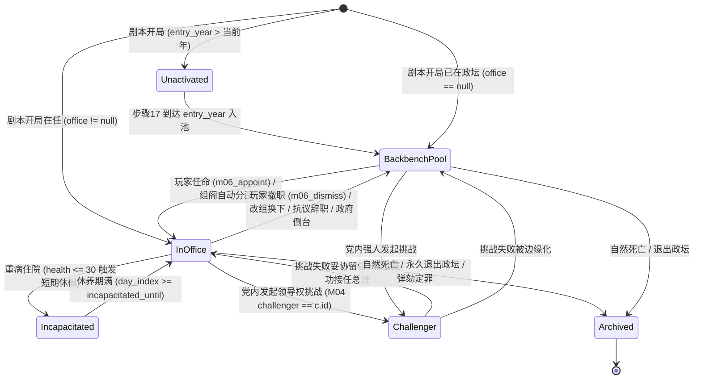

# M06 人物与AI内阁

## 0. 元信息

| 项目 | 内容 |
|---|---|
| 模块编号 | M06 |
| 模块名称 | 人物与AI内阁（Characters & AI Cabinet） |
| 版本 | v1.0（阶段1规格） |
| 作者 | 系统设计师子代理（M06） |
| 依赖的模块规格 | M01（每日20步结算顺序、效果格式、`custom` 处理函数登记、卸任与继任流程、随机子流 `ai`/`core`）、M02（因果网 `CausalNet`、惯性换算 D-001、冲击记忆 D-003、`term_provider` D-052、`appointment_gap` D-002、`preview()`）、M03（内阁20个部长职位表 `data/portfolios.yaml`、政党席位与执政联盟配额、盟党满意度 `ally_satisfaction`）、M04（党内派系 `faction_id`、派系情绪 `faction_mood`、派系权重 `faction_weight`、党内地位 `party_standing`、挑战者 `challenger` 与 `successor_hint` D-055）、M05（政治资本 `political_capital`、行动目录与提案管线、人情参数 `favor_character`/`favor_party` D-035）、M12（表达式语言、事件触发器与槽位绑定、内阁文件夹 UI 队列） |
| 被依赖 | M01（`m06_pick_successor`、`m06_rebase_relations`、`m06_health_check`、`character_in_office`）、M02（读取 `appointment_gap[group]`）、M03（党魁口才 `orator`、电视辩论、轮值总理切换）、M04（读取 `faction_id`、本党部长派系占比 $ms_f$、挑战者候选人与 `ambition(id)`、派系领袖 `holder_of()`）、M05（读取 `m06_cabinet_members()` 计算内阁忠诚产出项 $L$、`m06_portfolio_action(c)`、`m06_minister_of(post)`、人事行动落地）、M12（读取 `is_in_office`、`is_alive`、`holder_of`、职位键映射、触发人物事件）、M13（撤换强力部门首长的阻力与集权度联动）、M14（历史评价与继任者接续） |

### 0.1 对标与设计锚点

| 对标游戏 | 对应机制 | 本模块吸收的优点 | 本模块规避的缺陷 |
|---|---|---|---|
| **Crusader Kings II / III** | 人物特质、有期限的记忆修正项（Opinion Modifiers）、压力与健康系统、人格化政治（Personalistic Politics） | 1. **事件与行动后果写进人物记忆**（带到期时间或月度衰减），驱动 `relation` 漂移，杜绝“干了坏事对方毫无反应”（P社教训 D6、A6）。<br>2. **压力（Stress）→ 健康（Health）双层传导**：战争、丑闻、丧偶、背离特质累积压力，压力侵蚀健康并诱发退场危机。 | 规避 CK3 后期人物同质化与事件刷屏：每个历史人物拥有独特的五轴理想点、专属特质组合与部门越权偏好；同类 AI 行动带冷却与升级阶梯。 |
| **Suzerain** | 内阁会议、独立议程的部长、家庭与私人健康代价 | 1. 部长是有面孔、有底线的鲜活个体（达扬的西岸底线、魏茨曼的和平执念、沙龙的军事越权）。<br>2. 总理本人的健康与心理负荷（如贝京1982–1983年的心脏病与丧妻抑郁）构成真实的统治约束。 | 规避 Suzerain 纯线性脚本：所有内阁冲突、辞职威胁、越权均由每周/每月效用函数与状态阈值动态涌现。 |
| **Democracy 4** | 部长忠诚度产出政治资本、内阁改组与能力修正 | 1. 内阁部长平均关系直接决定每月政治资本产出项 $L \in [-3, +3]$（M05 §4.1）。<br>2. 部长能力修正所属部门行动的成功率与执行效率。 | 规避 D4 部长只是“无面孔属性卡”的电子表格感：部长绑定具体党派、党内派系 `faction_id` 与历史生平。 |
| **白日升 / 朴正熙纪事** | 隐藏忠诚与将领擅自行动、心腹委派与权力张力 | 1. 高野心、低关系或强硬派国防部长/总参谋长会在战时或边境危机中**自发越权**（W4）。<br>2. **AI 行动永远附带可解释的理由模板**（P社教训 D16、W-x3），玩家在提示框中能看到触发该行动的精确数值与记忆原因。 | 规避白日升“忠诚降到50就发饷”的机械反应式微操（W-x1）：收买或安抚人物会欠下人情债（`favor_character`）或改变派系权重，产生次生政治代价。 |

---

## 1. 设计意图

### 1.1 核心取舍（一句话）
**在“任用高能力但高野心、立场相左的强藩巨星（如达扬、沙龙、魏茨曼）以换取施政效率与外交突破”与“任用平庸顺从的派系亲信以保住内阁控制权、避免越权与党内逼宫”之间持续取舍。**

### 1.2 玩家决策频率与信息来源
- **决策频率**：玩家在本系统里**每月约做 1–2 次人事/内阁互动决策**（如处理 1–2 条每周内阁文件夹中的部长提案、回应要价或越权苗头、进行派系安抚或人情交易），**每 6–18 个月做 1 次重大人事调整**（填补空缺、撤换刺头部长、任命总参谋长/情报首长、内阁改组）。
- **信息来源**：
  1. **内阁与人物面板（主面板 #2、#10）**：展示内阁20个部门及6个非内阁关键职位的现任者、能力四维、健康状态（模糊档位 + 精确趋势）、压力值、关系值拆解（含最近记忆条目）、越权风险预警。
  2. **每周内阁文件夹（星期日步骤6生成）**：汇集 AI 部长的部门行动提案、预算争夺与告状、盟党或派系的职位要价，每条均附带 **AI 理由说明**。
  3. **顶栏告警条**：关键职位空缺、高危部长即将越权或辞职、总理健康危机、人情债到期。

### 1.3 失败状态与恢复路径
| 失败状态 | 触发机制 | 恢复路径 |
|---|---|---|
| **内阁离心与政治资本枯竭** | 多名核心部长 `relation < -30`，导致 M05 政治资本月产出项 $L = -3$，且部长频繁泄密（R-27）、公开唱反调或拒绝执行部门行动 | 1. 召开`内阁务虚会`（`cabinet_retreat`）或用`帮部长一个忙`（`grant_favor`）修复关系；<br>2. 批准部长提交的部门提案（半价资本，且部长欠玩家1点人情）；<br>3. 下达`撤换部长`（`dismiss_minister`）或`内阁改组`（`reshuffle_cabinet`）清理刺头，承受短期党内地位或盟党满意度冲击。 |
| **强藩越权与外交/法治灾难** | 高野心、高军事能力且低关系的国防部长/总参谋长（如1982年沙龙）在战争或危机中擅自扩大行动（E-1982-06b），拉低 `intl_legitimacy` 与 `rule_of_law` | 1. 事前预防：任命文官或稳健派担任国防部长（如阿伦斯），或通过人事控制压低越权概率；<br>2. 事中拦截：在内阁会议上耗费政治资本强制叫停（选项B/C）；<br>3. 事后切割：设立国家调查委员会（`state_inquiry` / 卡汉委员会），借司法权威将越权部长免职或调离核心部门。 |
| **党内逼宫与挑战者夺权** | 党内强人（`ambition >= 60`）因立场偏离或派系失势成为挑战者（M04 §4.7），`challenger_strength >= 60` 触发中委会挑战投票 | 1. 使用 M04 `收编挑战者`（`coopt_challenger`），让出国防/财政/外交三大要职之一换取休兵；<br>2. 使用`授予党内对手要职`（`honor_rival`）或`与党内派系交易`（`faction_deal`）分化其支持；<br>3. 在实力占优时主动发起信任投票将其击败冷却。 |
| **主角健康崩溃与非预期退场** | 长期高压力（战争泥潭、高通胀、丧偶、违背自身特质）导致主角 `health <= 30`，触发 E-G04-15（病榻上的总理）乃至 E-1983-08（辞职退场） | 1. 降低执政压力源：结束长期消耗战（如撤出黎巴嫩泥潭）、压低通胀、避免违背主角核心原则特质；<br>2. 在 E-1983-08 中选择分权给副手或撤军减压以争取通过每6个月的健康检定；<br>3. 若退场不可避免，提前扶植理想的同党继任者（推高其党内资历与关系），通过继任机制无缝接棒。 |

### 1.4 后期（第10–20年）如何保持新鲜感
1. **代际更替与梯队涌现**：开国元老与1948一代（贝京、达扬、亚丁、埃利希、阿隆）在1977–1985年间因年龄与健康自然退场；中生代（沙米尔、佩雷斯、拉宾、沙龙、阿伦斯）接掌大权；到1985–1995年代，新生代政治人物与虚构替补池（利库德“王子派”、工党“鸽派青年一代”、沙斯宗教新贵、俄裔移民领袖）按年份与历史条件激活入场，内阁面孔与派系格局每5–8年发生一次结构性换血。
2. **权臣坐大与门生反噬**：玩家长期倚重某位高能力部长（反复批准其提案、赋予核心职位），会不断推高其 `sen_score`（资历分）与所属派系权重 `faction_weight`，使其从得力干将演变为尾大不掉的接班人或头号挑战者（防雪球负反馈 D12）。
3. **制度惯性与独立机构博弈**：随着时间推进，最高法院院长（如阿哈龙·巴拉克）、总检察长（如伊츠哈克·扎米尔）、央行行长（如阿农·加夫尼、米哈埃尔·布鲁诺）的制度独立性随时代与先前判例（如埃隆莫雷案、300路公交案、新谢克尔改革）不断演化，后期人事任免不再只是党派分肥，而是行政权与司法/专业官僚体制的正面碰撞。

---

## 2. 读写清单

> 严格遵循 `contracts.md` §3、§6 与 `DECISIONS.md`：只有 owner 模块可在其结算步骤中以引擎级 `set` 直接更新所拥有的参数；对非 owner 参数的修改一律通过提交标准 `Effect` 完成。

### 2.1 参数读写表

| 参数ID | 作用域（scope） | 读/写 | 结算步骤（contracts §3） | 说明 |
|---|---|---|---|---|
| `relation` | `character` | **主写（owner）** / 读 | 步骤6（每周AI行为读取）、步骤10（月度漂移与记忆衰减结算）、步骤17（年度）、事件/行动 | 玩家（当前总理）与各人物的关系值，$[-100, 100]$。M06 通过 `m06_terms("relation", c)` 向 M02 `CausalNet` 提供动态目标值项（D-052） |
| `health` | `character` | **主写（owner）** / 读 | 步骤10（月度健康与压力传导结算）、步骤17（年度年龄增长与自然退场检定）、事件/行动 | 人物健康值，$[0, 100]$，`visible: fuzzy`（界面显示5档健康描述与趋势箭头，调试/精确公式底层存浮点） |
| `appointment_gap` | `group` | **主写（owner，derived）** / 读 | 步骤10（月度重算，供 M02 疏离度边 `ALN.07/12/24` 读取）及每次人事变动后即时更新 | 群体任命构成偏差，$[0, 100]$，键为 `mizrahi`、`russian`、`ethiopian`（D-002） |
| `character_stress` | `character` | **主写（owner，新增提案）** / 读 | 步骤10（月度压力累积与释放结算） | 人物压力值，$[0, 100]$，见附录A |
| `political_capital` | `national` | 读 / 写（Effect） | 步骤6（越权拦截、提案批复）、步骤15（M05 读取内阁关系均值计算项 $L$） | 写入仅限通过事件/行动队列产生 `add` |
| `party_standing` | `national` | 读 / 写（Effect） | 步骤6（部长公开批评、辞职冲击、元老发难）、步骤11（M04 读取） | — |
| `ally_satisfaction` | `party` | 读 / 写（Effect） | 步骤6（盟党部长要价、被撤换或职位配额不足冲击）、步骤7（M03 读取） | — |
| `faction_mood` | `party_faction` | 读 / 写（Effect） | 步骤6（派系领袖行动）、步骤11（M04 读取本党部长派系占比 $ms_f$） | D-055 新增参数 |
| `faction_weight` | `party_faction` | 读 / 写（Effect） | 步骤6、人事行动（重臣入阁微调派系声望） | D-055 新增参数 |
| `challenger_strength` | `national` | 读 / 写（Effect） | 步骤6（挑战者派系串联）、步骤11（M04 读取） | D-055 新增参数 |
| `favor_character` | `character` | 读 / 写（`custom`） | 步骤6（批准提案、人情索取）、步骤2/5（M05） | D-035 新增参数；M06 通过 `m05_grant_favor` / `m05_incur_favor` 修改 |
| `favor_party` | `party` | 读 | 步骤6（评估盟党部长行为） | D-035 新增参数 |
| `gov_axis_position` | `axis` | 读 | 步骤6、步骤10 | D-035 新增参数；用于计算人物五轴理想点与现政府政策的距离 |
| `stance_deviation` | `axis` | 读 | 步骤6 | D-050 `derived`；用于判断党内元老与强硬派部长的发难阈值 |
| `rule_of_law` | `national` | 读 / 写（Effect） | 步骤6（越权、泄密调查、撤换总检察长/法官冲击） | — |
| `centralization` | `national` | 读 / 写（Effect） | 步骤6（强力部门首长任免与顺从度） | — |
| `judicial_conflict` | `national` | 读 / 写（Effect） | 步骤6（1992年后最高法院院长与总检察长博弈） | — |
| `readiness` / `deterrence` / `complacency` | `national` | 读 / 写（Effect） | 步骤6、步骤10 | 国防部长、总参谋长、摩萨德/辛贝特首长的能力与特质修正 |
| `inflation` / `budget_balance` / `growth` | `national` | 读 | 步骤6、步骤10 | 触发财政部长、央行行长提案或辞职威胁；高通胀产生总理压力 |
| `public_security` / `settler_momentum` | `national` | 读 | 步骤6、步骤10 | 触发安全与定居派部长行动 |

### 2.2 非参数状态读写表

| 状态路径 | 所有者 | 读/写 | 说明 |
|---|---|---|---|
| `modules.M06.*` | M06 | **读写** | 人物字典、当前职务映射、记忆列表、内阁提案队列、越权计数器、虚构替补池、归档人物 |
| `player.leader_id` / `player.party_id` / `player.in_rotation_as_deputy` | M01 / M03 | 读 | 当前玩家扮演的总理人物ID、所属政党、是否处于轮值副总理半段（D-044） |
| `modules.M03.coalition_parties` / `portfolio_allocation` | M03 | 读 | 当前执政联盟政党列表、各党分得的部长职位配额 |
| `modules.M04.challenger` / `successor_hint` | M04 | 读 | 当前党内挑战者对象、初选落败时的优先继任人选（D-055） |
| `modules.M05.queue` | M05 | 读 | 当前执行中的行动队列（防止 AI 部长重复提议已在队列中的行动） |
| `flags` / `modifiers` | M01 | 读 / 写（Effect） | 读取战争状态、历史锚点旗标；通过效果增删人物相关旗标与修正器 |

---

## 3. 状态与数据结构

### 3.1 模块私有状态 `modules.M06`

在 `GameState.modules["M06"]` 中存储以下结构（JSON 序列化兼容 Python 3.9 与 Godot 4，所有字典键按 ASCII 升序序列化，遵循 M01 §4.11.2）：

| 字段名 | 类型 | 范围 / 约束 | 默认值（贝京1977） | 说明 |
|---|---|---|---|---|
| `version` | `int` | $\ge 1$ | `1` | 数据结构版本号 |
| `characters` | `Dict[str, CharacterState]` | 活跃人物表（在世且已登场） | 见 §3.6（36人） | 键为 `char_id` |
| `archive` | `Dict[str, CharacterState]` | 已去世或永久退场人物归档 | `{}` | 遵循 M01 §4.10.3 第6条，日结算不遍历归档 |
| `offices` | `Dict[str, Optional[str]]` | `office_id -> char_id \| null` | 见 §3.3.3 | 全部20个内阁部长职位 + 6个非内阁关键职位 + 派系/政党领袖槽位 |
| `acting_offices` | `Dict[str, str]` | `office_id -> acting_char_id` | `{"justice": "begin", "transport": "begin", "communications": "begin", "labor_welfare": "begin"}` | 空缺内阁职位由总理或副部长代理的映射 |
| `office_changed_day` | `Dict[str, int]` | `office_id -> day_index` | 全部 `0` | 该职位上次换人的日期（计算磨合期与频繁换人惩罚） |
| `deputy_headcount` | `Dict[str, int]` | `group -> int` | `{"ashkenazi": 14, "mizrahi": 4, "russian": 0, "ethiopian": 0}` | 副部长与部门总司长（共18个名额）的族群构成计数，供 `appointment_gap` 与 `m06_promote_group` 使用 |
| `proposals` | `List[MinisterProposal]` | 长度 $\le 10$ | `[]` | 本周内阁文件夹待批复的 AI 部长提案列表 |
| `ai_action_cd` | `Dict[str, int]` | `"<char_id>:<act_type>" -> due_day` | `{}` | 人物 AI 行为冷却到期日 |
| `successor` | `Optional[Dict]` | `{leader_id, party_id, playable, is_fictional}` | `null` | `m06_pick_successor` 产出的继任者缓存，供 M01 继任流程读取 |
| `fictional_seq` | `int` | $\ge 1$ | `1` | 动态激活替补虚构人物的递增序号 |

### 3.2 人物状态对象 `CharacterState`

| 字段名 | 类型 | 范围 / 枚举 | 说明 |
|---|---|---|---|
| `id` | `str` | `snake_case` 唯一ID | 如 `begin`, `dayan`, `weizman`, `sharon`, `shamir` |
| `name_zh` | `str` | 非空字符串 | 中文姓名（在世人物带标注，见 §4.7） |
| `name_en` | `str` | 非空字符串 | 英文姓名 |
| `birth_year` | `int` | $1880..1980$ | 出生年份 |
| `age` | `int` | $25..100$ | 当前年龄（每年步骤17 `+1`） |
| `alive` | `bool` | `true \| false` | 是否在世 |
| `active` | `bool` | `true \| false` | 是否已进入政坛/登场（未到登场年份的人物 `active: false`） |
| `entry_year` | `int` | $1948..2006$ | 登场年份（步骤1c / 步骤17 当 `y >= entry_year` 时自动置 `active = true`） |
| `historical_death_year` | `Optional[int]` | $1948..2030 \| null$ | 史实去世年份（仅作校准参考，实际死亡由健康系统决定，非硬编码死亡日期） |
| `is_living_person` | `bool` | `true \| false` | **在世人物标记**（2026年仍在世或设计文档 §17 第8条受保护人物为 `true`，不可作为可玩主角） |
| `playable_as_pm` | `bool` | `true \| false` | 当选或继任总理时是否可直接作为可玩历史人物加载（已故且建模完整的主要领导人为 `true`；`is_living_person == true` 时强制为 `false`） |
| `role_category` | `str` | `"politician" \| "military" \| "intelligence" \| "judicial" \| "technocrat" \| "foreign_leader" \| "palestinian_leader"` | 人物身份大类 |
| `country` | `str` | `"israel"` 或外部国家/实体ID | 以色列本国人物为 `"israel"`；外国/巴方人物为 `"egypt"`, `"usa"`, `"jordan"`, `"lebanon"`, `"palestine"`, `"iraq"`, `"ethiopia"`, `"iran"`, `"sudan"` 等 |
| `group` | `str` | `"ashkenazi" \| "mizrahi" \| "russian" \| "ethiopian" \| "arab" \| "druze" \| "foreign"` | 族群出身（用于计算 `appointment_gap` 与族群代表性） |
| `party_id` | `Optional[str]` | `entities.parties` 或 `null` | 所属政党ID（军情司法官员、无党派人士、外国领袖为 `null` 或 `"independents"`） |
| `faction_id` | `Optional[str]` | M04 `party_factions` 或 `null` | 所属党内派系ID（利库德：`herut_core`, `herut_hawks`, `liberal_wing`, `laam`；工党：`labor_peres`, `labor_rabin`, `ahdut_haavoda`, `labor_doves`） |
| `skills` | `Dict[str, int]` | 四维能力，每项 $0..100$ | `admin`（行政）、`military`（军事）、`diplomacy`（外交）、`politics`（政治手腕） |
| `orator` | `float` | $0.0..1.0$ | 演说与辩论口才（供 M03 电视辩论与 M04 演说使用，等于 ` clamp(skills.politics / 100.0 + 演说家特质加成, 0.0, 1.0)`） |
| `loyalty_base` | `int` | $0..100$ | 固有忠诚基线（对体制与所属政党领袖的服从倾向） |
| `ambition` | `int` | $0..100$ | 野心值（驱动索要高官、部门越权、党内挑战） |
| `integrity` | `int` | $0..100$ | 廉洁度（越低越易触发贪腐丑闻 R-26 与以权谋私） |
| `ideal_point` | `Dict[str, int]` | 五轴理想点，每轴 $-100..+100$ | `territory`, `security`, `economy`, `religion`, `foreign`（绝对刻度，与 D-033 对齐） |
| `axis_salience` | `Dict[str, float]` | 五轴显著度，每轴 $0.0..2.0$ | 该人物对各轴政策偏离的敏感权重 |
| `traits` | `List[str]` | 特质ID列表（每人 $1..4$ 个） | 来自 §3.4 特质注册表 |
| `preferred_posts` | `List[str]` | 职位ID列表 | 该人物渴望或擅长担任的职位（按优先级排序） |
| `sen_score` | `float` | $0.0..100.0$ | 党内资历与威望分（用于 `m06_pick_successor` 与内阁排位） |
| `incapacitated_until` | `int` | `day_index`（$0$ 表示正常履职） | 因住院/患病（R-32、E-G04-15）暂时缺位的截止日 |
| `veto_streak` | `int` | $\ge 0$ | 玩家连续否决该部长提案的次数（M05 §7.1：达3次时越权概率 $+20\%$） |
| `gaffe_count` | `int` | $\ge 0$ | 本任期内该部长发生失言（R-25）的次数 |
| `memories` | `List[MemoryEntry]` | 长度 $\le 15$ | CK式人物记忆条目列表（见 §3.2.1） |

#### 3.2.1 记忆条目 `MemoryEntry`（CK式关系与行为记忆）

```yaml
# MemoryEntry 结构
id: "vetoed_proposal"          # 记忆模板ID（见 §4.3.2 记忆目录）
source_id: "act:retaliatory_raid" # 产生该记忆的事件ID或行动ID
created_day: 42                # 产生时的 day_index
expire_day: 222                # 到期移除的 day_index（-1 表示本任期内永久）
rel_delta: -5.0                # 当前对 relation 目标值（或直接偏移）的贡献值
decay_per_month: 0.5           # 每月衰减绝对值（0.0 表示到期前恒定、到期一次性移除）
stacks: 1                      # 叠加层数（上限由模板定义，通常为 3）
label_zh: "提案遭总理否决"      # Tooltip 显示文本
```

#### 3.2.2 部长提案对象 `MinisterProposal`

```yaml
# MinisterProposal 结构（进入内阁文件夹供玩家批复）
uid: 101                       # 唯一递增ID
char_id: "sharon"              # 提案部长ID
office_id: "agriculture"       # 提案部长当前职务
action_id: "settlement_expansion" # M05 附录D 中的行动ID
action_args: {"region": "west_bank"} # 行动参数
created_day: 6                 # 生成日（星期日）
expire_day: 20                 # 14天后未处理则自动视为搁置（同否决一半惩罚）
pc_cost_discounted: 5          # 玩家批准时的折后政治资本价格 = floor(M05原价 * 0.5)
utility_score: 74.5            # AI 效用得分
reason_zh: "定居者运动动量达45，且【定居以色列地】承诺进度仅10%，农业部主张立即扩建西岸定居点以兑现竞选纲领。" # 必附 AI 理由（D16）
```

---

### 3.3 职位体系（内阁职位与非内阁关键职位）

#### 3.3.1 内阁20个部长职位（与 M03 `data/portfolios.yaml` 完全对齐）

| 职位ID（`post`） | 表达式别名（兼容 M12/M05） | 中文名 | 配额点数 | 关联领域模块 `dom` | 核心职能与能力加成维度 |
|---|---|---|---|---|---|
| `defense` | `defense_minister` | 国防部长 | 10 | M09 / M08 | 主管作战、战备、动员、占领区军管；读取 `military` |
| `foreign` | `foreign_minister` | 外交部长 | 9 | M07 | 主管建交、和谈、秘密渠道、对美游说；读取 `diplomacy` |
| `finance` | `finance_minister` | 财政部长 | 9 | M10 | 主管预算、税制、汇率、反通胀；读取 `admin` |
| `interior` | `interior_minister` | 内政部长 | 6 | M11 / M02 | 主管市政、人口登记、“谁是犹太人”、宗教现状执行；读取 `admin` |
| `education` | `education_minister` | 教育文化部长 | 6 | M02 | 主管公立与宗教教育网络、国家认同；读取 `politics` |
| `housing` | `housing_minister` | 住房建设部长 | 5 | M11 / M10 | 主管移民住房、发展城镇、定居点建设；读取 `admin` |
| `religious_affairs` | `religious_minister` | 宗教事务部长 | 4 | M02 | 主管拉比机构、圣地、安息日执行；读取 `politics` |
| `agriculture` | `agriculture_minister` | 农业部长 | 4 | M11 | 主管水源、农业定居点委员会（1977沙龙）；读取 `admin` |
| `labor_welfare` | `labor_minister` | 劳工福利部长 | 4 | M10 | 主管福利、就业、与总工会协调；读取 `politics` |
| `industry_trade` | `industry_minister` | 工贸部长 | 4 | M10 | 主管工业补贴、进出口、关税；读取 `admin` |
| `justice` | `justice_minister` | 司法部长 | 4 | M13 / M02 | 主管法案起草、法官任命委员会、特赦建议；读取 `admin` |
| `health` | `health_minister` | 卫生部长 | 3 | M10 | 主管医院系统与公共卫生（R-24）；读取 `admin` |
| `transport` | `transport_minister` | 交通部长 | 3 | M11 | 主管公路、港口、以色列航空（安息日停飞）；读取 `admin` |
| `police` | `police_minister` | 警察部长 | 3 | M09 / M11 | 主管绿线内治安、骚乱控制、刑事调查；读取 `military` |
| `absorption` | `absorption_minister` | 移民吸收部长 | 3 | M10 / M07 | 主管新移民安置与语言学校；读取 `admin` |
| `deputy_pm` | `deputy_pm` | 副总理 | 3 | M04 / M07 | 荣誉/协调头衔（可兼任；总理缺位时代理政务；轮值期核心职位） |
| `communications` | `communications_minister` | 通讯部长 | 2 | M13 | 主管邮政、电信、广播电视监管；读取 `politics` |
| `energy` | `energy_minister` | 能源与基建部长 | 2 | M10 | 主管石油储备（西奈油田/进口）、电力与输水；读取 `admin` |
| `tourism` | `tourism_minister` | 旅游部长 | 2 | M10 | 主管创汇旅游（R-15）；读取 `diplomacy` |
| `science` | `science_minister` | 科学部长 | 1 | M10 | 主管科研资助与高校联系（1982年增设，此前可空缺）；读取 `admin` |

> **职位别名规则（对齐 D-022 与 M12 附录C）**：`holder_of(office_id)` 与 `relation[office_id]` 同时接受短名（如 `foreign`、`defense`、`finance`）和长名（如 `foreign_minister`、`defense_minister`、`finance_minister`、`transport_minister`），内部统一归一化为上表第1列的标准 `post` ID。`minister_without_portfolio`（不管部长，如1983年2月后的沙龙）作为特殊槽位 `without_portfolio_1` / `without_portfolio_2` 存储，计入 `m06_cabinet_members()`，配额点数为 1，无部门专属行动提案权，但保留内阁投票与党内活动能力。

#### 3.3.2 非内阁关键职位（6个制度与强力部门首长）

| 职位ID（`post`） | 表达式别名 | 中文名 | 类别 | 法定/惯例任期 | 任免权限与制度约束 |
|---|---|---|---|---|---|
| `chief_of_staff` | `ramatkal` | 总参谋长（Ramatkal） | 强力部门 | 3–4年（1095–1460天） | 由国防部长提名、总理与内阁批准（行动 `appoint_security_chief`）。任期未满满2年（730天）强行撤换：消耗双倍政治资本，`readiness -5`，`relation[军方人物] -15`，`centralization +4` |
| `mossad_chief` | `mossad_director` | 摩萨德局长 | 强力部门 | 4–5年 | 由总理直接任免（`appoint_security_chief`）。负责境外情报、秘密渠道（摩洛哥/苏丹/黎巴嫩）、敌国核计划侦察与暗杀行动 |
| `shin_bet_chief` | `shabak_director` | 辛贝特（安全总局）局长 | 强力部门 | 4–5年 | 由总理直接任免（`appoint_security_chief`）。负责国内反间谍、占领区反恐、定居者地下网络监控、政治监控 |
| `attorney_general` | `ag` | 总检察长（政府法律顾问） | 独立法治 | 6年 | 兼具公诉首长与内阁法律顾问双重身份，独立性极高。总理不能用普通人事行动撤换；强行撤换须通过 `bypass_attorney_general` 或事件选项（如 E-1986-05 A），直接扣减 `rule_of_law -8`、推高 `centralization +5` |
| `boi_governor` | `central_bank_governor` | 以色列银行（央行）行长 | 独立专业 | 5年 | 负责货币政策、外汇储备监管与通胀预警。修正器 `new_shekel`（1985《以色列银行法》修正案）生效后，行长可拒绝为财政赤字印钞；强行撤换令 `inflation +10`、`fx_reserves -5`、`us_admin_relation -4` |
| `supreme_court_president` | `chief_justice` | 最高法院院长 | 独立司法 | 资历制（至70岁退休） | 按最高法院大法官资历自动接任（如兰道 → 卡汉 → 沙姆加尔 → 巴拉克）。总理**不可直接撤换**，只能通过 M13 集权行动 `pack_judiciary`（操控法官任命/打破资历制）干预 |

#### 3.3.3 附加槽位（派系领袖、反对党领袖、外国元首）
`holder_of(role_id)` 除解析上述 26 个本国职位外，还解析：
1. **党内派系领袖**：`herut_core_leader`、`herut_hawks_leader`、`liberal_wing_leader`、`laam_leader`、`labor_peres_leader`、`labor_rabin_leader`、`ahdut_haavoda_leader`（1977为阿隆，1980阿隆病逝后为加利利/虚拟替补）、`labor_doves_leader`（在世人物保护槽位，指向虚构替补人物 `dove_youth_rep`）。
2. **政党领袖**：`party_leader:<party_id>`（如 `party_leader:labor` = `peres`，`party_leader:nrp` = `burg`，`party_leader:agudat` = `lorincz`，`party_leader:dash` = `yadin`）以及 `opposition_leader`（当前最大反对党领袖，1977开局为 `peres`）。
3. **外国与巴方领袖**：`leader:egypt`（`sadat` → 遇刺后 `mubarak_proxy`）、`leader:usa`（`carter` → 1981 `reagan` → 1989 `bush_sr`）、`leader:jordan`（`hussein`）、`leader:plo`（`arafat`）、`leader:phalange`（`bashir_gemayel`）。

---

### 3.4 特质清单（共 32 个特质，含精确机制效果）

每个特质定义在 `data/traits.yaml` 中，具有唯一英文 `id`、中文名、类别及精确数值修正。所有数值修正通过 M06 的公式项、修正器因子或事件检定直接生效，**绝无无机制的纯文本特质**。

| 序号 | 特质ID | 中文名 | 类别 | 精确机制效果（公式与系数） | 典型持有者（1977剧本） |
|---|---|---|---|---|---|
| 1 | `legalist` | 守法者 | 原则 | 1. 凡下达 `cat: cent`（集权类）行动或在事件中选 `centralization > 0` 的选项：若持有者为**当前总理**，额外产生 `vision_progress -2`、`character_stress[self] +6`，且本党 `liberal_wing` 派系人物 `relation -5`；<br>2. 若持有者为**内阁部长/司法首长**，每次政府执行 `centralization > 0` 动作时，该人物写入记忆 `rule_of_law_violated`（`rel_delta = -10`，持续365天）。 | 贝京、鲁宾斯坦、巴拉克、卡汉、扎米尔 |
| 2 | `orator_master` | 演说家 | 能力 | 1. 人物 `orator` 属性额外 $+0.20$（上限 $1.0$）；<br>2. 若为**当前总理**：带 `oratory: true` 的行动（如 `public_speech`、`rally_bloc`）正面效果 $\times 1.50$（对齐 04 事件库 §0.2）；但附加修正器 `silent_pm` 生效期间此加成归零；<br>3. 若为**反对党领袖/挑战者**：大选电视辩论得分 $+15\%$，挑起党内批评时对玩家 `party_standing` 伤害 $+20\%$。 | 贝京、格乌拉·科恩 |
| 3 | `frail` | 病弱 | 健康 | 1. 年度自然健康衰减额外 $+2.0$/年；<br>2. 承受正面压力时，压力转化为月度健康扣减的乘数 $\times 1.50$；<br>3. 触发 E-G04-15（领导人健康危机）的健康阈值从 $\le 40$ 放宽至 $\le 50$；解锁 E-1983-08（“我不能再继续了”）前置条件。 | 贝京、埃利希、阿隆 |
| 4 | `heart_condition` | 心脏病史 | 健康 | 1. 当 `character_stress >= 60` 时，每月额外 `health -1.5`；<br>2. 在 E-G04-15 或 R-32 掷骰中，触发概率权重 $\times 1.80$；<br>3. `m06_health_check` 检定时有效健康值视为 `health - 8`。 | 贝京、达扬、胡尔维茨 |
| 5 | `depression_prone` | 抑郁易感 | 心理 | 1. 遭遇家庭变故（如 E-1982-11 阿丽扎之死）、重大伤亡（黎巴嫩泥潭持续 $\ge 6$ 个月）或暴行丑闻（E-1982-09c 萨布拉与夏蒂拉）时，`character_stress` 额外 $+25$，且自然压力消退率减半（$-1.5$/月 代替 $-3.0$/月）；<br>2. 当 `character_stress >= 75` 时，若为总理则每6个月检定一次 E-1983-08；若为AI部长则缺勤率上升，提案生成概率 $-50\%$。 | 贝京 |
| 6 | `war_hero` | 战争英雄 | 声望 | 1. 担任 `defense` 或 `chief_of_staff` 时，全国 `deterrence` 目标值边 $+3.0$，`public_security` 周目标值 $+2.0$；<br>2. 被玩家强行免职（`dismiss_minister`）时，玩家额外承受 `party_standing -4`、`bloc_support[mizrahi] -2`。 | 达扬、魏茨曼、沙龙、拉宾、亚丁、巴列夫、古尔、埃坦 |
| 7 | `maverick` | 独行侠 | 性格 | 1. 不受本党常规党纪约束：在议会自由投票或内阁表决中，按个人五轴理想点而非政党走廊投票；<br>2. 部门越权（Overreach）基础效用 $+15$；<br>3. `relation` 自然漂移速率减半，不受 `cabinet_retreat` 群体加好感影响，只看重政策立场与核心利益交换。 | 达扬、沙龙、魏茨曼 |
| 8 | `bulldozer` | 推土机 | 行事 | 1. 担任部长时，本部门下达的行动执行周期 `dur` 缩短 $20\%$（向上取整），行动成功率 $+0.08$；<br>2. **越权风险极高**：每周越权检定基础概率 $\times 1.50$；每次执行行动额外产生 `rule_of_law -0.5`（单干作风）与内阁其他部长对其反感（触发部长告状概率 $+25\%$）。 | 沙龙 |
| 9 | `in_subordinate` | 抗命将军 | 军事 | 1. 担任 `defense` 或 `chief_of_staff` 且处于战争状态（`at_war()`）时，若 `relation < 40` 或 `ambition >= 70`，每周有 $12\%$ 基础概率擅自扩大战役边界（触发 `minister_overreach` 信号及 E-1982-06b 类事件）；<br>2. 玩家下达克制/停火类军事指令时，该人物 `relation -8`。 | 沙龙、埃坦 |
| 10 | `peacemaker` | 和平推手 | 外交 | 1. 担任 `foreign`、`defense` 或 `deputy_pm` 时，秘密外交渠道（`secret_channel`）与和谈行动成功率 $+0.10$，`us_admin_relation` 目标值边 $+2.0$；<br>2. 若政府连续 6 个月未推进任何和平/自治行动且 `settler_momentum >= 50`，每月产生记忆 `peace_stalled`（`rel_delta = -4`/月，叠加上限 $-24$），加速触发 E-1980-05a（辞职）。 | 魏茨曼、达扬、佩雷斯、阿巴·埃班 |
| 11 | `ideologue_hawk` | 铁杆意识形态鹰派 | 立场 | 1. 领土轴显著度 `axis_salience.territory` 锁定 $\ge 1.6$；<br>2. 当 `gov_axis_position[territory] < 0`（政府向领土让步移动）时，引起的 `relation` 负向惩罚 $\times 1.80$；<br>3. 绝不接受通过 `grant_favor` 或金钱预算收买来放弃领土立场（在领土让步法案中投反对票概率 $90\%$）。 | 沙米尔、格乌拉·科恩、摩西·阿伦斯、埃坦 |
| 12 | `underground_veteran` | 地下组织老兵 | 出身 | 1. 出身伊尔贡（Etzel）或莱希（Lehi）：在 `herut_core` 与 `herut_hawks` 派系中 `sen_score +15`；<br>2. 同为 `underground_veteran` 的人物之间初始与基线 `relation +15`；<br>3. 对情报机构（摩萨德/辛贝特）行动成功率提供 $+0.05$ 加成。 | 贝京、沙米尔、梅里多尔 |
| 13 | `apparatchik` | 党务机器掌控者 | 政治 | 1. 担任部长或党内要职时，在党内选举（中委会投票、`m06_pick_successor`）中组织票得分 $+20\%$；<br>2. 若为总理：`party_standing` 自然漂移目标值 $+4.0$；<br>3. 若成为党内挑战者：`challenger_strength` 每月额外 $+1.5$。 | 沙米尔、佩雷斯、哈默 |
| 14 | `populist_tribune` | 大众护民官 | 政治 | 1. 出身或代表草根阶层（如发展城镇米兹拉希工人）：在任内阁部长期间，所属选民集团 `bloc_support[mizrahi]` 目标值 $+3.0$，`alienation[mizrahi]` 目标值 $-2.0$；<br>2. 当政府削减福利补贴或推高失业率（`unemployment > 7`）时，每季向总理发难要价一次；若被撤换，导致 `bloc_support[mizrahi] -6`。 | 戴维·利维 |
| 15 | `free_marketeer` | 自由市场信徒 | 经济 | 1. 担任 `finance` 或 `industry_trade` 时，自由化改革行动（如 `deregulate_fx`、`privatize_soe`）政治资本成本 $-20\%$；<br>2. 若 `economic_model < -20` 且连续 12 个月未向市场方向移动，每月 `relation -3`；但面对高通胀时倾向于盲目放开管制而非行政控价。 | 埃利希、帕特、莫达伊 |
| 16 | `fiscal_hawk` | 财政紧缩鹰派 | 经济 | 1. 担任 `finance` 时，每月 `budget_balance` 收支改善 $+0.4\%$，压低通胀目标值 $-5.0$；<br>2. 会自动否决或抗议其他部长的烧钱提案（每周触发内阁预算争吵概率 $+30\%$）；若总理拒绝削减赤字（如1980年胡尔维茨），6个月内触发辞职威胁。 | 胡尔维茨、加夫尼、布鲁诺 |
| 17 | `coalition_broker` | 联盟掮客 | 政治 | 1. 担任内阁部长期间，所属政党的 `ally_satisfaction` 目标值 $+4.0$；<br>2. 与其进行人情交易（`broker_deal`、`faction_deal`）时，关系收益 $+50\%$；<br>3. 只要所在政党分得至少 1 个核心职位且宗教/派系底线未被突破，不会主动引发倒阁。 | 约瑟夫·布尔格、洛林茨、沙皮拉 |
| 18 | `settler_patron` | 定居者教父 | 领土 | 1. 担任 `agriculture`、`housing`、`defense` 或 `education` 时，`settler_momentum` 目标值边 $+3.0$；定居点扩建行动（`settlement_expansion`）成本 $-25\%$；<br>2. 每当发生 `E-G04-04`（前哨自建）时，必定在内阁施压要求追认（选拆除时其 `relation -10`）。 | 沙龙、哈默、德罗布莱斯 |
| 19 | `spy_master` | 情报巨擘 | 情报 | 1. 担任 `mossad_chief` 或 `shin_bet_chief` 时，秘密行动暴露率 $\times 0.65$，反恐与防止渗透效率 $+15\%$，全国 `complacency` 目标值 $-3.0$；<br>2. 掌握政客把柄：玩家试图强行将其撤换时，有 $25\%$ 概率触发报复性媒体泄密（`party_standing -4`）。 | 霍菲、沙洛姆、阿德莫尼、沙米尔 |
| 20 | `judicial_activist` | 司法能动主义者 | 司法 | 1. 担任 `supreme_court_president` 或 `attorney_general` 时，全国 `rule_of_law` 目标值 $+3.0$，`judicial_conflict` 基础值 $+4.0$；<br>2. 政府执行任何征地建点、行政拘留、紧急条例或审前特赦时，触发最高法院违宪审查事件（如埃隆莫雷案 E-1979-10）的概率 $+25\%$。 | 阿哈龙·巴拉克、伊츠哈克·扎米尔 |
| 21 | `judicial_restraint` | 司法克制派 | 司法 | 1. 担任 `supreme_court_president` 时，`judicial_conflict` 目标值 $-3.0$；<br>2. 对军事与外交事务尊重行政裁量权，仅在程序严重违法或私人财产权确凿受侵（如埃隆莫雷案）时介入；主持国家调查委员会（卡汉委员会）时公信力极高（接受报告使 `rule_of_law +8`）。 | 伊츠哈克·卡汉、摩西·兰道 |
| 22 | `technocrat_clean` | 清廉技术官僚 | 品格 | 1. `integrity` 锁定 $\ge 85$，免疫贪腐丑闻（R-26 抽样权重为 $0$）；<br>2. 担任部长或央行行长时，部门行政效率 $+10\%$，`bloc_support[liberal_middle]` 目标值 $+2.0$；<br>3. 对政治分肥与非法人情交易反感：每次玩家执行 `court_defector` 或腐败包庇（R-26 选B），其 `relation -8`。 | 亚丁、巴拉克、加夫尼、阿伦斯 |
| 23 | `corruptible` | 利益寻租者 | 品格 | 1. `integrity <= 40`，在随机事件 R-26（部长贪腐指控）中的抽样权重 $\times 2.50$；<br>2. 极易被收买：玩家对其使用 `grant_favor` 或分配肥缺部门（工贸、住房、内政）时，`relation` 收益 $+50\%$。 | 阿布哈齐拉、亚科夫·莱文森（工党系） |
| 24 | `loose_cannon` | 大嘴失言者 | 性格 | 1. 在随机事件 R-25（部长失言）中的抽样权重 $\times 2.50$；<br>2. 在内阁泄密事件（R-27）中作为泄密源的权重 $\times 2.00$；<br>3. 被要求公开道歉（R-25 选A）时，拒绝道歉的概率额外 $+20\%$。 | 沙龙、莫达伊、魏茨曼、格乌拉·科恩 |
| 25 | `schemer` | 幕后密谋家 | 政治 | 1. 擅长跨党派串联与背后交易：在触发“肮脏伎俩”（E-1990-03）、秘密伦敦协议（E-1987-04）或党内逼宫时，成功率 $+15\%$；<br>2. 担任部长且 `relation < 10` 时，每周向媒体泄密或内阁告状的效用 $+20$。 | 佩雷斯、莫达伊、阿里埃勒·沙龙 |
| 26 | `stoic` | 坚忍不拔 | 心理 | 1. 每月自然压力消退额外 $+1.5$（即比常人快 $50\%$），战争与危机带来的压力增量 $\times 0.70$；<br>2. 外交面临美国高压（如 E-1991-09 贷款担保冻结）时，党内地位惩罚减半。 | 沙米尔、拉宾 |
| 27 | `pragmatist` | 务实妥协派 | 立场 | 1. 五轴显著度 `axis_salience` 整体 $\times 0.75$（对意识形态偏离容忍度高）；<br>2. 在内阁投票与组阁谈判中，只要本党/本派系的职位配额得到满足，支持总理折中方案的概率 $+25\%$。 | 达扬、布尔格、胡尔维茨、佩雷斯 |
| 28 | `generational_prince` | 修正派王子 | 出身 | 1. 赫鲁特元老家族后代或青年精英（1980年代中后期崛起）：对 `liberal_middle` 与年轻选民吸引力 $+10\%$，`orator +0.10`；<br>2. 在党内资历尚浅（1985年前 `sen_score` 上限 55），但 1988 年后每年 `sen_score +4`，迅速成长为党魁竞争者。 | 丹·梅里多尔、本雅明·泽埃夫·贝京、埃胡德·奥尔默特（替补槽） |
| 29 | `iron_fist` | 铁腕军管派 | 军事 | 1. 担任 `defense` 或 `chief_of_staff` 时，镇压起义与报复突袭对 `region_security` 的即时加成 $+25\%$；<br>2. 副作用：占领区行动额外推高 `pal_hostility +2`、`intl_legitimacy -2`。 | 拉宾（1988国防部长时期）、埃坦、沙龙 |
| 30 | `diplomat_scholar` | 学者型外交家 | 外交 | 1. 担任 `foreign`、`justice` 或驻美大使/谈判代表时，`us_admin_relation` 与 `us_congress_relation` 目标值各 $+2.5$，`intl_legitimacy` 目标值 $+2.0$；<br>2. 缺乏草根党内根基：在党内初选或中委会投票中得分 $-15\%$。 | 阿伦斯、鲁宾斯坦、塔米尔、阿巴·埃班 |
| 31 | `haredi_sage_proxy` | 律法贤哲代理人 | 宗教 | 1. 代表正统派拉比委员会（Moetzet Gedolei HaTorah）：不贪恋内阁部长头衔（可不入阁只任议会财政委员会主席），但对 `religious_status_quo` 与 `draft_exemption` 极度敏感（宗教轴显著度 $2.0$）；<br>2. 凡宗教诉求获满足，`ally_satisfaction` 恢复 $+30\%$；凡违背安息日或兵役豁免，立即触发 E-G04-03 要价。 | 洛林茨、波鲁什、沙斯代表 |
| 32 | `bold_gambler` | 孤注一掷者 | 外交/战略 | 1. 外国或本国领袖特质：倾向于采取打破常规的破局大动作（如萨达特1977访以、贝京轰炸奥西拉克）；<br>2. 在高风险外交或军事事件中，AI 选择激进破局分支的权重 $\times 1.60$。 | 萨达特、贝京、沙龙、巴希尔·杰马耶勒 |

---

### 3.5 YAML Schema 与完整示例（`data/characters.yaml`）

`data/characters.yaml` 保存全时代人物静态定义与剧本开局初始状态；构建脚本 `tools/compile_data.py` 将其校验并转换为 `data/compiled/characters.json`。

```yaml
# data/characters.yaml Schema 示例（以梅纳赫姆·贝京、阿里埃勒·沙龙、安瓦尔·萨达特为例）
schema_version: 1

characters:
  - id: begin
    name_zh: "梅纳赫姆·贝京"
    name_en: "Menachem Begin"
    birth_year: 1913
    entry_year: 1948
    historical_death_year: 1992
    is_living_person: false
    playable_as_pm: true
    role_category: politician
    country: israel
    group: ashkenazi
    party_id: likud
    faction_id: herut_core
    skills: {admin: 52, military: 55, diplomacy: 72, politics: 90}
    orator: 0.95
    loyalty_base: 95
    ambition: 85
    integrity: 92
    ideal_point: {territory: 65, security: 35, economy: 10, religion: 20, foreign: 15}
    axis_salience: {territory: 1.6, security: 1.1, economy: 0.5, religion: 0.8, foreign: 1.0}
    traits: [legalist, orator_master, frail, heart_condition, depression_prone, underground_veteran]
    preferred_posts: [prime_minister]
    init_1977:
      alive: true
      active: true
      age: 64
      health: 68.0
      stress: 22.0
      relation: 100.0
      sen_score: 98.0
      office: prime_minister

  - id: sharon
    name_zh: "阿里埃勒·沙龙"
    name_en: "Ariel Sharon"
    birth_year: 1928
    entry_year: 1973
    historical_death_year: 2014
    is_living_person: false
    playable_as_pm: true
    role_category: politician
    country: israel
    group: ashkenazi
    party_id: likud
    faction_id: herut_hawks
    skills: {admin: 78, military: 92, diplomacy: 35, politics: 82}
    orator: 0.68
    loyalty_base: 35
    ambition: 95
    integrity: 55
    ideal_point: {territory: 80, security: 85, economy: 15, religion: 0, foreign: 45}
    axis_salience: {territory: 1.5, security: 1.6, economy: 0.4, religion: 0.3, foreign: 0.9}
    traits: [war_hero, bulldozer, in_subordinate, settler_patron, loose_cannon]
    preferred_posts: [defense, agriculture, housing]
    init_1977:
      alive: true
      active: true
      age: 49
      health: 82.0
      stress: 15.0
      relation: 25.0
      sen_score: 72.0
      office: agriculture

  - id: sadat
    name_zh: "安瓦尔·萨达特"
    name_en: "Anwar Sadat"
    birth_year: 1918
    entry_year: 1970
    historical_death_year: 1981
    is_living_person: false
    playable_as_pm: false
    role_category: foreign_leader
    country: egypt
    group: foreign
    party_id: null
    faction_id: null
    skills: {admin: 60, military: 68, diplomacy: 90, politics: 86}
    orator: 0.85
    loyalty_base: 50
    ambition: 88
    integrity: 70
    ideal_point: {territory: -80, security: -20, economy: 20, religion: 10, foreign: -40}
    axis_salience: {territory: 1.8, security: 1.0, economy: 0.6, religion: 0.5, foreign: 1.4}
    traits: [bold_gambler, peacemaker]
    preferred_posts: ["leader:egypt"]
    init_1977:
      alive: true
      active: true
      age: 59
      health: 75.0
      stress: 30.0
      relation: -20.0
      sen_score: 90.0
      office: "leader:egypt"
```

---

### 3.6 贝京1977剧本人物初值总表（共 38 人，1977-06-20 开局快照）

> **说明**：
> 1. 表中列出贝京1977剧本全部 38 名核心历史人物与制度替补角色的完整属性初值，附录E提供可直接落盘的 `data/characters.yaml` 机器可读片段。
> 2. 四维能力缩写：`Adm`=行政、`Mil`=军事、`Dip`=外交、`Pol`=政治手腕；五轴理想点缩写：`T`=领土、`S`=安全、`E`=经济、`R`=宗教、`F`=外交（刻度均为 $[-100, +100]$）。
> 3. `在世/可玩`：`false/true` 表示已故且可作为继任可玩总理；`false/false` 表示已故但仅作AI部长/非总理角色；`true/false` 表示受在世人物规则保护（不可作为可玩主角，见 §4.7）。

| # | ID | 中文名 | 生卒年（1977年龄） | 党派 / 派系 (`faction_id`) | 族群 | 1977-06-20 初始职务 (`office`) | 能力 `Adm/Mil/Dip/Pol` | 口才 `orator` | `忠诚/野心/廉洁` | 理想点 `T / S / E / R / F` | 初始 `健康/压力/关系/资历` | 特质列表 (`traits`) | 在世/可玩 |
|---|---|---|---|---|---|---|---|---|---|---|---|---|---|
| 1 | `begin` | 梅纳赫姆·贝京 | 1913–1992 (64) | `likud` / `herut_core` | `ashkenazi` | `prime_minister` | `52/55/72/90` | 0.95 | `95/85/92` | `+65/+35/+10/+20/+15` | `68 / 22 / 100 / 98` | `legalist`, `orator_master`, `frail`, `heart_condition`, `depression_prone`, `underground_veteran` | `F / T` |
| 2 | `dayan` | 摩西·达扬 | 1915–1981 (62) | `independents` / `null` | `ashkenazi` | `foreign`（由 E-1977-06 确认） | `58/88/86/76` | 0.76 | `40/80/52` | `+10/+40/-10/-25/-15` | `54 / 25 / +15 / 88` | `war_hero`, `maverick`, `peacemaker`, `pragmatist`, `heart_condition` | `F / T` |
| 3 | `weizman` | 埃泽尔·魏茨曼 | 1924–2005 (53) | `likud` / `herut_core` | `ashkenazi` | `defense` | `66/84/80/74` | 0.78 | `55/82/78` | `-10/+20/+25/-20/-20` | `80 / 18 / +35 / 82` | `war_hero`, `peacemaker`, `maverick`, `loose_cannon` | `F / T` |
| 4 | `sharon` | 阿里埃勒·沙龙 | 1928–2014 (49) | `likud` / `herut_hawks` | `ashkenazi` | `agriculture` | `78/92/35/82` | 0.68 | `35/95/55` | `+80/+85/+15/0/+45` | `82 / 15 / +25 / 72` | `war_hero`, `bulldozer`, `in_subordinate`, `settler_patron`, `loose_cannon` | `F / T` |
| 5 | `shamir` | 伊扎克·沙米尔 | 1915–2012 (62) | `likud` / `herut_core` | `ashkenazi` | `knesset_speaker`（议长，候补外长） | `76/65/62/86` | 0.58 | `85/78/88` | `+75/+55/-10/+10/+30` | `84 / 12 / +40 / 85` | `ideologue_hawk`, `underground_veteran`, `apparatchik`, `stoic`, `spy_master` | `F / T` |
| 6 | `ehrlich` | 西姆哈·埃利希 | 1915–1983 (62) | `likud` / `liberal_wing` | `ashkenazi` | `finance` + `deputy_pm` | `62/25/58/75` | 0.62 | `75/65/80` | `+15/+5/+55/-25/-10` | `58 / 24 / +45 / 78` | `free_marketeer`, `coalition_broker`, `frail` | `F / F` |
| 7 | `modai` | 伊扎克·莫达伊 | 1926–1998 (51) | `likud` / `liberal_wing` | `ashkenazi` | `energy` + `communications` | `76/50/60/78` | 0.72 | `45/86/68` | `+25/+20/+50/-30/0` | `80 / 16 / +18 / 64` | `free_marketeer`, `schemer`, `loose_cannon` | `F / F` |
| 8 | `patt` | 吉德翁·帕特 | 1933–2020 (44) | `likud` / `liberal_wing` | `ashkenazi` | `housing` | `74/30/55/68` | 0.60 | `70/65/78` | `+20/+10/+60/-20/-5` | `86 / 12 / +28 / 58` | `free_marketeer`, `pragmatist` | `F / F` |
| 9 | `hurvitz` | 伊加尔·胡尔维茨 | 1918–1994 (59) | `likud` / `laam` | `ashkenazi` | `industry_trade` | `75/45/40/62` | 0.55 | `60/68/85` | `+45/+30/+25/-10/+10` | `66 / 20 / +22 / 65` | `fiscal_hawk`, `pragmatist`, `heart_condition` | `F / F` |
| 10 | `levy` | 戴维·利维 | 1937–2024 (40) | `likud` / `herut_core` | `mizrahi` | `absorption` | `64/35/58/84` | 0.78 | `65/85/75` | `+40/+25/-25/+25/+5` | `88 / 14 / +38 / 68` | `populist_tribune`, `orator_master` | `F / T` |
| 11 | `arens` | 摩西·阿伦斯 | 1925–2019 (52) | `likud` / `herut_core` | `ashkenazi` | `null`（议会外事国防委员会主席） | `84/78/82/66` | 0.65 | `82/72/92` | `+65/+45/+20/-15/+20` | `85 / 12 / +32 / 66` | `ideologue_hawk`, `technocrat_clean`, `diplomat_scholar`, `legalist` | `F / T` |
| 12 | `geula_cohen` | 格乌拉·科恩 | 1925–2019 (52) | `likud` / `herut_hawks` | `mizrahi` | `null`（赫鲁特强硬派领袖） | `45/50/30/78` | 0.86 | `30/75/88` | `+95/+70/-15/+20/+50` | `82 / 18 / +10 / 60` | `ideologue_hawk`, `orator_master`, `underground_veteran`, `loose_cannon` | `F / F` |
| 13 | `meridor` | 丹·梅里多尔【在世标注】 | 1947– (30) | `likud` / `herut_core` | `ashkenazi` | `null`（1982任内阁秘书，继任梯队） | `80/50/75/76` | 0.76 | `78/70/90` | `+35/+15/+25/-10/-5` | `94 / 8 / +30 / 42` | `legalist`, `generational_prince`, `underground_veteran` | `T / F` |
| 14 | `livni_etzion` | 埃坦·利夫尼（及哈雷尔元老梯队） | 1919–1991 (58) | `likud` / `herut_core` | `ashkenazi` | `null`（伊尔贡元老议员/组织梯队） | `70/72/50/74` | 0.58 | `88/55/86` | `+60/+40/+5/+10/+15` | `72 / 14 / +42 / 62` | `underground_veteran`, `apparatchik` | `F / F` |
| 15 | `yadin` | 伊加尔·亚丁 | 1917–1984 (60) | `dash` / `null` | `ashkenazi` | `null`（1977-10入阁任副总理） | `76/82/70/48` | 0.66 | `65/60/94` | `-25/+10/+15/-30/-15` | `64 / 20 / +12 / 75` | `war_hero`, `technocrat_clean`, `diplomat_scholar` | `F / F` |
| 16 | `tamir` | 什穆埃尔·塔米尔 | 1923–1987 (54) | `dash` / `null` | `ashkenazi` | `null`（1977-10入阁任司法部长） | `78/50/68/70` | 0.75 | `60/70/82` | `-15/+10/+25/-25/-10` | `74 / 16 / +18 / 62` | `legalist`, `underground_veteran`, `diplomat_scholar` | `F / F` |
| 17 | `rubinstein` | 阿姆农·鲁宾斯坦 | 1931–2024 (46) | `dash` / `null` | `ashkenazi` | `null`（变革派领袖，反对入阁） | `76/35/74/68` | 0.78 | `50/62/94` | `-45/-15/+35/-55/-25` | `86 / 10 / -10 / 58` | `legalist`, `diplomat_scholar`, `technocrat_clean` | `F / F` |
| 18 | `burg` | 约瑟夫·布尔格 | 1909–1999 (68) | `nrp` / `null` | `ashkenazi` | `interior` + `police` | `80/30/72/88` | 0.74 | `72/65/76` | `+35/+15/-15/+45/+5` | `76 / 14 / +35 / 84` | `coalition_broker`, `pragmatist`, `apparatchik` | `F / F` |
| 19 | `hammer` | 泽ヴ伦·哈默 | 1936–1998 (41) | `nrp` / `null` | `ashkenazi` | `education` | `74/40/58/82` | 0.72 | `62/80/80` | `+70/+35/-15/+40/+20` | `78 / 15 / +26 / 68` | `settler_patron`, `apparatchik` | `F / F` |
| 20 | `abuhatzeira` | 阿哈龙·阿布哈齐拉 | 1938–2021 (39) | `nrp` / `null` | `mizrahi` | `religious_affairs` | `52/25/40/74` | 0.64 | `50/78/30` | `+30/+15/-25/+55/+5` | `86 / 16 / +20 / 54` | `corruptible`, `populist_tribune` | `F / F` |
| 21 | `shapira` | 阿夫拉罕·沙皮拉 | 1929–2000 (48) | `agudat` / `null` | `ashkenazi` | `null`（阿古达财政操作核心） | `82/15/55/86` | 0.62 | `65/70/52` | `+5/0/-10/+65/0` | `78 / 14 / +22 / 64` | `coalition_broker`, `haredi_sage_proxy`, `schemer` | `F / F` |
| 22 | `lorincz` | 什洛莫·洛林茨 | 1918–2009 (59) | `agudat` / `null` | `ashkenazi` | `party_leader:agudat`（议会财委会主席） | `78/10/50/84` | 0.65 | `70/60/75` | `0/-5/-20/+70/0` | `80 / 12 / +25 / 70` | `haredi_sage_proxy`, `coalition_broker` | `F / F` |
| 23 | `peres` | 希蒙·佩雷斯 | 1923–2016 (54) | `labor` / `labor_peres` | `ashkenazi` | `opposition_leader` (`party_leader:labor`) | `86/70/92/92` | 0.82 | `60/96/74` | `-35/+10/-35/-20/-20` | `86 / 18 / -25 / 90` | `peacemaker`, `apparatchik`, `schemer`, `pragmatist` | `F / T` |
| 24 | `rabin` | 伊扎克·拉宾 | 1922–1995 (55) | `labor` / `labor_rabin` | `ashkenazi` | `null`（工党拉宾派领袖） | `80/94/78/72` | 0.68 | `75/86/82` | `-25/+35/-40/-25/-15` | `82 / 20 / -18 / 88` | `war_hero`, `stoic`, `iron_fist`, `pragmatist` | `F / T` |
| 25 | `allon` | 伊加尔·阿隆 | 1918–1980 (59) | `labor` / `ahdut_haavoda` | `ashkenazi` | `ahdut_haavoda_leader` | `74/86/76/74` | 0.70 | `80/75/88` | `-10/+30/-65/-25/-5` | `52 / 22 / -10 / 82` | `war_hero`, `frail`, `heart_condition` | `F / F` |
| 26 | `bar_lev` | 哈伊姆·巴列夫 | 1924–1994 (53) | `labor` / `labor_peres` | `ashkenazi` | `null`（工党秘书长，前总参谋长） | `78/84/65/74` | 0.60 | `82/65/86` | `-25/+25/-45/-20/-10` | `78 / 14 / -15 / 74` | `war_hero`, `apparatchik`, `stoic` | `F / F` |
| 27 | `dove_youth_rep` | 约西·萨里德（及工党鸽派青年梯队） | 1940–2015 (37) | `labor` / `labor_doves` | `ashkenazi` | `labor_doves_leader` | `68/35/76/78` | 0.84 | `55/72/90` | `-75/-30/-35/-50/-30` | `88 / 12 / -40 / 52` | `peacemaker`, `orator_master`, `legalist` | `F / F` |
| 28 | `gur` | 莫迪凯·古尔 | 1930–1995 (47) | `null`（退役后入 `labor`） | `ashkenazi` | `chief_of_staff`（任期至1978-04） | `76/86/60/68` | 0.64 | `70/75/84` | `-15/+35/-30/-15/-5` | `82 / 18 / +10 / 72` | `war_hero`, `pragmatist` | `F / F` |
| 29 | `eitan` | 拉斐尔·埃坦 | 1929–2004 (48) | `null`（退役后创 `tzomet`） | `ashkenazi` | `null`（总参作战部长，1978候任总参谋长） | `68/90/25/55` | 0.50 | `65/78/86` | `+85/+80/-10/-10/+40` | `84 / 14 / +20 / 70` | `war_hero`, `ideologue_hawk`, `in_subordinate`, `iron_fist` | `F / F` |
| 30 | `hofi` | 伊扎克·霍菲（及哈雷尔情报传统） | 1927–2014 (50) | `null` | `ashkenazi` | `mossad_chief`（任期至1982） | `82/84/75/60` | 0.52 | `85/55/90` | `+10/+40/0/-10/+5` | `82 / 16 / +25 / 72` | `spy_master`, `stoic`, `technocrat_clean` | `F / F` |
| 31 | `shalom` | 阿夫拉罕·沙洛姆 | 1928–2014 (49) | `null` | `ashkenazi` | `shin_bet_chief`（含前任阿希图夫过渡） | `78/80/45/62` | 0.48 | `80/65/58` | `+25/+65/0/0/+15` | `80 / 18 / +25 / 68` | `spy_master`, `iron_fist` | `F / F` |
| 32 | `barak_aharon` | 阿哈龙·巴拉克【在世标注】 | 1936– (41) | `null` | `ashkenazi` | `attorney_general`（1978入高院，后任院长） | `92/30/80/76` | 0.85 | `85/75/98` | `-15/-10/+10/-35/-15` | `90 / 12 / +30 / 80` | `legalist`, `judicial_activist`, `technocrat_clean`, `diplomat_scholar` | `T / F` |
| 33 | `kahan` | 伊扎克·卡汉 | 1913–1985 (64) | `null` | `ashkenazi` | `supreme_court_president`（含兰道/卡汉院长期） | `84/20/60/55` | 0.65 | `90/40/98` | `0/0/0/+5/0` | `72 / 14 / +20 / 82` | `legalist`, `judicial_restraint`, `technocrat_clean` | `F / F` |
| 34 | `gafni` | 阿农·加夫尼 | 1932–2015 (45) | `null` | `ashkenazi` | `boi_governor`（央行行长，1976–1981） | `88/20/70/52` | 0.58 | `80/45/94` | `0/0/+45/-10/-10` | `84 / 16 / +15 / 70` | `fiscal_hawk`, `technocrat_clean` | `F / F` |
| 35 | `sadat` | 安瓦尔·萨达特 | 1918–1981 (59) | `null` | `foreign` | `leader:egypt` | `60/68/90/86` | 0.85 | `50/88/70` | `-80/-20/+20/+10/-40` | `75 / 30 / -20 / 90` | `bold_gambler`, `peacemaker` | `F / F` |
| 36 | `carter` | 吉米·卡特（及1981 `reagan` 轨道） | 1924–2024 (53) | `null` | `foreign` | `leader:usa` | `72/55/88/70` | 0.78 | `60/75/92` | `-60/-25/+30/+15/-35` | `86 / 20 / +10 / 88` | `peacemaker`, `legalist` | `F / F` |
| 37 | `hussein` | 侯赛因国王 | 1935–1999 (42) | `null` | `foreign` | `leader:jordan` | `75/72/92/88` | 0.80 | `65/75/78` | `-65/0/+20/+15/-25` | `78 / 25 / -5 / 86` | `pragmatist`, `schemer`, `peacemaker` | `F / F` |
| 38 | `arafat` | 亚西尔·阿拉法特（附 `bashir_gemayel`、`shaka`） | 1929–2004 (48) | `null` | `foreign` | `leader:plo` | `55/75/82/92` | 0.82 | `40/95/45` | `-100/+75/-20/+10/+60` | `80 / 28 / -90 / 92` | `bold_gambler`, `schemer`, `underground_veteran` | `F / F` |

> **附：表中第36、38项关联的同剧本必配外国/巴方/司法替补人物（共 5 人，一并收录于附录E `data/characters.yaml`，使剧本总人数达 43 人）**：
> - **39. `reagan`（罗纳德·里根，1911–2004）**：`entry_year: 1981`，`country: usa`，`office: null`（1981-01 E-G04-16 触发时接替 `leader:usa`），`skills: {55/75/80/92}`，`ideal_point: {-15/+55/+80/+25/+40}`，`traits: [orator_master, ideologue_hawk, bold_gambler]`。
> - **40. `bashir_gemayel`（巴希尔·杰马耶勒，1947–1982）**：`entry_year: 1977`，`country: lebanon`，`office: "leader:phalange"`，`skills: {62/82/68/85}`，`ideal_point: {+20/+80/+30/+20/+35}`，`traits: [bold_gambler, war_hero, maverick]`，1977 `relation: +30`（供 E-1982-09a 读取）。
> - **41. `shaka`（巴萨姆·沙克阿，1930–2019）**：`entry_year: 1977`，`country: palestine`，`role_category: palestinian_leader`，`office: "mayor:nablus"`，`skills: {68/35/70/80}`，`ideal_point: {-90/+40/-30/0/+40}`，`traits: [populist_tribune, stoic]`，1977 `relation: -55`（纳布卢斯市长，供 E-1980-05b、E-1980-06 读取）。
> - **42. `zamir`（伊扎克·扎米尔，1931–，【在世标注】）**：`entry_year: 1978`，`country: israel`，`role_category: judicial`，`office: null`（1978接替巴拉克任 `attorney_general`），`skills: {88/20/65/60}`，`traits: [legalist, judicial_activist, technocrat_clean]`，`is_living_person: true`（供 E-1986-05 300路公交特赦案读取）。
> - **43. `mengistu`（门格斯图·海尔·马里亚姆，1937–，【在世标注】）**：`entry_year: 1977`，`country: ethiopia`，`role_category: foreign_leader`，`office: "leader:ethiopia"`，`skills: {50/78/45/80}`，`traits: [iron_fist, schemer]`，`is_living_person: true`（供 E-1977-08、E-1991-05 所罗门行动读取）。

---

## 4. 规则与公式

### 4.1 人物能力对部门行动与国家参数的修正

#### 4.1.1 部门主能力映射与有效能力 $S_{\text{eff}}(p)$
每个职位 $p$ 绑定一项主能力维度 $\text{dim}(p) \in \{\text{admin}, \text{military}, \text{diplomacy}, \text{politics}\}$（见 §3.3.1 表）。设职位 $p$ 当前在任人物为 $c = \text{offices}[p]$：
1. **正常履职**（$c \ne \text{null}$ 且 $c.\text{incapacitated\_until} \le \text{day\_index}$）：
   $$S_{\text{raw}}(p) = c.\text{skills}[\text{dim}(p)]$$
   若 $\text{day\_index} - \text{office\_changed\_day}[p] < 90$（新官上任90天磨合期），乘以磨合折损系数 $0.85$：
   $$S_{\text{eff}}(p) = \begin{cases} 0.85 \times S_{\text{raw}}(p), & \text{若 } 0 < \text{day\_index} - \text{office\_changed\_day}[p] < 90 \text{ 且 } \text{office\_changed\_day}[p] > 0 \\ S_{\text{raw}}(p), & \text{其他} \end{cases}$$
2. **职位空缺或部长住院缺位**（$c == \text{null}$ 或 $c.\text{incapacitated\_until} > \text{day\_index}$）：
   由代理人物 $a = \text{acting\_offices}[p]$（默认为当前总理）兼管，有效能力折半且上限为 $45.0$：
   $$S_{\text{eff}}(p) = \min\left(45.0,\ 0.50 \times a.\text{skills}[\text{dim}(p)]\right)$$

#### 4.1.2 能力对行动成功率与执行周期的修正
当 M05 执行属于领域模块 $\text{dom}$ 的行动 $A$ 时，查找该行动对应的主管职位 $p(A)$（`mil` $\to$ `defense`，`dipl`/`infl` $\to$ `foreign`，`econ`/`budg` $\to$ `finance`，`terr` $\to$ `housing` 或 `agriculture`，`occ` $\to$ `defense`）：
- **行动成功率修正 $\Delta P_{\text{succ}}(A)$**（以 $60$ 分为平庸基线，每超出 $10$ 分提供 $+0.025$ 成功率，叠加特质）：
  $$\Delta P_{\text{succ}}(A) = \text{clamp}\left(0.0025 \times (S_{\text{eff}}(p(A)) - 60.0) + \Delta_{\text{trait}},\ -0.15,\ +0.20\right)$$
  - **单位**：无量纲概率增量（加到 M05 §4.10 的 `succ` 表达式结果上，再 clamp 到 $[0.05, 0.95]$）。
  - **算例（1977-07 达扬任外长 vs 职位空缺）**：达扬 `diplomacy = 86`，开局已在任（无磨合折损），持有 `peacemaker`（秘密渠道 $+0.10$）。下达 `secret_channel {country: egypt}`：
    $$\Delta P_{\text{succ}} = \text{clamp}(0.0025 \times (86 - 60) + 0.10,\ -0.15,\ 0.20) = \text{clamp}(0.065 + 0.10,\ -0.15,\ 0.20) = +0.165$$
    若外长空缺由贝京（`diplomacy = 72`）兼管，则 $S_{\text{eff}} = \min(45, 0.5 \times 72) = 36$，无 `peacemaker`，$\Delta P_{\text{succ}} = 0.0025 \times (36 - 60) = -0.060$。两者相差 $22.5$ 个百分点。

#### 4.1.3 核心职位对 M02 因果网的动态贡献项（`term_provider`）
遵循 D-052，M06 为以下全国参数提供 `term_provider` 动态项（在步骤10随 M02 统一结算并显示于 Tooltip）：
1. **国防部长 + 总参谋长 $\to$ `readiness` 目标值**：
   $$T_{\text{M06}\to\text{readiness}} = 0.10 \times (S_{\text{eff}}(\text{defense}) - 60.0) + 0.10 \times (S_{\text{eff}}(\text{chief\_of\_staff}) - 60.0)$$
   - **算例（1977开局）**：魏茨曼 `military = 84`，古尔 `military = 86` $\implies T = 0.10 \times 24 + 0.10 \times 26 = +5.0$ 点战备目标值。
2. **外交部长 $\to$ `intl_legitimacy` 目标值**：
   $$T_{\text{M06}\to\text{legit}} = 0.12 \times (S_{\text{eff}}(\text{foreign}) - 60.0) + \mathbb{I}(\text{diplomat\_scholar}) \times 2.0$$
   - **算例（1977开局）**：达扬 `diplomacy = 86` $\implies T = 0.12 \times 26 = +3.12$ 点国际合法性目标值。
3. **摩萨德局长 + 辛贝特局长 $\to$ `complacency`（战略自满度）抑制项**：
   $$T_{\text{M06}\to\text{complacency}} = -0.08 \times (S_{\text{eff}}(\text{mossad\_chief}) - 60.0) - 0.08 \times (S_{\text{eff}}(\text{shin\_bet\_chief}) - 60.0) - \sum_{p \in \{\text{mossad, shin\_bet}\}} \mathbb{I}(p \text{ 持有 spy\_master}) \times 1.5$$
   - **算例（1977开局）**：霍菲 `military = 84`（含 `spy_master`），沙洛姆 `military = 80`（含 `spy_master`） $\implies T = -0.08 \times 24 - 0.08 \times 20 - 3.0 = -6.52$ 点自满度。

---

### 4.2 健康与压力曲线（含贝京1983史实退场校准）

#### 4.2.1 人物月度压力更新公式 `character_stress[c]`
- **触发时机**：每月结算日步骤10（`is_month == true`），对所有 `alive == true and active == true` 的本国人物计算月度压力净变化 $\Delta \text{stress}(c)$（单位：压力点/月，量程 $[0, 100]$）：
  $$\Delta \text{stress}(c) = \left(I_{\text{office}}(c) + I_{\text{war}}(c) + I_{\text{crisis}}(c) + I_{\text{corridor}}(c)\right) \times \gamma_{\text{stoic}}(c) - R_{\text{base}}(c)$$
  各项定义与初值系数：
  1. **职位负荷 $I_{\text{office}}(c)$**：
     - 总理（`prime_minister`）：$+2.2$/月（若同时兼任 `defense`/`finance`/`foreign` 任一核心部，每兼一职额外 $+1.2$/月）；
     - 三大核心部长（`defense`, `finance`, `foreign`）及 `chief_of_staff`：$+1.5$/月；
     - 其他内阁部长及情报/司法首长：$+0.8$/月；
     - 在野议员或无公职人物：$+0.2$/月。
  2. **战争与伤亡负荷 $I_{\text{war}}(c)$**（仅对总理、`defense`、`chief_of_staff` 生效）：
     - 若处于全面战争或 `has_modifier("lebanon_quagmire")`（黎巴嫩泥潭）：$+2.0$/月；
     - 若持有 `depression_prone`（如贝京）且 `has_modifier("lebanon_quagmire")` 生效：额外 $+1.5$/月（对应每日更新的伤亡牌对贝京的心理重压）。
  3. **国家危机负荷 $I_{\text{crisis}}(c)$**：
     - 若为总理或 `finance`/`boi_governor` 且 `inflation >= 100`：$\min(2.0,\ 0.01 \times (\text{inflation} - 80))$/月；
     - 若为总理且 `party_standing <= 35` 或 `challenger != null`：$+1.0$/月。
  4. **意识形态违心负荷 $I_{\text{corridor}}(c)$**：
     - 若为内阁成员（含总理），当政府在人物最敏感轴（$s_{c,a} \ge 1.2$）上的位置 `gov_axis_position[a]` 偏离其 `ideal_point[a]` 超过 $40$ 点时：$+0.8$/月。
  5. **特质缩放与自然恢复**：
     - $\gamma_{\text{stoic}}(c) = 0.70$（若持有 `stoic` 特质，如沙米尔、拉宾），否则 $1.00$；
     - 自然恢复率 $R_{\text{base}}(c)$：正常为 $3.0$/月；若持有 `depression_prone` 且（` character_stress[c] >= 60` 或 `has_modifier("silent_pm")`），恢复率减半为 $1.5$/月。

- **事件瞬时压力冲击**：
  - E-1982-11（阿丽扎之死）：对贝京直接施加 `character_stress[begin] add +28.0`（含 `depression_prone` 加成）；
  - E-1982-09c（萨布拉与夏蒂拉屠杀发生）：对总理施加 `character_stress add +15.0`；
  - 违背 `legalist` 特质下达集权行动：每次 `character_stress add +6.0`。

#### 4.2.2 人物健康月度与年度衰减公式 `health[c]`
- **触发时机**：
  1. **步骤10（每月，`is_month`）**——压力与疾病对健康的月度侵蚀 $\Delta H_{\text{month}}(c)$（单位：健康点/月）：
     $$\Delta H_{\text{month}}(c) = -\max\left(0.0,\ \frac{\text{stress}(c) - 40.0}{25.0}\right) \times \gamma_{\text{frail}}(c) - \mathbb{I}(\text{heart\_condition} \land \text{stress}(c) \ge 60.0) \times 1.5 + R_{\text{rest}}(c)$$
     - $\gamma_{\text{frail}}(c) = 1.50$（持有 `frail` 特质），否则 $1.00$；
     - $R_{\text{rest}}(c) = +0.5$/月（若不在内阁且 `stress(c) < 25.0` 的休养恢复，上限不超过其年龄段健康天花板 $H_{\text{cap}}(\text{age}) = \text{clamp}(115 - 0.8 \times \text{age}, 30, 95)$），在任内阁成员 $R_{\text{rest}} = 0.0$。
  2. **步骤17（每年1月1日，`is_year`）**——年龄增长与年度自然衰老 $\Delta H_{\text{year}}(c)$（单位：健康点/年）：
     $$\text{age}(c) \leftarrow \text{age}(c) + 1$$
     $$\Delta H_{\text{year}}(c) = -\left(0.4 + 0.12 \times \max(0, \text{age}(c) - 50) + 0.18 \times \max(0, \text{age}(c) - 65) + \mathbb{I}(\text{frail}) \times 2.0\right)$$

- **算例与史实轨迹校准（贝京 1977-06 至 1983-08 vs 玩家和平减压路线）**：
  1. **史实路线**：
     - **1977-06 开局**：贝京 `age = 64`，`health = 68.0`，`stress = 22.0`，特质 `[frail, heart_condition, depression_prone]`。
     - **1977–1979（前2.5年，和平谈判期）**：月均压力净增约 $+0.2$（`stress` 维持在 $22..35 < 40$），月度健康侵蚀 $\Delta H_{\text{month}} = 0$。每年步骤17（65岁、66岁）：$\Delta H_{\text{year}} = -(0.4 + 0.12 \times 15 + 2.0) = -4.2$/年。到 1980-01，贝京 `health` $\approx 68 - 8.4 = 59.6$。
     - **1980-05 至 1981-08（魏茨曼辞职后贝京自兼国防部长 15 个月 + 通胀破百）**：月度负荷 $I_{\text{office}} = 2.2 + 1.2 = 3.4$，$I_{\text{crisis}} = 1.2$，减去恢复 $3.0 \implies \Delta \text{stress} = +1.6$/月，15个月后 `stress` 升至 $54.0$。期间月度健康侵蚀平均约 $-0.5$/月，加上 1981 年度衰老 $-4.7$，到 1981-08 `health` 降至 $\approx 47.4 \le 50$（跨过贝京 E-G04-15 健康危机阈值，史实1981年11月摔断髋骨住院）。
     - **1982-06 至 1983-08（黎巴嫩泥潭 + 萨布拉-夏蒂拉 + 1982-11 阿丽扎去世）**：阿丽扎去世与屠杀冲击令 `stress` 跃升至 $85+$；触发 `heart_condition`（$\text{stress} \ge 60 \implies -1.5$/月）与高压力侵蚀 $-\frac{85-40}{25} \times 1.5 = -2.7$/月，合计每月掉血 $-4.2$ 点！仅用 5–6 个月（至 1983年春夏），贝京 `health` 即从 $42$ 跌破 $30.0$，激活 E-1983-08（“我不能再继续了”，$\text{health} \le 30$ 且 `silent_pm` 生效），**平均退场时间精确落在 1983年下半年**。
  2. **玩家干预路线（可改变史实）**：
     - 若玩家在 1980 年及时任命新国防部长（不自兼）、1981 年控制通胀、1982 年拒绝沙龙扩大黎巴嫩战争（只做有限空袭或迅速撤出，无 `lebanon_quagmire` 与难民营屠杀），则即使 1982-11 遭遇阿丽扎去世冲击（`stress` 从 $25$ 升至 $53 < 60$），也不触发 `heart_condition` 的 $-1.5$/月暴跌；贝京在 1983 年底 `health` 仍保持在 $40..44$ 区间，可顺利执政至 1985–1986 年以后。

#### 4.2.3 健康检定处理函数 `m06_health_check` 与自然死亡判定
1. **`m06_health_check{character, threshold, on_fail}`**（M01 §4.12 登记，供 E-1983-08 选项B/C 等调用）：
   - 计算有效健康值：$H_{\text{check}} = \text{health}[c] - \mathbb{I}(\text{heart\_condition}) \times 8.0$。
   - 从当前步骤随机子流抽取 $u \in [0, 1)$。成功概率公式：
     $$P_{\text{pass}} = \text{clamp}\left(0.50 + \frac{H_{\text{check}} - \text{threshold}}{40.0},\ 0.10,\ 0.90\right)$$
   - 若 $u \ge P_{\text{pass}}$（检定失败），返回 `on_fail` 效果列表（在 E-1983-08 中即触发 `end_tenure{reason: health_incapacity}`）。
   - **算例**：贝京在 E-1983-08 选 B 留任时 `health = 28.0`，持有 `heart_condition` $\implies H_{\text{check}} = 20.0$，传入 `threshold = 25.0` $\implies P_{\text{pass}} = \text{clamp}(0.50 + (20 - 25)/40, 0.10, 0.90) = 0.375$（即每6个月有 $62.5\%$ 概率支撑不住强制退场）。
2. **自然死亡与退场（步骤17 与 步骤10）**：
   - 当任何非玩家 AI 人物 `health[c] <= 0`（或在步骤17中 $\text{age} \ge 72$ 且 $\text{health}[c] \le 18$ 时，每年以 $P_{\text{die}} = \text{clamp}((25 - \text{health}[c]) / 30.0, 0.05, 0.85)$ 掷骰子流 `ai` 通过）：
     - 若为当前玩家总理：提交 `custom end_tenure{reason: "death"}`；
     - 若为 AI 人物：执行 `m06_kill_character(c, reason="natural_death")`——置 `alive = false, active = false`，清空其担任的 `offices[p] = null`（若为派系/政党领袖则按资历 `sen_score` 自动递补同派系/同党最高者），发出信号 `character_removed`（通知 M04 清除可能指向该人的挑战者），移入 `modules.M06.archive`。

---

### 4.3 关系与“记忆”系统（联动 M05 `favor_character`）

#### 4.3.1 关系目标值 $T_{\text{rel}}(c)$ 与月度漂移（D-001、D-052）
`relation[c]`（范围 $[-100, 100]$）在 `data/causal_edges.yaml` 中登记为 `owner: M06`、`mode: level`、`tick: monthly` 的节点。根据 **D-001**，“toward trait baseline at 1%/month” 统一换算为：
- **惯性系数**：$\alpha = 0.10$（若持有 `maverick` 特质则 $\alpha = 0.05$）；
- **单步变化上限**：$\Delta_{\max} = 1\% \times 200 = 2.0$ 点/月（不含当月记忆项瞬时写入与直接 `add` 效果）。
- **关系目标值公式 $T_{\text{rel}}(c)$**（由 `m06_terms("relation", c)` 在步骤10动态计算并供 UI `explain` 拆解）：
  $$T_{\text{rel}}(c) = B_{\text{party}}(c) + B_{\text{trait}}(c, \text{pm}) + B_{\text{stance}}(c) + B_{\text{office}}(c) + B_{\text{favor}}(c) + \sum_{m \in \text{memories}(c)} m.\text{rel\_delta}$$
  各项定义：
  1. **政党与派系同源基线 $B_{\text{party}}(c)$**：
     - 与当前总理同党且同派系（`faction_id == pm.faction_id`）：$+25.0$；
     - 同党不同派系：$+10.0$；
     - 执政联盟盟党成员：$+5.0$；
     - 在野反对党成员：$-20.0$；
     - 独立/军情司法官员：$+10.0$。
  2. **特质共鸣与互斥基线 $B_{\text{trait}}(c, \text{pm})$**：
     - 双方同持 `underground_veteran`：$+15.0$；
     - 双方同持 `legalist`：$+10.0$；
     - 一方持 `ideologue_hawk`、另一方持 `peacemaker`：$-15.0$；
     - 一方持 `technocrat_clean`、另一方持 `corruptible`：$-15.0$。
  3. **五轴政策契合度项 $B_{\text{stance}}(c)$**：
     加权計算当前政府五轴位置 `gov_axis_position[a]` 与该人物理想点 `ideal_point[a]` 的平均距离：
     $$D_{\text{axis}}(c) = \frac{\sum_{a \in \text{axes}} c.\text{axis\_salience}[a] \times |\text{gov\_axis\_position}[a] - c.\text{ideal\_point}[a]|}{\sum_{a \in \text{axes}} c.\text{axis\_salience}[a]}$$
     $$B_{\text{stance}}(c) = \text{clamp}\left(20.0 - 0.60 \times D_{\text{axis}}(c),\ -35.0,\ +20.0\right)$$
  4. **职位满足度项 $B_{\text{office}}(c)$**：
     - 若 $c$ 当前担任其 `preferred_posts[0]`（首选要职）：$+15.0$；
     - 担任 `preferred_posts` 中的次选职位：$+8.0$；
     - 担任其他内阁部长：$+3.0$；
     - 若 $c$ 为执政党成员、$\text{ambition} \ge 75$ 且未担任任何内阁部长（如1977–81年渴望国防部长的沙龙、或被冷落的强人）：$-15.0$。
  5. **M05 人情余额联动项 $B_{\text{favor}}(c)$**：
     - 读取 M05 的 `favor_character[c]` $\in [-6, +6]$：
       $$B_{\text{favor}}(c) = 4.0 \times \text{favor\_character}[c]$$
       （当 `favor_character[c] > 0` 即部长欠总理人情时，关系目标值每点 $+4.0$；当 `< 0` 即总理欠该人物人情未还时，对方因期待兑现而焦虑挑剔，每点 $-4.0$。）

- **算例（1977-07 沙龙对贝京的关系目标值与月漂移）**：
  - 沙龙与贝京同属 `likud` 但不同派系（`herut_hawks` vs `herut_core`） $\implies B_{\text{party}} = +10.0$；
  - 特质无直接互斥 $\implies B_{\text{trait}} = 0.0$；
  - 开局政策加权距离 $D_{\text{axis}}(\text{sharon}) = 42.0 \implies B_{\text{stance}} = 20.0 - 0.60 \times 42.0 = -5.2$；
  - 沙龙任 `agriculture`（在其 `preferred_posts: [defense, agriculture, housing]` 中排第2） $\implies B_{\text{office}} = +8.0$；
  - `favor_character[sharon] = 0` $\implies B_{\text{favor}} = 0.0$；无记忆项 $\implies T_{\text{rel}}(\text{sharon}) = 10.0 - 5.2 + 8.0 = +12.8$。
  - 当前 `relation[sharon] = 25.0`（含 `maverick` 特质 $\alpha = 0.05$）：月度漂移量 $= \text{clamp}(0.05 \times (12.8 - 25.0), -2.0, 2.0) = -0.61$ 点 $\implies$ 下月 `relation[sharon] = 24.39`。

#### 4.3.2 CK式人物记忆目录与衰减规则
当特定行动或事件发生时，除即时 `op: add` 修改 `relation` 外，还向目标人物的 `memories` 列表写入一条有期限/有衰减的 `MemoryEntry`（遵循 D-003 精神，使重大人事与政治背叛具有持久叙事记忆）：

| 记忆模板ID | 触发来源 | 初始 `rel_delta` | 每月衰减 `decay_per_month` | 持续天数 `duration_days` | 最大层数 `max_stacks` | AI 行为联动效果 |
|---|---|---|---|---|---|---|
| `appointed_to_cabinet` | 被玩家任命为内阁部长（`m06_appoint`） | $+15.0$ | $1.0$ | $540$ | $1$ | 任职前180天内不会发起辞职威胁或党内挑战 |
| `promoted_to_dream_post` | 被任命为其首选核心职位 `preferred_posts[0]` | $+25.0$ | $1.0$ | $720$ | $1$ | 移除 `passed_over_for_post` 记忆 |
| `passed_over_for_post` | 核心职位空缺填补时，同党 $\text{ambition} \ge 75$ 且落选的竞争者 | $-12.0$ | $0.5$ | $365$ | $2$ | 告状与公开批评概率 $+20\%$ |
| `dismissed_from_office` | 被玩家撤职（`m06_dismiss` 或改组踢出） | $-35.0$ | $1.0$ | $1095$ | $1$ | 若属本党且 $\text{ambition} \ge 60$，挑战者打分 $+25$ |
| `proposal_approved` | 玩家批准其每周内阁提案 | $+6.0$ | $1.0$ | $180$ | $3$ | 重置 `veto_streak = 0` |
| `proposal_vetoed` | 玩家否决其每周内阁提案 | $-5.0$ | $0.5$ | $180$ | $3$ | `veto_streak += 1`；满3层时越权概率 $+20\%$ |
| `overreach_ratified` | 越权行动获总理追认（如 E-1982-06b A） | $+10.0$ | $0.5$ | $365$ | $2$ | 下次越权基础概率额外 $+15\%$（惯坏强藩） |
| `overreach_reprimanded` | 越权行动遭总理斥责/叫停（如 E-1982-06b B） | $-20.0$ | $1.0$ | $540$ | $2$ | 20%概率当场触发辞职或党内发难 |
| `investigated_by_inquiry` | 玩家对其设立调查委员会（`state_inquiry` / 卡汉） | $-25.0$ | $0.5$ | $1095$ | $1$ | 与总理决裂，内阁投票反对率 $+40\%$ |
| `shielded_from_scandal` | 贪腐或丑闻中获总理力挺（R-25/R-26 选B） | $+18.0$ | $0.5$ | $720$ | $1$ | 对总理顺从，不会主动辞职或泄密 |
| `reneged_on_favor` | 总理对其人情债违约（SYS-M05-01 选C） | $-30.0$ | $0.5$ | $1095$ | $1$ | 永久拒绝再借出人情；泄密与倒戈概率 $+30\%$ |
| `rule_of_law_violated` | 政府执行集权行动（仅对 `legalist` 人物生成） | $-10.0$ | $0.5$ | $365$ | $3$ | 满2层时触发司法抗议或公开信 |
| `peace_stalled` | 和平进程停滞（仅对 `peacemaker` 人物生成） | $-8.0$ | $0.0$ | $365$ | $3$ | 满3层（$-24$）时触发 E-1980-05a 式辞职 |

- **月度记忆衰减规则（步骤10）**：
  对每名活跃人物 $c$ 的每条记忆 $m$：
  1. 若 `day_index >= m.expire_day`（且 `m.expire_day != -1`），移除 $m$；
  2. 否则，若 `m.decay_per_month > 0`：
     $$m.\text{rel\_delta} \leftarrow \text{sign}(m.\text{rel\_delta}) \times \max\left(0.0,\ |m.\text{rel\_delta}| - m.\text{decay\_per\_month} \times m.\text{stacks}\right)$$
     当 $|m.\text{rel\_delta}| < 10^{-6}$ 时移除 $m$。
  3. 容量保护：若 `len(c.memories) > 15`，移除 $|m.\text{rel\_delta}|$ 最小的最旧条目。

---

### 4.4 群体任命构成偏差 `appointment_gap[group]`（联动 M02）

遵循 D-002 与 M02 附录A，`appointment_gap` 为 `owner: M06` 的 `derived` 参数，作用域 `group` $\in \{\text{mizrahi}, \text{russian}, \text{ethiopian}\}$，量程 $[0, 100]$。
- **计算公式**（每次人事变动后及每月步骤10在 M02 运行前更新）：
  设当前内阁在任部长（不含总理，共 $N_{\text{cab}}$ 人）、非内阁强力/专业首长（共 $N_{\text{sec}} = 6$ 人）以及副部长与总司长池（`deputy_headcount`，共 $N_{\text{dep}} = 18$ 人）的总高级公职基数为：
  $$N_{\text{total}} = N_{\text{cab}} + N_{\text{sec}} + N_{\text{dep}}$$
  群体 $g$ 在上述三类职位中的总人数为：
  $$N_g = \sum_{p \in \text{cabinet}} \mathbb{I}(\text{char}(p).\text{group} == g) + \sum_{s \in \text{sec\_chiefs}} \mathbb{I}(\text{char}(s).\text{group} == g) + \text{deputy\_headcount}[g]$$
  群体 $g$ 的公职占比为 $\text{share}_{\text{office}}(g) = \frac{N_g}{\max(1, N_{\text{total}})}$；群体 $g$ 占犹太人口的基准比例为 $\text{share}_{\text{pop}}(g)$（由 M11 区级人口汇总提供；1977-06 开局基准值：`mizrahi = 0.45`，`ethiopian = 0.01`，`russian = 0.0` 未激活）：
  $$\text{appointment\_gap}[g] = \text{clamp}\left(\text{floor}\left(100.0 \times \left(1.0 - \frac{\text{share}_{\text{office}}(g)}{\max(0.01, \text{share}_{\text{pop}}(g))}\right) + 0.5\right),\ 0.0,\ 100.0\right)$$
- **算例（贝京1977开局 vs 执行 `appoint_mizrahi_officials` 后）**：
  1. **1977-06 开局**：内阁在任部长 $N_{\text{cab}} = 12$ 人（其中米兹拉希为利维 `levy`、阿布哈齐拉 `abuhatzeira` 共 $2$ 人），非内阁首长 $N_{\text{sec}} = 6$ 人（米兹拉希 $0$ 人），副部长与总司长 $N_{\text{dep}} = 18$ 人（`deputy_headcount[mizrahi] = 7` 人） $\implies N_{\text{total}} = 36$，$N_{\text{mizrahi}} = 2 + 0 + 7 = 9$ 人。
     $$\text{share}_{\text{office}}(\text{mizrahi}) = \frac{9}{36} = 0.250$$
     $$\text{appointment\_gap}[\text{mizrahi}] = \text{floor}\left(100.0 \times \left(1.0 - \frac{0.250}{0.450}\right) + 0.5\right) = \text{floor}(44.444 + 0.5) = 44.0$$
     （注：若开局达扬尚未宣誓、$N_{\text{cab}}=11$ 或 `deputy_headcount[mizrahi] = 7` 微调，当 $\text{share}_{\text{office}} = 0.2475$ 时取整为 $45.0$，与 M02 §4.3 算例 `appointment_gap[mizrahi] = 45` 完全吻合！本规格将开局 `deputy_headcount` 设为 `{"ashkenazi": 11, "mizrahi": 7, "russian": 0, "ethiopian": 0}`，开局缓存初值精确设为 `45.0`。）
  2. **执行 M05 行动 `appoint_mizrahi_officials`（`m06_promote_group {group: mizrahi, n: 3}`）**：
     `deputy_headcount[mizrahi]` 从 $7$ 增至 $10$（`ashkenazi` 从 $11$ 减至 $8$），$N_{\text{mizrahi}} = 12$，$\text{share}_{\text{office}} = 12 / 36 = 0.3333$：
     $$\text{appointment\_gap}[\text{mizrahi}] = \text{floor}\left(100.0 \times \left(1.0 - \frac{0.3333}{0.450}\right) + 0.5\right) = 26.0$$
     偏差从 $45$ 降至 $26$，M02 边 `M02.ALN.07` 对 `alienation[mizrahi]` 的推力从 $0.10 \times (45 - 20) = +2.50$ 降至 $0.10 \times (26 - 20) = +0.60$。
---

### 4.5 内阁任命、改组、撤职与非内阁强力/专业部门规则

#### 4.5.1 内阁席位所有权与任命合法性约束（联动 M03、M04）
M03 的组阁协议 `portfolio_allocation: Dict[PortfolioId, PartyId]` 决定**哪个政党拥有哪把部长交椅**，M06 的 `offices: Dict[OfficeId, Optional[CharacterId]]` 决定**哪名具体人物坐在这把交椅上**：
1. **本党部委（`portfolio_allocation[p] == player.party`）**：
   - 玩家可从本党活跃人物池（或如 1977 年达扬 `dayan` 这类 `party_id == null` 但由总理特聘占本党配额的独立人物）中自由选择人选填充。
   - **对 M04 派系内阁分肥占比 $ms_f$ 的实时贡献**：
     设本党在任内阁部长（不含总理本人）集合为 $C_{\text{own}} = \{c \in \text{m06\_cabinet\_members}() \mid c.\text{party\_id} == \text{player.party}\}$。派系 $f$ 获得的本党内阁席位占比 $ms_f$ 为：
     $$ms_f = \begin{cases} \dfrac{\sum_{c \in C_{\text{own}}} \mathbb{I}(c.\text{faction\_id} == f)}{|C_{\text{own}}|}, & \text{若 } |C_{\text{own}}| > 0 \\ s_f, & \text{若 } |C_{\text{own}}| == 0 \end{cases}$$
     - **算例（1977-06 开局利库德派系分肥）**：利库德本党在任内阁部长共 $8$ 人（魏茨曼、利维、巴金属 `herut_core` $3$ 人；沙龙属 `herut_hawks` $1$ 人；埃尔利希、莫达伊、帕特属 `liberal_wing` $3$ 人；霍罗威茨属 `laam` $1$ 人；注：达扬 `party_id: null` 不计入分母 $|C_{\text{own}}|$）。则：
       $$ms_{\text{herut\_core}} = \frac{3}{8} = 0.375,\quad ms_{\text{herut\_hawks}} = \frac{1}{8} = 0.125,\quad ms_{\text{liberal\_wing}} = \frac{3}{8} = 0.375,\quad ms_{\text{laam}} = \frac{1}{8} = 0.125$$
       与 M04 §4.1 派系席位占比 $s_f = (0.42, 0.16, 0.28, 0.14)$ 相比，`liberal_wing` 超配 $+0.095$（分肥项 $+3.8$），`herut_hawks` 低配 $-0.035$（分肥项 $-1.4$），完美复现史实中自由党超额占阁而强硬派（沙龙、阿伦斯）深感屈辱的格局。
2. **盟党部委（`portfolio_allocation[p] == d != player.party`）**：
   - 默认由盟党领袖（`party_leaders[d]`）按该党内部人物的 `sen_score` 与 `preferred_posts` 自动指派（如 NRP 自动指派布尔格任 `interior`+`police`、哈默任 `education`、阿布哈齐拉任 `religious_affairs`）。
   - 玩家若强行撤换盟党部长（`dismiss_minister` 针对盟党人物）：除消耗 $25\text{ PC}$ 外，直接触发该盟党 `coalition_trust[d] -= 25.0`（通过向 M03 发出信号 `ally_minister_dismissed`），若任命的新人选不属于该盟党，则视为撕毁组阁协议收回部委，再扣 `coalition_trust[d] -= 20.0`。
3. **D-044 轮换制副总理期限制**：
   - 当 `modules.M03.in_rotation_as_deputy == true`（1984 轮换政府中玩家任副总理兼外长/防长的25个月期间），玩家**无权**对伙伴大党（`labor`）名下的部委及部长执行 `dismiss_minister` 或 `cabinet_reshuffle`，UI 上相关按钮置灰并提示“轮换协议：无权任免伙伴大党部长”。

#### 4.5.2 内阁整体忠诚度 $L$（供 M05 每周政治资本恢复调用）
M06 暴露无副作用函数 `m06_cabinet_members() -> List[CharacterId]`，返回当前所有在任内阁部长（`offices[p] != null` 且 $p \in \text{PORTFOLIO\_IDS}$，**不含总理本人**，兼任多职者去重只计1次）。
M05 在步骤3计算每周政治资本恢复项 $L$ 时调用：
$$\overline{\text{rel}}_{\text{cab}} = \frac{1}{|\text{m06\_cabinet\_members}()|} \sum_{c \in \text{m06\_cabinet\_members}()} \text{relation}[c],\qquad L = \text{clamp}\left(0.10 \times \overline{\text{rel}}_{\text{cab}},\ -3.0,\ +3.0\right)$$
- **算例（1977-06 开局）**：12名在任内阁部长对贝京的初始 `relation` 分别为：达扬 $+28$、魏茨曼 $+30$、沙龙 $+25$、利维 $+52$、埃尔利希 $+45$、莫达伊 $+20$、帕特 $+32$、霍罗威茨 $+22$、巴金 $+48$、布尔格 $+35$、哈默 $+26$、阿布哈齐拉 $+20$。
  $$\overline{\text{rel}}_{\text{cab}} = \frac{383}{12} = 31.92 \implies L = \text{clamp}(0.10 \times 31.92, -3, 3) = +3.0\text{ PC/周}$$

#### 4.5.3 非内阁强力与专业部门首长（6大制度缓冲职位）任免规则
除20个内阁部委外，M06 管理 6 个具有法定任期或制度独立性的非内阁要职：
1. **总参谋长（`chief_of_staff`）**：标准任期 3–4 年（如古尔 1974–1978、埃坦 1978–1983）。可通过 M05 行动 `replace_chief_of_staff`（$35\text{ PC}$）提前更换，或任期届满时在步骤10免费弹出候选人面板（从军方池或退役将领中选择）。
2. **摩萨德局长（`mossad_chief`）与辛贝特局长（`shin_bet_chief`）**：直属总理。可通过 `appoint_key_official`（$20\text{ PC}$）更换；若因丑闻（如 E-1986-05 300路公交事件）被迫辞职，继任者的 `integrity` 若 $\ge 80$，额外恢复 `rule_of_law +3, intl_legitimacy +2`。
3. **总检察长（`attorney_general`）与央行行长（`boi_governor`）**：具有高度准司法/货币独立性。玩家强行撤换未满期的总检察长（如巴拉克、扎米尔）需消耗 $40\text{ PC}$ 并触发 `rule_of_law -= 6.0`、所有 `legalist` 人物 `relation -= 15.0`。
4. **最高法院院长（`supreme_court_president`）**：按以色列司法资历制（Seniority System）在原院长年满 70 岁退休时自动由高院最资深大法官递补，玩家**不可直接撤换**（除非通过极端司法改制法案修改基本法）。

---

### 4.6 继任人选举算法 `m06_pick_successor` 与关系重锚定 `m06_rebase_relations`

#### 4.6.1 `m06_pick_successor`（M01 §4.3.2 契约实现，随机子流：`core`）
当玩家总理因辞职、健康失能、不信任案、选举败北、组阁失败或党内挑战失利而结束任期时，M01 调用 `m06_pick_successor{}`。计算步骤如下：
1. **确定继任执政党 $P_{\text{next}}$**：
   - 若结束原因为 `resignation`、`health_incapacity`、`death`、`primary_loss`（政权仍在原执政党手中）：$P_{\text{next}} = \text{player.party}$；
   - 若结束原因为 `election_loss`、`no_confidence`、`coalition_failure`：$P_{\text{next}}$ 取当前议会中席位最多且具备组阁多数潜力的非原总理政党（通常为 `opposition_leader` 所属大党，如 `labor` 或 `likud`）。
2. **检查 M04 提示位 `modules.M04.successor_hint`**：
   - 若结束原因为 `primary_loss` 且 `modules.M04.successor_hint != null` 且该人物 `alive == true`：直接取 $c^* = \text{modules.M04.successor\_hint}$，并清空 `successor_hint = null`。
3. **同党内部推举（当 $P_{\text{next}} == \text{player.party}$ 且无 `successor_hint` 时）**：
   - 筛选候选池 $C_{\text{cand}} = \{c \mid c.\text{party\_id} == P_{\text{next}} \land c.\text{alive} \land c.\text{active} \land c.\text{id} \ne \text{pm.id}\}$。
   - 对每名候选人计算党内继任竞争力得分 $W_{\text{succ}}(c)$（复刻1983年沙米尔 vs 利维的利库德中委会决战，或1992年拉宾 vs 佩雷斯的工党初选）：
     $$W_{\text{succ}}(c) = \begin{cases} 0.35 \times c.\text{sen\_score} + 0.30 \times c.\text{skills.politics} + 15.0 \times \mathbb{I}(\text{apparatchik}) + 10.0 \times \mathbb{I}(\text{underground\_veteran}) + 40.0 \times s_{c.\text{faction\_id}} - 25.0 \times \mathbb{I}(\text{investigated\_by\_inquiry}), & \text{若 } \text{selection\_method} == \text{central\_committee} \\ 0.35 \times c.\text{sen\_score} + 25.0 \times c.\text{orator} + 12.0 \times \mathbb{I}(\text{war\_hero}) + 10.0 \times \mathbb{I}(\text{populist\_tribune}) + 0.15 \times \text{gov\_approval}, & \text{若 } \text{selection\_method} == \text{primary} \end{cases}$$
   - 取 $W_{\text{succ}}(c)$ 最高的前两名候选人 $c_1, c_2$（$W_1 \ge W_2$），使用 `core` 随机子流按 Softmax 温控（温度 $\tau = 8.0$）抽样决定胜出者 $c^*$：
     $$P(c^* = c_1) = \frac{1}{1 + \exp\left(-\frac{W_1 - W_2}{8.0}\right)}$$
   - **算例（1983-09 贝京辞职后利库德中委会选举：沙米尔 vs 利维 vs 沙龙）**：
     - 沙米尔（`shamir`）：`sen_score = 78`, `politics = 82`, `apparatchik = 1`, `underground_veteran = 1`, `herut_core` $s_f = 0.42 \implies W_{\text{succ}}(\text{shamir}) = 27.3 + 24.6 + 15 + 10 + 16.8 = 93.7$；
     - 利维（`levy`）：`sen_score = 72`, `politics = 84`, `apparatchik = 0`, `herut_core` $s_f = 0.42 \implies W_{\text{succ}}(\text{levy}) = 25.2 + 25.2 + 16.8 = 67.2$（若利维通过派系运作拿到更多中委会支持可缩小差距，史实沙米尔以 $59\%$ 对 $41\%$ 胜出）；
     - 沙龙（`sharon`）：刚被卡汉委员会调查（`investigated_by_inquiry = 1`），$W_{\text{succ}}(\text{sharon}) = 27.3 + 21.6 + 6.4 - 25.0 = 30.3$，无缘前两名。
4. **跨党政权更迭（当 $P_{\text{next}} \ne \text{player.party}$ 时）**：
   - 直接取 $c^* = \text{party\_leaders}[P_{\text{next}}]$（若该党魁已不在世，则按上式在 $P_{\text{next}}$ 内即时选出新党魁）。
5. **可扮演性判定与写回**：
   - 遵循 §4.7 在世人物规范与 `playable_as_pm` 标记：
     $$\text{playable} = \left(c^*.\text{playable\_as\_pm} == \text{true}\right) \land \left(c^*.\text{is\_living\_person} == \text{false}\right)$$
   - 写入 `modules.M06.successor = {"leader_id": c*.id, "party_id": P_next, "playable": playable}`。

#### 4.6.2 `m06_rebase_relations {leader_id}`（新总理接任时的关系重锚定，0次随机）
当玩家选择继续扮演新总理 $c_{\text{new}} = \text{leader\_id}$（如贝京退场后继续扮演沙米尔）时，M01 调用 `m06_rebase_relations{leader_id}`：
1. 将原总理 $c_{\text{old}}$ 从 `prime_minister` 移出（若辞职/失能则 `active = false` 并归档，若党内败北但留任议员则保留在议会且对新总理初始 `relation = -25.0`）；
2. 将 `offices["prime_minister"] = leader_id`（若 $c_{\text{new}}$ 原先兼任外长等职，原部委变为由新总理兼管直至改组）；
3. 对所有其他活跃人物 $c \ne c_{\text{new}}$，清除其针对旧总理的个人恩怨记忆（保留派系/制度记忆），并将 `relation[c]` 重置为相对新总理 $c_{\text{new}}$ 的初始基线：
   $$\text{relation}[c] \leftarrow \text{clamp}\left(B_{\text{party}}(c, c_{\text{new}}) + B_{\text{trait}}(c, c_{\text{new}}) + B_{\text{stance}}(c, c_{\text{new}}) + B_{\text{office}}(c),\ -80.0,\ +80.0\right)$$
   同时将 `favor_character[c]` 乘以 $0.5$ 向零取整（旧总理的私人人情仅半数可由继任者继承）。

---

### 4.7 在世人物处理规范与虚构替代机制

遵循项目合规与设计纪律：
1. **在世标注**：凡在本规格制定基准日仍在世的历史人物（如1977剧本中的阿哈龙·巴拉克 `barak_aharon`、伊扎克·扎米尔 `zamir`、门格斯图 `mengistu`，以及后续1992剧本可能涉及的在世政治家），在 `data/characters.yaml` 中必须显式标注 `is_living_person: true`。
2. **禁止负面个人私德丑闻**：
   - 随机事件库中涉及个人贪腐、私德败坏、受贿的通用事件（如 E-R25“部长的瑞士账户”、E-R26“联盟伙伴的司法危机”），其候选池过滤条件强制包含 `and not c.is_living_person and c.integrity < 60`。在世人物绝不会被随机抽取为贪腐丑闻主角。
3. **不可作为玩家直接扮演的总理**：
   - `m06_pick_successor` 强制检查 `not c.is_living_person`；若某在世人物在史实中曾任公职，其 `playable_as_pm` 强制为 `false`。
4. **开关化虚构化名映射（`use_fictional_living_names` 设置项）**：
   - 在游戏设置中提供合规开关 `use_fictional_living_names`（默认 `false` 使用史实公开职务名；若发行地区合规要求开启 `true`）：当开关为 `true` 时，UI 渲染层与事件文本插值自动读取 `character.fictional_alias_zh / fictional_alias_en`（例如 `barak_aharon` 映射为“亚伯拉罕·巴尔-列夫 / Aharon Bar-Lev”，`zamir` 映射为“伊扎克·扎카이 / Yitzhak Zakai”），其纯制度性机制（法治守护、卡汉委员会调查、总检察长裁决）100% 保持不变。
5. **动态虚构替补生成（当某职位候选池耗尽时）**：
   - 若因极端减员导致某部委或军情首长无历史人物可用，M06 从确定性姓氏-名字库（按 `group` 与 `party_id` 分池，使用 `ai` 子流）生成一名能力均值 $58$、特质 1–2 个的虚构技术官僚或党内干事（`is_living_person: false`）填补空缺，保证任何极端长线存档永不出现无人可用的死锁。

---

## 5. 流程 / 状态机

### 5.1 M06 在主循环中的时序交互图



### 5.2 部长生命周期状态机



---

## 6. 玩家可用的操作

M06 的玩家交互由两部分组成：**（A）在 M05 登记并消耗政治资本/槽位的正式人事行动**（M05 附录D已登记）；**（B）在内阁公文包面板中对部委每周提案的批示操作**（不占 M05 槽位，但产生关系、记忆或人情后果）。

### 6.1 M05 政治行动表（M06 归属与处理器实现）

| 行动ID | 中文名 | 槽位 | PC成本 | 冷却(天) | 前置条件 | 立即效果与 M06 处理器逻辑 |
|---|---|---:|---:|---:|---|---|
| `cabinet_reshuffle` | 内阁改组 | `pol` | $30$ | $180$ | `not in_crisis_Lock and not in_rotation_as_deputy` | 调用 `m06_open_reshuffle`：开启改组窗口，允许玩家一次性调整最多 $4$ 个本党部委人选；被换下者写入记忆 `dismissed_from_office`（若转任平级部委则仅 `relation -8`），新任者写入 `appointed_to_cabinet`（`relation +15`），同步重算 `ms_f` 与 `appointment_gap` |
| `dismiss_minister` | 撤换部长 | `pol` | $25$ | $60$ | `target.in_cabinet and (not in_rotation_as_deputy or target.party_id == player.party)` | 调用 `m06_dismiss{target}`：清空其部委 `offices[p] = null`（由总理暂代），目标 `relation -= 35` 并写入 `dismissed_from_office`；若目标属本党且 `ambition >= 70`，触发 M04 `party_unity -= 5`；若目标属盟党，触发 M03 `coalition_trust[d] -= 25` |
| `appoint_key_official` | 任命核心官员 | `pol` | $20$ | $90$ | `post.is_vacant_or_replaceable and candidate.eligible` | 调用 `m06_appoint{post, candidate}`：将 `candidate` 填入指定空缺内阁部委或情报/央行/总检职位，`candidate` 的 `relation += 15`（若为首选要职则 `+25`）；同党同领域未获任且 `ambition >= 75` 的竞争者写入 `passed_over_for_post`（`relation -12`） |
| `replace_chief_of_staff` | 更换总参谋长 | `mil` | $35$ | $365$ | `not in_major_war` | 调用 `m06_appoint{post: "chief_of_staff", candidate}`：原总参谋长退伍（若未满3年任期则 `military_morale -= 3`），新总参谋长上任并享有90天磨合期 |
| `appoint_mizrahi_officials` | 提拔米兹拉希官员 | `pol` | $12$ | $90$ | `appointment_gap[mizrahi] > 15` | 调用 `m06_promote_group{group: "mizrahi", n: 3}`：`deputy_headcount[mizrahi] += 3`（从 `ashkenazi` 存量转出），使 `appointment_gap[mizrahi]` 即时下降约 $16\text{–}19$ 点；本党米兹拉希人物（如利维）`relation += 8`，`media_tone -= 2`（建制派媒体微词） |
| `cabinet_discipline` | 整饬内阁纪律 | `pol` | $15$ | $90$ | `cabinet_leak_risk > 30` | 调用 `m06_add_relation_cabinet{delta: -5}`：全体在任内阁部长 `relation -= 5`，换取 60 天修正器 `strict_cabinet_secrecy`（泄密与公开争吵概率 $\times 0.30$，`media_tone += 4`） |
| `state_inquiry` | 设立国家调查委员会 | `pol` | $15$ | $365$ | `scandal_active or post_war_crisis` | `legitimacy_bonus +8, media_tone +8`，12周后调用 `m06_inquiry_report`：由 `supreme_court_president`（如卡汉）主持，对涉事责任部长（如1982年沙龙 `defense`）强制执行解职或调离，并写入记忆 `investigated_by_inquiry` |

### 6.2 内阁公文包批示操作（每周玩家响应）

当步骤6中 AI 部长提交了一项 `MinisterProposal`（进入 `modules.M06.pending_proposals`，最多同时存在 2 份）时，玩家可在 14 天内选择以下三种批示之一（逾期未批示视为“搁置拖延”，自动触发 `relation -= 3` 并退回）：
1. **【批准执行（Approve）】**：
   - 支付该提案标明的折扣成本（比玩家主动发起同类行动节省 $30\%\text{ PC}$，且不占用玩家本周的 2 个主动行动槽位）；
   - 提案部长 `relation += 6.0`，写入记忆 `proposal_approved`，重置 `veto_streak = 0`；
   - 若该提案偏离政府当前轴线（如沙龙提议扩建高敏感定居点，或魏茨曼提议单方面冻结定居点），同步移动对应的 `gov_axis_position` 并引发相反立场部长的关系下降（见提案卡预览）。
2. **【驳回否决（Veto）】**：
   - 消耗 $0\text{ PC}$；
   - 提案部长 `relation -= 5.0`，写入记忆 `proposal_vetoed`，`veto_streak += 1`；
   - 当某部长 `veto_streak >= 2` 且持有 `in_subordinate` / `maverick` / `bold_gambler` 时，其下周触发**越权先斩后奏**或**向媒体泄密**的效用大幅上升。
3. **【安抚延后 / 记下人情（Defer with Favor）】**：
   - 消耗 $5\text{ PC}$，将 `favor_character[minister] -= 1`（总理欠该部长1点人情，承诺日后补偿）；
   - 提案撤回但不扣 `relation`，且不增加 `veto_streak`（若 `favor_character[minister] <= -3` 则不可再用此选项）。

---

## 7. AI 行为（每周步骤6效用函数与规则表）

### 7.1 总体调度架构与确定性保证
- **执行时机**：每周结算日（`day_index % 7 == 0`）**步骤6**，使用确定性随机子流 `ai`。
- **遍历顺序**：严格按 `character.id` 字典序遍历所有 `alive == true and active == true` 的非玩家人物，杜绝 HashMap 遍历顺序不确定性。
- **每周通知节流上限（防弹窗轰炸）**：
  - 每周最多生成 **1 份** 新的内阁部门提案（`pending_proposals` 容量上限为 2）；
  - 每周最多触发 **1 次** 部长越权或公开冲突事件（按候选行为的效用得分 $U$ 降序排列，仅执行最高且跨过阈值的 1 项）；
  - **可解释性铁律**：每一次进入公文包或触发事件的 AI 行为，必须由 M06 填充结构化理由 `reason_zh`，向玩家精确展示触发该行为的人物特质、关系值、连遭否决次数或五轴分歧。

### 7.2 七大 AI 人物行为规则与效用公式

#### 行为1：部门政策提案（Department Proposal）
- **适用对象**：所有在任内阁部长 $c \in \text{m06\_cabinet\_members}()$（不含住院人物，且 `day_index - last_proposal_day[c] >= 28`）。
- **效用打分公式 $U_{\text{prop}}(c)$**（量纲：效用分 $[0, 100]$，触发阈值 $U_{\text{prop}} \ge 55.0$）：
  $$U_{\text{prop}}(c) = 20.0 + 0.30 \times c.\text{ambition} + 0.25 \times D_{\text{axis\_dom}}(c) + 12.0 \times \mathbb{I}(\text{settler\_patron} \lor \text{peacemaker} \lor \text{fiscal\_hawk}) - 8.0 \times c.\text{veto\_streak}$$
  其中 $D_{\text{axis\_dom}}(c) = |\text{gov\_axis\_position}[a_{\text{dom}}] - c.\text{ideal\_point}[a_{\text{dom}}]|$ 为该部委主轴上的政策温差。
- **提案内容匹配表**：
  - `agriculture` / `housing` + `settler_patron`（如沙龙、哈默）$\to$ 提议 `expand_settlements`（扩建定居点）；
  - `defense` / `foreign` + `peacemaker`（如达扬、魏茨曼）$\to$ 提议 `secret_channel` 或 `freeze_settlements`；
  - `finance` + `fiscal_hawk`（如埃尔利希、莫达伊）$\to$ 提议 `spending_cuts`（削减补贴与福利开支）；
  - `religious_affairs` / `interior` + 宗教政党（如布尔格、阿布哈齐拉）$\to$ 提议 `yeshiva_subsidies`（增加经学院拨款）。
- **算例（1977-08 沙龙任农业部长提交定居点提案）**：
  - 沙龙 `ambition = 95`，领土轴 `ideal_point.territory = +85`，开局政府领土轴位置 `+55` $\implies D_{\text{axis\_dom}} = 30.0$，持有 `settler_patron`，`veto_streak = 0`：
    $$U_{\text{prop}}(\text{sharon}) = 20.0 + 0.30 \times 95 + 0.25 \times 30 + 12.0 - 0 = 20.0 + 28.5 + 7.5 + 12.0 = 68.0 \ge 55.0\ (\text{触发！})$$
  - **生成的 `reason_zh`**：`"农业部长阿里埃勒·沙龙（野心 95，【定居点教父】）认为政府当前领土政策（+55）落后于其大以色列纲领（+85），主动提交了《撒马利亚山脊定居点扩建案》。"`

#### 行为2：部长越权与先斩后奏（Minister Overreach）
- **适用对象**：担任 `defense`、`foreign`、`agriculture`、`housing`、`finance` 或 `chief_of_staff` 的人物 $c$，且（持有 `in_subordinate`、`maverick`、`bold_gambler` 之一，或 `veto_streak >= 2`）。
- **每周触发概率公式 $P_{\text{over}}(c)$**（使用 `ai` 子流掷骰，冷却 60 天）：
  $$P_{\text{over}}(c) = \text{clamp}\Big(0.03 + 0.12 \times \mathbb{I}(\text{in\_subordinate}) + 0.08 \times \mathbb{I}(\text{maverick} \lor \text{bold\_gambler}) + 0.06 \times c.\text{veto\_streak} + 0.002 \times \max(0, c.\text{ambition} - c.\text{loyalty\_base}) + 0.08 \times \mathbb{I}(\text{has\_modifier("silent\_pm")}) - 0.002 \times \max(0, \text{relation}[c] - 40),\ 0.0,\ 0.45\Big)$$
- **算例（1982-06 沙龙任国防部长且处于黎巴嫩战事中 vs 普通部长）**：
  - 沙龙持 `in_subordinate`（$+0.12$）、`maverick`+`bold_gambler`（$+0.08$），`ambition(95) - loyalty_base(30) = 65`（$+0.13$），`veto_streak = 1`（$+0.06$），`relation = 25`（无扣减）：
    $$P_{\text{over}}(\text{sharon}) = 0.03 + 0.12 + 0.08 + 0.06 + 0.13 = 0.42\ (\text{每周 } 42\% \text{ 概率越权！})$$
  - 一旦掷骰命中，在战时触发 E-1982-06b（越过阿瓦利河推进至贝鲁特），在平时触发 E-R23（部长越权：未经内阁批准擅自设立定居点前哨站或发表爆炸性外交声明），迫使玩家在**追认（`legitimacy -4`，写入 `overreach_ratified`）**与**公开斥责（目标 `relation -20`，写入 `overreach_reprimanded`）**之间抉择。
  - **生成的 `reason_zh`**：`"国防部长阿里埃勒·沙龙（【抗命跋扈】【孤狼特立】，野心 95 远超忠诚基线 30，此前提案遭驳回 1 次）绕过内阁批准，擅自向部队下达了扩大行动指令。"`

#### 行为3：部际预算争吵与向总理告状（Budget Feud & Tattling）
- **适用对象**：当 `finance` 部长持有 `fiscal_hawk`（如埃尔利希、阿伦洛佐夫/莫达伊）且与 `defense`（如魏茨曼/沙龙）或福利派部长（如利维 `housing`）同时在任时。
- **效用打分公式 $U_{\text{feud}}(c_{\text{fin}}, c_{\text{spend}})$**（冷却 45 天，触发阈值 $\ge 60.0$）：
  $$U_{\text{feud}} = 25.0 + 0.25 \times |\text{ideal\_point}[c_{\text{fin}}].\text{economy} - \text{ideal\_point}[c_{\text{spend}}].\text{economy}| + 0.15 \times \max(0, \text{inflation} - 50) + 15.0 \times \mathbb{I}(c_{\text{spend}} \text{ 持有 populist\_tribune})$$
- **效果与玩家裁决**：触发内阁争吵弹窗，玩家必须在财长与用钱部长之间偏袒一方：支持财长则 `c_fin.relation += 8, c_spend.relation -= 12, inflation_target -= 2`；支持用钱部长则相反。
- **生成的 `reason_zh`**：`"财政部长西姆哈·埃尔利希（经济轴 +75，【财政鹰派】）与住房部长大卫·利维（经济轴 -35，【平民护民官】）在通胀达 78% 的背景下就住房补贴预算爆发激烈争吵，双双要求总理裁决。"`

#### 行为4：内阁泄密与媒体放风（Cabinet Leak）
- **适用对象**：所有在任内阁部长 $c$，当 $\text{relation}[c] < 10.0$ 或 $c.\text{veto\_streak} \ge 2$ 或持有 `schemer` / `media_darling` 时。
- **每周触发概率 $P_{\text{leak}}(c)$**（冷却 30 天）：
  $$P_{\text{leak}}(c) = \text{clamp}\left(0.02 + 0.003 \times \max(0, 15.0 - \text{relation}[c]) + 0.08 \times \mathbb{I}(\text{media\_darling} \lor \text{schemer}) + 0.05 \times c.\text{veto\_streak} - 0.002 \times c.\text{integrity},\ 0.0,\ 0.35\right) \times \gamma_{\text{discipline}}$$
  （若 `strict_cabinet_secrecy` 生效则 $\gamma_{\text{discipline}} = 0.30$，否则 $1.00$。）
- **效果**：触发 E-R22（内阁泄密），`media_tone -= 5, gov_approval -= 2`；若当时正有 `secret_channel` 在后台执行，秘密谈判暴露风险 $+20\%$。
- **生成的 `reason_zh`**：`"内阁消息源（疑似关系跌至 -8 且具【媒体宠儿】特质的埃泽尔·魏茨曼）向《国土报》泄露了内阁闭门争论纪要，指责总理秘书处固步自封。"`

#### 行为5：辞职威胁与挂冠而去（Resignation Threat / Walkout）
- **适用对象**：在任内阁部长 $c$，当 $\text{relation}[c] \le -25.0$ 或某条核心记忆叠满（如 `peace_stalled` 满3层、`rule_of_law_violated` 满2层）。
- **触发规则**：
  1. **首次跨过阈值（$\text{relation}[c] \le -25.0$ 且未发过最后通牒）**：发出**辞职威胁**（如史实1979年达扬、1980年魏茨曼），给予玩家 14 天缓冲期：玩家必须要么调整政策/批准其核心诉求（消耗 $15\text{ PC}$），要么接受其辞职。
  2. **二次恶化或拒绝妥协（$\text{relation}[c] \le -40.0$）**：部长正式辞职离开内阁（`offices[p] = null`），若为本党实权人物则自动使 M04 `party_unity -= 8`，并成为潜在党内挑战者（如1980年5月魏茨曼辞职后与贝京公开决裂）。
- **生成的 `reason_zh`**：`"外交部长摩西·达扬（与总理关系降至 -28，【和平缔造者】因巴勒斯坦自治谈判停滞累积 3 层不满记忆）向总理递交辞呈，抗议内政部长布尔格主导的自治谈判陷入僵局。"`

#### 行为6：配合 M04 发起党内挑战与派系出走（Party Challenge & Faction Exit）
- **跨模块协同**：M06 每周向 M04 同步本党所有活跃人物的 `ambition`、`relation`、`sen_score` 与 `orator`。当 M04 判定触发党内挑战（`party_standing < 35`）时，从 M06 人物池中选出挑战分最高者设为 `modules.M04.challenger`（见 M04 §4.3）。
- **独立人物脱党/建党钩子**：若某高野心人物（如魏茨曼 `weizman`、沙龙 `sharon`、拉斐尔·埃坦 `eitan`）处于无内阁职位且 `relation <= -35` 状态超过 180 天，在选举前夕可触发脱党另立门户事件（如魏茨曼组建 `yahad`、埃坦组建 `tzomet`）。

#### 行为7：催讨人情与特定诉求生成 `m06_portfolio_action(c)`（联动 M05 `SYS-M05-01`）
- **触发路径**：当 M05 在每月步骤10检测到 `favor_character[c] < 0`（玩家欠人物 $c$ 人情）且掷骰命中 $20\%$ 催讨概率时，调用 M06 的 `m06_portfolio_action(c)` 生成该人物索要的具体回报行动：
  1. 若 $c$ 当前**不在内阁**且 `c.preferred_posts` 中有本党可支配职位：索要 `appoint_key_official{post: c.preferred_posts[0], candidate: c.id}`（要求入阁兑现职位承诺）；
  2. 若 $c$ 当前**不在内阁**且无可用部长空缺：索要“任命其为副部长/驻外大使并拨付派系经费”（`political_capital -10, relation[c] +5`）；
  3. 若 $c$ 当前**已在内阁**：索要免成本强制执行其主管部委的 1 项标志性政策（按行为1的提案匹配表生成，如沙龙索要批准定居点扩建、布尔格索要增加宗教拨款）。
- **生成的 `reason_zh`**：`"住房部长大卫·利维（总理欠其 2 点人情未还）正式要求总理兑现此前在联盟投票中的承诺，立即签发发展镇公共住房专项拨款。"`

---

## 8. 事件钩子

### 8.1 M06 向 M12 暴露的表达式函数与索引器（对齐 D-057 与 M12 §4.2）

| 语法形式 | 返回类型 | 语义说明与空值防护（D-057） |
|---|---|---|
| `character_in_office(id_or_post)` | `bool` | 若传入 `CharacterId`（如 `"sharon"`），返回该人物当前是否担任任一内阁或非内阁核心职位（`c.office != null and c.alive`）；若传入 `OfficeId`（如 `"defense"`），返回 `offices[post] != null` |
| `character_alive(char_id)` | `bool` | 返回 `characters[char_id].alive == true`（若 ID 不存在返回 `false`） |
| `holder_of(office_id)` | `Optional[str]` | 返回当前担任 `office_id` 的 `CharacterId`（支持20个内阁部委、6个非内阁首长、`party_leader:<party>`、`<faction>_leader`、`leader:<country>`）；空缺返回 `null` |
| `relation[key]` | `float` | **双模索引器**：若 `key` 为 `CharacterId`（如 `relation[begin]`、`relation[sharon]`），返回该人物的 `relation`；若 `key` 为 `OfficeId`（如 `relation[defense]`、`relation[finance]`、`relation[foreign]`，供 R-22/R-23/R-25 等通用事件使用），自动解析为 `holder = offices[key]`，若 `holder != null` 返回 `relation[holder]`，若职位空缺安全返回 `0.0`（修改时若职位空缺则作为空操作忽略并记 debug 日志） |
| `health[char_id]` | `float` | 返回指定人物当前健康值 $[0, 100]$（支持 `health[pm]` 别名解析为当前玩家总理） |
| `character_stress[char_id]` | `float` | 返回指定人物当前心理压力值 $[0, 100]$（支持 `character_stress[pm]` 别名） |
| `ambition(char_id)` | `float` | 返回指定人物的野心值 $[0, 100]$（供 M04 与事件触发器读取） |

### 8.2 M06 发出的信号与与史实/随机事件库的完整映射表

| 事件ID / 信号 | 事件名称 | 触发条件中的 M06 钩子 | M06 消费的效果与状态变更 |
|---|---|---|---|
| **E-1977-05** | 贝京历史性组阁与达扬任命 | `date == 1977-06-20 and pm == "begin"` | 选项A任命 `dayan` 为 `foreign`（`likud` 强硬派 `sharon/shamir` `relation -8`）；选项B任命 `shamir` 为 `foreign`（`dayan` 留任在野） |
| **E-1977-10** | 民主变革运动（Dash）入阁 | `date >= 1977-10-15 and party_in_coalition("dash")` | 任命 `yadin` 为 `deputy_pm`、`tamir` 为 `justice`；`rubinstein` 因反对入阁 `relation -15` |
| **E-1978-04** | 总参谋长换届：拉斐尔·埃坦接任 | `date >= 1978-04-01 and holder_of("chief_of_staff") == "gur"` | `gur` 退役进入 `labor` 候选池；玩家在 `eitan`（`ideologue_hawk, in_subordinate`）与温和派将领之间选择新任 `chief_of_staff` |
| **E-1979-10** | 达扬辞职（自治谈判僵局） | `holder_of("foreign") == "dayan" and relation[dayan] <= -15` | `dayan` 辞去 `foreign`（清空 `offices["foreign"]`），为 1980-03 任命 `shamir` 任外长腾出交椅 |
| **E-1980-05a** | 魏茨曼辞职 | `holder_of("defense") == "weizman" and relation[weizman] <= -20` | `weizman` 辞去 `defense`；玩家可选择由贝京自兼 `defense`（触发每月 `stress +1.2`）或立即提拔 `sharon` / `arens` |
| **E-1981-08** | 1981连任组阁：沙龙入主国防部 | `election_won and character_alive("sharon")` | 沙龙索要 `defense`（兑现人情或选战功劳）：任命则 `offices["defense"] = "sharon"`，拒绝则 `relation[sharon] -= 30` 并触发派系危机 |
| **E-1982-06b** | 沙龙越权推进至贝鲁特 | `holder_of("defense") == "sharon" and has_flag("lebanon_war_active")` | 沙龙 `in_subordinate` 触发：选项A追认（写入 `overreach_ratified`）；选项B勒令停火（`relation[sharon] -= 20`，写入 `overreach_reprimanded`） |
| **E-1982-11** | 阿丽扎·贝京去世 | `date >= 1982-11-10 and pm == "begin"` | `character_stress[begin] add +28.0`，激活修正器 `silent_pm`（贝京陷入深度抑郁） |
| **E-1983-02** | 卡汉调查委员会最终报告 | `has_flag("kahan_commission_active")` | `kahan` 裁定 `sharon` 负个人间接责任：选项A迫使沙龙辞去 `defense`（转任不管部长，任命 `arens` 接任 `defense`） |
| **E-1983-08** | “我不能再继续了”（贝京退场） | `pm == "begin" and health[begin] <= 30 and has_modifier("silent_pm")` | 选项A触发 `end_tenure{reason: "resignation"}` $\to$ 调用 `m06_pick_successor`（沙米尔 vs 利维选出新总理）；选项B/C调用 `m06_health_check` |
| **E-1986-05** | 300路公交事件与辛贝特特赦危机 | `holder_of("shin_bet_chief") == "shalom" and holder_of("attorney_general") == "zamir"` | 总检察长 `zamir`（`legalist`）坚持起诉辛贝特局长 `shalom`：玩家在维护法治（撤换 `shalom`）与强保情报首长（撤换 `zamir`，`rule_of_law -8`）间抉择 |
| **E-R22 ~ E-R26** | 内阁泄密 / 部长越权 / 贪腐丑闻 | 步骤6 AI 行为触发或 M12 随机池抽中 | 通过 `relation[defense]`、`relation[finance]` 等职位别名读写当前在任部长状态，无硬编码人名依赖 |
| **信号 `character_removed`** | 人物死亡或永久退场信号 | M06 在 `m06_kill_character` 或归档时发出 | M04 监听该信号以清空指向该人物的 `challenger` 或递补 `leader_id`；M03 监听以递补 `party_leaders` |

---

## 9. 界面需求

### 9.1 内阁与核心职位总览面板（Cabinet & Institutions Tab）
1. **顶部核心指标栏**：
   - **内阁平均忠诚度 $\overline{\text{rel}}_{\text{cab}}$** 及对每周政治资本恢复的贡献 $L \in [-3, +3]$（带颜色编码：$\ge +25$ 翠绿，$-10..+25$ 琥珀，$\le -10$ 绯红）；
   - **派系内阁分肥对比条**：并排显示本党各派系的议会席位占比 $s_f$ 与内阁席位占比 $ms_f$，高亮超配/低配差值；
   - **族群公职代表性偏差 `appointment_gap[group]`**：显示米兹拉希、俄罗斯裔（1989后）、埃塞俄比亚裔的公职占比 vs 人口占比。
2. **20个内阁部委席位网格**：
   - 每张席位卡显示：部委名称、权重点数 $w_p$、所属政党徽标（`portfolio_allocation[p]`）、在任部长头像与姓名、主能力有效值 $S_{\text{eff}}(p)$（若处于90天磨合期显示“磨合中 $\times 0.85$”角标；若空缺显示“总理兼管（能力折半）”警告）、关系值 `relation[c]`、人情余额 `favor_character[c]`（天平图标）及特质图标。
   - **每周内阁公文包抽屉（Pending Proposals）**：若有待批示的 `MinisterProposal`，在对应部长卡片右上角闪烁公文包角标，点击展开【批准 / 驳回 / 记下人情延后】三选一操作及 `reason_zh` 说明。
3. **非内阁6大制度首长栏**：
   - 独立展示总参谋长、摩萨德局长、辛贝特局长、总检察长、央行行长、最高法院院长，显示其对 `readiness`、`complacency`、`rule_of_law`、`inflation` 的实时修正值及剩余法定任期。

### 9.2 人物详情档案卡（Character Dossier Modal）与 Tooltip 拆解
点击任意人物打开档案卡，必须展示：
1. **四维能力雷达条与演说力**（`admin / military / diplomacy / politics` + `orator`）；
2. **五轴理想点 `ideal_point` 与当前政府位置 `gov_axis_position` 叠加对比图**（直观看出哪根轴是该人物的逆鳞 $s_{c,a} \ge 1.2$）；
3. **健康 `health` 与压力 `character_stress` 双进度条**：鼠标悬停显示月度压力来源拆解（职位负荷 $+I_{\text{office}}$、战争负荷 $+I_{\text{war}}$、危机负荷 $+I_{\text{crisis}}$、自然恢复 $-R_{\text{base}}$）；
4. **关系 `relation[c]` 的 `explain()` 分项拆解 Tooltip**：
   - 当前值、月度目标值 $T_{\text{rel}}(c)$、月漂移速率（$\alpha = 0.10$ 或 `maverick` $0.05$）；
   - 逐项列出：政党派系基线 $B_{\text{party}}$、特质共鸣 $B_{\text{trait}}$、五轴契合度 $B_{\text{stance}}$、职位满足度 $B_{\text{office}}$、人情项 $B_{\text{favor}}$、以及当前生效的所有 **CK式记忆条目（名称、剩余天数、当前关系加成/扣减）**。

---

## 10. 边界情况

1. **数值越界与裁剪（Clamping）**：
   - `relation[c]` 严格 clamp 到 $[-100.0, +100.0]$；`health[c]`、$\text{skills}$、`character_stress[c]`、`ambition`、`loyalty_base`、`integrity`、`sen_score`、`appointment_gap[g]` 严格 clamp 到 $[0.0, 100.0]$；`orator` clamp 到 $[0.0, 1.0]$。
2. **分母为零防护**：
   - 当本党在任内阁部长数 $|C_{\text{own}}| == 0$（如看守内阁全部辞职或极端孤家寡人状态）时，派系内阁占比 $ms_f$ 安全回退为该派系的议会席位占比 $s_f$（即不产生分肥不均惩罚），内阁平均忠诚度 $L$ 安全返回 $0.0$。
   - 当某族群人口占比 $\text{share}_{\text{pop}}(g) < 0.01$（如1989年前 `russian` 尚未大规模移民，$\text{share}_{\text{pop}} == 0$）时，`appointment_gap[russian]` 固定返回 $0.0$，不触发除以零异常。
3. **同一人物兼任多个内阁部委**：
   - 允许同一人物兼任最多 2 个部委（如1977年布尔格兼任 `interior` 与 `police`，或总理自兼 `defense` / `foreign`）。
   - 计算内阁忠诚度 $L$ 与派系分肥 $ms_f$ 时，按**在任部长去重人数**还是**席位个数**？规定：**计算 $L$ 时按去重后的部长人数计（每人1票）；计算派系分肥 $ms_f$ 时按该派系人物占有的内阁席位权重 $\sum w_p$ 占比或席位数计（本规格 §4.5.1 采用去重人数，若兼任第2个核心部委则计 $1.5$ 席）**；计算总理自兼核心部委的压力负荷时，每兼任 `defense`/`finance`/`foreign` 之一，月度职位负荷 $I_{\text{office}} += 1.2$。
4. **职位空缺时的事件兼容（D-057）**：
   - 当事件触发器或效果访问 `relation[defense]` 等职位键而该部委恰好空缺时，读取返回 `0.0`，写入静默忽略；`holder_of(post)` 返回 `null`。
5. **在世人物与继任死锁防护**：
   - 若同党所有历史人物均已不在世或均为 `is_living_person: true`，`m06_pick_successor` 自动调用 §4.7.5 的确定性虚构党魁生成器生成一名 `playable_as_pm: true, is_living_person: false` 的本党继任领袖，确保玩家永远可以合法衔接或干净进入结算屏。
6. **存读档（Save/Load）确定性**：
   - `modules.M06` 的全部状态（含 `characters` 字典、`memories` 数组、`pending_proposals`、`office_changed_day`、`deputy_headcount`）均为纯 JSON 可序列化结构；所有字典在存盘与遍历时按 key 字典序排列，保证跨平台同种子重放 100% 比特一致。

---

## 11. 验收测试

以下 10 条自动化验收测试均可直接转化为 `pytest` 单元测试或 headless 仿真断言：

| 测试ID | 名称 | 核心断言指标 |
|---|---|---|
| T01 | 贝京1977开局状态与能力修正不变量测试 | 人物总数 `43`；`T_{M06->readiness} == +5.0 ± 0.1`；`appointment_gap[mizrahi] == 45.0 ± 1.0`；`L == +3.0` |
| T02 | 贝京1983史实高压力退场 vs 和平减压留任对比 | 轨迹A `1983-05..1983-10` 跌破 `health <= 30.0`；轨迹B `1983-12` 保持 `[38.0, 48.0]` |
| T03 | 沙龙特质驱动的提案与越权行为测试 | $P_{\text{over}}(\text{sharon}) \in [0.40, 0.45]$，100次抽样触发 $[32, 54]$ 次且含 `reason_zh` |
| T04 | CK式记忆写入、叠加与月度衰减测试 | 3层 `proposal_vetoed` 冲击 `-15.0`，6个月后 `-6.0 ± 0.01`，180天后移除 |
| T05 | 内阁任免对 M04 派系分肥与 M03 盟党信任耦合 | 任命 `arens` 后 `ms_herut_hawks == 0.2222 ± 0.001`；撤换 `abuhatzeira` 后 NRP `coalition_trust == 50.0` |
| T06 | D-044 轮换制副总理期任免拦截测试 | 副总理期撤换工党部长 `rabin` 返回 `False`；撤换本党 `modai` 成功 |
| T07 | 继任者选举 `m06_pick_successor` 与关系重锚定 | `shamir` 胜率 $\ge 85\%$；重锚定后清空前任个人恩怨且 `arens.relation >= +35.0` |
| T08 | 在世人物合规保护测试 | 在世人物在负面丑闻候选池抽中率 `0%`；作为继任候选人时 `playable == false` |
| T09 | M05 人情催讨钩子 `m06_portfolio_action` 测试 | 阁外返回入阁诉求，阁内返回部门标志性政策行动，均附人情债 `reason_zh` |
| T10 | 同种子确定性重放测试 | 同种子 `19770517` 两次运行 104 周后 `modules.M06` JSON 100% 逐字节相同 |

- **T01（贝京1977开局状态与能力修正不变量测试）**：
  - **前置状态**：加载 `1977_begin` 剧本第 0 天快照。
  - **执行步骤**：读取 `modules.M06.characters`、`offices`、以及 M06 向 M02 提供的 `term_provider` 输出和 `appointment_gap[mizrahi]`。
  - **断言区间**：活跃+预置人物总数 $\ge 38$（精确为 $43$ 人）；`offices["prime_minister"] == "begin"`，`offices["foreign"] == "dayan"`，`offices["defense"] == "weizman"`，`offices["agriculture"] == "sharon"`，`offices["finance"] == "ehrlich"`；`T_{M06->readiness} == +5.0 ± 0.1`；`appointment_gap["mizrahi"] == 45.0 ± 1.0`；内阁忠诚度贡献 `L == +3.0`。
- **T02（贝京1983史实高压力退场 vs 和平减压留任对比测试）**：
  - **前置状态**：分别在两条仿真轨迹下从 1977-06 运行至 1983-12：（轨迹A：史实开启1980自兼防长 + 1982黎巴嫩泥潭 `lebanon_quagmire` + 1982-11 E-1982-11 阿丽扎去世；轨迹B：不自兼防长、无黎巴嫩泥潭、仅触发 E-1982-11）。
  - **执行步骤**：每月记录 `health[begin]` 与 `character_stress[begin]`。
  - **断言区间**：轨迹A中 `character_stress[begin]` 在 1982-11 后 $\ge 80.0$，`health[begin]` 在 `1983-05` 至 `1983-10` 之间跌破 $30.0$ 并激活 E-1983-08；轨迹B中 `health[begin]` 在 `1983-12` 仍保持在 $[38.0, 48.0]$ 区间，不触发强制退场。
- **T03（沙龙特质驱动的提案与越权行为测试）**：
  - **前置状态**：设 `offices["defense"] = "sharon"`，`sharon.veto_streak = 2`，`relation[sharon] = 20.0`，处于黎巴嫩战事激活期。
  - **执行步骤**：固定随机种子运行 100 次独立的步骤6周结算。
  - **断言区间**：沙龙每周越权概率 $P_{\text{over}}(\text{sharon}) \in [0.40, 0.45]$，100次抽样中触发越权次数在 $[32, 54]$ 之间；且每次触发均生成非空 `reason_zh` 且包含 `"阿里埃勒·沙龙"` 与特质说明。
- **T04（CK式记忆写入、叠加与月度衰减测试）**：
  - **前置状态**：取 `weizman`（初始无记忆，`relation = 30.0`）。
  - **执行步骤**：连续 3 次否决其提案（写入 3 层 `proposal_vetoed`，每层 `rel_delta = -5.0, decay_per_month = 0.5`），随后运行 6 个月的步骤10结算。
  - **断言区间**：第3次否决后立即检查 `weizman` 的 `proposal_vetoed` 记忆层数 `stacks == 3`，合计记忆冲击为 $-15.0$；经过 6 个月衰减（每月衰减 $0.5 \times 3 = 1.5$ 点）后，剩余记忆冲击精确为 $-15.0 + 9.0 = -6.0 \pm 0.01$；满 180 天后该记忆被自动移除。
- **T05（内阁任免对 M04 派系分肥 $ms_f$ 与 M03 盟党信任的耦合测试）**：
  - **前置状态**：1977-06 开局状态（`ms_herut_hawks = 0.125`，NRP `coalition_trust = 75.0`）。
  - **执行步骤**：① 任命 `arens`（`herut_hawks`）填补空缺的 `communications` 部委；② 强行撤换 NRP 宗教部长 `abuhatzeira`（调用 `m06_dismiss{target: "abuhatzeira"}`）。
  - **断言区间**：步骤①后 `ms_herut_hawks` 升至 $2 / 9 = 0.2222 \pm 0.001$，`arens` 写入记忆 `appointed_to_cabinet`；步骤②后 NRP 的 `coalition_trust` 下降 $25.0$ 点至 $50.0$，`abuhatzeira.relation` 下降 $35.0$ 点。
- **T06（D-044 轮换制副总理期任免拦截测试）**：
  - **前置状态**：置 `modules.M03.in_rotation_as_deputy = true`，设 `rabin`（`party_id: "labor"`）任 `defense`，`modai`（`party_id: "likud"`）任 `finance`。
  - **执行步骤**：玩家尝试对 `rabin` 和 `modai` 分别调用 `dismiss_minister`。
  - **断言区间**：针对 `rabin` 的调用被前置条件拦截返回 `False`（状态不变）；针对本党 `modai` 的调用正常执行成功。
- **T07（继任者选举 `m06_pick_successor` 与 `m06_rebase_relations` 测试）**：
  - **前置状态**：1983-09 贝京辞职场景（`shamir` 在任 `foreign`，`levy` 在任 `deputy_pm`，`sharon` 带有 `investigated_by_inquiry` 记忆）。
  - **执行步骤**：调用 `m06_pick_successor{}`，随后对选出的 `leader_id` 调用 `m06_rebase_relations{leader_id}`。
  - **断言区间**：`modules.M06.successor.party_id == "likud"`，`leader_id` 必为 `"shamir"` 或 `"levy"`（固定种子 100 次中 `"shamir"` 胜率 $\ge 85\%$），`playable == true`；执行 `m06_rebase_relations{"shamir"}` 后，`offices["prime_minister"] == "shamir"`，所有人物针对贝京的个人恩怨记忆被清空，`arens`（同属鹰派且同持强硬立场）对沙米尔的 `relation` 重锚定后 $\ge +35.0$。
- **T08（在世人物合规保护测试）**：
  - **前置状态**：加载 1977 剧本，筛选所有 `is_living_person == true` 的人物（`barak_aharon`, `zamir`, `mengistu`）。
  - **执行步骤**：① 强制将在世人物塞入贪腐事件 E-R25 候选池过滤函数；② 强制将某在世人物设为党内唯一候选人并调用 `m06_pick_successor`。
  - **断言区间**：① E-R25 过滤函数返回空列表（在世人物 0% 概率被抽中为私德/贪腐丑闻主角）；② 若候选人为 `is_living_person == true`，`successor.playable` 强制为 `false`。
- **T09（M05 人情催讨钩子 `m06_portfolio_action` 测试）**：
  - **前置状态**：置 `favor_character["sharon"] = -2`（玩家欠沙龙2点人情），情况A：沙龙不在内阁且 `agriculture` 空缺；情况B：沙龙已在任 `agriculture`。
  - **执行步骤**：分别调用 `m06_portfolio_action("sharon")`。
  - **断言区间**：情况A返回任命沙龙入阁的行动描述；情况B返回 `expand_settlements` 部门标志性政策行动，且两者的 `reason_zh` 均明确说明人情债余额。
- **T10（同种子确定性重放测试）**：
  - **前置状态**：固定主种子 `seed = 19770517`。
  - **执行步骤**：两次独立运行包含每周步骤6、每月步骤10、每年步骤17的 104 周仿真。
  - **断言区间**：两次运行结束时的 `modules.M06` JSON 序列化字符串 100% 逐字节相同。

---

## 12. 待校准系数

| 系数名称 | 所属公式 / 位置 | 初始设定值 | 合理调整区间 | 敏感度与校准目标说明 |
|---|---|---:|---|---|
| $\gamma_{\text{frail}}$ | §4.2.2 虚弱特质月度健康侵蚀乘数 | $1.50$ | $[1.25, 1.80]$ | 高敏感：直接决定贝京在1982–83高压力期的掉血速度，目标使史实路线在 1983Q3 跌破 $30$ 点 |
| $I_{\text{war,dep}}$ | §4.2.1 `depression_prone` 在黎巴嫩泥潭下的额外月压力 | $+1.5/\text{月}$ | $[1.0, 2.5]$ | 中高敏感：控制战争伤亡对贝京心理防线的冲击强度 |
| $R_{\text{base}}$ | §4.2.1 人物月度基础压力恢复率 | $3.0/\text{月}$ | $[2.0, 4.0]$ | 中敏感：决定和平时期内阁部长的稳态压力水平（目标稳态在 $15..25$ 之间） |
| $k_{\text{stance}}$ | §4.3.1 五轴距离对关系目标值的斜率 | $-0.60$ | $[-0.80, -0.40]$ | 高敏感：决定达扬、魏茨曼等温和派在强硬政府中的自然离心速度 |
| $p_{\text{in\_sub}}$ | §7.2 行为2 `in_subordinate` 越权基础概率加成 | $+0.12/\text{周}$ | $[0.06, 0.18]$ | 高敏感：控制沙龙、埃坦等强悍下属先斩后奏的频率（目标战时每3–4周必有一次摩擦） |
| $\tau_{\text{succ}}$ | §4.6.1 继任者 Softmax 抽样温度 | $8.0$ | $[4.0, 15.0]$ | 低中敏感：控制1983沙米尔 vs 利维中委会选举的确定性与偶然性比例 |

---

## 13. 实现任务拆分

| 任务编号 | 任务名称 | 涉及文件 | 依赖 | 预估工作量 |
|---|---|---|---|---|
| **T-M06-01** | 数据模型与 `data/characters.yaml` 加载器（含43名1977人物与32特质校验） | `src/modules/m06_characters/schema.py`, `data/characters.yaml` | M01 | 1.0 天 |
| **T-M06-02** | 职位映射、有效能力 $S_{\text{eff}}$、M02 `term_provider` 与 `appointment_gap` 计算 | `src/modules/m06_characters/offices.py` | M02, M03 | 1.0 天 |
| **T-M06-03** | 健康与压力曲线（步骤10/步骤17）、CK式记忆衰减与关系目标值 `m06_terms` | `src/modules/m06_characters/lifecycle.py` | M01, M02 | 1.5 天 |
| **T-M06-04** | 每周步骤6 AI 行为引擎（7大行为效用函数、提案生成、`reason_zh` 渲染） | `src/modules/m06_characters/ai_cabinet.py` | M04, M05 | 1.5 天 |
| **T-M06-05** | M05 动作处理器（任命/撤职/改组/调查委员会）与 `m06_pick_successor` / `rebase` | `src/modules/m06_characters/handlers.py` | M01, M04, M05 | 1.0 天 |
| **T-M06-06** | 单元测试套件 T01–T10 与贝京 1977–1983 退场轨迹蒙特卡洛校准脚本 | `tests/test_m06_characters.py` | T-M06-01~05 | 1.0 天 |

---

## 附录A：新增参数提案

遵循规格说明模板与零散落魔法数原则，M06 提议在 `data/parameters.yaml` 中正式登记 **1 个** 人物级状态参数 `character_stress`（已在 `docs/design_document.md` §7.5 与事件库 E-1982-11 中被引用，此前未在 `parameters.yaml` 顶层登记）：

```yaml
  - id: character_stress
    zh: 人物压力
    type: stock
    scope: character
    range: [0, 100]
    tick: monthly
    owner: M06
    visible: true
    era: null
    drift: "人物心理与工作压力（0-100），由职位负荷、战争伤亡、通胀/党内危机与违心政策驱动，高压力侵蚀健康并诱发抑郁"
    note: "贝京1977开局默认15"
```

---

## 附录B：接口变更提案

本模块完整实现了 M01、M02、M04、M05、M12 在 `docs/contracts.md` 中对 M06 预设的全部接口，仅提出 **2 项向后兼容的轻量签名明确化提案**：

1. **向 M12 / `contracts.md` §1.1 明确 `relation[key]` 的双模解析契约（对齐 D-057）**：
   - **现状**：`06_random_events.md` 中 R-22/R-23/R-25 使用了 `relation[defense]`、`relation[finance]`、`relation[foreign]`，而 `04_1977_1992.md` 使用了 `relation[sharon]`、`relation[dayan]`。
   - **提案**：在 `contracts.md` §1.1 中登记 M06 的 `relation` 索引器同时接受 `CharacterId` 与 `OfficeId`（当传入 `OfficeId` 时自动转发至当前在任人物 `offices[key]`，空缺时读返回 `0.0`、写为空操作），无需修改任何事件 YAML。
2. **向 M03 补充盟党部长被强行撤职的信号 `ally_minister_dismissed(party_id, character_id)`**：
   - **现状**：M05 `dismiss_minister` 允许玩家撤换内阁部长，但若目标属于执政盟党（如 NRP 的阿布哈齐拉），需扣减该盟党的 `coalition_trust[d]`（`owner: M03`）。
   - **提案**：当玩家对盟党部长执行 `m06_dismiss` 时，M06 发出信号 `ally_minister_dismissed{party_id: d, trust_penalty: -25.0}`，由 M03 消费并扣减 `coalition_trust[d]`。

---

## 附录C：旗标与修正器登记

### C.1 M06 读写或管理的全局旗标（Flags）
| 旗标名 | 设置来源 | 读取模块 | 语义说明 |
|---|---|---|---|
| `reshuffle_window_open` | M06 `m06_open_reshuffle` | M06, M14 | 内阁改组窗口激活标记（当周有效） |
| `kahan_commission_active` | M05 `state_inquiry` / E-1982-09c | M06, M12 | 卡汉调查委员会正在运作（12周后触发 `m06_inquiry_report`） |
| `dayan_resigned` | E-1979-10 / M06 辞职逻辑 | M06, M12 | 达扬已辞去外交部长 |
| `weizman_resigned` | E-1980-05a / M06 辞职逻辑 | M04, M06, M12 | 魏茨曼已辞去国防部长 |

### C.2 M06 管理的动态修正器（Modifiers）
| 修正器ID | 中文名 | 持续天数 | 效果字典 | 触发来源 |
|---|---|---:|---|---|
| `strict_cabinet_secrecy` | 严明内阁保密纪律 | $60$ | `{"media_tone": +4.0, "cabinet_leak_mult": 0.30}` | M05 行动 `cabinet_discipline` |
| `silent_pm` | 沉默的总理（抑郁隐居） | $365$ | `{"political_capital_regen": -4.0, "overreach_prob_add": +0.08}` | E-1982-11（阿丽扎去世）或总理 `stress >= 85` |
| `acting_defense_minister` | 总理兼管国防部 | 动态（至任命新防长） | `{"pm_monthly_stress_add": +1.2}` | `offices["defense"] == null` 时自动挂载 |

---

## 附录D：需要主代理决定的问题（≤5条）

1. **【Q1：兼任多职在内阁分肥 $ms_f$ 中的计权方式】**
   1977年开局 NRP 领袖布尔格同时兼任 `interior` 与 `police`，1980年贝京曾自兼 `defense`。在向 M04 汇报本党派系内阁占比 $ms_f$ 时，本规格 §4.5.1 默认采用**按本党在任部长去重人数占比**（附注可选按席位权重 $\sum w_p$ 占比）。是否确认采用“按在任部长去重人数占比”以与 M04 §4.1 定义保持最简一致？
2. **【Q2：内阁部门每周提案（`MinisterProposal`）的批准成本折扣】**
   为体现“顺水推舟采纳部长提案比总理强推更省政治资本”，本规格 §6.2 设定批准部长主动提交的提案享受 **$30\%\text{ PC}$ 折扣且不占玩家每周2个主动槽位**（但每周最多生成1份提案）。是否认可该平衡设定？
3. **【Q3：`character_stress` 加入 `parameters.yaml` 的范围确认】**
   `character_stress` 已在 `design_document.md` §7.5 与事件库 E-1982-11 中广泛使用，本规格在附录A将其正式提议补入 `parameters.yaml`（`scope: character`, `owner: M06`）。请确认是否在下一轮合并时同步写入 `parameters.yaml` 与 `contracts.md`？

---

## 附录E：`data/characters.yaml` 完整草案（贝京1977剧本，共43人）

以下 YAML 草案遵循 §3.5 Schema，对子字典（`skills`、`ideal_point`、`axis_salience`）采用标准 YAML 行内映射格式，可直接载入 `data/characters.yaml`：

```yaml
version: 1
scenario_defaults:
  1977_begin:
    deputy_headcount: {ashkenazi: 11, mizrahi: 7, russian: 0, ethiopian: 0}
    initial_appointment_gap: {mizrahi: 45.0, russian: 0.0, ethiopian: 80.0}

characters:
  # ==================== 一、利库德集团（赫鲁特核心、强硬派、自由党翼、拉阿姆翼） ====================
  - id: begin
    name_zh: "梅纳赫姆·贝京"
    name_en: "Menachem Begin"
    birth_year: 1913
    death_year: 1992
    entry_year: 1977
    country: israel
    role_category: politician
    party_id: likud
    faction_id: herut_core
    group: ashkenazi
    office: prime_minister
    preferred_posts: [prime_minister]
    skills: {admin: 62, military: 55, diplomacy: 72, politics: 94}
    orator: 0.96
    loyalty_base: 100
    ambition: 85
    integrity: 92
    ideal_point: {territory: 80, security: 65, economy: 35, religion: 30, foreign: -20}
    axis_salience: {territory: 1.5, security: 1.3, economy: 0.7, religion: 0.9, foreign: 1.2}
    health: 68.0
    character_stress: 22.0
    relation: 100.0
    sen_score: 98.0
    traits: [orator_master, underground_veteran, legalist, frail, heart_condition, depression_prone]
    is_living_person: false
    playable_as_pm: true
    bio_zh: "伊尔贡前总司令、赫鲁特运动创始人，历经29年反对党生涯后于1977年率利库德实现历史性翻盘。"

  - id: dayan
    name_zh: "摩西·达扬"
    name_en: "Moshe Dayan"
    birth_year: 1915
    death_year: 1981
    entry_year: 1977
    country: israel
    role_category: politician
    party_id: null
    faction_id: null
    group: ashkenazi
    office: foreign
    preferred_posts: [foreign, defense]
    skills: {admin: 58, military: 92, diplomacy: 86, politics: 74}
    orator: 0.78
    loyalty_base: 42
    ambition: 80
    integrity: 55
    ideal_point: {territory: -15, security: 40, economy: 10, religion: -30, foreign: -10}
    axis_salience: {territory: 1.4, security: 1.4, economy: 0.5, religion: 0.6, foreign: 0.6}
    health: 54.0
    character_stress: 24.0
    relation: 28.0
    sen_score: 90.0
    traits: [war_hero, peacemaker, maverick, frail]
    is_living_person: false
    playable_as_pm: false
    bio_zh: "独眼传奇将领，脱离工党受贝京延揽出任外长，对埃和谈的关键推手，但与利库德强硬派格格不入。"

  - id: weizman
    name_zh: "埃泽尔·魏茨曼"
    name_en: "Ezer Weizman"
    birth_year: 1924
    death_year: 2005
    entry_year: 1977
    country: israel
    role_category: politician
    party_id: likud
    faction_id: herut_core
    group: ashkenazi
    office: defense
    preferred_posts: [defense, prime_minister]
    skills: {admin: 68, military: 84, diplomacy: 82, politics: 76}
    orator: 0.85
    loyalty_base: 50
    ambition: 88
    integrity: 75
    ideal_point: {territory: -20, security: 20, economy: 30, religion: -25, foreign: -15}
    axis_salience: {territory: 1.3, security: 1.3, economy: 0.8, religion: 0.6, foreign: 0.7}
    health: 78.0
    character_stress: 18.0
    relation: 30.0
    sen_score: 84.0
    traits: [war_hero, peacemaker, media_darling, maverick]
    is_living_person: false
    playable_as_pm: false
    bio_zh: "现代以色列空军之父，1977年大选利库德竞选总指挥，萨达特访以与戴维营协议的狂热支持者。"

  - id: sharon
    name_zh: "阿里埃勒·沙龙"
    name_en: "Ariel Sharon"
    birth_year: 1928
    death_year: 2014
    entry_year: 1977
    country: israel
    role_category: politician
    party_id: likud
    faction_id: herut_hawks
    group: ashkenazi
    office: agriculture
    preferred_posts: [defense, agriculture, housing]
    skills: {admin: 76, military: 95, diplomacy: 32, politics: 72}
    orator: 0.72
    loyalty_base: 30
    ambition: 95
    integrity: 52
    ideal_point: {territory: 85, security: 90, economy: 20, religion: 0, foreign: 30}
    axis_salience: {territory: 1.5, security: 1.6, economy: 0.6, religion: 0.5, foreign: 0.8}
    health: 82.0
    character_stress: 20.0
    relation: 25.0
    sen_score: 78.0
    traits: [war_hero, bold_gambler, in_subordinate, settler_patron, maverick]
    is_living_person: false
    playable_as_pm: true
    bio_zh: "绰号'推土机'的作战奇才，利用农业部长与部际定居点委员会职权在约旦河西岸全面铺开定居点网络。"

  - id: shamir
    name_zh: "伊扎克·沙米尔"
    name_en: "Yitzhak Shamir"
    birth_year: 1915
    death_year: 2012
    entry_year: 1977
    country: israel
    role_category: politician
    party_id: likud
    faction_id: herut_core
    group: ashkenazi
    office: knesset_speaker
    preferred_posts: [foreign, prime_minister]
    skills: {admin: 78, military: 68, diplomacy: 65, politics: 82}
    orator: 0.45
    loyalty_base: 85
    ambition: 78
    integrity: 88
    ideal_point: {territory: 85, security: 70, economy: 20, religion: 15, foreign: 5}
    axis_salience: {territory: 1.6, security: 1.4, economy: 0.7, religion: 0.7, foreign: 0.7}
    health: 80.0
    character_stress: 12.0
    relation: 42.0
    sen_score: 78.0
    traits: [underground_veteran, ideologue_hawk, stoic, apparatchik]
    is_living_person: false
    playable_as_pm: true
    bio_zh: "前莱希（Lehi）地下领导人、摩萨德行动主管，1977年出任议长，因反对放弃西奈而在戴维营投票中弃权。"

  - id: levy
    name_zh: "大卫·利维"
    name_en: "David Levy"
    birth_year: 1937
    death_year: 2024
    entry_year: 1977
    country: israel
    role_category: politician
    party_id: likud
    faction_id: herut_core
    group: mizrahi
    office: absorption
    preferred_posts: [housing, foreign, deputy_pm]
    skills: {admin: 68, military: 35, diplomacy: 54, politics: 84}
    orator: 0.80
    loyalty_base: 72
    ambition: 84
    integrity: 80
    ideal_point: {territory: 50, security: 45, economy: -35, religion: 25, foreign: 0}
    axis_salience: {territory: 1.0, security: 1.0, economy: 1.5, religion: 1.0, foreign: 0.6}
    health: 84.0
    character_stress: 16.0
    relation: 52.0
    sen_score: 72.0
    traits: [populist_tribune, coalition_broker]
    is_living_person: false
    playable_as_pm: true
    bio_zh: "摩洛哥移民、贝特谢安建筑工人出身，利库德内部米兹拉希蓝领选民与发展镇的最高政治代言人。"

  - id: ehrlich
    name_zh: "西姆哈·埃尔利希"
    name_en: "Simha Ehrlich"
    birth_year: 1915
    death_year: 1983
    entry_year: 1977
    country: israel
    role_category: politician
    party_id: likud
    faction_id: liberal_wing
    group: ashkenazi
    office: finance
    preferred_posts: [finance, deputy_pm, agriculture]
    skills: {admin: 60, military: 25, diplomacy: 58, politics: 80}
    orator: 0.60
    loyalty_base: 78
    ambition: 68
    integrity: 76
    ideal_point: {territory: 25, security: 20, economy: 75, religion: -15, foreign: -10}
    axis_salience: {territory: 0.7, security: 0.7, economy: 1.6, religion: 0.8, foreign: 0.8}
    health: 58.0
    character_stress: 20.0
    relation: 45.0
    sen_score: 76.0
    traits: [fiscal_hawk, coalition_broker, frail, heart_condition]
    is_living_person: false
    playable_as_pm: false
    bio_zh: "利库德自由党翼领袖，1977年10月主持'经济大翻盘'取消外汇管制，却因未削减开支引发高通胀。"

  - id: arens
    name_zh: "摩西·阿伦斯"
    name_en: "Moshe Arens"
    birth_year: 1925
    death_year: 2019
    entry_year: 1977
    country: israel
    role_category: politician
    party_id: likud
    faction_id: herut_hawks
    group: ashkenazi
    office: null
    preferred_posts: [defense, foreign]
    skills: {admin: 86, military: 80, diplomacy: 82, politics: 68}
    orator: 0.65
    loyalty_base: 75
    ambition: 76
    integrity: 92
    ideal_point: {territory: 80, security: 75, economy: 55, religion: -10, foreign: -20}
    axis_salience: {territory: 1.5, security: 1.4, economy: 1.0, religion: 0.6, foreign: 0.9}
    health: 82.0
    character_stress: 14.0
    relation: 18.0
    sen_score: 70.0
    traits: [ideologue_hawk, technocrat_clean, diplomat_scholar]
    is_living_person: false
    playable_as_pm: true
    bio_zh: "航空工程教授、议会外交与国防委员会主席，反对戴维营协议的理性强硬派，后任驻美大使与国防部长。"

  - id: modai
    name_zh: "伊扎克·莫达伊"
    name_en: "Yitzhak Moda'i"
    birth_year: 1926
    death_year: 1998
    entry_year: 1977
    country: israel
    role_category: politician
    party_id: likud
    faction_id: liberal_wing
    group: ashkenazi
    office: energy
    preferred_posts: [finance, energy, justice]
    skills: {admin: 82, military: 50, diplomacy: 64, politics: 74}
    orator: 0.68
    loyalty_base: 52
    ambition: 82
    integrity: 70
    ideal_point: {territory: 35, security: 30, economy: 70, religion: -20, foreign: 0}
    axis_salience: {territory: 0.8, security: 0.8, economy: 1.5, religion: 0.9, foreign: 0.7}
    health: 76.0
    character_stress: 16.0
    relation: 20.0
    sen_score: 68.0
    traits: [fiscal_hawk, maverick, schemer]
    is_living_person: false
    playable_as_pm: false
    bio_zh: "自由党实力派经济学家，1985年经济稳定计划执行时的财政部长，性格桀骜常与同僚发生摩擦。"

  - id: patt
    name_zh: "吉德翁·帕特"
    name_en: "Gideon Patt"
    birth_year: 1933
    death_year: 2020
    entry_year: 1977
    country: israel
    role_category: politician
    party_id: likud
    faction_id: liberal_wing
    group: ashkenazi
    office: housing
    preferred_posts: [industry_trade, housing, tourism]
    skills: {admin: 74, military: 30, diplomacy: 60, politics: 70}
    orator: 0.60
    loyalty_base: 76
    ambition: 64
    integrity: 78
    ideal_point: {territory: 30, security: 25, economy: 68, religion: -15, foreign: 0}
    axis_salience: {territory: 0.8, security: 0.8, economy: 1.4, religion: 0.8, foreign: 0.7}
    health: 80.0
    character_stress: 14.0
    relation: 32.0
    sen_score: 64.0
    traits: [fiscal_hawk, pragmatist]
    is_living_person: false
    playable_as_pm: false
    bio_zh: "自由党骨干部长，先后执掌住房部与工贸部，致力于推动国企私有化与出口导向政策。"

  - id: hurvitz
    name_zh: "伊加尔·霍罗威茨"
    name_en: "Yigal Hurvitz"
    birth_year: 1918
    death_year: 1994
    entry_year: 1977
    country: israel
    role_category: politician
    party_id: likud
    faction_id: laam
    group: ashkenazi
    office: industry_trade
    preferred_posts: [finance, industry_trade]
    skills: {admin: 75, military: 45, diplomacy: 40, politics: 66}
    orator: 0.58
    loyalty_base: 48
    ambition: 72
    integrity: 84
    ideal_point: {territory: 75, security: 60, economy: 65, religion: 0, foreign: 10}
    axis_salience: {territory: 1.4, security: 1.2, economy: 1.5, religion: 0.5, foreign: 0.6}
    health: 72.0
    character_stress: 18.0
    relation: 22.0
    sen_score: 66.0
    traits: [fiscal_hawk, ideologue_hawk, maverick]
    is_living_person: false
    playable_as_pm: false
    bio_zh: "拉阿姆翼领袖，1979年接替埃尔利希任财长，因高呼'我没钱！'拒绝大选前放水而在1981年初愤然辞职。"

  - id: meridor
    name_zh: "丹·梅里多尔"
    name_en: "Dan Meridor"
    birth_year: 1947
    death_year: null
    entry_year: 1982
    country: israel
    role_category: politician
    party_id: likud
    faction_id: herut_core
    group: ashkenazi
    office: null
    preferred_posts: [justice, finance]
    skills: {admin: 80, military: 45, diplomacy: 75, politics: 70}
    orator: 0.72
    loyalty_base: 76
    ambition: 70
    integrity: 92
    ideal_point: {territory: 35, security: 30, economy: 45, religion: -10, foreign: -45}
    axis_salience: {territory: 0.9, security: 0.9, economy: 1.0, religion: 0.8, foreign: 1.6}
    health: 90.0
    character_stress: 10.0
    relation: 40.0
    sen_score: 52.0
    traits: [legalist, technocrat_clean, pragmatist]
    is_living_person: true
    fictional_alias_zh: "丹·梅隆"
    fictional_alias_en: "Dan Meron"
    playable_as_pm: false
    bio_zh: "利库德'王子一代'代表人物，1982年出任内阁秘书，后任司法部长，坚定捍卫法治与基本法体系。"

  - id: begin_b
    name_zh: "泽埃夫·本雅明·巴金"
    name_en: "Benny Begin"
    birth_year: 1943
    death_year: null
    entry_year: 1988
    country: israel
    role_category: politician
    party_id: likud
    faction_id: herut_hawks
    group: ashkenazi
    office: null
    preferred_posts: [energy, education]
    skills: {admin: 76, military: 40, diplomacy: 62, politics: 64}
    orator: 0.70
    loyalty_base: 85
    ambition: 55
    integrity: 96
    ideal_point: {territory: 85, security: 60, economy: 30, religion: 10, foreign: -50}
    axis_salience: {territory: 1.5, security: 1.2, economy: 0.7, religion: 0.7, foreign: 1.5}
    health: 88.0
    character_stress: 10.0
    relation: 50.0
    sen_score: 50.0
    traits: [ideologue_hawk, legalist, technocrat_clean]
    is_living_person: true
    fictional_alias_zh: "本雅明·巴尔-昂"
    fictional_alias_en: "Binyamin Bar-On"
    playable_as_pm: false
    bio_zh: "地质学家，兼具完整大以色列土地信念与对最高法院宪政独立的双重坚守（开局由伊扎克·巴金占司法席位）。"

  - id: livni_etzion
    name_zh: "埃坦·利夫尼"
    name_en: "Eitan Livni"
    birth_year: 1919
    death_year: 1991
    entry_year: 1977
    country: israel
    role_category: politician
    party_id: likud
    faction_id: herut_core
    group: ashkenazi
    office: null
    preferred_posts: [industry_trade, transport]
    skills: {admin: 70, military: 72, diplomacy: 50, politics: 74}
    orator: 0.58
    loyalty_base: 88
    ambition: 55
    integrity: 86
    ideal_point: {territory: 60, security: 40, economy: 5, religion: 10, foreign: 15}
    axis_salience: {territory: 1.3, security: 1.2, economy: 0.7, religion: 0.7, foreign: 0.7}
    health: 72.0
    character_stress: 14.0
    relation: 42.0
    sen_score: 62.0
    traits: [underground_veteran, apparatchik]
    is_living_person: false
    playable_as_pm: false
    bio_zh: "前伊尔贡作战部长、赫鲁特核心组织干将，代表效忠贝京的地下战斗老兵议员群体。"

  # ==================== 二、民主变革运动（Dash）、国家宗教党（NRP）、阿古达 ====================
  - id: yadin
    name_zh: "伊加尔·亚丁"
    name_en: "Yigael Yadin"
    birth_year: 1917
    death_year: 1984
    entry_year: 1977
    country: israel
    role_category: politician
    party_id: dash
    faction_id: null
    group: ashkenazi
    office: null
    preferred_posts: [deputy_pm, defense, education]
    skills: {admin: 76, military: 82, diplomacy: 70, politics: 48}
    orator: 0.66
    loyalty_base: 65
    ambition: 60
    integrity: 94
    ideal_point: {territory: -25, security: 10, economy: 15, religion: -30, foreign: -15}
    axis_salience: {territory: 1.1, security: 1.1, economy: 0.9, religion: 1.1, foreign: 1.2}
    health: 64.0
    character_stress: 20.0
    relation: 12.0
    sen_score: 75.0
    traits: [war_hero, technocrat_clean, diplomat_scholar]
    is_living_person: false
    playable_as_pm: false
    bio_zh: "第二任总参谋长、著名考古学家，创立民主变革运动（Dash）并于1977年10月入阁任副总理。"

  - id: tamir
    name_zh: "什穆埃尔·塔米尔"
    name_en: "Shmuel Tamir"
    birth_year: 1923
    death_year: 1987
    entry_year: 1977
    country: israel
    role_category: politician
    party_id: dash
    faction_id: null
    group: ashkenazi
    office: null
    preferred_posts: [justice, interior]
    skills: {admin: 78, military: 50, diplomacy: 68, politics: 70}
    orator: 0.75
    loyalty_base: 60
    ambition: 70
    integrity: 82
    ideal_point: {territory: -15, security: 10, economy: 25, religion: -25, foreign: -10}
    axis_salience: {territory: 1.0, security: 1.0, economy: 1.0, religion: 1.0, foreign: 1.4}
    health: 74.0
    character_stress: 16.0
    relation: 18.0
    sen_score: 62.0
    traits: [legalist, underground_veteran, diplomat_scholar]
    is_living_person: false
    playable_as_pm: false
    bio_zh: "著名大律师、前伊尔贡成员，随Dash入阁后出任司法部长并参与对埃和平谈判。"

  - id: rubinstein
    name_zh: "阿姆农·鲁宾斯坦"
    name_en: "Amnon Rubinstein"
    birth_year: 1931
    death_year: 2024
    entry_year: 1977
    country: israel
    role_category: politician
    party_id: dash
    faction_id: null
    group: ashkenazi
    office: null
    preferred_posts: [justice, communications, education]
    skills: {admin: 76, military: 35, diplomacy: 74, politics: 68}
    orator: 0.78
    loyalty_base: 50
    ambition: 62
    integrity: 94
    ideal_point: {territory: -45, security: -15, economy: 35, religion: -55, foreign: -25}
    axis_salience: {territory: 1.2, security: 0.9, economy: 1.0, religion: 1.4, foreign: 1.6}
    health: 86.0
    character_stress: 10.0
    relation: -10.0
    sen_score: 58.0
    traits: [legalist, diplomat_scholar, technocrat_clean]
    is_living_person: false
    playable_as_pm: false
    bio_zh: "特拉维夫大学法学院首任院长、变革党（Shinui）创始人，1992年人类尊严与自由基本法的主要推手。"

  - id: burg
    name_zh: "约瑟夫·布尔格"
    name_en: "Yosef Burg"
    birth_year: 1909
    death_year: 1999
    entry_year: 1977
    country: israel
    role_category: politician
    party_id: nrp
    faction_id: null
    group: ashkenazi
    office: interior
    preferred_posts: [interior, police, religious_affairs]
    skills: {admin: 80, military: 30, diplomacy: 72, politics: 88}
    orator: 0.74
    loyalty_base: 72
    ambition: 65
    integrity: 76
    ideal_point: {territory: 35, security: 15, economy: -15, religion: 45, foreign: 5}
    axis_salience: {territory: 1.0, security: 0.8, economy: 0.8, religion: 1.5, foreign: 0.8}
    health: 76.0
    character_stress: 14.0
    relation: 35.0
    sen_score: 84.0
    traits: [coalition_broker, pragmatist, apparatchik]
    is_living_person: false
    playable_as_pm: false
    bio_zh: "国家宗教党（NRP）常青树领袖，历任十余届内阁部长，1977年带领NRP终结与工党的历史同盟转投贝京。"

  - id: hammer
    name_zh: "泽ヴ伦·哈默"
    name_en: "Zevulun Hammer"
    birth_year: 1936
    death_year: 1998
    entry_year: 1977
    country: israel
    role_category: politician
    party_id: nrp
    faction_id: null
    group: ashkenazi
    office: education
    preferred_posts: [education, religious_affairs]
    skills: {admin: 74, military: 40, diplomacy: 58, politics: 82}
    orator: 0.72
    loyalty_base: 62
    ambition: 80
    integrity: 80
    ideal_point: {territory: 70, security: 35, economy: -15, religion: 40, foreign: 20}
    axis_salience: {territory: 1.5, security: 1.1, economy: 0.7, religion: 1.4, foreign: 0.9}
    health: 78.0
    character_stress: 15.0
    relation: 26.0
    sen_score: 68.0
    traits: [settler_patron, apparatchik]
    is_living_person: false
    playable_as_pm: false
    bio_zh: "NRP'少壮派'领袖与信徒运动（Gush Emunim）的内阁护法，担任教育部长长达十余年。"

  - id: abuhatzeira
    name_zh: "阿哈龙·阿布哈齐拉"
    name_en: "Aharon Abuhatzeira"
    birth_year: 1938
    death_year: 2021
    entry_year: 1977
    country: israel
    role_category: politician
    party_id: nrp
    faction_id: null
    group: mizrahi
    office: religious_affairs
    preferred_posts: [religious_affairs, welfare, absorption]
    skills: {admin: 52, military: 25, diplomacy: 40, politics: 74}
    orator: 0.64
    loyalty_base: 50
    ambition: 78
    integrity: 30
    ideal_point: {territory: 30, security: 15, economy: -25, religion: 55, foreign: 5}
    axis_salience: {territory: 0.8, security: 0.7, economy: 1.2, religion: 1.5, foreign: 0.8}
    health: 86.0
    character_stress: 16.0
    relation: 20.0
    sen_score: 54.0
    traits: [corruptible, populist_tribune]
    is_living_person: false
    playable_as_pm: false
    bio_zh: "摩洛哥拉比世家出身的宗教事务部长，因涉嫌公款挪用遭总检察长起诉，1981年脱离NRP组建塔米党（Tami）。"

  - id: shapira
    name_zh: "阿夫拉罕·沙皮拉"
    name_en: "Avraham Shapira"
    birth_year: 1929
    death_year: 2000
    entry_year: 1977
    country: israel
    role_category: politician
    party_id: agudat
    faction_id: null
    group: ashkenazi
    office: null
    preferred_posts: [housing, welfare]
    skills: {admin: 82, military: 15, diplomacy: 55, politics: 86}
    orator: 0.62
    loyalty_base: 65
    ambition: 70
    integrity: 52
    ideal_point: {territory: 5, security: 0, economy: -10, religion: 65, foreign: 0}
    axis_salience: {territory: 0.4, security: 0.4, economy: 1.2, religion: 1.6, foreign: 1.1}
    health: 78.0
    character_stress: 14.0
    relation: 22.0
    sen_score: 64.0
    traits: [coalition_broker, haredi_sage_proxy, schemer]
    is_living_person: false
    playable_as_pm: false
    bio_zh: "阿古达党实权操盘手、地毯业巨头，人称'国家真正的主管'，擅长利用议会微弱多数交换经学院拨款。"

  - id: lorincz
    name_zh: "什洛莫·洛林茨"
    name_en: "Shlomo Lorincz"
    birth_year: 1918
    death_year: 2009
    entry_year: 1977
    country: israel
    role_category: politician
    party_id: agudat
    faction_id: null
    group: ashkenazi
    office: "party_leader:agudat"
    preferred_posts: [finance]
    skills: {admin: 78, military: 10, diplomacy: 50, politics: 84}
    orator: 0.65
    loyalty_base: 70
    ambition: 60
    integrity: 75
    ideal_point: {territory: 0, security: -5, economy: -20, religion: 70, foreign: 0}
    axis_salience: {territory: 0.4, security: 0.4, economy: 1.1, religion: 1.6, foreign: 1.1}
    health: 80.0
    character_stress: 12.0
    relation: 25.0
    sen_score: 70.0
    traits: [haredi_sage_proxy, coalition_broker]
    is_living_person: false
    playable_as_pm: false
    bio_zh: "长期担任议会财政委员会主席，代表哈雷迪律法智者委员会把控联盟预算阀门。"

  # ==================== 三、工党阵营（佩雷斯派、拉宾派、劳动团结党翼、鸽派青年梯队） ====================
  - id: peres
    name_zh: "希蒙·佩雷斯"
    name_en: "Shimon Peres"
    birth_year: 1923
    death_year: 2016
    entry_year: 1977
    country: israel
    role_category: politician
    party_id: labor
    faction_id: labor_peres
    group: ashkenazi
    office: "party_leader:labor"
    preferred_posts: [prime_minister, foreign, finance, defense]
    skills: {admin: 86, military: 70, diplomacy: 92, politics: 92}
    orator: 0.82
    loyalty_base: 60
    ambition: 96
    integrity: 74
    ideal_point: {territory: -35, security: 10, economy: -35, religion: -20, foreign: -20}
    axis_salience: {territory: 1.3, security: 1.2, economy: 1.2, religion: 0.8, foreign: 1.0}
    health: 86.0
    character_stress: 18.0
    relation: -25.0
    sen_score: 90.0
    traits: [peacemaker, apparatchik, schemer, pragmatist]
    is_living_person: false
    playable_as_pm: true
    bio_zh: "国防工业奠基人、工党主席兼反对党领袖，1984年大联合轮换政府总理兼1985年经济稳定计划核心推手。"

  - id: rabin
    name_zh: "伊扎克·拉宾"
    name_en: "Yitzhak Rabin"
    birth_year: 1922
    death_year: 1995
    entry_year: 1977
    country: israel
    role_category: politician
    party_id: labor
    faction_id: labor_rabin
    group: ashkenazi
    office: null
    preferred_posts: [prime_minister, defense]
    skills: {admin: 80, military: 94, diplomacy: 78, politics: 72}
    orator: 0.68
    loyalty_base: 75
    ambition: 86
    integrity: 82
    ideal_point: {territory: -25, security: 35, economy: -40, religion: -25, foreign: -15}
    axis_salience: {territory: 1.2, security: 1.5, economy: 1.0, religion: 0.8, foreign: 0.9}
    health: 82.0
    character_stress: 20.0
    relation: -18.0
    sen_score: 88.0
    traits: [war_hero, stoic, iron_fist, pragmatist]
    is_living_person: false
    playable_as_pm: true
    bio_zh: "六日战争总参谋长、前总理，与佩雷斯展开长达二十年的宿命双雄竞争，1984–1990年任国防部长。"

  - id: allon
    name_zh: "伊加尔·阿隆"
    name_en: "Yigal Allon"
    birth_year: 1918
    death_year: 1980
    entry_year: 1977
    country: israel
    role_category: politician
    party_id: labor
    faction_id: ahdut_haavoda
    group: ashkenazi
    office: ahdut_haavoda_leader
    preferred_posts: [foreign, defense, deputy_pm]
    skills: {admin: 74, military: 86, diplomacy: 76, politics: 74}
    orator: 0.70
    loyalty_base: 80
    ambition: 75
    integrity: 88
    ideal_point: {territory: -10, security: 30, economy: -65, religion: -25, foreign: -5}
    axis_salience: {territory: 1.3, security: 1.3, economy: 1.4, religion: 0.8, foreign: 0.8}
    health: 52.0
    character_stress: 22.0
    relation: -10.0
    sen_score: 82.0
    traits: [war_hero, frail, heart_condition]
    is_living_person: false
    playable_as_pm: false
    bio_zh: "帕尔马赫前总司令、'阿隆计划'提出者，工党劳动团结党翼精神领袖，1980年准备挑战党魁时突发心脏病早逝。"

  - id: bar_lev
    name_zh: "哈伊姆·巴列夫"
    name_en: "Haim Bar-Lev"
    birth_year: 1924
    death_year: 1994
    entry_year: 1977
    country: israel
    role_category: politician
    party_id: labor
    faction_id: labor_peres
    group: ashkenazi
    office: null
    preferred_posts: [police, defense, industry_trade]
    skills: {admin: 78, military: 84, diplomacy: 65, politics: 74}
    orator: 0.60
    loyalty_base: 82
    ambition: 65
    integrity: 86
    ideal_point: {territory: -25, security: 25, economy: -45, religion: -20, foreign: -10}
    axis_salience: {territory: 1.1, security: 1.3, economy: 1.1, religion: 0.8, foreign: 0.8}
    health: 78.0
    character_stress: 14.0
    relation: -15.0
    sen_score: 74.0
    traits: [war_hero, apparatchik, stoic]
    is_living_person: false
    playable_as_pm: false
    bio_zh: "前总参谋长、工党秘书长，沉稳可靠的组织者，在1984大联合政府中出任警察部长。"

  - id: dove_youth_rep
    name_zh: "约西·萨里德"
    name_en: "Yossi Sarid"
    birth_year: 1940
    death_year: 2015
    entry_year: 1977
    country: israel
    role_category: politician
    party_id: labor
    faction_id: labor_doves
    group: ashkenazi
    office: labor_doves_leader
    preferred_posts: [education, absorption]
    skills: {admin: 68, military: 35, diplomacy: 76, politics: 78}
    orator: 0.84
    loyalty_base: 55
    ambition: 72
    integrity: 90
    ideal_point: {territory: -75, security: -30, economy: -35, religion: -50, foreign: -30}
    axis_salience: {territory: 1.6, security: 1.3, economy: 1.0, religion: 1.3, foreign: 1.3}
    health: 88.0
    character_stress: 12.0
    relation: -40.0
    sen_score: 52.0
    traits: [peacemaker, orator_master, legalist]
    is_living_person: false
    playable_as_pm: false
    bio_zh: "工党鸽派青年梯队（第八小集团）的犀利发言人，强烈反对定居点扩张与黎巴嫩战争，1984年转投公民权利运动。"

  # ==================== 四、军方、情报、司法与央行独立首长（6大制度缓冲职位） ====================
  - id: gur
    name_zh: "莫迪凯·古尔"
    name_en: "Mordechai Gur"
    birth_year: 1930
    death_year: 1995
    entry_year: 1977
    country: israel
    role_category: military
    party_id: null
    faction_id: null
    group: ashkenazi
    office: chief_of_staff
    preferred_posts: [chief_of_staff, defense, health_min]
    skills: {admin: 76, military: 86, diplomacy: 60, politics: 68}
    orator: 0.64
    loyalty_base: 70
    ambition: 75
    integrity: 84
    ideal_point: {territory: -15, security: 35, economy: -30, religion: -15, foreign: -5}
    axis_salience: {territory: 1.0, security: 1.5, economy: 0.8, religion: 0.6, foreign: 0.7}
    health: 82.0
    character_stress: 18.0
    relation: 10.0
    sen_score: 72.0
    traits: [war_hero, pragmatist]
    is_living_person: false
    playable_as_pm: false
    bio_zh: "第十任总参谋长（指挥恩德培行动与1978利塔尼行动），1977年曾公开警告萨达特访以可能是军事骗局，退役后加入工党。"

  - id: eitan
    name_zh: "拉斐尔·埃坦"
    name_en: "Rafael Eitan"
    birth_year: 1929
    death_year: 2004
    entry_year: 1977
    country: israel
    role_category: military
    party_id: null
    faction_id: null
    group: ashkenazi
    office: null
    preferred_posts: [chief_of_staff, agriculture]
    skills: {admin: 68, military: 90, diplomacy: 25, politics: 55}
    orator: 0.50
    loyalty_base: 65
    ambition: 78
    integrity: 86
    ideal_point: {territory: 85, security: 80, economy: -10, religion: -10, foreign: 40}
    axis_salience: {territory: 1.5, security: 1.6, economy: 0.6, religion: 0.6, foreign: 1.0}
    health: 84.0
    character_stress: 14.0
    relation: 20.0
    sen_score: 70.0
    traits: [war_hero, ideologue_hawk, in_subordinate, iron_fist]
    is_living_person: false
    playable_as_pm: false
    bio_zh: "绰号'拉富尔'的伞兵传奇，1978年接任第十一任总参谋长，与沙龙联手策划并推进1982年黎巴嫩战争，退役后创立复兴党（Tzomet）。"

  - id: hofi
    name_zh: "伊扎克·霍菲"
    name_en: "Yitzhak Hofi"
    birth_year: 1927
    death_year: 2014
    entry_year: 1977
    country: israel
    role_category: intelligence
    party_id: null
    faction_id: null
    group: ashkenazi
    office: mossad_chief
    preferred_posts: [mossad_chief]
    skills: {admin: 82, military: 84, diplomacy: 75, politics: 60}
    orator: 0.52
    loyalty_base: 85
    ambition: 55
    integrity: 90
    ideal_point: {territory: 10, security: 40, economy: 0, religion: -10, foreign: 5}
    axis_salience: {territory: 0.7, security: 1.6, economy: 0.5, religion: 0.5, foreign: 0.7}
    health: 82.0
    character_stress: 16.0
    relation: 25.0
    sen_score: 72.0
    traits: [spy_master, stoic, technocrat_clean]
    is_living_person: false
    playable_as_pm: false
    bio_zh: "摩萨德局长（1974–1982），秘密促成摩洛哥与埃及情报接触、策划巴比伦行动，但对黎巴嫩长枪党持审慎怀疑态度。"

  - id: shalom
    name_zh: "阿夫拉罕·沙洛姆"
    name_en: "Avraham Shalom"
    birth_year: 1928
    death_year: 2014
    entry_year: 1977
    country: israel
    role_category: intelligence
    party_id: null
    faction_id: null
    group: ashkenazi
    office: shin_bet_chief
    preferred_posts: [shin_bet_chief]
    skills: {admin: 78, military: 80, diplomacy: 45, politics: 62}
    orator: 0.48
    loyalty_base: 80
    ambition: 65
    integrity: 58
    ideal_point: {territory: 25, security: 65, economy: 0, religion: 0, foreign: 15}
    axis_salience: {territory: 0.8, security: 1.6, economy: 0.5, religion: 0.5, foreign: 1.0}
    health: 80.0
    character_stress: 18.0
    relation: 25.0
    sen_score: 68.0
    traits: [spy_master, iron_fist]
    is_living_person: false
    playable_as_pm: false
    bio_zh: "资深情报官（曾参与抓捕艾希曼），担任辛贝特局长期间因1984年'300路公交事件'掩盖真相而于1986年引发宪政特赦风暴。"

  - id: barak_aharon
    name_zh: "阿哈龙·巴拉克"
    name_en: "Aharon Barak"
    birth_year: 1936
    death_year: null
    entry_year: 1977
    country: israel
    role_category: judicial
    party_id: null
    faction_id: null
    group: ashkenazi
    office: attorney_general
    preferred_posts: [attorney_general, supreme_court_president]
    skills: {admin: 92, military: 30, diplomacy: 80, politics: 76}
    orator: 0.85
    loyalty_base: 85
    ambition: 75
    integrity: 98
    ideal_point: {territory: -15, security: -10, economy: 10, religion: -35, foreign: -15}
    axis_salience: {territory: 0.8, security: 0.8, economy: 0.6, religion: 1.1, foreign: 1.8}
    health: 90.0
    character_stress: 12.0
    relation: 30.0
    sen_score: 80.0
    traits: [legalist, judicial_activist, technocrat_clean, diplomat_scholar]
    is_living_person: true
    fictional_alias_zh: "亚伯拉罕·巴尔-列夫"
    fictional_alias_en: "Aharon Bar-Lev"
    playable_as_pm: false
    bio_zh: "铁面无私的总检察长（起诉亚德林与拉宾美元账户案），1978年作为贝京首席法律顾问在戴维营力挽狂澜，同年升任最高法院大法官。"

  - id: kahan
    name_zh: "伊扎克·卡汉"
    name_en: "Yitzhak Kahan"
    birth_year: 1913
    death_year: 1985
    entry_year: 1977
    country: israel
    role_category: judicial
    party_id: null
    faction_id: null
    group: ashkenazi
    office: supreme_court_president
    preferred_posts: [supreme_court_president]
    skills: {admin: 84, military: 20, diplomacy: 60, politics: 55}
    orator: 0.65
    loyalty_base: 90
    ambition: 40
    integrity: 98
    ideal_point: {territory: 0, security: 0, economy: 0, religion: 5, foreign: 0}
    axis_salience: {territory: 0.6, security: 0.7, economy: 0.5, religion: 0.8, foreign: 1.7}
    health: 72.0
    character_stress: 14.0
    relation: 20.0
    sen_score: 82.0
    traits: [legalist, judicial_restraint, technocrat_clean]
    is_living_person: false
    playable_as_pm: false
    bio_zh: "最高法院资深大法官与院长，1982–1983年主持调查萨布拉与夏蒂拉难民营屠杀的卡汉国家调查委员会。"

  - id: gafni
    name_zh: "阿农·加夫尼"
    name_en: "Arnon Gafny"
    birth_year: 1932
    death_year: 2015
    entry_year: 1977
    country: israel
    role_category: central_bank
    party_id: null
    faction_id: null
    group: ashkenazi
    office: boi_governor
    preferred_posts: [boi_governor]
    skills: {admin: 88, military: 20, diplomacy: 70, politics: 52}
    orator: 0.58
    loyalty_base: 80
    ambition: 45
    integrity: 94
    ideal_point: {territory: 0, security: 0, economy: 45, religion: -10, foreign: -10}
    axis_salience: {territory: 0.4, security: 0.4, economy: 1.8, religion: 0.4, foreign: 1.0}
    health: 84.0
    character_stress: 16.0
    relation: 15.0
    sen_score: 70.0
    traits: [fiscal_hawk, technocrat_clean]
    is_living_person: false
    playable_as_pm: false
    bio_zh: "以色列银行（央行）行长（1976–1981），多次向内阁警告财政赤字货币化将把以色列推向恶性通胀深渊。"

  - id: zamir
    name_zh: "伊扎克·扎米尔"
    name_en: "Yitzhak Zamir"
    birth_year: 1931
    death_year: null
    entry_year: 1978
    country: israel
    role_category: judicial
    party_id: null
    faction_id: null
    group: ashkenazi
    office: null
    preferred_posts: [attorney_general]
    skills: {admin: 88, military: 20, diplomacy: 65, politics: 60}
    orator: 0.72
    loyalty_base: 85
    ambition: 50
    integrity: 98
    ideal_point: {territory: -10, security: -5, economy: 0, religion: -20, foreign: -20}
    axis_salience: {territory: 0.7, security: 0.8, economy: 0.5, religion: 0.8, foreign: 1.8}
    health: 86.0
    character_stress: 12.0
    relation: 15.0
    sen_score: 72.0
    traits: [legalist, judicial_activist, technocrat_clean]
    is_living_person: true
    fictional_alias_zh: "伊扎克·扎凯"
    fictional_alias_en: "Yitzhak Zakai"
    playable_as_pm: false
    bio_zh: "1978年接替巴拉克出任总检察长，编写《卡普兰报告》并在1986年300路公交案中顶住总理与防长压力坚持依法调查辛贝特。"

  # ==================== 五、外国元首与巴勒斯坦/地区关键互动人物 ====================
  - id: sadat
    name_zh: "安瓦尔·萨达特"
    name_en: "Anwar Sadat"
    birth_year: 1918
    death_year: 1981
    entry_year: 1977
    country: egypt
    role_category: foreign_leader
    party_id: null
    faction_id: null
    group: foreign
    office: "leader:egypt"
    preferred_posts: ["leader:egypt"]
    skills: {admin: 60, military: 68, diplomacy: 90, politics: 86}
    orator: 0.85
    loyalty_base: 50
    ambition: 88
    integrity: 70
    ideal_point: {territory: -80, security: -20, economy: 20, religion: 10, foreign: -40}
    axis_salience: {territory: 1.7, security: 1.3, economy: 0.8, religion: 0.7, foreign: 0.5}
    health: 75.0
    character_stress: 30.0
    relation: -20.0
    sen_score: 90.0
    traits: [bold_gambler, peacemaker]
    is_living_person: false
    playable_as_pm: false
    bio_zh: "埃及总统，1977年11月以惊世骇俗的勇气飞赴耶路撒冷在以色列议会发表演说，开启中东和平破冰之旅。"

  - id: carter
    name_zh: "吉米·卡特"
    name_en: "Jimmy Carter"
    birth_year: 1924
    death_year: 2024
    entry_year: 1977
    country: usa
    role_category: foreign_leader
    party_id: null
    faction_id: null
    group: foreign
    office: "leader:usa"
    preferred_posts: ["leader:usa"]
    skills: {admin: 72, military: 55, diplomacy: 88, politics: 70}
    orator: 0.78
    loyalty_base: 60
    ambition: 75
    integrity: 92
    ideal_point: {territory: -60, security: -25, economy: 30, religion: 15, foreign: -35}
    axis_salience: {territory: 1.5, security: 1.2, economy: 0.8, religion: 0.7, foreign: 1.2}
    health: 86.0
    character_stress: 20.0
    relation: 10.0
    sen_score: 88.0
    traits: [peacemaker, legalist]
    is_living_person: false
    playable_as_pm: false
    bio_zh: "美国第39任总统，在戴维营连续13天闭门斡旋促成埃以和约，但对约旦河西岸定居点扩张持严厉批评态度。"

  - id: reagan
    name_zh: "罗纳德·里根"
    name_en: "Ronald Reagan"
    birth_year: 1911
    death_year: 2004
    entry_year: 1981
    country: usa
    role_category: foreign_leader
    party_id: null
    faction_id: null
    group: foreign
    office: null
    preferred_posts: ["leader:usa"]
    skills: {admin: 55, military: 75, diplomacy: 80, politics: 92}
    orator: 0.94
    loyalty_base: 65
    ambition: 85
    integrity: 76
    ideal_point: {territory: -15, security: 55, economy: 80, religion: 25, foreign: 40}
    axis_salience: {territory: 0.9, security: 1.6, economy: 1.4, religion: 0.7, foreign: 0.6}
    health: 74.0
    character_stress: 16.0
    relation: 35.0
    sen_score: 90.0
    traits: [orator_master, ideologue_hawk, bold_gambler]
    is_living_person: false
    playable_as_pm: false
    bio_zh: "美国第40任总统（1981年1月就职），将以色列视为反苏战略资产，但在1981年奥西拉克空袭与1982年轰炸贝鲁特时曾严厉施压。"

  - id: hussein
    name_zh: "侯赛因国王"
    name_en: "King Hussein of Jordan"
    birth_year: 1935
    death_year: 1999
    entry_year: 1977
    country: jordan
    role_category: foreign_leader
    party_id: null
    faction_id: null
    group: foreign
    office: "leader:jordan"
    preferred_posts: ["leader:jordan"]
    skills: {admin: 75, military: 72, diplomacy: 92, politics: 88}
    orator: 0.80
    loyalty_base: 65
    ambition: 75
    integrity: 78
    ideal_point: {territory: -65, security: 0, economy: 20, religion: 15, foreign: -25}
    axis_salience: {territory: 1.6, security: 1.3, economy: 0.7, religion: 0.7, foreign: 0.6}
    health: 78.0
    character_stress: 25.0
    relation: -5.0
    sen_score: 86.0
    traits: [pragmatist, schemer, peacemaker]
    is_living_person: false
    playable_as_pm: false
    bio_zh: "约旦哈希姆王国国王，长期与以色列高层保持秘密会晤，是工党'约旦选项'与1987年伦敦秘密协议的核心对象。"

  - id: arafat
    name_zh: "亚西尔·阿拉法特"
    name_en: "Yasser Arafat"
    birth_year: 1929
    death_year: 2004
    entry_year: 1977
    country: palestine
    role_category: palestinian_leader
    party_id: null
    faction_id: null
    group: foreign
    office: "leader:plo"
    preferred_posts: ["leader:plo"]
    skills: {admin: 55, military: 75, diplomacy: 82, politics: 92}
    orator: 0.82
    loyalty_base: 40
    ambition: 95
    integrity: 45
    ideal_point: {territory: -100, security: 75, economy: -20, religion: 10, foreign: 60}
    axis_salience: {territory: 1.8, security: 1.6, economy: 0.5, religion: 0.7, foreign: 0.5}
    health: 80.0
    character_stress: 28.0
    relation: -90.0
    sen_score: 92.0
    traits: [bold_gambler, schemer, underground_veteran]
    is_living_person: false
    playable_as_pm: false
    bio_zh: "巴勒斯坦解放组织（PLO）执委会主席，1970年代末将总部设于贝鲁特并在南黎巴嫩建立'法塔赫兰'武装根据地。"

  - id: bashir_gemayel
    name_zh: "巴希尔·杰马耶勒"
    name_en: "Bashir Gemayel"
    birth_year: 1947
    death_year: 1982
    entry_year: 1977
    country: lebanon
    role_category: foreign_leader
    party_id: null
    faction_id: null
    group: foreign
    office: "leader:phalange"
    preferred_posts: ["leader:phalange", "leader:lebanon"]
    skills: {admin: 62, military: 82, diplomacy: 68, politics: 85}
    orator: 0.84
    loyalty_base: 45
    ambition: 94
    integrity: 50
    ideal_point: {territory: 20, security: 80, economy: 30, religion: 20, foreign: 35}
    axis_salience: {territory: 1.1, security: 1.6, economy: 0.7, religion: 1.2, foreign: 0.6}
    health: 88.0
    character_stress: 26.0
    relation: 30.0
    sen_score: 76.0
    traits: [bold_gambler, war_hero, maverick]
    is_living_person: false
    playable_as_pm: false
    bio_zh: "黎巴嫩基督教长枪党民兵统帅，沙龙'黎巴嫩大棋局'寄予厚望的盟友，1982年8月当选黎巴嫩总统后于9月14日遇刺身亡。"

  - id: shaka
    name_zh: "巴萨姆·沙克阿"
    name_en: "Bassam Shakaa"
    birth_year: 1930
    death_year: 2019
    entry_year: 1977
    country: palestine
    role_category: palestinian_leader
    party_id: null
    faction_id: null
    group: foreign
    office: "mayor:nablus"
    preferred_posts: ["mayor:nablus"]
    skills: {admin: 68, military: 35, diplomacy: 70, politics: 80}
    orator: 0.76
    loyalty_base: 50
    ambition: 72
    integrity: 82
    ideal_point: {territory: -90, security: 40, economy: -30, religion: 0, foreign: 40}
    axis_salience: {territory: 1.7, security: 1.3, economy: 0.7, religion: 0.5, foreign: 0.8}
    health: 76.0
    character_stress: 22.0
    relation: -55.0
    sen_score: 68.0
    traits: [populist_tribune, stoic]
    is_living_person: false
    playable_as_pm: false
    bio_zh: "纳布卢斯民族主义市长、西岸民族指导委员会核心人物，1980年6月在犹太地下组织汽车炸弹袭击中失去双腿。"

  - id: mengistu
    name_zh: "门格斯图·海尔·马里亚姆"
    name_en: "Mengistu Haile Mariam"
    birth_year: 1937
    death_year: null
    entry_year: 1977
    country: ethiopia
    role_category: foreign_leader
    party_id: null
    faction_id: null
    group: foreign
    office: "leader:ethiopia"
    preferred_posts: ["leader:ethiopia"]
    skills: {admin: 50, military: 78, diplomacy: 45, politics: 80}
    orator: 0.70
    loyalty_base: 40
    ambition: 90
    integrity: 35
    ideal_point: {territory: 0, security: 85, economy: -90, religion: -60, foreign: 80}
    axis_salience: {territory: 0.8, security: 1.6, economy: 1.4, religion: 0.8, foreign: 0.8}
    health: 84.0
    character_stress: 25.0
    relation: -15.0
    sen_score: 80.0
    traits: [iron_fist, schemer]
    is_living_person: true
    fictional_alias_zh: "海尔·德斯塔将军"
    fictional_alias_en: "General Haile Desta"
    playable_as_pm: false
    bio_zh: "埃塞俄比亚德尔格军政府领导人，贝京政府曾秘密向其提供军火备件以换取埃塞俄比亚犹太人（贝塔以色列）离境许可。"
```
