# M07 外部世界与外交（External World & Diplomacy）

## 0. 元信息

| 项目 | 内容 |
|---|---|
| 模块编号 | M07 |
| 模块名称 | 外部世界与外交（External World & Diplomacy） |
| 版本 | v1.0（2026-10-17） |
| 作者 | 外交与外部世界系统设计师（子代理） |
| 依赖模块 | M01（核心循环、效果队列、修正器因子、随机数 `world` 子流）、M02（因果网络节点与跨模块边、`term_provider` 机制）、M03（议会条约批准投票 `m03_submit_bill`、自由投票修正器 `free_vote_next`）、M04（立场走廊偏离 `stance_deviation[territory/foreign]`、和平与安全承诺 `promise_progress`、宏大愿景 `vision_progress`）、M05（外交政策杠杆与外交行动、政治资本消耗）、M06（外长/国防部长/摩萨德首长能力与人物关系）、M08（巴勒斯坦民间敌意 `pal_hostility`、巴解各派系实力与合法性）、M09（威慑值 `deterrence`、战备 `readiness`、动员 `mobilization`、战争启动 `m09_start_war`、战略自满度 `complacency`）、M10（财政美援乘数 `"us_aid"`、外汇消耗乘数 `"fx_spend"`、移民吸收容量 `absorption_capacity`）、M11（动态区存废 `region_exists` 与撤离 `m11_remove_region`）、M12（事件引擎、`world_` 旗标与外交锚点事件） |
| 对标机制 | **Suzerain**（大国外交与主权让步的叙事压迫感、多轮峰会对谈）+ **Democracy 4**（透明可追溯的国际合法性与外援因果网）+ **Victoria 3 / EU4**（结构化外交博弈与条约机制，但克服 Vic3 的黑箱与空洞二元按钮）+ **《为了祖国：朴正熙纪事》**（美援依赖与核开发/自主防务的战略张力，但克服其“外交只能被动等年份事件解锁”的缺陷） |

### 0.1 本模块负责满足的对标与教训标准

| 编号 | 标准来源 | 门槛与要求 | 本模块实现落点 |
|---|---|---|---|
| **K-x5** | `benchmarks.md` §2.7 | 避免“外交只能被动等待年份事件解锁” | 提供 8 项主动外交行动、5 项常驻外交政策滑块、多议题峰会谈判状态机（§4.3、§6），玩家可随时主动开辟秘密渠道、发起自治倡议或赴美游说 |
| **D15** | `paradox_lessons.md` §5.1 | 外交是多方的、可权谋操作的，避免一对一二元按钮 | 建构“白宫—国会山—AIPAC/海外犹太社群”三角博弈（§4.4）、阿拉伯政权敌意与民间敌意分离模型（§4.5）、外围国家军火换移民/秘密军售机制（§4.6） |
| **D16 / A13** | `paradox_lessons.md` §3.7, §5.1 | **AI 的每个外交行动都必须附带可向玩家展示的理由** | 所有 AI 国家月度外交动作均通过效用函数触发，并生成 `AIDiplomaticAction` 结构，含中文理由模板与 Top-3 数值驱动项（§7.2、§9.3） |
| **A4 / A5** | `paradox_lessons.md` §5.2 | 避免硬编码铁轨（A4）与历史引力过弱（A5） | 采用“关键帧线性插值轨道 + 确定性月度正弦/伪随机扰动 + 玩家持久偏离 $\Delta_{\text{perm}}$ + 缓慢回归系数”四层复合模型（§4.1），无干预时重大锚点重演率落在 70%–80%，玩家强干预可彻底改写走向 |
| **W-x3 / D2** | `benchmarks.md` §1.7, `paradox_lessons.md` §5.1 | 所有结算结果与外部数值变化必须可解释 | M07 托管参数全部接入 M02 `CausalNet` 或通过 `record_custom_explanation` 输出前 5 项贡献因子（§4.8、§9.2） |

---

## 1. 设计意图

### 1.1 核心取舍（一句话）
**在大国庇护（美援、军售许可、贷款担保、外交保护伞）与民族主义主权议程（定居点扩张、吞并领土、单边先发制人打击、拒绝巴勒斯坦自治）之间做不可能的平衡——用“西奈的沙子”换取埃及退出战争与美国金元，还是冒着国际孤立、美援冻结与多线战争的风险死守每一寸“解放的土地”。**

### 1.2 决策频率与信息来源
- **决策频率**：玩家在和平时期每月约做 **1–2 次**外交/外部相关决策（调整外交或占领政策档位、派外长开辟秘密渠道、在国会游说、对外军售或回应外国外交动作）；进入重大外交危机或峰会期（如 1977 萨达特访以、1978 戴维营十三天、1981 奥西拉克空袭窗口、1991 海湾飞毛腿危机与老布什贷款担保对峙、1991 马德里和会）时，提升为**每数日 1 次**密集博弈决策。
- **信息来源**：
  1. **顶栏常驻微件**：`intl_legitimacy`（国际合法性）、`us_admin_relation`（美国白宫关系）与 `us_congress_relation`（国会关系）及其月度变化量。
  2. **地图边缘邻国标签**（`design_document.md` §9.2）：在地图四周直接显示埃及、约旦、叙利亚、黎巴嫩、伊拉克、沙特、伊朗的政权敌意、战备、开战概率与和约状态。
  3. **摩萨德与军事情报局（Aman）简报**：对 `fuzzy`/`hidden` 参数（`regime_stability`、`war_probability`、`enemy_nuclear_progress`）提供带情报首长能力误差的区间评估与打击窗口预警。
  4. **AI 外交照会横幅**：每次外国 AI 采取外交行动时，直接列出触发该行动的具体参数原因（如：`美国暂停 F-16 交付：因为你发动了奥西拉克空袭（美国政府关系 −8），且当前美国政府关系 46 < 阈值 50`）。

### 1.3 失败状态与恢复路径
| 失败状态 | 触发条件与后果 | 恢复路径 |
|---|---|---|
| **美援与贷款担保冻结** | `us_admin_relation < 35` 且定居点扩张（`settler_momentum >= 50`），或拒绝美国核心调停方案 → 挂载 `us_loan_freeze` 或 `us_aid_suspended`（`us_aid` 乘数降至 `0.65` 或 `0.30`），财政赤字与外汇危机（M10）迅速恶化 | ① 动员国会山与海外犹太社群（`us_lobbying` 升至高档 + `diaspora_tour`，若 `us_congress_relation >= 70` 可迫使白宫部分妥协）；② 宣布暂停新定居点或接受参加国际和会（如马德里和会）以解除冻结；③ 转向高息商业借贷或国产军工硬扛阵痛 |
| **国际孤立与武器禁运** | `intl_legitimacy < 25`（如强攻西贝鲁特、吞并西岸、发生难民营屠杀且拒绝调查）→ 欧洲断绝军售（`arms_reliability[france/uk] <= 15`），联合国通过制裁决议（`fx_spend` 乘数 `+0.20`），美国暂停进攻性武器交付 | ① 设立国家调查委员会（如卡汉委员会 E-1982-09d）重建法治与国际信誉；② 在黎巴嫩或占领区采取阶段性撤军/停火；③ 扩大第三世界技术援助与联合国游说缓慢修复 |
| **和平谈判破裂 / 和约危机** | 戴维营峰会破裂或推迟亚米特撤离（E-1982-04 选 C）→ `regime_hostility[egypt] +25`，萨达特冻结关系或和约中止，南线重新需要高战备，财政每年额外消耗 `-2%` | ① 更换强硬派外长/国防部长，通过摩洛哥或美国秘密渠道（`secret_channel`）重启接触；② 请求美国总统穿梭外交（消耗政治资本并做出自治或撤军时间表让步） |
| **敌国核突破（奥西拉克装料）** | `enemy_nuclear_progress[iraq]` 达到 `100`（常规空袭窗口关闭）→ `deterrence -15`、`public_security -10`，伊拉克开战底气大增，长期笼罩核恐怖阴影 | ① 立即加速本国迪莫纳核威慑信号（`nuclear_signaling`）对冲威慑流失；② 联合美国与摩萨德开展长期秘密破坏与封锁行动，等待多国联军战争窗口（如海湾战争）彻底摧毁其核设施 |

### 1.4 后期（第10–20年，1987–1997）如何保持新鲜感
1. **大国格局剧变（冷战结束与单极时刻）**：1989–1991 年苏联轨道从超级大国庇护者滑向解体（`world_cold_war_end`），叙利亚与巴解失去苏联免费军援，迫使阿拉伯国家转向谈判桌（马德里和会），但同时美国不再需要以色列充当“反苏堡垒”（老布什-贝克现实主义政府上台），美以矛盾从冷战配合转为定居点与和平进程的正面碰撞。
2. **百万前苏联移民大潮（Aliyah）与地缘经济的耦合**：`world_soviet_emigration_open` 与 `world_us_refugee_quota_tightened` 触发每年 15–20 万人的史诗级移民潮，把外交模块（美苏出境许可、100 亿美元美国住房贷款担保）与内政经济（M10 吸收容量、M03 俄裔选民集团崛起、M11 住房选址在绿线内还是西岸）死死拧在一起。
3. **敌手迭代（从世俗阿拉伯军政府到伊朗革命输出与导弹战）**：前期对手是埃及、叙利亚的世俗装甲部队；中后期随伊朗伊斯兰革命（`world_iranian_revolution`）、黎巴嫩真主党崛起、伊拉克远程弹道导弹（1991 飞毛腿袭击特拉维夫）及伊朗核计划萌芽，外交与安全博弈进入“非对称代理人 + 远程大规模杀伤性武器 + 美国防空联军协调”的全新范式。

---

## 2. 读写清单

> 严格遵循 `contracts.md` §3、§6 与 `DECISIONS.md`。只有 owner 模块可在其结算步骤以 `priority = 100` 直接写入参数；对其他模块的参数，M07 只通过提交标准效果（Effect）或挂载因果边/修正器因子进行交互。

| 参数ID | 作用域 (scope) | 类型 | 读/写 | 结算步骤（contracts §3） | 说明 |
|---|---|---|---|---|---|
| `intl_legitimacy` | `national` | `stock` [0, 100] | **写 (owner)** | 步骤 12（每月） | 国际合法性；由 M02 因果引擎按 M07 节点配置、联合国轨道与占领/法治边结算 |
| `us_admin_relation` | `national` | `stock` [0, 100] | **写 (owner)** | 步骤 4（每日谈判）、步骤 12（每月） | 美国政府（白宫）关系；向当任总统基线漂移，受定居点、和谈与战略合作影响 |
| `us_congress_relation` | `national` | `stock` [0, 100] | **写 (owner)** | 步骤 12（每月） | 美国国会关系；向 60 漂移，受民主法治、海外犹太社群与 AIPAC 游说驱动 |
| `power_relation` | `power` (`usa, ussr, france, uk, west_germany, diaspora`) | `stock` [0, 100] | **写 (owner)** | 步骤 12（每月） | 大国与海外犹太社群关系；`power_relation[usa]` 与 `us_admin_relation` 同步 |
| `regime_hostility` | `arab_state` / `country` | `stock` [0, 100] | **写 (owner)** | 步骤 4（每日谈判）、步骤 12（每月） | 政权敌意；等于 `100.0 - country_relation[c]`，沿世界轨道 + 持久偏离演化 |
| `popular_hostility` | `arab_state` | `stock` [0, 100] | **写 (owner)** | 步骤 12（每月） | 阿拉伯国家民间敌意；向 50 缓慢回归，受巴勒斯坦局势、圣地与黎巴嫩伤亡推高 |
| `regime_stability` | `arab_state` / `country` (`fuzzy`) | `stock` [0, 100] | **写 (owner)** | 步骤 12（每月） | 外国政权稳定度；沿世界轨道 + 确定性月度扰动 + 以色列秘密干预偏离演化 |
| `war_probability` | `arab_state` (`fuzzy`) | `derived` [0, 100] | **写 (owner)** | 步骤 12（每月） | 敌国开战概率；由政权敌意、民间敌意×不稳定度、敌国战备、威慑值与和约状态算出 |
| `enemy_nuclear_progress` | `arab_state` / `country` (`fuzzy`) | `hidden` [0, 100] | **写 (owner)** | 步骤 12（每月） | 敌国核计划进度（伊拉克、伊朗）；沿世界轨道推进，受外交施压、破坏与空袭削减 |
| `arms_reliability` | `power` | `stock` [0, 100] | **写 (owner)** | 步骤 12（每月） | 各武器供应国可靠度；随对该大国关系、国际合法性与武器禁运状态变化 |
| `strategic_dependence` | `national` | `derived` [0, 100] | **写 (owner)** | 步骤 12（每月） | 战略依赖度；由美援占国防开支比、武器来源集中度与国产军工档位派生计算 |
| `immigration_inflow` | `national` | `count` [0, 1000000] | **写 (owner)** | 步骤 12（每月） | 年度移民流入率（人/年，别名 `annual_immigration`）；四大来源地合成公式算出 |
| `country_war_readiness` | `country`（附录A新增） | `stock` [0, 100] | **写 (owner)** | 步骤 12（每月） | 外国军事战备度；沿世界轨道 + 战争损耗与大国军援偏离演化 |
| `peace_treaty_state` | `country`（附录A新增） | `count` [0, 3] | **写 (owner)** | 步骤 4 / 步骤 12 | 双边和约状态（`0`=敌对/无约，`1`=停火/秘密接触，`2`=框架协议，`3`=正式和约） |
| `rule_of_law` | `national` | `stock` | 读 | 步骤 12 | 读自 M02；影响 `intl_legitimacy`、`us_congress_relation`、`power_relation[diaspora]` |
| `religious_status_quo` | `national` | `axis` | 读 | 步骤 12 | 读自 M02；>20 时损害 `power_relation[diaspora]` 并压低欧美移民流入 |
| `settler_momentum` | `national` | `stock` | 读 | 步骤 4、步骤 12 | 读自 M02；损害 `us_admin_relation` 与 `intl_legitimacy`，抬高定居点拆迁谈判阻力 |
| `pal_hostility` | `national` | `stock` | 读 | 步骤 12 | 读自 M08；推高阿拉伯邻国 `popular_hostility` 并损害 `intl_legitimacy` |
| `deterrence`, `readiness`, `complacency` | `national` | `stock` / `hidden` | 读 + 效果 | 步骤 12 | 读自 M09；用于计算 `war_probability` 与核打击成功率；谈判/条约可产生效果修改 |
| `budget_balance`, `fx_reserves`, `growth`, `absorption_capacity`, `budget_slider[defense]`, `budget_slider[settlements]` | `national` / `budget_item` | `percent` / `stock` / `lever` | 读 + 效果 + 修正器因子 | 步骤 4、步骤 12 | 读自 M10；M07 通过挂载 `"us_aid"` 与 `"fx_spend"` 修正器因子及 `one_off_flows` 与 M10 联动 |
| `policy_level` | `policy` | `lever` | 读 | 步骤 12 | 读自 M05；读取 `un_posture`、`third_world_aid`、`south_africa_ties`、`us_lobbying`、`periphery_alliances`、`arms_sourcing`、`ethiopian_aliyah`、`soviet_jewry_campaign`、`aliyah_incentives` |
| `relation`, `character` | `character` | `axis` | 读 + 效果 | 步骤 4、步骤 12 | 读自 M06；读取 `foreign_minister`、`defense_minister`、`mossad_chief` 的关系与能力 |

---

## 3. 状态与数据结构

### 3.1 M07 模块私有状态（`state.modules.M07`）

M07 的全部运行时状态保存在 `state.modules.M07` 下，支持明文 JSON 序列化与规范化哈希（`contracts.md` §1、M01 §4.11.2）：

| 字段路径 | 类型 | 范围 / 枚举 | 默认初值（贝京 1977-06-20） | 说明 |
|---|---|---|---|---|
| `version` | `int` | `>= 1` | `1` | 模块数据结构版本号 |
| `countries` | `Dict[str, CountryState]` | 18 个实体键（按 ASCII 排序） | 见 §3.1.1 表 | 涵盖 12 个核心世界轨道实体（`usa, ussr, egypt, jordan, syria, lebanon, iraq, iran, saudi, france, uk, un`）与 6 个扩展外围/社群实体（`west_germany, diaspora, turkey, ethiopia, sudan, morocco`） |
| `us_politics` | `USPoliticsState` | 结构体 | 见 §3.1.2 表 | 美国白宫—国会山双轨模型、总统任期档案、军售许可与年度美援/贷款担保状态 |
| `active_negotiation` | `NegotiationState` 或 `null` | 结构体 / `null` | `null` | 当前进行中的多议题外交峰会/谈判（同一时刻最多 1 场主峰会，如戴维营峰会、马德里双边会谈） |
| `crisis_timers` | `List[CrisisTimer]` | 列表（按 `id` 升序） | `[]` | 外交危机倒计时队列（如安理会最后通牒、和约撤军期限、贷款担保 120 天审议期） |
| `immigration_breakdown` | `Dict[str, float]` | `ussr, ethiopia, western, mena_latam, pulse_bonus` | `{"ussr": 8500.0, "ethiopia": 120.0, "western": 6800.0, "mena_latam": 5980.0, "pulse_bonus": 0.0}` | 四大来源地年化移民流入分量与事件空运脉冲加成（合计 `21400` 人/年） |
| `nuclear_intel` | `Dict[str, NuclearIntelReport]` | 键：`iraq, iran` | 见 §3.1.5 表 | 摩萨德对敌国核计划的最新情报评估（含报告模糊值、打击窗口状态） |
| `ai_action_log` | `List[AIDiplomaticAction]` | 定长队列（最多保留最近 24 条） | `[]` | AI 国家近期执行的外交行动及其结构化理由（供 UI 外交照会与 tooltip 展示） |

#### 3.1.1 单国状态 `CountryState` 字段定义与 1977-06-20 开局初值

每个 `CountryState` 包含以下字段：
- `id`: `str` — 国家/实体英文 ID
- `category`: `str` — `"superpower"` | `"great_power"` | `"arab_frontline"` | `"arab_gulf"` | `"peripheral"` | `"international_org"` | `"diaspora"`
- `relation`: `float` [0.0, 100.0] — 对以关系值 `country_relation`（对于阿拉伯/敌对国家，与 `regime_hostility` 严格满足恒等式 `regime_hostility[c] = q(100.0 - relation)`）
- `stability`: `float` [0.0, 100.0] — 政权稳定度 `country_stability`（对应 `regime_stability`）
- `war_readiness`: `float` [0.0, 100.0] — 军事战备度 `country_war_readiness`
- `nuclear_progress`: `float` [0.0, 100.0] — 核计划进度 `country_nuclear_progress`（对应 `enemy_nuclear_progress`）
- `peace_treaty_state`: `int` `{0, 1, 2, 3}` — 和约状态：`0` = 敌对/无约（Hostile/None），`1` = 停火/功能性默契（Ceasefire/Tacit），`2` = 框架协议/正常化筹备（Framework/De Facto），`3` = 正式和平条约与建交（Full Peace Treaty）
- `delta_perm`: `Dict[str, float]` — 玩家政策/行动/事件造成的**持久偏离量** $\Delta_{\text{perm}}$，包含 4 个浮点键 `{"relation": 0.0, "stability": 0.0, "war_readiness": 0.0, "nuclear_progress": 0.0}`，范围 `[-80.0, +80.0]`
- `reversion_lambda`: `Dict[str, float]` — 持久偏离向 0 衰减的**月度缓慢回归系数** $\lambda \in [0.0, 0.20]$（默认 `{"relation": 0.02, "stability": 0.03, "war_readiness": 0.04, "nuclear_progress": 0.00}`，核进度偏离不自动回弹）
- `secret_channel_open`: `bool` — 是否已建立秘密外交渠道（对应旗标 `channel_<country>`）
- `embargo_active`: `bool` — 是否对以色列实施武器禁运

**1977-06-20（贝京上台日）18 个实体的开局初始快照表**：

| 实体 ID (`country`) | 中文名 | 类别 (`category`) | `country_relation` (`relation`) | 对应 `regime_hostility` | `country_stability` (`stability`) | `country_war_readiness` | `country_nuclear_progress` | `peace_treaty_state` | `popular_hostility` | `arms_reliability` |
|---|---|---|---|---|---|---|---|---|---|---|
| `usa` | 美国 | `superpower` | `58.0` | — | `78.0` | `85.0` | `100.0` | `3` | — | `78.0` |
| `ussr` | 苏联 | `superpower` | `15.0` | `85.0` | `82.0` | `90.0` | `100.0` | `0` | — | `0.0` |
| `egypt` | 埃及 | `arab_frontline` | `42.0` | `58.0` | `52.0` | `62.0` | `0.0` | `1`（西奈二号停火） | `68.0` | — |
| `jordan` | 约旦 | `arab_frontline` | `45.0` | `55.0` | `64.0` | `48.0` | `0.0` | `1`（开放桥梁默契） | `72.0` | — |
| `syria` | 叙利亚 | `arab_frontline` | `15.0` | `85.0` | `68.0` | `76.0` | `0.0` | `1`（1974脱离接触） | `84.0` | — |
| `lebanon` | 黎巴嫩 | `arab_frontline` | `40.0` | `60.0` | `25.0` | `20.0` | `0.0` | `1`（1949停战协定） | `58.0` | — |
| `iraq` | 伊拉克 | `arab_frontline` | `10.0` | `90.0` | `72.0` | `70.0` | `35.0`（塔穆兹在建） | `0`（拒绝停战） | `85.0` | — |
| `iran` | 伊朗 | `peripheral` | `90.0` | `10.0` | `48.0` | `65.0` | `5.0`（巴列维核萌芽） | `2`（外围战略盟友） | — | — |
| `saudi` | 沙特阿拉伯 | `arab_gulf` | `20.0` | `80.0` | `80.0` | `45.0` | `0.0` | `0` | `78.0` | — |
| `france` | 法国 | `great_power` | `45.0` | — | `76.0` | `72.0` | `100.0` | `3` | — | `42.0` |
| `uk` | 英国 | `great_power` | `52.0` | — | `72.0` | `70.0` | `100.0` | `3` | — | `50.0` |
| `un` | 联合国 | `international_org` | `38.0` | — | `80.0` | `0.0` | `0.0` | `1` | — | — |
| `west_germany` | 西德 | `great_power` | `65.0` | — | `82.0` | `68.0` | `0.0` | `3` | — | `60.0` |
| `diaspora` | 海外犹太社群 | `diaspora` | `72.0` | — | `85.0` | `0.0` | `0.0` | `3` | — | `72.0` |
| `turkey` | 土耳其 | `peripheral` | `55.0` | `45.0` | `50.0` | `60.0` | `0.0` | `2` | — | — |
| `ethiopia` | 埃塞俄比亚 | `peripheral` | `48.0` | `52.0` | `38.0` | `55.0` | `0.0` | `1` | — | — |
| `sudan` | 苏丹 | `peripheral` | `35.0` | `65.0` | `46.0` | `35.0` | `0.0` | `0` | — | — |
| `morocco` | 摩洛哥 | `peripheral` | `62.0` | `38.0` | `70.0` | `45.0` | `0.0` | `1`（秘密渠道东道主） | — | — |

#### 3.1.2 美国政治双轨状态 `USPoliticsState`

| 字段名 | 类型 | 范围 / 枚举 | 1977-06-20 初值 | 说明 |
|---|---|---|---|---|
| `president_id` | `str` | `"carter"` / `"reagan"` / `"bush_sr"` / `"clinton"` | `"carter"` | 当前白宫在任总统 ID |
| `president_party` | `str` | `"democrat"` / `"republican"` | `"democrat"` | 总统党派 |
| `admin_archetype` | `str` | `"human_rights_mediator"`（卡特）/ `"strategic_partner"`（里根）/ `"cool_realist"`（老布什）/ `"peace_broker"`（克林顿） | `"human_rights_mediator"` | 决定白宫对定居点、人权与和谈的敏感度系数（见 §4.4.1） |
| `admin_baseline` | `float` | `[30.0, 85.0]` | `55.0` | 当任白宫对以关系自然基线（随世界轨道与总统更替变化） |
| `congress_baseline` | `float` | `[40.0, 85.0]` | `65.0` | 国会亲以度自然基线 |
| `aipac_leverage` | `float` | `[0.0, 100.0]` | `62.0` | AIPAC 与犹太游说集团在国会的动员力（由 `us_lobbying` 政策与 `power_relation[diaspora]` 驱动） |
| `arms_license_tier` | `int` | `0`（全面禁运）/ `1`（仅防御性军备，暂停 F-16/集束弹药）/ `2`（常规开放，现状）/ `3`（战略盟友优先，解锁尖端联合研发） | `2` | 美国对以军售许可等级 |
| `arms_suspension_days` | `int` | `>= 0` | `0` | 临时军售冻结剩余天数（如奥西拉克空袭或西贝鲁特轰炸触发的暂停交付） |
| `annual_military_aid` | `float` | `[0.0, 5.0]`（十亿美元/年，仅作展示与派生；财政影响通过 `"us_aid"` 乘数传入 M10） | `1.80` | 年度美国对以军事援助额（1977 约 18 亿美元，埃以和约后升至 30 亿美元） |
| `annual_economic_aid` | `float` | `[0.0, 5.0]` | `0.80` | 年度美国对以经济援助额 |
| `loan_guarantee_state` | `str` | `"none"` / `"requested"` / `"frozen_by_bush"` / `"approved"` | `"none"` | 1990–1992 年 100 亿美元移民住房贷款担保状态 |
| `strategic_memo_active` | `bool` | `true` / `false` | `false` | 美以战略合作备忘录是否生效（1981 签署，戈兰高地法通过时暂停） |

#### 3.1.3 多议题外交谈判状态 `NegotiationState`

当进入正式多议题谈判（如 1978 戴维营峰会 `camp_david_1978`、1982–1983 黎以协议谈判 `lebanon_accord_1983`、1987 伦敦秘密协议 `london_accord_1987`、1991 马德里双边谈判 `madrid_bilateral_1991`）时，`active_negotiation` 持有以下结构：

```yaml
negotiation_id: "camp_david_1978"
counterpart: "egypt"               # 谈判对手国 ID
mediator: "usa"                    # 调停国 ID（可为 null）
phase: "BARGAINING"                # PREP | BARGAINING | FINAL_OFFER | RATIFICATION | COMPLETED | COLLAPSED
start_day: 442                     # 1978-09-05
max_days: 13                       # 峰会最长持续天数（戴维营 13 天）
elapsed_days: 0
mediator_patience: 75.0            # 调停方耐心 [0, 100]；归零时发出最终裁定或宣布破裂
mediator_pressure_used: 0          # 调停方已施压次数
issues:
  sinai_withdrawal_depth:
    zh: "西奈撤军深度"
    tier: 1                        # 当前桌面提议档位 0..3
    israel_pref: 0                 # 以方理想档位（0=仅撤出运河东岸保留沙姆沙伊赫与机场，3=100%退回国际边界）
    counterpart_pref: 3            # 埃方理想档位（3=完全恢复主权）
    israel_weight: 0.25            # 以方对该议题的权重
    counterpart_weight: 0.40       # 埃方对该议题的权重（萨达特核心底线：每一寸西奈土地）
    counterpart_min_tier: 3        # 埃方不可退让的底线档位（低于3则终局拒绝签字）
  settlement_dismantling:
    zh: "西奈定居点（亚米特）拆迁"
    tier: 1                        # 0=保留并由以军护卫，1=保留但置于埃及/联合国管辖，2=分阶段拆迁但须议会自由投票批准，3=立即无条件全部拆除
    israel_pref: 0
    counterpart_pref: 3
    israel_weight: 0.30
    counterpart_weight: 0.25
    counterpart_min_tier: 2        # 埃方底线：至少档位2（议会表决全撤）
  palestinian_autonomy:
    zh: "约旦河西岸与加沙巴勒斯坦自治框架"
    tier: 1                        # 0=纯军事管理无自治，1=贝京方案（对人不对地的有限行政自治+冻结定居点3个月），2=卡特/埃及过渡方案（全权自治当局+冻结定居点5年），3=明确通向巴勒斯坦自决与建国
    israel_pref: 1
    counterpart_pref: 2
    israel_weight: 0.30
    counterpart_weight: 0.15       # 萨达特需要颜面遮羞布，但权重低于西奈主权
    counterpart_min_tier: 1        # 若西奈达标且美援到位，埃方可接受档位1（模糊措辞各表）
  us_aid_compensation:
    zh: "美国军援补偿与内盖夫基地群建设费"
    tier: 1                        # 0=无额外补偿，1=常规军援微增，2=30亿美元基地搬迁补贴+15年石油供应担保，3=全额赠款+F-15/F-16优先交付+战略同盟条约
    israel_pref: 3
    counterpart_pref: 2            # 埃及同步获得美援（约以方的2/3），故埃方亦乐见档位2
    israel_weight: 0.15
    counterpart_weight: 0.20
    mediator_max_tier: 2           # 卡特受财政与国会约束的默认上限（若 us_congress_relation >= 75 可解锁档位3）
ratification_bill_uid: null        # 提交 M03 议会表决时的法案号
```

#### 3.1.4 外交危机倒计时 `CrisisTimer`

| 字段名 | 类型 | 说明 |
|---|---|---|
| `id` | `str` | 危机唯一标识（如 `"un_res_425_withdrawal"`, `"sinai_final_withdrawal_1982"`, `"bush_loan_120_days"`） |
| `zh` | `str` | 界面显示的危机中文名 |
| `country` | `str` | 关联国家 ID |
| `remaining_days` | `int` | 剩余天数（每日步骤 4 减 1） |
| `resolve_cond` | `str` | 提前解除危机的表达式（如 `flag("sinai_returned")` 或 `policy_level[settlement_expansion] == 0`） |
| `on_expire_effects` | `List[Effect]` | 倒计时归零且未解除时自动提交的效果列表 |

#### 3.1.5 敌国核情报报告 `NuclearIntelReport`

| 字段名 | 类型 | 说明 |
|---|---|---|
| `country` | `str` | `"iraq"` 或 `"iran"` |
| `true_progress` | `float` | 真实核进度（等于 `countries[country].nuclear_progress`，对玩家隐藏） |
| `reported_band` | `str` | 向玩家显示的模糊档位：`"dormant"` (0–19) / `"early_research"` (20–49) / `"reactor_construction_window"` (50–79) / `"imminent_fueling_critical"` (80–99) / `"nuclear_capable_closed"` (100) |
| `estimated_months_to_100` | `int` | 情报首长估算距装料完成剩余月数（带偏差） |
| `strike_window_open` | `bool` | 是否处于军事打击窗口（`50.0 <= true_progress < 100.0`） |

### 3.2 `data/world_tracks.yaml` 数据 Schema 与完整示例

所有外部世界历史轨道与世界旗标定义存放在 `data/world_tracks.yaml`（构建时转为 `data/world_tracks.json`）。完整 1977–1992 年 12 国 5 参数关键帧表见 **附录C §C.3**，此处给出 Schema 定义与单国完整结构示例：

```yaml
schema_version: 1
# 确定性月度扰动参数：在不消耗额外随机数的前提下，结合 world 子流月度微扰提供局间差异
perturbation_config:
  use_world_rng: true              # 每月步骤12从 world 子流按国家ID升序抽取1次 next_float()
  max_monthly_noise:
    relation: 0.8                  # 每月关系随机微扰幅度 [-0.8, +0.8]
    stability: 1.2                 # 每月政权稳定度随机微扰幅度 [-1.2, +1.2]
    war_readiness: 1.0             # 每月战备微扰幅度 [-1.0, +1.0]
    nuclear_progress: 0.2          # 核进度微扰幅度 [0.0, +0.2]

# 国家轨道定义：每个关键帧日期格式为 YYYY-MM-DD，步骤12按日历天数线性插值
country_tracks:
  egypt:
    zh: "埃及"
    category: "arab_frontline"
    reversion_lambda: {relation: 0.015, stability: 0.030, war_readiness: 0.040, nuclear_progress: 0.0}
    keyframes:
      - {date: "1977-06-01", country_relation: 42.0, country_stability: 52.0, country_war_readiness: 62.0, country_nuclear_progress: 0.0, peace_treaty_state: 1}
      - {date: "1977-11-20", country_relation: 55.0, country_stability: 50.0, country_war_readiness: 55.0, country_nuclear_progress: 0.0, peace_treaty_state: 1}
      - {date: "1978-09-17", country_relation: 68.0, country_stability: 48.0, country_war_readiness: 48.0, country_nuclear_progress: 0.0, peace_treaty_state: 2}
      - {date: "1979-03-26", country_relation: 75.0, country_stability: 45.0, country_war_readiness: 42.0, country_nuclear_progress: 0.0, peace_treaty_state: 3}
      - {date: "1981-10-06", country_relation: 65.0, country_stability: 35.0, country_war_readiness: 40.0, country_nuclear_progress: 0.0, peace_treaty_state: 3}
      - {date: "1982-09-20", country_relation: 52.0, country_stability: 48.0, country_war_readiness: 42.0, country_nuclear_progress: 0.0, peace_treaty_state: 3}
      - {date: "1989-05-01", country_relation: 62.0, country_stability: 58.0, country_war_readiness: 45.0, country_nuclear_progress: 0.0, peace_treaty_state: 3}
      - {date: "1991-03-01", country_relation: 68.0, country_stability: 62.0, country_war_readiness: 50.0, country_nuclear_progress: 0.0, peace_treaty_state: 3}
      - {date: "1992-07-01", country_relation: 70.0, country_stability: 60.0, country_war_readiness: 48.0, country_nuclear_progress: 0.0, peace_treaty_state: 3}
```

---

## 4. 规则与公式

> **可移植算术遵守声明**：以下所有公式严格使用 `M01` §4.11.1 白名单运算（`+ - * /`、`min`、`max`、`clamp`、`abs`、`floor`、`sqrt`、整数连乘幂 `ipow`、量化函数 `q(x) = floor(x * 1000000.0 + 0.5) / 1000000.0`），绝不使用 `exp`、`log`、`sin` 或浮点数非整数幂。所有随机数明确标注使用 `world` 子流（步骤 4 或步骤 12）。

---

### 4.1 “历史轨道加扰动”与持久偏离模型（重点 1）

#### 4.1.1 触发时机
每个月结算日（`d == 1`）的 **步骤 12（外部世界轨道推进与扰动）**，对 `state.modules.M07.countries` 中按国家 ID ASCII 升序排列的每个国家 $c$ 依次执行。

#### 4.1.2 关键帧线性插值函数 $\text{track}(c, p, t)$
设当前游戏日序号为 $t = \text{day\_index}$（或对应公历日期 $D_t$），国家 $c$ 在参数 $p \in \{\text{country\_relation}, \text{country\_stability}, \text{country\_war\_readiness}, \text{country\_nuclear\_progress}\}$ 上的关键帧序列为 $(t_0, y_0), (t_1, y_1), \dots, (t_K, y_K)$，其中 $t_k = \text{days\_from\_civil}(D_k)$：

1. 若 $t \le t_0$，则 $\text{track}(c, p, t) = y_0$；
2. 若 $t \ge t_K$，则 $\text{track}(c, p, t) = y_K$；
3. 若存在 $k$ 使得 $t_k \le t < t_{k+1}$，则线性插值：
$$\text{track}(c, p, t) = y_k + (y_{k+1} - y_k) \times \frac{t - t_k}{t_{k+1} - t_k}$$

> **特例（和约门控轨道路由）**：对于 `egypt` 与 `jordan`，历史轨道中的 `country_relation` 在 1978–1979 年的跃升是以签署协议为前提的。若玩家在游戏中设置了 `flag("sadat_missed")`（错失萨达特）或未签署和约（`peace_treaty_state[egypt] < 2`），则 `egypt` 的 `country_relation` 参考轨道上限被钳制在 `45.0`（即政权敌意不低于 `55.0`），不会无故自动升温到史实和约后的 `75.0`；只有通过玩家外交行动与事件（E-1977-11、E-1978-09、E-1979-03）推进 `peace_treaty_state` 并累加正向 $\Delta_{\text{perm}}$，才会解锁高关系轨道。为避免双重计入：当 `peace_treaty_state[egypt] >= 2` 时，埃及的 `country_relation` 直接读取和约轨道基线，事件 E-1977-11 / E-1978-09 / E-1979-03 对 `regime_hostility[egypt]` 的一次性减法在 `on_effect_applied` 中按 §4.1.4 的幂等防重规则汇入 $\Delta_{\text{perm}}$。

#### 4.1.3 确定性月度扰动 $\epsilon_{c, p}(t)$ 与持久偏离 $\Delta_{\text{perm}}(c, p, t)$
每个国家 $c$ 在参数 $p$ 上的实际状态值 $V_{c, p}(t)$ 由三部分合成：
$$V_{c, p}(t) = \text{clamp}\Big(q\big(\text{track}(c, p, t) + \Delta_{\text{perm}}(c, p, t) + \epsilon_{c, p}(t)\big),\ 0.0,\ 100.0\Big)$$

1. **持久偏离 $\Delta_{\text{perm}}$ 的月度缓慢回归**：
   每月初步骤 12，持久偏离先按该国该参数的回归系数 $\lambda_{c, p}$ 向 0 指数衰减，再加上本月政策边与修正器的持续月度增量 $\delta_{\text{policy}}(c, p)$：
   $$\Delta_{\text{perm}}(c, p, t) = \text{clamp}\Big(\Delta_{\text{perm}}(c, p, t-1) \times (1.0 - \lambda_{c, p}) + \delta_{\text{policy}}(c, p),\ -80.0,\ +80.0\Big)$$
   - **系数初值**：
     - $\lambda_{c, \text{relation}} = 0.02\text{ /月}$（半衰期约 34 个月；若存在正式和约 `peace_treaty_state == 3` 则 $\lambda_{c, \text{relation}} = 0.01\text{ /月}$）
     - $\lambda_{c, \text{stability}} = 0.03\text{ /月}$（半衰期约 23 个月；外国国内政局有较强的内生惯性，呼应 E-1979-02“以色列的军援只能延缓、不能扭转伊朗革命轨道”）
     - $\lambda_{c, \text{war\_readiness}} = 0.04\text{ /月}$（战争损耗后的战备恢复半衰期约 17 个月）
     - $\lambda_{c, \text{nuclear\_progress}} = 0.00\text{ /月}$（核设施被炸毁或外交停供造成的进度扣减**永久保持**，不会自动回弹到原关键帧；敌国只能从扣减后的新进度开始继续按月度速率爬升，见 §4.5.3）
2. **确定性月度扰动 $\epsilon_{c, p}(t)$**：
   每个月结算日步骤 12，对每个国家 $c$（按 ID 升序），从 `world` 随机子流固定抽取 **1 次** `u = next_float()` $\in [0, 1)$，生成零均值伪随机扰动因子 $z = 2.0 \times u - 1.0 \in [-1.0, +1.0)$：
   - $\epsilon_{c, \text{relation}}(t) = 0.80 \times z$（单位：点）
   - $\epsilon_{c, \text{stability}}(t) = 1.20 \times (-z)$（单位：点）
   - $\epsilon_{c, \text{war\_readiness}}(t) = 1.00 \times (2.0 \times \text{posmod}(u \times 3.7, 1.0) - 1.0)$（单位：点）
   - $\epsilon_{c, \text{nuclear\_progress}}(t) = 0.0$（核进度由 §4.5.3 独立推进，不叠加月度双边噪声）
3. **一次性行动/事件冲击转入 $\Delta_{\text{perm}}$（通过 M02 `on_effect_applied` 回调，D-006）**：
   当任何事件选项（M12）或玩家行动（M05）对 `regime_hostility[c]`、`power_relation[c]`、`us_admin_relation`、`regime_stability[c]` 提交非 owner 的 `add` 效果 $\Delta E$ 时：
   - 若目标是 `regime_hostility[c]`：$\Delta_{\text{perm}}(c, \text{relation}) \leftarrow \text{clamp}(\Delta_{\text{perm}}(c, \text{relation}) - \Delta E, -80.0, 80.0)$（敌意下降等于关系上升）；
   - 若目标是 `power_relation[c]` 或 `us_admin_relation`：$\Delta_{\text{perm}}(c, \text{relation}) \leftarrow \text{clamp}(\Delta_{\text{perm}}(c, \text{relation}) + \Delta E, -80.0, 80.0)$；
   - 若目标是 `regime_stability[c]`：$\Delta_{\text{perm}}(c, \text{stability}) \leftarrow \text{clamp}(\Delta_{\text{perm}}(c, \text{stability}) + \Delta E, -80.0, 80.0)$。

#### 4.1.4 算例（伊朗政权稳定度下滑与以色列外围联盟干预，1977-07-01）
- **初始状态**：1977-06-20 开局时，`iran` 在 `world_tracks.yaml` 中的关键帧为：`1977-06-01`（day 2708）`country_stability = 48.0`，下一关键帧 `1978-01-01`（day 2922）`country_stability = 34.0`。开局 $\Delta_{\text{perm}}(\text{iran}, \text{stability}) = 0.0$。玩家将政策 `periphery_alliances`（外围联盟）设为档位 2（`v = 100`，扩大），每月对伊朗稳定度贡献 $\delta_{\text{policy}} = +0.17\text{ 点/月}$（对应每年约 $+2.0$ 点，与 E-1979-02 文本一致）。
- **触发时机**：1977-07-01（day 2738）月度结算步骤 12。
- **代入计算**：
  1. 关键帧线性插值：$t = 2738, t_0 = 2708, t_1 = 2922$，
     $$\text{track}(\text{iran}, \text{stability}, 2738) = 48.0 + (34.0 - 48.0) \times \frac{2738 - 2708}{2922 - 2708} = 48.0 - 14.0 \times \frac{30}{214} = 48.0 - 1.962617 = 46.037383$$
  2. 持久偏离更新：$\lambda_{\text{iran}, \text{stability}} = 0.03$，
     $$\Delta_{\text{perm}}(\text{iran}, \text{stability}) = 0.0 \times (1.0 - 0.03) + 0.17 = +0.170000$$
  3. 确定性月度扰动：假设从 `world` 子流抽得 $u = 0.625000$，则 $z = 2 \times 0.625 - 1 = +0.25$，$\epsilon_{\text{iran}, \text{stability}} = 1.20 \times (-0.25) = -0.300000$。
  4. 合成新稳定度：
     $$V_{\text{iran}, \text{stability}}(2738) = q(46.037383 + 0.170000 - 0.300000) = \mathbf{45.907383}$$
  - **结论**：即使玩家全力维持外围联盟（每年约 $+2$ 点），伊朗稳定度仍沿史实革命轨道从 `48.0` 滑向 `20.0` 以下（只会将 E-1979-02 伊朗革命窗口推迟约 2–3 个月，不会机械锁死日期，也不会被轻易逆转）。

---

### 4.2 世界旗标（World Flags）触发与联动规则（重点 2）

#### 4.2.1 触发时机
每个月结算日（`d == 1`）的 **步骤 12b**，在轨道更新完成后，按固定列表顺序检查所有尚未激活的世界旗标。世界旗标一旦满足条件即通过 `{op: set_flag, target: flag, key: "world_..."}` 激活（部分同时设置事件库兼容中文映射旗标），并立即向效果队列提交联动效果。

#### 4.2.2 1977–1992 核心世界旗标完整规则表

| 世界旗标 ID（`world_` 前缀） | 事件库兼容旗标 / 关联事件 | 触发日期窗口与状态条件 | 触发时对以色列与外部世界的联动效果 |
|---|---|---|---|
| `world_camp_david_window` | 关联 `E-1978-09` | `year >= 1978 and month >= 6` 且 `event_done("E-1977-11")` 且 `not flag("sadat_missed")` 且 `peace_treaty_state[egypt] == 1` | 设置 `flag("us_mediation_active")`；卡特政府发出戴维营峰会邀请，解锁行动 `accept_us_proposal` 与 `E-1978-09` |
| `world_iranian_revolution` | 关联 `E-1979-02` | `year >= 1978 and month >= 6` 且 `regime_stability[iran] <= 20.0` 且 `not flag("world_iranian_revolution")` | 触发或加速 `E-1979-02`；`countries[iran].peace_treaty_state` 置为 `0`；伊朗基础轨道切换为霍梅尼伊斯兰共和国（`country_relation[iran]` 跌至 `30.0`，`regime_hostility[iran]` 升至 `70.0`）；挂载修正器 `lost_periphery` |
| `world_iran_iraq_war` | `两伊战争`（关联 `E-G04-14`） | `year >= 1980 and month >= 9` 且 `flag("world_iranian_revolution")` 且 `regime_hostility[iraq] >= 60.0` | 设置 `flag("world_iran_iraq_war")`；伊拉克地面部队被牵制在东线：挂载修正器 `iraq_bogged_in_iran`（持续至 `world_iran_iraq_ceasefire`：伊拉克对以 `war_probability` 乘数 `×0.25`，`country_war_readiness[iraq] -15.0`）；解锁 `E-G04-14`（对伊秘密军售） |
| `world_us_election_1980` | 关联 `E-G04-16` | `year == 1981 and month == 1`（1980年11月大选后、1981年1月20日就职月） | 切换 `us_politics.president_id = "reagan"`, `president_party = "republican"`, `admin_archetype = "strategic_partner"`, `admin_baseline = 68.0`；挂载修正器 `us_strategic_partner`；触发 `E-G04-16`；解锁行动 `strategic_memorandum` |
| `world_ethiopian_famine` | 关联 `E-1984-11` | `year >= 1983 and month >= 10` 且 `regime_stability[ethiopia] <= 35.0` | 埃塞俄比亚饥荒爆发，苏丹难民营贝塔以色列人激增，满足 `E-1984-11`（摩西行动）人数条件 |
| `world_us_election_1984` | 关联 `E-G04-16` | `year == 1985 and month == 1` | 里根连任：`us_politics.admin_baseline = 70.0`；若当时以色列 `inflation >= 200.0`，设置 `flag("us_stabilization_aid_ready")`（为 1985 经济稳定计划 `E-1985-07` 提供 15 亿美元紧急美援支持） |
| `world_sudan_coup_1985` | 关联 `E-1984-11` 失效条件 | `year >= 1985 and month >= 4` 且 `regime_stability[sudan] <= 30.0` | 苏丹尼迈里政权倒台：`regime_hostility[sudan]` 跃升至 `70.0`（`country_relation[sudan] = 30.0`），关闭 `flag("sudan_route")` |
| `world_iran_iraq_ceasefire` | 两伊战争结束 | `year >= 1988 and month >= 8` 且 `flag("world_iran_iraq_war")` | 清除 `flag("world_iran_iraq_war")`，移除修正器 `iraq_bogged_in_iran`；萨达姆政权腾出百万大军，伊拉克 `country_war_readiness[iraq]` 升至 `82.0`，同时伊朗重启核研究（`country_nuclear_progress[iran]` 开始以 `+0.35/月` 增长） |
| `world_us_election_1988` | 关联 `E-G04-16`、`E-1991-09` | `year == 1989 and month == 1` | 老布什与国务卿贝克就任：`us_politics.president_id = "bush_sr"`, `president_party = "republican"`, `admin_archetype = "cool_realist"`, `admin_baseline = 52.0`；移除 `us_strategic_partner`，挂载修正器 `cool_realist_admin`（定居点行动对 `us_admin_relation` 负面效果 `×1.5`）；触发 `E-G04-16` |
| `world_soviet_emigration_open` | 关联 `E-1989-10` | `year >= 1988 and month >= 6` 且 `regime_stability[ussr] <= 45.0` 且 `power_relation[ussr] >= 20.0` | 戈尔巴乔夫放开苏联犹太人出境配额：苏联移民阀门系数 $G_{\text{ussr}}$ 从 `0.08` 跃升至 `1.00`；`power_relation[ussr] +15.0`；激活 `russian` 选民集团与族群参数（若尚未激活） |
| `world_us_refugee_quota_tightened` | `美国配额收紧`（关联 `E-1989-10`） | `year >= 1989 and month >= 10` 且 `flag("world_soviet_emigration_open")` | 美国限制以难民身份接收苏联犹太人：苏联移民转向乘数 $M_{\text{divert}}$ 从 `1.0` 跃升至 `3.0`（年流入飙升至 15–20 万人），触发 `E-1989-10` |
| `world_gulf_war` | `海湾战争`（关联 `E-1991-01`） | `year >= 1990 and month >= 8` 且 `regime_hostility[iraq] >= 75.0`（1990-08 伊拉克入侵科威特，1991-01 沙漠风暴开战） | `1990-08` 设置 `flag("world_kuwait_invasion")`；`1991-01` 设置 `flag("world_gulf_war")`（兼容 `旗标：海湾战争`），触发 `E-1991-01`（飞毛腿袭击抉择）；战争在 `1991-03` 结束时设置 `flag("world_gulf_war_ended")`，伊拉克 `country_war_readiness[iraq]` 暴跌至 `25.0`，`enemy_nuclear_progress[iraq]` 置为 `0.0` |
| `world_fall_of_mengistu` | 关联 `E-1991-05` | `year >= 1991 and month >= 5` 且 `regime_stability[ethiopia] <= 15.0` | 门格斯图政权濒临崩溃，触发 `E-1991-05`（所罗门行动 36 小时大空运）最后窗口 |
| `world_cold_war_end` | 冷战结束与苏联解体（关联 `E-1991-10`） | `year >= 1991 and month >= 8` 且 `regime_stability[ussr] <= 25.0` | 苏联失去超级大国中东投射能力：叙利亚失去苏联保护伞（`country_war_readiness[syria] -15.0`，`regime_hostility[syria] -8.0`），联合国于 1991-12 废除“犹太复国主义即种族主义”的 3379 号决议（`intl_legitimacy +8.0`, `country_relation[un] +15.0`），满足 `E-1991-10`（马德里和会）前置 |
| `world_us_election_1992` | 关联 `E-G04-16`（衔接拉宾剧本） | `year == 1993 and month == 1` | 克林顿就任：`us_politics.president_id = "clinton"`, `president_party = "democrat"`, `admin_archetype = "peace_broker"`, `admin_baseline = 72.0`；全力支持奥斯陆与以叙和谈 |

---

### 4.3 多议题外交谈判小系统（重点 3：以 1978 戴维营峰会为完整算例）

#### 4.3.1 设计架构与触发时机
多议题谈判系统用于处理决定国家命运的重大双边/三边峰会（首推 1978 年戴维营峰会 `camp_david_1978`，同样通用于 1983 黎以协议、1987 伦敦协议、1991 马德里后续双边谈判）。
- **开启方式**：当事件 `E-1978-09` 触发时（或玩家调用行动 `accept_us_proposal`），不仅提供传统的三选一快速决议，还可通过 custom 处理函数 `m07_open_negotiation {negotiation_id: "camp_david_1978"}` 开启为期最多 $T_{\max} = 13$ 天的多议题逐日博弈状态机。
- **结算时机**：在每个游戏日的 **步骤 4（外交谈判进度）** 推进 1 个谈判日（`elapsed_days += 1`），计算双方对当前桌面方案的接受效用、AI 对手反提议（Counter-offer）与美国总统调停施压。

#### 4.3.2 议题定义与刻度表（以 `camp_david_1978` 四议题为例）

峰会包含 4 个正交议题 $i \in \{1, 2, 3, 4\}$，每个议题有离散档位 $x_i \in \{0, 1, 2, 3\}$（数值越大代表以色列让步越大 / 美援补偿越高）：

| 议题 ID ($i$) | 档位 $x_i = 0$（以方强硬极值） | 档位 $x_i = 1$（以方初步妥协） | 档位 $x_i = 2$（美方折中方案） | 档位 $x_i = 3$（埃方/美方最大诉求） | 以方权重 $w_i^{\text{ISR}}$ | 埃方权重 $w_i^{\text{EGY}}$ | 埃方底线 $x_i^{\min}$ |
|---|---|---|---|---|---|---|---|
| 1. `sinai_withdrawal_depth`（西奈撤军深度） | 仅撤出苏伊士运河东岸，保留埃坦空军基地与沙姆沙伊赫 | 撤出 2/3 西奈，保留阿里什—拉法走廊与油田 | 归还 95% 西奈主权，仅在蒂朗海峡保留以军观察哨 | **100% 撤回国际边界**，分阶段移交全部基地与油田（史实） | `0.25` | `0.40` | `3` |
| 2. `settlement_dismantling`（定居点拆迁） | 保留亚米特等全部 18 个定居点，由以军设飞地保护 | 定居点保留，但移交联合国/埃及警察管辖 | **承诺全部拆迁，但须交以色列议会自由投票批准**（史实） | 内阁直接签字承诺无条件全部拆除，不设议会保留 | `0.30` | `0.25` | `2` |
| 3. `palestinian_autonomy`（巴勒斯坦自治框架） | 拒绝任何西岸与加沙条款，只签埃以双边协定 | **贝京“对人不对地”5 年过渡行政自治 + 冻结定居点 3 个月**（史实） | 设立全权巴勒斯坦自治政府 + 冻结西岸新建定居点 5 年 | 承认巴勒斯坦人民自决权，5 年后公投决定独立或与约旦联邦 | `0.30` | `0.15` | `1` |
| 4. `us_aid_compensation`（美援补偿） | 无额外补偿（0） | 一次性补贴 10 亿美元（1） | **30 亿美元内盖夫新空军基地建设费 + 15 年美国石油供应保证**（史实） | 50 亿美元全额赠款 + 共同防御条约 + 解锁全部尖端武器（3） | `0.15` | `0.20` | `1` |

#### 4.3.3 各方效用函数、底线与让步交换公式

1. **对手国（埃及/萨达特）对桌面方案 $\mathbf{x} = (x_1, x_2, x_3, x_4)$ 的接受度 $U_{\text{EGY}}(\mathbf{x})$**：
   $$U_{\text{EGY}}(\mathbf{x}) = 100.0 \times \sum_{i=1}^{4} w_i^{\text{EGY}} \frac{x_i}{3.0} + B_{\text{channel}} + B_{\text{carter}} - P_{\text{hostility}}$$
   其中：
   - 秘密渠道与外长加成 $B_{\text{channel}} = 5.0 \times [\text{flag}(\text{"dayan\_foreign\_minister"})] + 0.15 \times \max(0.0, \text{relation}[\text{foreign\_minister}])$；
   - 卡特对萨达特的调停保证 $B_{\text{carter}} = 0.20 \times (\text{us\_admin\_relation} - 40.0)$；
   - 敌意与国内压力惩罚 $P_{\text{hostility}} = 0.30 \times \max(0.0, \text{regime\_hostility}[\text{egypt}] - 35.0) + 0.20 \times \max(0.0, 50.0 - \text{regime\_stability}[\text{egypt}])$。
   - **对手签字条件（缺一不可）**：
     ① **综合效用达标**：$U_{\text{EGY}}(\mathbf{x}) \ge \Theta_{\text{EGY}}$，其中对手底线阈值 $\Theta_{\text{EGY}} = 72.0$；
     ② **核心主权底线达标**：$x_1 \ge x_1^{\min} = 3$ 且 $x_2 \ge x_2^{\min} = 2$；至于议题 3（巴勒斯坦自治），若 $x_1 = 3$ 且 $x_4 \ge 2$，则埃方接受 $x_3 \ge 1$（即贝京方案“各执一词”）；若玩家坚持 $x_3 = 0$（完全不提巴勒斯坦），则触发“单独西奈协议”检定：只有当 $U_{\text{EGY}}(\mathbf{x}) \ge 82.0$ 时萨达特才冒着阿拉伯世界彻底决裂的风险签字（对应 E-1978-09 选项 B 的 30% 成功分支）。

2. **调停方（美国/卡特）的调停压力与补偿上限**：
   - 美方允许的最高美援补偿档位 $x_4^{\max}$：
     $$x_4^{\max} = \begin{cases} 3, & \text{若 } \text{us\_congress\_relation} \ge 75.0 \text{ 且 } x_1 = 3 \text{ 且 } x_3 \ge 2 \\ 2, & \text{若 } \text{us\_admin\_relation} \ge 45.0 \text{ 且 } x_1 \ge 2 \\ 1, & \text{其他情况} \end{cases}$$
   - **卡特调停压力（Mediator Pressure）**：每经过 3 个谈判日（$d_{\text{elap}} \in \{3, 6, 9, 12\}$），若双方仍未达成满足签字条件的方案，卡特向阻碍达成协议的一方施压：
     - 若 $x_1 < 3$ 或 $x_2 < 2$ 或 $x_3 < 1$（以方未达最低折中线），卡特向以色列施压：玩家若拒绝在当日上调至少 1 个议题的档位，立即承受 `{op: add, target: us_admin_relation, value: -4.0}`、`mediator_patience -= 20.0`；
     - 若玩家在议题 1 或议题 2 上主动让步 $+1$ 档（例如同意 $x_1: 2 \to 3$），则获得**让步交换筹码（Concession Leverage）**：可要求卡特将 $x_4$（美援补偿）自动提升 $+1$ 档（最高至 $x_4^{\max}$），或要求卡特压迫埃方将底线 $\Theta_{\text{EGY}}$ 下调 $-4.0$ 点。

3. **以色列国内政治代价与议会批准投票联动（M03 对接）**：
   设最终达成协议的方案为 $\mathbf{x}^* = (x_1^*, x_2^*, x_3^*, x_4^*)$：
   - **政府立场冲量与党内代价**：
     $$\Delta \text{pos}_{\text{territory}} = -\big(4.0 \times x_1^* + 3.0 \times x_2^* + 5.0 \times x_3^*\big)$$
     $$\Delta \text{party\_standing} = -\big(2.0 \times x_1^* + 2.5 \times x_2^* + 3.0 \times x_3^*\big) + 2.0 \times x_4^*$$
   - **议会批准投票（联动 M03 `m03_submit_bill`）**：
     凡是达成 $x_1^* \ge 2$ 或 $x_2^* \ge 2$（涉及归还西奈领土或拆迁定居点）的协议，进入 `RATIFICATION` 阶段，M07 自动调用 M03 接口：
     `{op: custom, target: custom, key: m03_submit_bill, value: {bill_uid: 701978, action_uid: 0, vote: "simple", hint: {"likud": 0, "labor": 1, "dash": 1, "liberals": 1, "nrp": -1, "agudat": 0, "tehiya": -1}}}`
     - 若玩家在提交前开启了自由投票（`has_modifier("free_vote_next")` 或在 E-1979-03 选 A），M03 规则下反对党工党（`labor`）、民主变革运动（`dash`）将按意识形态接近度投赞成票（史实 95 票赞成、18 票反对高票通过），但利库德内部强硬派分裂成立复兴党（触发 M03 `LC-1979-TEH` `flag("复兴党成立")`）；
     - 若玩家强制党纪投票（不启用 `free_vote_next`），反对党投弃权/反对票，而联合政府内宗教党（`nrp`）若 `ally_satisfaction[nrp] < 45` 可能倒戈导致法案在议会流产！
   - **谈判破裂或议会否决的后果（确保结果非固定）**：
     - **分支 1：全面成功（Full Accord，如 $\mathbf{x}^* = (3, 2, 1, 2)$ 且议会批准）**：`peace_treaty_state[egypt] = 2`（随后在 E-1979-03 升至 `3`），`regime_hostility[egypt] -20`，`vision_progress +15`，`promise_progress[peace_security] +15`，挂载修正器 `us_camp_david_aid`（`"us_aid"` 乘数 `+0.25`）与 `us_oil_guarantee`。
     - **分支 2：深度自治和平（Grand Vision Breakthrough，如 $\mathbf{x}^* = (3, 2, 2, 3)$ 且议会批准）**：不仅埃及媾和，且巴勒斯坦实质自治启动（`pal_hostility -12`，`vision_progress +30`，`intl_legitimacy +20`），萨达特在埃及国内合法性稳固（`regime_stability[egypt] +10`，后续 E-1981-10 萨达特遇刺概率大幅下降至 $<1\%/\text{月}$），但玩家承受巨大党内风暴（`party_standing -16`，沙龙与复兴党立即发难）。
     - **分支 3：单独西奈局部协议（Partial Sinai-Only Deal，如 $\mathbf{x}^* = (3, 2, 0, 1)$）**：不设 `flag("autonomy_framework_signed")`，无立场走廊自治偏离，但埃及被阿拉伯世界猛烈围攻（`regime_stability[egypt] -10`，`popular_hostility[egypt] +10`，萨达特遇刺概率翻倍），`us_admin_relation` 仅 `+2`。
     - **分支 4：谈判破裂（Summit Collapse，`mediator_patience <= 0` 或玩家在 $d_{\text{elap}} = 13$ 拒绝满足底线）**：`active_negotiation.phase = "COLLAPSED"`，设置 `flag("sadat_missed")`；`regime_hostility[egypt] +10`，`us_admin_relation -20`，`us_congress_relation -8`，`intl_legitimacy -10`，`vision_progress -20`，`party_standing +5`（赫鲁特强硬派欢呼总理顶住了卡特压力）。

#### 4.3.4 算例（1978-09 戴维营峰会数值推演）
- **初始状态（1978-09-05）**：`regime_hostility[egypt] = 38.0`（萨达特访以后下降），`regime_stability[egypt] = 48.0`，`us_admin_relation = 62.0`，`us_congress_relation = 66.0`，`flag("dayan_foreign_minister") = true`，`relation[foreign_minister] = 30.0`。
- **第 1–6 天**：初始桌面方案为 $\mathbf{x}^{(0)} = (1, 1, 1, 1)$。
  计算埃方接受度：
  $$\sum w_i^{\text{EGY}} \frac{x_i}{3.0} = (0.40 \times 1 + 0.25 \times 1 + 0.15 \times 1 + 0.20 \times 1) / 3.0 = \frac{1.00}{3.0} = 0.333333$$
  $$B_{\text{channel}} = 5.0 \times 1 + 0.15 \times 30.0 = 9.500000$$
  $$B_{\text{carter}} = 0.20 \times (62.0 - 40.0) = 4.400000$$
  $$P_{\text{hostility}} = 0.30 \times \max(0, 38.0 - 35.0) + 0.20 \times \max(0, 50.0 - 48.0) = 0.90 + 0.40 = 1.300000$$
  $$U_{\text{EGY}}(1,1,1,1) = 33.333333 + 9.50 + 4.40 - 1.30 = \mathbf{45.933333} < 72.0$$
  且 $x_1 = 1 < 3, x_2 = 1 < 2$，萨达特拒绝并威胁打包行李离开。
- **第 7–12 天（让步交换）**：玩家将西奈撤军深度上调至 $x_1 = 3$（完全撤回国际边界），将定居点拆迁上调至 $x_2 = 2$（交议会表决拆迁），利用让步筹码要求卡特将美援补偿上调至 $x_4 = 2$（30 亿美元基地补贴+石油保证，因 `us_admin_relation = 62 >= 45` 且 $x_1 = 3 \ge 2$，符合 $x_4^{\max} = 2$），而在巴勒斯坦自治上坚持贝京方案 $x_3 = 1$。
- **第 13 天（终局判定 $\mathbf{x}^* = (3, 2, 1, 2)$）**：
  $$\sum w_i^{\text{EGY}} \frac{x_i^*}{3.0} = \frac{0.40 \times 3 + 0.25 \times 2 + 0.15 \times 1 + 0.20 \times 2}{3.0} = \frac{1.20 + 0.50 + 0.15 + 0.40}{3.0} = \frac{2.25}{3.0} = 0.750000$$
  $$U_{\text{EGY}}(3, 2, 1, 2) = 100.0 \times 0.750000 + 9.50 + 4.40 - 1.30 = \mathbf{87.600000} \ge \Theta_{\text{EGY}} (72.0)$$
  同时检查底线：$x_1^* = 3 \ge 3$，$x_2^* = 2 \ge 2$，$x_3^* = 1 \ge 1$，$x_4^* = 2 \le x_4^{\max}(2)$。**全部满足，戴维营协议签署！**
  以色列国内冲击：$\Delta \text{pos}_{\text{territory}} = -(4\times 3 + 3\times 2 + 5\times 1) = \mathbf{-23.0}$，$\Delta \text{party\_standing} = -(2\times 3 + 2.5\times 2 + 3\times 1) + 2\times 2 = -14.0 + 4.0 = \mathbf{-10.0}$（与 `E-1978-09` 选项 A 的 `党内地位 -10` 完全吻合）。

---

### 4.4 美国白宫与国会山双轨模型（重点 4）

#### 4.4.1 白宫（`us_admin_relation`）与国会（`us_congress_relation`）的月度漂移与耦合
两者均为 M07 托管的 `level` 型因果节点（在步骤 10/12 按 M02 惯性公式 $\alpha = 0.10$ 演化）：

1. **白宫关系目标值 $T_{\text{admin}}$**：
   $$T_{\text{admin}} = B_{\text{pres}} + \Delta_{\text{perm}}(\text{usa}, \text{relation}) - k_{\text{settle}}^{\text{pres}} \times \max(0.0,\ \text{settler\_momentum} - 50.0) + 0.15 \times \max(0.0,\ \text{us\_congress\_relation} - 60.0) + \sum E_{\text{M05}\to\text{admin}}$$
   其中总统基线 $B_{\text{pres}}$ 与定居点惩罚系数 $k_{\text{settle}}^{\text{pres}}$ 随当任总统类型（`admin_archetype`）切换：
   - 卡特（`human_rights_mediator`, 1977–1980）：$B_{\text{pres}} = 55.0$，$k_{\text{settle}}^{\text{pres}} = 0.25$；
   - 里根（`strategic_partner`, 1981–1988）：$B_{\text{pres}} = 68.0$，$k_{\text{settle}}^{\text{pres}} = 0.10$；
   - 老布什（`cool_realist`, 1989–1992）：$B_{\text{pres}} = 52.0$，$k_{\text{settle}}^{\text{pres}} = 0.35$；
   - 克林顿（`peace_broker`, 1993–2000）：$B_{\text{pres}} = 72.0$，$k_{\text{settle}}^{\text{pres}} = 0.20$。
   > **注意**：式中 $+0.15 \times \max(0, \text{us\_congress\_relation} - 60)$ 体现了国会山对白宫的牵制——只要国会亲以度高于 60，白宫对以关系就被国会托底。

2. **国会关系目标值 $T_{\text{congress}}$**：
   $$T_{\text{congress}} = 60.0 + \Delta_{\text{perm}}(\text{congress}) + 0.15 \times (\text{rule\_of\_law} - 50.0) - 0.30 \times \max(0.0,\ 40.0 - \text{rule\_of\_law}) + 0.20 \times (\text{aipac\_leverage} - 50.0) + \sum E_{\text{M05}\to\text{congress}}$$
   其中 AIPAC 游说动员力 `aipac_leverage` 由海外犹太社群关系与 M05 `us_lobbying`（对美游说投入，档位值 $L_{\text{lobby}} \in \{0, 50, 100\}$）实时算出：
   $$\text{aipac\_leverage} = \text{clamp}\Big(0.60 \times \text{power\_relation}[\text{diaspora}] + 0.30 \times L_{\text{lobby}} + 4.0,\ 0.0,\ 100.0\Big)$$

#### 4.4.2 军售许可与 `arms_reliability` 公式
每个月结算日步骤 12，M07 更新各武器供应大国 $p \in \{\text{usa}, \text{france}, \text{uk}, \text{west\_germany}, \text{diaspora}, \text{ussr}\}$ 的可靠度 `arms_reliability[p]`：
1. **美国军售许可等级 `arms_license_tier` 判定**：
   - 若 `us_admin_relation < 25.0` 且 `us_congress_relation < 40.0`：`arms_license_tier = 0`（全面禁运）；
   - 若 `arms_suspension_days > 0` 或（`us_admin_relation < 45.0` 且 `us_congress_relation < 65.0`）：`arms_license_tier = 1`（暂停 F-16/集束弹药等进攻性武器交付）；
   - 若 `us_admin_relation >= 65.0` 且 `strategic_memo_active == true`：`arms_license_tier = 3`（战略盟友优先）；
   - 其余情况：`arms_license_tier = 2`（常规开放）。
2. **可靠度月度更新公式**（向目标值 $T_{\text{arms}}[p]$ 按单步 $\alpha_{\text{arms}} = 0.20$ 靠拢）：
   - 对美国（$p = \text{usa}$）：
     $$T_{\text{arms}}[\text{usa}] = \text{clamp}\Big(0.55 \times \text{us\_admin\_relation} + 0.35 \times \text{us\_congress\_relation} + 10.0 \times (\text{arms\_license\_tier} - 1) - 0.08 \times L_{\text{arms\_sourcing}},\ 0.0,\ 100.0\Big)$$
     （其中 $L_{\text{arms\_sourcing}} \in \{0, 50, 100\}$ 为 M05 `arms_sourcing` 国产军工政策档位）。
   - 对欧洲大国（$p \in \{\text{france}, \text{uk}, \text{west\_germany}\}$）：
     $$T_{\text{arms}}[p] = \begin{cases} 10.0, & \text{若 } \text{intl\_legitimacy} < 25.0 \text{（触发欧洲武器禁运）} \\ \text{clamp}\big(0.65 \times \text{power\_relation}[p] + 0.35 \times \text{intl\_legitimacy},\ 0.0,\ 100.0\big), & \text{其他情况} \end{cases}$$
   - 对海外犹太社群（$p = \text{diaspora}$，代表资金与道义后勤可靠度）：$T_{\text{arms}}[\text{diaspora}] = \text{power\_relation}[\text{diaspora}]$。
   - 对苏联（$p = \text{ussr}$）：在 1977–1992 年间，除非走反事实“东方阵营”路线（`power_relation[ussr] >= 75.0`），否则 $T_{\text{arms}}[\text{ussr}] = 0.0$。

#### 4.4.3 战略依赖度 `strategic_dependence`（派生参数）公式
每个月结算日步骤 12，由 M07 直接计算并写入 `strategic_dependence`（范围 `[0, 100]`）：
$$\text{strategic\_dependence} = \text{clamp}\Big(q\big(45.0 \times S_{\text{aid}} + 40.0 \times C_{\text{supplier}} - 0.16 \times L_{\text{arms\_sourcing}} + 15.0 \times [\text{loan\_guarantee\_state} == \text{"approved"}]\big),\ 0.0,\ 100.0\Big)$$
其中：
- **美援占国防开支比指标 $S_{\text{aid}}$**：
  $$S_{\text{aid}} = \text{clamp}\left(\frac{\text{mod\_factor}(\text{"us\_aid"}) \times 50.0}{\max(25.0,\ \text{budget\_slider}[\text{defense}])},\ 0.20,\ 1.50\right)$$
- **武器来源集中度指标 $C_{\text{supplier}}$**（美国可靠度占美英法西德四方可靠度总和的份额）：
  $$C_{\text{supplier}} = \frac{\text{arms\_reliability}[\text{usa}]}{\max\big(1.0,\ \text{arms\_reliability}[\text{usa}] + 0.5 \times (\text{arms\_reliability}[\text{france}] + \text{arms\_reliability}[\text{uk}] + \text{arms\_reliability}[\text{west\_germany}])\big)}$$
- **战略依赖度 > 70 的阈值惩罚（`contradiction_parameters.md` §4）**：当 `strategic_dependence > 70.0` 时，自动激活阈值旗标 `thr.strategic_dependence_high`，美国施压类事件或拒绝美方倡议时对 `us_admin_relation` 的负向扣减幅度乘以 `1.5`（若 `> 85.0` 则乘以 `2.0`）。

#### 4.4.4 年度美援、贷款担保与 M10 `"us_aid"` 修正器因子的联动（D-061）
M10 在每月步骤 9 计算财政收入 `r_aid` 与外汇平衡项 `m10_fx_balance_term` 时，读取 `state.mod_factor("us_aid")`（默认 `1.0`）与 `state.mod_factor("fx_spend")`（默认 `1.0`）。M07 通过挂载/移除以下修正器与 M10 精确联动：

| 修正器 ID | 触发条件（M07 / M12） | 对 `"us_aid"` 因子贡献 | 对 `"fx_spend"` 因子贡献 | 移除条件 |
|---|---|---|---|---|
| `us_camp_david_aid` | 签署埃以和约（`E-1979-03` 选 A/B 或戴维营后续） | `add_pct: +25`（乘数 `1.25`） | `add_pct: -10`（美国石油供应保证降低耗汇） | 和约废除（`peace_treaty_state[egypt] == 0`） |
| `us_emergency_aid_1985` | `E-1985-07` 选 A（经济稳定计划获美方 15 亿美元紧急援助）或行动 `request_us_aid` | `add_pct: +20`（持续 24 个月） | — | 24 个月到期 |
| `us_loan_freeze` | `E-1991-09` 选 A（老布什冻结 100 亿美元贷款担保），或 `year >= 1991` 且 `budget_slider[settlements] >= 50` 且 `us_admin_relation <= 50` | `mult: 0.65` | `mult: 1.15`（被迫转向国际市场高息借贷） | 冻结定居点（`E-1991-09` 选 B，或 `budget_slider[settlements] <= 35` 且 `policy_level[settlement_expansion] == 0`），或克林顿/拉宾上台和解 |
| `us_loan_approved` | `E-1991-09` 选 B 或未触发冻结分支 | `add_pct: +30`（持续 60 个月） | `add_pct: -10` | 60 个月到期 |
| `us_aid_suspended` | `us_admin_relation < 25.0` 且 `us_congress_relation < 45.0`（白宫与国会双重决裂） | `mult: 0.30` | `mult: 1.25` | `us_admin_relation >= 35.0` 或 `us_congress_relation >= 55.0` |

#### 4.4.5 算例（1977-06-20 开局战略依赖度与 AIPAC 动员力计算）
- **开局输入**：`power_relation[diaspora] = 72.0`，`policy_level[us_lobbying] = 50.0`（现行），`policy_level[arms_sourcing] = 50.0`（均衡），`budget_slider[defense] = 65.0`，`mod_factor("us_aid") = 1.0`，`arms_reliability`: `usa = 78.0`, `france = 42.0`, `uk = 50.0`, `west_germany = 60.0`，`loan_guarantee_state = "none"`。
- **代入计算**：
  1. $\text{aipac\_leverage} = 0.60 \times 72.0 + 0.30 \times 50.0 + 4.0 = 43.2 + 15.0 + 4.0 = \mathbf{62.200000}$。
  2. $S_{\text{aid}} = \text{clamp}(1.0 \times 50.0 / 65.0,\ 0.20,\ 1.50) = \mathbf{0.769231}$。
  3. $C_{\text{supplier}} = \frac{78.0}{78.0 + 0.5 \times (42.0 + 50.0 + 60.0)} = \frac{78.0}{78.0 + 76.0} = \frac{78.0}{154.0} = \mathbf{0.506494}$。
  4. $\text{strategic\_dependence} = q(45.0 \times 0.769231 + 40.0 \times 0.506494 - 0.16 \times 50.0 + 0.0) = q(34.615395 + 20.259760 - 8.0) = \mathbf{46.875155}$（处于安全区间 `[0, 70]` 内）。

---

### 4.5 敌国开战概率公式与敌国核计划模型（重点 5）

#### 4.5.1 敌国开战概率 `war_probability[c]` 公式（联动 M09）
每个月结算日步骤 12，对每个阿拉伯国家 $c \in \{\text{egypt}, \text{jordan}, \text{syria}, \text{lebanon}, \text{iraq}, \text{saudi}\}$ 计算派生参数 `war_probability[c]`（范围 `[0.0, 100.0]`，单位：百分比指数）：

$$\text{war\_probability}[c] = \text{clamp}\Big(q\big(M_{\text{treaty}}(c) \times M_{\text{mod}}(c) \times \max(0.0,\ B_{\text{raw}}(c))\big),\ 0.0,\ 100.0\Big)$$

其中基础战争冲动 $B_{\text{raw}}(c)$ 由五项线性合成（严格对应 `contradiction_parameters.md` §8.1）：
$$B_{\text{raw}}(c) = 0.45 \times \text{regime\_hostility}[c] + 0.35 \times \text{popular\_hostility}[c] \times \left(1.0 - \frac{\text{regime\_stability}[c]}{100.0}\right) + 0.30 \times \text{country\_war\_readiness}[c] + 0.15 \times S_{\text{patron}}(c) - 0.65 \times D_{\text{eff}}$$

各项定义与系数初值：
1. **政权敌意项**：$0.45 \times \text{regime\_hostility}[c]$；
2. **民间敌意倒逼脆弱政权项**：$0.35 \times \text{popular\_hostility}[c] \times (1.0 - \text{regime\_stability}[c] / 100.0)$（民间敌意高且政权不稳时，统治者倾向通过对外冲突转移国内危机）；
3. **敌国战备项**：$0.30 \times \text{country\_war\_readiness}[c]$；
4. **大国庇护项 $S_{\text{patron}}(c)$**：
   - 对亲苏阵营国家（`syria`, `iraq`）：$S_{\text{patron}}(c) = \max(0.0,\ \text{country\_stability}[\text{ussr}] - 30.0)$（苏联稳定时提供军火与外交兜底；1989 年后苏联稳定度跌破 30，叙利亚失去单挑以色列的超级大国后盾，$S_{\text{patron}} = 0$）；
   - 对亲西方或温和国家（`egypt`, `jordan`, `saudi`, `lebanon`）：$S_{\text{patron}}(c) = \max(0.0,\ 50.0 - \text{us\_admin\_relation})$（只有当美以关系恶化到 50 以下时，美国才放松对这些国家军事冒险的约束）。
5. **以色列有效威慑值 $D_{\text{eff}}$**（联动 M09 `deterrence`、`readiness` 与 `complacency`）：
   $$D_{\text{eff}} = \big(0.70 \times \text{deterrence} + 0.30 \times \text{readiness}\big) \times \left(1.0 - 0.35 \times \frac{\text{complacency}}{100.0}\right)$$
   （当以色列 `complacency` 战略自满度高企时，敌国感知到以军情报麻痹，有效威慑打折，突袭风险上升！）
6. **和约状态乘数 $M_{\text{treaty}}(c)$**：
   - `peace_treaty_state[c] == 0`（无约/敌对）：$M_{\text{treaty}} = 1.00$；
   - `peace_treaty_state[c] == 1`（停火协定）：$M_{\text{treaty}} = 0.65$；
   - `peace_treaty_state[c] == 2`（框架协议）：$M_{\text{treaty}} = 0.20$；
   - `peace_treaty_state[c] == 3`（正式和约）：$M_{\text{treaty}} = 0.02$（只要和约未废除，几乎不主动开战）。
7. **特殊修正乘数 $M_{\text{mod}}(c)$**：
   - 若 `c == "iraq"` 且 `flag("world_iran_iraq_war")` 为真（两伊战争期间）：$M_{\text{mod}}(\text{iraq}) = 0.25$；
   - 若 `c == "lebanon"`（黎巴嫩政府军无力发动正规战，黎巴嫩边境冲突由巴解/真主党与 M09 战线驱动）：$M_{\text{mod}}(\text{lebanon}) = 0.15$；
   - 若 `c == "saudi"`（非直接接壤前线国）：$M_{\text{mod}}(\text{saudi}) = 0.20$；
   - 若该国已与以色列处于交战状态（`at_war(c) == true`）：`war_probability[c]` 固定置为 `100.0`。

#### 4.5.2 敌国主动开战检定与 M09 战争触发联动
每个月结算日步骤 12，当计算完 `war_probability[c]` 后：
- 若 `not at_war(c)` 且 `war_probability[c] >= 55.0`（开战高危阈值）：
  从 `world` 随机子流抽取 1 次 `chance(p_attack)`，其中月度开战触发概率为：
  $$p_{\text{attack}}(c) = \text{clamp}\left(\frac{\text{war\_probability}[c] - 50.0}{200.0},\ 0.025,\ 0.25\right)$$
  （例如 `war_probability = 70` 时，每月有 `(70 - 50)/200 = 10%` 概率主动发动突袭战争）。
- 一旦检定命中：M07 提交效果 `{op: custom, target: custom, key: m09_start_war, value: {front: c, scope: "full", initiator: c}}` 通知 M09 启动全面战争，同时提交 `m01_raise_signal {signal: "war_started"}`（触发 M01 `AP04` 强制自动暂停），并记录一条 `AIDiplomaticAction` 说明敌国开战的精确数值原因。

#### 4.5.3 算例（1977-06-20 开局叙利亚与埃及开战概率对比）
- **开局输入**：以色列 `deterrence = 68.0`, `readiness = 72.0`, `complacency = 20.0`, `us_admin_relation = 58.0`, `country_stability[ussr] = 82.0`。
  - 有效威慑 $D_{\text{eff}} = (0.70 \times 68.0 + 0.30 \times 72.0) \times (1.0 - 0.35 \times 0.20) = (47.6 + 21.6) \times 0.93 = 69.2 \times 0.93 = \mathbf{64.356000}$。
- **叙利亚（`syria`）**：`regime_hostility = 85.0`, `popular_hostility = 84.0`, `regime_stability = 68.0`, `country_war_readiness = 76.0`, `peace_treaty_state = 1` ($M_{\text{treaty}} = 0.65$), $M_{\text{mod}} = 1.0$, $S_{\text{patron}} = 82.0 - 30.0 = 52.0$。
  $$B_{\text{raw}}(\text{syria}) = 0.45 \times 85.0 + 0.35 \times 84.0 \times (1 - 0.68) + 0.30 \times 76.0 + 0.15 \times 52.0 - 0.65 \times 64.356$$
  $$= 38.25 + 9.408 + 22.80 + 7.80 - 41.8314 = 36.426600$$
  $$\text{war\_probability}[\text{syria}] = q(0.65 \times 1.0 \times 36.426600) = \mathbf{23.677290}\ (\text{低于 } 55 \text{ 阈值，叙利亚在以军高威慑下保持克制})$$
- **埃及（`egypt`）**：`regime_hostility = 58.0`, `popular_hostility = 68.0`, `regime_stability = 52.0`, `country_war_readiness = 62.0`, `peace_treaty_state = 1` ($M_{\text{treaty}} = 0.65$), $S_{\text{patron}} = \max(0, 50 - 58) = 0$。
  $$B_{\text{raw}}(\text{egypt}) = 0.45 \times 58.0 + 0.35 \times 68.0 \times 0.48 + 0.30 \times 62.0 + 0 - 41.8314 = 26.10 + 11.424 + 18.60 - 41.8314 = 14.292600$$
  $$\text{war\_probability}[\text{egypt}] = q(0.65 \times 14.292600) = \mathbf{9.290190}$$
  （若埃以签署正式和约 `peace_treaty_state = 3`，则 $M_{\text{treaty}} = 0.02$，`war_probability[egypt]` 降至 `< 0.3`）。

#### 4.5.4 敌国核计划进度（`enemy_nuclear_progress`）与打击窗口模型
M07 追踪伊拉克（`iraq`，奥西拉克/塔穆兹反应堆）与伊朗（`iran`，1988 年两伊停火后重启的核计划）的核进度 $N_c \in [0.0, 100.0]$：

1. **月度核进度增量公式（步骤 12）**：
   - 若 $N_c \ge 100.0$（已完成装料/核突破）或 `flag("world_gulf_war_ended")`（海湾战争彻底摧毁伊拉克核计划）：$\Delta N_c = 0.0$；
   - 否则，月度增量 $\Delta N_c$ 由基础工程速率 $r_{\text{base}}(c, t)$、外国供料乘数 $M_{\text{supply}}(c)$ 与外交阻滞项决定：
     $$N_c(t) = \text{clamp}\Big(q\big(N_c(t-1) + r_{\text{base}}(c, t) \times M_{\text{supply}}(c) - \delta_{\text{dipl}}(c)\big),\ 0.0,\ 100.0\Big)$$
   - **伊拉克（`iraq`）**：
     - 1977-06-20 初值 $N_{\text{iraq}}(0) = 35.0$；
     - 基础速率：在 `1977-06` 至 `1982-12` 期间 $r_{\text{base}}(\text{iraq}) = 1.00\text{ 点/月}$（无干预时 45 个月后即 1981-03 达到 `80.0` 触发 `E-1981-06a` 奥西拉克危机，65 个月后即 1982-11 达到 `100.0` 装料闭窗）；若已被空袭摧毁（`flag("osirak_destroyed")`），地下重建速率降为 $r_{\text{base}} = 0.25\text{ 点/月}$；
     - 法国供料乘数 $M_{\text{supply}}(\text{iraq})$：默认 `1.00`；若玩家在 `E-1981-06a` 选 C 成功施压法美停供，或 `power_relation[france] >= 75.0` 且 `us_admin_relation >= 70.0`，则 $M_{\text{supply}}(\text{iraq}) = 0.40$。
   - **伊朗（`iran`）**：
     - 1977-06-20 初值 $N_{\text{iran}}(0) = 5.0$；1979 革命至 1988 两伊停火前 $r_{\text{base}}(\text{iran}) = 0.0$；
     - `flag("world_iran_iraq_ceasefire")`（1988-08）激活后：$r_{\text{base}}(\text{iran}) = 0.45\text{ 点/月}$（为 1990 年代后续剧本埋下长线核危机）。

2. **打击窗口与情报模糊显示规则**：
   - **打击窗口区间**：当 $50.0 \le N_c < 100.0$ 时，`nuclear_intel[c].strike_window_open = true`，此时解锁 M05 军事行动 `preemptive_strike {country: c}`；当 $80.0 \le N_{\text{iraq}} < 100.0$ 时，进入 `E-1981-06a`（奥西拉克）高概率触发窗口。
   - **空袭效果**：执行 `preemptive_strike` 成功（或 `E-1981-06a` 选 A）使 $N_c \leftarrow \max(0.0, N_c - 40.0)$（`E-1981-06a` 选 A 额外设置 `flag("osirak_destroyed")` 与 `flag("begin_doctrine")`，并将 $N_{\text{iraq}}$ 直接打回 `15.0`）。
   - **装料闭窗（$N_c == 100.0$）**：一旦 $N_c$ 达到 `100.0`，反应堆完成核燃料装填，此时轰炸将引发严重放射性灾难，常规空袭窗口**永久关闭**（`strike_window_open = false`，`E-1981-06a` 失效），立即设置 `flag("iraq_nuclear_program_continues")`，并触发一次性惩罚：`deterrence -8.0`、`public_security -5.0`、`party_standing -5.0`。
   - **情报误差公式**：摩萨德报告给玩家的估算剩余月数 $\hat{T}_{\text{rem}}$ 为：
     $$\hat{T}_{\text{rem}} = \max\left(1,\ \text{floor}\left(\frac{100.0 - N_c}{\max(0.1,\ r_{\text{base}} \times M_{\text{supply}})} + \text{err}_{\text{intel}} + 0.5\right)\right)$$
     其中情报偏差 $\text{err}_{\text{intel}} = \text{ clamp}\big(6.0 - 0.08 \times \text{competence}[\text{mossad\_chief}],\ -2.0,\ +4.0\big) \times z_{\text{intel}}$（能力越高的摩萨德首长，报告越准）。

---

### 4.6 年度移民流入（`immigration_inflow` / `annual_immigration`）驱动公式（重点 6）

#### 4.6.1 触发时机与参数语义
每个月结算日步骤 12，M07 计算并更新 `immigration_inflow`（单位：**人/年**，即当前年化移民流入速率；M03 §4.18、M10 §4.5 与 M12 `E-G04-08` 均按“每年人数”读取此参数）。

#### 4.6.2 四大来源地合成公式
$$\text{immigration\_inflow} = \text{clamp}\Big(\text{floor}\big(I_{\text{ussr}} + I_{\text{ethiopia}} + I_{\text{western}} + I_{\text{mena\_latam}} + I_{\text{pulse}} + \Delta I_{\text{M05}} + 0.5\big),\ 0,\ 1000000\Big)$$

1. **前苏联/东欧犹太人分量 $I_{\text{ussr}}$（人/年）**：
   $$I_{\text{ussr}} = 55000.0 \times G_{\text{ussr}} \times M_{\text{divert}} \times \left(0.40 + 0.012 \times \max(0.0,\ 85.0 - \text{country\_stability}[\text{ussr}])\right) \times \left(0.70 + 0.006 \times L_{\text{soviet\_camp}}\right)$$
   - **苏联出境阀门系数 $G_{\text{ussr}}$**：
     - 当 `flag("world_soviet_emigration_open")` 未激活（1988 年前）：$G_{\text{ussr}} = 0.05 + 0.005 \times \max(0.0,\ \text{power\_relation}[\text{ussr}] - 10.0)$（1977 开局时 $\text{power\_relation}[\text{ussr}] = 15 \Rightarrow G_{\text{ussr}} = 0.075$；1980 年代初美苏冷战加剧关系跌至 10 时降至 `0.05`，对应每年仅数千人获批）；
     - 当 `flag("world_soviet_emigration_open")` 已激活（戈尔巴乔夫改革后）：若玩家在 `E-1989-10` 选 C（引导移民去西岸定居激怒苏联）则 $G_{\text{ussr}} = 0.65$，否则 $G_{\text{ussr}} = 1.00$。
   - **美国难民配额转向乘数 $M_{\text{divert}}$**：`flag("world_us_refugee_quota_tightened")`（1989-10）激活前为 `1.00`（约 2/3 苏联犹太人中途转赴美国），激活后跃升为 `3.00`（几乎全部直飞以色列）。
   - $L_{\text{soviet\_camp}} \in \{0, 50, 100\}$：M05 政策 `soviet_jewry_campaign`（苏联犹太人国际运动）档位。

2. **埃塞俄比亚（贝塔以色列）分量 $I_{\text{ethiopia}}$（人/年）**：
   $$I_{\text{ethiopia}} = \big(200.0 + 1800.0 \times [\text{flag}(\text{"sudan\_route"})] + 1200.0 \times [\text{has\_modifier}(\text{"arms\_for\_aliyah"})]\big) \times \left(0.20 + 0.016 \times L_{\text{eth\_policy}}\right) \times \left(1.0 + 0.01 \times \max(0.0,\ 50.0 - \text{country\_stability}[\text{ethiopia}])\right)$$
   - $L_{\text{eth\_policy}} \in \{0, 50, 100\}$：M05 政策 `ethiopian_aliyah`（埃塞俄比亚犹太人秘密转运）档位（1977 开局档位 1，`L = 50`）。

3. **欧美自由世界（北美、英、法、西德）分量 $I_{\text{western}}$（人/年）**：
   $$I_{\text{western}} = 6500.0 \times \left(\frac{\text{power\_relation}[\text{diaspora}]}{70.0}\right) \times \text{clamp}\Big(1.0 + 0.03 \times (\text{growth} - 3.0) + 0.01 \times (\text{public\_security} - 60.0) - 0.008 \times \max(0.0,\ \text{religious\_status\_quo} - 15.0),\ 0.30,\ 1.80\Big) \times (0.80 + 0.004 \times L_{\text{incentives}})$$
   - 体现了《回归法》争议（`religious_status_quo > 15` 否定改革派/保守派皈依）与安全/经济形势对欧美自愿移民（Aliyah）的显著拉动或劝退；$L_{\text{incentives}} \in \{0, 50, 100\}$ 为 M05 政策 `aliyah_incentives`。

4. **中东（伊朗）与拉美/其他地区分量 $I_{\text{mena\_latam}}$（人/年）**：
   $$I_{\text{mena\_latam}} = 3800.0 + 40.0 \times \max(0.0,\ 65.0 - \text{country\_stability}[\text{iran}]) + 2500.0 \times [\text{flag}(\text{"world\_iranian\_revolution"}) \text{ and } \text{year} \le 1982]$$

5. **事件大规模空运脉冲加成 $I_{\text{pulse}}$ 与 M05 因果边增量 $\Delta I_{\text{M05}}$**：
   - 当 `E-1984-11`（摩西行动，`+8000`）或 `E-1991-05`（所罗门行动，`+14000`）触发时，其一次性 `移民 +N` 效果通过 `on_effect_applied` 记入 `immigration_breakdown.pulse_bonus` 并在 12 个月内按每月 $1/12$ 线性释放完毕。

#### 4.6.3 算例（1977-06 开局 vs 1990-01 苏联移民高潮对比）
- **算例 A：1977-06-20 开局常态**：
  - 输入：`country_stability[ussr] = 82.0`, `power_relation[ussr] = 15.0` $\Rightarrow G_{\text{ussr}} = 0.075, M_{\text{divert}} = 1.0, L_{\text{soviet\_camp}} = 50$；
    $$I_{\text{ussr}} = 55000 \times 0.075 \times 1.0 \times (0.40 + 0.012 \times 3.0) \times (0.70 + 0.30) = 4125 \times 0.436 \times 1.0 = \mathbf{1798.5\text{ 人/年}}$$
  - 埃塞俄比亚：`sudan_route = false`, $L_{\text{eth\_policy}} = 50$, `stability[ethiopia] = 38.0`：
    $$I_{\text{ethiopia}} = 200 \times (0.20 + 0.80) \times (1.0 + 0.01 \times 12.0) = \mathbf{224.0\text{ 人/年}}$$
  - 欧美：`power_relation[diaspora] = 72.0`, `growth = 2.5`, `public_security = 65.0`, `religious_status_quo = 5.0`, $L_{\text{incentives}} = 50$：
    $$I_{\text{western}} = 6500 \times \frac{72}{70} \times (1.0 - 0.015 + 0.05 - 0) \times 1.0 = 6685.71 \times 1.035 = \mathbf{6919.7\text{ 人/年}}$$
  - 伊朗与拉美：`stability[iran] = 48.0`, `world_iranian_revolution = false`：
    $$I_{\text{mena\_latam}} = 3800 + 40 \times (65 - 48) = 3800 + 680 = \mathbf{4480.0\text{ 人/年}}$$
  - 合计年化移民率：$\text{floor}(1798.5 + 224.0 + 6919.7 + 4480.0 + 0.5) = \mathbf{13422\text{ 人/年}}$（与 1977 年史实约 1.5–2 万人量级完全吻合）。
- **算例 B：1990-01-01 苏联移民大潮（`world_soviet_emigration_open` 与 `world_us_refugee_quota_tightened` 均已激活）**：
  - 输入：$G_{\text{ussr}} = 1.00$, $M_{\text{divert}} = 3.00$, `country_stability[ussr] = 28.0`, $L_{\text{soviet\_camp}} = 100$：
    $$I_{\text{ussr}} = 55000 \times 1.0 \times 3.0 \times (0.40 + 0.012 \times (85.0 - 28.0)) \times (0.70 + 0.60) = 165000 \times (0.40 + 0.684) \times 1.30 = 165000 \times 1.084 \times 1.30 = \mathbf{232518.0\text{ 人/年}}$$
  - 加上其他三项约 `11,000` 人/年，总年化流入达 **`243,518` 人/年**（自动跨过 `E-G04-08` 新移民住房危机 `immigration_inflow >= 100,000` 的触发条件，并向 M10 输送巨量劳动力冲击！）。

---

### 4.7 国际合法性（`intl_legitimacy`）与阿拉伯国家民间敌意（`popular_hostility`）公式

#### 4.7.1 `intl_legitimacy` 月度结算（M02 `level` 节点，步骤 10/12）
`intl_legitimacy` 向基线 $B_{\text{legit}} = 50.0$ 按单步惯性 $\alpha = 0.10$、最大单步变化 `max_step = 2.5` 漂移。其目标值 $T_{\text{legit}}$ 为：
$$T_{\text{legit}} = 50.0 + 0.15 \times (\text{rule\_of\_law} - 50.0) - 0.10 \times \max(0.0,\ \text{settler\_momentum} - 60.0) - 0.12 \times \max(0.0,\ \text{pal\_hostility} - 55.0) + 0.20 \times (\text{country\_relation}[\text{un}] - 40.0) + 6.0 \times [\text{peace\_treaty\_state}[\text{egypt}] == 3] + \sum E_{\text{M05/mod}\to\text{legit}}$$
- **算例**：开局 `rule_of_law = 70.0`（贡献 $+3.0$），`settler_momentum = 45.5`（$0$），`pal_hostility = 52.0`（$0$），`country_relation[un] = 38.0`（贡献 $-0.4$），无和约（$0$）$\Rightarrow T_{\text{legit}} = 52.6$。若开局 `intl_legitimacy = 52.0`，当月无事件冲击时新值为 $52.0 + 0.10 \times (52.6 - 52.0) = \mathbf{52.06}$。

#### 4.7.2 `popular_hostility[c]` 月度结算（步骤 12）
对每个阿拉伯国家 $c \in \{\text{egypt}, \text{jordan}, \text{syria}, \text{lebanon}, \text{iraq}, \text{saudi}\}$，`popular_hostility[c]` 每月按增量公式演化（向基线 $B_{\text{pop}}[c]$ 以 `0.5 点/月` 回归，同时受巴勒斯坦敌意、起义与黎巴嫩战事推升）：
$$B_{\text{pop}}[c] = 50.0 + 0.25 \times (\text{pal\_hostility} - 50.0) + 8.0 \times [\text{has\_modifier}(\text{"intifada"})] + 6.0 \times [\text{has\_modifier}(\text{"lebanon\_quagmire"})] - 5.0 \times [\text{peace\_treaty\_state}[c] == 3]$$
$$\Delta \text{popular\_hostility}[c] = \text{clamp}\big(0.10 \times (B_{\text{pop}}[c] - \text{popular\_hostility}[c]),\ -0.80,\ +1.50\big)$$
- **算例**：埃及开局 `popular_hostility[egypt] = 68.0`，`pal_hostility = 52.0`，无起义与黎巴嫩泥潭，尚未签正式和约 $\Rightarrow B_{\text{pop}}[\text{egypt}] = 50.0 + 0.25 \times 2.0 = 50.5$。当月自然回归量 $\Delta = \text{clamp}(0.10 \times (50.5 - 68.0), -0.80, 1.50) = \text{clamp}(-1.75, -0.80, 1.50) = \mathbf{-0.80\text{ 点/月}}$，新值为 `67.2`。

---

## 5. 流程 / 状态机

### 5.1 M07 每日（步骤 4）与每月（步骤 12）结算总流程

```mermaid
flowchart TD
    subgraph Daily_Step4["每日结算：步骤 4（M07 外交谈判进度与危机倒计时）"]
        D0["读取当日开始状态"] --> D1{"active_negotiation != null?"}
        D1 -->|是| D2["elapsed_days += 1；计算对手效用 U_other 与底线检查"]
        D2 --> D3{"d_elap % 3 == 0 且未达标?"}
        D3 -->|是| D4["执行调停方施压检定；扣减 mediator_patience 或触发让步交换"]
        D3 -->|否| D5{"满足签字条件 或 elapsed_days >= max_days?"}
        D4 --> D5
        D5 -->|达成协议| D6["若需议会批准 → 提交 m03_submit_bill 进入 RATIFICATION；否则直接结算协议效果"]
        D5 -->|超时未达标| D7["phase = COLLAPSED；提交谈判破裂惩罚效果与旗标"]
        D5 -->|继续谈判| D8["检查 crisis_timers"]
        D1 -->|否| D8
        D6 --> D8
        D7 --> D8
        D8 --> D9["遍历 crisis_timers：若 eval(resolve_cond) 为真则移除；否则 remaining_days -= 1"]
        D9 --> D10{"remaining_days == 0?"}
        D10 -->|是| D11["提交 on_expire_effects 并移除计时器"]
        D10 -->|否| D12["步骤 4 结束，效果队列统一应用"]
        D11 --> D12
    end

    subgraph Monthly_Step12["每月结算：步骤 12（每月 1 日 M07 外部世界轨道与外交月结）"]
        M0["12a. 遍历 18 个实体（按 ID 升序）：更新 Δ_perm 回归 + 抽取 world 子流扰动 + 计算关键帧插值 track(c,p,t)"] --> M1["同步写回 us_admin_relation, power_relation, regime_hostility, regime_stability, country_war_readiness"]
        M1 --> M2["12b. 检查世界旗标表（§4.2.2）：满足条件者设置 world_ 旗标并提交联动效果"]
        M2 --> M3["12c. 更新美国双轨模型：计算 aipac_leverage, arms_license_tier, 各大国 arms_reliability 与 strategic_dependence"]
        M3 --> M4["12d. 更新敌国核计划 enemy_nuclear_progress 与摩萨德情报模糊报告 nuclear_intel"]
        M4 --> M5["12e. 更新 popular_hostility 与敌国 war_probability；若 >=55 则掷骰检定主动开战（联动 m09_start_war）"]
        M5 --> M6["12f. 计算四大来源地合成公式，更新 immigration_inflow"]
        M6 --> M7["12g. 执行外国 AI 外交行动决策（§7.1），生成带结构化理由的 AIDiplomaticAction 并记录"]
        M7 --> M8["12h. 写入 M02.record_custom_explanation 归因账本；步骤 12 结束"]
    end
```



### 5.2 多议题外交峰会状态机（`NegotiationState`）

```mermaid
stateDiagram-v2
    [*] --> PREP: m07_open_negotiation(id)
    PREP --> BARGAINING: 峰会开幕（设定初始桌面方案 x^(0)）
    BARGAINING --> BARGAINING: 每日步骤4推进 / 玩家调整议题档位 m07_set_issue_tier / 让步交换
    BARGAINING --> FINAL_OFFER: elapsed_days == max_days - 1 或 mediator_patience <= 20
    FINAL_OFFER --> RATIFICATION: U_other >= Θ 且满足底线 且 (x1>=2 or x2>=2) [调用 m03_submit_bill]
    FINAL_OFFER --> COMPLETED: U_other >= Θ 且满足底线 且无需议会表决
    FINAL_OFFER --> COLLAPSED: 玩家拒绝底线 或 对手效用不足退场
    RATIFICATION --> COMPLETED: m07_ratification_result(passed=true)
    RATIFICATION --> COLLAPSED: m07_ratification_result(passed=false) [议会否决条约]
    COMPLETED --> [*]
    COLLAPSED --> [*]
```



---

## 6. 玩家可用的操作

> 遵循 `DECISIONS.md` D-030、D-034、D-035 与 `M05_actions_capital.md` 附录 C/D。玩家在外交领域的操作分为三类：① **5 项常驻外交政策滑块 + 3 项移民/军工关联政策滑块**（通过 M05 `change_policy` 调整）；② **11 项内阁外交与外国影响力行动**（通过 M05 行动槽执行，已经在 `M05` 附录 D 登记）；③ **3 项多议题峰会专属交互操作**（峰会进行期间在谈判面板直接调用，不占 M05 常规执行槽）。

### 6.1 外交、军工与移民政策杠杆（已在 M05 附录 C 登记，M07 读取并执行跨模块效应）

| 政策 ID (`policy`) | 中文名 | 档位 (`tiers`) | 贝京1977初值 | 政治资本 `pc` | 轴冲量 `ax` | 对 M07 参数的核心因果边与机制联动 |
|---|---|---|---|---|---|---|
| `un_posture` | 对联合国态度 | `0`:合作 / `50`:冷淡 / `100`:对抗 | 档位1 (`50`) | `6` | `foreign: +10` | `intl_legitimacy` (`c: -0.06, i: 6`)、`us_admin_relation` (`c: -0.02, i: 6`)、`country_relation[un]` (`c: -0.10`) |
| `third_world_aid` | 对第三世界技术援助 | `0`:收缩 / `50`:现行(`f:0.1`) / `100`:扩大(`f:0.3`) | 档位0 (`0`) | `6` | `foreign: -4` | `intl_legitimacy` (`c: +0.06, i: 12`)、`us_admin_relation` (`c: +0.01, i: 12`) |
| `south_africa_ties` | 与南非合作 | `0`:断绝 / `50`:低调合作 / `100`:公开军事合作 | 档位1 (`50`) | `8` | `foreign: +6` | `fx_reserves` (`c: +0.03`)，但损害 `intl_legitimacy` (`c: -0.06`)、`us_congress_relation` (`c: -0.04`)、`power_relation[diaspora]` (`c: -0.02`) |
| `us_lobbying` | 对美国国会游说投入 | `0`:低(`f:-0.05`) / `50`:现行 / `100`:高(`f:0.1`) | 档位1 (`50`) | `6` | `foreign: +4` | `us_congress_relation` (`c: +0.08, i: 6`)、`power_relation[diaspora]` (`c: +0.02`)，直接提升 `aipac_leverage`（`+15` 点），但白宫反感绕过行政当局（`us_admin_relation c: -0.02`） |
| `periphery_alliances` | 外围联盟（伊朗、埃塞、库尔德、南苏丹） | `0`:收缩 / `50`:维持 / `100`:扩大(`f:0.3`) | 档位1 (`50`) | `8` | `foreign: +4` | `regime_stability[iran]` (`c: +0.02, i: 12`)、`regime_hostility[iraq]` (`c: +0.03, i: 6`)、`deterrence` (`c: +0.01`) |
| `arms_sourcing` | 武器来源与国产军工 | `0`:依赖美国(`f:-0.5`) / `50`:均衡 / `100`:国产优先(`f:1.5`) | 档位1 (`50`) | `10` | `foreign: +8` | 降低 `strategic_dependence`（档位 100 时直接 `-8.0` 点），但引起美国军工复合体不满（`arms_reliability[usa] c: -0.04`、`us_admin_relation c: -0.03`） |
| `aliyah_incentives` | 回归移民激励与安置 | `0`:基础 / `50`:现行(`f:0.2`) / `100`:优厚(`f:0.6`) | 档位1 (`50`) | `8` | — | `immigration_inflow` (`c: +100, i: 12`)，同时在 §4.6.2 中乘数提升欧美移民 $I_{\text{western}}$ |
| `soviet_jewry_campaign` | 苏联犹太人国际运动 | `0`:低调外交 / `50`:现行 / `100`:高调公开运动(`f:0.1`) | 档位1 (`50`) | `6` | `foreign: +4` | `immigration_inflow` (`c: +150, i: 12`)、`power_relation[diaspora]` (`c: +0.04`)、`us_congress_relation` (`c: +0.02`)，在 §4.6.2 中提升 $I_{\text{ussr}}$ |
| `ethiopian_aliyah` | 埃塞俄比亚犹太人秘密转运 | `0`:暂停 / `50`:秘密小规模(`f:0.1`) / `100`:积极通道(`f:0.3`) | 档位1 (`50`) | `6` | — | `immigration_inflow` (`c: +20, i: 6`)、`power_relation[diaspora]` (`c: +0.06`)，在 §4.6.2 中提升 $I_{\text{ethiopia}}$ |

### 6.2 玩家可用的外交与外国影响力行动表（M05 附录 D 对接）

| 行动 ID (`action_id`) | 中文名 | 前提条件 (`pre`) | 成本 (`cost`) | 周期 / 冷却 (`dur` / `cd`) | 成功率公式 (`succ`) | 效果 (`fx`，按 `contracts.md` §4 格式) | AI 总理是否使用 |
|---|---|---|---|---|---|---|---|
| `secret_channel` | 开辟秘密渠道 | `not at_war({country})` | `pc: 8`（受 `covert_cost` 修正器缩放） | `dur: 60`, `cd: 180` | `0.30 + (60 - regime_hostility[{country}]) / 100 + max(0, min(1, relation[foreign_minister] - 19)) * 0.10` | 成功：`regime_hostility[{country}] add -5`、`set_flag "channel_{country}"`（同步置 `secret_channel_open = true`）；失败：50% 概率 `party_standing add -2` | 是（`ai_pm`） |
| `washington_visit` | 访问华盛顿 | `true` | `pc: 6`, `fiscal: 0.05` | `dur: 14`, `cd: 180` | `1.0` | `us_admin_relation add 4`、`us_congress_relation add 3`（带 `oratory: true`，受演说家特质加成） | 是（`ai_pm`） |
| `host_leader` | 接待外国领导人 | `peace_treaty_state[{country}] >= 1 or flag("channel_{country}")` | `pc: 4`, `fiscal: 0.05` | `dur: 7`, `cd: 180` | `1.0` | `regime_hostility[{country}] add -2`、`intl_legitimacy add 1` | 否 |
| `un_lobbying` | 联合国游说 | `true` | `pc: 5`, `fiscal: 0.10` | `dur: 30`, `cd: 180` | `1.0` | `intl_legitimacy add 3`、`country_relation[un] add 4` | 否 |
| `arms_sale_third` | 对第三国军售 | `country_stability[{country}] <= 75` | `pc: 6`, `us_admin_relation: -2`, `intl_legitimacy: -2` | `dur: 0`, `cd: 180` | `1.0` | `fx_reserves add 2`、`regime_stability[{country}] add 2`、30% 概率暴露 `intl_legitimacy add -3`（对应 `E-1977-08`、`E-G04-14`） | 否 |
| `accept_us_proposal` | 接受美国斡旋方案 | `flag("us_mediation_active")` | `pc: 10`, `standing: -4`, `ally_satisfaction[nrp]: -5` | `dur: 0`, `cd: 365` | `1.0` | `us_admin_relation add 8`、`vision_progress add 5`、`promise_progress[cat_peace] add 4`、`ax: {territory: -8, foreign: -6}` | 否 |
| `autonomy_proposal` | 提出巴勒斯坦自治方案 | `region_exists("west_bank")` | `pc: 10`, `standing: -2`, `ally_satisfaction[nrp]: -3` | `dur: 0`, `cd: 365` | `1.0` | `us_admin_relation add 4`、`intl_legitimacy add 3`、`vision_progress add 4`、`set_flag "autonomy_proposed"`、`ax: {territory: -12}` | 否 |
| `strategic_memorandum` | 与美国签署战略合作备忘录 | `era >= 1981 and us_admin_relation >= 60` | `pc: 12`, `power_relation[ussr]: -5`, `intl_legitimacy: -2` | `dur: 60`, `once: true` | `1.0` | `us_admin_relation add 6`、`arms_reliability[usa] add 5`、`deterrence add 3`、置 `strategic_memo_active = true` | 否 |
| `request_us_aid` | 申请美国紧急援助 | `us_admin_relation >= 40 or us_congress_relation >= 60` | `pc: 10`, `standing: -1`, `us_admin_relation: -1` | `dur: 60`, `cd: 365` | `1.0` | `fx_reserves add 6`、`budget_balance add 1`（走 `one_off_flows`） | 否 |
| `lebanon_christian_alliance` | 与黎巴嫩基督徒结盟 | `era in [1975, 1985]` | `pc: 12`, `fiscal: 0.50`, `intl_legitimacy: -3` | `dur: 90`, `once: true` | `1.0` | `set_flag "phalange_alliance"`、`regime_stability[lebanon] add -3`、`m05_change_policy {policy: lebanon_proxy, to: 2}` | 否 |
| `kurdish_support` | 支持伊拉克库尔德人 | `regime_hostility[iraq] >= 50` | `pc: 6`, `fiscal: 0.20`, `regime_hostility[iraq]: +4` | `dur: 60`, `cd: 365` | `1.0` | `regime_stability[iraq] add -3`、`country_war_readiness[iraq] add -2` | 否 |

### 6.3 峰会谈判面板专属交互操作（Custom Handlers）

当 `active_negotiation != null` 且 `phase in ["BARGAINING", "FINAL_OFFER"]` 时，玩家可在峰会界面直接执行以下操作（通过 `op: custom` 提交，立即在暂停态或当日步骤 4 生效）：

1. **`m07_set_issue_tier`（调整议题提议档位）**
   - **参数**：`{issue_id: str, to_tier: int}`（`to_tier` $\in \{0, 1, 2, 3\}$）
   - **前提**：若 `issue_id == "us_aid_compensation"`，要求 `to_tier <= mediator_max_tier`
   - **成本**：每次将领土/拆迁/自治议题（$i \in \{1, 2, 3\}$）上调 1 档，不立即扣政治资本（政治资本与党内地位在签字时一次性结算），但立即更新桌面预估 `U_EGY` 与国内党派反应预览；若在峰会中途将已让步的档位回调（出尔反尔），每次扣减 `mediator_patience -= 10.0`、`us_admin_relation add -2.0`。
2. **`m07_trade_concession`（向美方要求让步交换）**
   - **参数**：`{give_issue: str, ask_type: "raise_us_aid" | "press_counterpart"}`
   - **前提**：`give_issue` $\in \{\text{"sinai\_withdrawal\_depth"}, \text{"settlement\_dismantling"}, \text{"palestinian\_autonomy"}\}$ 且当前档位 $< 3$；`mediator_patience >= 30.0`
   - **成本**：`political_capital add -5.0`
   - **效果**：将 `give_issue` 档位 $+1$；若 `ask_type == "raise_us_aid"` 则 `us_aid_compensation` 档位自动 $+1$（最高至 $x_4^{\max}$）；若 `ask_type == "press_counterpart"` 则卡特向对手施压使对手签字阈值 $\Theta_{\text{other}}$ 永久降低 `-4.0` 点。
3. **`m07_conclude_summit`（签署当前框架或拂袖离场）**
   - **参数**：`{action: "sign" | "walk_out"}`
   - **前提**：选 `"sign"` 时必须满足 §4.3.3 的对手签字条件（$U_{\text{other}} \ge \Theta_{\text{other}}$ 且满足各议题底线）；选 `"walk_out"` 无前提。
   - **效果**：按 §4.3.3 的分支 1/2/3（签字）或分支 4（破裂）立即结算。
---

## 7. AI 行为

> 遵循 `paradox_lessons.md` L4（**AI 透明**：AI 国家的外交态度和决策向玩家展示原因，而非黑箱突发）。所有外国 AI 外交行动均由确定性效用/阈值规则触发，且**每一条外国 AI 外交行动都必须生成一条包含 Top-3 数值驱动因子的 `AIDiplomaticAction` 结构化记录**，写入 `recent_ai_actions` 队列并推送至右侧新闻流与外交面板。

### 7.1 外国 AI 月度外交行动决策规则（重点 7：带透明理由展示）

每个月结算日步骤 12g，M07 按固定顺序评估以下 8 类外国 AI 自主外交行动（每类行动同一国家有独立月度冷却 `cd_months`，储存在国家实体的内部冷却表中）：

| 行动代码 (`action_code`) | 发起主体 (`country_id`) | 触发条件与效用阈值公式 | 冷却 (`cd`) | 提交效果 (`effects`) | 展示给玩家的结构化理由模板 (`summary_template` + `reason_factors` Top-3) |
|---|---|---|---|---|---|
| `AI_DIP_PEACE_FEELER`（释放秘密和平试探） | `egypt`, `jordan` | `peace_treaty_state[c] <= 1` 且 `not at_war(c)` 且和平意愿分 $S_{\text{peace}} = (65 - \text{regime\_hostility}[c]) + 0.5 \times (55 - \text{regime\_stability}[c]) + 0.3 \times (\text{deterrence} - 60) + 10 \times [\text{secret\_channel\_open}] \ge 15.0$ | 12个月 | `regime_hostility[c] add -3.0`、`set_flag "peace_feeler_{c}"`（提升 `E-1977-11` 或 `E-1987-04` 权重） | `"{country} 通过中间人向耶路撒冷传递和平试探信号"`<br>因子：① 政权敌意回落 (`65 - regime_hostility`)；② 国内经济/政局压力促使其寻求和平红利 (`55 - regime_stability`)；③ 以军有效威慑迫使其放弃军事选项 (`0.3*(deterrence-60)`) |
| `AI_DIP_RECALL_AMBASSADOR`（召回大使/冻结正常化） | 已建交阿拉伯国（`peace_treaty_state[c] == 3`） | 抗议分 $S_{\text{protest}} = 0.5 \times \max(0, \text{popular\_hostility}[c] - 65) + 15 \times [\text{has\_modifier("lebanon\_quagmire")}] + 12 \times [\text{has\_modifier("intifada")}] + 0.4 \times \max(0, \text{settler\_momentum} - 60) \ge 20.0$ | 12个月 | `regime_hostility[c] add +6.0`、`intl_legitimacy add -2.0`、`set_flag "cold_peace_{c}"` | `"{country} 宣布召回驻特拉维夫大使以示抗议（冷和平加剧）"`<br>因子：① 该国民间反以敌意高涨 (`popular_hostility[c]`)；② 黎巴嫩战事/巴勒斯坦起义冲击阿拉伯舆论；③ 约旦河西岸定居点扩张势头 (`settler_momentum`) |
| `AI_DIP_BORDER_MOBILIZATION`（边境装甲增兵威慑） | `syria`, `egypt`, `iraq`, `jordan` | `not at_war(c)` 且 `peace_treaty_state[c] <= 1` 且 `42.0 <= war_probability[c] < 55.0` | 6个月 | `country_war_readiness[c] add +4.0`、`border_friction add +4.0`、`public_security add -2.0` | `"{country} 向边境前线增调装甲师，战备等级上升"`<br>因子：① 政权敌意高企 (`0.45*regime_hostility`)；② 外国大国军火与外交撑腰 (`0.15*S_patron`)；③ 以军威慑折损或战略自满 (`-0.65*D_eff`) |
| `AI_DIP_PREEMPTIVE_WAR`（发动主动突袭战争） | `syria`, `egypt`, `iraq`, `jordan` | `not at_war(c)` 且 `war_probability[c] >= 55.0` 且步骤 12e 命中 $p_{\text{attack}}(c)$ | 24个月 | `m09_start_war {front: c, scope: "full", initiator: c}`、`m01_raise_signal {signal: "war_started"}` | `"{country} 判定以军威慑出现空隙，越过停火线发动全面军事进攻！"`<br>因子：① 政权敌意 (`0.45*regime_hostility`)；② 敌军战备度 (`0.30*war_readiness`)；③ 以军有效威慑不足 (`-0.65*D_eff`) |
| `AI_DIP_US_ARMS_REVIEW`（白宫下令审查/暂缓对以军售） | `usa` | `arms_suspension_days == 0` 且不满意分 $S_{\text{us\_review}} = (45 - \text{us\_admin\_relation}) + 0.3 \times \max(0, \text{settler\_momentum} - 60) + 10 \times [\text{at\_war("lebanon")}] - 0.25 \times \max(0, \text{us\_congress\_relation} - 65) \ge 12.0$ | 9个月 | 置 `arms_suspension_days = 60`、`arms_license_tier = 1`、`arms_reliability[usa] add -8.0` | `"美国白宫宣布对输以F-16战机与精确制导弹药启动60天合规审查"`<br>因子：① 白宫行政当局关系恶化 (`45 - us_admin_relation`)；② 定居点扩张或黎巴嫩进攻行动引发国务院不满；③ 国会山亲以游说抵消项 (`-0.25*(us_congress_relation-65)`) |
| `AI_DIP_CONGRESS_AID_PLUS`（国会山追加亲以专项军援） | `usa` | `us_congress_relation >= 74.0` 且 `aipac_leverage >= 65.0` 且 `rule_of_law >= 55.0` | 12个月 | `fx_reserves add +3.0`、`arms_reliability[usa] add +4.0`、`us_admin_relation add +2.0` | `"美国国会两院高票通过跨党派修正案，向以色列追加专项防务赠款"`<br>因子：① 国会山亲以关系高涨 (`us_congress_relation`)；② AIPAC 与海外犹太社群游说动员力 (`aipac_leverage`)；③ 以色列民主法治形象加分 (`rule_of_law`) |
| `AI_DIP_EURO_DECLARATION`（欧洲共同体发表亲巴声明/限制军售） | `france`, `uk` | `intl_legitimacy < 38.0` 且 `power_relation[p] < 45.0` 且 `pal_hostility > 60.0` | 12个月 | `intl_legitimacy add -3.0`、`arms_reliability[p] add -6.0`、`pal_diplomatic_recognition add +3.0` | `"{country} 联合欧共体发表声明，要求巴解组织参与中东和平谈判并收紧对以军售"`<br>因子：① 以色列国际合法性低迷 (`38 - intl_legitimacy`)；② 巴勒斯坦抗议与敌意引发欧洲舆论关注 (`pal_hostility`)；③ 双边大国关系疏远 (`45 - power_relation[p]`) |
| `AI_DIP_UNSC_CONDEMNATION`（安理会通过谴责决议） | `un` | 孤立分 $S_{\text{un}} = (40 - \text{intl\_legitimacy}) + (35 - \text{country\_relation}[\text{un}]) + 0.3 \times \max(0, \text{settler\_momentum} - 55) \ge 18.0$ 且美国未动用否决权（`us_admin_relation < 52.0`） | 6个月 | `intl_legitimacy add -4.0`、`media_tone add -3.0`、`us_admin_relation add -1.0` | `"联合国安理会通过谴责以色列行动决议（美国代表投弃权票未予否决）"`<br>因子：① 白宫关系低于否决保护线 (`52 - us_admin_relation`)；② 国际合法性赤字 (`40 - intl_legitimacy`)；③ 争议性定居点/军事行动 (`settler_momentum`) |

### 7.2 内阁部长与情报首长的外交自主建言与越权行为（联动 M04）
M07 遵循 M04 §7 的部长双月检定框架，为外交部长（`foreign_minister`）与摩萨德首长（`mossad_chief`）提供外交域触发条件：
1. **外交部长温和派和平建言/泄露（如达扬、佩雷斯、魏茨曼）**：
   - 当外交部长意识形态与政府立场在 `territory` 或 `foreign` 轴偏差 `> 25`（鸽派部长处于鹰派内阁），且 `peace_feeler_egypt` 或 `peace_feeler_jordan` 已激活但玩家超过 6 个月未开启秘密渠道或谈判时：
   - 外交部长触发建言事件，要求立即授权接触；若玩家拒绝且部长 `loyalty < 45`，部长有 35% 概率私下会见美方/阿方特使并向媒体放风（`media_tone -4`、`coalition_stability -5`，对应达扬 1979 辞职或佩雷斯 1987 伦敦秘密协定 `E-1987-04`）。
2. **摩萨德首长核情报预警**：
   - 当 `enemy_nuclear_progress[iraq] >= 50.0`（进入打击窗口）或 `>= 80.0`（进入临战高危期）时，摩萨德首长自动向总理呈交专项简报（更新 `nuclear_intel[iraq]` 估算月数并触发提醒横幅）。

---

## 8. 事件钩子

### 8.1 M07 暴露给 M12 事件引擎的表达式函数（扩展 `contracts.md` §3）
除 `contracts.md` §3 已登记的 `at_war(front_id)`、`flag(name)`、`has_modifier(id)` 外，M07 注册以下 4 个纯函数供 M12 事件 `trigger_expr` / `weight_expr` 与 M05 `pre` 表达式调用（详见附录 B）：
- `peace_treaty(country_id: str) -> bool`：等价于 `peace_treaty_state[country_id] >= 2`（已签署框架协议或正式和约）；
- `treaty_tier(country_id: str) -> int`：返回 `peace_treaty_state[country_id]`（`0..3`）；
- `secret_channel(country_id: str) -> bool`：等价于 `countries[country_id].secret_channel_open == true` 或 `flag("channel_" + country_id)`；
- `nuclear_progress(country_id: str) -> float`：返回 `enemy_nuclear_progress[country_id]`（`0.0..100.0`）。

### 8.2 M07 与 `04_1977_1992.md` 史实/通用事件的精确钩子映射表

| 事件 ID | 事件名称 | 类型 | M07 提供的触发条件 / 轨道驱动钩子 | 事件选项对 M07 状态的回写（通过 `on_effect_applied` 或 `custom`） |
|---|---|---|---|---|
| `E-1977-06` | 卡特公开支持“巴勒斯坦人家园” | `triggered` | `date in [1977-06, 1977-08]` 且 `us_admin.admin_archetype == "human_rights_mediator"` | 选 A/B/C 修改 `us_admin_relation` $\Delta_{\text{perm}}$、设置 `flag("settled_shilo")` |
| `E-1977-08` | 达扬秘密访摩洛哥与伊朗武器换石油 | `triggered` | `date in [1977-08, 1977-10]` | 选 A：置 `countries["egypt"].secret_channel_open = true`、`set_flag("morocco_channel")`、`regime_hostility[egypt] -5`；选 B：`regime_stability[iran] +2` |
| `E-1977-11` | 萨达特飞抵耶路撒冷 | `predecision` | 见 `04_1977_1992.md` §1.1 前置判定公式（读取 `morocco_channel`、`regime_hostility[egypt]`、`us_admin_relation`） | 选 A/B：`regime_hostility[egypt] -20/-10`、置 `peace_treaty_state[egypt] = 1`、解锁 `E-1978-09`；未触发则 `set_flag("sadat_missed")` |
| `E-1978-03b` | 利塔尼行动 | `triggered` | `flag("coastal_road_attack")` | 选 A：交安理会通过 425 号决议部署联黎部队，`intl_legitimacy -8`、`us_admin_relation -5` |
| `E-1978-09` | 戴维营十三天 | `triggered` | `date in [1978-08, 1979-03]` 且 `flag("E-1977-11")` | 触发时调用 `m07_open_negotiation {negotiation_id: "camp_david_1978"}` 打开 4 议题谈判面板；选项 A/B/C 对应 §4.3.3 的终局分支 1/3/4 |
| `E-1979-02` | 德黑兰陷落：伊朗伊斯兰革命 | `anchor` | 步骤 12b 设置 `flag("world_iranian_revolution")` | 立即将 `regime_hostility[iran]` 拉升至 `95.0`（$\Delta_{\text{perm}} +60$）、断绝石油供应（`inflation +4`, `fx_reserves -8`）；选 C 支援伊拉克库尔德人 |
| `E-1979-03` | 白宫草坪上的埃以和约与自由投票 | `triggered` | `flag("camp_david_signed")`（`peace_treaty_state[egypt] == 2`） | 联动 M03 议会投票；通过后置 `peace_treaty_state[egypt] = 3`，挂载修正器 `us_camp_david_aid`（`"us_aid" +25%`）与 `us_oil_guarantee` |
| `E-1980-07` | 《耶路撒冷基本法》 | `triggered` | 议员私人法案触发 | 选 A：`intl_legitimacy -10`、`us_admin_relation -5`、`regime_hostility[egypt] +8`（13 国大使馆迁出耶路撒冷） |
| `E-1981-06a` | 巴比伦行动：轰炸奥西拉克核反应堆 | `triggered` | `enemy_nuclear_progress[iraq] >= 80.0` 且 `< 100.0` | 选 A：将 `enemy_nuclear_progress[iraq]` 重置为 `15.0`、置 `flag("osirak_destroyed")`、触发美方暂缓 F-16 交付（`arms_suspension_days = 75`）；选 B：等待至 `100.0` 闭窗 |
| `E-1981-10` | 萨达特在开罗阅兵式上遇刺 | `predecision` | 见 `04_1977_1992.md` §1.2 前置判定公式（读取 `regime_stability[egypt]`、`popular_hostility[egypt]`、`autonomy_framework_signed`） | 穆巴拉克接任：选 A 按期完成撤军維持 `peace_treaty_state[egypt] = 3`（冷和平）；选 B 停止撤军导致和约降级为 `1`、`us_admin_relation -25` |
| `E-1981-12` | 闪电通过《戈兰高地法》 | `triggered` | 见 `04_1977_1992.md`（要求 `flag("world_poland_martial_law")` 激活） | 选 A：`regime_hostility[syria] +15`、`us_admin_relation -12`、里根暂停战略合作备忘录（`strategic_memo_active = false`） |
| `E-1982-04` | 亚米特强拆 | `triggered` | `peace_treaty_state[egypt] == 3` 且未设 `sinai_withdrawal_halted` | 选 A：完成西奈最后撤军，巩固 `peace_treaty_state[egypt] = 3`；选 C：和约破裂（`peace_treaty_state[egypt] = 0`，`regime_hostility[egypt] +35`） |
| `E-1982-08` | 巴解组织撤出贝鲁特与《里根和平倡议》 | `triggered` | 围困西贝鲁特期间 | 里根提出西岸与约旦联邦倡议；选 A 拒绝：`us_admin_relation -8`；选 B 探讨：`us_admin_relation +10` |
| `E-1982-09c` | 萨布拉-夏蒂拉难民营屠杀 | `predecision` | 见 `04_1977_1992.md` §1.3 | 触发时 `intl_legitimacy -20`、`us_admin_relation -12`、`power_relation[diaspora] -12`、`regime_hostility[egypt] +10`（埃及召回大使） |
| `E-1984-11` | 摩西行动：苏丹通道秘密空运 | `triggered` | `flag("sudan_route")` 且 `flag("world_ethiopia_famine")` | 选 A：12 个月脉冲式增加 `immigration_inflow +8000`；选 B：中途泄密导致苏丹关闭通道 |
| `E-1985-07` | 1985 经济稳定计划 | `triggered` | `inflation >= 200` | 选 A 配合舒尔茨改革：挂载 `us_emergency_aid_1985`（`"us_aid"` 因子 `+20%`） |
| `E-1985-11` | 乔纳森·波拉德间谍案 | `triggered` | `date in [1985-11, 1986-03]` | 选 A 道歉归还文件：`us_admin_relation -8`、`us_congress_relation -5`；选 B 拒绝配合：`us_admin_relation -18`、`us_congress_relation -12` |
| `E-1986-10` | 伊朗门丑闻曝光 | `triggered` | `flag("iran_contra_joined")` 且 `date >= 1986-10` | 选 A/B：`us_congress_relation -8/-3`、`intl_legitimacy -4` |
| `E-1987-04` | 佩雷斯-侯赛因《伦敦秘密协定》 | `triggered` | `date in [1987-03, 1987-08]` 且 `peace_treaty_state[jordan] < 2` | 选 A（沙米尔否决）：`us_admin_relation -6`；选 B（批准）：开启约以西岸共管谈判，`regime_hostility[jordan] -20`、`peace_treaty_state[jordan] = 2` |
| `E-1988-07` | 约旦国王侯赛因宣布放弃对西岸主权要求 | `triggered` | `has_modifier("intifada")` 且 `not flag("london_agreement_approved")` | 约旦永久退出西岸代表权争夺，巴解组织成为唯一谈判对手 |
| `E-1989-10` | 苏联百万犹太移民大潮开启 | `anchor` | `flag("world_soviet_emigration_open")` 且 `flag("world_us_refugee_quota_tightened")` | 触发 §4.6.2 中 $G_{\text{ussr}} = 1.0, M_{\text{divert}} = 3.0$，使 `immigration_inflow` 跃升至 18–25 万人/年 |
| `E-1991-01` | 海湾战争：伊拉克飞毛腿导弹袭击特拉维夫 | `anchor` | `flag("world_gulf_war_started")` | 选 A（战略克制不反击）：`us_admin_relation +15`、`us_congress_relation +18`、`intl_legitimacy +12`、`fx_reserves +10`；选 B（单方面空袭伊拉克）：美军拒绝提供敌我识别码，`us_admin_relation -20`、反萨达姆阿拉伯联盟瓦解 |
| `E-1991-05` | 所罗门行动：36 小时空运 14,325 名埃塞犹太人 | `triggered` | `flag("world_ethiopia_mengistu_fall")` | 选 A：`fx_reserves -3`、脉冲增加 `immigration_inflow +14000`、`power_relation[diaspora] +10`、`intl_legitimacy +6` |
| `E-1991-09` | 100 亿美元美国贷款担保对决 | `triggered` | `immigration_inflow >= 80000` 且 `us_admin.admin_archetype == "cool_realist"` | 选 A（拒绝冻结定居点）：挂载 `us_loan_freeze`（`"us_aid"` 乘 `0.65`），`us_admin_relation -15`；选 B（同意暂停新建）：挂载 `us_loan_approved`（`"us_aid" +30%`），`us_admin_relation +12` |
| `E-1991-10` | 马德里中东和平会议 | `anchor` | `flag("world_gulf_war_ended")` | 选 A（赴会）：启动多边和谈轨道（`peace_treaty_state[jordan] = 1`、`intl_legitimacy +8`、`us_admin_relation +8`，但极右翼退出内阁）；选 B（抵制）：`us_admin_relation -20`、挂载 `us_loan_freeze` |
| `E-G04-13` | 安理会谴责决议与美国否决权危机 | `recurring` | `intl_legitimacy <= 35` 且 `us_admin_relation <= 50` | 联动 §7.1 `AI_DIP_UNSC_CONDEMNATION` |
| `E-G04-14` | 对第三世界军售丑闻曝光 | `recurring` | 执行过 `arms_sale_third` 或 `south_africa_ties >= 50` | `us_congress_relation -6`、`intl_legitimacy -5` |
| `E-G04-16` | 海外犹太领袖抗议《谁是犹太人》修法 | `recurring` | `religious_status_quo >= 25` | `power_relation[diaspora] -12`、`us_congress_relation -5` |

---

## 9. 界面需求

> 严格遵循 `design_document.md` §10（布局、单层弹窗上限、渐进披露）与 `paradox_lessons.md` L1（三级数字 Tooltip：当前值与趋势 → 分项因果明细 → 触发阈值与影响）、L4（AI 行动原因透明展示）。

### 9.1 地图边缘邻国状态徽章（Map Edge Country Badges）
在中央以色列主地图四周边缘，常驻显示 4 个接壤前线邻国（北：**黎巴嫩**、东北：**叙利亚**、东：**约旦**、西南：**埃及**）及远端战略威胁槽（东侧角标：**伊拉克 / 伊朗核计划**）的紧凑徽章：
1. **一级显示（默认常驻）**：
   - 国旗与国名、政权领袖肖像缩略图（如萨达特/穆巴拉克、阿萨德、侯赛因国王、萨达姆）；
   - **和约状态角标**：🔴 敌对无约 (`0`) / 🟡 停火线 (`1`) / 🔵 框架协议 (`2`) / 🟢 正式和约 (`3`)；
   - **双环指示器**：外环显示政权敌意 `regime_hostility[c]`（红度），内环显示开战风险 `war_probability[c]`（当 `>= 45` 时呈现琥珀色呼吸闪烁，`>= 55` 时红色警报闪烁）；
   - **伊拉克/伊朗核进度条**：当 `enemy_nuclear_progress[c] >= 40` 时，显示放射标志进度环与摩萨德估算剩余月数 `~N 个月`。
2. **二级悬停 Tooltip（遵循 L1 三级穿透）**：
   - **第一层**：当前 `regime_hostility`、`popular_hostility`、`regime_stability`、`war_probability` 数值及较上月变化箭头（`▲/▼`）；
   - **第二层（由 M02 `explain_parameter` + M07 `record_custom_explanation` 驱动）**：严格按绝对值排序列出前 5 项分项贡献（例如：`开战概率 23.7% = 政权敌意贡献 +38.3 + 敌军战备 +22.8 + 民间敌意倒逼 +9.4 + 苏联庇护 +7.8 - 以军有效威慑 -41.8，再乘停火协定系数 ×0.65`）；
   - **第三层**：高亮提示关键阈值（如 `"当开战概率 ≥ 55% 时，该国每月可能主动发动突袭战争"`、`"当核进度达到 100% 时，反应堆完成装料，空袭窗口永久关闭"`）。

### 9.2 左侧 Tab 5：「外交与外部世界」主面板
点击左侧导航栏「外交与外部世界」切换主视图为四象限仪表盘（不叠加多层弹窗）：
1. **左上象限：白宫与国会山双轨仪表盘（US Dual-Track Widget）**：
   - 并列展示 **白宫行政当局**（当前总统姓名、党派与外交性格标签、`us_admin_relation` 进度条）与 **国会山**（`us_congress_relation` 进度条、`aipac_leverage` 游说指数）；
   - 显示当前 **军售许可等级**（`arms_license_tier` 0–3 徽章，若有暂停交付倒计时则显示 `剩余 N 天`）、**贷款担保状态** 与 **战略依赖度 `strategic_dependence`** 仪表盘（在 `70` 处标出红色警戒刻度线）。
2. **右上象限：大国关系与武器供应可靠度矩阵**：
   - 展示美国、苏联、法国、英国、西德、海外犹太社群 6 大实体的 `power_relation` 与 `arms_reliability` 双柱状图，以及联合国 `country_relation[un]` 与全球 `intl_legitimacy` 评分。
3. **左下象限：阿拉伯世界、外围战略与核威胁监控**：
   - 展示埃及、约旦、叙利亚、黎巴嫩、伊拉克、伊朗、沙特、埃塞俄比亚 8 国卡片，可一键发起针对该国的 M05 外交行动（如 `secret_channel`、`host_leader`、`kurdish_support`、`preemptive_strike`）；
   - 底部常驻 **外国 AI 最近外交行动日志（`recent_ai_actions`）**：每条行动右侧直接展开 `因为：[因子1: +X] [因子2: +Y] [因子3: -Z]` 标签，彻底消除“为什么埃及突然召回大使/为什么白宫突然卡脖”的黑箱感。
4. **右下象限：全球阿利亚（移民流入）四大通道监控**：
   - 实时饼图与折线展示年化移民总速率 `immigration_inflow`（人/年）及其四大来源分项（苏联/东欧 $I_{\text{ussr}}$、埃塞俄比亚 $I_{\text{ethiopia}}$、欧美 $I_{\text{western}}$、伊朗与拉美 $I_{\text{mena\_latam}}$），并提供 3 项移民政策滑块快捷入口。

### 9.3 多议题外交峰会专用界面（如戴维营峰会 Modal）
当 `active_negotiation != null` 时，可通过顶部横幅一键进入单层峰会谈判桌界面：
- **顶部**：峰会天数倒计时（`第 d_elap / 13 天`）、调停方（卡特）耐心值条 `mediator_patience`、对手（萨达特）综合接受度仪表盘 `U_EGY / Θ_EGY (72.0)`（实时预览：当玩家拖动议题档位时，接受度指针与各底线锁图标 `🔒/🔓` 实时跳动）；
- **中部**：4 项议题的四档水平滑块（0–3 档），每档下方清晰标注文字定义、埃方效用权重、以及对以色列 `pos_territory` 与 `party_standing` 的国内冲击预览；
- **底部**：【要求卡特让步交换 (`m07_trade_concession`)】、【提交当前方案签署 (`m07_conclude_summit: sign`)】（仅当所有底线锁解锁且 `U_EGY >= 72.0` 时亮起）、【拂袖离场 (`m07_conclude_summit: walk_out`)】三个操作按钮，以及送交 Knesset 表决时的预计赞成/反对票数预测条（读取 M03 投票预览）。

### 9.4 顶部提醒横幅（Alerts）
M07 向顶部提醒栏注册以下 5 类非阻塞外交警报（遵循 L2 可批量忽略、点击直达对应面板）：
1. 🔴 **敌国临战警报**：任一邻国 `war_probability[c] >= 55.0`；
2. ☢️ **核反应堆打击窗口警报**：`enemy_nuclear_progress[c] >= 80.0` 且 `< 100.0`（提示距装料闭窗仅剩约 $\hat{T}_{\text{rem}}$ 个月）；
3. 🏛️ **外交峰会进行中**：`active_negotiation != null`（显示剩余天数与当前是否达标）；
4. ⚠️ **战略依赖度过高 / 美方制裁预警**：`strategic_dependence > 70.0` 或 `arms_suspension_days > 0` 或 `loan_guarantee_state == "frozen"`；
5. ✈️ **移民洪峰预警**：`immigration_inflow >= 100000`（提示住房与财政吸收压力）。

---

## 10. 边界情况

1. **所有参数的上下界截断（Clamping）与防除零保护**：
   - 所有 `[0, 100]` 范围参数（`us_admin_relation`, `us_congress_relation`, `intl_legitimacy`, `power_relation`, `arms_reliability`, `strategic_dependence`, `regime_hostility`, `popular_hostility`, `regime_stability`, `country_war_readiness`, `war_probability`, `enemy_nuclear_progress`）在每次写入前统一经 `clamp(x, 0.0, 100.0)` 与 `q(x)` 量化处理；
   - `immigration_inflow` 强制截断为整数 `[0, 1_000_000]`；
   - §4.4.3 战略依赖度公式中，分母 `budget_slider[defense]` 使用 `max(25.0, budget_slider[defense])` 保底，武器来源集中度分母使用 `max(1.0, ...)` 保底，摩萨德核估算剩余月数分母使用 `max(0.1, ...)` 保底，任何极端输入下绝不产生 `NaN` 或 `ZeroDivisionError`。
2. **峰会谈判期间爆发战争或对手政权更迭**：
   - 若在 `active_negotiation != null` 期间，对手国家 $c$ 与以色列进入交战状态（`at_war(c) == true`），峰会立即强制中止（`phase = "COLLAPSED"`，`active_negotiation = null`），不触发议会表决；
   - 若在峰会处于 `RATIFICATION`（等待 M03 议会表决）期间，总理因不信任案倒阁或辞职（M03 进入看守政府），已提交的条约批准法案 `bill_uid = 701978` 仍在当周星期三由议会全院表决（史实及以色列宪法惯例：国际条约批准权在议会全院）。
3. **和平条约签署后的逆转与撕毁边界**：
   - 若某国已签署正式和约（`peace_treaty_state[c] == 3`），但随后双方爆发全面战争（`at_war(c) == true`）或玩家在事件中公开撕毁条约（如 `E-1982-04` 选 C 拒绝撤出亚米特），M07 立即将 `peace_treaty_state[c]` 降级为 `0`，自动移除 `us_camp_david_aid` 与 `us_oil_guarantee` 修正器，并触发 `us_admin_relation add -25.0`、`intl_legitimacy add -15.0`。
4. **核反应堆已被摧毁或已满 100 后的重复操作防护**：
   - 当 `enemy_nuclear_progress[c] < 50.0`（如已被 `E-1981-06a` 打回 `15.0`）或 `== 100.0`（已完成装料闭窗）时，`nuclear_intel[c].strike_window_open` 严格为 `false`，M05 的 `preemptive_strike` 行动与 `E-1981-06a` 事件前提均返回 `false`，绝不会发生对已毁反应堆或已装料反应堆的重复空袭。
5. **轮流执政（Rotation Government，如 1984–1988 佩雷斯-沙米尔轮换）下的外交连续性**：
   - 当 M03 执行总理轮换时，`M07State` 中的外部国家状态、$\Delta_{\text{perm}}$、已签署和约状态与世界旗标完整保留；但新任总理的立场走廊与外交部长人选变化将立即通过 §4.4、§4.7 与 §8.2 改变美以关系漂移目标值与秘密谈判事件可用性（例如佩雷斯任外长时尝试推进 `E-1987-04` 伦敦协定，而沙米尔任总理时可在内阁予以否决）。
6. **存档与读档（Save/Load）确定性保证**：
   - `M07State` 的全部字段（含各国 `perm_delta`、AI 行动冷却表、当前 `active_negotiation` 快照、危机计时器列表）均包含在 `GameState` 序列化 JSON 中；由于月度随机扰动使用基于 `(campaign_seed, tick, "world")` 的无状态哈希或归档子流状态，任何时刻存档再读档后的世界演化轨迹 100% 比特级一致。

---

## 11. 验收测试

以下 10 项自动化验收测试（`tests/m07/test_world_diplomacy.py`）覆盖 M07 全部核心机制与边界情况，所有浮点断言精度为 $\pm 10^{-6}$：

| 测试编号 | 测试名称 | 给定初始状态（Given） | 执行步骤（When） | 预期输出断言（Then） |
|---|---|---|---|---|
| **T01** | **外部世界轨道关键帧插值与确定性扰动复现** | 加载 1977-06-20 初始状态，`campaign_seed = 42`，埃及 `regime_hostility` 在 `1977-06-20` 关键帧为 `58.0`，`1977-11-01` 关键帧为 `54.0`，$\Delta_{\text{perm}} = 0$ | 推进至 `1977-09-01`（步骤 12）；随后从 `1977-06-20` 读档以相同种子再跑一次 | ① 两次运行的 `regime_hostility[egypt]`、`country_stability[iran]` 等全部 18 个实体属性精确相等（差值 `0.0`）；② 当将 $\sigma_{\text{noise}}$ 置 0 时，`1977-09-01` 的 `track("egypt", "hostility")` 精确等于线性插值 $58.0 + \frac{73}{134}\times(54.0 - 58.0) = \mathbf{55.820896}$。 |
| **T02** | **玩家外交干预持久化偏差 $\Delta_{\text{perm}}$ 与指数衰减 $\lambda$** | `1977-07-01` 埃及 `perm_delta["hostility"] = 0.0` | 通过 `on_effect_applied` 施加 `{op: add, target: regime_hostility, key: "egypt", value: -10.0}`，随后连续结算 6 个月的步骤 12（$\lambda_{\text{hostility}} = 0.02$） | ① 施加瞬间 `perm_delta["hostility"] == -10.0`，埃及敌意立即下降 `10.0` 点；② 6 个月后 `perm_delta["hostility"]` 精确等于 $-10.0 \times (0.98)^6 = \mathbf{-8.858424}$（未被下一月关键帧覆写清零！）。 |
| **T03** | **世界旗标双条件激活与史实联动效果（伊朗革命）** | `1978-12-01` 状态，`country_stability[iran] = 28.0` | 推进至 `1979-02-01`（步骤 12），关键帧使 `country_stability[iran]` 跌至 `18.0 <= 25.0` | ① `flag("world_iranian_revolution")` 在步骤 12b 自动变为 `true`；② `regime_hostility[iran]` 被拉升至 `>= 90.0`，且同一局后续月份不再重复触发该旗标的初始化冲量。 |
| **T04** | **1978 戴维营 4 议题谈判：成功签署与国内代价结算** | 调用 `m07_open_negotiation {negotiation_id: "camp_david_1978"}`，输入 §4.3.4 算例初值（`regime_hostility[egypt]=38`, `regime_stability[egypt]=48`, `us_admin_relation=62`, `dayan_foreign_minister=true`, `relation[foreign_minister]=30`） | 先检查初始方案 `(1,1,1,1)` 下的 `U_EGY`；随后玩家通过 `m07_set_issue_tier` 设定方案 `(3, 2, 1, 2)` 并调用 `m07_conclude_summit {action: "sign"}` | ① 初始方案 `(1,1,1,1)` 下 `U_EGY == 45.933333 < 72.0`，`"sign"` 按钮禁用；② 调整为 `(3,2,1,2)` 后 `U_EGY == 87.600000 >= 72.0` 且满足全部底线；③ 签字后进入 `RATIFICATION` 并向 M03 提交 `bill_uid = 701978`；当回调 `m07_ratification_result {passed: true}` 后，`peace_treaty_state[egypt] == 2`、`pos_territory` 偏移 `-23.0`、`party_standing` 变化 `-10.0`。 |
| **T05** | **1978 戴维营 4 议题谈判：拒绝底线导致峰会破裂** | 同 T04 打开 `camp_david_1978` 峰会 | 玩家坚持设定 `x_1 = 1`（保留东奈山机场与定居点），连续推进 13 天不让步 | ① 第 3、6、9、12 天卡特施压每次扣减 `us_admin_relation -4.0`、`mediator_patience -20.0`；② 第 13 天步骤 4 自动判定 `phase == "COLLAPSED"`，设置 `flag("sadat_missed") == true`，`us_admin_relation` 额外 `-20.0`，`peace_treaty_state[egypt]` 保持 `1`（未签和约）。 |
| **T06** | **白宫 vs 国会双轨模型、战略依赖度与 M10 `"us_aid"` 修正器联动** | 加载 §4.4.5 算例初值；随后模拟 1991 年老布什任期（`admin_archetype = "cool_realist"`，`us_admin_relation = 42.0`，`us_congress_relation = 72.0`） | ① 计算开局 `aipac_leverage` 与 `strategic_dependence`；② 挂载 `us_loan_freeze` 后调用 `state.mod_factor("us_aid")` 与 `state.mod_factor("fx_spend")`；③ 将 `arms_sourcing` 政策提至档位 2 (`100`) | ① 开局 `aipac_leverage == 62.200000`，`strategic_dependence == 46.875155`；② 挂载 `us_loan_freeze` 后 `mod_factor("us_aid") == 0.65`、`mod_factor("fx_spend") == 1.15`；③ 尽管理事白宫关系 `42.0 < 45.0`，但因国会关系 `72.0 >= 65.0`，不会触发 `arms_license_tier = 0` 全面禁运；④ `arms_sourcing = 100` 使 `strategic_dependence` 准确下降 `8.0` 点。 |
| **T07** | **敌国开战概率 `war_probability` 计算与 M09 战争触发** | 输入 §4.5.3 算例状态（叙利亚 `hostility=85, pop_hostility=84, stability=68, readiness=76, peace_treaty=1`，以色列 `deterrence=68, readiness=72, complacency=20`） | ① 执行步骤 12e 计算 `war_probability[syria]` 与 `war_probability[egypt]`；② 将以色列 `deterrence` 人工降至 `20.0`、`complacency` 升至 `80.0`、`peace_treaty_state[syria] = 0`，再次计算 | ① 常态下 `war_probability[syria] == 23.677290`、`war_probability[egypt] == 9.290190`，均 `< 55.0` 不触发开战检定；② 威慑崩溃后 `D_eff == 25.632`，`war_probability[syria]` 跃升至 `61.595800 >= 55.0`，激活月度开战检定并可正确提交 `m09_start_war {front: "syria", scope: "full", initiator: "syria"}`。 |
| **T08** | **奥西拉克核进度：打击窗口 `[50, 99]`、空袭重置与 `100` 闭窗惩罚** | 1977-06-20 `enemy_nuclear_progress[iraq] = 35.0`，基础速率 `1.0 点/月`，$M_{\text{supply}} = 1.0$ | ① 推进 15 个月至进度 `50.0`；② 分支 A：在进度 `82.0` 时执行 `E-1981-06a` 选 A（空袭）；③ 分支 B：不空袭继续推进至进度 `100.0` | ① 进度 `< 50.0` 时 `strike_window_open == false`，达到 `50.0` 时变为 `true`；② 分支 A 空袭后进度立即变为 `15.0`、`flag("osirak_destroyed") == true`、`strike_window_open == false`，此后每月仅增长 `0.25`；③ 分支 B 达到 `100.0` 当月，`strike_window_open` 永久变为 `false`，自动设置 `flag("iraq_nuclear_program_continues") == true` 且扣减 `deterrence -8.0`。 |
| **T09** | **四大来源地移民流入公式：1977 常态 vs 1990 苏联移民洪峰** | 分别输入 §4.6.3 算例 A（1977-06 开局）与算例 B（1990-01 激活 `world_soviet_emigration_open` 与 `world_us_refugee_quota_tightened`）的参数 | 执行步骤 12f 计算 `immigration_inflow` | ① 算例 A 输出 `immigration_inflow == 13422` 人/年（其中 `I_ussr == 1798.5`）；② 算例 B 输出 `I_ussr == 232518.0` 人/年，总 `immigration_inflow >= 240000` 人/年，满足 `E-G04-08` 触发阈值。 |
| **T10** | **外国 AI 外交行动透明理由（`AIDiplomaticAction`）生成验证** | 埃及已签正式和约（`peace_treaty_state[egypt] = 3`），随后爆发黎巴嫩战争（挂载 `lebanon_quagmire`）、`popular_hostility[egypt] = 75.0`、`settler_momentum = 70.0` | 执行步骤 12g | ① 抗议分 $S_{\text{protest}} = 0.5\times 10 + 15 + 0 + 0.4\times 10 = 24.0 \ge 20.0$，触发 `AI_DIP_RECALL_AMBASSADOR`；② `recent_ai_actions` 新增一条记录，`reason_factors` 非空且精确包含 3 个数值因子（`民间反以敌意 +5.0`、`黎巴嫩泥潭 +15.0`、`定居点扩张势头 +4.0`）。 |

---

## 12. 待校准系数

以下系数在 Stage 4 实现时提取至 `data/world_tracks.yaml` 的 `calibration:` 节，并在 Stage 5 蒙特卡洛自动平衡迭代中对照 `benchmarks.md` 标尺进行微调：

| 系数符号 | 所属公式 | 初始设定值 | 允许调参区间 | 对应 `benchmarks.md` 校准标尺 | 调参方向说明 |
|---|---|---|---|---|---|
| $\lambda_p$ | §4.1.2 玩家干预回归率 | `0.02 / 0.03` | `[0.005, 0.06]` | `SIM-05`（政策见效延迟与持久度）、`HIST-01`（埃以和平持久性） | 若玩家外交行动效果消失太快，则下调 $\lambda_p$ |
| $\Theta_{\text{EGY}}$ | §4.3.3 戴维营埃方签字底线 | `72.0` | `[65.0, 80.0]` | `HIST-01`（贝京 AI 在 1978–1980 达成埃以和约率 $\ge 60\%$） | 若 `historical` 策略 Bot 达成和约率低于 60%，则适度下调 $\Theta_{\text{EGY}}$ |
| $k_{\text{settle}}^{\text{pres}}$ | §4.4.1 历任总统定居点惩罚系数 | `0.25 / 0.10 / 0.35` | `[0.05, 0.50]` | `HIST-04`（1991 贷款担保危机）、`BOT-02`（盲目扩张定居点导致外交孤立） | 若 `hawk` Bot 在 1991 年未感受到美方贷款冻结压力，则上调老布什系数 |
| $w_{\text{det}} = 0.65$ | §4.5.1 开战概率中以军威慑权重 | `0.65` | `[0.45, 0.85]` | `SIM-03`（15 年大规模战争次数 `[0, 3]` 次）、`BOT-03`（鸽派裁军诱发邻国进攻） | 若和平时期邻国频繁无故开战，则上调 $w_{\text{det}}$；若裁军到 30 仍不开战，则下调 |
| $r_{\text{base}}(\text{iraq})$ | §4.5.4 奥西拉克月度核进度速率 | `1.00 点/月` | `[0.80, 1.25]` | `HIST-02`（1981 年前后奥西拉克反应堆危机窗口准时开启） | 固定校准使无干预下第 45 个月（1981-03）到达 `80.0` |
| $B_{\text{ussr}} = 55000$ | §4.6.2 苏联移民基准人口池系数 | `55000.0` | `[40000, 75000]` | `HIST-04`（1989–1992 苏联移民年流入峰值 15–25 万人/年） | 对照 1990–1991 累计移民总数标尺微调 |

---

## 13. 实现任务拆分

遵循「每个任务只改 1–2 个文件」的粒度要求，M07 在 Stage 4 的实现拆分为以下 5 个顺序子任务：

| 任务 ID | 任务名称 | 涉及文件（1–2 个） | 前置依赖 | 交付与验收标准 |
|---|---|---|---|---|
| **TASK-M07-01** | **外部世界轨道数据文件与 Schema 加载器** | `data/world_tracks.yaml`、`src/sim/m07/tracks.py` | M01 数据加载器 | 完成 12 国 + 6 外部实体的 1977–1992 关键帧配置表（见附录 C.3），实现 §4.1 关键帧插值、`world` 子流扰动、$\Delta_{\text{perm}}$ 回归与世界旗标激活逻辑，通过 **T01–T03**。 |
| **TASK-M07-02** | **美国双轨模型、战略依赖度与 M10 美援因子对接** | `src/sim/m07/us_relations.py`、`data/modifiers.yaml` | TASK-M07-01、M02 | 实现 §4.4 白宫/国会双轨漂移、AIPAC 游说指数、6 大国军售可靠度、`strategic_dependence` 派生计算及 5 个美援修正器，通过 **T06**。 |
| **TASK-M07-03** | **敌国开战概率、核计划进度与阿利亚移民四通道引擎** | `src/sim/m07/threats_and_aliyah.py` | TASK-M07-01、M09 接口 | 实现 §4.5 `war_probability` 公式与 `m09_start_war` 触发、奥西拉克/伊朗核进度与摩萨德模糊情报、§4.6 `immigration_inflow` 四大来源地公式，通过 **T07–T09**。 |
| **TASK-M07-04** | **多议题外交峰会状态机与外国 AI 透明外交行动** | `src/sim/m07/negotiation_and_ai.py`、`src/sim/m07/module.py` | TASK-M07-01..03、M03 法案接口 | 实现 §4.3 戴维营 4 议题状态机、`m07_*` custom handlers、与 M03 批准投票对接、以及 §7.1 带结构化理由的 8 类外国 AI 外交行动，通过 **T04–T05、T10**。 |
| **TASK-M07-05** | **M07 单元测试集与 M02 归因账本集成验证** | `tests/m07/test_world_diplomacy.py` | TASK-M07-01..04 | 跑通 T01–T10 全部断言，验证 UI Tooltip 三级归因明细与 Save/Load 确定性。 |

---

## 附录A：新增参数提案

> 为严格对齐 `DECISIONS.md` D-057（在 `parameters.yaml` 中统一注册 `country_war_readiness` 与 `peace_treaty_state`）及 `contracts.md` §3.1 命名，特提出以下 `data/parameters.yaml` 增补与修正提案，请主代理在 Stage 3 审阅后合入 `data/parameters.yaml`：

### A.1 新增参数（2 项，依据 D-057）

```yaml
  country_war_readiness:
    cn_name: 敌国战备度
    category: 外部世界与外交
    owner: M07
    writers: [M07, M05, M12]
    readers: [M07, M09, M12, M14]
    type: float
    unit: 指数(0-100)
    range: [0.0, 100.0]
    scope: per_country                # 索引: egypt, jordan, syria, lebanon, iraq, iran, saudi
    sim_tier: derived                 # 由 M07 步骤 12a 历史轨道 + Δ_perm 算出
    update_freq: monthly
    inertia: 0.15
    baseline: 50.0
    max_step: 10.0
    init_1977:
      egypt: 62.0
      jordan: 58.0
      syria: 76.0
      lebanon: 20.0
      iraq: 68.0
      iran: 60.0
      saudi: 45.0
    ui_Precision: 0
    description: 阿拉伯邻国与外围国家的军事动员与战备水平，直接参与计算 war_probability 与 M09 敌方开战初始兵力。

  peace_treaty_state:
    cn_name: 和平条约状态
    category: 外部世界与外交
    owner: M07
    writers: [M07, M12]
    readers: [M03, M05, M07, M09, M12, M13, M14]
    type: int
    unit: 枚举档位(0-3)
    range: [0, 3]                     # 0=无约/敌对, 1=停火协定, 2=框架协议, 3=正式和平条约
    scope: per_country                # 索引: egypt, jordan, syria, lebanon, iraq, saudi
    sim_tier: discrete
    update_freq: on_event
    inertia: 0.0
    baseline: 0
    max_step: 3
    init_1977:
      egypt: 1
      jordan: 1
      syria: 1
      lebanon: 1
      iraq: 0
      saudi: 0
    ui_Precision: 0
    description: 与各阿拉伯邻国的条约等级（0=敌对无约，1=停火协定，2=框架协议如戴维营，3=正式和约如1979埃以和约）。
```

### A.2 既有参数元数据校准（3 项范围/别名对齐，不新增顶层参数）
1. **`enemy_nuclear_progress`**：建议将其 `scope` 由 `per_front` 修正为 `per_country (iraq, iran)`，`init_1977` 设为 `{iraq: 35.0, iran: 5.0}`（因核计划属于主权国家 `iraq` / `iran` 而非边境交战线 `sinai` / `golan`）。
2. **`regime_stability`**：在 `per_country` 索引列表中明确包含外围与大国实体 `iran, ethiopia, ussr, usa, france, uk, un`，以便 `04_1977_1992.md` 中的 `country_stability[iran]`、`country_stability[ussr]`、`country_stability[ethiopia]` 直接映射到同一存储字典。
3. **脚本别名映射（Alias Mapping）**：在 `M02` / `M12` 参数解析器中注册 4 个无歧义别名（指向既有参数，不占额外槽位）：
   - `country_stability[c]` $\equiv$ `regime_stability[c]`
   - `country_nuclear_progress[c]` $\equiv$ `enemy_nuclear_progress[c]`
   - `annual_immigration` $\equiv$ `immigration_inflow`
   - `country_relation[c]` $\equiv$ 按 §3.1 规则自动路由至 `us_admin_relation`（`usa`）、`power_relation[c]`（大国）或 `100.0 - regime_hostility[c]`（阿拉伯/中东国家）。

---

## 附录B：接口变更提案

以下接口扩展请求合入 `docs/contracts.md`：

1. **在 `contracts.md` §3（表达式语言内置函数表）新增 4 个 M07 查询函数**：
   - `peace_treaty(country_id: str) -> bool`：返回 `peace_treaty_state[country_id] >= 2`；
   - `treaty_tier(country_id: str) -> int`：返回 `peace_treaty_state[country_id]`（`0..3`）；
   - `secret_channel(country_id: str) -> bool`：返回是否已对该国建立秘密外交渠道；
   - `nuclear_progress(country_id: str) -> float`：返回 `enemy_nuclear_progress[country_id]`。
2. **在 `contracts.md` §4.2（Custom Handler 登记表）新增 5 个 M07 处理器**：
   - `m07_open_negotiation`: `{negotiation_id: str}` — 启动多议题外交峰会状态机（如 `camp_david_1978`）；
   - `m07_set_issue_tier`: `{issue_id: str, to_tier: int}` — 玩家在峰会中调整某个议题的提议档位（`0..3`）；
   - `m07_trade_concession`: `{give_issue: str, ask_type: str}` — 玩家在峰会中主动让步 1 档以换取美方提高美援档位或压低对手底线；
   - `m07_conclude_summit`: `{action: "sign" | "walk_out"}` — 签署当前峰会方案或主动退场；
   - `m07_ratification_result`: `{bill_uid: int, passed: bool, votes_for: int, votes_against: int}` — 由 M03 在星期三完成国际条约批准案（如 `bill_uid = 701978`）全院表决后回调 M07，驱动峰会从 `RATIFICATION` 转入 `COMPLETED` 或 `COLLAPSED`。
3. **在 `contracts.md` §6（模块接口协议）明确 M02 效果应用回调**：
   - 当 M02 `apply_effects` 对 M07 托管的轨道参数（`regime_hostility`, `regime_stability`, `power_relation`, `us_admin_relation`, `us_congress_relation`, `country_war_readiness`）执行 `add` 或 `set` 时，同步通知 `M07.on_effect_applied(target, key, op, delta)`，将该变化量累加至对应国家的持久化偏差槽 $\Delta_{\text{perm}}(c, p)$，确保事件与行动效果不会被下一月的关键帧插值覆盖。

---

## 附录C：旗标与修正器登记提案

### C.1 M07 新增修正器（合入 `data/modifiers.yaml`，对接 D-061 M10 `"us_aid"` / `"fx_spend"` 因子）

| 修正器 ID | 中文名称 | 持续时间 | 修正效果 (`factors` / `effects`) | 挂载来源 |
|---|---|---|---|---|
| `us_camp_david_aid` | 戴维营美援与安全补助包 | 永久（和约有效期内） | `factors: {"us_aid": +0.25, "fx_spend": -0.10}` | `E-1979-03` 批准埃以和约 |
| `us_oil_guarantee` | 美国西奈石油供应保证 | 180个月 | `factors: {"fx_spend": -0.08}`；免疫温和石油危机冲击 | `E-1979-03` 批准埃以和约 |
| `us_emergency_aid_1985` | 美国 1985 紧急经济稳定赠款 | 24个月 | `factors: {"us_aid": +0.20}`、`fx_reserves` 月度 `+0.4` | `E-1985-07` 选 A |
| `us_loan_freeze` | 老布什冻结 100 亿美元贷款担保 | 条件移除 | `factors: {"us_aid": -0.35, "fx_spend": +0.15}`、`market_confidence` 基线 `-6.0` | `E-1991-09` 选 A 或 `E-1991-10` 选 B |
| `us_loan_approved` | 美国 100 亿美元移民安置贷款担保 | 60个月 | `factors: {"us_aid": +0.30, "fx_spend": -0.10}`、`market_confidence` 基线 `+5.0` | `E-1991-09` 选 B |
| `us_aid_suspended` | 美国全面暂停对以双边援助 | 条件移除 | `factors: {"us_aid": -0.70, "fx_spend": +0.25}` | 白宫 `<25` 且国会 `<45` |
| `arms_for_aliyah` | 秘密武器换埃塞俄比亚移民协议 | 36个月 | `factors: {"covert_cost": -0.15}`、埃塞移民基数 `+1200` | `E-1977-08` 后续或外围联盟 |

### C.2 M07 采纳的 M02 跨模块因果边（共 7 条，完整采纳 `M02` 附录 C 提案）
依据 `DECISIONS.md` D-005 与 `M02_causal_network.md` 附录 C，M07 确认接收以下 7 条指向 M07 宿主参数的跨模块因果边并合入 `data/causal_edges.yaml`：

| 边 ID | 源参数 (`source`) | 目标参数 (`target`) | 边类型 (`type`) | 权重 / 参数 (`weight` / `threshold` / `slope`) | 滞后 (`lag`) | 叙事说明 |
|---|---|---|---|---|---|---|
| `X.RSQ.06` | `religious_status_quo` | `power_relation[diaspora]` | `threshold` | `threshold: 15.0, dir: ">", slope: -0.06` | `1` | 正统派垄断《谁是犹太人》引发北美改革派/保守派犹太社群强烈疏离 |
| `X.SM.03` | `settler_momentum` | `us_admin_relation` | `threshold` | `threshold: 50.0, dir: ">", slope: -0.08` | `0` | 定居点扩张势头越过 50 后持续侵蚀美国白宫行政当局关系 |
| `X.SM.04` | `settler_momentum` | `intl_legitimacy` | `threshold` | `threshold: 60.0, dir: ">", slope: -0.10` | `0` | 大规模定居点建设招致联合国与欧洲外交孤立 |
| `X.ROL.01` | `rule_of_law` | `intl_legitimacy` | `linear` | `weight: +0.15, baseline: 50.0` | `1` | 独立司法调查（如卡汉委员会）与法治记录支撑以色列国际合法性 |
| `X.ROL.02` | `rule_of_law` | `intl_legitimacy` | `threshold` | `threshold: 45.0, dir: "<", slope: -0.35` | `0` | 法治跌破底线引发国际社会严厉谴责 |
| `X.ROL.03` | `rule_of_law` | `us_congress_relation` | `linear` | `weight: +0.15, baseline: 50.0` | `1` | 共享民主法治价值观巩固美国国会跨党派支持 |
| `X.ROL.04` | `rule_of_law` | `us_congress_relation` | `threshold` | `threshold: 40.0, dir: "<", slope: -0.30` | `0` | 法治崩塌动摇国会山自由派议员对以支持 |

### C.3 `data/world_tracks.yaml` 完整草案（1977–1992 12 国 5 维历史轨道关键帧与配置）

```yaml
# data/world_tracks.yaml — M07 外部世界历史轨道与关键帧配置表（1977–1992 剧本）
version: "1.0"
reversion_rates:
  country_relation: 0.02
  country_stability: 0.03
  country_war_readiness: 0.04
  country_nuclear_progress: 0.00
  peace_treaty_state: 0.00

noise_sigmas:
  default: {relation: 0.6, stability: 0.5, readiness: 0.5}
  lebanon: {relation: 0.8, stability: 1.5, readiness: 0.6}
  iran:    {relation: 0.8, stability: 1.2, readiness: 0.8}
  iraq:    {relation: 0.6, stability: 0.8, readiness: 0.9}

presidents_usa:
  - {id: "carter",  name: "吉米·卡特",     party: "D", archetype: "human_rights_mediator", start: "1977-01-20", end: "1981-01-20", base_rel: 55.0, settle_k: 0.25}
  - {id: "reagan",  name: "罗纳德·里根",   party: "R", archetype: "strategic_partner",     start: "1981-01-20", end: "1989-01-20", base_rel: 68.0, settle_k: 0.10}
  - {id: "bush41",  name: "乔治·H·W·布什", party: "R", archetype: "cool_realist",          start: "1989-01-20", end: "1993-01-20", base_rel: 52.0, settle_k: 0.35}
  - {id: "clinton", name: "比尔·克林顿",   party: "D", archetype: "peace_broker",          start: "1993-01-20", end: "2001-01-20", base_rel: 72.0, settle_k: 0.20}

# 12 国 5 维关键帧表（注：阿拉伯/伊朗的 relation 列存亲以关系 100 - regime_hostility，引擎加载时同步映射为 regime_hostility = 100 - relation）
countries:
  usa:
    peace_treaty_init: 3
    nuclear_init: 100.0
    keyframes:
      "1977-06-20": {relation: 58.0, stability: 78.0, readiness: 80.0}
      "1978-09-01": {relation: 62.0, stability: 75.0, readiness: 78.0}
      "1980-03-01": {relation: 52.0, stability: 68.0, readiness: 78.0}
      "1981-02-01": {relation: 68.0, stability: 82.0, readiness: 85.0}
      "1982-09-01": {relation: 56.0, stability: 80.0, readiness: 85.0}
      "1985-07-01": {relation: 72.0, stability: 86.0, readiness: 88.0}
      "1989-02-01": {relation: 55.0, stability: 82.0, readiness: 86.0}
      "1991-01-15": {relation: 68.0, stability: 85.0, readiness: 95.0}
      "1991-09-01": {relation: 50.0, stability: 78.0, readiness: 85.0}
      "1992-11-01": {relation: 66.0, stability: 80.0, readiness: 82.0}

  ussr:
    peace_treaty_init: 0
    nuclear_init: 100.0
    keyframes:
      "1977-06-20": {relation: 15.0, stability: 82.0, readiness: 88.0}
      "1979-12-25": {relation: 10.0, stability: 80.0, readiness: 90.0}
      "1982-11-10": {relation: 12.0, stability: 74.0, readiness: 86.0}
      "1985-03-11": {relation: 18.0, stability: 68.0, readiness: 82.0}
      "1987-06-01": {relation: 32.0, stability: 52.0, readiness: 75.0}
      "1988-06-01": {relation: 42.0, stability: 44.0, readiness: 68.0}
      "1989-11-09": {relation: 52.0, stability: 30.0, readiness: 58.0}
      "1991-10-18": {relation: 65.0, stability: 15.0, readiness: 45.0}
      "1991-12-25": {relation: 68.0, stability: 12.0, readiness: 40.0}

  egypt:
    peace_treaty_init: 1              # 1=1975西奈二期停火协定; 戴维营/和约通过事件与谈判状态机推进至2和3
    nuclear_init: 0.0
    keyframes:
      "1977-06-20": {relation: 42.0, stability: 52.0, readiness: 62.0} # hostility = 58.0
      "1977-11-01": {relation: 46.0, stability: 50.0, readiness: 58.0} # hostility = 54.0
      "1981-10-06": {relation: 52.0, stability: 42.0, readiness: 55.0} # 萨达特遇刺节点
      "1982-09-20": {relation: 40.0, stability: 54.0, readiness: 55.0} # 黎巴嫩战争冷和平
      "1989-03-15": {relation: 55.0, stability: 60.0, readiness: 56.0} # 塔巴仲裁归还后回暖
      "1991-02-01": {relation: 60.0, stability: 64.0, readiness: 60.0}

  jordan:
    peace_treaty_init: 1
    nuclear_init: 0.0
    keyframes:
      "1977-06-20": {relation: 48.0, stability: 65.0, readiness: 58.0} # hostility = 52.0
      "1979-04-01": {relation: 40.0, stability: 64.0, readiness: 60.0} # 阿拉伯联盟抵制戴维营压力
      "1985-02-01": {relation: 54.0, stability: 68.0, readiness: 56.0}
      "1987-04-11": {relation: 58.0, stability: 66.0, readiness: 55.0} # 伦敦秘密协定窗口
      "1988-07-31": {relation: 50.0, stability: 58.0, readiness: 54.0} # 放弃西岸主权声明
      "1990-08-15": {relation: 38.0, stability: 48.0, readiness: 58.0} # 海湾危机中被迫倾向伊拉克
      "1991-10-30": {relation: 56.0, stability: 62.0, readiness: 52.0} # 马德里和会

  syria:
    peace_treaty_init: 1
    nuclear_init: 0.0
    keyframes:
      "1977-06-20": {relation: 15.0, stability: 68.0, readiness: 76.0} # hostility = 85.0
      "1979-04-01": {relation: 10.0, stability: 62.0, readiness: 80.0} # 埃以单独媾和后叙利亚暴怒
      "1982-02-02": {relation: 10.0, stability: 54.0, readiness: 82.0} # 哈马起义镇压与贝卡谷地对峙
      "1983-11-01": {relation: 12.0, stability: 58.0, readiness: 84.0} # 苏联补充SS-21导弹(“战略均势”)
      "1989-11-01": {relation: 18.0, stability: 66.0, readiness: 72.0} # 失去苏联无条件军援庇护
      "1991-10-30": {relation: 26.0, stability: 72.0, readiness: 68.0} # 参加马德里和会

  lebanon:
    peace_treaty_init: 1
    nuclear_init: 0.0
    keyframes:
      "1977-06-20": {relation: 45.0, stability: 25.0, readiness: 20.0} # 黎巴嫩内战碎裂状态
      "1982-08-23": {relation: 58.0, stability: 30.0, readiness: 25.0} # 巴希尔·杰马耶勒当选短暂窗口
      "1982-09-15": {relation: 32.0, stability: 15.0, readiness: 18.0} # 巴希尔遇刺
      "1985-06-01": {relation: 25.0, stability: 20.0, readiness: 22.0} # 南黎安全区与真主党崛起
      "1990-10-13": {relation: 22.0, stability: 45.0, readiness: 35.0} # 塔伊夫协议后叙利亚主导黎巴嫩

  iraq:
    peace_treaty_init: 0
    nuclear_init: 35.0                # 之后按 §4.5.4 公式每月增长 +1.0（除非被空袭或外交阻滞）
    keyframes:
      "1977-06-20": {relation: 10.0, stability: 72.0, readiness: 68.0} # hostility = 90.0
      "1979-07-16": {relation: 8.0,  stability: 78.0, readiness: 75.0} # 萨达姆正式掌权
      "1980-09-22": {relation: 12.0, stability: 68.0, readiness: 72.0} # 两伊战争爆发，主力东调
      "1988-08-20": {relation: 8.0,  stability: 65.0, readiness: 88.0} # 两伊停火，百万大军腾出手
      "1990-08-02": {relation: 5.0,  stability: 60.0, readiness: 92.0} # 入侵科威特，威胁焚烧半个以色列
      "1991-03-01": {relation: 8.0,  stability: 35.0, readiness: 30.0} # 海湾战争战败重创

  iran:
    peace_treaty_init: 1
    nuclear_init: 5.0
    keyframes:
      "1977-06-20": {relation: 65.0, stability: 48.0, readiness: 60.0} # 巴列维王朝秘密盟友 (hostility = 35.0)
      "1978-09-08": {relation: 58.0, stability: 28.0, readiness: 50.0} # 黑色星期五动乱
      "1979-02-01": {relation: 5.0,  stability: 22.0, readiness: 45.0} # 霍梅尼革命 (触发 world_iranian_revolution, hostility = 95.0)
      "1982-06-01": {relation: 5.0,  stability: 58.0, readiness: 70.0} # 派革命卫队赴黎巴嫩建真主党
      "1988-08-20": {relation: 8.0,  stability: 65.0, readiness: 65.0} # 两伊停火，重启核计划
      "1992-06-01": {relation: 6.0,  stability: 70.0, readiness: 70.0}

  saudi:
    peace_treaty_init: 0
    nuclear_init: 0.0
    keyframes:
      "1977-06-20": {relation: 25.0, stability: 78.0, readiness: 45.0} # hostility = 75.0
      "1981-08-01": {relation: 32.0, stability: 80.0, readiness: 55.0} # 法赫德八点和平计划与AWACS军售
      "1991-02-01": {relation: 40.0, stability: 76.0, readiness: 62.0} # 海湾战争共同面对萨达姆威胁
      "1991-10-30": {relation: 44.0, stability: 78.0, readiness: 60.0} # 观察员身份出席马德里和会

  france:
    peace_treaty_init: 3
    nuclear_init: 100.0
    keyframes:
      "1977-06-20": {relation: 45.0, stability: 78.0, readiness: 75.0}
      "1980-06-13": {relation: 40.0, stability: 76.0, readiness: 75.0} # 威尼斯宣言
      "1981-05-10": {relation: 56.0, stability: 78.0, readiness: 76.0} # 密特朗当选并访以
      "1982-08-01": {relation: 44.0, stability: 76.0, readiness: 75.0} # 黎巴嫩战争摩擦
      "1991-03-01": {relation: 54.0, stability: 78.0, readiness: 76.0}

  uk:
    peace_treaty_init: 3
    nuclear_init: 100.0
    keyframes:
      "1977-06-20": {relation: 52.0, stability: 74.0, readiness: 75.0}
      "1979-05-04": {relation: 58.0, stability: 78.0, readiness: 78.0} # 撒切尔夫人执政
      "1982-07-01": {relation: 46.0, stability: 80.0, readiness: 80.0} # 黎巴嫩战争期间短暂武器限制
      "1986-05-24": {relation: 62.0, stability: 82.0, readiness: 78.0} # 撒切尔成为首位访以英国首相
      "1991-03-01": {relation: 60.0, stability: 78.0, readiness: 78.0}

  un:
    peace_treaty_init: 3
    nuclear_init: 0.0
    keyframes:
      "1977-06-20": {relation: 38.0, stability: 75.0, readiness: 0.0}  # 3379号“犹太复国主义即种族主义”决议阴影下
      "1979-03-26": {relation: 42.0, stability: 75.0, readiness: 0.0}
      "1982-09-01": {relation: 28.0, stability: 75.0, readiness: 0.0}
      "1988-01-01": {relation: 30.0, stability: 75.0, readiness: 0.0}
      "1991-12-16": {relation: 52.0, stability: 80.0, readiness: 0.0}  # 联大第46/86号决议废除3379号决议

  # 附：移民与军售关联的 2 个辅助实体关键帧
  ethiopia:
    peace_treaty_init: 1
    nuclear_init: 0.0
    keyframes:
      "1977-06-20": {relation: 45.0, stability: 38.0, readiness: 50.0} # 欧加登战争前夕，门格斯图秘购以军零件
      "1984-09-01": {relation: 35.0, stability: 22.0, readiness: 45.0} # 1984大饥荒 (触发 world_ethiopia_famine)
      "1991-05-21": {relation: 55.0, stability: 12.0, readiness: 20.0} # 门格斯图政权崩溃 (触发 world_ethiopia_mengistu_fall)
```

---

## 附录D：需要主代理决定的问题

1. **`enemy_nuclear_progress` 的 `scope` 修正确认**：当前 `data/parameters.yaml` 将 `enemy_nuclear_progress` 标为 `scope: per_front`，但核计划属于伊拉克（`iraq`）与伊朗（`iran`）而非西奈/戈兰前线。是否批准按附录 A.2 将其 `scope` 修正为 `per_country (iraq, iran)`？
2. **M03 条约批准投票回调 `m07_ratification_result` 确认**：当戴维营协议或埃以和约通过 `m03_submit_bill` 送交议会表决后，是否批准 M03 在星期三全院投票结算时回调 `m07_ratification_result {bill_uid, passed}`，以支持“议会否决导致和约流产”的非固定结果分支？
3. **脚本参数别名（`country_stability`、`annual_immigration`、`country_relation`）统一映射**：为保持 `04_1977_1992.md` 事件剧本与 `parameters.yaml` 零摩擦兼容，是否批准在 M02/M12 参数解析层直接内置附录 A.2 的 4 项无歧义别名映射？
