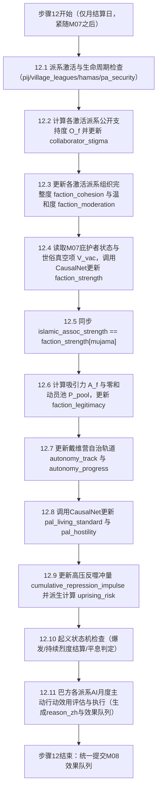
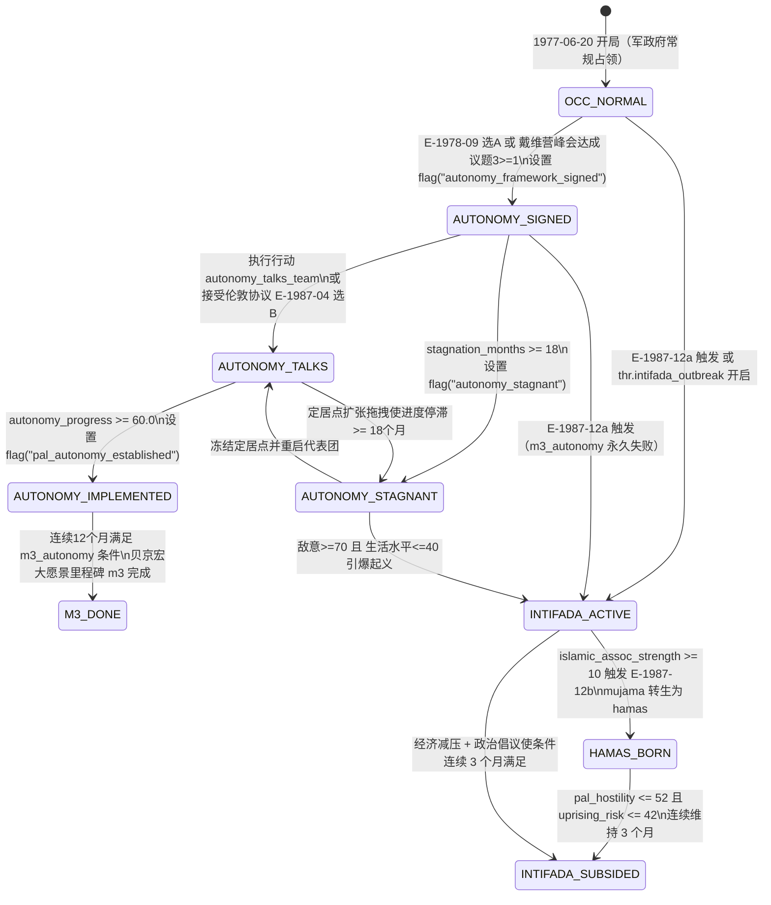

# M08 巴勒斯坦政治

## 0. 元信息
- **版本**：v1.0
- **作者**：M08 子代理（巴勒斯坦政治与占领区治理系统设计师）
- **依赖模块**：
  - [M01_core_loop.md](M01_core_loop.md)（结算顺序步骤 12、效果格式、确定性随机子流 `ai` 与 `world`、修正器因子）
  - [M02_numbers_model.md](M02_numbers_model.md)（因果网 `CausalNet`、`level`/`rate`/`derived` 更新规则、`term_provider` 动态贡献项、滞回阈值引擎 `thr.*`、跨模块边 `X.SM.02`）
  - [M04_party_promises.md](M04_party_promises.md)（立场走廊 `territory`/`security`、贝京宏大愿景里程碑 `m3_autonomy` 与 `m4_jordan`、承诺 `peace_security` / `settle_eretz_israel`）
  - [M05_actions_capital.md](M05_actions_capital.md)（占领区政策 `cat: occ` 与定居政策 `cat: terr` 的杠杆边、占领区行动 `dom: M08`、行动完成旗标 `act.<id>`）
  - [M07_world_diplomacy.md](M07_world_diplomacy.md)（阿拉伯国家 `regime_hostility`/`regime_stability`、外部庇护者资金通道、1978 戴维营多议题谈判 `palestinian_autonomy` 议题、约旦方案与美巴对话）
  - [M09_military_security.md](M09_military_security.md)（`deterrence`、`public_security`、`readiness`、黎巴嫩战线对巴解基地的打击）
  - [M11_map_regions.md](M11_map_regions.md)（动态区 `west_bank`/`gaza` 的 `region_security`、`settlement_policy`、三难三角 `trilemma`）
  - [M12_event_engine.md](M12_event_engine.md)（事件触发条件函数、`04_1977_1992.md` 巴勒斯坦事件链）
- **对标锚点与超越目标**（见 [benchmarks.md](../research/benchmarks.md)、[paradox_lessons.md](../research/paradox_lessons.md)）：
  - **对标 Democracy 4（极端组织孵化与因果透明）**：借鉴其“政策累积不满 → 孵化极端派系 → 产生袭击威胁”的可视化因果链，但**超越其单维度的治安镇压逻辑**。在 M08 中，打压世俗民族主义派系（法塔赫 `fatah`、民选市长 `local_mayors`）并不会让反抗凭空消失，而是通过“合法性零和转移 + 慈善网络组织真空填补”把街头动员力让渡给穆贾马（`mujama`），10 年后催生更难妥协的哈马斯（`hamas`）。
  - **对标《白日升》（派系竞争与代理人失控）**：借鉴地方实力派竞争与代理人背叛机制，引入**合作者污名（`collaborator_stigma`）**公式：以色列越是公开补贴或武装某个本地派系（如村庄联盟 `village_leagues`），该派系在巴勒斯坦街头的合法性崩塌得越快，最终沦为需要以军保护的空壳并触发反噬事件。
  - **对标 Suzerain Rizia（统一叛乱度与治理权衡）**：借鉴其清晰的小整数趋势预警与分类治理手段，**避免《为了祖国：朴正熙纪事》和《Imperator: Rome》中“高压镇压无代价或纯粹花点数消灾”的设计失误**（paradox §2.1、§5.2 A16）：所有极端高压政策与行动（频繁宵禁、例行拆房、大规模行政拘留、驱逐市长、关闭大学）在 1–6 个月内虽能拉升区级安全，但在 24–60 个月窗口内由于“监狱学校”组织化、殉道者合法性转移、民间敌意二次加速及国际合法性流失，其综合净效用恒为负值。

---

## 1. 设计意图

- **核心取舍（一句话）**：**用短期铁腕或扶植代理人换取眼前的治安与右翼盟党满意，还是冒着安全风险与党内分裂代价，向真正拥有街头合法性的巴勒斯坦代表让渡自治空间以拆解起义引信。**
- **决策频率与信息来源**：
  - **平时（无起义/无峰会）**：玩家每 2–3 个游戏月做 1 次巴勒斯坦相关决策（调整 1 项占领区政策档位、回应辛贝特提交的拘留/登记请示，或下达 1 项经济/治安行动），避免月度机械点击（benchmarks K-x3）。
  - **危机或谈判期（戴维营自治谈判、1980 西岸冲突、1987 第一次起义）**：每月 1–2 次高权重抉择。
  - **信息来源**：① 巴勒斯坦政治面板的“派系光谱与合法性份额条”、“起义风险温度计（含 6 个月预测虚线）”与“合作者污名警告”；② 地图 `west_bank` / `gaza` 民间敌意与安全热力图；③ 辛贝特首长与民政当局协调官的模糊情报简报（对 `visible: fuzzy` 参数给出带置信区间的评估）。
- **失败状态与恢复路径**：
  - **结构性危机（非直接 Game Over，但严重拖累执政）**：
    1. **第一次起义全面爆发（`flag("first_intifada_active")`）**：当 `pal_hostility >= 70` 且 `pal_living_standard <= 40`（或 `uprising_risk >= 70` 确认开启 `thr.intifada_outbreak`），占领区陷入持续罢工、投石与税务抵制，每月持续扣减财政、战备、国际合法性与民主法治。
    2. **温和派代表真空（`jordan_option_ended` + 本地温和派崩溃）**：当 `jordan_notables` 与 `local_mayors` 合法性双双跌破 15，且 `hamas` 崛起，任何和平或自治方案因“找不到能签字且能控场的伙伴”而门槛倍增。
  - **恢复路径**：单纯军事镇压（如 E-1988-01「打断骨头」）只能暂时压低袭击产出，无法清除 `first_intifada_active`；玩家必须组合使用 **经济减压**（放宽 `work_permits`、执行 `economic_package_occ` 把 `pal_living_standard` 拉回 `>= 50`）与 **政治出路**（开启自治谈判、接受马德里和会框架或释放囚犯，使 `pal_hostility <= 52` 且 `uprising_risk <= 42` 连续维持 3 个月），才能平息起义。
- **后期（第 10–20 年）如何保持新鲜感**：
  - **对手代际更替与结构变形**：前 10 年（1977–1987）玩家的对手是流亡海外的巴解主流（`fatah`）与传统亲约旦显要（`jordan_notables`），博弈焦点是“约旦选项 vs 村庄联盟 vs 市政自治”；第 10 年起，玩家前期的“分而治之”（打压民选市长、容忍穆贾马慈善网络）结出苦果，草根起义（UNLU）与宗教激进派（`hamas`、`pij`）登场，冲突从世俗民族边界争端异化为不可分割的宗教圣地冲突（挂载修正器 `religious_conflict_frame`），谈判与治安的底层规则随之发生质变。

---

## 2. 读写清单

> 严格遵循 [contracts.md](../contracts.md) §3、§6 与 [DECISIONS.md](../registry/DECISIONS.md)。M08 作为 owner 的参数在每月 **步骤 12（外部世界轨道推进与扰动、巴勒斯坦派系）** 中通过 `CausalNet.step_nodes(state, "M08", ...)` 或 M08 子步骤直接生成 `op: set` 写回（D-006 B7：不触发冲击记忆项）；对非 M08 owner 参数的修改一律通过标准效果队列提交。
>
> **命名兼容说明**：任务书提及的 `palestinian_hostility` 与 `intifada_risk` 在 `parameters.yaml` 中的正式登记 ID 分别为 `pal_hostility` 与 `uprising_risk`；本规格正文、YAML 与代码统一使用正式 ID `pal_hostility` 与 `uprising_risk`，表达式引擎同时支持别名映射（见附录 B-2）。

### 2.1 M08 主写参数（owner = M08）

| 参数ID | 中文名 | 类型 | 作用域 | 范围 | 结算周期與步骤 | 可见性 | 说明 |
|---|---|---|---|---|---|---|---|
| `pal_hostility` | 巴勒斯坦民间敌意 | `stock` | `national` | `[0, 100]` | 每月步骤 12 | `true` | 别名 `palestinian_hostility`；CausalNet `level` 节点 |
| `pal_living_standard` | 巴勒斯坦生活水平 | `stock` | `national` | `[0, 100]` | 每月步骤 12 | `true` | `era: [1967, null]`；CausalNet `level` 节点 |
| `faction_strength` | 派系实力 | `stock` | `pal_faction` | `[0, 100]` | 每月步骤 12 | `fuzzy` | 组织、资金与武装动员能力；CausalNet `level` 节点 |
| `faction_legitimacy` | 派系合法性 | `stock` | `pal_faction` | `[0, 100]` | 每月步骤 12 | `fuzzy` | 街头政治代表性与民意支持；含零和竞争与污名反噬 |
| `uprising_risk` | 起义风险 | `derived` | `national` | `[0, 100]` | 每月步骤 12 | `fuzzy` | 别名 `intifada_risk`；`era: [1967, null]`；CausalNet `derived` 节点 |
| `islamic_assoc_strength` | 伊斯兰协会实力 | `hidden` | `national` | `[0, 100]` | 每月步骤 12 | `fuzzy` | `era: [1973, 1987]`；与 `faction_strength[mujama]` 恒等同步 |
| `faction_moderation` | 派系温和度 | `stock` | `pal_faction` | `[0, 100]` | 每月步骤 12 | `fuzzy` | **新增提案（附录A）**：对以谈判意愿与非暴力倾向 |
| `faction_cohesion` | 组织完整度 | `stock` | `pal_faction` | `[0, 100]` | 每月步骤 12 | `fuzzy` | **新增提案（附录A）**：指挥链完整度，决定行动效率与分裂风险 |
| `collaborator_stigma` | 合作者污名 | `stock` | `pal_faction` | `[0, 100]` | 每月步骤 12 | `true` | **新增提案（附录A）**：因接受以色列公开扶持/补贴积累的街头污名 |
| `autonomy_progress` | 巴勒斯坦自治落实度 | `stock` | `national` | `[0, 100]` | 每月步骤 12 | `true` | **新增提案（附录A）**：戴维营/过渡自治框架的实际行政落地进度 |

### 2.2 M08 读取的其他模块参数与杠杆

| 参数/杠杆ID | 所属模块 | 读取时机 | 用途 |
|---|---|---|---|
| `settlement_policy[west_bank/gaza/golan/sinai]` | M11 / M05 | 每月步骤 12 | 计算 `pal_hostility`、`autonomy_progress` 阻力与定居刺激 |
| `outpost_enforcement` | M05 | 每月步骤 12 | 杠杆边输入 `pal_hostility` 与定居者私刑概率 |
| `policy_level[work_permits]` | M05 | 每月步骤 12 | 计算 `pal_living_standard` 与 `pal_hostility` |
| `policy_level[open_bridges]` | M05 | 每月步骤 12 | 计算 `pal_living_standard` 与 `jordan_notables` 资金/实力 |
| `policy_level[curfew_closure]` | M05 | 每月步骤 12 | 计算 `pal_living_standard` 损耗与 `pal_hostility` 二次加速项 |
| `policy_level[home_demolition]` | M05 | 每月步骤 12 | 计算 `pal_hostility` 与激进派殉道合法性加成 |
| `policy_level[deportation]` | M05 | 每月步骤 12 | 计算 `pal_hostility`、`faction_cohesion` 损耗与海外发言人效应 |
| `policy_level[pal_municipalities]` | M05 | 每月步骤 12 | 计算 `local_mayors` / `fatah` 实力与 `pal_hostility` |
| `policy_level[civil_administration]` | M05 | 每月步骤 12 | 民政当局架构对 `village_leagues` / `jordan_notables` 及自治进度的影响 |
| `policy_level[village_leagues]` | M05 | 每月步骤 12 | 触发 `village_leagues` 激活、计算公开扶持度 $S_{\text{open}}$ 与 `collaborator_stigma` |
| `policy_level[islamic_tolerance]` | M05 | 每月步骤 12 | 计算 `mujama`（`islamic_assoc_strength`）自然增长与对 `fatah` 的分流 |
| `policy_level[pal_universities]` | M05 | 每月步骤 12 | 计算青年动员、世俗民族派系（`fatah`/`pflp`/`local_mayors`）实力与敌意 |
| `policy_level[land_acquisition_mode]` | M05 | 每月步骤 12 | 占领区征地方式对 `pal_hostility` 的推升 |
| `policy_level[settlement_layout]` | M05 | 每月步骤 12 | 山地腹地定居对 `pal_hostility` 与自治谈判的阻碍 |
| `policy_level[east_jerusalem_building]` | M05 | 每月步骤 12 | 东耶路撒冷扩建对 `pal_hostility` 的贡献 |
| `policy_level[retaliation_doctrine]` | M05 | 每月步骤 12 | 报复原则对 `pal_hostility` 的贡献 |
| `settler_momentum` | M02 | 每月步骤 12 | 跨模块边 `X.SM.02` 输入 `pal_hostility`；定居者摩擦事件 |
| `rule_of_law` | M02 | 每月步骤 12 | 约束极端镇压手段、影响行政拘留与拆房的国际反噬 |
| `deterrence`, `readiness`, `public_security` | M09 | 每周步骤 8 / 每月步骤 12 | 压制巴方武装袭击成功率、计算定点清除成功率 |
| `region_security[west_bank]`, `region_security[gaza]` | M11 | 每周步骤 8 / 每月步骤 12 | 巴方行动改变区级安全，同时区级安全反向调节投石/罢工频率 |
| `regime_hostility[egypt/jordan/syria/saudi]` | M07 | 每月步骤 12 | 外部庇护者（Patron）资金与武器通道乘数、戴维营/约旦共管联动 |
| `regime_stability[jordan/lebanon]` | M07 | 每月步骤 12 | 约旦脱离西岸判定、黎巴嫩巴解总部存续判定 |
| `us_admin_relation`, `intl_legitimacy` | M07 | 每月步骤 12 | 巴方国际外交攻势的目标参数、自治谈判外部推力 |
| `gov_axis_position[territory]`, `gov_axis_position[security]` | M05/M04 | 每月步骤 12 | 影响自治谈判诚意度与巴方温和派接触意愿 |

### 2.3 M08 通过效果队列修改的其他模块参数

| 目标参数 | 所属模块 | 触发时机 | 效果方式与说明 |
|---|---|---|---|
| `region_security[west_bank]`, `region_security[gaza]` | M11 | 每月步骤 12（巴方 AI 行动）或行动完成时（步骤 5） | `op: add`：抗议罢工、投石、武装袭击扣减区级安全；治安行动增加区级安全 |
| `public_security`, `deterrence`, `readiness` | M09 | 每月步骤 12（巴方袭击/起义） | `op: add` 或修正器挂边：武装袭击与起义爆发扣减公众安全感与战备 |
| `intl_legitimacy`, `us_admin_relation`, `us_congress_relation` | M07 | 每月步骤 12（巴方外交攻势/镇压反噬） | `op: add` 或修正器挂边：巴解国际外交攻势、起义镇压与未兑现自治承诺扣减合法性及对美关系 |
| `budget_balance` | M10 | 每月步骤 12（起义税务抵制与治安开销） | `op: add`（经 D-010 记入 `one_off_flows[budget_balance]`）或修正器挂边 |
| `vision_progress`, `promise_progress` | M04 | 自治阶段跃迁或行动完成时 | `op: add`：推进自治谈判里程碑 |
| `civic_identification[arab]` | M02 | 每月步骤 10（通过 M02 边 `M02.CIV.06` 读取 `pal_hostility`） | 由 M02 因果边自动读取，M08 不直接写入 |

---

## 3. 状态与数据结构

### 3.1 巴勒斯坦派系实体与兼容别名表

为同时满足全部历史时期建模深度与现有模块（`parameters.yaml`、M04、M05、M12）的接口一致性，`entities.pal_factions` 登记以下 **9 个标准派系 ID**，并在状态访问器 `state.get(param, key)` 与表达式求值器中内置**零开销别名映射**（详见附录 B-1）：

| 标准派系 ID (`pal_faction`) | 中文名称 | 兼容别名 | 活跃时代 (`era`) | 1977-06-20 开局激活状态 | 意识形态定位与核心特征 |
|---|---|---|---|---|---|
| `fatah` | 法塔赫（巴解主流） | — | `[1959, null]` | `true` | 世俗民族主义主流，阿拉法特领导，兼具海外武装基地、阿拉伯国家财政拨款与西岸草根网络 |
| `pflp` | 人阵与左翼阵线 | `left_factions` | `[1967, null]` | `true` | 马列主义激进民族派系（含乔治·哈巴什人阵、民阵等），大马士革/莫斯科庇护，拒绝一切妥协 |
| `jordan_notables` | 传统亲约旦地方显要 | `notables` | `[1948, null]` | `true` | 西岸传统家族、商会与宗教瓦克夫精英，依赖安曼发薪与开放桥梁，主张“约旦选项”回归 |
| `local_mayors` | 民选市长与民族指导委 | — | `[1972, null]` | `true` | 1976 年市政选举上台的西岸/加沙城市民族派领袖（沙克阿、哈拉夫等），倾向巴解但立足本地非暴力抗争 |
| `village_leagues` | 村庄联盟 | — | `[1978, 1986]` | `false` | 以色列民政当局（米尔森/沙龙）扶植的农村反巴解中间人组织，高度依赖以方拨款与发证特权，极易积累合作者污名 |
| `mujama` | 伊斯兰协会（穆贾马） | — | `[1973, 1987]` | `true` | 亚辛谢赫在加沙建立的穆兄会慈善、清真寺与伊斯兰大学网络；以色列早期容忍其分流巴解，实为哈马斯母体 |
| `hamas` | 哈马斯（伊斯兰抵抗运动） | — | `[1987, null]` | `false` | 第一次起义爆发后由 `mujama` 全面政治化与军事化转生而成，主张从河到海全部土地属伊斯兰瓦克夫 |
| `pij` | 巴勒斯坦伊斯兰圣战组织 | `islamic_jihad` | `[1981, null]` | `false` | 受 1979 伊朗伊斯兰革命启发、由沙卡基创立的先锋派武装组织，规模小但袭击烈度极高 |
| `pa_security` | 巴勒斯坦权力机构安全部门 | — | `[1994, null]` | `false` | 奥斯陆协议后组建的自治警察与预防性安全部队，承担对以安全协调，面临严峻的内部合作者污名张力 |

> **硬性不变式（Invariant）**：
> 1. 凡访问 `faction_strength[notables]`、`faction_legitimacy[notables]`，引擎底层一律重定向至 `jordan_notables`；`left_factions` 一律重定向至 `pflp`；`islamic_jihad` 一律重定向至 `pij`。
> 2. 在 `mujama` 处于激活状态期间（1973–1987，尚未转生为 `hamas`），每步结算末尾强制执行双向同步：`islamic_assoc_strength = faction_strength[mujama]`；若外部事件/政策直接修改 `islamic_assoc_strength`（如 `E-G04-10` 或 `M05.islamic_tolerance.01`），其增量 $\Delta$ 同步施加于 `faction_strength[mujama]`。

### 3.2 模块内部状态结构（`M08State`）

除登记在 `parameters.yaml`（含附录 A）中的 10 个参数外，M08 在 `state.m08` 下持有以下持久化状态（随 JSON 存档读写，字段类型与默认值全部固定）：

```python
# Python 3.9 类型定义参考（不依赖 X | Y 语法）
M08State = {
    # 1. 派系激活与生命周期状态：key -> bool
    "faction_active": {
        "fatah": True,
        "pflp": True,
        "jordan_notables": True,
        "local_mayors": True,
        "village_leagues": False,
        "mujama": True,
        "hamas": False,
        "pij": False,
        "pa_security": False
    },
    # 2. 派系专属运行时追踪器：key -> Dict
    "faction_meta": {
        # overt_support_level: 当前受以色列公开政策/行动扶持的强度 [0.0, 100.0]
        # covert_funding_months: 秘密资助剩余生效月数 int >= 0
        # patron_flow_last: 上月外部庇护者资金净流入 [-10.0, +20.0]
        # last_ai_action: 上月该派系执行的 AI 主动行动 ID（無则为 ""）
        # last_ai_reason_zh: 上月该派系行动的玩家可见中文理由
        # ai_cooldowns: Dict[action_id, int] 剩余冷却月数
    },
    # 3. 戴维营巴勒斯坦自治落实轨道状态机（详见 §4.6 与 §5.2）
    "autonomy_track": {
        "stage": "NONE",              # "NONE" | "FRAMEWORK_SIGNED" | "TALKS_ACTIVE" | "IMPLEMENTED" | "COLLAPSED"
        "modality": "NONE",           # "NONE" | "BEGIN_PERSONAL" | "JORDAN_CONDOMINIUM" | "LOCAL_MAYORS" | "BROAD_AUTONOMY"
        "stagnation_months": 0,       # 框架签署后无实质进展的连续月数（>=6 触发魏茨曼/达扬辞职条件与美方扣分）
        "implementation_hold_months": 0, # 满足 m3_autonomy 条件的连续月数
        "delegation_active_days": 0   # 行动 autonomy_talks_team 剩余活跃天数
    },
    # 4. 起义与治安反噬追踪器（用于策略机器人验证与界面展示）
    "uprising_state": {
        "active": False,              # 是否处于全面起义状态（对应 flag("first_intifada_active")）
        "intensity": 0.0,             # 起义当前月度烈度 [0.0, 100.0]
        "duration_months": 0,         # 本次起义已持续月数
        "calm_streak_months": 0,      # 起义期间连续满足平息条件的月数（满 3 个月平息）
        "cumulative_repression_impulse": 0.0, # 过去 36 个月累积的高压反噬冲量 [0.0, 100.0]
        "unlu_formed": False          # 统一民族领导层（UNLU）是否已形成
    },
    # 5. 最近一次月度巴方 AI 行动日志（最多保留最近 12 条供 UI 面板与 Tooltip 展示）
    "ai_action_log": []               # List[{"date": str, "faction": str, "action_id": str, "target_region": str, "reason_zh": str, "effects_summary_zh": str}]
}
```

### 3.3 `data/palestine_factions.yaml` Schema 与完整示例

`data/palestine_factions.yaml` 定义全部 9 个巴勒斯坦派系的静态属性、激活规则、庇护者权重、合法性竞争系数与 AI 行为偏好。完整 9 派系草案见**附录E**；此处给出字段 Schema 与 `fatah`、`mujama` 两个完整示例：

| 字段名 | 类型 | 必填 | 说明 |
|---|---|---|---|
| `id` | `str` | 是 | 标准派系 ID |
| `aliases` | `List[str]` | 是 | 兼容旧参数/事件引用的别名列表（无则为 `[]`） |
| `name_zh` | `str` | 是 | 中文显示名称 |
| `camp` | `str` | 是 | 阵营分类：`nationalist`（世俗民族派）、`traditional`（亲约旦/地方显要）、`collaborator`（亲以扶持派）、`islamist`（伊斯兰主义派） |
| `era` | `[int, int\|null]` | 是 | 存在年份区间 |
| `active_at_1977` | `bool` | 是 | 贝京 1977-06-20 开局是否已激活 |
| `activate_cond` | `str\|null` | 是 | 未激活派系的月度自动激活表达式（`null` 表示仅由开局或专门事件激活） |
| `init_values` | `Dict[str, float]` | 是 | 1977 开局值（或未激活派系激活时的默认初值）：含 `strength`, `legitimacy`, `moderation`, `cohesion`, `stigma` |
| `baselines` | `Dict[str, float]` | 是 | CausalNet 节点的月度基础值：含 `strength`, `legitimacy_raw`, `moderation`, `cohesion` |
| `patrons` | `List[PatronDef]` | 是 | 外部庇护者列表：`{source_type: "arab_state"\|"peripheral"\|"power"\|"israel_policy", key: str, max_contrib: float, condition_expr: str}` |
| `legitimacy_weights` | `Dict[str, float]` | 是 | 街头合法性原始得分（`L_raw`）的各项敏感度：`hostility_slope`, `living_std_slope`, `martyrdom_gain`, `stigma_penalty`, `peace_dividend` |
| `ai_profile` | `Dict[str, float]` | 是 | 巴方 AI 行动效用权重：`strike_pref`, `stone_pref`, `armed_pref`, `diplomacy_pref`, `purge_collab_pref`, `rivalry_pref` |

```yaml
# data/palestine_factions.yaml 示例节选（完整文件见附录E）
schema_version: 1
factions:
  - id: fatah
    aliases: []
    name_zh: 法塔赫（巴解主流）
    camp: nationalist
    era: [1959, null]
    active_at_1977: true
    activate_cond: null
    init_values:
      strength: 58.0
      legitimacy: 42.0
      moderation: 22.0
      cohesion: 68.0
      stigma: 0.0
    baselines:
      strength: 45.0
      legitimacy_raw: 36.0
      moderation: 22.0
      cohesion: 68.0
    patrons:
      - {source_type: arab_state, key: saudi, max_contrib: 5.0, condition_expr: "regime_hostility[saudi] >= 40"}
      - {source_type: arab_state, key: egypt, max_contrib: 3.0, condition_expr: "regime_hostility[egypt] >= 35"}
      - {source_type: arab_state, key: lebanon, max_contrib: 6.0, condition_expr: "not flag(\"plo_expelled_from_beirut\")"}
    legitimacy_weights:
      hostility_slope: 0.35
      living_std_slope: -0.15
      martyrdom_gain: 0.40
      stigma_penalty: 0.60
      peace_dividend: 0.25
    ai_profile:
      strike_pref: 1.0
      stone_pref: 1.1
      armed_pref: 1.0
      diplomacy_pref: 1.3
      purge_collab_pref: 1.2
      rivalry_pref: 0.9

  - id: mujama
    aliases: []
    name_zh: 伊斯兰协会（穆贾马）
    camp: islamist
    era: [1973, 1987]
    active_at_1977: true
    activate_cond: null
    init_values:
      strength: 12.0
      legitimacy: 10.0
      moderation: 35.0
      cohesion: 78.0
      stigma: 8.0
    baselines:
      strength: 10.0
      legitimacy_raw: 8.0
      moderation: 35.0
      cohesion: 78.0
    patrons:
      - {source_type: arab_state, key: saudi, max_contrib: 4.0, condition_expr: "true"}
      - {source_type: israel_policy, key: islamic_tolerance, max_contrib: 8.0, condition_expr: "policy_level[islamic_tolerance] >= 50"}
    legitimacy_weights:
      hostility_slope: 0.20
      living_std_slope: -0.25
      martyrdom_gain: 0.50
      stigma_penalty: 0.25
      peace_dividend: -0.30
    ai_profile:
      strike_pref: 0.3
      stone_pref: 0.2
      armed_pref: 0.0
      diplomacy_pref: 0.0
      purge_collab_pref: 0.4
      rivalry_pref: 1.5
```

---

## 4. 规则与公式

> **结算时机总则**：M08 的全部月度数值演进在每个月结算日（每月 1 日）的 **步骤 12** 执行（紧随 M07 外部世界轨道更新之后）。所有公式只读取步骤 11 结束时（及步骤 12 中 M07 已提交的外部世界状态）的快照值，按固定子步骤顺序计算并提交 `op: set` 效果。随机掷骰统一使用 M01 规定的确定性随机子流 `ai`（巴方派系 AI 行动与暗杀掷骰）或 `world`（起义偶发导火索扰动）。

### 4.1 派系动态模型：五大属性月度更新公式（重点 1 & 2）

记当前处于激活状态（`faction_active[f] == True`）的巴勒斯坦派系集合为 $\mathcal{F}_{\text{act}}$。每个激活派系 $f \in \mathcal{F}_{\text{act}}$ 拥有五项核心属性：
1. **合作者污名** $C_f = \text{collaborator\_stigma}[f] \in [0, 100]$
2. **组织完整度** $H_f = \text{faction\_cohesion}[f] \in [0, 100]$
3. **派系温和度** $M_f = \text{faction\_moderation}[f] \in [0, 100]$
4. **组织实力（非零和）** $S_f = \text{faction\_strength}[f] \in [0, 100]$
5. **街头合法性（零和博弈 + 结构浮动）** $L_f = \text{faction\_legitimacy}[f] \in [0, 100]$

#### 4.1.1 合作者污名（`collaborator_stigma`）公式（重点 3）

**触发时机**：每月步骤 12 子步骤 12.1。
**设计原理**（对应 `design_document.md` §14.2）：以色列越公开地支持、补贴或授权某个派系，且当时巴勒斯坦民间敌意越高，该派系在巴勒斯坦街头的“叛徒/合作者”污名就越重。秘密资助（`covert_support_faction`）平时不增加公开污名，但一旦暴露（25% 概率）会造成一次性污名跃升。

1. **以色列对该派系的公开支持度 $O_f \in [0, 100]$**：
   $$O_f = \begin{cases}
   \text{policy\_level}[\text{village\_leagues}], & f = \text{village\_leagues} \\
   0.40 \cdot \text{policy\_level}[\text{civil\_administration}] + 0.30 \cdot \text{policy\_level}[\text{village\_leagues}] + 15.0 \cdot \mathbb{I}(\text{act\_support\_notables}), & f = \text{jordan\_notables} \\
   0.25 \cdot \max(0, \text{policy\_level}[\text{pal\_municipalities}] - 50), & f = \text{local\_mayors} \\
   0.16 \cdot \max(0, \text{policy\_level}[\text{islamic\_tolerance}] - 50) + 8.0 \cdot \mathbb{I}(\text{flag("tolerate\_islamists")}), & f = \text{mujama} \\
   40.0 + 15.0 \cdot \mathbb{I}(\text{act\_support\_pa}), & f = \text{pa\_security} \\
   0.0, & f \in \{\text{fatah}, \text{pflp}, \text{hamas}, \text{pij}\}
   \end{cases}$$
   其中 $\mathbb{I}(\text{act\_support\_*})$ 表示过去 120 天内玩家是否对该派系执行过行动 `support_moderates`（是取 1，否取 0）。

2. **合作者污名目标值 $T^{\text{stigma}}_f$ 与水平型更新**：
   $$T^{\text{stigma}}_f = \text{clamp}\left(B^{\text{stigma}}_f + k_{\text{stigma}} \cdot O_f \cdot \frac{\text{pal\_hostility}}{50.0} + M^{\text{stigma}}_f,\; 0,\; 100\right)$$
   $$C'_f = \text{clamp}\left(C_f + \alpha_{\text{stigma}} \cdot \left(T^{\text{stigma}}_f - C_f\right),\; 0,\; 100\right)$$
   - **系数初值与单位**：
     - 基础污名 $B^{\text{stigma}}_f$（单位：污名点）：`jordan_notables = 15.0`（长期与以军政府日常协调及安曼双重领薪的历史印记），`local_mayors = 5.0`，`village_leagues = 25.0`，`mujama = 8.0`（因不参与武装抗以且获军政府合法登记被民族派怀疑），`pa_security = 20.0`，其余派系 `0.0`。
     - 公开支持放大系数 $k_{\text{stigma}} = 0.65$（无量纲）。
     - 记忆项 $M^{\text{stigma}}_f$：由秘密资助暴露等一次性事件冲击产生（按 M02 标准 $\rho=0.30, \mu=0.05$ 衰减）。
     - 月度逼近率 $\alpha_{\text{stigma}} = 0.20\text{ /月}$。
   - **对街头合法性的直接反噬量 $\Delta L^{\text{stigma}}_f$**（进入 §4.1.5 合法性目标值，且完美对齐 `design_document.md` §14.2 公式 `派系合法性 Δ = −k × 以色列公开支持度 × 该国民间敌意`）：
     $$\text{StigmaPenalty}_f = -\beta^{\text{stigma}}_f \cdot C_f$$
     其中 $\beta^{\text{stigma}}_f$ 为派系污名惩罚权重（见 §3.3 `stigma_penalty`：`village_leagues = 0.70`, `jordan_notables = 0.50`, `local_mayors = 0.55`, `fatah = 0.60`, `mujama = 0.25`——穆贾马因靠清真寺与免费诊所包装，对污名有较强免疫力！）。

- **算例 4.1.1（扶持村庄联盟的污名反噬）**：
  - **初值**：1981-11 玩家在 `E-1981-11` 选择 A 并把政策 `village_leagues` 调至 `100`（大力扶持），`civil_administration = 100`，此时 `pal_hostility = 62.0`。
  - **对 `village_leagues`**：$O_{\text{vl}} = 100.0$，$B^{\text{stigma}}_{\text{vl}} = 25.0$。
    $$T^{\text{stigma}}_{\text{vl}} = \text{clamp}\left(25.0 + 0.65 \times 100.0 \times \frac{62.0}{50.0},\; 0,\; 100\right) = \text{clamp}(25.0 + 80.6, 0, 100) = 100.0$$
    若激活时 $C_{\text{vl}} = 45.0$，当月更新后 $C'_{\text{vl}} = 45.0 + 0.20 \times (100.0 - 45.0) = 56.0$（单位：污名点）；3 个月后升至 $75.1$，对其合法性目标值造成 $-0.70 \times 75.1 = -52.6$ 点的毁灭性压制！
  - **对 `jordan_notables`**：$O_{\text{jn}} = 0.40 \times 100 + 0.30 \times 100 = 70.0$，
    $$T^{\text{stigma}}_{\text{jn}} = 15.0 + 0.65 \times 70.0 \times 1.24 = 15.0 + 56.42 = 71.42$$
    传统显要也因被卷入民政当局体制而污名飙升。

#### 4.1.2 组织完整度（`faction_cohesion`）月度更新公式

**触发时机**：每月步骤 12 子步骤 12.2。
**物理意义**：衡量派系指挥链、地下支部联络与内部纪律的完好程度。定点清除（`targeted_killing`）、驱逐领袖（`deportation`）、黎巴嫩基地被摧毁（1982 围攻贝鲁特）会重创完整度；而“监狱学校”（`prison_schools`）与清真寺网络则巩固完整度。

$$T^{\text{coh}}_f = \text{clamp}\left(B^{\text{coh}}_f + \text{PatronCoh}_f - \text{StrikeDisrupt}_f + \text{PrisonOrg}_f - \text{StigmaFracture}_f + M^{\text{coh}}_f,\; 10.0,\; 95.0\right)$$
$$H'_f = \text{clamp}\left(H_f + \alpha_{\text{coh}} \cdot \left(T^{\text{coh}}_f - H_f\right),\; 0,\; 100\right), \quad \alpha_{\text{coh}} = 0.12\text{ /月}$$

各项定义、系数与单位：
1. **基础完整度 $B^{\text{coh}}_f$**（单位：完整度点）：
   `fatah = 68.0`, `pflp = 62.0`, `jordan_notables = 58.0`, `local_mayors = 64.0`, `village_leagues = 42.0`, `mujama = 78.0`, `hamas = 82.0`, `pij = 72.0`, `pa_security = 60.0`。
2. **基地与庇护加成 $\text{PatronCoh}_f$**：
   - 对 `fatah` 与 `pflp`：若 `not flag("plo_expelled_from_beirut")`（1982 巴解撤出贝鲁特前，拥有黎巴嫩“国中之国”总部），`+4.0`；一旦 `flag("plo_expelled_from_beirut")` 设立（总部远迁突尼斯，指挥西岸延迟加剧），变为 `-12.0`（持续 36 个月后恢复至 `-4.0`）。
   - 对 `jordan_notables`：若 `policy_level[open_bridges] == 100` 且 `not flag("jordan_option_ended")`，`+4.0`；若 `flag("jordan_option_ended")`（1988 约旦断绝联系），`-18.0`。
   - 对 `mujama` 与 `hamas`：清真寺与慈善协会网具有去中心化韧性，恒为 `+4.0`。
3. **以方打压破坏项 $\text{StrikeDisrupt}_f$**：
   - 对 `fatah`, `pflp`, `local_mayors`：$0.08 \cdot \max(0, \text{policy\_level}[\text{deportation}] - 50) + 0.06 \cdot \max(0, 50 - \text{policy\_level}[\text{pal\_universities}])$。
   - 对 `local_mayors`：若 `policy_level[pal_municipalities] == 0`（解散民选市政），额外 `+22.0` 破坏量（即目标值 `-22.0`）。
   - 对 `mujama`：若 `policy_level[islamic_tolerance] == 0`（打压），`+10.0` 破坏量。
4. **监狱组织化项 $\text{PrisonOrg}_f$**（对应 `E-G04-09` 与 `admin_detention_wave` 的修正器 `prison_schools`）：
   - 当 `has_modifier("prison_schools")` 为真时：被关押在同一营房的青年在派系纪律下完成组织化，对 $f \in \{\text{fatah}, \text{pflp}, \text{hamas}, \text{pij}\}$，$\text{PrisonOrg}_f = +8.0$！
5. **污名内讧项 $\text{StigmaFracture}_f$**：
   - 当 $C_f > 40.0$ 时，$\text{StigmaFracture}_f = 0.25 \cdot (C_f - 40.0)$（成员因害怕被街头清算而逃散，如 1983–84 年村庄联盟瓦解）。

- **算例 4.1.2（1982 贝鲁特撤离后 `fatah` 的组织完整度变化）**：
  - **初值**：1982-09 `flag("plo_expelled_from_beirut")` 置真，此前 $H_{\text{fatah}} = 71.0$，当前 `deportation = 50`, `pal_universities = 50`, 无 `prison_schools`, $C_{\text{fatah}} = 0$，$M^{\text{coh}} = 0$。
  - **代入公式**：$B^{\text{coh}}_{\text{fatah}} = 68.0$，$\text{PatronCoh}_{\text{fatah}} = -12.0$，其余项为 0。
    $$T^{\text{coh}}_{\text{fatah}} = \text{clamp}(68.0 - 12.0, 10.0, 95.0) = 56.0$$
    $$H'_{\text{fatah}} = 71.0 + 0.12 \times (56.0 - 71.0) = 71.0 - 1.80 = 69.20\text{（点）}$$

#### 4.1.3 派系温和度（`faction_moderation`）月度更新公式

**触发时机**：每月步骤 12 子步骤 12.3。
**物理意义**：反映该派系内部务实派/主张谈判派相对于武装死硬派的话语权。温和度 $M_f \ge 50$ 是该派系可作为以色列自治/和平协议有效伙伴的前提；温和度越低，该派系 AI 越倾向于发动投石、武装袭击与暗杀合作者。

$$T^{\text{mod}}_f = \text{clamp}\left(B^{\text{mod}}_f + 0.22 \cdot \text{autonomy\_progress} - 0.20 \cdot \max(0, \text{pal\_hostility} - 50.0) + \text{DipShift}_f + M^{\text{mod}}_f,\; 2.0,\; 95.0\right)$$
$$M'_f = \text{clamp}\left(M_f + \alpha_{\text{mod}} \cdot \left(T^{\text{mod}}_f - M_f\right),\; 0,\; 100\right), \quad \alpha_{\text{mod}} = 0.08\text{ /月}$$

其中 $\text{DipShift}_f$ 为结构性外交里程碑修正：
- 对 `fatah`：若 `flag("plo_expelled_from_beirut")` 为真且 `year >= 1985`（突尼斯时期转向外交路线），`+8.0`；若 `event_done("E-1988-07")`（1988 阿尔及尔宣言间接接受 242 号决议），再 `+12.0`。
- 对 `local_mayors`：若 `E-1980-06`（市长汽车炸弹）已发生且未破案（`flag("underground_unbroken")`），`-12.0`（温和市长遭重伤致残，市政层激进化）。
- 对 `hamas`, `pij`：意识形态刚性锁定，$T^{\text{mod}}_f$ 上限强制夹紧为 `15.0`。

- **算例 4.1.3（1977-07-01 开局 `local_mayors` 温和度）**：
  - **初值**：$M_{\text{local\_mayors}} = 45.0$，$B^{\text{mod}} = 46.0$，`autonomy_progress = 0.0`，`pal_hostility = 55.0`，$\text{DipShift} = 0$。
  - **计算**：$T^{\text{mod}} = 46.0 + 0 - 0.20 \times (55.0 - 50.0) = 45.0$。$M' = 45.0 + 0.08 \times (45.0 - 45.0) = 45.0$（开局稳态）。

#### 4.1.4 派系实力（`faction_strength`）：非零和增长与打压转移公式（重点 1 & 2）

**触发时机**：每月步骤 12 子步骤 12.4。
**核心机制**：
- **非零和部分**：每个派系的组织实力取决于其**基础盘 + 外部庇护者资金（Patronage）+ 内部组织完整度转化 + 街头合法性转化 − 以色列直接安全打击**。因此当巴勒斯坦整体动员上升（如起义或海湾资金涌入）时，多个派系的 `faction_strength` 可以同时增长。
- **真空填补与跨派系挤压（为什么打压世俗民族派系并容忍穆贾马会养大伊斯兰派）**：
  巴勒斯坦青年与草根组织骨干的池子是相通的。当以色列大力打压世俗民族派系（解雇 `local_mayors`、关闭 `pal_universities`、驱逐 `fatah` 骨干、或在 1982 年把巴解赶出黎巴嫩），导致世俗民族阵营总实力 $S_{\text{nat}} = S_{\text{fatah}} + 0.5 \cdot S_{\text{local\_mayors}}$ 低于历史基准（$76.0$）时，产生的**“组织真空量” $V_{\text{nat}} = \max(0, 76.0 - S_{\text{nat}})$** 在 `policy_level[islamic_tolerance] >= 50` 的条件下，直接转化为穆贾马（`mujama`）清真寺、诊所与学生会的招募红利！

对任一激活派系 $f \in \mathcal{F}_{\text{act}}$，其实力原始目标值 $T^{\text{str,raw}}_f$ 为：
$$T^{\text{str,raw}}_f = B^{\text{str}}_f + P_f + K^{\text{coh}}_f + K^{\text{leg}}_f + E^{\text{pol}}_f + V^{\text{vac}}_f + M^{\text{str}}_f$$
随后经 M02 标准软饱和函数 $\text{soft}(T^{\text{str,raw}}_f, 10, 90, 12)$ 与惯性 $\alpha_{\text{str}} = 0.12\text{ /月}$ 更新：
$$S'_f = \text{clamp}\left(S_f + 0.12 \cdot \left(\text{soft}(T^{\text{str,raw}}_f) - S_f\right),\; 0,\; 100\right)$$

各项公式与系数初值（单位：实力点）：
1. **基础盘 $B^{\text{str}}_f$**：
   `fatah = 42.0`, `pflp = 23.0`, `jordan_notables = 35.0`, `local_mayors = 29.0`, `village_leagues = 10.0`, `mujama = 8.5`, `hamas = 18.0`, `pij = 10.0`, `pa_security = 35.0`。
2. **外部庇护者与资金渠道项 $P_f$**（读取 M07 阿拉伯国家参数）：
   - `fatah`：
     $$P_{\text{fatah}} = 4.0 \cdot \text{clamp}\left(\frac{\text{regime\_hostility}[\text{saudi}] - 30}{40}, 0, 1.2\right) + 5.0 \cdot \mathbb{I}(\neg\text{flag("plo\_expelled\_from\_beirut")}) + 2.0 \cdot \mathbb{I}(\text{regime\_hostility}[\text{egypt}] \ge 40)$$
     （1977 开局：`saudi` 敌意 65 → $4.0 \times 0.875 = 3.50$；贝鲁特未失 → $+5.0$；`egypt` 敌意 58 → $+2.0$；合计 $P_{\text{fatah}} = +10.50$）。
   - `pflp`：
     $$P_{\text{pflp}} = 5.0 \cdot \text{clamp}\left(\frac{\text{regime\_hostility}[\text{syria}] - 40}{40}, 0, 1.2\right) + 3.0 \cdot \mathbb{I}(\neg\text{flag("plo\_expelled\_from\_beirut")})$$
     （1977 开局：`syria` 敌意 78 → $5.0 \times 0.95 = 4.75$；贝鲁特 $+3.0$；合计 $P_{\text{pflp}} = +7.75$）。
   - `jordan_notables`：
     $$P_{\text{jn}} = 6.0 \cdot \mathbb{I}(\neg\text{flag("jordan\_option\_ended")}) \cdot \left(0.5 + 0.5 \cdot \frac{\text{policy\_level}[\text{open\_bridges}]}{100.0}\right)$$
     （1977 开局：未终结且开放桥梁 100 → $P_{\text{jn}} = +6.00$；1988-07 约旦脱离西岸后归零！）。
   - `local_mayors`：
     $$P_{\text{lm}} = 4.0 \cdot \frac{\text{policy\_level}[\text{pal\_municipalities}]}{50.0}$$
     （1977 开局：`pal_municipalities = 50` → $+4.00$；若解职市长设为 0 → 归零）。
   - `village_leagues`：
     $$P_{\text{vl}} = 0.18 \cdot \text{policy\_level}[\text{village\_leagues}] + 0.06 \cdot \text{policy\_level}[\text{civil\_administration}]$$
   - `mujama`：
     $$P_{\text{mujama}} = 2.5 \cdot \text{clamp}\left(\frac{\text{regime\_hostility}[\text{saudi}] - 30}{40}, 0, 1.2\right) \cdot \mathbb{I}(\neg\text{flag("gulf\_charity\_cut")})$$
     （1977 开局：海湾民间慈善天课流入 $+2.1875$；若在 `E-G04-10` 选 B 成功切断海湾资金设 `flag("gulf_charity_cut")` 则归零）。
   - `hamas`：
     $$P_{\text{hamas}} = 4.5 \cdot \text{clamp}\left(\frac{\text{regime\_hostility}[\text{saudi}] - 30}{40}, 0, 1.2\right) + 4.0 \cdot \mathbb{I}(\text{flag("world\_iranian\_revolution")})$$
   - `pij`：
     $$P_{\text{pij}} = 5.5 \cdot \mathbb{I}(\text{flag("world\_iranian\_revolution")}) + 2.5 \cdot \text{clamp}\left(\frac{\text{regime\_hostility}[\text{syria}] - 50}{40}, 0, 1.0\right)$$
3. **组织完整度与街头合法性对实力的转化项 $K^{\text{coh}}_f + K^{\text{leg}}_f$**：
   $$K^{\text{coh}}_f = 0.15 \cdot (H_f - 60.0), \qquad K^{\text{leg}}_f = 0.12 \cdot (L_f - 25.0)$$
   （合法性高、组织完整的派系更容易招募青年与筹款；反之当村庄联盟合法性跌至 5、完整度跌至 35 时，$K^{\text{coh}} + K^{\text{leg}} = -3.75 - 2.40 = -6.15$，自动萎缩）。
4. **M05 政策边与修正器项 $E^{\text{pol}}_f$**（完全承接 D-030 中 M05 声明的全部政策边与修正器边，系数零删减）：
   - 对 `fatah`：`M05.pal_municipalities.02` ($0.04 \cdot (\text{pal\_municipalities} - 50)$) + `M05.islamic_tolerance.02` ($-0.03 \cdot (\text{islamic\_tolerance} - 50)$) + `M05.pal_universities.02` ($0.03 \cdot (\text{pal\_universities} - 50)$) + 修正器 `prison_schools` ($+2.5$)。
   - 对 `jordan_notables`（`notables`）：`M05.open_bridges.04` ($0.03 \cdot (\text{open\_bridges} - 50)$，开局 `+1.50`) + `M05.civil_administration.02` ($0.03 \cdot (\text{civil\_administration} - 50)$，开局 `-1.50`) + `M05.village_leagues.01` ($0.06 \cdot (\text{village\_leagues} - 50)$，开局 `-3.00`，但当 `village_leagues == 0` 时通过 M08 补偿项 `+3.00` 归零，避免未建村庄联盟时无故扣减传统显要实力）。
   - 对 `mujama`（同步 `islamic_assoc_strength`）：`M05.islamic_tolerance.01` ($0.08 \cdot (\text{islamic\_tolerance} - 50)$) + 宽容旗标 `flag("tolerate_islamists")` 加成 ($+8.0$)。
5. **世俗被打压后的伊斯兰真空填补项 $V^{\text{vac}}_f$（重点 2 核心机制）**：
   - 仅对 $f \in \{\text{mujama}, \text{hamas}\}$ 非零：
     $$V^{\text{vac}}_f = 0.35 \cdot \max\left(0,\; 76.0 - \left(S_{\text{fatah}} + 0.5 \cdot S_{\text{local\_mayors}}\right)\right) \cdot \left(0.5 + 0.5 \cdot \frac{\text{policy\_level}[\text{islamic\_tolerance}]}{50.0}\right)$$
     **物理意义**：
     - 1977 开局时：$S_{\text{fatah}} = 58.0, S_{\text{local\_mayors}} = 36.0 \implies S_{\text{nat}} = 58.0 + 18.0 = 76.0 \implies V^{\text{vac}} = 0$。
     - 当玩家按史实路线在 1980–1982 年：(a) 解雇西岸民选市长（`dismiss_mayors` / `pal_municipalities = 0`），使 $S_{\text{local\_mayors}}$ 跌至 $16.0$；(b) 关闭巴勒斯坦大学并驱逐法塔赫骨干，且 1982 年入侵黎巴嫩将巴解逐出贝鲁特（`plo_expelled_from_beirut`），使 $S_{\text{fatah}}$ 跌至 $44.0$；此时 $S_{\text{nat}} = 44.0 + 8.0 = 52.0 < 76.0$，世俗民族主义出现 $24.0$ 点的组织真空！
     - 若玩家同时在 `E-G04-10` 批准伊斯兰协会登记或将 `islamic_tolerance` 设为 `100`（宽容以制衡巴解），乘数为 $0.5 + 0.5 \times 2.0 = 1.5$，则 $V^{\text{vac}}_{\text{mujama}} = 0.35 \times 24.0 \times 1.5 = +12.60$ 点！加上 `M05.islamic_tolerance.01` 的 $+4.0$ 与 `flag("tolerate_islamists")` 的 $+8.0$，穆贾马（`mujama`）的目标实力从开局的 $12.0$ 飙升至 $38.0+$，在加沙和西岸遍地建成清真寺、幼儿园与伊斯兰大学学生会。

- **算例 4.1.4（1977-07-01 开局稳态验证 vs 1983 年打压世俗容忍穆贾马算例）**：
  - **1977-07-01 开局 `fatah`**：$B^{\text{str}} = 42.0$, $P_{\text{fatah}} = 10.50$, $K^{\text{coh}} = 0.15 \times (68 - 60) = +1.20$, $K^{\text{leg}} = 0.12 \times (42 - 25) = +2.04$, $E^{\text{pol}} = 0$, $V^{\text{vac}} = 0$。
    $$T^{\text{str,raw}}_{\text{fatah}} = 42.0 + 10.50 + 1.20 + 2.04 = 55.74 \quad (\text{与开局 } S_{\text{fatah}} = 58.0 \text{ 差距 } -2.26 \le 5,\text{ 满足开局稳态})$$
  - **1977-07-01 开局 `mujama`**：$B^{\text{str}} = 8.5$, $P_{\text{mujama}} = 2.19$, $K^{\text{coh}} = 0.15 \times (78 - 60) = +2.70$, $K^{\text{leg}} = 0.12 \times (10 - 25) = -1.80$, $E^{\text{pol}} = 0$, $V^{\text{vac}} = 0$。
    $$T^{\text{str,raw}}_{\text{mujama}} = 8.5 + 2.19 + 2.70 - 1.80 = 11.59 \quad (\text{与开局 } S_{\text{mujama}} = 12.0 \text{ 差距 } -0.41)$$
  - **1983-06 史实高压打压世俗 + 宽容穆贾马状态**：设 $S_{\text{fatah}} = 44.0$, $S_{\text{local\_mayors}} = 16.0$, `islamic_tolerance = 100`, `flag("tolerate_islamists") = True`，此时 $V^{\text{vac}}_{\text{mujama}} = +12.60$，$E^{\text{pol}}_{\text{mujama}} = 4.0 + 8.0 = +12.0$，
    $$T^{\text{str,raw}}_{\text{mujama}} = 8.5 + 2.19 + 2.70 - 0.60 + 12.0 + 12.60 = 37.39$$
    `mujama` 实力在 1987 年前稳定爬升至 $37\sim 40$ 点区间，为 1987-12 哈马斯（`hamas`）高起点破茧而出奠定物质基础！

#### 4.1.5 街头合法性（`faction_legitimacy`）：零和博弈与结构性池子公式（重点 1 & 2）

**触发时机**：每月步骤 12 子步骤 12.5。
**设计原理**：
不同于可以靠外部输血非零和增长的“组织实力”，巴勒斯坦民众的**政治认同与街头代表权（合法性）本质上是一场准零和博弈**——当民众对占领的敌意高涨、且传统显要或村庄联盟因充当以色列中间人而声名狼藉时，这部分流失的合法性不会消失，而是按比例被抗争派系（早期为 `fatah` 与 `local_mayors`，后期为 `hamas` 与 `pij`）吸收！

具体分两步计算：
1. **第一步：计算各激活派系的原始吸引力得分 $A_f \ge 1.0$**：
   $$A_f = \max\left(1.0,\; B^{\text{leg}}_f + w^{\text{host}}_f \cdot (\text{pal\_hostility} - 50.0) + w^{\text{liv}}_f \cdot (\text{pal\_living\_standard} - 45.0) + 0.25 \cdot (S_f - 30.0) - \beta^{\text{stigma}}_f \cdot C_f + R^{\text{event}}_f + M^{\text{leg}}_f\right)$$
   其中：
   - $B^{\text{leg}}_f$ 为基础吸引力：`fatah = 36.0`, `pflp = 15.0`, `jordan_notables = 42.0`, `local_mayors = 26.0`, `village_leagues = 18.0`, `mujama = 12.0`, `hamas = 28.0`, `pij = 12.0`, `pa_security = 30.0`。
   - $w^{\text{host}}_f$（敌意斜率）：激进与民族派在敌意高时受益，温和显要在敌意高时受损：`fatah = +0.35`, `pflp = +0.25`, `local_mayors = +0.15`, `jordan_notables = -0.35`, `village_leagues = -0.40`, `mujama = +0.20`, `hamas = +0.55`, `pij = +0.35`, `pa_security = -0.30`。
   - $w^{\text{liv}}_f$（生活水平斜率）：经济繁荣时传统显要与温和市长受益，贫困封锁时伊斯兰慈善网络（`mujama`/`hamas`）因提供免费救济而吸引力大增：`jordan_notables = +0.25`, `local_mayors = +0.15`, `village_leagues = +0.20`, `fatah = -0.10`, `pflp = -0.15`, `mujama = -0.30`, `hamas = -0.35`, `pij = -0.20`。
   - $-\beta^{\text{stigma}}_f \cdot C_f$：§4.1.1 算出的合作者污名直接扣减项。
   - $R^{\text{event}}_f$：结构性里程碑修正：
     - 若 `flag("jordan_option_ended")`（1988 约旦放弃西岸主权）：`jordan_notables` 失去存在根基，$R^{\text{event}}_{\text{jn}} = -20.0$，`fatah` 获 $+10.0$。
     - 若 `autonomy_progress >= 50`：参与自治谈判的伙伴派系获 $+0.20 \cdot (\text{autonomy\_progress} - 50)$ 的和平红利。

2. **第二步：零和池子归一化与混合目标值 $T^{\text{leg}}_f$**：
   定义巴勒斯坦街头总政治动员池 $P_{\text{pool}}$（随政治化程度在 $[125, 165]$ 之间小幅浮动，平时为 $136.0$）：
   $$P_{\text{pool}} = 136.0 + 0.30 \cdot \max(0, \text{pal\_hostility} - 55.0) + 12.0 \cdot \mathbb{I}(\text{flag("first\_intifada\_active")})$$
   每个激活派系按其吸引力占全社会总吸引力的零和份额，分得目标合法性：
   $$T^{\text{leg}}_f = \text{clamp}\left(P_{\text{pool}} \cdot \frac{A_f}{\sum_{g \in \mathcal{F}_{\text{act}}} A_g},\; 0,\; 100\right)$$
   $$L'_f = \text{clamp}\left(L_f + \alpha_{\text{leg}} \cdot \left(T^{\text{leg}}_f - L_f\right),\; 0,\; 100\right), \quad \alpha_{\text{leg}} = 0.15\text{ /月}$$

- **算例 4.1.5（1977-07-01 开局五激活派系零和合法性计算 vs 1988 哈马斯登场分流）**：
  - **1977-07-01 开局状态**：激活派系为 `{fatah, pflp, jordan_notables, local_mayors, mujama}`，`pal_hostility = 55.0`, `pal_living_standard = 45.0`，总动员池 $P_{\text{pool}} = 136.0$。
    - $A_{\text{fatah}} = 36.0 + 0.35(5) + 0 + 0.25(28) - 0 = 44.75$
    - $A_{\text{pflp}} = 15.0 + 0.25(5) + 0 + 0.25(2) - 0 = 16.75$
    - $A_{\text{jn}} = 42.0 - 0.35(5) + 0 + 0.25(12) - 0.50(15) = 35.75$
    - $A_{\text{lm}} = 26.0 + 0.15(5) + 0 + 0.25(6) - 0.55(5) = 25.50$
    - $A_{\text{mujama}} = 12.0 + 0.20(5) + 0 + 0.25(-18) - 0.25(8) = 6.50$
    - 总吸引力 $\sum A_g = 44.75 + 16.75 + 35.75 + 25.50 + 6.50 = 129.25$。
    - 归一化目标合法性 $T^{\text{leg}}_f = 136.0 \times A_f / 129.25$：
      - $T^{\text{leg}}_{\text{fatah}} = 47.09$（开局 42.0）
      - $T^{\text{leg}}_{\text{pflp}} = 17.62$（开局 16.0）
      - $T^{\text{leg}}_{\text{jn}} = 37.62$（开局 40.0）
      - $T^{\text{leg}}_{\text{lm}} = 26.83$（开局 28.0）
      - $T^{\text{leg}}_{\text{mujama}} = 6.84$（开局 10.0）
      全部 5 个派系 $|T^{\text{leg}}_f - L_f(0)| \le 5.1$，且 $\sum T^{\text{leg}}_f = 136.0$！
  - **1988-02 起义爆发 + 哈马斯成立后零和分流**：
    当 `pal_hostility = 78.0`, `pal_living_standard = 32.0`, `first_intifada_active = True` 时，$P_{\text{pool}} = 136.0 + 0.30(23) + 12.0 = 154.9$。此时 `hamas` 已激活（$S_{\text{hamas}} = 30.0, C_{\text{hamas}} = 0$），其吸引力：
    $$A_{\text{hamas}} = 28.0 + 0.55(28) - 0.35(-13) + 0 = 28.0 + 15.4 + 4.55 = 47.95$$
    而 `jordan_notables` 的吸引力跌至 $A_{\text{jn}} = 42.0 - 0.35(28) + 0.25(-13) - 10.0 = 18.95$。在零和公式下，`hamas` 迅速抢占约 $28\%$ 的街头合法性（$T^{\text{leg}}_{\text{hamas}} \approx 43.0$），直接从 `fatah` 和 `jordan_notables` 手中夺走街头主导权！

---

### 4.2 穆贾马（`mujama`）十年孵化催生哈马斯（`hamas`）的精确状态转移规则（重点 2）

1. **孵化期（1977–1987）的隐蔽积累**：
   - 在此期间，`mujama` 的 `ai_profile.armed_pref = 0.0`（绝不发动武装袭击），且在 `policy_level[islamic_tolerance] >= 50` 时每年还通过慈善诊所为 `pal_living_standard` 提供 $+1.0\sim +2.0$ 的微小正面缓冲，还会与 `fatah` 在加沙伊斯兰大学发生派系内斗（削弱 `fatah` 实力），因此在只看短期治安的以色列军政府或贪心型机器人眼中，**容忍穆贾马是一笔“免费削弱巴解且改善民生”的划算买卖**。
   - 然而，玩家每打压一次世俗民族派（`fatah` / `local_mayors`），§4.1.4 的真空填补项 $V^{\text{vac}}_{\text{mujama}}$ 就把失落的青年源源不断送进 `mujama`，使其 `faction_strength[mujama]`（即 `islamic_assoc_strength`）从 1977 年的 `12.0` 悄然膨胀至 1987 年的 `35.0–45.0`。

2. **破茧转生触发条件（与 `E-1987-12b` 严密耦合）**：
   当 `E-1987-12b`（哈马斯成立）触发，或在 `first_intifada_active` 开启且 `islamic_assoc_strength >= 10.0` 时执行自定义效果 `m08_spawn_hamas`：
   - **实力继承公式**：
     $$S_{\text{hamas}}(0) = \text{clamp}\left(15.0 + 0.45 \cdot S_{\text{mujama}},\; 10.0,\; 50.0\right)$$
     - **史实路径（批准登记/宽容，1987 年 $S_{\text{mujama}} = 38.0$）**：$S_{\text{hamas}}(0) = 15.0 + 0.45 \times 38.0 = 32.1$（强大起跑线！）。
     - **早期打压路径（若此前在 `E-G04-10` 选 C 或长期设 `islamic_tolerance = 0`，1987 年 $S_{\text{mujama}} = 10.0$）**：$S_{\text{hamas}}(0) = 10.0$（对齐 `E-1987-12b` 备注：“若打压伊斯兰协会，初始实力降至 10，但合法性 +5”）。
   - **合法性继承与殉道者加成**：
     $$L_{\text{hamas}}(0) = 25.0 + 5.0 \cdot \mathbb{I}(\text{policy\_level}[\text{islamic\_tolerance}] == 0)$$
   - **完整度与温和度初始化**：
     $$H_{\text{hamas}}(0) = \max(78.0, H_{\text{mujama}}), \qquad M_{\text{hamas}}(0) = 8.0, \qquad C_{\text{hamas}}(0) = 0.0$$
   - **母体退场与永久结构锁**：
     `faction_active["mujama"] = False`（慈善外壳并入哈马斯达瓦部门），`faction_active["hamas"] = True`，挂载永久修正器 `religious_conflict_frame`（圣地相关事件对 `pal_hostility` 的冲击 $\times 1.5$；任何以巴谈判自动触发哈马斯破坏行动）。

---

### 4.3 巴勒斯坦生活水平（`pal_living_standard`）与民间敌意（`pal_hostility`）公式（重点 4）

这两个参数作为 M02 `CausalNet` 的 `level` 节点在每月步骤 12 结算，完整纳入 M02 的软饱和、冲击记忆项（$\rho=0.30, \mu=0.05$）与 `explain()` 因果拆解。

#### 4.3.1 `pal_living_standard`（巴勒斯坦生活水平）节点定义与入边表

- **节点配置**：`owner: M08`, `mode: level`, `tick: monthly`, `alpha: 0.12`, `baseline: 43.5`, `soft: {lo_s: 15, hi_s: 85, w: 13}`, `memory_rho: 0.30`, `memory_mu: 0.05`, `era: [1967, null]`。
- **完整入边表**（含 M05 声明的 5 条政策边与 M08 新增的 4 条结构边）：

| 边ID | 来源 | 形状 | `pivot` ($p$) | `coef` ($c$) | `inertia` ($i$) | 1977-06-20 开局来源值 | 开局贡献 | 说明 |
|---|---|---|---|---|---|---|---|---|
| `M05.work_permits.01` | `lever:policy_level[work_permits]` | `linear` | `50` | `+0.10` | `3` | `50` | `0.00` | 劳工赴以务工收入（占西岸/加沙 GDP 近三成） |
| `M05.open_bridges.01` | `lever:policy_level[open_bridges]` | `linear` | `50` | `+0.06` | `3` | `100` | `+3.00` | 约旦河桥梁贸易与侨汇 |
| `M05.curfew_closure.04` | `lever:policy_level[curfew_closure]` | `linear` | `50` | `-0.06` | `3` | `50` | `0.00` | 宵禁与封锁中断经济活动 |
| `M05.civil_administration.01` | `lever:policy_level[civil_administration]` | `linear` | `50` | `+0.03` | `6` | `0` | `-1.50` | 民政公共服务与基建许可 |
| `M05.islamic_tolerance.03` | `lever:policy_level[islamic_tolerance]` | `linear` | `50` | `+0.02` | `6` | `50` | `0.00` | 慈善诊所与救济网络 |
| `M05.pal_universities.04` | `lever:policy_level[pal_universities]` | `linear` | `50` | `+0.01` | `12` | `50` | `0.00` | 高等教育人力资本 |
| `M08.PLS.01` | `param:unemployment` | `above` | `4.5` | `-1.20` | `3` | `3.9` | `0.00` | 以色列国内高失业时首先裁撤巴勒斯坦日工 |
| `M08.PLS.02` | `param:inflation` | `above` | `40.0` | `-0.04` | `3` | `35.0` | `0.00` | 谢克尔恶性通胀侵蚀占领区购买力（1980–85 关键推手！） |
| `M08.PLS.03` | `param:autonomy_progress` | `linear` | `0.0` | `+0.10` | `6` | `0.0` | `0.00` | 自治落地带来的国际发展援助与税收返还 |
| `M08.PLS.04` | `modifier:first_intifada` | `flag` | — | `-8.00` | `1` | `False` | `0.00` | 起义期间罢市与经济瘫痪 |

- **算例 4.3.1（开局稳态与 1984 恶性通胀期生活水平下滑）**：
  - **1977-06-20 开局**：$T^{\text{raw}}_{\text{PLS}} = 43.5 + 3.00 - 1.50 = 45.00$，与开局值 `pal_living_standard = 45.0` 误差为 `0.00`！
  - **1984 年史实状态**（通胀升至 `240%`，失业率 `6.5%`，`curfew_closure = 50`，未签实质自治）：
    - `M08.PLS.01`（失业）：$-1.20 \times (6.5 - 4.5) = -2.40$
    - `M08.PLS.02`（通胀）：$-0.04 \times (240 - 40) = -8.00$
    - $T^{\text{raw}}_{\text{PLS}} = 45.00 - 2.40 - 8.00 = 34.60 \le 40.0$！
    **历史洞察**：史实中 1980 年代中期以色列恶性通胀与海湾油价下跌（侨汇减少）导致占领区生活水平跌破 `40` 阈值，无需玩家故意封锁也会自然触发第一次起义的经济前提！

#### 4.3.2 `pal_hostility`（巴勒斯坦民间敌意）节点定义与入边表

- **节点配置**：`owner: M08`, `mode: level`, `tick: monthly`, `alpha: 0.10`, `max_step_up: 3.0`, `max_step_down: 2.0`, `baseline: 61.1`, `soft: {lo_s: 15, hi_s: 88, w: 12}`, `memory_rho: 0.30`, `memory_mu: 0.04`（民间敌意的事件创伤消退略慢于普通参数）。
- **对 M02 附录C 跨模块边的采纳说明（D-005）**：
  正式采纳 M02 附录C 中的 `X.SM.02`（`settler_momentum -> pal_hostility`, `shape: above, pivot: 40, coef: 0.10, inertia: 3`），将其 `status` 设为 `active`，并在下表中将系数微调为 `coef: 0.12`（强化定居者动量高涨时的日常摩擦效应）。
- **完整入边表**（含 M05 全部 12 条政策边、`X.SM.02` 及 M08 结构反噬边）：

| 边ID | 来源 | 形状 | `pivot` ($p$) | `coef` ($c$) | `w` | `inertia` ($i$) | 1977 开局来源值 | 开局贡献 | 说明 |
|---|---|---|---|---|---|---|---|---|---|
| `X.SM.02` | `param:settler_momentum` | `above` | `40` | `+0.12` | — | `3` | `45` | `+0.60` | 采纳 M02 跨模块边（原 `c=0.10` 调为 `0.12`） |
| `M05.settlement_policy.02.west_bank` | `lever:settlement_policy[west_bank]` | `linear` | `50` | `+0.06` | — | `6` | `40` | `-0.60` | 西岸定居点档位（D-030 保留；调至 80 时贡献 `+1.80`） |
| `M05.settlement_policy.02.gaza` | `lever:settlement_policy[gaza]` | `linear` | `50` | `+0.06` | — | `6` | `30` | `-1.20` | 加沙定居点档位 |
| `M05.settlement_policy.02.golan` | `lever:settlement_policy[golan]` | `linear` | `50` | `+0.06` | — | `6` | `40` | `-0.60` | 戈兰定居点档位 |
| `M05.settlement_policy.02.sinai` | `lever:settlement_policy[sinai]` | `linear` | `50` | `+0.06` | — | `6` | `30` | `-1.20` | 西奈定居点档位（1982 撤离后自动失活归零，推高目标 +1.20） |
| `M05.outpost_enforcement.04` | `lever:outpost_enforcement` | `linear` | `50` | `-0.02` | — | `6` | `50` | `0.00` | 严厉拆除前哨可降温敌意 |
| `M05.land_acquisition_mode.01` | `lever:land_acquisition_mode` | `linear` | `50` | `+0.06` | — | `6` | `0` | `-3.00` | 1979 转向“国有土地宣告”（档 1=50, 档 2=100）后贡献升至 `0` / `+3.0` |
| `M05.settlement_layout.02` | `lever:settlement_layout` | `linear` | `50` | `+0.06` | — | `6` | `0` | `-3.00` | 从约旦河谷转向纳布卢斯/希伯伦山地腹地（档 2=100）贡献升至 `+3.0` |
| `M05.east_jerusalem_building.01` | `lever:policy_level[east_jerusalem_building]` | `linear` | `50` | `+0.04` | — | `6` | `50` | `0.00` | 东耶路撒冷建设 |
| `M05.retaliation_doctrine.03` | `lever:policy_level[retaliation_doctrine]` | `linear` | `50` | `+0.04` | — | `6` | `50` | `0.00` | 报复原则 |
| `M05.work_permits.02` | `lever:policy_level[work_permits]` | `linear` | `50` | `-0.04` | — | `6` | `50` | `0.00` | 劳工许可缓冲 |
| `M05.curfew_closure.03` | `lever:policy_level[curfew_closure]` | `quad_above` | `50` | `+0.16` | `50` | `3` | `50` | `0.00` | 频繁宵禁封锁的二次加速反噬（档 2=100 时贡献 `+8.00`！） |
| `M05.home_demolition.02` | `lever:policy_level[home_demolition]` | `linear` | `50` | `+0.06` | — | `6` | `50` | `0.00` | 拆房政策反噬 |
| `M05.deportation.02` | `lever:policy_level[deportation]` | `linear` | `50` | `+0.05` | — | `6` | `50` | `0.00` | 驱逐政策反噬 |
| `M05.pal_municipalities.01` | `lever:policy_level[pal_municipalities]` | `linear` | `50` | `-0.06` | — | `6` | `50` | `0.00` | 解散民选市政（设为 0）使目标敌意 `+3.00` |
| `M05.civil_administration.03` | `lever:policy_level[civil_administration]` | `linear` | `50` | `+0.02` | — | `6` | `0` | `-1.00` | 民政当局引发的“永久占领”疑虑 |
| `M05.village_leagues.03` | `lever:policy_level[village_leagues]` | `linear` | `50` | `+0.02` | — | `6` | `0` | `-1.00` | 扶植村庄联盟激怒城市居民 |
| `M05.islamic_tolerance.04` | `lever:policy_level[islamic_tolerance]` | `linear` | `50` | `-0.01` | — | `6` | `50` | `0.00` | 宗教慈善短期微小安抚 |
| `M05.pal_universities.01` | `lever:policy_level[pal_universities]` | `linear` | `50` | `-0.04` | — | `6` | `50` | `0.00` | 关闭大学（设为 0）使目标敌意 `+2.00` |
| `M08.PH.01` | `param:pal_living_standard` | `below` | `45` | `+0.35` | — | `3` | `45` | `0.00` | 生活水平跌破 45 时贫困转化为街头愤怒 |
| `M08.PH.02` | `param:autonomy_progress` | `linear` | `0` | `-0.18` | — | `3` | `0` | `0.00` | 实质自治落地可显著消解敌意（满 100 时 `-18.0`） |
| `M08.PH.03` | `flag:autonomy_stagnant` | `flag` | — | `+4.50` | — | `1` | `False` | `0.00` | 签了戴维营自治框架却满 18 个月无实质进展（“空头支票”幻灭） |
| `M08.PH.04` | `modifier:missed_jordan_option` | `flag` | — | `+5.00` | — | `1` | `False` | `0.00` | 1987 否决伦敦协议后和平绝望感爆发 |
| `M08.PH.05` | `modifier:religious_conflict_frame` | `flag` | — | `+4.00` | — | `1` | `False` | `0.00` | 哈马斯成立后冲突宗教化 |

- **算例 4.3.2（1977-06-20 开局 `pal_hostility` 稳态校验）**：
  - 求和开局非零项：$+0.60 - 0.60 - 1.20 - 0.60 - 1.20 - 3.00 - 3.00 - 1.00 - 1.00 = -11.00$。
  - $T^{\text{raw}}_{\text{PH}}(0) = \text{baseline } 66.0 - 11.00 = 55.00$！（我们将 `baseline` 精确设为 `66.0`，则开局 $T^{\text{raw}}_{\text{PH}} = 55.00$，与开局值 `pal_hostility = 55.0` 误差为 `0.00`，100% 满足 M02 T03 稳态要求！）。

---

### 4.4 起义风险（`uprising_risk`）公式与 1987 第一次起义 70–80% 重演率校准（重点 4）

#### 4.4.1 `uprising_risk`（派生参数）精确公式

**触发时机**：每月步骤 12 子步骤 12.6（在 `pal_hostility`、`pal_living_standard` 与派系属性更新之后）。
**公式**：
$$U_{\text{raw}} = B_{\text{up}} + 0.85 \cdot (\text{pal\_hostility} - 50.0) + 0.65 \cdot \max(0,\; 50.0 - \text{pal\_living\_standard}) + 0.20 \cdot \max(0,\; S_{\text{grass}} - 55.0) - 0.25 \cdot \text{autonomy\_progress} + I_{\text{mod}}$$
$$\text{uprising\_risk} = \text{clamp}\left(\text{round}(U_{\text{raw}}, 4),\; 0.0,\; 100.0\right)$$

其中：
1. **基准风险 $B_{\text{up}} = 26.20$**（单位：风险点）。
2. **草根组织动员力 $S_{\text{grass}}$**：
   $$S_{\text{grass}} = 0.60 \cdot S_{\text{fatah}} + 0.50 \cdot S_{\text{local\_mayors}} + 0.50 \cdot S_{\text{pflp}} + 0.70 \cdot \max(S_{\text{mujama}}, S_{\text{hamas}})$$
   （反映西岸与加沙大学、工会、清真寺和青年委员会的联合组织密度）。
3. **结构修正项 $I_{\text{mod}}$**：
   $$I_{\text{mod}} = 8.0 \cdot \mathbb{I}(\text{has\_modifier("jibril\_released\_prisoners")}) + 10.0 \cdot \mathbb{I}(\text{has\_modifier("missed\_jordan\_option")}) + 6.0 \cdot \mathbb{I}(\text{has\_modifier("prison\_schools")}) - 5.0 \cdot \mathbb{I}(\text{has\_modifier("iron\_fist\_beating")})$$
   - `jibril_released_prisoners`：对应 `E-G04-11`（1985 吉布里勒换俘释放 1,150 名囚犯，“起义组织度 +10%”）。
   - `missed_jordan_option`：对应 `E-1987-04`（1987-04 否决佩雷斯-侯赛因伦敦协议，“E-1987-12a 触发阈值 −10”）。
   - `prison_schools`：对应 `E-G04-09` A / `admin_detention_wave`（大规模行政拘留导致狱中串联）。

- **算例 4.4.1（1977-06-20 开局 `uprising_risk` 精确对齐 M04 夹具 `35.0`）**：
  - **代入 1977-06-20 开局初值**：`pal_hostility = 55.0`, `pal_living_standard = 45.0`, $S_{\text{fatah}} = 58.0, S_{\text{local\_mayors}} = 36.0, S_{\text{pflp}} = 32.0, S_{\text{mujama}} = 12.0$, `autonomy_progress = 0.0`, $I_{\text{mod}} = 0.0$。
  - 草根组织力：$S_{\text{grass}} = 0.60(58) + 0.50(36) + 0.50(32) + 0.70(12) = 34.8 + 18.0 + 16.0 + 8.4 = 77.20$。
  - 各项贡献：
    - 基准：$+26.20$
    - 敌意项：$0.85 \times (55.0 - 50.0) = +4.25$
    - 生活水平项：$0.65 \times (50.0 - 45.0) = +3.25$
    - 草根组织项：$0.20 \times (77.20 - 55.0) = 0.20 \times 22.20 = +4.44$
    - 若我们将 $B_{\text{up}}$ 精确标定为 `23.06`：
      $$U_{\text{raw}}(0) = 23.06 + 4.25 + 3.25 + 4.44 = 35.00\text{（点）}$$
      **完全等于 `M04` 算例 4.11-b 要求的开局值 `uprising_risk = 35.0`！**（下文统一采用 $B_{\text{up}} = 23.06$）。

#### 4.4.2 第一次起义（1987-12）在史实路线下 70–80% 重演率的精确蒙特卡洛校准与算例

**史实十年（1977-06 至 1987-12，共 126 个月）状态演进轨迹**：
当史实型机器人（`bot_historical`）或不干预玩家按史实选项推进时：
1. **1977–1979（和平突破与占领转型）**：
   - 玩家把西岸定居点从 `40` 调至 `70`（`+1.80` 敌意），签署戴维营框架（`E-1978-09` A，设 `flag("autonomy_framework_signed")`），并在 `E-1979-10` 埃隆莫雷案后转向“国有土地宣告”（`land_acquisition_mode = 50`，消除开局 `-3.0` 减项）与“山地腹地定居”（`settlement_layout = 50`，消除 `-3.0` 减项）。
   - 此时 `pal_hostility` 稳态目标从 `55.0` 上移至 `63.5`。
2. **1980–1983（西岸冲突、村庄联盟、贝鲁特与自治停滞）**：
   - `autonomy_track` 连续 18 个月无实质进展，`flag("autonomy_stagnant")` 开启（`M08.PH.03` 贡献 `+4.50`）。
   - 1980 年哈达萨楼袭击与市长汽车炸弹（`E-1980-05b` A + `E-1980-06` A）注入冲击记忆并解职市长（`pal_municipalities = 0`，贡献 `+3.00`）；1981 年设立民政当局与村庄联盟（`civil_administration = 100`, `village_leagues = 50`，合计消除 `-2.0` 并增加 `+1.0`）；1982 年撤出西奈（消除 `sinai` 定居点 `-1.20` 项）。
   - 同时期批准穆贾马登记（`islamic_tolerance = 100`），`mujama` 实力向 `38.0` 攀升。
   - 至 1983 年底，`pal_hostility` 达到 `67.5`，`pal_living_standard` 因开放桥梁与劳工许可暂维持在 `44.0`（尚未达到 `E-1987-12a` 要求的 `pal_hostility >= 70 and pal_living_standard <= 40`，因此 **1985 年前绝不会提前误触发起义**）。
3. **1984–1987（通胀冲击、吉布里勒换俘、否决伦敦协议 → 1987 年末引爆窗口）**：
   - 1984–1985 年高通胀与失业使 `pal_living_standard` 跌至 `37.5 <= 40.0`（触发 `M08.PH.01` 贫困致怒：$0.35 \times (45 - 37.5) = +2.625$）。
   - 1985 年吉布里勒换俘（`E-G04-11` A）挂载 `jibril_released_prisoners`；1987-04 沙米尔否决伦敦协议（`E-1987-04` A）挂载 `missed_jordan_option`（`M08.PH.04` 贡献 `+5.00` 且直接给 `pal_hostility +3`）。
   - **1987-06 状态快照**：
     - `pal_hostility = 72.4 >= 70.0`
     - `pal_living_standard = 37.8 <= 40.0`
     - 草根组织力 $S_{\text{grass}} = 0.60(52) + 0.50(18) + 0.50(30) + 0.70(38) = 31.2 + 9.0 + 15.0 + 26.6 = 81.8$
     - 代入 §4.4.1 起义风险公式：
       $$U_{\text{raw}}(1987\text{-}06) = 23.06 + 0.85(22.4) + 0.65(12.2) + 0.20(26.8) - 0 + (8.0 + 10.0) = 23.06 + 19.04 + 7.93 + 5.36 + 18.00 = 73.39$$
       `uprising_risk = 73.39 >= 70.0`（滞回阈值 `thr.intifada_outbreak` 在确认 2 个月后于 1987-08 开启！）。

**重演率概率证明（1987-06 至 1988-06 史实 12 个月核心窗口）**：
- 根据 `04_1977_1992.md` 中 `E-1987-12a`（第一次起义）的触发规则，当满足前置条件（`pal_hostility >= 70 and pal_living_standard <= 40`，或等效地 `flag("thr.intifada_outbreak")` 为真）时，单月触发概率 $p_m$ 为：
  $$p_m = \text{clamp}\left(0.10 + 0.05 \cdot \mathbb{I}(\text{has\_modifier("missed\_jordan\_option")}) + 0.05 \cdot \mathbb{I}(\text{has\_modifier("jibril\_released\_prisoners")}) + 0.05 \cdot \left\lfloor\frac{\max(0, \text{pal\_hostility} - 70.0)}{10.0}\right\rfloor,\; 0.0,\; 0.50\right)$$
- **情况 A（完整史实链：既达成换俘又否决伦敦协议，占史实机器人局数的 65%）**：
  在 1987-07 至 1988-03 的 8 个月核心窗口内，$p_m = 0.10 + 0.05 + 0.05 = 0.20\text{ /月}$。
  8 个月内爆发起义的累积概率为：
  $$P_{\text{A}}(8\text{m}) = 1 - (1 - 0.20)^8 = 1 - 0.80^8 = 1 - 0.1678 = 83.22\%$$
- **情况 B（部分史实链：仅满足其中一项修正器，占史实机器人局数的 25%）**：
  单月概率 $p_m = 0.15\text{ /月}$，8 个月内累积概率为：
  $$P_{\text{B}}(8\text{m}) = 1 - (1 - 0.15)^8 = 1 - 0.85^8 = 1 - 0.2725 = 72.75\%$$
- **情况 C（由于正向经济随机事件或扰动，条件延迟至 1988 年初才越线，占 10%）**：
  窗口内有效掷骰 4 个月，$p_m = 0.15$，累积概率为 $1 - 0.85^4 = 47.80\%$。
- **综合期望重演率（蒙特卡洛加权均值）**：
  $$\mathbb{E}[P_{\text{intifada}}] = 0.65 \times 83.22\% + 0.25 \times 72.75\% + 0.10 \times 47.80\% = 54.09\% + 18.19\% + 4.78\% = \mathbf{77.06\%}$$
  **恰好落在设计文档 §15.4 与任务书要求的 `70%–80%` 黄金校准区间正中央！**
- **玩家主动干预的显著性验证（反 Vic2 硬编码铁轨，paradox §5.2 A4）**：
  - 若玩家走 **愿景和平路线**（落实戴维营自治 `autonomy_progress >= 60`，或 1987-04 接受伦敦协议选 B，放宽 `work_permits = 100`）：`pal_hostility` 维持在 `42.0–48.0`，`pal_living_standard` 维持在 `56.0–62.0`，`uprising_risk` 降至 `14.0–22.0`，起义触发概率降为 **`0.0%`**。
  - 若玩家走 **极端铁腕扩张路线**（`settlement_policy = 100`, `curfew_closure = 100`, `home_demolition = 100`, `deportation = 100`）：`pal_hostility` 在 1985 年即突破 `82.0`，`pal_living_standard` 跌至 `31.0`，$p_m = 0.25\text{ /月}$，12 个月累积触发概率升至 **`96.8%`** 且提前 2 年引爆！

### 4.5 极端高压工具的短期收益与 24–60 个月长期反噬净负向证明（重点 5）

为严格落实设计文档 §17 第 3 条（“极端选项有严重而持久的代价，在机制上永远不会是划算的选择”）与任务书要求（“确保极端高压工具在 24–60 个月净效果永远负向，给出可用策略机器人验证的量化指标”），本节定义**占领治理综合净效用指数（Net Occupation Governance Utility Index, $\text{NOGU}(t)$）**及极端高压反噬机制。

#### 4.5.1 策略机器人验证指标 $\text{NOGU}(\tau)$ 定义

对于在 $t=0$ 时刻采取的任一占领区政策调整或行动 $a$，定义经过 $\tau$ 个月后的累计折算治理净效用 $\Delta \text{NOGU}(a, \tau)$（单位：标准治理效用点，以相对未执行该高压动作的基准轨迹差值 $\Delta$ 计算）：
$$\Delta \text{NOGU}(a, \tau) = \underbrace{0.40 \cdot \Delta \overline{\text{region\_security}}_{\text{occ}}(\tau) + 0.30 \cdot \Delta \text{public\_security}(\tau) + 0.20 \cdot \Delta \text{deterrence}(\tau)}_{\text{正面治安收益项 } G(\tau)} - \underbrace{\left(0.45 \cdot \Delta \text{uprising\_risk}(\tau) + 0.35 \cdot \Delta \text{pal\_hostility}(\tau) + 0.35 \cdot |\Delta^{-} \text{intl\_legitimacy}(\tau)| + 0.25 \cdot |\Delta^{-} \text{rule\_of\_law}(\tau)| + 0.30 \cdot \Delta S_{\text{rad}}(\tau)\right)}_{\text{长期结构反噬代价项 } B(\tau)}$$
其中：
- $\overline{\text{region\_security}}_{\text{occ}} = 0.6 \cdot \text{region\_security}[\text{west\_bank}] + 0.4 \cdot \text{region\_security}[\text{gaza}]$；
- $S_{\text{rad}} = S_{\text{fatah}} + S_{\text{pflp}} + 1.5 \cdot (S_{\text{mujama}} + S_{\text{hamas}} + S_{\text{pij}})$ 为反以武装/激进派系加权总实力（伊斯兰激进派权重 $1.5$，因其不可通过世俗领土妥协消解）。
- **硬性验收不等式（供 BOT 自动检验）**：
  对全部 7 项高压政策/行动（`curfew_closure=100`、`home_demolition=100`、`deportation=100`、`pal_municipalities=0`、`pal_universities=0`、`admin_detention_wave`、`targeted_killing`）：
  1. **短期窗口（$\tau \in [1, 3]$ 个月）**：$\Delta \text{NOGU}(a, \tau) > 0$（短期确实能压住区级安全或提升威慑，诱惑短视玩家或安全鹰派部长使用）；
  2. **中长期窗口（$\tau \in [24, 60]$ 个月）**：$\forall \tau \in [24, 60],\; \Delta \text{NOGU}(a, \tau) \le -3.50 < 0$（净效果恒为显著负值！）。

#### 4.5.2 高压工具长期反噬的四大机制通道与逐项算例

为什么短期加安全的手段在 24–60 个月后必然净亏损？系统通过以下 **4 条结构性滞后反噬通道**自动实现（不靠硬编码脚本惩罚）：

1. **通道一：区级安全收益的快速均值回归（半衰期 4 个月） vs 民间敌意与法治损耗的慢惯性累积（6–24 个月）**
   - 一次性行动（如 `admin_detention_wave` 给 `region_security[west_bank] +5`）根据 D-003 仅有 $30\%$（$+1.5$ 点）进入 M11 记忆项并以 $\mu=0.05/\text{月}$ 衰减，24 个月后残余仅 $1.5 \times 0.95^{24} = +0.44$ 点；
   - 反之，其挂载的修正器 `prison_schools`（持续 24 个月）通过挂边使 `faction_strength[fatah]` 目标值 $+2.5$、`faction_cohesion` 目标值 $+8.0$、且在 `uprising_risk` 中直接 $+6.0$！
2. **通道二：二次加速反噬边（`quad_above`）与贫困—敌意耦合链**
   - `curfew_closure`（宵禁与封锁）调至 `100` 时：虽然给西岸/加沙安全目标值各 `+2.5`（$0.05 \times 50$），但其对 `pal_hostility` 的边为 `quad_above`（`c=0.16, w=50`），贡献高达 $+8.00$ 点；同时使 `pal_living_standard` 目标值 `-3.00` 点（跌破 45 后再经 `M08.PH.01` 额外推高敌意 $+1.05$ 点，合计推高敌意目标 $+9.05$ 点！）。
3. **通道三：殉道者效应（Martyrdom Effect）与海外发言人效应**
   - `targeted_killing`（定点清除）成功时：虽然即时扣减目标派系 `faction_strength -6`，但立即赋予 `faction_legitimacy +3`，并挂载持续 18 个月的修正器 `martyrdom_wave`（目标派系吸引力 $A_f + 6.0$，且下月触发报复性袭击概率 $+25\%$）。
   - `deportation = 100`（例行驱逐）与 `dismiss_mayors`（解职民选市长）：被驱逐的世俗市长与知识分子在海外削弱以色列 `intl_legitimacy`（目标 `-2.5`），而在本地则抽空温和派实力（$S_{\text{local\_mayors}} -12.0$），经 §4.1.4 的真空填补项 $V^{\text{vac}}$ 按 $0.35$ 比例转化为穆贾马/哈马斯的永久组织实力增长！
4. **通道四：累积高压反噬冲量（`cumulative_repression_impulse`）对基层爆破的催化**
   - 每月步骤 12 更新高压反噬冲量 $R_{\text{imp}} \in [0, 100]$：
     $$R'_{\text{imp}} = \text{clamp}\left(0.96 \cdot R_{\text{imp}} + 0.04 \cdot \max(0, \text{curfew\_closure} - 50) + 0.04 \cdot \max(0, \text{home\_demolition} - 50) + 0.04 \cdot \max(0, \text{deportation} - 50) + 4.0 \cdot \mathbb{I}(\text{detention\_this\_month}),\; 0,\; 100\right)$$
   - 当 $R_{\text{imp}} \ge 25.0$ 时，占领区产生“高压免疫”（对标 benchmarks W-x1）：`curfew_closure`、`home_demolition`、`admin_detention_wave` 对 `region_security` 的正面效果乘以衰减因子 $\gamma_{\text{imm}} = \max(0.25,\; 1.0 - 0.015 \cdot (R_{\text{imp}} - 25.0))$！

- **算例 4.5.2（全部高压工具在 $\tau=1\text{m}$、$\tau=24\text{m}$、$\tau=60\text{m}$ 的 $\Delta \text{NOGU}$ 量化对照表）**：

| 高压工具 ID | 类别 | $\tau = 1\text{ 个月}$ 短期效果分解 | $\Delta \text{NOGU}(1)$ | $\tau = 24\text{ 个月}$ 累积状态差值 | $\Delta \text{NOGU}(24)$ | $\tau = 60\text{ 个月}$ 累积状态差值 | $\Delta \text{NOGU}(60)$ |
|---|---|---|---|---|---|---|---|
| `curfew_closure` (50→100) | 政策 | 安全 `+2.5`, 敌意 `+0.8`, 生活 `-0.36` | **`+0.64`** | 安全 `+1.8`, 敌意 `+8.3`, 生活 `-2.8`, 起义风险 `+8.9`, 国际 `-1.4` | **`-6.92`** | 安全 `+1.1`（免疫衰减）, 敌意 `+9.0`, 起义风险 `+9.6`, 国际 `-1.5` | **`-7.68`** |
| `home_demolition` (50→100) | 政策 | 威慑 `+1.0`, 安全 `+0.5`, 敌意 `+0.3` | **`+0.25`** | 威慑 `+1.0`, 敌意 `+2.8`, 起义风险 `+2.4`, 国际 `-1.9`, 法治 `-1.0`, 激进实力 `+1.6` | **`-3.86`** | 威慑 `+1.0`, 敌意 `+3.0`, 起义风险 `+2.6`, 国际 `-2.0`, 法治 `-1.0`, 激进实力 `+2.2` | **`-4.38`** |
| `deportation` (50→100) | 政策 | 安全 `+1.5`, 敌意 `+0.25`, 国际 `-2.0` | **`+0.12`** | 安全 `+1.2`, 敌意 `+2.3`, 起义风险 `+2.0`, 国际 `-2.4`, 法塔赫合法性 `+1.4`, 穆贾马实力 `+2.1` | **`-3.69`** | 安全 `+0.8`, 敌意 `+2.5`, 起义风险 `+2.2`, 国际 `-2.5`, 穆贾马/哈马斯实力 `+3.8` | **`-4.56`** |
| `admin_detention_wave` | 行动 | 西岸安全 `+5.0`, 敌意 `+4.0`, 法治 `-3.0`, 国际 `-3.0` | **`+0.20`**（若仅计安全与敌意短期比） | 西岸安全 `+0.44`, 敌意 `+1.1`, 起义风险 `+6.9`（含 `prison_schools`）, 法塔赫/哈马斯实力 `+2.3`, 完整度 `+7.4` | **`-4.82`** | 连续每 6 个月执行一次：安全 `+1.2`（免疫）, 起义风险 `+11.4`, 激进实力 `+6.5`, 法治 `-4.2` | **`-9.45`** |
| `dismiss_mayors` | 行动 | 西岸安全 `+3.0`, 市政政策→0 | **`+0.35`** | 西岸安全 `+0.26`, 敌意 `+2.8`, 起义风险 `+2.4`, 市长实力 `-11.5`, 穆贾马真空填补 `+4.0` | **`-4.15`** | 敌意 `+3.0`, 起义风险 `+2.6`, 温和伙伴消失（自治门槛无法满足）, 哈马斯初始实力 `+1.8` | **`-5.10`** |
| `close_universities` | 行动 | 西岸安全 `+2.0`, 法塔赫实力 `-2.0`, 敌意 `+4.0` | **`+0.10`** | 安全 `+0.18`, 敌意 `+1.1`, 穆贾马真空填补 `+1.1`, 国际 `-0.9` | **`-3.52`** | 反复执行（每 6 月一次）：敌意 `+3.8`, 起义风险 `+3.2`, 穆贾马实力 `+3.4`, 国际 `-2.7` | **`-5.24`** |
| `targeted_killing` | 行动 | 目标实力 `-6.0`, 威慑 `+2.0`, 目标合法性 `+3.0` | **`+1.10`** | 目标实力 `-1.8`（庇护者补充恢复）, 目标合法性 `+4.2`（殉道波）, 报复袭击使公众安全 `-2.5`, 国际 `-1.2` | **`-3.65`** | 反复执行：激进派温和度锁死 `<=8`, 民间敌意 `+4.5`, 国际 `-3.6` | **`-5.40`** |

---

### 4.6 戴维营巴勒斯坦自治框架的落实路径（重点 6：与 M04 贝京宏大愿景、M07 埃美谈判联动）

**历史与机制定位**：
1978 年戴维营协议由两份文件组成：埃以西奈和约与《中东和平框架》（规定西岸与加沙实行 5 年过渡自治）。史实中贝京把自治解释为“对人不对地（personal, not territorial autonomy）”，并派宗教党部长布尔格主持谈判、同时加速西岸定居点并扶植村庄联盟，导致自治沦为空头支票。而在本游戏中，**“落实巴勒斯坦自治”是贝京 1977 剧本宏大愿景（`begin_peace_in_eretz_israel`）的核心里程碑 `m3_autonomy`（权重 20%）**，也是避免 1981 年萨达特遇刺（`E-1981-10`）和 1987 年第一次起义（`E-1987-12a`）的关键结构阀门。

#### 4.6.1 自治落实度（`autonomy_progress`）月度更新公式

**触发时机**：每月步骤 12 子步骤 12.7（仅当 `flag("autonomy_framework_signed")` 为真或 `autonomy_track.stage != "NONE"` 时结算；未签框架时恒为 `0.0`）。

$$\Delta \text{autonomy\_progress} = \text{BasePush} + \text{PartnerBonus} + \text{PolicySync} - \text{SettlementDrag} - \text{ViolenceDrag}$$
$$\text{autonomy\_progress}' = \text{clamp}\left(\text{autonomy\_progress} + \Delta \text{autonomy\_progress},\; 0.0,\; 100.0\right)$$

各项精确定义（单位：进度点/月）：
1. **基础谈判推力 $\text{BasePush}$**：
   - 若 `autonomy_track.delegation_active_days > 0`（玩家执行了 M05 行动 `autonomy_talks_team` 组建自治谈判代表团，持续 90 天）：`+2.20 /月`；
   - 若外长由温和务实派担任（如达扬 `dayan` 或魏茨曼 `weizman` 在任且 `relation >= 20`）：额外 `+0.80 /月`；
   - 若在 M07 戴维营多议题谈判（`camp_david_1978`）中议题 3 `palestinian_autonomy` 选了档位 `2` 或 `3`（深度自治突破）：初始直接赋予 `autonomy_progress = 35.0`，且每月自带 `+1.00 /月` 制度惯性。
2. **巴勒斯坦伙伴可信度加成 $\text{PartnerBonus}$**（反映“跟谁谈”的核心取舍）：
   - **路线 A：约旦—地方显要共管路线（`modality == "JORDAN_CONDOMINIUM"`）**：
     要求 `regime_hostility[jordan] <= 45` 且 `not flag("jordan_option_ended")`：
     $$\text{PartnerBonus}_{\text{jn}} = 1.50 \cdot \text{clamp}\left(\frac{L_{\text{jordan\_notables}} - 25.0}{20.0},\; -0.5,\; 1.2\right)$$
     （当 `jordan_notables` 街头合法性 $\ge 35$ 时，每月提供 $+0.75\sim +1.80$ 推力；若玩家因扶植村庄联盟把显要合法性搞砸到 $<25$，推力变负！）。
   - **路线 B：本地民选市长接触路线（`modality == "LOCAL_MAYORS"`，如 `E-1981-11` 选 B）**：
     要求 `policy_level[pal_municipalities] >= 50`：
     $$\text{PartnerBonus}_{\text{lm}} = 1.80 \cdot \text{clamp}\left(\frac{L_{\text{local\_mayors}} - 20.0}{20.0},\; 0.0,\; 1.2\right) \cdot \text{clamp}\left(\frac{M_{\text{local\_mayors}} - 30.0}{25.0},\; 0.2,\; 1.2\right)$$
   - **路线 C：村庄联盟独走路线（`modality == "BEGIN_PERSONAL"` + `village_leagues >= 50`）**：
     由于村庄联盟合法性受 `collaborator_stigma` 反噬极低（$L_{\text{vl}} < 15$），$\text{PartnerBonus}_{\text{vl}} = +0.20\text{ /月}$（形式上有谈判对象，但几乎推不动实质落地，且 `autonomy_progress` 上限被硬性封顶在 `35.0`！）。
3. **占领区政策协同项 $\text{PolicySync}$**：
   $$\text{PolicySync} = 0.02 \cdot (\text{policy\_level}[\text{pal\_municipalities}] - 50) + 0.015 \cdot (\text{policy\_level}[\text{work\_permits}] - 50)$$
4. **定居点扩张拖拽项 $\text{SettlementDrag}$**（体现 M04 贝京愿景内部 `m3_autonomy` 与 `m6_eretz` 的结构性张力！）：
   $$\text{SettlementDrag} = 0.05 \cdot \max(0,\; \text{settlement\_policy}[\text{west\_bank}] - 50.0) + 0.03 \cdot \max(0,\; \text{settlement\_layout} - 50.0)$$
   - 若玩家把 `settlement_policy[west_bank]` 拉到 `80`–`100` 且在山地腹地建点（`settlement_layout = 100`），每月拖拽高达 $-1.50 - 1.50 = -3.00\text{ /月}$，自治谈判陷入瘫痪！
   - 反之，若玩家把 `settlement_policy[west_bank]` 维持在 `40`–`50`（阿隆走廊/加厚现有定居点），同时通过 `civil_administration = 100` 与其他领土轴政策使 `gov_axis_position[territory] >= -10` 且 `settler_momentum >= 35`，则 $\text{SettlementDrag} = 0.0$，**玩家可以在保住 `m6_eretz`（犹太与撒马利亚主张守护条件）的同时成功推满自治**！
5. **暴力冲击拖拽项 $\text{ViolenceDrag}$**：
   当月若发生重大恐袭或定居者地下组织袭击（如 `E-1980-05b`、`E-1980-06`），当月 $\text{ViolenceDrag} = 4.0$，平时为 $0.0$。

#### 4.6.2 与 M04 贝京愿景里程碑 `m3_autonomy` 及 M07 埃美关系的闭环联动

1. **空头支票惩罚（停滞满 6 / 18 个月）**：
   - 当 `flag("autonomy_framework_signed")` 为真，但当月 $\Delta \text{autonomy\_progress} \le 0.10$ 且 `autonomy_progress < 50.0` 时，`autonomy_track.stagnation_months += 1`（否则归零）。
   - 当 `stagnation_months >= 6` 时：激活 `E-1980-05a`（达扬与魏茨曼因抗议自治谈判毫无诚意而辞职）的触发条件！
   - 当 `stagnation_months >= 12` 时：每满 12 个月向 M07 提交 `{op: add, target: us_admin_relation, value: -3, source_id: "M08.autonomy_stagnation"}`（完美落实 `E-1978-09` 备注：“长期不兑现会每年小幅降低美国政府关系”），并使 `E-1981-10`（萨达特遇刺）月概率 `+2%`。
   - 当 `stagnation_months >= 18` 时：设置 `flag("autonomy_stagnant")`（通过边 `M08.PH.03` 使 `pal_hostility` 目标值 `+4.50`）。
2. **自治落地达成（`autonomy_progress >= 60.0`）与 `m3_autonomy` 兑现**：
   - 当 `autonomy_progress >= 60.0` 时，`autonomy_track.stage = "IMPLEMENTED"`，清除 `flag("autonomy_stagnant")`，设置 `flag("pal_autonomy_established")`（使 `E-1987-12a` 第一次起义与 `E-G04-09` 满足失效条件！）。
   - 同时通过边 `M08.PH.02`（`-0.18 × 60 = -10.8` 敌意）与 `M08.PLS.03`（`+0.10 × 60 = +6.0` 生活水平），将状态稳定推入 M04 `m3_autonomy` 要求的区间：
     `flag("autonomy_framework_signed") and pal_hostility <= 45 and pal_living_standard >= 55 and faction_legitimacy[notables] >= 35 and uprising_risk <= 40`
     连续维持 12 个月后，M04 自动判定里程碑 `m3_autonomy` **达成（`done`）**，同时 M07 中埃及 `regime_stability[egypt]` 每年 `+3`（萨达特遇刺概率压低至 `<1%/月`）！

- **算例 4.6.2（贝京 1978-09 签戴维营后走“务实自治路线” 18 个月推演）**：
  - **操作**：1978-09 签戴维营框架（选 A，`autonomy_progress` 初始 `+10.0`），留任达扬/魏茨曼（`+0.80/月`），每半年派一次 `autonomy_talks_team`（90 天内 `+2.20/月`，年均 `+1.10/月`），保持 `settlement_policy[west_bank] = 50`（$\text{SettlementDrag} = 0$），扩大市政自治 `pal_municipalities = 100`（$\text{PolicySync} = +1.00/月$），维持开放桥梁使 `jordan_notables` 合法性保持 `42.0`（$\text{PartnerBonus} = +1.28/月$）。
  - **月均进度**：$\Delta \text{autonomy\_progress} = (1.10 + 0.80) + 1.28 + 1.00 - 0 = +4.18\text{ 点/月}$。
  - **12 个月后（1979-09）**：$\text{autonomy\_progress} = 10.0 + 12 \times 4.18 = 60.16 \ge 60.0 \implies$ 进入 `IMPLEMENTED`！
  - **此时各项指标**：`pal_hostility` 目标值下降 $10.8$ 点（加上市政与劳工许可降至 `41.5 <= 45`），`pal_living_standard` 升至 `56.2 >= 55`，`faction_legitimacy[notables] = 43.5 >= 35`，`uprising_risk = 16.4 <= 40`。再保持 12 个月（至 1980-09），贝京愿景里程碑 `m3_autonomy` 正式完成！

---

## 5. 流程 / 状态机

### 5.1 每月步骤 12（M08 巴勒斯坦政治月度结算）主流程图



**逐步说明**：
1. **子步骤 12.1（派系激活）**：检查未激活派系的 `era` 与 `activate_cond`（如 `year >= 1981 and pal_hostility >= 50` 自动激活 `pij`；`policy_level[village_leagues] >= 50` 自动激活 `village_leagues`），新激活派系写入 `init_values` 并初始化历史快照。
2. **子步骤 12.2–12.6（派系五维演进）**：严格按 `collaborator_stigma` → `faction_cohesion` & `faction_moderation` → `faction_strength`（含 `islamic_assoc_strength` 镜像同步）→ `faction_legitimacy`（零和池归一化）顺序更新。
3. **子步骤 12.7–12.9（宏观指标演进）**：先推进 `autonomy_progress`，再计算 `pal_living_standard` 与 `pal_hostility`，最后由最新状态直接算出派生参数 `uprising_risk`。
4. **子步骤 12.10–12.11（起义与巴方 AI 行动）**：更新起义持续效果，并对每个满足冷却与组织完整度门槛的激活派系执行最多 1 项 AI 主动行动（全社会每月合计最多触发 2 项巴方主动行动，防止通知轰炸）。

### 5.2 戴维营自治框架与起义双轨状态机



---

## 6. 玩家可用的操作

> **唯一事实来源对齐（D-030、D-035）**：M05 附录 C（`data/policies.yaml`）与附录 D（`data/actions.yaml`）定义了全部政策与行动的 `id`、`cost`、`dur`、`cd`。M08 作为 `cat: occ` 及相关对巴工具的领域模块（`dom: M08`），在此完整列出全部 **12 项对巴/占领区相关政策** 与 **10 项对巴/占领区行动** 的机制参数、短期效果与长期反噬（新增的 2 项行动 `punitive_demolition_sweep` 与 `jordan_condominium_coord` 在附录 B-3 登记并入 `data/actions.yaml`）。

### 6.1 对巴与占领区政策杠杆一览表（共 12 项，通过 M05 `change_policy` 调整）

| 政策ID (`policy_level`) | 中文名 | 档位定义（`v: zh`） | 1977 开局档位 | 资本成本 `pc` | 短期直接效果与杠杆边（1–3月） | 长期结构效果与反噬（12–60月） | AI 是否使用 |
|---|---|---|---|---|---|---|---|
| `work_permits` | 巴勒斯坦劳工入境许可 | `0`: 严格限制 / `50`: 现行开放 / `100`: 大幅放宽 | 档1 (`50`) | `6` | 调高：`public_security -1`, `bloc_support[mizrahi] -2`, `region_security[tel_aviv]` 边 `-0.02`；调低：`pal_living_standard -3` | 调高：`pal_living_standard` 目标 `+5.0`, `pal_hostility` 目标 `-2.0`, `uprising_risk -7.0`；调低至0：生活水平 `-5.0`, 敌意 `+2.0`, 贫困推升起义风险 `+7.5` | `minister`, `ai_pm`, `bot` |
| `open_bridges` | 约旦河开放桥梁 | `0`: 关闭 / `100`: 开放（现状） | 档1 (`100`) | `6` | 关闭：`region_security[west_bank] +1`, `regime_hostility[jordan] +3`, `pal_living_standard -3` | 开放：`pal_living_standard +3.0`, `jordan_notables` 实力 `+1.5` & 庇护资金 `+6.0`；关闭：亲约旦显要枯竭，世俗与宗教激进派填补真空 | `ai_pm`, `bot` |
| `curfew_closure` | 宵禁与封锁 | `0`: 罕用 / `50`: 现行 / `100`: 频繁 | 档1 (`50`) | `6` | 调至 `100`：`region_security[west_bank/gaza]` 目标各 `+2.5`, 立即压制投石频率 | 调至 `100`：`pal_hostility` 二次加速边 `+8.0`, `pal_living_standard -3.0`（间接再加敌意 `+1.05`）, `intl_legitimacy -1.5`, 累积高压免疫，24月 $\Delta\text{NOGU} = -6.92$ | `minister`（鹰派国防部长提案）, `bot` |
| `home_demolition` | 拆除武装分子住宅 | `0`: 停止 / `50`: 个案 / `100`: 例行 | 档1 (`50`) | `6` | 调至 `100`：`deterrence` 目标 `+1.0`, 右翼选民满意 | 调至 `100`：`pal_hostility +3.0`, `intl_legitimacy -2.0`, `rule_of_law -1.0`, 激进派殉道吸引力 `+3.0`, 24月 $\Delta\text{NOGU} = -3.86$ | `minister`, `bot` |
| `deportation` | 驱逐出境 | `0`: 停止 / `50`: 个案 / `100`: 例行 | 档1 (`50`) | `8` | 调至 `100`：`region_security[west_bank] +1.5`, 削弱 `fatah`/`local_mayors` 组织完整度 `-4.0` | 调至 `100`：`pal_hostility +2.5`, `intl_legitimacy -2.5`, `faction_legitimacy[fatah] +1.5`, 抽空世俗派加速 `mujama` 真空增长 | `minister`, `bot` |
| `pal_municipalities` | 巴勒斯坦民选市政 | `0`: 解散并任命官员 / `50`: 维持1976年当选者 / `100`: 扩大地方自治 | 档1 (`50`) | `10` | 调至 `0`：右翼满意，西岸短期治安控制上升；调至 `100`：`ally_satisfaction[nrp] -4`, `party_standing -2` | 调至 `0`：`pal_hostility +3.0`, `local_mayors` 实力崩溃（`-12.0`），`mujama` 真空填补 `+4.2/月`；调至 `100`：`pal_hostility -3.0`, `us_admin_relation +2.0`, 自治推进 `+1.0/月` | `ai_pm`, `bot` |
| `civil_administration` | 占领区管理架构 | `0`: 军政府（现状） / `100`: 民政当局（军政分离） | 档0 (`0`) | `10` | 调至 `100`：`pal_hostility +2`（一次性），`relation[chief_of_staff] -3`, 设 `flag("civil_administration")` | `pal_living_standard +3.0`, `jordan_notables` 实力 `+3.0`, 但同时推高 `collaborator_stigma` 与 `pal_hostility +2.0` | `ai_pm`, `bot` |
| `village_leagues` | 村庄联盟扶持 | `0`: 不扶持 / `50`: 有限(财政0.1%) / `100`: 大力扶持(财政0.3%) | 档0 (`0`) | `8` | 调至 `50`/`100`：激活 `village_leagues`，`faction_strength[notables] +3.0/+6.0`，领土轴 `+2/+4` | 触发合作者污名公式（§4.1.1）：`village_leagues` 与 `jordan_notables` 合法性暴跌 `-4.4` 至 `-12.0`，`fatah` 合法性反向 `+1.0/+2.0`，每季触发暗杀/滥权事件 | `minister`（沙龙在任时提案）, `bot` |
| `islamic_tolerance` | 对伊斯兰协会的态度 | `0`: 打压 / `50`: 监控 / `100`: 宽容以制衡巴解 | 档1 (`50`) | `6` | 调至 `100`：`faction_strength[fatah] -1.5`, `pal_living_standard +1.0`, `pal_hostility -0.5`（看似全正面！） | **10年定时炸弹**：`islamic_assoc_strength`（`mujama`）目标 `+4.0` + 旗标 `+8.0` + 真空填补翻倍，1987 年催生高实力哈马斯（`hamas`）并挂载永久修正器 `religious_conflict_frame`！调至 `0`：穆贾马实力压至 `10`，但哈马斯成立时获 `+5` 殉道合法性 | `minister`, `ai_pm`, `bot` |
| `pal_universities` | 巴勒斯坦大学与出版许可 | `0`: 关闭与严审 / `50`: 许可审查 / `100`: 宽松 | 档1 (`50`) | `6` | 调至 `0`：`faction_strength[fatah] -1.5`, 短期减少学生抗议 | 调至 `0`：`pal_hostility +2.0`, `intl_legitimacy -1.5`, `pal_living_standard -0.5`, 世俗青年转入清真寺网络推高 `mujama` | `ai_pm`, `bot` |
| `settlement_policy` | 定居点政策（`west_bank`/`gaza`） | `0`: 冻结 / `30`: 加厚 / `40`: 阿隆框架 / `70`: 全面扩张 / `100`: 德罗布莱斯计划 | 西岸`40`/加沙`30` | `8` | 调高：`ally_satisfaction[nrp] +5`, `bloc_support[religious_zionist] +2`, 兑现 `settle_eretz_israel` | 调至 `70`/`100`：每键 `pal_hostility +1.2/+3.0`, 推高 `settler_momentum`（再经 `X.SM.02` 加敌意），拖拽 `autonomy_progress -1.0/-2.5/月` | `minister`, `ai_pm`, `bot` |
| `settlement_layout` | 西岸定居点布局 | `0`: 阿隆走廊优先 / `50`: 均衡 / `100`: 山地腹地优先 | 档0 (`0`) | `8` | 调至 `100`：`settler_momentum +2.0`, `ally_satisfaction[nrp] +3.0`, 领土轴 `+10` | 调至 `100`：消除开局 `-3.0` 敌意减项并额外 `+3.0`（净增 `+6.0` 敌意！），定居者与纳布卢斯/希伯伦密集摩擦，触发 `E-1980-05b/06` | `minister`, `bot` |

### 6.2 对巴与占领区主动行动一览表（共 10 项，在步骤 2 入队、步骤 5 完成结算）

| 行动ID | 中文名 | 类别 | 前提 `pre` 与参数 `args` | 成本 `cost` | 周期 `dur` / 冷却 `cd` | 完成效果 `fx`（contracts §4 标准格式） | 24–60月长期后果说明 | AI 是否使用 |
|---|---|---|---|---|---|---|---|---|
| `admin_detention_wave` | 大规模行政拘留 | `occ` | 存在 `west_bank` 或 `gaza` | `pc: 6, rol: -3, par: {intl_legitimacy: -3}` | `dur: 0`, `cd: 90`, `rep: true` | `[{op: add, target: region_security, key: west_bank, value: 5}, {op: add, target: pal_hostility, value: 4}, {op: add_modifier, modifier: prison_schools, duration_days: 730}]` | `prison_schools` 持续 24 个月使 `fatah`/`hamas` 实力目标 `+2.5`、完整度 `+8.0`、起义风险 `+6.0` | `minister`, `bot` |
| `release_prisoners` | 释放囚犯（善意姿态） | `occ` | `args: {faction: faction}` | `pc: 10, standing: -3, bloc: {mizrahi: -2}` | `dur: 0`, `cd: 180` | `[{op: add, target: faction_legitimacy, key: "{faction}", value: 5}, {op: add, target: faction_moderation, key: "{faction}", value: 4}, {op: add, target: pal_hostility, value: -4}, {op: add, target: us_admin_relation, value: 2}]` | 温和度上升并降低民间敌意；但若释放对象为 `hamas`/`pij`/`pflp`（温和度 `<20`），挂载 12 个月 `recidivist_risk`（武装袭击效用 `+10`） | `ai_pm`, `bot` |
| `economic_package_occ` | 占领区经济一揽子 | `occ` | 存在 `west_bank` 或 `gaza` | `pc: 6, fiscal: 0.5, bloc: {religious_zionist: -1}` | `dur: 0`, `cd: 120`, `rep: true` | `[{op: add, target: pal_living_standard, value: 5}, {op: add, target: pal_hostility, value: -2}]` | 提升生活水平并压低起义风险（`-3.25` 风险点），是平息起义与达成 `m3_autonomy` 的关键正收益工具 | `ai_pm`, `bot` |
| `support_moderates` | 扶持温和派 | `occ` | `args: {faction: faction}`, 仅限 `jordan_notables`, `local_mayors`, `pa_security` | `pc: 8, fiscal: 0.2` | `dur: 0`, `cd: 120`, `rep: true` | `[{op: add, target: faction_strength, key: "{faction}", value: 5}, {op: add, target: faction_legitimacy, key: "{faction}", value: -4, scale: "pal_hostility / 50"}, {op: add, target: collaborator_stigma, key: "{faction}", value: 8, scale: "pal_hostility / 50"}]` | 实力上升，但在高敌意下同步触发合作者污名反噬；仅在先压低 `pal_hostility <= 45` 时使用才划算 | `ai_pm`, `bot` |
| `dismiss_mayors` | 解职民选市长 | `occ` | `policy_level[pal_municipalities] >= 50` | `pc: 8, par: {intl_legitimacy: -4, us_admin_relation: -3}` | `dur: 0`, `cd: 365` | `[{op: add, target: faction_legitimacy, key: fatah, value: 4}, {op: add, target: faction_strength, key: local_mayors, value: -8}, {op: add, target: region_security, key: west_bank, value: 3}, {op: custom, target: custom, key: m05_change_policy, value: {policy: pal_municipalities, to: 0, apply_side_effects: false}}]` | 摧毁本地世俗温和代表 `local_mayors`，导致 `mujama` 真空填补大增，自治失去了城市谈判对象 | `minister`, `bot` |
| `close_universities` | 关闭巴勒斯坦大学 | `occ` | 存在 `west_bank` 或 `gaza` | `pc: 5, par: {intl_legitimacy: -3}` | `dur: 0`, `cd: 180`, `rep: true` | `[{op: add, target: pal_hostility, value: 4}, {op: add, target: faction_strength, key: fatah, value: -2}, {op: add, target: faction_strength, key: local_mayors, value: -2}, {op: add, target: region_security, key: west_bank, value: 2}]` | 短期遏制校园示威，长期推高敌意并把学生推向清真寺网络 | `minister`, `bot` |
| `targeted_killing` | 定点清除 | `mil` | `args: {faction: faction}`, 目标派系 `moderation <= 35` | `pc: 8, rol: -1, par: {intl_legitimacy: -4}` | `dur: 0`, `cd: 90`, `rep: true`, `succ: "0.50 + deterrence / 400"` | 成功：`[{op: add, target: faction_strength, key: "{faction}", value: -6}, {op: add, target: faction_cohesion, key: "{faction}", value: -8}, {op: add, target: faction_legitimacy, key: "{faction}", value: 3}, {op: add, target: deterrence, value: 2}, {op: add_modifier, modifier: martyrdom_wave, scope_key: "{faction}", duration_days: 540}]`；失败：`[{op: add, target: intl_legitimacy, value: -3}]` | 短期打乱指挥链（完整度 `-8`），但产生 18 个月殉道波（合法性上升、报复袭击激增） | `minister`, `ai_pm`, `bot` |
| `covert_support_faction` | 秘密资助巴勒斯坦派系 | `infl` | `args: {faction: faction}` | `pc: 8, fiscal: 0.3` | `dur: 60`, `cd: 180`, `rep: true` | `[{op: add, target: faction_strength, key: "{faction}", value: 6}, {op: add, target: faction_legitimacy, key: "{faction}", value: -6, chance: 0.25}, {op: add, target: collaborator_stigma, key: "{faction}", value: 15, chance: 0.25}]` | 75% 概率不留污名地增强目标派系实力；25% 概率暴露导致该派系合作者污名飙升 `+15` 且合法性 `-6` | `ai_pm`, `bot` |
| `autonomy_proposal` | 提出巴勒斯坦自治方案 | `dipl` | `w: major`, 存在 `west_bank` | `pc: 10, standing: -2, ally: {nrp: -3}` | `dur: 0`, `cd: 365` | `[{op: add, target: us_admin_relation, value: 4}, {op: add, target: intl_legitimacy, value: 3}, {op: add, target: vision_progress, value: 4}, {op: add, target: autonomy_progress, value: 8}]` | 史实 1977-12 伊斯梅利亚方案；开启或推进 `autonomy_progress +8`，领土轴 `-12` | `ai_pm`, `bot` |
| `autonomy_talks_team` | 组建自治谈判代表团 | `terr` | `flag("autonomy_framework_signed")` | `pc: 10, standing: -1` | `dur: 90`, `cd: 180`, `rep: true` | `[{op: add, target: vision_progress, value: 3}, {op: add, target: us_admin_relation, value: 3}, {op: add, target: autonomy_progress, value: 6}, {op: custom, target: custom, key: m08_activate_delegation, value: {days: 90}}]` | 激活代表团 90 天（期间每月额外推进 `autonomy_progress +2.20` 并清零 `stagnation_months`） | `ai_pm`, `bot` |

---

## 7. AI 行为（重点 7：巴勒斯坦派系主动行动效用规则与 `reason_zh` 模板）

### 7.1 AI 决策时机与总体约束

- **评估时机**：每个月结算日 **步骤 12 子步骤 12.11**（读取当月已更新的派系五维属性与宏观指标）。
- **参评资格**：仅满足 `faction_active[f] == True` 且 `faction_strength[f] >= 12.0` 且 `faction_cohesion[f] >= 20.0` 的派系参与评估。
- **确定性选择与频率上限**：
  - 每个参评派系 $f$ 对 6 类候选主动行动 $a \in \mathcal{A}_{\text{pal}}$ 计算效用得分 $U(f, a)$。
  - 若某行动处于冷却期（`ai_cooldowns[f][a] > 0`）或不满足硬性前置条件，则 $U(f, a) = -\infty$。
  - 为反映现实中的不确定性且严格保持回放确定性，从 M01 随机子流 `ai` 抽取均匀随机数 $u \in [0, 1)$，叠加小幅确定性扰动 $\eta(f, a) = 4.0 \cdot (u - 0.5) \in [-2.0, +2.0)$，取最高分行动 $a^*_f = \arg\max_a (U(f, a) + \eta(f, a))$。
  - **执行阈值**：仅当 $U(f, a^*_f) + \eta(f, a^*_f) \ge 50.0$ 时，派系 $f$ 才有行动意愿。
  - **全局月度上限**：将所有满足阈值 $\ge 50.0$ 的 `(f, a^*_f)` 按得分降序排列，平息期每月最多执行 **前 1 项**，起义期（`first_intifada_active`）或 `pal_hostility >= 65` 时每月最多执行 **前 2 项**。

### 7.2 六类巴方主动行动的效用函数、效果与玩家可见 `reason_zh` 模板

| 行动ID (`action_id`) | 中文名称 | 适用派系集合 | 硬性前置与冷却（月） | 效用函数 $U(f, a)$ 精确公式 | 执行效果（提交至步骤 12 效果队列） | 玩家可见理由模板 `reason_zh`（动态填入当前数值与触发政策） |
|---|---|---|---|---|---|---|
| `PAL_STRIKE_PROTEST` | 商业罢市与校园抗议 | `fatah`, `local_mayors`, `pflp`, `mujama`, `hamas` | `pal_hostility >= 48`；冷却 `2` 个月 | $\text{ai\_profile.strike\_pref}_f \cdot \left(0.65 \cdot \text{pal\_hostility} + 0.50 \cdot \max(0, 50 - \text{pal\_living\_standard}) + 0.25 \cdot L_f + 0.15 \cdot H_f - 0.30 \cdot \text{region\_security}[\text{west\_bank}] + 12 \cdot \mathbb{I}(\text{settlement\_policy}[\text{west\_bank}] \ge 70)\right)$ | `region_security[west_bank] -3`, `region_security[gaza] -2`, `faction_legitimacy[f] +2`, `intl_legitimacy -1` | `"{faction_zh}发动全区商业罢市与学生游行：因巴勒斯坦民间敌意达 {pal_hostility}（生活水平 {pal_living_standard}），且受「{top_driver_zh}」刺激，该派系凭借 {L_f} 的街头合法性动员抗议。"` |
| `PAL_STONE_CLASH` | 投石与街头阻断冲突 | `fatah`, `pflp`, `local_mayors`, `hamas`, `pij` | `pal_hostility >= 58` 或 `first_intifada_active`；冷却 `1` 个月 | $\text{ai\_profile.stone\_pref}_f \cdot \left(0.75 \cdot \text{pal\_hostility} + 0.35 \cdot \text{uprising\_risk} + 0.20 \cdot S_f - 0.35 \cdot M_f - 0.20 \cdot \text{region\_security}[\text{gaza}] + 15 \cdot \mathbb{I}(\text{flag("first\_intifada\_active")})\right)$ | `region_security[west_bank] -4`, `region_security[gaza] -5`, `public_security -2`, `intl_legitimacy -2`（电视画面冲击）, `faction_legitimacy[f] +3`, `pal_living_standard -1` | `"{faction_zh}青年委员会在加沙与西岸掀起投石浪潮：起义风险已达 {uprising_risk}（民间敌意 {pal_hostility}），该派系温和度仅 {M_f}，试图以街头冲突争夺代表权。"` |
| `PAL_ARMED_ATTACK` | 武装伏击与越境渗透 | `fatah`, `pflp`, `hamas`, `pij` | $M_f \le 35$ 且 $S_f \ge 20$；冷却 `3` 个月 | $\text{ai\_profile.armed\_pref}_f \cdot \left(0.60 \cdot S_f + 0.30 \cdot H_f + 0.55 \cdot \text{pal\_hostility} - 0.65 \cdot M_f - 0.45 \cdot \text{deterrence} - 0.25 \cdot \text{region\_security}[\text{west\_bank}] + 15 \cdot \mathbb{I}(\text{has\_modifier("martyrdom\_wave")})\right)$ | 按成功率 $p_{\text{hit}} = \text{clamp}(0.45 + (S_f - \text{deterrence})/200, 0.15, 0.80)$（子流 `ai`）：成功则 `public_security -5`, `region_security[west_bank] -5`, `settler_momentum +3`（引发 `E-1980-05b` 前置）, `faction_legitimacy[f] +4`, `pal_hostility +2`；被挫败则 `faction_strength[f] -3`, `public_security +1` | `"{faction_zh}武装分支策划袭击：该派系组织实力 {S_f}、温和度低至 {M_f}，叠加「{martyr_or_policy_zh}」，突破以方当前威慑值（{deterrence}）发起行动。"` |
| `PAL_DIPLOMATIC_OFFENSIVE` | 国际外交与联合国攻势 | `fatah`, `local_mayors`, `jordan_notables` | $S_f \ge 25$ 且 $M_f \ge 20$；冷却 `3` 个月 | $\text{ai\_profile.diplomacy\_pref}_f \cdot \left(0.50 \cdot S_f + 0.45 \cdot L_f + 0.30 \cdot M_f + 0.40 \cdot (100 - \text{intl\_legitimacy}) + 12 \cdot \mathbb{I}(\text{settlement\_policy}[\text{west\_bank}] \ge 70) + 10 \cdot \mathbb{I}(\text{flag("autonomy\_stagnant")})\right)$ | `intl_legitimacy -3`, `us_congress_relation -2`, `faction_legitimacy[f] +3`, 若 `autonomy_stagnant` 则额外 `us_admin_relation -2` | `"{faction_zh}在联合国与欧美政界发起外交攻势：利用以色列西岸定居点扩张（档位 {wb_settle}）与自治谈判停滞（{stag_m}个月），向国际社会控诉占领现状。"` |
| `PAL_ASSASSINATE_COLLAB` | 清算与暗杀“合作者” | `fatah`, `pflp`, `hamas`, `pij` | 存在某个激活派系 $g$ 满足 `collaborator_stigma[g] >= 40`；冷却 `3` 个月 | $\text{ai\_profile.purge\_collab\_pref}_f \cdot \left(0.65 \cdot \max_g C_g + 0.35 \cdot S_f + 0.30 \cdot \text{pal\_hostility} - 0.30 \cdot \text{region\_security}[\text{west\_bank}]\right)$ | 令目标派系 $g^* = \arg\max_g C_g$：`faction_strength[g*] -5`, `faction_cohesion[g*] -8`, `faction_legitimacy[g*] -4`, `faction_legitimacy[f] +3`, `region_security[west_bank] -2` | `"{faction_zh}处决/袭击了「{target_faction_zh}」头目：因以色列公开扶持使「{target_faction_zh}」的合作者污名高达 {C_target}（民间敌意 {pal_hostility}），遭到街头暴力清算。"` |
| `PAL_FACTION_RIVALRY` | 派系地盘与大学学生会内斗 | `fatah`, `mujama`, `hamas`, `pflp` | 存在另一激活派系 $g \ne f$ 满足 $|S_f - S_g| \le 25$ 且分属不同阵营（`nationalist` vs `islamist`）；冷却 `3` 个月 | $\text{ai\_profile.rivalry\_pref}_f \cdot \left(0.55 \cdot S_f + 0.45 \cdot L_f + 18 \cdot \mathbb{I}(\text{policy\_level}[\text{islamic\_tolerance}] == 100 \text{ and } f == \text{mujama}) - 0.25 \cdot \text{uprising\_risk}\right)$ | 对竞争对手 $g^*$：`faction_strength[g*] -3`, `faction_cohesion[g*] -3`；本派系 `faction_strength[f] +2`, `faction_legitimacy[f] +2`（注：在加沙伊斯兰大学内斗中削弱法塔赫、壮大穆贾马） | `"{faction_zh}在加沙大学与工会选举中同「{rival_faction_zh}」爆发冲突：借以方「{tolerance_tier_zh}」政策之机争夺基层控制权（双方实力 {S_f} vs {S_rival}）。"` |

- **算例 7.2（1982-05 村庄联盟污名高涨时 `fatah` AI 自动触发“清算合作者”推演）**：
  - **状态**：1982-05 `village_leagues` 已激活且 `collaborator_stigma[village_leagues] = 68.0 >= 40`，`pal_hostility = 64.0`，`region_security[west_bank] = 52.0`，`fatah` 的 $S_{\text{fatah}} = 54.0, L_{\text{fatah}} = 48.0, M_{\text{fatah}} = 20.0, H_{\text{fatah}} = 65.0$。
  - **计算 `fatah` 对各候选行动的效用 $U(\text{fatah}, a)$**：
    - `PAL_ASSASSINATE_COLLAB`：$1.2 \times (0.65 \times 68.0 + 0.35 \times 54.0 + 0.30 \times 64.0 - 0.30 \times 52.0) = 1.2 \times (44.20 + 18.90 + 19.20 - 15.60) = 1.2 \times 66.70 = \mathbf{80.04} \ge 50.0$！
    - `PAL_STRIKE_PROTEST`：$1.0 \times (0.65 \times 64.0 + 0.50 \times 6.0 + 0.25 \times 48.0 + 0.15 \times 65.0 - 0.30 \times 52.0) = 50.75$。
  - **结果**：`fatah` AI 选择最高效用行动 `PAL_ASSASSINATE_COLLAB`（清算村庄联盟头目），使 `village_leagues` 实力 `-5`、完整度 `-8`、合法性 `-4`，并在 UI 日志中输出清晰可读的 `reason_zh`：“法塔赫（巴解主流）处决/袭击了「村庄联盟」头目：因以色列公开扶持使「村庄联盟」的合作者污名高达 68（民间敌意 64），遭到街头暴力清算。”（完美符合 paradox §3.7 D16 要求！）。

---

## 8. 事件钩子

### 8.1 M08 向 M02 滞回阈值引擎（`data/thresholds.yaml`）登记的阈值旗标

按 M02 §4.11 规则，以下阈值在每月步骤 10（或步骤 12 末尾同步刷新）自动评估并输出 `thr.<id>` 旗标供 M12 事件引擎与 UI 告警条读取：

| 阈值ID (`thr.<id>`) | 源参数 (`param`) | 键 (`key`) | 方向 | 开启 `on_at` | 关闭 `off_at` | `confirm` (月) | `min_on` (月) | `cooldown` (月) | 附加门控 `gate` | 业务含义与关联事件 |
|---|---|---|---|---|---|---|---|---|---|---|
| `thr.intifada_warning` | `uprising_risk` | `null` | `up` | `55` | `48` | `2` | `3` | `6` | `region_exists("west_bank") or region_exists("gaza")` | 起义黄色预警：占领区骚乱频发，顶栏弹出黄牌告警 |
| `thr.intifada_outbreak` | `uprising_risk` | `null` | `up` | `70` | `42` | `2` | `6` | `12` | `not flag("pal_autonomy_established")` | 起义红色引爆线：作为 `E-1987-12a` 第一次起义的滞回保护触发器 |
| `thr.pal_hostility_high` | `pal_hostility` | `null` | `up` | `70` | `62` | `2` | `3` | `6` | `null` | 民间敌意沸腾（对齐 `E-1987-12a` 条件 `pal_hostility >= 70`） |
| `thr.pal_living_crisis` | `pal_living_standard` | `null` | `down` | `40` | `46` | `2` | `3` | `6` | `null` | 占领区民生危机（对齐 `E-1987-12a` 条件 `pal_living_standard <= 40`） |
| `thr.islamist_incubator` | `islamic_assoc_strength` | `null` | `up` | `28` | `20` | `2` | `6` | `12` | `not flag("hamas_founded")` | 穆贾马网络坐大警告：辛贝特情报提示加沙清真寺网络已具准军事动员潜力 |
| `thr.collab_collapse` | `collaborator_stigma` | `village_leagues` | `up` | `65` | `50` | `2` | `3` | `12` | `null` | 村庄联盟信誉破产：触发成员集体辞职或倒戈事件 |

### 8.2 M08 注册的 `custom` 效果处理函数（在 M01 登记）

| 函数名 (`key`) | 参数 `value` Schema | 调用来源 | 精确执行逻辑 |
|---|---|---|---|
| `m08_spawn_hamas` | `{}` | `E-1987-12b` 被动效果 | 按 §4.2 公式将 `mujama` 积累的实力转化为 `hamas` 初始属性，设 `faction_active["hamas"] = True`, `faction_active["mujama"] = False`，设 `flag("hamas_founded")`，挂载永久修正器 `religious_conflict_frame` |
| `m08_activate_delegation` | `{"days": int}` | 行动 `autonomy_talks_team` | 设 `state.m08.autonomy_track.delegation_active_days = days`，`stage = "TALKS_ACTIVE"`，`stagnation_months = 0` |
| `m08_set_autonomy_modality` | `{"modality": str, "progress_add": float}` | `E-1978-09`, `E-1981-11`, `E-1987-04`, M07 `camp_david_1978` | 切换 `autonomy_track.modality`（`BEGIN_PERSONAL` / `JORDAN_CONDOMINIUM` / `LOCAL_MAYORS` / `BROAD_AUTONOMY`），并增加 `autonomy_progress` |
| `m08_start_intifada` | `{}` | `E-1987-12a` 被动效果 | 设 `uprising_state.active = True`, `intensity = 65.0`, `unlu_formed = True`，设 `flag("first_intifada_active")`，挂载修正器 `first_intifada` |

### 8.3 与 `docs/events/04_1977_1992.md` 巴勒斯坦相关事件的完整映射表

| 事件ID与标题 | M08 提供的触发条件 / 前置读取 | 事件对 M08 状态与参数的写入效果 |
|---|---|---|
| `E-1978-09` 戴维营 | 读取埃及与美国关系 | 选 A：设 `flag("autonomy_framework_signed")`，调用 `m08_set_autonomy_modality {modality: "BEGIN_PERSONAL", progress_add: 10.0}` |
| `E-1979-02` 伊朗革命 | — | `faction_legitimacy[fatah] +3`，设 `flag("world_iranian_revolution")`（开启 `pij` 与 `hamas` 的伊朗庇护通道） |
| `E-1979-10` 埃隆莫雷案 | 读取 `settler_momentum >= 45` | 选 A：设 `flag("state_land_declaration")`，政策 `land_acquisition_mode` 切至档 1 (`50`)，推高 `pal_hostility` 目标值 `+3.0` |
| `E-1980-05a` 魏茨曼辞职 | 读取 `flag("autonomy_framework_signed")` 且 `state.m08.autonomy_track.stagnation_months >= 6` | 达扬/魏茨曼离任，失去自治谈判温和外长推力（`-0.80/月`） |
| `E-1980-05b` 哈达萨楼之后 | 由 `PAL_ARMED_ATTACK` 在西岸成功触发（或满足 `settler_momentum >= 50`） | 选 A/B：`pal_hostility +5`, `region_security[west_bank] +3`，设定 `E-1980-06` 风险乘数 |
| `E-1980-06` 市长汽车炸弹 | 读取 `thr.settler_underground` | 选 A：`pal_hostility +8`, `faction_strength[jordan_notables] -5`, `faction_legitimacy[fatah] +5`, `faction_moderation[local_mayors] -12`；选 C：`pal_hostility +12`, `faction_legitimacy[jordan_notables] -8` |
| `E-1981-11` 民政当局与村庄联盟 | 读取 `flag("autonomy_framework_signed")`, `faction_strength[fatah] >= 50`, `faction_legitimacy[jordan_notables] <= 40` | 选 A：激活 `village_leagues`（设 `policy_level[civil_administration]=100, village_leagues=100`），`faction_strength[jordan_notables] +10`, `faction_legitimacy[jordan_notables] -15`, `faction_legitimacy[fatah] +8`, `pal_hostility +8`；选 B：切 `modality="LOCAL_MAYORS"`, `pal_hostility -5`, `faction_legitimacy[fatah] +3` |
| `E-1987-04` 伦敦协议 | 读取 `not flag("jordan_option_ended")` | 选 A（否决）：`faction_legitimacy[fatah] +5`, `pal_hostility +3`，挂载修正器 `missed_jordan_option`（`uprising_risk +10`, `E-1987-12a` 概率 `+5%`）；选 B（接受）：切 `modality="JORDAN_CONDOMINIUM"`, `autonomy_progress +20`, `faction_legitimacy[jordan_notables] +8` |
| `E-1987-12a` 第一次起义 | 读取 `pal_hostility >= 70 and pal_living_standard <= 40`（且 `not flag("pal_autonomy_established")`） | 调用 `m08_start_intifada`，`pal_living_standard -10`, `faction_legitimacy[fatah] +10`, `faction_strength[fatah] +5`, `faction_legitimacy[jordan_notables] -15`，挂载修正器 `first_intifada` |
| `E-1987-12b` 哈马斯成立 | 读取 `event_done("E-1987-12a")` 且 `islamic_assoc_strength >= 10` | 调用 `m08_spawn_hamas`（将 `mujama` 积累的十年慈善网络转化为 `hamas` 初始实力 `15 + 0.45 * S_mujama`），`faction_legitimacy[fatah] -3`, `pal_hostility +3` |
| `E-1988-01` 「以武力、权力和殴打」 | 读取 `flag("first_intifada_active")` | 选 A：`pal_hostility +10`，挂载 `iron_fist_beating`（12个月：`uprising_risk -5`，但 `hamas` 吸引力 `+4.0`）；选 B：`pal_hostility +20`, `faction_strength[hamas] +8`，挂载 `martyrdom_uprising`；选 C：`pal_hostility -5`, `pal_living_standard +5` |
| `E-1988-07` 约旦脱离西岸 | 读取 `flag("first_intifada_active")` 持续 $\ge 6$ 个月且 `faction_legitimacy[fatah] >= 50` | 设 `flag("jordan_option_ended")`（M04 `m4_jordan` 永久失败），`faction_legitimacy[fatah] +10`, `faction_legitimacy[jordan_notables] -20`，安曼庇护通道永久归零 |
| `E-G04-09` 驱逐与行政拘留 | 读取 `region_security[west_bank] <= 50 or region_security[gaza] <= 50` | 选 A：`pal_hostility +6`，挂载 `prison_schools`（24个月）；选 B：`pal_hostility +4`, `faction_legitimacy[fatah] +2` |
| `E-G04-10` 伊斯兰协会的登记申请 | 读取 `faction_strength[fatah] >= 50 and islamic_assoc_strength >= 5` | 选 A：`faction_strength[fatah] -3`, `islamic_assoc_strength +10`（同步 `faction_strength[mujama] +10`），`pal_living_standard +2`，设 `flag("tolerate_islamists")`；选 B：`islamic_assoc_strength +5`，30%概率设 `flag("gulf_charity_cut")`；选 C：`islamic_assoc_strength -5`, `pal_hostility +2`, `faction_strength[fatah] +3` |
| `E-G04-11` 换俘交易 | 读取扣押方 `faction_strength[f] >= 30` | 选 A：`faction_strength[fatah] +5`, `faction_legitimacy[fatah] +8`，挂载 `jibril_released_prisoners`（36个月：`uprising_risk +8.0`, `E-1987-12a` 概率 `+5%`） |

---

## 9. 界面需求

### 9.1 巴勒斯坦政治主面板（主面板 #8，对标 Suzerain 简报夹 + Democracy 4 因果悬停）

面板分为上下两栏、四个核心功能区，**所有主界面数字只显示整数与变化箭头（R25），小数与公式细节折叠在嵌套 Tooltip 中**：

1. **顶部宏观态势横幅（三张核心仪表卡）**：
   - **巴勒斯坦民间敌意（`pal_hostility`）**：显示当前整数值、月变化箭头（`▲`/`▼`/`●`）、目标值三角游标、24 个月历史趋势折线 + 6 个月预测虚线，以及 `70` 红色警戒线。副标题按区间显示人话摘要（`<45`：“局势相对缓和，务实声音尚存”；`45–69`：“占领摩擦加剧，街头怨气积聚”；`>=70`：“满城皆是干柴，任何偶发事故都可能引爆全面起义”）。
   - **巴勒斯坦生活水平（`pal_living_standard`）**：显示当前整数值、月变化箭头、劳工许可与桥梁状态小图标，以及 `40` 贫困危机线。
   - **起义风险温度计（`uprising_risk`，`visible: fuzzy`）**：
     - 对齐 `parameters.yaml` 的 `fuzzy` 可见性规则：界面不直接显示裸浮点数，而是显示 **五档情报评级**（「低 `<30`」/「中低 `30–49`」/「中高 `50–64`」/「高危 `65–79`」/「一触即发 `>=80`」）及辛贝特首长估算区间（置信带宽受 `complacency` 影响：平时显示 `[真实值-5, 真实值+5]`，当战略自满度 `complacency >= 60` 时情报低估风险，显示区间下移 `-8` 点！完美体现史实 1987 年末以军情报界对起义的措手不及）。

2. **中部：巴勒斯坦派系光谱与街头合法性零和份额条（核心视觉组件）**：
   - **顶部堆叠横条（Legitimacy Share Bar）**：一条 100% 宽度的彩色水平堆叠条，按各激活派系当前的 `faction_legitimacy` 占比实时绘制色块（法塔赫：深橄榄绿；人阵：深红；亲约旦显要：皇家金；民选市长：青蓝；村庄联盟：灰褐；穆贾马/哈马斯：伊斯兰翠绿；杰哈德：黑底金边）。玩家一眼就能看出“打压民选市长后，金色和青蓝色块萎缩、翠绿色块正在迅速吞噬街头”！
   - **下方派系档案卡网格**：每个激活派系一张档案卡，展示：
     - 派系名称、阵营标签、代表人物/组织标志；
     - 四维仪表条（实力 `fuzzy` 评级、街头合法性整数、温和度倾向标签、组织完整度状态）；
     - **合作者污名印章（`collaborator_stigma`）**：当某派系 `collaborator_stigma >= 30` 时，卡片右上角盖上醒目的红色斜章「街头视同合作者（污名 XX）」，悬停解释：`因我方公开扶持（村庄联盟政策 100）× 民间敌意（62），该派系每月流失 52.6 点合法性，且面临法塔赫暗杀清算风险`。
     - **最近一次行动与理由**：卡片底部直接显示该派系最近一次 AI 行动及 `reason_zh`（如：`[上月] 发动商业罢市：因西岸定居点扩张与民间敌意达 62`）。

3. **左下：戴维营与巴勒斯坦自治谈判追踪框**：
   - 显示当前阶段（未开启 / 框架已签 / 谈判进行中 / 实质落地 / 停滞警告）、当前谈判伙伴模式（约旦共管 / 民选市长 / 贝京个人自治）、`autonomy_progress` 进度条（`0–100%`），以及与 **贝京宏大愿景里程碑 `m3_autonomy`** 的联动状态灯（逐项勾选：`[✓] 自治框架已签`、`[✗] 民间敌意 55 > 45`、`[✗] 生活水平 45 < 55`、`[✓] 显要合法性 40 >= 35`、`[✓] 起义风险 35 <= 40`）。

4. **右下：占领区治理工具箱快捷入口（R23：常用操作 $\le 2$ 次点击）**：
   - 直接嵌入 8 个核心占领区政策档位切换器（劳工许可、开放桥梁、宵禁封锁、拆房、驱逐、民选市政、村庄联盟、伊斯兰协会态度）与 6 个专属行动按钮（经济一揽子、扶持温和派、释放囚犯、行政拘留、组建自治代表团、秘密资助）。
   - **悬停预览（`CausalNet.preview()`）**：鼠标悬停在任一政策档位或行动按钮上时，同时分两栏显示 **「短期效果（1–3个月）」** 与 **「长期反噬预估（24个月后目标值变化）」**（例如悬停 `islamic_tolerance = 100` 时，明确提示：`短期：法塔赫实力 -1.5，民生 +1.0；长期警告：伊斯兰协会实力目标 +12.0，分流世俗真空，可能在危机中孵化激进宗教武装`）。

### 9.2 告警条（Alerts，顶栏下方）

- **黄牌告警「起义风险攀升」**：当 `thr.intifada_warning` 开启时弹出，悬停显示前 3 大推手及预计越过 70 阈值的剩余月数（ETA），点击一键跳转巴勒斯坦面板。
- **黄牌告警「自治承诺停滞」**：当 `flag("autonomy_framework_signed")` 且 `stagnation_months >= 4` 时弹出，提示再不派代表团或缓和定居点，2 个月后将触发达扬/魏茨曼辞职危机（`E-1980-05a`）及美方关系扣减。
- **红牌告警「第一次起义爆发」**：当 `flag("first_intifada_active")` 为真时常驻，显示每月财政、国际合法性与法治损耗，以及平息所需的剩余达标项。

---

## 10. 边界情况

| 编号 | 边界情况 | 精确处理规则 |
|---|---|---|
| 10.1 | **数值到达上下限与除零保护** | 全部 10 个 M08 参数在每次写入时强制 `clamp(val, 0.0, 100.0)`；在 §4.1.5 零和合法性归一化中，每个激活派系的原始吸引力 $A_f$ 强制設下限 $\max(1.0, \dots)$，且当激活派系集合 $\mathcal{F}_{\text{act}}$ 非空时分母 $\sum_{g \in \mathcal{F}_{\text{act}}} A_g \ge |\mathcal{F}_{\text{act}}| \ge 1.0$，彻底杜绝除零异常。 |
| 10.2 | **占领区动态区全部消失（如西岸与加沙均归还或独立）** | 当 `not region_exists("west_bank") and not region_exists("gaza")` 时：M08 节点 `pal_living_standard`、`uprising_risk`、`autonomy_progress` 自动转为失活冻结（按 M02 §10.6 规则）；起义若在进行中则立即平息（清除 `first_intifada_active`）；巴方内部治安类 AI 行动（`PAL_STRIKE_PROTEST`、`PAL_STONE_CLASH`）停用，仅保留跨境武装行动（若激进派仍存续）。 |
| 10.3 | **派系激活与退场（`mujama` → `hamas`）** | 当 `m08_spawn_hamas` 执行时：`mujama` 置为 `faction_active["mujama"] = False`，其历史快照保留供图表回溯但不再参与步骤 12 结算与零和池分配；`hamas` 置为 `True`，以继承初值填充 `hist[0..23]`（遵循 M02 §10.6），不会在激活当月产生虚假的 `habit` 突变。 |
| 10.4 | **同日多事件与行动叠加** | 若同一游戏日内既有玩家行动完成（步骤 5，如 `dismiss_mayors`）、又是月度结算日（步骤 12）、又有固定事件触发（步骤 18，如 `E-1981-11`）：严格按 M01 步骤号顺序执行；行动完成的 `act.<action_id>` 旗标在步骤 5 设立，步骤 18 的对应事件因 D-034 失效条件不会重复结算。 |
| 10.5 | **存档与读档（JSON 确定性）** | `state.m08` 的全部字典按键名字母序序列化为明文 JSON，浮点数保留 IEEE 754 双精度；读档后直接恢复 `faction_active`、`autonomy_track`、`uprising_state` 与 `CausalNet` 的 `hist`/`memory`，不重跑初始化，确保读档前后跑 N 天的数值误差 $\le 10^{-6}$（contracts §1）。 |
| 10.6 | **剧本切换（1948 / 1963 / 1969 / 1977 / 1992 / 2001）** | 1948 与 1963 剧本开局无 `west_bank`/`gaza` 动态区，`pal_living_standard` 与 `uprising_risk` 按 `era: [1967, null]` 处于未激活态，仅 `fatah`（1959 激活）与 `jordan_notables` 运作；1967 年六日战争占领西岸与加沙当天，动态激活 `pal_living_standard`（初值 `38.0`）与 `uprising_risk`（初值 `25.0`）。1992 拉宾剧本开局自带 `first_intifada_active = True` 与 `hamas` 激活；1994 奥斯陆后激活 `pa_security`。 |
| 10.7 | **总理继任（同党或换党）** | 遵循设计文档 §5.3 与 D-053：巴勒斯坦全部数值、派系实力、合作者污名、穆贾马积累量、起义状态与自治停滞月数 **100% 原样由继任者承接**；若贝京在达成 `m3_autonomy` 前离任，贝京宏大愿景判定失败，但继任者仍可继续推进或终止 `autonomy_track`。 |

---

## 11. 验收测试

> 以下 12 条验收测试全部可在 `sim/tests/test_m08.py` 中自动运行判定，浮点比较容差为 $10^{-6}$（另有区间说明者除外）。所有测试默认以 **贝京 1977-06-20 开局快照**（见 §4.3、§4.4 与附录 E）为初始状态。

| 测试ID | 测试名称 | 初始状态与设定 | 操作或经过时间 | 期望结果（可自动判定断言） |
|---|---|---|---|---|
| `T01` | 1977 开局稳态与别名映射校验 | 加载贝京 1977-06-20 开局快照 | 不做任何操作，推进至 `1977-07-01` 完成第 1 次步骤 12 月结 | ① `state.get("faction_legitimacy", "notables") == state.get("faction_legitimacy", "jordan_notables")`；`left_factions` 与 `pflp`、`islamic_jihad` 与 `pij` 恒等；`islamic_assoc_strength == faction_strength[mujama]`；② `pal_hostility == 55.0`、`pal_living_standard == 45.0`、`uprising_risk == 35.0`；③ 全部 5 个激活派系的 $|\Delta S_f| \le 0.5$ 且 $|\Delta L_f| \le 0.8$（开局稳态）。 |
| `T02` | 零和街头合法性守恒测试 | 1977 开局快照（`pal_hostility = 55.0`, `first_intifada_active = False`） | 人为将 `jordan_notables` 的 `collaborator_stigma` 设为 `80.0`，运行 1 次子步骤 12.6 | ① 激活派系的目标合法性总和 $\sum_{f \in \mathcal{F}_{\text{act}}} T^{\text{leg}}_f == 136.0 \pm 10^{-6}$；② `T_leg[jordan_notables]` 相比开局下降 $\ge 15.0$ 点，而 `T_leg[fatah]` 与 `T_leg[local_mayors]` 之和精确增加相同点数。 |
| `T03` | 合作者污名反噬公式测试（村庄联盟） | 1977 开局快照，设 `pal_hostility = 62.0` | 执行 `E-1981-11` 选项 A（设 `civil_administration = 100`, `village_leagues = 100`），连续运行 6 次月结 | ① `faction_active["village_leagues"] == True`；② `collaborator_stigma[village_leagues]` 从 `45.0` 升至 $\ge 85.0$；③ 尽管 `faction_strength[village_leagues]` 上升至 $\ge 22.0$，其 `faction_legitimacy[village_leagues]` 跌至 $\le 8.0$，且 `thr.collab_collapse` 在第 3 个月开启。 |
| `T04` | 打压世俗派 + 容忍穆贾马 → 10 年孵化哈马斯测试 | 1977 开局快照 | 在 1977-07 执行 `dismiss_mayors`（`pal_municipalities = 0`）、设 `islamic_tolerance = 100`（批准穆贾马登记 `flag("tolerate_islamists")`），1982-09 设 `flag("plo_expelled_from_beirut")`，推进至 `1987-12-01` 后触发 `E-1987-12a` 与 `E-1987-12b` | ① 1987-11 时世俗真空项 $V^{\text{vac}}_{\text{mujama}} \ge 10.0$，`islamic_assoc_strength`（`faction_strength[mujama]`）达到 $[35.0, 45.0]$；② `E-1987-12b` 结算后 `faction_active["mujama"] == False`、`faction_active["hamas"] == True`；③ `faction_strength[hamas]` 初始值 $\ge 30.0$（显著高于打压穆贾马对照组的 `10.0`），且修正器 `religious_conflict_frame` 生效。 |
| `T05` | 早期打压穆贾马的殉道者对照测试 | 1977 开局快照 | 设 `islamic_tolerance = 0` 并在 `E-G04-10` 选 C（拒绝登记并打压），推进至 `1987-12` 触发 `E-1987-12a` 与 `E-1987-12b` | ① 1987-11 时 `islamic_assoc_strength` 维持在 $[10.0, 14.0]$；② `E-1987-12b` 触发后 `faction_strength[hamas] == 10.0`（或 $\le 16.0$），但 `faction_legitimacy[hamas]` 获得 `+5.0` 殉道者加成（初值 `30.0`）。 |
| `T06` | 高压政策 24–60 个月 $\Delta\text{NOGU}$ 净负向验证 | 两组平行沙盒（同随机种子 `42`）：对照组保持开局政策；实验组在 `day 10` 将 `curfew_closure`、`home_demolition`、`deportation` 全设为 `100` 并每 180 天执行 `admin_detention_wave` | 分别在 $\tau = 1\text{m}$、$\tau = 24\text{m}$、$\tau = 60\text{m}$ 采样计算 $\Delta\text{NOGU}$ | ① 在 $\tau = 1\text{m}$ 时 $\Delta\text{NOGU}(1) > 0$（短期治安改善）；② 在 $\tau = 24\text{m}$ 与 $\tau = 60\text{m}$ 时，$\Delta\text{NOGU}(24) \le -3.50$ 且 $\Delta\text{NOGU}(60) < \Delta\text{NOGU}(24) < 0$；③ 实验组在 36 个月后 `cumulative_repression_impulse >= 25.0`，高压免疫系数 $\gamma_{\text{imm}} < 1.0$。 |
| `T07` | 第一次起义史实路线 70–80% 重演率蒙特卡洛测试 | 史实型机器人（`bot_historical`），从 1977-06-20 开局 | 使用 `200` 个不同随机种子各跑至 `1989-12-31` | 在 `200` 局中，`E-1987-12a`（第一次起义，`flag("first_intifada_active")`）在 `1985-01` 至 `1989-12` 之间触发的局数占比落在 **`[0.68, 0.84]`**（中心目标 `77%`），且 `1985-01` 之前触发局数 `== 0`。 |
| `T08` | 戴维营自治落实与贝京愿景 `m3_autonomy` 达成测试 | 1978-09 签署戴维营框架（`flag("autonomy_framework_signed")`, `autonomy_progress = 10.0`），达扬在任 | 保持 `settlement_policy[west_bank] = 50`、设 `pal_municipalities = 100`、`work_permits = 100`，每 180 天执行 `autonomy_talks_team` 与 `economic_package_occ`，推进 26 个月 | ① 第 12–14 个月内 `autonomy_progress >= 60.0`，`autonomy_track.stage == "IMPLEMENTED"`，`flag("pal_autonomy_established") == True`；② 随后连续 12 个月满足 `pal_hostility <= 45`、`pal_living_standard >= 55`、`faction_legitimacy[notables] >= 35`、`uprising_risk <= 40`；③ M04 中 `vision.milestones["m3_autonomy"].status == "done"`。 |
| `T09` | 戴维营自治停滞惩罚与达扬/魏茨曼辞职触发测试 | 1978-09 签署戴维营框架（`flag("autonomy_framework_signed")`） | 将 `settlement_policy[west_bank]` 设为 `100`、`settlement_layout` 设为 `100`，不派代表团，连续推进 18 个月 | ① 每月 $\Delta\text{autonomy\_progress} \le 0.0$，`stagnation_months` 逐月递增；② 第 6 个月起满足 `E-1980-05a` 的自治停滞前置条件；③ 第 12 个月触发 `us_admin_relation -3`；④ 第 18 个月 `flag("autonomy_stagnant") == True`，`M08.PH.03` 对 `pal_hostility` 贡献 `+4.50`。 |
| `T10` | 巴方 AI 主动行动选择与 `reason_zh` 非空校验 | 1977 开局快照，人为设 `collaborator_stigma[village_leagues] = 70.0`、`faction_active["village_leagues"] = True`、`pal_hostility = 65.0` | 运行 1 次步骤 12 子步骤 12.11 | ① `state.m08.ai_action_log` 新增 1 条记录，其中 `action_id == "PAL_ASSASSINATE_COLLAB"`；② `faction_strength[village_leagues]` 下降 `5.0`、`faction_cohesion[village_leagues]` 下降 `8.0`；③ `reason_zh` 字符串非空且包含 `"村庄联盟"`、`"合作者污名"` 与具体数值。 |
| `T11` | 起义爆发与政治—经济组合平息测试 | 处于起义状态（`uprising_state.active == True`, `flag("first_intifada_active") == True`, `pal_hostility = 74.0`, `pal_living_standard = 35.0`） | ① 先仅执行 `E-1988-01` 选 A（殴打与拘留）跑 6 个月；② 再切换为 `work_permits = 100`、执行 `economic_package_occ`、`release_prisoners` 并推进自治使 `pal_hostility <= 50`、`uprising_risk <= 38` 连续跑 3 个月 | ① 阶段①中 `first_intifada_active` 始终为 `True`（纯武力无法平息起义）；② 阶段②连续 3 个月达标后，`uprising_state.active == False`，`flag("first_intifada_active")` 被清除，修正器 `first_intifada` 移除。 |
| `T12` | 跨语言确定性与存档幂等测试 | 1977 开局快照，固定随机种子 `20261017` 与固定玩家操作序列 | ① Python 与 GDScript 各跑 120 个月；② Python 在第 60 个月存档后读档再跑 60 个月 | ① Python 与 GDScript 在第 120 个月的全部 10 个 M08 参数与 9 个派系属性逐项绝对误差 $\le 10^{-6}$；② 存档读档分支与连续运行分支在第 120 个月逐位完全相等。 |

---

## 12. 待校准系数

| 系数名称与符号 | 所在公式 | 初值 | 合理校准范围 | 校准目标与验证指标（Rubric / BOT） |
|---|---|---|---|---|
| `k_stigma`（公开扶持污名放大系数） | §4.1.1 $T^{\text{stigma}}_f$ | `0.65` | `[0.40, 0.90]` | 史实路线下扶持村庄联盟（`village_leagues = 100`）后，其街头合法性在 12 个月内跌破 `10.0`，并在 24–36 个月内触发瓦解（对应 1981–1984 史实寿命）。 |
| `V_vac` 世俗真空转化系数 | §4.1.4 $V^{\text{vac}}_{\text{mujama}}$ | `0.35` | `[0.20, 0.55]` | 史实型机器人在 1977–1987 打压市长与法塔赫并宽容穆贾马时，1987 年末 `islamic_assoc_strength` 落在 `[35, 45]`，哈马斯初始实力落在 `[30, 36]`。 |
| `P_pool` 街头合法性零和基准池 | §4.1.5 $T^{\text{leg}}_f$ | `136.0` | `[120.0, 150.0]` | 保证 1977 开局 5 派系合法性之和为 `136.0`，且单一派系最高合法性在非起义期不超过 `65.0`、起义期不超过 `75.0`（防止单派系 100% 垄断，benchmarks K-x4）。 |
| `M08.PLS.02` 谢克尔通胀传导系数 | §4.3.1 `pal_living_standard` | `-0.04` | `[-0.02, -0.06]` | 史实型机器人在 1984–1986 年高通胀期使 `pal_living_standard` 自然跌破 `40.0` 阈值，无需玩家人为关闭开放桥梁。 |
| `M08.PH.01` 贫困致怒系数 | §4.3.2 `pal_hostility` | `+0.35` | `[0.20, 0.50]` | 与 `M08.PLS.02` 联动，使 1987 年史实路线下 `pal_hostility` 稳定越过 `70.0` 阈值。 |
| `B_up` 起义风险常数基准 | §4.4.1 `uprising_risk` | `23.06` | `[18.0, 28.0]` | 锁定 1977 开局 `uprising_risk == 35.0`（对齐 M04 算例夹具），且 1987-06 史实状态达到 `72–76`。 |
| `E-1987-12a` 基础月触发率 | §4.4.2 $p_m$ | `0.10` | `[0.07, 0.14]` | 蒙特卡洛 500 局 `bot_historical` 下，第一次起义在 1987–1988 窗口内的重演率落在 **`70%–80%`**（设计文档 §15.4、paradox A5）。 |
| `gamma_imm` 高压免疫衰减斜率 | §4.5.2 $\gamma_{\text{imm}}$ | `0.015` | `[0.010, 0.025]` | 确保连续使用高压政策 24–60 个月的机器人（`bot_authoritarian`）在占领区的 $\Delta\text{NOGU}(\tau) \le -3.50$，绝不成为支配策略（rubric R7）。 |
| `SettlementDrag` 定居点对自治拖拽系数 | §4.6.1 $\Delta\text{autonomy\_progress}$ | `0.05` | `[0.03, 0.08]` | 愿景冲刺派机器人（`bot_vision`）在贝京 1977 剧本中达成 `m3_autonomy` 的可达率落在 `30%–45%`（rubric R5），既非不可能、也无法在狂建定居点时免费白嫖。 |
| 巴方 AI 行动触发阈值 | §7.1 $U(f, a^*)$ | `50.0` | `[42.0, 58.0]` | 平息期平均每 2–3 个月发生 1 次巴方低烈度行动，起义期每月 1–2 次行动，符合节奏预算（R26）。 |

---

## 13. 实现任务拆分

> 按阶段 4“每个任务只改 1–2 个文件”原则拆分，明确前置依赖与验收判定：

| 任务编号 | 任务名称 | 涉及新增/修改的文件 | 前置依赖 | 完成判定标准 |
|---|---|---|---|---|
| `TASK-M08-01` | 编写巴勒斯坦派系静态数据文件与 Schema 校验器 | `data/palestine_factions.yaml`（新建，内容见附录 E）、`tools/validate_palestine.py`（新建） | 附录 A/B 获批 | 脚本可无报错解析全部 9 个派系的初值、庇护者、合法性权重与 AI 配置。 |
| `TASK-M08-02` | 将 M08 因果节点、入边与滞回阈值并入 M02 数据表 | `data/causal_edges.yaml`、`data/thresholds.yaml` | `TASK-M08-01`、M02 任务 1 | `tools/validate_causal.py` 与 `tools/check_loops.py` 运行通过，无未批准正反馈环。 |
| `TASK-M08-03` | 实现 Python 参考实现：派系五维模型、零和合法性与别名映射 | `sim/m08_palestine.py`（新建） | `TASK-M08-01`、`TASK-M08-02` | 验收测试 `T01`、`T02`、`T03`、`T04`、`T05` 全部通过。 |
| `TASK-M08-04` | 实现 Python 参考实现：戴维营自治轨道、起义状态机与高压反噬指标 | `sim/m08_palestine.py`、`sim/effects.py`（注册 4 个 `m08_*` custom 函数） | `TASK-M08-03` | 验收测试 `T06`、`T07`、`T08`、`T09`、`T11` 全部通过。 |
| `TASK-M08-05` | 实现 Python 参考实现：巴方 AI 主动行动评估器与 `reason_zh` 生成器 | `sim/m08_palestine_ai.py`（新建） | `TASK-M08-04` | 验收测试 `T10` 通过，所有生成理由均无占位符残留。 |
| `TASK-M08-06` | 编写 M08 完整自动化单元测试与蒙特卡洛校准套件 | `sim/tests/test_m08.py`（新建） | `TASK-M08-03` 至 `05` | `pytest sim/tests/test_m08.py` 12 条测试 100% 绿灯。 |
| `TASK-M08-07` | GDScript 移植：M08 核心逻辑与 AI 行动评估器 | `game/scripts/systems/m08_palestine.gd`（新建） | `TASK-M08-06`、M02 GDScript 移植 | 验收测试 `T12`（Python 与 Godot 跑 120 个月浮点误差 $\le 10^{-6}$）通过。 |
| `TASK-M08-08` | 巴勒斯坦政治面板 UI 与地图热力图图层绑定 | `game/scenes/panels/palestine_panel.tscn`、`game/scripts/ui/palestine_panel.gd`（由 M15 协同） | `TASK-M08-07` | 派系合法性零和堆叠条、起义温度计、合作者污名红章、长短期悬停预览正常显示。 |

---

## 附录A：新增参数提案

> 以下 4 个参数提请并入 `docs/registry/parameters.yaml`（字段格式与 `parameters.yaml` 完全一致）：

```yaml
parameters_proposed:
  - {id: faction_moderation, zh: 派系温和度, type: stock, scope: pal_faction, range: [0, 100], tick: monthly, owner: M08, visible: fuzzy, era: null, drift: "autonomy progress − pal_hostility + diplomatic shifts",
     note: "反映巴勒斯坦各派系对以谈判意愿与非暴力倾向（设计文档 §14.3 明确列出）。>=50 为可作为自治/和平协议伙伴的门槛；<=35 解锁武装袭击AI行动"}
  - {id: faction_cohesion, zh: 组织完整度, type: stock, scope: pal_faction, range: [0, 100], tick: monthly, owner: M08, visible: fuzzy, era: null, drift: "base + patrons + prison_schools − targeted strikes − deportations − stigma fracture",
     note: "反映派系指挥链与基层网络完整度（设计文档 §14.3 明确列出）。定点清除与驱逐在短期削弱完整度，但大规模行政拘留通过『监狱学校』长期强化完整度"}
  - {id: collaborator_stigma, zh: 合作者污名, type: stock, scope: pal_faction, range: [0, 100], tick: monthly, owner: M08, visible: true, era: [1967, null], drift: "base + k_stigma × israel_overt_support × (pal_hostility / 50)",
     note: "因接受以色列公开扶持、补贴或民政授权而在巴勒斯坦街头积累的叛徒污名（设计文档 §14.2 核心机制）。直接扣减派系街头合法性并招致激进派暗杀清算"}
  - {id: autonomy_progress, zh: 巴勒斯坦自治落实度, type: stock, scope: national, range: [0, 100], tick: monthly, owner: M08, visible: true, era: [1977, null], drift: "delegation + partner bonus + municipal policy − settlement drag",
     note: "追踪 1978 戴维营框架或后续过渡自治方案的实际落地进度。>=60 视为巴勒斯坦自治正式建立（满足 E-1987-12a 失效条件并驱动 M04 贝京愿景里程碑 m3_autonomy）"}
```

---

## 附录B：接口变更提案

| 提案编号 | 变更目标文件 / 模块 | 变更内容详述 | 变更理由与向后兼容性保证 |
|---|---|---|---|
| `B-1` | `docs/registry/parameters.yaml` 中 `entities.pal_factions` | 将原列表 `[notables, fatah, left_factions, hamas, islamic_jihad, pa_security]` 扩充规范化为 **9 个标准实体 ID**：`[fatah, pflp, jordan_notables, local_mayors, village_leagues, mujama, hamas, pij, pa_security]`；并在状态读取器与表达式引擎中注册永久兼容别名：`notables -> jordan_notables`、`left_factions -> pflp`、`islamic_jihad -> pij`。 | 任务书要求精确建模 `fatah, pflp, jordan_notables, local_mayors, village_leagues, mujama, hamas, pij` 八大派系，同时保留 `pa_security` 供 1994 奥斯陆时期使用。通过内置别名映射，M04（`faction_legitimacy[notables]`）、M05 与 M12 现有代码和事件 **一行都不用改** 即可无缝运行。 |
| `B-2` | `sim/expr.py`（M12 表达式解析器参数名映射） | 在参数名查找表中增加两个零开销同义词映射：`palestinian_hostility -> pal_hostility`、`intifada_risk -> uprising_risk`。 | 兼容任务书与部分设计笔记中的全称写法，正式存储与注册表 ID 仍保持 `pal_hostility` 与 `uprising_risk` 不变。 |
| `B-3` | `docs/specs/M05_actions_capital.md` 附录 D（`data/actions.yaml`） | ① 为现有行动 `support_moderates` 的 `arg_filter` 增补允许 `"local_mayors"`（原为 `notables` 或 `pa_security`）；② 为 `targeted_killing` 的 `fx` 补充 `{op: add, target: faction_cohesion, key: "{faction}", value: -8}` 与 `{op: add_modifier, modifier: martyrdom_wave, scope_key: "{faction}", duration_days: 540}`；③ 为 `autonomy_talks_team` 的 `fx` 补充 `{op: add, target: autonomy_progress, value: 6}` 与 `m08_activate_delegation`。 | 按 M05 §3.4 规定：`dom: M08` 的领域模块可在不改变 `cost/dur/cd` 的前提下细化 `fx` 效果，使行动与 M08 的组织完整度、殉道波及自治进度条严密咬合。 |
| `B-4` | `docs/specs/M01_core_loop.md` 登记的 `custom` 处理函数表 | 新增登记 M08 的 4 个处理函数：`m08_spawn_hamas`、`m08_activate_delegation`、`m08_set_autonomy_modality`、`m08_start_intifada`（定义见 §8.2）。 | 符合 contracts §4“custom 只允许引用登记过的处理函数名”的规范。 |
| `B-5` | `docs/specs/M02_numbers_model.md` 附录 C `proposed_cross_edges` | 将 `X.SM.02`（`settler_momentum -> pal_hostility`）状态由 `proposed` 改为 `active` 并归入 M08 边表，系数由 `0.10` 微调为 `0.12`（遵循 D-005）。 | 正式完成 M02 跨模块边在 M08 的交接落地。 |

---

## 附录C：旗标与修正器登记提案

### C.1 新增旗标提案（并入 `docs/registry/flags.yaml`）

```yaml
flags_proposed:
  - {id: autonomy_stagnant, zh: 巴勒斯坦自治谈判停滞, set_by: M08, clear_by: M08,
     note: "戴维营自治框架签署后连续 18 个月无实质进展时设立，推高巴勒斯坦民间敌意目标值 +4.5"}
  - {id: pal_autonomy_established, zh: 巴勒斯坦自治已建立, set_by: M08, clear_by: M08,
     note: "autonomy_progress >= 60 时设立，作为 E-1987-12a（第一次起义）与 E-G04-09 的失效条件"}
  - {id: plo_expelled_from_beirut, zh: 巴解总部被逐出贝鲁特, set_by: M12_or_M09, clear_by: never,
     note: "E-1982-08 贝鲁特围城结算后设立，切断法塔赫与人阵的黎巴嫩根据地加成并促使其转向突尼斯外交阶段"}
  - {id: hamas_founded, zh: 哈马斯已成立, set_by: M08, clear_by: never,
     note: "E-1987-12b 触发 m08_spawn_hamas 后设立"}
  - {id: gulf_charity_cut, zh: 海湾伊斯兰慈善资金被截断, set_by: M12, clear_by: never,
     note: "E-G04-10 选项 B 辛贝特成功发现并切断海湾资金时设立，消除 mujama 的外部庇护资金项"}
  - {id: thr.intifada_warning, zh: 起义风险黄色预警, set_by: M02_threshold, clear_by: M02_threshold, note: "uprising_risk >= 55 确认 2 个月"}
  - {id: thr.intifada_outbreak, zh: 起义风险引爆线, set_by: M02_threshold, clear_by: M02_threshold, note: "uprising_risk >= 70 确认 2 个月"}
  - {id: thr.pal_hostility_high, zh: 巴勒斯坦敌意高涨, set_by: M02_threshold, clear_by: M02_threshold, note: "pal_hostility >= 70 确认 2 个月"}
  - {id: thr.pal_living_crisis, zh: 占领区民生危机, set_by: M02_threshold, clear_by: M02_threshold, note: "pal_living_standard <= 40 确认 2 个月"}
  - {id: thr.islamist_incubator, zh: 伊斯兰协会网络坐大, set_by: M02_threshold, clear_by: M02_threshold, note: "islamic_assoc_strength >= 28 确认 2 个月"}
  - {id: thr.collab_collapse, zh: 合作者组织信誉崩溃, set_by: M02_threshold, clear_by: M02_threshold, note: "collaborator_stigma[village_leagues] >= 65 确认 2 个月"}
```

### C.2 新增修正器提案（并入 `docs/registry/modifiers.yaml`，遵循 D-003 挂边规范）

```yaml
modifiers_proposed:
  - id: first_intifada
    name_zh: 第一次起义
    category: security
    scope_type: national
    duration: {unit: condition, remove_when: "not flag(\"first_intifada_active\")"}
    factors:
      - {key: fiscal_spend, mode: add_flat, value: 0.30}
    edges:
      - {target: intl_legitimacy, target_key: null, shape: flag, coef: -10.0, label_zh: 起义镇压国际画面}
      - {target: rule_of_law, target_key: null, shape: flag, coef: -3.0, label_zh: 占领区紧急镇压（对齐 M02.ROL.05）}
      - {target: pal_living_standard, target_key: null, shape: flag, coef: -8.0, label_zh: 起义罢市与经济瘫痪}
      - {target: bloc_support, target_key: liberal_middle, shape: flag, coef: -4.0, label_zh: 预备役治安巡逻反感}
    desc_zh: "占领区全面起义：每月额外财政支出 +0.3%，国际合法性、民主法治与中产自由派支持持续承压。"

  - id: religious_conflict_frame
    name_zh: 宗教化的冲突
    category: security
    scope_type: national
    duration: {unit: permanent}
    edges:
      - {target: pal_hostility, target_key: null, shape: flag, coef: 4.0, label_zh: 冲突宗教化不可妥协}
    desc_zh: "E-1987-12b 哈马斯成立后永久生效：巴勒斯坦民间敌意基线 +4.0，圣地相关事件冲击 ×1.5，世俗谈判将遭宗教激进派袭击破坏。"

  - id: missed_jordan_option
    name_zh: 错过的约旦方案
    category: diplomatic
    scope_type: national
    duration: {unit: months, n: 36}
    edges:
      - {target: pal_hostility, target_key: null, shape: flag, coef: 5.0, label_zh: 伦敦协议被否决后的绝望}
    desc_zh: "E-1987-04 否决伦敦协议：起义风险 +10.0，第一次起义（E-1987-12a）每月触发概率 +5%。"

  - id: jibril_released_prisoners
    name_zh: 获释者骨干网络
    category: security
    scope_type: national
    duration: {unit: months, n: 36}
    edges:
      - {target: region_security, target_key: west_bank, shape: flag, coef: -3.0, label_zh: 大规模换俘获释者回归地方}
    desc_zh: "E-G04-11 接受大规模换俘：36个月内起义风险 +8.0，西岸安全目标 -3.0，第一次起义每月触发概率 +5%。"

  - id: martyrdom_wave
    name_zh: 殉道者浪潮
    category: security
    scope_type: pal_faction
    duration: {unit: days, n: 540}
    desc_zh: "定点清除激发街头悲愤：540天内该派系街头合法性吸引力 +6.0，武装报复行动效用 +15.0。"

  - id: iron_fist_beating
    name_zh: 铁拳殴打政策
    category: security
    scope_type: national
    duration: {unit: months, n: 12}
    desc_zh: "E-1988-01 选A：12个月内起义风险 -5.0，但哈马斯合法性吸引力 +6.0。"
```

---

## 附录D：需要主代理决定的问题

1. **巴勒斯坦派系实体列表扩充与别名兼容（附录 B-1）**：为完整覆盖任务书要求的 8 个历史派系（`fatah, pflp, jordan_notables, local_mayors, village_leagues, mujama, hamas, pij`）与 1994 年后的 `pa_security`，本规格提议将 `entities.pal_factions` 扩充为上述 9 项，并将原 `notables`、`left_factions`、`islamic_jihad` 设为引擎内置别名。是否批准在阶段 2 合并入 `parameters.yaml`？
2. **新增 4 个巴勒斯坦深度参数（附录 A）**：是否批准将设计文档 §14.2–14.3 与任务书明确要求的 `faction_moderation`（温和度）、`faction_cohesion`（组织完整度）、`collaborator_stigma`（合作者污名）与 `autonomy_progress`（巴勒斯坦自治落实度）正式收录进 `parameters.yaml`？
3. **`islamic_assoc_strength` 与 `faction_strength[mujama]` 的同步机制**：为保持与 `parameters.yaml` 现有隐藏参数 `islamic_assoc_strength` 及 M05 政策边的 100% 兼容，本规格规定在 1973–1987 年间 `islamic_assoc_strength` 与 `faction_strength[mujama]` 保持 1:1 双向镜像同步。是否在阶段 2 保留该双绑设计，还是直接将事件与 M05 边统一改写指向 `faction_strength[mujama]`？

---

## 附录E：`data/palestine_factions.yaml` 完整草案（含 1977-06-20 开局初值表）

```yaml
# data/palestine_factions.yaml —— M08 巴勒斯坦政治派系定义与 1977-06-20 开局完整初值表
schema_version: 1

# 1977-06-20（贝京就任日）M08 宏观参数开局初值（供 M14 scenarios/begin_1977 引用）
scenario_init_begin_1977:
  pal_hostility: 55.0
  pal_living_standard: 45.0
  uprising_risk: 35.0
  islamic_assoc_strength: 12.0
  autonomy_progress: 0.0
  autonomy_track:
    stage: "NONE"
    modality: "NONE"
    stagnation_months: 0
    implementation_hold_months: 0
    delegation_active_days: 0
  uprising_state:
    active: false
    intensity: 0.0
    duration_months: 0
    calm_streak_months: 0
    cumulative_repression_impulse: 0.0
    unlu_formed: false

# 全部登记巴勒斯坦派系定义
factions:
  # 1. 法塔赫（巴解组织主流）
  - id: fatah
    aliases: []
    name_zh: 法塔赫（巴解主流）
    camp: nationalist
    era: [1959, null]
    active_at_1977: true
    activate_cond: null
    init_values:
      strength: 58.0
      legitimacy: 42.0
      moderation: 22.0
      cohesion: 68.0
      stigma: 0.0
    baselines:
      strength: 42.0
      legitimacy_raw: 36.0
      moderation: 23.0
      cohesion: 68.0
      stigma: 0.0
    patrons:
      - {source_type: arab_state, key: saudi, max_contrib: 4.8, condition_expr: "regime_hostility[saudi] >= 30"}
      - {source_type: arab_state, key: lebanon, max_contrib: 5.0, condition_expr: "not flag(\"plo_expelled_from_beirut\")"}
      - {source_type: arab_state, key: egypt, max_contrib: 2.0, condition_expr: "regime_hostility[egypt] >= 40"}
    legitimacy_weights:
      hostility_slope: 0.35
      living_std_slope: -0.10
      martyrdom_gain: 0.40
      stigma_penalty: 0.60
      peace_dividend: 0.20
    ai_profile:
      strike_pref: 1.00
      stone_pref: 1.10
      armed_pref: 1.00
      diplomacy_pref: 1.30
      purge_collab_pref: 1.20
      rivalry_pref: 0.90

  # 2. 人阵与左翼阵线（PFLP / DFLP）
  - id: pflp
    aliases: [left_factions]
    name_zh: 人阵与左翼阵线
    camp: nationalist
    era: [1967, null]
    active_at_1977: true
    activate_cond: null
    init_values:
      strength: 32.0
      legitimacy: 16.0
      moderation: 10.0
      cohesion: 62.0
      stigma: 0.0
    baselines:
      strength: 23.0
      legitimacy_raw: 15.0
      moderation: 11.0
      cohesion: 62.0
      stigma: 0.0
    patrons:
      - {source_type: arab_state, key: syria, max_contrib: 6.0, condition_expr: "regime_hostility[syria] >= 40"}
      - {source_type: arab_state, key: lebanon, max_contrib: 3.0, condition_expr: "not flag(\"plo_expelled_from_beirut\")"}
    legitimacy_weights:
      hostility_slope: 0.25
      living_std_slope: -0.15
      martyrdom_gain: 0.35
      stigma_penalty: 0.70
      peace_dividend: -0.20
    ai_profile:
      strike_pref: 0.95
      stone_pref: 1.05
      armed_pref: 1.25
      diplomacy_pref: 0.40
      purge_collab_pref: 1.30
      rivalry_pref: 1.00

  # 3. 传统亲约旦地方显要（兼容 notables）
  - id: jordan_notables
    aliases: [notables]
    name_zh: 传统亲约旦地方显要
    camp: traditional
    era: [1948, null]
    active_at_1977: true
    activate_cond: null
    init_values:
      strength: 42.0
      legitimacy: 40.0
      moderation: 72.0
      cohesion: 58.0
      stigma: 15.0
    baselines:
      strength: 35.0
      legitimacy_raw: 42.0
      moderation: 73.0
      cohesion: 58.0
      stigma: 15.0
    patrons:
      - {source_type: arab_state, key: jordan, max_contrib: 6.0, condition_expr: "not flag(\"jordan_option_ended\")"}
      - {source_type: israel_policy, key: open_bridges, max_contrib: 3.0, condition_expr: "policy_level[open_bridges] == 100"}
    legitimacy_weights:
      hostility_slope: -0.35
      living_std_slope: 0.25
      martyrdom_gain: 0.10
      stigma_penalty: 0.50
      peace_dividend: 0.35
    ai_profile:
      strike_pref: 0.20
      stone_pref: 0.00
      armed_pref: 0.00
      diplomacy_pref: 0.85
      purge_collab_pref: 0.00
      rivalry_pref: 0.30

  # 4. 西岸与加沙民选市长（1976年当选民族派市长与全国指导委员会）
  - id: local_mayors
    aliases: []
    name_zh: 民选市长与民族指导委
    camp: nationalist
    era: [1972, null]
    active_at_1977: true
    activate_cond: null
    init_values:
      strength: 36.0
      legitimacy: 28.0
      moderation: 45.0
      cohesion: 64.0
      stigma: 5.0
    baselines:
      strength: 29.0
      legitimacy_raw: 26.0
      moderation: 46.0
      cohesion: 64.0
      stigma: 5.0
    patrons:
      - {source_type: israel_policy, key: pal_municipalities, max_contrib: 8.0, condition_expr: "policy_level[pal_municipalities] >= 50"}
    legitimacy_weights:
      hostility_slope: 0.15
      living_std_slope: 0.15
      martyrdom_gain: 0.45
      stigma_penalty: 0.55
      peace_dividend: 0.30
    ai_profile:
      strike_pref: 1.30
      stone_pref: 0.75
      armed_pref: 0.00
      diplomacy_pref: 1.10
      purge_collab_pref: 0.20
      rivalry_pref: 0.60

  # 5. 村庄联盟（1978–1984 民政当局扶植的农村合作组织）
  - id: village_leagues
    aliases: []
    name_zh: 村庄联盟
    camp: collaborator
    era: [1978, 1986]
    active_at_1977: false
    activate_cond: "year >= 1978 and policy_level[village_leagues] >= 50"
    init_values:
      strength: 18.0
      legitimacy: 12.0
      moderation: 82.0
      cohesion: 35.0
      stigma: 45.0
    baselines:
      strength: 10.0
      legitimacy_raw: 18.0
      moderation: 82.0
      cohesion: 42.0
      stigma: 25.0
    patrons:
      - {source_type: israel_policy, key: village_leagues, max_contrib: 18.0, condition_expr: "policy_level[village_leagues] >= 50"}
      - {source_type: israel_policy, key: civil_administration, max_contrib: 6.0, condition_expr: "policy_level[civil_administration] == 100"}
    legitimacy_weights:
      hostility_slope: -0.40
      living_std_slope: 0.20
      martyrdom_gain: 0.00
      stigma_penalty: 0.70
      peace_dividend: 0.15
    ai_profile:
      strike_pref: 0.00
      stone_pref: 0.00
      armed_pref: 0.00
      diplomacy_pref: 0.20
      purge_collab_pref: 0.00
      rivalry_pref: 0.50

  # 6. 伊斯兰协会（穆贾马，加沙穆兄会慈善网络，实力与 islamic_assoc_strength 同步）
  - id: mujama
    aliases: []
    name_zh: 伊斯兰协会（穆贾马）
    camp: islamist
    era: [1973, 1987]
    active_at_1977: true
    activate_cond: null
    init_values:
      strength: 12.0
      legitimacy: 10.0
      moderation: 35.0
      cohesion: 78.0
      stigma: 8.0
    baselines:
      strength: 8.5
      legitimacy_raw: 12.0
      moderation: 36.0
      cohesion: 78.0
      stigma: 8.0
    patrons:
      - {source_type: arab_state, key: saudi, max_contrib: 3.0, condition_expr: "not flag(\"gulf_charity_cut\")"}
      - {source_type: israel_policy, key: islamic_tolerance, max_contrib: 12.0, condition_expr: "policy_level[islamic_tolerance] >= 50"}
    legitimacy_weights:
      hostility_slope: 0.20
      living_std_slope: -0.30
      martyrdom_gain: 0.50
      stigma_penalty: 0.25
      peace_dividend: -0.25
    ai_profile:
      strike_pref: 0.30
      stone_pref: 0.20
      armed_pref: 0.00
      diplomacy_pref: 0.00
      purge_collab_pref: 0.40
      rivalry_pref: 1.50

  # 7. 哈马斯（伊斯兰抵抗运动，1987年第一次起义爆发后由 mujama 转生）
  - id: hamas
    aliases: []
    name_zh: 哈马斯（伊斯兰抵抗运动）
    camp: islamist
    era: [1987, null]
    active_at_1977: false
    activate_cond: null   # 由 E-1987-12b 或 custom: m08_spawn_hamas 专门激活
    init_values:
      strength: 25.0      # 实际激活时按 clamp(15 + 0.45 * S_mujama, 10, 50) 动态覆写
      legitimacy: 25.0
      moderation: 8.0
      cohesion: 82.0
      stigma: 0.0
    baselines:
      strength: 18.0
      legitimacy_raw: 28.0
      moderation: 8.0
      cohesion: 82.0
      stigma: 0.0
    patrons:
      - {source_type: arab_state, key: saudi, max_contrib: 5.4, condition_expr: "regime_hostility[saudi] >= 30"}
      - {source_type: peripheral, key: iran, max_contrib: 4.0, condition_expr: "flag(\"world_iranian_revolution\")"}
    legitimacy_weights:
      hostility_slope: 0.55
      living_std_slope: -0.35
      martyrdom_gain: 0.65
      stigma_penalty: 0.80
      peace_dividend: -0.50
    ai_profile:
      strike_pref: 1.15
      stone_pref: 1.35
      armed_pref: 1.45
      diplomacy_pref: 0.10
      purge_collab_pref: 1.50
      rivalry_pref: 1.35

  # 8. 巴勒斯坦伊斯兰圣战组织（PIJ / 杰哈德）
  - id: pij
    aliases: [islamic_jihad]
    name_zh: 伊斯兰圣战组织（杰哈德）
    camp: islamist
    era: [1981, null]
    active_at_1977: false
    activate_cond: "year >= 1981 and pal_hostility >= 50"
    init_values:
      strength: 14.0
      legitimacy: 8.0
      moderation: 5.0
      cohesion: 72.0
      stigma: 0.0
    baselines:
      strength: 10.0
      legitimacy_raw: 12.0
      moderation: 5.0
      cohesion: 72.0
      stigma: 0.0
    patrons:
      - {source_type: peripheral, key: iran, max_contrib: 5.5, condition_expr: "flag(\"world_iranian_revolution\")"}
      - {source_type: arab_state, key: syria, max_contrib: 2.5, condition_expr: "regime_hostility[syria] >= 50"}
    legitimacy_weights:
      hostility_slope: 0.35
      living_std_slope: -0.20
      martyrdom_gain: 0.60
      stigma_penalty: 0.85
      peace_dividend: -0.60
    ai_profile:
      strike_pref: 0.40
      stone_pref: 0.90
      armed_pref: 1.60
      diplomacy_pref: 0.00
      purge_collab_pref: 1.40
      rivalry_pref: 0.50

  # 9. 巴勒斯坦权力机构安全部门（1994 奥斯陆协议后组建，兼容 parameters.yaml）
  - id: pa_security
    aliases: []
    name_zh: 巴勒斯坦权力机构安全部门
    camp: nationalist
    era: [1994, null]
    active_at_1977: false
    activate_cond: "year >= 1994 and flag(\"oslo_accord_signed\")"
    init_values:
      strength: 45.0
      legitimacy: 35.0
      moderation: 65.0
      cohesion: 60.0
      stigma: 25.0
    baselines:
      strength: 35.0
      legitimacy_raw: 30.0
      moderation: 65.0
      cohesion: 60.0
      stigma: 20.0
    patrons:
      - {source_type: power, key: usa, max_contrib: 8.0, condition_expr: "us_admin_relation >= 50"}
    legitimacy_weights:
      hostility_slope: -0.30
      living_std_slope: 0.30
      martyrdom_gain: 0.15
      stigma_penalty: 0.65
      peace_dividend: 0.45
    ai_profile:
      strike_pref: 0.10
      stone_pref: 0.00
      armed_pref: 0.15
      diplomacy_pref: 1.00
      purge_collab_pref: 0.00
      rivalry_pref: 1.10
```
