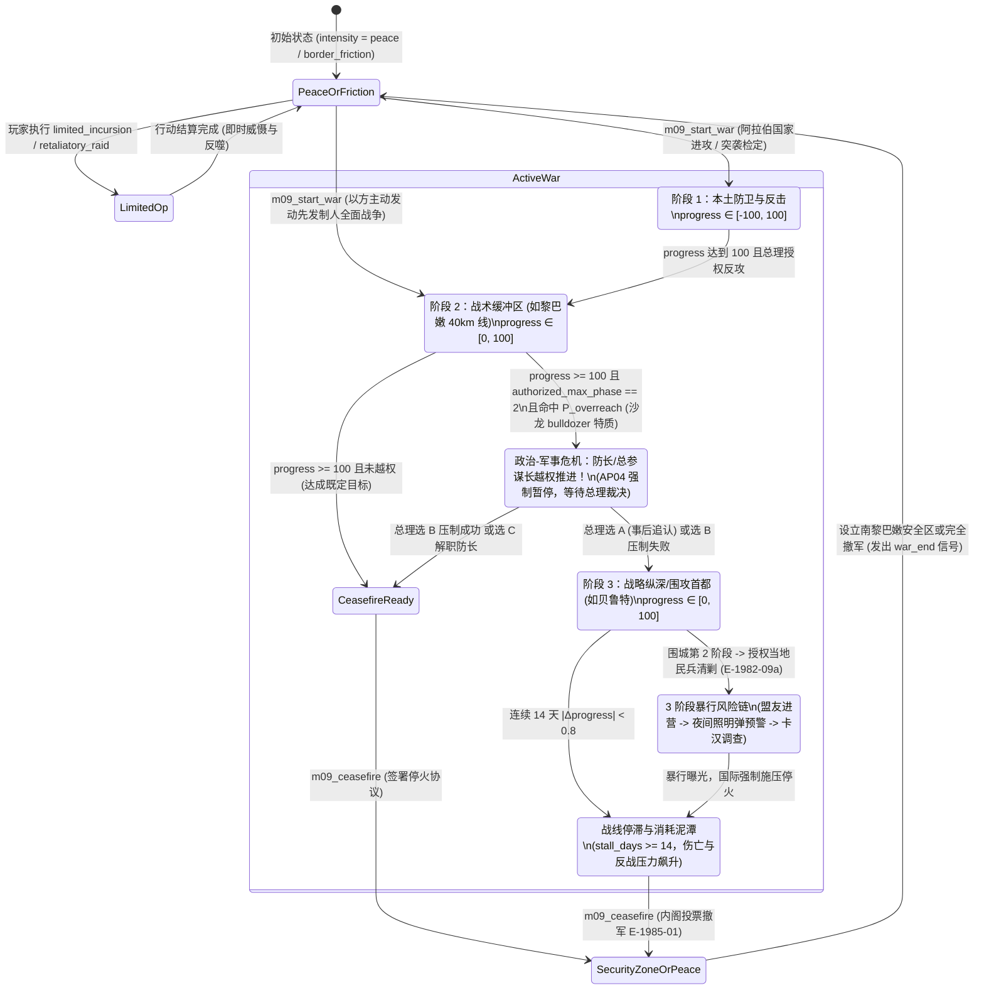

# M09 — 军事、安全与情报（Military, Security & Intelligence）

## 0. 元信息

| 项目 | 内容 |
|---|---|
| **模块编号** | `M09` |
| **模块名称** | 军事、安全与情报（Military, Security & Intelligence） |
| **规格版本** | `v1.0.0`（2026-10-17） |
| **作者** | 商业策略游戏资深系统设计师（子代理） |
| **所属文件** | `docs/specs/M09_military_intel.md` |
| **机器数据产物** | `data/military_campaigns.yaml`、`data/special_ops.yaml`（构建脚本转为同名 `.json`） |
| **参考实现路径** | `sim/m09/military_intel.py`、`sim/m09/war_engine.py`、`sim/m09/intel_nuclear.py` |
| **依赖模块** | `M01`（步骤 3 `military_daily`、步骤 8 `security_weekly`、步骤 10 月度漂移、`combat` 随机子流、`AP04` 自动暂停信号、`custom` 处理函数登记）、`M02`（因果网节点与边、`term_provider`、`thr.*` 阈值）、`M03`/`M04`（`bloc_support`、`party_standing`、承诺违约条件 `at_war()`）、`M05`（`sec` 类安全政策与 `mil` 类军事行动）、`M06`（`defense_minister, chief_of_staff, mossad_chief, shin_bet_chief` 能力与特质 `bulldozer, in_subordinate, spy_master, iron_fist`、`minister_overreach`、战争伤亡对 `character_stress` 的负荷）、`M07`（`country_war_readiness, regime_hostility, popular_hostility, war_probability, enemy_nuclear_progress, arms_reliability, us_admin_relation`）、`M08`（`pal_hostility, faction_strength, faction_legitimacy, uprising_risk`）、`M10`（`budget_slider[defense]`、战时财政 `one_off_flows["budget_balance"]`、外汇乘数 `fx_spend`、动员对 `growth` 冲击）、`M11`（`region_security`、动态区与南黎巴嫩安全区）、`M12`（战争/暴行/情报事件钩子与 `at_war()`、`last_ceasefire_date()` 表达式函数） |
| **遵循裁定** | `D-001`–`D-006`、`D-010`–`D-015`、`D-020`–`D-025`、`D-030`–`D-035`、`D-040`–`D-045`、`D-050`–`D-055`、`D-060`–`D-068` |

### 0.1 对标机制与超越目标

| 对标作品与机制 | 借鉴锚点（见 `docs/research/`） | 本模块必须规避的缺陷与超越方案 |
|---|---|---|
| **Victoria 3 — 战线制与政治家视角战争**（`paradox_lessons.md` §2.2、要求 `D14` / `A12`） | 玩家扮演政府首脑而非战区连长：划定战略目标、调配国家动员资源、选派统帅，不在地图上逐格微操步兵师。 | **规避“抽象到沦为无聊旁观者”与“不知为何输赢”**：<br>1. 设计**六大战线 × 三阶段战役目标 + 内阁授权停止线**结构（以 1982 黎巴嫩战争“40公里线 → 舒夫/贝卡叙军防空网 → 贝鲁特公路与围城”为标准范式）；<br>2. 战中提供**6 大高频政治-战略决策点**（预备役动员档位、授权作战阶段上限、是否批准打击驻黎叙军、交战规则与当地民兵协同、申请美国紧急空运、回应美苏停火调停）；<br>3. 每日步骤 3 战报面板实时列出推进度与伤亡的**前 5 项正负贡献因子**（对齐 `benchmarks.md` `W-x3`）。 |
| **白日升（*Rise of the White Sun*）— 将领自主性与涌现失控**（`benchmarks.md` §1.3、`W4`、`W-x1`） | 强悍下属的隐藏野心与特质会自发制造失控叙事，迫使文官首脑为既成事实买单或付出政治代价。 | **超越纯脚本事件**：当战线推进至内阁授权停止线（如阿瓦利河 40 公里线）时，持有 `bulldozer` / `in_subordinate` 特质的国防部长（沙龙）或总参谋长（埃坦）按公式每日/每周检定**擅自越权扩大战争**，触发 `E-1982-06b` 式政治危机；杜绝固定阈值机械点击。 |
| **Democracy 4 — 因果透明与极端威胁情报网**（`benchmarks.md` §4.2、§4.6、`D1`、`D6`、`R7`） | 安全投入、情报机构能力与恐袭/暗杀/起义风险之间有清晰的加权因果链。 | **杜绝“无脑刷威慑”的支配策略（`R7`）**：严格落实 `contradiction_parameters.md` §8.3 的非线性权衡——军事行动对 `deterrence` 的收益服从**边际递减曲线** $\Delta D \propto x(1 - D/100)$，而对阿拉伯/巴勒斯坦民间敌意的刺激服从**平方级加速反噬** $\Delta H \propto x^2$；大规模轰炸在威慑高位时得不偿失。 |
| **Suzerain — 办公桌简报与道德责任三段论**（`benchmarks.md` §3.2、`S2`、设计文档 §15.3-9） | 情报简报以带有置信度与印章的卷宗呈现；重大道德与法治危机分阶段落地。 | **三阶段暴行与丑闻结构 + 情报迷雾（“概念 Conceptia”）**：<br>1. 事前政策抉择（如长枪党入营 `E-1982-09b`、辛贝特审讯惯例 `E-G04-19`）**只显示风险等级提示**，隐藏具体乘数；暴行本身（`E-1982-09c`、`E-1984-04a`）为概率检定的被动事件；事后（`E-1982-09d` / `E-1983-02a` 卡汉委员会）迫使总理在法治问责与掩盖集权间抉择；<br>2. 战略自满度（`complacency`）高企时，情报报告会产生**系统性乐观偏差**，复现 1973 年赎罪日战争前夕的“概念（Conceptia）”盲区。 |

---

## 1. 设计意图

### 1.1 核心取舍（一句话）
**玩家必须在“以强硬军事行动、高动员与放宽交战规则换取短期威慑与边境安全”与“承受财政外汇枯竭、伤亡引发的国内反战浪潮与贝京个人精神崩溃、国防部长越权失控、阿拉伯民间敌意平方级反噬及美欧外交孤立”之间做出不可兼得的政治决断。**

### 1.2 决策频率与信息来源
- **和平与低烈度摩擦期（每月 1–2 次决策）**：
  - 玩家通过【安全与情报】主面板审阅摩萨德（外部敌国战备、开战概率、伊拉克/伊朗核进度剩余月数）与辛贝特（占领区起义风险、激进派系实力、犹太地下组织）的**模糊区间情报简报**；
  - 决定是否下达跨境报复突袭（`retaliatory_raid`）、定点清除（`targeted_killing`）、外部情报复核（`intelligence_review`，压低战略自满度），或在敌国核反应堆装料闭窗前拍板外科手术打击（`preemptive_strike` / `E-1981-06a` 奥西拉克空袭）；
  - 调整安全类政策杠杆（`retaliation_doctrine` 报复原则、`nuclear_signaling` 核模糊政策、`shin_bet_oversight` 辛贝特监督、`lebanon_proxy` 南黎民兵支持）。
- **全面战争或有限地面入侵期（每周 2–3 次高强度决策）**：
  - 战争爆发当天自动触发 `AP04` 强制暂停；
  - 玩家在【战时安全内阁】态势图上设定或调整：**① 预备役动员档位**（常备 10 / 局部 35 / 战区 65 / 全面 95）；**② 内阁授权作战阶段停止线**（`authorized_phase_cap`：第 1、2 或 3 阶段）；**③ 是否授权交战驻黎叙军或摧毁防空网**；**④ 前线交战规则与当地民兵协同等级**（`roe_level`）；**⑤ 是否消耗对美关系请求紧急军火空运**；**⑥ 何时接受停火或单方面撤军**。
  - 信息来源：战线每日推进条与伤亡统计牌、悬浮展开的“今日战果前 5 项贡献因子”Tooltip、内阁防长/总参谋长性格与越权风险预警灯、美苏外交停火压力计。

### 1.3 失败状态与恢复路径
1. **战略自满导致突袭溃败（1973 式危机）**：
   - **成因**：长期和平与高威慑推高隐藏参数 `complacency >= 65`，情报简报产生严重乐观偏差；敌国 `war_probability >= 55` 发动突袭，触发 `strategic_surprise_shock`（前 14 天以军战力 $\times 0.65$，战线大幅后退，公众安全感与党内地位雪崩）。
   - **恢复路径**：立即下达全面总动员（`mobilization_target = 95`）→ 启用 `request_us_wartime_airlift`（以战略依赖度上升与外交让步换取美军紧急补给，战备立即 $+12$）→ 顶住前两周冲击待 `complacency` 归零后反攻收复失地 → 战后接受国家调查委员会（如阿格拉纳特/卡汉模式）更换失职将领以挽回 `rule_of_law` 与选民信任。
2. **局部战争失控演变为占领泥潭（1982 黎巴嫩式危机）**：
   - **成因**：任命高野心且具 `bulldozer` + `in_subordinate` 特质的防长（沙龙），在“40公里有限行动”达标后越权推进至贝鲁特并卷入叙军交战，进入第 3 阶段围城与 `OCCUPATION_QUAGMIRE`（黎巴嫩泥潭），叠加难民营暴行事件（`E-1982-09c`），导致每周持续伤亡、40 万人反战示威、外汇流失与贝京 `character_stress` 突破 85 触发退场危机（`E-1983-08`）。
   - **恢复路径**：在 `E-1982-06b` 中消耗政治资本强行叫停越权或撤换防长；若已陷入泥潭，则通过 `E-1982-09d` 设立卡汉委员会切割政治责任，并执行分阶段撤军至南黎巴嫩安全区（`E-1985-01` 选项 A 或行动 `withdraw_to_security_zone`），止住每日财政与人命失血。

### 1.4 后期（第 10–20 年）如何保持新鲜感
- **安全威胁代际演进**：
  - **第 1–5 年（1977–1982）**：以正规装甲防线对峙（埃及、叙利亚）、巴解南黎巴嫩火炮越境（利塔尼行动、加利利和平行动）与伊拉克奥西拉克核反应堆外科手术打击为核心；
  - **第 6–10 年（1983–1987）**：巴解主力撤往突尼斯后，真主党（`hezbollah`）在南黎巴嫩崛起，开启自杀式袭击与安全区游击消耗战（`E-G04-18`）；国内曝出 300 路公交车辛贝特丑闻（`E-1986-05`）、波拉德间谍案（`E-1985-11`）与瓦努努核泄密（`E-1986-10`），安全焦点转向“法治监督 vs 机构特权”；
  - **第 11–20 年（1987–1997）**：占领区爆发第一次巴勒斯坦大起义（`E-1987-12a`）与哈马斯成立（`E-1987-12b`），高昂的常规军备与F-16机群对街巷投石少年束手无策，反而因电视画面导致 `intl_legitimacy` 与 `rule_of_law` 持续流血；1991 年海湾战争飞毛腿导弹袭击本土（`E-1991-01`）与两伊战后伊朗核计划重启（`enemy_nuclear_progress[iran]`），迫使玩家在“打破数十年有仇必报传统以换取美国贷款担保与马德里和会入场券”中做出全新抉择。

---

## 2. 读写清单

> 严格遵循 `contracts.md` §3、§6 与 `DECISIONS.md`：M09 仅在步骤 3（`military_daily`）、步骤 8（`security_weekly`）及步骤 10（随 M02 统一结算）直接写入自身为 `owner` 的参数；对其他模块的参数一律通过提交标准 `Effect` 修改。

### 2.1 M09 主写参数（`owner: M09`）

| 参数 ID | 中文名 | 类型 | 作用域 | 范围 | 结算步骤 | 写入方式与说明 |
|---|---|---|---|---|---|---|
| `readiness` | 战备 | `stock` | `national` | `[0, 100]` | 步骤 3（战时日损耗）、步骤 10（月度回归） | 衡量以军装备完好率、弹药储备与训练水平；1977-06-20 开局值 `72.0` |
| `mobilization` | 动员水平 | `stock` | `national` | `[0, 100]` | 步骤 3（每日） | 衡量现役与预备役征召比例；每日向 `mobilization_target` 渐进移动；1977-06-20 开局值 `10.0` |
| `deterrence` | 威慑值 | `stock` | `national` | `[0, 100]` | 步骤 3（交战/行动即时结算）、步骤 10（月度自然衰减与核底线） | 衡量外部敌对势力对以军报复能力与意志的敬畏度；1977-06-20 开局值 `68.0` |
| `public_security` | 公众安全感 | `stock` | `national` | `[0, 100]` | 步骤 8（每周日） | 衡量本国公众对日常治安、恐袭防范与边境安全的信心（M10 通过别名 `security_index` 读取）；1977-06-20 开局值 `62.0` |
| `complacency` | 战略自满度 | `hidden` | `national` | `[0, 100]` | 步骤 3（遭受突袭时归零）、步骤 10（月度累积） | 隐藏参数（`visible: fuzzy`）；和平与高威慑期缓慢上升，侵蚀有效威慑并造成情报乐观偏差；1977-06-20 开局值 `20.0` |
| `nuclear_progress` | 核计划进度 | `hidden` | `national` | `[0, 100]` | 步骤 10（每月） | 隐藏参数（`visible: fuzzy`，`era: [1957, null]`）；衡量迪莫纳核设施与投送能力成熟度；1977-06-20 开局值 `78.0` |
| `nuclear_exposure_risk` | 核计划暴露风险 | `hidden` | `national` | `[0, 100]` | 步骤 10（每月） | 隐藏参数（`visible: fuzzy`，`era: [1957, null]`）；≥60 时激活瓦努努泄密事件 `E-1986-10`；1977-06-20 开局值 `42.0` |
| `state_integration` | 国家整合度 | `stock` | `national` | `[0, 100]` | 步骤 10（每月） | `era: [1948, 1950]` 建国初期“一支军队”整合度；1977-06-20 开局固定为 `100.0` |
| `intel_accuracy`（附录 A 提案） | 情报精度 | `derived` | `national` | `[0, 100]` | 步骤 10（每月）及首长变更时重算 | 由摩萨德/辛贝特首长能力、特质、国防预算与 `complacency` 实时派生；1977-06-20 开局值 `79.650` |

### 2.2 M09 只读引用或通过效果修改的其他模块参数

| 参数 ID | 所属模块 | 读/写（效果） | 结算步骤 | 用途说明 |
|---|---|---|---|---|
| `budget_slider[defense]` | `M10` | 读 | 步骤 3、8、10 | 读取当前生效的国防预算滑块值（开局 `65.0`），决定 `readiness` 目标基线、`intel_accuracy` 与 `nuclear_progress` 增速 |
| `budget_balance`（经 `one_off_flows`）、`fx_reserves`、`growth` | `M10` | 效果（`add` / 修正器） | 步骤 3、9、16 | 战时每日消耗记入 `one_off_flows["budget_balance"]`（遵循 `D-010`）；战时挂载 `wartime_fx_drain` 修正器提升 `fx_spend`；高动员通过边压低季度 `growth` |
| `arms_reliability[usa/france/uk]` | `M07` | 读 + 效果 | 步骤 3、10 | 决定空军优势、战备上限与持续作战补给修正；美国武器暂停交付时压低战备 |
| `country_war_readiness[c]`、`regime_hostility[c]`、`popular_hostility[c]`、`regime_stability[c]`、`peace_treaty_state[c]`、`war_probability[c]` | `M07` | 读 + 效果 | 步骤 3、8、10 | 计算正规战线敌方战力 $P_{\text{enemy}}$；军事行动产生平方级 `popular_hostility` 反噬；模糊情报面板生成估算区间 |
| `enemy_nuclear_progress[iraq/iran]` | `M07` | 读 + 效果 | 步骤 3、10 | 监测奥西拉克/伊朗核反应堆进度，计算剩余月数模糊简报；`preemptive_strike` 扣减进度 |
| `us_admin_relation`、`us_congress_relation`、`intl_legitimacy`、`power_relation[uk/france/ussr]` | `M07` | 读 + 效果 | 步骤 3、5 | 计算美苏停火施压速率、美国战时紧急空运前提，以及跨境打击/暴行/核警报的外交惩罚 |
| `pal_hostility`、`uprising_risk`、`faction_strength[f]`、`faction_legitimacy[f]`、`islamic_assoc_strength` | `M08` | 读 + 效果 | 步骤 3、8、10 | 巴解（`fatah`）、真主党（`hezbollah`）、长枪党（`phalange`）、南黎军（`sla`）、哈马斯（`hamas`）在黎巴嫩/加沙/西岸的游击战力与清剿结算 |
| `region_security[r]` | `M11` | 读 + 效果 | 步骤 3、8 | 边境火箭袭击（`E-G04-05`）、报复行动、安全区驻军改变 `galilee, tel_aviv, jerusalem, west_bank, gaza, golan` 安全度；汇总计算 `public_security` |
| `policy_level[retaliation_doctrine / nuclear_signaling / military_censorship / shin_bet_oversight / arms_sourcing / lebanon_proxy / reserve_duty_days / conscription_length]` | `M05` | 读 | 步骤 3、8、10 | 读取 8 项安全政策杠杆档位，驱动交战规则、核暴露风险、兵源战备与南黎代理民兵实力 |
| `character_stress[c]`、`relation[c]`、在任首长属性与特质 | `M06` | 读 + 效果 | 步骤 3、6、8、10 | 读取 `defense_minister`、`chief_of_staff`、`mossad_chief`、`shin_bet_chief` 的 `military/competence` 与 `bulldozer/in_subordinate/spy_master/iron_fist` 特质；战时伤亡推高总理与防长 `character_stress` |
| `bloc_support[b]`、`party_standing`、`rule_of_law`、`centralization`、`draft_exemption` | `M02`/`M03`/`M04`/`M13` | 读 + 效果 | 步骤 3、8、10 | 兵役豁免 `draft_exemption` 超过 30 侵蚀 `readiness`（边 `X.DEX.03`）；战争伤亡与暴行调查影响 `bloc_support`、`party_standing`、`rule_of_law` |

---

## 3. 状态与数据结构

### 3.1 运行时状态结构（`state.m09`）

`state.m09` 挂载于全局 `GameState` 下。所有浮点数遵循 `D-015` 在结算步结束时按 `1e-6` 量化（`q(x) = round(x * 1_000_000) / 1_000_000`），确保存档与跨语言回放严格一致：

```python
from typing import Dict, List, Optional, Tuple
from dataclasses import dataclass, field

@dataclass
class WarCampaignState:
    war_id: str                           # 战役唯一ID，如 "war_lebanon_1982", "op_litani_1978"
    front_id: str                         # 所属战线: "egypt"|"jordan"|"syria"|"lebanon"|"gaza"|"internal"
    scope: str                            # 战争规模: "limited" (有限入侵) | "full" (全面战争)
    initiator: str                        # 发起方: "israel" 或敌国ID ("egypt"|"syria"|"jordan"|"iraq"|"lebanon")
    start_day: int                        # 开战绝对游戏日 (day_index)
    duration_days: int = 0                # 已持续天数
    current_phase: int = 1                # 当前所处战役阶段: 1, 2, 3
    authorized_phase_cap: int = 1         # 内阁授权最高作战阶段(停止线): 1, 2, 3
    phase_progress: float = 0.0           # 当前阶段推进度: [-100.0, 100.0]，>=100 进入下一阶段或达成目标
    syria_engaged: bool = False           # (黎巴嫩战线专属) 是否已与驻黎叙利亚军队全面交火
    sams_destroyed: bool = False          # (黎巴嫩/叙利亚战线) 是否已摧毁贝卡谷地叙军防空导弹网
    air_superiority: float = 75.0         # 当前战线空中优势指数: [0.0, 100.0]
    idf_casualties_total: int = 0         # 本场战争以军累计阵亡人数 (KIA)
    idf_casualties_weekly: int = 0        # 本周新增以军阵亡人数 (每周日步骤8结算后清零)
    enemy_casualties_total: int = 0       # 敌军/武装分子累计伤亡估值
    civilian_collateral_index: float = 0.0 # 平民附带伤亡与人道危机指数: [0.0, 100.0]
    us_resupply_active: bool = False      # 美国紧急军火空运是否激活
    ceasefire_pressure: float = 0.0       # 美苏国际停火施压累积值: [0.0, 100.0]
    surprise_shock_days_left: int = 0     # 若遭遇战略突袭，剩余震荡减益天数 (初始 14 天)
    overreach_checked_phases: List[int] = field(default_factory=list) # 已触发过越权检定的阶段列表
    last_daily_factors: List[Tuple[str, float]] = field(default_factory=list) # 最近一日推进度前5项贡献因子

@dataclass
class FrontState:
    front_id: str                         # "egypt" | "jordan" | "syria" | "lebanon" | "gaza" | "internal"
    status: str                           # "PEACE" | "BORDER_FRICTION" | "LIMITED_OP" | "FULL_WAR" | "OCCUPATION_QUAGMIRE" | "SECURITY_ZONE"
    border_friction: float = 10.0         # 边境摩擦热度: [0.0, 100.0]
    roe_level: int = 1                    # 交战规则: 0=严格受限(随军法务), 1=标准交战准则, 2=放宽重火力与民兵协同
    local_militia_allied: Optional[str] = None # 协同民兵ID: "phalange" | "sla" | None
    security_zone_active: bool = False    # 是否维持常驻边境安全区(如1985-2000南黎安全区)
    quagmire_months: int = 0              # 陷入占领泥潭(OCCUPATION_QUAGMIRE)的累计月数
    active_war: Optional[WarCampaignState] = None

@dataclass
class FuzzyIntelReport:
    target_type: str                      # "country_readiness" | "war_prob" | "enemy_nuclear" | "uprising_risk" | "faction_strength"
    target_key: str                       # 如 "syria", "iraq", "fatah", "national"
    true_value: float                     # 底层真实值(仅引擎内部可见)
    est_low: float                        # 呈现给玩家的区间下限
    est_high: float                       # 呈现给玩家的区间上限
    threat_tier_zh: str                   # 定性评级: "低" | "中" | "高" | "极危"
    confidence_pct: int                   # 情报置信度百分比: [20, 95]
    est_months_to_breakthrough: Optional[int] = None # 仅针对核计划: 预计距装料闭窗剩余月数
    updated_day: int = 0                  # 上次更新绝对日

@dataclass
class NuclearState:
    arsenal_tier: int = 2                 # 0=早期研发(1957-66), 1=初步组装(1967-73), 2=成熟二级核威慑(1974+)
    alert_active: bool = False            # 是否处于核警报(参孙选项威慑姿态)
    alert_cooldown_days: int = 0          # 核警报冷却剩余天数
    vanunu_leaked: bool = False           # 瓦努努核泄密事件是否已发生
    lakam_active: bool = True             # 科学关系局(Lakam)在美秘密搜集是否开启(关联波拉德案 E-1985-11)

@dataclass
class M09State:
    mobilization_target: float = 10.0     # 玩家设定的目标动员水平: 10.0(常备) | 35.0(局部) | 65.0(战区) | 95.0(全面)
    intel_accuracy: float = 79.65         # 当前综合情报精度: [0.0, 100.0]
    peace_months_streak: int = 44         # 连续无全面战争月数(1973-10停火至1977-06为44个月)
    last_ceasefire_date: Optional[str] = "1974-05-31" # 最近一次停火日期(叙以脱离接触协定)
    wartime_fiscal_acc: float = 0.0       # 当月累计战时额外财政支出(%)
    atrocity_risk_multipliers: Dict[str, float] = field(default_factory=dict) # 事前决策点写入的暴行风险乘数
    fronts: Dict[str, FrontState] = field(default_factory=dict)
    intel_reports: Dict[str, FuzzyIntelReport] = field(default_factory=dict)
    nuclear: NuclearState = field(default_factory=NuclearState)
```

### 3.2 贝京 1977（`1977-06-20`）开局状态快照初值

| 状态字段 / 参数 | `1977-06-20` 初值 | 历史依据与说明 |
|---|---|---|
| `readiness` | `72.0` | 赎罪日战争后经美国大规模换装（F-15首装、M60坦克补齐），战备恢复至较高水平 |
| `mobilization` / `mobilization_target` | `10.0` / `10.0` | 和平时期常备军与轮训预备役基线 |
| `deterrence` | `68.0` | 1973年逆转取胜与1976年恩德培奇袭成功后的高威慑基线 |
| `public_security` | `62.0` | 埃以、叙以脱离接触后南线与戈兰平静，但加利利受南黎巴解袭扰（与 M10 `security_index = 62.0` 完全对齐） |
| `complacency` | `20.0` | 阿格拉纳特委员会整顿后情报界保持警惕，自满度处于低位（与 M07 §4.5.3 算例 `complacency = 20.0` 完全对齐） |
| `nuclear_progress` | `78.0` | 迪莫纳反应堆已稳定运行十余年，具备实战化核威慑与杰里科-1型导弹/幽灵机投送能力（`arsenal_tier = 2`） |
| `nuclear_exposure_risk` | `42.0` | 严格实行“不首先在中东引入核武器”的阿米尔（Amimut）核模糊政策，尚未发生瓦努努泄密 |
| `state_integration` | `100.0` | 1948年“阿尔塔列纳号”与帕尔马赫整编早已完成 |
| `intel_accuracy` | `79.65` | 摩萨德局长霍菲（`military=84, spy_master`）与辛贝特局长沙洛姆（`military=80, spy_master`）在任，国防预算 `65.0` |
| `fronts["egypt"]` | `PEACE`, `border_friction: 15.0`, `roe_level: 1` | 1975年西奈第二阶段脱离接触协定生效，驻有美军观察员 |
| `fronts["jordan"]` | `PEACE`, `border_friction: 10.0`, `roe_level: 1` | 约旦河谷事实停火与“开放桥梁”默契 |
| `fronts["syria"]` | `PEACE`, `border_friction: 25.0`, `roe_level: 1` | 戈兰高地联合国观察员缓冲区，但叙军于1976年进入黎巴嫩 |
| `fronts["lebanon"]` | `BORDER_FRICTION`, `border_friction: 55.0`, `roe_level: 1`, `local_militia_allied: "sla"` | 巴解组织盘踞南黎“法塔赫兰”，以色列已开启“好篱笆”政策有限资助哈达德少校基督徒民兵 |
| `fronts["gaza"]` | `PEACE`, `border_friction: 22.0`, `roe_level: 1` | 1971年沙龙铁腕清剿后加沙武装活动暂处低谷，但人口稠密、生活水平低 |
| `fronts["internal"]` | `PEACE`, `border_friction: 18.0`, `roe_level: 1` | 约旦河西岸与绿线内治安战线；古什埃穆尼姆定居活动升温 |

### 3.3 战役与特种行动配置 Schema（`data/military_campaigns.yaml` 与 `data/special_ops.yaml`）

```yaml
# data/military_campaigns.yaml —— 战线与三阶段战役模板定义
schema_version: 1

fronts:
  egypt:
    name_zh: 西奈—苏伊士运河战线
    enemy_country: egypt
    linked_dynamic_region: sinai
    base_air_difficulty: 35.0
    phases:
      1: {name_zh: 固守米特拉与吉迪山口防线, terrain_mod: 0.90, base_kia_rate: 18.0, collateral_rate: 0.4, fiscal_daily: 0.12}
      2: {name_zh: 装甲反击推进至运河东岸, terrain_mod: 1.00, base_kia_rate: 22.0, collateral_rate: 0.6, fiscal_daily: 0.15}
      3: {name_zh: 跨运河西岸合围与逼近开罗公路, terrain_mod: 0.75, base_kia_rate: 28.0, collateral_rate: 1.2, fiscal_daily: 0.20}

  syria:
    name_zh: 戈兰高地—大马士革战线
    enemy_country: syria
    linked_dynamic_region: golan
    base_air_difficulty: 55.0
    phases:
      1: {name_zh: 赫尔蒙山与紫线装甲防御战, terrain_mod: 0.70, base_kia_rate: 20.0, collateral_rate: 0.5, fiscal_daily: 0.12}
      2: {name_zh: 突破库奈特拉防线与摧毁防空网, terrain_mod: 0.75, base_kia_rate: 25.0, collateral_rate: 0.8, fiscal_daily: 0.16}
      3: {name_zh: 推进至萨萨突出部（距大马士革40公里）, terrain_mod: 0.65, base_kia_rate: 32.0, collateral_rate: 1.5, fiscal_daily: 0.22}

  jordan:
    name_zh: 约旦河谷—东岸战线
    enemy_country: jordan
    linked_dynamic_region: west_bank
    base_air_difficulty: 25.0
    phases:
      1: {name_zh: 控制约旦河渡口与杰里科通道, terrain_mod: 0.95, base_kia_rate: 10.0, collateral_rate: 0.5, fiscal_daily: 0.08}
      2: {name_zh: 攻占吉拉德山地制高点, terrain_mod: 0.70, base_kia_rate: 15.0, collateral_rate: 0.9, fiscal_daily: 0.11}
      3: {name_zh: 威逼安曼外围迫使王室求和, terrain_mod: 0.60, base_kia_rate: 20.0, collateral_rate: 1.6, fiscal_daily: 0.14}

  lebanon:
    name_zh: 北部边境—黎巴嫩战线
    enemy_country: lebanon
    primary_non_state: fatah            # flag("plo_evacuated_tunis") 后自动切换为 hezbollah
    secondary_country: syria            # 驻黎巴嫩贝卡谷地与舒夫山区叙军
    linked_border_region: galilee
    base_air_difficulty: 20.0           # 若 syria_engaged 且 not sams_destroyed，临时 +35.0
    phases:
      1:
        name_zh: 阶段一：推进至利塔尼/阿瓦利河（40公里加利利安全线）
        terrain_mod: 0.85
        base_kia_rate: 6.0
        collateral_rate: 1.2
        fiscal_daily: 0.08
        on_complete_limited: {set_flag: litani_buffer_established, region_security_galilee: 12.0, fatah_strength: -8.0}
      2:
        name_zh: 阶段二：舒夫山区迂回与贝卡谷地叙军防空网决战
        terrain_mod: 0.65
        base_kia_rate: 14.0
        collateral_rate: 1.8
        fiscal_daily: 0.14
        requires_syria_decision: true
        on_complete: {fatah_strength: -10.0, syria_readiness: -12.0, deterrence: 6.0}
      3:
        name_zh: 阶段三：切断贝鲁特—大马士革公路与合围西贝鲁特
        terrain_mod: 0.40
        base_kia_rate: 18.0
        collateral_rate: 3.5
        fiscal_daily: 0.18
        triggers_event: E-1982-08       # 抵达西贝鲁特外围触发贝鲁特围城抉择
        quagmire_on_stay: true          # 达成后转入 OCCUPATION_QUAGMIRE（黎巴嫩泥潭）

  gaza:
    name_zh: 加沙地带治安与清剿战线
    enemy_country: null
    primary_non_state: fatah            # 1988年后叠加 hamas
    linked_dynamic_region: gaza
    base_air_difficulty: 5.0
    phases:
      1: {name_zh: 封锁拉法走廊与难民营外围宵禁, terrain_mod: 0.60, base_kia_rate: 2.0, collateral_rate: 2.2, fiscal_daily: 0.03}
      2: {name_zh: 深入贾巴利耶与沙蒂难民营搜捕骨干, terrain_mod: 0.45, base_kia_rate: 4.5, collateral_rate: 3.8, fiscal_daily: 0.05}
      3: {name_zh: 全面直接军事接管与武装网络瓦解, terrain_mod: 0.35, base_kia_rate: 6.0, collateral_rate: 5.0, fiscal_daily: 0.07}

  internal:
    name_zh: 约旦河西岸与本土反恐战线
    enemy_country: null
    primary_non_state: fatah
    linked_dynamic_region: west_bank
    base_air_difficulty: 5.0
    phases:
      1: {name_zh: 城市检查站封控与大规模行政拘留, terrain_mod: 0.70, base_kia_rate: 1.5, collateral_rate: 1.8, fiscal_daily: 0.03}
      2: {name_zh: 纳布卢斯与希伯伦山地腹地清剿（铁拳行动）, terrain_mod: 0.55, base_kia_rate: 3.5, collateral_rate: 3.0, fiscal_daily: 0.05}
      3: {name_zh: 解散全境民选机构与全面军管压制, terrain_mod: 0.45, base_kia_rate: 5.0, collateral_rate: 4.2, fiscal_daily: 0.06}
```

---

## 4. 规则与公式

> **随机数与精度约定**：本模块所有随机抽样均使用 `M01` 提供的 `combat` 随机子流（`rng.stream("combat")`），以保证战局、突袭检定与特种行动可 100% 确定性回放。所有公式计算结果在写入状态前经 `q(x)` 量化至 `1e-6`。

### 4.1 动员水平（`mobilization`）与战备度（`readiness`）规则与公式

#### 4.1.1 预备役动员四档位与每日推进公式（步骤 3 `military_daily`）
以色列的国防基石是全民预备役体系（平时只维持小规模义务兵与职业军官骨干，战时 48–72 小时内将数十万预备役公民编入一线装甲旅）。玩家通过行动或战时安全内阁面板将 `mobilization_target` 设为以下 4 个标准档位之一：

| 档位编号 | 档位名称 | `mobilization_target` | 适用场景与解锁条件 | 每日财政消耗 $\Delta F_{\text{mob}}$（占年度预算%/日） |
|---|---|---|---|---|
| **档位 0** | 常备值班（Peacetime Standing） | `10.0` | 和平时期默认档位（`not at_war()` 时可随时切回） | `0.000` |
| **档位 1** | 局部预备役征召（Partial Call-up） | `35.0` | 边境摩擦升级、有限地面入侵（如利塔尼行动）或威慑演习 | `0.025`（约合每月 `0.75%`） |
| **档位 2** | 战区级总动员（Theater Mobilization） | `65.0` | 单线全面战争或大规模地面行动（如 1982 黎巴嫩战争高峰期） | `0.070`（约合每月 `2.10%`） |
| **档位 3** | 全国全面总动员（8号命令 / Tzav 8） | `95.0` | 仅当处于 `FULL_WAR` 或任一邻国 `war_probability >= 65.0` 时可激活 | `0.150`（约合每月 `4.50%`） |

- **触发时机**：每个游戏日步骤 3（`military_daily`）。
- **每日 `mobilization` 渐变公式**：
  $$\text{mobilization}(d) = \begin{cases} \min\big(\text{mobilization\_target},\ \text{mobilization}(d-1) + 12.0\big) & \text{若 } \text{mobilization}(d-1) < \text{mobilization\_target}\ (\text{紧急征召：}+12.0\text{ 点/日}) \\ \max\big(\text{mobilization\_target},\ \text{mobilization}(d-1) - 5.0\big) & \text{若 } \text{mobilization}(d-1) > \text{mobilization\_target}\ (\text{分批复员：}-5.0\text{ 点/日}) \\ \text{mobilization}(d-1) & \text{其他} \end{cases}$$
- **动员对财政、外汇与经济增长的每日/月度联动（对接 M10）**：
  1. **每日战时动员财政消耗**：当 $\text{mobilization}(d) > 10.0$ 时，每日产生额外财政支出 $\Delta F_{\text{mob}}(d) = 0.0015 \times (\text{mobilization}(d) - 10.0) + \mathbb{I}(\text{mobilization}(d) > 50.0) \times 0.0008 \times (\text{mobilization}(d) - 50.0)$（单位：年度预算%/日），每日步骤 3 直接累加至 `one_off_flows["budget_balance"] -= \Delta F_{\text{mob}}(d)`（由 M10 在步骤 9 月度结算时计入赤字与公共债务，严格遵循 `D-010`）。
  2. **劳动力抽调对季度 `growth` 的冲击**：除 M02 已登记的边 `M02.CIV.07`（战时猜疑）、`M02.CIV.14`（德鲁兹血盟）、`M02.ROL.06`（战时紧急状态）外，M09 在 `data/causal_edges.yaml` 中维护跨模块边 `M09.GRO.01`：当 `mobilization > 15.0` 时，每高 1 点对 `growth` 产生 $-0.06$ 的目标贡献（惯性 1 个季度），反映壮年技工、工程师与企业主被抽调前线导致的生产停摆。
- **算例（1982-06-06 黎巴嫩战争爆发下达档位 2 战区级动员 `65.0`）**：
  - 开局 `mobilization = 10.0`，玩家将 `mobilization_target` 设为 `65.0`：
  - 第 1 天结束：`10.0 + 12.0 = 22.0`；第 2 天：`34.0`；第 3 天：`46.0`；第 4 天：`58.0`；第 5 天：$\min(65.0, 58.0 + 12.0) = \mathbf{65.0}$（5 天内完成战区级动员集结）。
  - 达到 `65.0` 后，每日动员财政消耗 $\Delta F_{\text{mob}} = 0.0015 \times (65.0 - 10.0) + 0.0008 \times (65.0 - 50.0) = 0.0825 + 0.0120 = \mathbf{0.0945\%/\text{日}}$（持续 30 天消耗年度预算的 `2.835%`）；对季度 `growth` 的拖累为 $-0.06 \times (65.0 - 15.0) = \mathbf{-3.00\%}$。

#### 4.1.2 战备度（`readiness`）月度目标回归与战时日损耗公式
- **月度结算（步骤 10，随 M02 水平模式节点统一结算）**：
  `readiness` 作为 M02 `mode: level` 节点（惯性 $\alpha = 0.15$，基线 `baseline = 62.0`，软边界 `{lo_s: 15, hi_s: 90, w: 12}`），其每月目标值 $T_{\text{readiness}}$ 由以下 6 项求和（含 M06 `term_provider` 与 M02 `X.DEX.03`）：
  $$T_{\text{readiness}} = 62.0 + 0.45 \times (B_{\text{defense}} - 55.0) + 0.15 \times (\text{arms\_reliability}[\text{usa}] - 70.0) + T_{\text{M06}\to\text{readiness}} + T_{\text{service\_policy}} - 0.05 \times \max(0.0,\ \text{draft\_exemption} - 30.0) - 25.0 \times \mathbb{I}(\text{era} \le 1950) \times \left(1.0 - \frac{\text{state\_integration}}{100.0}\right)$$
  各项系数与含义：
  1. **国防预算支撑项**：$0.45 \times (B_{\text{defense}} - 55.0)$，其中 $B_{\text{defense}} = \text{budget\_slider}[\text{defense}]$（开局 `65.0` $\implies +4.50$ 点；若 1980 年砍国防预算至 `50.0` 则为 $-2.25$ 点）；
  2. **美制武器可靠度项**：$0.15 \times (\text{arms\_reliability}[\text{usa}] - 70.0)$（开局 `arms_reliability[usa] = 78.0` $\implies +1.20$ 点；若因奥西拉克或黎巴嫩轰炸遭美国暂停交付跌至 `55.0` 则为 $-2.25$ 点）；
  3. **M06 统帅能力项 $T_{\text{M06}\to\text{readiness}}$**（直接调用 M06 §4.1.3 公式）：
     $$T_{\text{M06}\to\text{readiness}} = 0.10 \times (S_{\text{eff}}(\text{defense\_minister}) - 60.0) + 0.10 \times (S_{\text{eff}}(\text{chief\_of\_staff}) - 60.0)$$
     （1977 开局：防长魏茨曼 `military = 84`、总参谋长古尔 `military = 86` $\implies +2.40 + 2.60 = +5.00$ 点；若防长空缺由贝京兼任，`E-1980-05a` 修正器 `pm_acting_defense` 额外压低目标 `-4.0` 点）；
  4. **兵役与预备役政策项 $T_{\text{service\_policy}}$**（对齐 M05 `reserve_duty_days`、`conscription_length`、`druze_track`）：
     $$T_{\text{service\_policy}} = 0.08 \times (\text{policy\_level}[\text{reserve\_duty\_days}] - 50.0) + 0.06 \times (\text{policy\_level}[\text{conscription\_length}] - 100.0) + 0.01 \times \text{policy\_level}[\text{druze\_track}]$$
     （1977 开局：`reserve_duty_days = 50`, `conscription_length = 100`, `druze_track = 100` $\implies 0 + 0 + 1.00 = +1.00$ 点）；
  5. **哈雷迪兵役豁免流失项（采纳 M02 附录 C `X.DEX.03`）**：$-0.05 \times \max(0.0, \text{draft\_exemption} - 30.0)$（1977 开局 `draft_exemption = 12.0` $\implies 0.0$）；
  6. **建国初期军队未整合惩罚**：1977 开局 `state_integration = 100.0` $\implies 0.0$。
- **战时每日弹药与装备损耗（步骤 3 `military_daily`）**：
  当任一战线 $f$ 处于活跃交战（`status in ["LIMITED_OP", "FULL_WAR"]`）时，每日步骤 3 直接扣减 `readiness`：
  $$\Delta \text{readiness}_{\text{combat}}(d) = -\sum_{f \in \text{active\_wars}} \Big(r_{\text{burn}}(f.\text{scope}) \times \big(1.0 - 0.55 \times \mathbb{I}(f.\text{us\_resupply\_active})\big)\Big)$$
  其中：有限行动 $r_{\text{burn}}(\text{"limited"}) = 0.25\text{ 点/日}$，全面战争 $r_{\text{burn}}(\text{"full"}) = 0.55\text{ 点/日}$；若美国紧急军火空运激活（`us_resupply_active == True`），每日弹药损耗降低 $55\%$。
- **算例（1977-06-20 开局月度战备目标值计算）**：
  - 代入开局值：$B_{\text{defense}} = 65.0$, $\text{arms\_reliability}[\text{usa}] = 78.0$, $T_{\text{M06}} = +5.00$, $T_{\text{service}} = +1.00$, $\text{draft\_exemption} = 12.0$：
    $$T_{\text{readiness}} = 62.0 + 0.45 \times (65 - 55) + 0.15 \times (78 - 70) + 5.00 + 1.00 - 0 = 62.0 + 4.50 + 1.20 + 5.00 + 1.00 = \mathbf{73.700000}$$
  - 开局当前值 `readiness = 72.0`，无冲击记忆项（$m_t = 0$），软边界压缩后 $T_{\text{soft}} = 73.70$，月度步骤 10 漂移增量 $\Delta = 0.15 \times (73.70 - 72.0) = \mathbf{+0.255000}$，月底更新为 `72.255`。

---

### 4.2 抽象但绝不旁观的战争系统：六大战线、三阶段目标与每日步骤 3 战斗结算公式（重点 1）

#### 4.2.1 六大战线与三阶段战役结构
所有军事冲突均在 6 条具名战线（`egypt, jordan, syria, lebanon, gaza, internal`）上展开。每场战役分为 **3 个递进的战略阶段（Phase 1 → Phase 2 → Phase 3）**，每个阶段的 `phase_progress` 从 `0.0` 推进至 `100.0`：
- **核心政治约束——内阁授权停止线（`authorized_phase_cap`）**：
  - 开战时，内阁决议（或玩家行动参数）设定本次战争的最高授权阶段 `authorized_phase_cap` $\in \{1, 2, 3\}$（例如 `E-1982-06a` 选项 A“批准 40 公里有限行动”将 `authorized_phase_cap` 设为 `1`；选项 B“批准沙龙大计划：直抵贝鲁特”将 `authorized_phase_cap` 设为 `3`）。
  - 当 `current_phase == authorized_phase_cap` 且 `phase_progress >= 100.0` 时，除非玩家主动下达【批准扩大作战范围（`authorize_phase_escalation`）】或国防部长/总参谋长触发**越权扩大战争（见 §4.3.2）**，否则部队在停止线上转入**原地固守待命**（不再向前推进，每日损耗与伤亡减半），等待政治停火或撤军指令。

#### 4.2.2 每日步骤 3 战斗结算公式（`military_daily`）
对每一条处于 `status in ["LIMITED_OP", "FULL_WAR"]` 且未停滞于停止线的战线 $f$（设其当前阶段为 $p \in \{1, 2, 3\}$），每日步骤 3 依次计算以下 6 个中间量与状态更新：

1. **以军战线有效战力指数 $P_{\text{IDF}}(f)$**（量纲：战力点，常规范围 `[20.0, 130.0]`）：
   $$P_{\text{IDF}}(f) = \Big(0.45 \times \text{readiness} + 0.55 \times M_{\text{eff}}(f) + 0.20 \times S_{\text{cmd}}\Big) \times M_{\text{supply}} \times M_{\text{surprise}}(f) \times M_{\text{integration}}$$
   其中：
   - **有效动员兵力 $M_{\text{eff}}(f)$**：
     - 若 `scope == "limited"`（有限行动，主要动用常备旅与少量预备役）：$M_{\text{eff}} = \min\big(100.0,\ 45.0 + 1.20 \times \text{mobilization}\big)$（当 `mobilization = 35` 时 $M_{\text{eff}} = 87.0$）；
     - 若 `scope == "full"`（全面战争，依赖大规模预备役兵团）：$M_{\text{eff}} = 100.0 \times \left(\frac{\text{mobilization}}{95.0}\right)^{0.75}$（当 `mobilization = 65` 时 $M_{\text{eff}} = 75.236$；当 `mobilization = 95` 时 $M_{\text{eff}} = 100.0$）；
     - 若同时在 $N_{\text{wars}} \ge 2$ 条全面战争战线作战，每条战线分摊兵力乘以 $\frac{1.0}{1.0 + 0.30 \times (N_{\text{wars}} - 1)}$。
   - **统帅指挥能力 $S_{\text{cmd}}$**：$S_{\text{cmd}} = 0.60 \times S_{\text{eff}}(\text{chief\_of\_staff}) + 0.40 \times S_{\text{eff}}(\text{defense\_minister}) + 8.0 \times \mathbb{I}(\text{defense\_minister 或 chief\_of\_staff 持有 war\_hero})$（1977 开局魏茨曼+古尔：`0.6*86 + 0.4*84 + 8 = 93.20`；1982 沙龙 `92` + 埃坦 `90` + `war_hero`：`0.6*90 + 0.4*92 + 8 = 98.80`）。
   - **后勤与武器可靠度乘数 $M_{\text{supply}}$**：$M_{\text{supply}} = \text{clamp}\big(0.75 + 0.003 \times \text{arms\_reliability}[\text{usa}] + 0.08 \times \mathbb{I}(f.\text{us\_resupply\_active}),\ 0.60,\ 1.15\big)$。
   - **战略突袭震荡乘数 $M_{\text{surprise}}(f)$**：若 $f.\text{surprise\_shock\_days\_left} > 0$（开战遭受战略突袭的前 14 天），$M_{\text{surprise}} = 0.65$（并将 `surprise_shock_days_left` 每日 `-1`）；否则 $M_{\text{surprise}} = 1.00$。
   - **建国整合乘数 $M_{\text{integration}}$**：$0.60 + 0.004 \times \text{state\_integration}$（1977 剧本恒为 `1.00`）。

2. **战线空中优势指数 $A_{\text{sup}}(f)$**（范围 `[0.0, 100.0]`）：
   $$A_{\text{sup}}(f) = \text{clamp}\Big(85.0 + 0.25 \times (\text{readiness} - 70.0) + 0.20 \times (\text{arms\_reliability}[\text{usa}] - 70.0) - D_{\text{enemy\_aa}}(f),\ 15.0,\ 98.0\Big)$$
   其中敌方防空威胁 $D_{\text{enemy\_aa}}(f)$：
   - 对正规敌国战线（`egypt, syria, jordan`）：$D_{\text{enemy\_aa}} = \text{base\_air\_difficulty}(f) \times \frac{\text{country\_war\_readiness}[c]}{80.0} \times \big(1.0 - 0.75 \times \mathbb{I}(f.\text{sams\_destroyed})\big)$；
   - 对黎巴嫩战线（`lebanon`）：若 `syria_engaged == False`，巴解游击队仅具高射机枪与肩扛导弹，$D_{\text{enemy\_aa}} = 10.0$；若 `syria_engaged == True` 且 `sams_destroyed == False`（贝卡谷地叙军萨姆-6导弹网完好），$D_{\text{enemy\_aa}} = 45.0$；一旦玩家执行“蟋蟀19号行动”摧毁萨姆导弹网（`sams_destroyed == True`），$D_{\text{enemy\_aa}}$ 骤降至 `6.0`，$A_{\text{sup}}$ 跃升至 `92.0+`！

3. **敌方有效抵抗指数 $P_{\text{enemy}}(f)$**（量纲：战力点，范围 `[10.0, 120.0]`）：
   - **正规国家战线（`egypt, syria, jordan`）**：
     $$P_{\text{enemy}}(f) = \text{country\_war\_readiness}[c] \times \left(0.75 + 0.0025 \times \text{regime\_stability}[c]\right) \times \left(1.0 + 0.15 \times \mathbb{I}(\text{power\_relation}[\text{ussr}] \le 25 \land c \in \{\text{syria, egypt}\})\right)$$
   - **黎巴嫩混合战线（`lebanon`）**：
     $$P_{\text{enemy}}(\text{lebanon}) = 0.70 \times \text{faction\_strength}[f_{\text{plo\_or\_hez}}] + 0.20 \times (100.0 - \text{regime\_stability}[\text{lebanon}]) + \mathbb{I}(\text{syria\_engaged}) \times 0.65 \times \text{country\_war\_readiness}[\text{syria}] \times \big(1.0 - 0.35 \times \mathbb{I}(\text{sams\_destroyed})\big)$$
     （其中 $f_{\text{plo\_or\_hez}}$ 在 `not flag("plo_evacuated_tunis")` 时为 `fatah`，之后为 `hezbollah`）。
   - **加沙与西岸治安战线（`gaza, internal`）**：
     $$P_{\text{enemy}}(f) = 0.55 \times \text{faction\_strength}[\text{fatah}] + 0.45 \times \text{faction\_strength}[\text{hamas}] + 0.30 \times \text{uprising\_risk}$$

4. **每日战线阶段推进度 $\Delta \text{prog}(f)$**（单位：阶段百分比/日）：
   从 `combat` 随机子流抽取均匀分布 $u_{\text{adv}} \sim \text{Uniform}(-1.0, +1.0)$，计算：
   $$\Delta \text{prog}(f) = \text{clamp}\left(14.0 \times \left(\frac{P_{\text{IDF}}(f)}{P_{\text{enemy}}(f) + 25.0} - 0.55\right) \times \left(0.65 + 0.005 \times A_{\text{sup}}(f)\right) \times \tau_{\text{terrain}}(f, p) \times M_{\text{roe\_adv}}(\text{roe\_level}) \times M_{\text{militia}}(f) + 1.5 \times u_{\text{adv}},\ -8.0,\ +18.0\right)$$
   其中：
   - $\tau_{\text{terrain}}(f, p)$ 为 `data/military_campaigns.yaml` 定义的当前阶段地形修正（如黎巴嫩阶段 1 沿海与丘陵 `0.85`、阶段 2 舒夫山区 `0.65`、阶段 3 贝鲁特城区 `0.40`）；
   - **交战规则推进乘数 $M_{\text{roe\_adv}}$**：`roe_level == 0`（严格受限）为 `0.82`；`roe_level == 1`（标准）为 `1.00`；`roe_level == 2`（重火力开路）为 `1.18`；
   - **当地民兵协同乘数 $M_{\text{militia}}(f)$**：若 `local_militia_allied != None`（如黎巴嫩战线协同 `sla` 或 `phalange`），$M_{\text{militia}} = 1.0 + 0.002 \times \text{faction\_strength}[\text{militia}]$（如长枪党实力 `55` 时提供 `+11%` 推进速度加成），否则 `1.00`；
   - 若持有 M06 修正器 `sharon_defense_ministry`（`E-1981-08` 选 A“沙龙的国防部：军事行动执行效率 +20%”），正向 $\Delta \text{prog}(f)$ 额外 $\times 1.20$。

5. **每日以军阵亡人数 $\Delta \text{KIA}(f)$ 与附带伤亡生成**：
   从 `combat` 子流抽取 $u_{\text{kia}} \sim \text{Uniform}(-0.20, +0.25)$，计算当日以军阵亡人数（四舍五入为非负整数）：
   $$\Delta \text{KIA}(f) = \max\left(0,\ \text{ floor}\left(B_{\text{kia}}(f, p) \times \frac{P_{\text{enemy}}(f) + 15.0}{P_{\text{IDF}}(f) + 25.0} \times \frac{1.0}{\tau_{\text{terrain}}(f, p)} \times \big(1.20 - 0.005 \times A_{\text{sup}}(f)\big) \times M_{\text{roe\_kia}}(\text{roe\_level}) \times (1.0 + u_{\text{kia}}) + 0.5\right)\right)$$
   - 其中 $B_{\text{kia}}(f, p)$ 为阶段基础日阵亡率（如黎巴嫩阶段 1 为 `6.0`、阶段 2 为 `14.0`、阶段 3 贝鲁特外围为 `18.0`）；
   - **交战规则伤亡乘数 $M_{\text{roe\_kia}}$**：`roe_level == 0`（步兵逐屋搜索、限制重炮轰炸）以军伤亡 $\times 1.25$，但平民附带伤亡 $\times 0.45$；`roe_level == 1` 为 `1.00`；`roe_level == 2`（重炮与空袭先行、民兵打头阵）以军伤亡 $\times 0.78$，但平民附带伤亡 $\times 1.85$ 且**暴行风险乘数翻倍**！
   - **平民附带伤亡指数日增量**：
     $$\Delta \text{collateral}(f) = \text{collateral\_rate}(f, p) \times M_{\text{roe\_col}}(\text{roe\_level}) \times \big(1.0 + 0.30 \times \mathbb{I}(p == 3)\big)$$
   - **美苏国际停火压力日增量**：
     $$\Delta \text{ceasefire\_pressure}(f) = 0.80 + 0.35 \times \Delta \text{collateral}(f) + 1.20 \times \mathbb{I}(f.\text{syria\_engaged}) + 0.03 \times \max(0.0,\ 70.0 - \text{us\_admin\_relation})$$

#### 4.2.3 算例（1982 年 6 月黎巴嫩战争“加利利和平行动”三阶段完整推演）
- **输入状态（1982-06-06 开战日）**：
  - 以色列：`readiness = 78.0`, 动员升至档位 2 `mobilization = 65.0`, `arms_reliability[usa] = 80.0`, 防长沙龙（`military = 92, war_hero, bulldozer, in_subordinate`，修正器 `sharon_defense_ministry` 生效）、总参谋长埃坦（`military = 90, war_hero, in_subordinate`），`roe_level = 1`, 协同民兵 `phalange`（`faction_strength[phalange] = 55.0`）。
  - 敌方：巴解 `faction_strength[fatah] = 60.0`, 黎巴嫩 `regime_stability[lebanon] = 25.0`, 驻黎叙军 `country_war_readiness[syria] = 82.0`。
- **第一阶段（Phase 1：推进至 40 公里阿瓦利河安全线，`syria_engaged = False`，$\tau_{\text{terrain}} = 0.85$）**：
  1. $M_{\text{eff}} = 100.0 \times (65/95)^{0.75} = 75.236044$；$S_{\text{cmd}} = 0.6 \times 90 + 0.4 \times 92 + 8 = 98.80$；$M_{\text{supply}} = 0.75 + 0.003 \times 80 = 0.990$；
     $$P_{\text{IDF}} = (0.45 \times 78.0 + 0.55 \times 75.236044 + 0.20 \times 98.80) \times 0.990 = (35.10 + 41.379824 + 19.76) \times 0.990 = \mathbf{95.277426}$$
  2. 空优 $A_{\text{sup}} = \text{clamp}(85.0 + 0.25 \times 8 + 0.20 \times 10 - 10.0, 15, 98) = \mathbf{79.000000}$；
  3. 敌方抵抗 $P_{\text{enemy}} = 0.70 \times 60.0 + 0.20 \times (100 - 25) + 0 = 42.0 + 15.0 = \mathbf{57.000000}$；
  4. 取无偏随机均值 $u_{\text{adv}} = 0.0$，$M_{\text{militia}} = 1.0 + 0.002 \times 55 = 1.11$，含 `sharon_defense_ministry`（$\times 1.20$）：
     $$\Delta \text{prog}_1 = 14.0 \times \left(\frac{95.277426}{57.0 + 25.0} - 0.55\right) \times (0.65 + 0.005 \times 79.0) \times 0.85 \times 1.0 \times 1.11 \times 1.20$$
     $$= 14.0 \times (1.161920 - 0.55) \times 1.045 \times 1.1322 = 8.56688 \times 1.045 \times 1.1322 = \mathbf{+10.135902\%/\text{日}}$$
     （仅需 **10 天**即推进满 `100%`，抵达 40 公里阿瓦利河停止线！日均阵亡 $\Delta \text{KIA}_1 = \text{round}(6.0 \times \frac{72.0}{120.277} \times \frac{1}{0.85} \times (1.20 - 0.395)) = \text{round}(3.5917 \times 1.1765 \times 0.805) = \mathbf{3\text{ 人/日}}$，10 天累计阵亡约 30 人）。
- **第二阶段（Phase 2：沙龙越权进入舒夫山区并与贝卡谷地叙军交火，`syria_engaged = True`，$\tau_{\text{terrain}} = 0.65$）**：
  - **摧毁萨姆导弹前（`sams_destroyed = False`）**：叙军参战使 $P_{\text{enemy}} = 57.0 + 0.65 \times 82.0 = \mathbf{110.300000}$，防空威胁 $D_{\text{enemy\_aa}} = 45.0 \implies A_{\text{sup}} = 44.0$。此时 $\frac{P_{\text{IDF}}}{P_{\text{enemy}} + 25} = \frac{95.277}{135.30} = 0.7042$，$\Delta \text{prog}_2$ 跌至 $+1.72\%/\text{日}$，且日均阵亡飙升至 $\mathbf{18\text{ 人/日}}$！
  - **玩家批准“蟋蟀19号行动”（`authorize_bekaa_sam_strike`）摧毁叙军萨姆防空网后（`sams_destroyed = True`）**：叙军失去防空掩护并遭受 82:0 空战惨败，$P_{\text{enemy}}$ 降至 $57.0 + 0.65 \times 82.0 \times 0.65 = \mathbf{91.645000}$，$A_{\text{sup}}$ 跃升至 `83.0`，每日推进度恢复至 $\mathbf{+5.42\%/\text{日}}$，约 18 天打通舒夫山区抵达贝鲁特—大马士革公路。
- **第三阶段（Phase 3：合围西贝鲁特，$\tau_{\text{terrain}} = 0.40$）**：
  - 抵达西贝鲁特外围后立即触发锚点事件 `E-1982-08`（贝鲁特围城），同时每日附带伤亡 $\Delta \text{collateral} = 3.5 \times 1.30 = 4.55/\text{日}$，推动美方停火压力 `ceasefire_pressure` 在 20 天内突破 `70.0`（里根致电贝京斥责“大屠杀”并派哈比卜调停）。

---

### 4.3 战中六大政治-战略决策点、防长/总参谋长越权机制与三阶段暴行模型

#### 4.3.1 玩家在战争中的 6 大核心政治-战略决策点
为彻底消除 Victoria 3 式的“旁观感”，玩家在战争进行期间掌握以下 6 项随时可干预或响应的战略拍板权（具体操作成本与效果格式见 §6）：

| 决策点编号 | 决策名称 | 政治-军事权衡本质 |
|---|---|---|
| **决策点 1** | **预备役动员等级切换**（`set_mobilization_tier`） | 提高动员档位可迅速拉升 $P_{\text{IDF}}$、加速战线推进并减少步兵因兵力不足造成的伤亡，但每日直接燃烧财政预算、拉高外汇消耗并抽空国内劳动力（压低季度 `growth`）。 |
| **决策点 2** | **划定与变更作战停止线**（`set_authorized_phase_cap`） | 坚持停在阶段 1（如 40 公里线）能以最小伤亡和国际代价收获边境安全，但无法根除巴解总部且遭鹰派防长抗命；批准阶段 3（直捣敌国首都外围）虽能重创对手，但极易陷入长期泥潭。 |
| **决策点 3** | **交战规则与当地民兵协同**（`set_front_roe_and_militia`） | 切换 `roe_level`（`0` 法务随军 / `1` 标准 / `2` 重火力开路与民兵打头阵）：放宽火力与依赖基督徒长枪党/南黎军能降低以军子弟兵伤亡、加快推进，但会暴增平民附带伤亡、加速美方停火最后通牒，并将难民营**暴行风险乘数放大至 1.0–2.0 倍**。 |
| **决策点 4** | **是否授权打击第三方驻军与防空网**（`authorize_bekaa_sam_strike`） | 在黎巴嫩战线阶段 2，不打叙军萨姆导弹网则空军束手束脚、地面伤亡惨重；批准“蟋蟀19号行动”可获辉煌空战大捷（`deterrence +6`），但直接使 `regime_hostility[syria] +10`、苏联发出严厉警告并大幅推高美苏停火干预压力。 |
| **决策点 5** | **请求美国战时紧急军火空运**（`request_us_wartime_airlift`） | 当 `readiness <= 55` 时可请求美军空运补给（如 1973“五分钱救援行动”）：立即恢复 `readiness +12` 并使战时日损耗减半，但代价是 `strategic_dependence` 激增，且战后在美方外交斡旋（如基辛格/哈比卜/贝克方案）中拒绝美方的惩罚翻倍。 |
| **决策点 6** | **停火时机、美苏最后通牒与安全区撤军**（`accept_ceasefire` / `withdraw_to_security_zone`） | 当 `ceasefire_pressure >= 70` 时美方提出停火方案，达 `95` 时美苏发出安理会制裁通牒：提前停火会被党内鹰派指责“半途而废”（`party_standing -5`, `stance_deviation[security]` 上升），拒绝停火则遭美国暂停武器交付（`arms_reliability[usa] -15`, `us_admin_relation -15`）。 |

#### 4.3.2 国防部长/总参谋长越权扩大战争机制（联动 M06 `bulldozer` / `in_subordinate`）
- **触发时机**：每个游戏日步骤 3，当某条战线 $f$ 的当前阶段 $p$ 满足 $p == f.\text{authorized\_phase\_cap}$ 且 $p < 3$ 且 `phase_progress >= 100.0`（即部队已抵达内阁授权停止线，如阿瓦利河 40 公里线），且 $p \notin f.\text{overreach\_checked\_phases}$ 时，立即执行一次**将领战线越权检定**（并将 $p$ 加入 `overreach_checked_phases`）。
- **战线越权概率公式 $P_{\text{war\_overreach}}(f)$**（使用 `combat` 子流抽取 `chance`）：
  $$P_{\text{war\_overreach}}(f) = \text{clamp}\Big(0.05 + 0.25 \times \mathbb{I}(\text{def\_has\_bulldozer}) + 0.20 \times \mathbb{I}(\text{def\_has\_insub}) + 0.12 \times \mathbb{I}(\text{cos\_has\_insub}) + 0.003 \times \max(0.0,\ A_{\text{def}} - L_{\text{def}}) + 0.15 \times \mathbb{I}(\text{has\_modifier("sharon\_defense\_ministry")}) + 0.10 \times \mathbb{I}(\text{has\_modifier("silent\_pm")} \lor \text{has\_modifier("bedridden\_pm")}) + 0.15 \times N_{\text{ratified}} - 0.004 \times \max(0.0,\ \text{relation}[\text{defense\_minister}] - 50.0),\ 0.0,\ 0.90\Big)$$
  其中：
  - `def_has_bulldozer`、`def_has_insub` 分别为在任 `defense_minister` 是否持有 `bulldozer`（推土机）、`in_subordinate`（抗命跋扈）特质；
  - `cos_has_insub` 为在任 `chief_of_staff` 是否持有 `in_subordinate` 特质（如埃坦）；
  - $A_{\text{def}} - L_{\text{def}}$ 为防长的 `ambition - loyalty_base`（沙龙为 `95 - 30 = 65`）；
  - $N_{\text{ratified}}$ 为该防长身上的 M06 `overreach_ratified` 记忆层数（每次追认越权额外 $+0.15$，对齐 M06 §4.3.2“惯坏强藩”）。
- **命中后的状态流转**：
  - 若检定未命中：部队严格遵守内阁命令停留在停止线（`phase_progress` 锁死在 `100.0`）。
  - 若检定命中：国防部长与总参谋长以“追击残敌、抢占制高点保护侧翼”为借口，瞒报内阁擅自将部队推入下一阶段（`current_phase += 1`, `phase_progress = 15.0`；若在黎巴嫩阶段 2 则自动令 `syria_engaged = True`），同时立即触发 `E-1982-06b`（沙龙越权）或通用战时越权抉择事件 `E-MIL-OVERREACH`，迫使玩家在**事后追认（选项 A：`authorized_phase_cap += 1`, `rule_of_law -5`, `centralization +3`, 写入 `overreach_ratified`）**、**强制勒令停在现阵线（选项 B：`political_capital -20`, `relation[defense_minister] -20`, 写入 `overreach_reprimanded`）**与**当场解除防长指挥权（选项 C：`political_capital -30`, 撤职防长，`readiness -3`）**之间做决定！
- **算例（1982-06 沙龙任防长、埃坦任总参谋长，抵达 40 公里线时的越权概率）**：
  - 沙龙持有 `bulldozer`（$+0.25$）与 `in_subordinate`（$+0.20$），埃坦持有 `in_subordinate`（$+0.12$），沙龙 $A_{\text{def}} - L_{\text{def}} = 65 \implies 0.003 \times 65 = +0.195$，`sharon_defense_ministry` 生效（$+0.15$），`relation[sharon] = 45`（无扣减）：
    $$P_{\text{war\_overreach}}(\text{lebanon}) = \text{clamp}(0.05 + 0.25 + 0.20 + 0.12 + 0.195 + 0.15,\ 0.0,\ 0.90) = \text{clamp}(0.965,\ 0.0,\ 0.90) = \mathbf{0.900000}\ (90\%)$$
  - 若玩家在 `E-1981-08` 中选 B 任命文官阿伦斯（无 `bulldozer`/`in_subordinate`，`ambition(65) - loyalty_base(80) < 0`），仅埃坦有 `in_subordinate`（$+0.12$）：
    $$P_{\text{war\_overreach}}(\text{lebanon}) = 0.05 + 0.12 = \mathbf{0.170000}\ (17\%\text{，与事件库备注“选B越权概率大幅降低但仍可能发生”完全吻合！})$$

#### 4.3.3 三阶段暴行风险结构（事前准则 → 被动暴行检定 → 事后调查委员会）
严格落实设计文档 §15.3 第 9 条，所有涉及平民伤亡、难民营清剿或杀俘的严重暴行均分为三阶段，绝不提供“一键屠杀”按钮，也绝不在事前泄露确定性结果：

| 阶段 | 机制与事件映射 | 规则与公式 |
|---|---|---|
| **第一阶段：事前政策/作战准则决策点**<br>（只显风险等级，隐藏乘数） | 1. **黎巴嫩难民营清剿**（`E-1982-09b` 长枪党与难民营）<br>2. **希伯伦哈达萨楼遇袭后**（`E-1980-05b`）<br>3. **辛贝特审讯与俘虏惯例**（`E-G04-19`）<br>4. **战线 `roe_level` 设定** | 玩家在选项按钮上只看到定性标签：<br>• `【风险提示：极低】` $\implies M_{\text{atrocity}} = 0.05$（如 `E-1982-09b` 选 C 拒绝长枪党入营，以军自行搜查承受巷战伤亡）<br>• `【风险提示：低】` $\implies M_{\text{atrocity}} = 0.15\text{–}0.30$（如 `E-1980-05b` 选 C 收缴非法武器；`E-G04-19` 选 B 移交警方与法务监督）<br>• `【风险提示：中】` $\implies M_{\text{atrocity}} = 0.40$（如 `E-1982-09b` 选 B 派联络官随队监督，但若仍发生则以方由“间接责任”升为“直接责任”）<br>• `【风险提示：高】` $\implies M_{\text{atrocity}} = 1.00$（如 `E-1982-09b` 选 A 允许长枪党无监督入营）<br>• `【风险提示：极高】` $\implies M_{\text{atrocity}} = 2.00$（如 `E-G04-19` 选 C 口头授权“不留活口”，或战线 `roe_level == 2`） |
| **第二阶段：被动暴行事件概率检定**<br>（由 `combat` 子流掷骰，无选项） | 1. **萨布拉与夏蒂拉大屠杀**（`E-1982-09c`）<br>2. **市长汽车炸弹袭击**（`E-1980-06`）<br>3. **300路公交车杀俘案**（`E-1984-04a`） | 检定公式（以萨布拉-夏蒂拉 `E-1982-09c` 为例）：<br>$$P_{\text{sabra}} = \text{clamp}\Big(\big(0.30 + 0.50 \times \mathbb{I}(\text{has\_modifier("vengeful\_phalange")}) + 0.10 \times \mathbb{I}(\text{flag("overreach\_unpunished")})\big) \times M_{\text{atrocity}} \times M_{\text{roe\_atrocity}},\ 0.0,\ 0.98\Big)$$<br>其中 $M_{\text{roe\_atrocity}} = 1.25$（若 `roe_level == 2`）否则 `1.00`。<br>• **算例**：巴希尔遇刺后 `vengeful_phalange` 生效（基础 $0.30+0.50=0.80$），若此前 `E-1982-06b` 追认越权（$+0.10 \implies 0.90$）：<br>  - 选 A（$M=1.00$）：$P_{\text{sabra}} = \mathbf{90.0\%}$；<br>  - 选 B（$M=0.40$）：$P_{\text{sabra}} = \mathbf{36.0\%}$；<br>  - 选 C（$M=0.05$）：$P_{\text{sabra}} = \mathbf{4.5\%}$（即使严令禁止，失控民兵仍有极小概率擅自制造流血）。<br>一旦命中，立即弹出被动事件 `E-1982-09c`，造成 `intl_legitimacy -25, us_admin_relation -15, pal_hostility +20, popular_hostility[lebanon] +15, character_stress[pm] +15` 并设置 `flag("massacre_occurred")`。 |
| **第三阶段：事后调查委员会与问责抉择** | 1. **是否设立国家调查委员会**（`E-1982-09d` → `E-1983-02a` 卡汉报告）<br>2. **辛贝特丑闻与审前特赦**（`E-1986-05`） | 暴行发生后，国内爆发 40 万人反战示威，盟党（国家宗教党）威胁退阁。玩家必须在：<br>• **选项 A（设立卡汉国家调查委员会并接受报告撤换防长）**：恢复 `rule_of_law +8, intl_legitimacy +8`，但损失 `political_capital -15, relation[sharon] -15`；<br>• **选项 B（仅军方内部调查）**：触发 6 个月修正器 `forty_thousand_protesters`（每月 `political_capital -5, bloc_support[liberal_middle] -2`），50% 概率盟党退阁；<br>• **选项 C（拒绝调查并限制报道 / 撤换总检察长特赦）**：`centralization +15, rule_of_law -20, us_congress_relation -20`，直接滑向威权生存路线。 |

#### 4.3.4 战争伤亡与占领泥潭对国内政治、总理压力及动态区（M11）的冲击公式
1. **每周伤亡政治反噬（步骤 8 `security_weekly`）**：
   对于每条处于活跃交战或 `OCCUPATION_QUAGMIRE`（黎巴嫩泥潭）的战线 $f$，统计本周阵亡人数 $K_w = f.\text{idf\_casualties\_weekly}$ 与累计阵亡人数 $K_{\text{tot}} = f.\text{idf\_casualties\_total}$：
   - **短期同仇敌忾（聚旗效应 Rally 'Round the Flag）**：若战争为敌国主动发起的自卫战（`initiator != "israel"`）且持续天数 `duration_days <= 21` 且未遭受战略突袭：每周提供 `+1.5` 点 `public_security` 支撑与 `+1.0` 点全体犹太选民集团 `bloc_support`；
   - **伤亡厌战效应（Casualty War Weariness）**：当 `duration_days > 21` 或 `initiator == "israel"`（选择性战争，如 1982 黎巴嫩战争）时，每周步骤 8 提交以下效果：
     $$\Delta \text{public\_security}_{\text{kia}} = -\text{clamp}\Big(0.18 \times K_w + 0.005 \times \max(0,\ K_{\text{tot}} - 100),\ 0.0,\ 6.0\Big)$$
     $$\Delta \text{bloc\_support}[\text{liberal\_middle}]_{\text{kia}} = -\text{clamp}\Big(0.12 \times K_w + 0.004 \times \max(0,\ K_{\text{tot}} - 150),\ 0.0,\ 4.0\Big)$$
     $$\Delta \text{bloc\_support}[\text{kibbutz\_moshav}]_{\text{kia}} = -\text{clamp}\Big(0.10 \times K_w + 0.003 \times \max(0,\ K_{\text{tot}} - 150),\ 0.0,\ 3.5\Big)$$
     （基布兹子弟在以军精锐伞兵旅与飞行员中占比极高，对选择性战争伤亡极为敏感）。
2. **总理个人心理重压（对接 M06 `character_stress`）**：
   - 当黎巴嫩战线处于 `OCCUPATION_QUAGMIRE`（修正器 `lebanon_quagmire` 生效）时，总理府外每日更新阵亡人数牌（史实累计突破 500–650 人）：除 M06 §4.2.1 规定的每月基础 $+2.0$（贝京因 `depression_prone` 再 $+1.5$，合计 $+3.5$/月）外，每当 $K_{\text{tot}}$ 跨越 `200, 400, 600` 整数关口时，M09 额外对在任总理提交一次 `{op: add, target: character_stress, key: pm_id, value: 6.0}`，精准复现贝京在 1982–1983 年因每日阵亡名单陷入重度抑郁直至说出“我不能再继续了”（`E-1983-08`）的历史轨迹。
3. **动态区与南黎巴嫩安全区生成/变更（对接 M11）**：
   - **正规战线领土变动**：若在 `sinai, golan, west_bank, gaza` 对应战线的全面战争中，某阶段完成或停火协议规定领土易手，M09 通过提交 `{op: custom, target: custom, key: m11_add_region / m11_remove_region, value: {region: r}}` 通知 M11 动态创建或移除该动态区；
   - **南黎巴嫩安全区（`south_lebanon` 战线区，对接设计文档 §9.2 与 `E-1985-01`）**：南黎巴嫩不算正式行政地块，作为 `fronts["lebanon"].security_zone_active = True` 的战线缓冲区存在。开启期间：
     - 为 M11 的 `region_security[galilee]` 提供 `+8.0` 点缓冲保护（阻挡火箭弹直瞄北部城镇）；
     - 代价是挂载修正器 `security_zone`：每月固定产生 `1–3` 名以军巡逻队阵亡（`public_security -0.2/月`）、财政支出 `-0.08%/月`、`faction_strength[hezbollah]` 每年 `+5.0`，并激活 `E-G04-18`（安全区里的伏击，累计触发 $\ge 6$ 次后解锁“四位母亲”撤军运动）。

---

### 4.4 小规模军事与情报特种行动规则与公式（重点 2）

M09 管理 5 类无需全面动员即可发动的外科手术/特种作战行动（对应 M05 `actions.yaml` 中的 `mil` 行动及历史锚点事件选项）：

| 行动 ID | 中文名 | 协同指挥首长 $c_{\text{lead}}$ | 基础难度 $D_{\text{op}}$ | 基础暴露率 $E_{\text{base}}$ | 行动强度系数 $x$（用于 §4.5 威慑与反噬） | 历史原型与说明 |
|---|---|---|---|---|---|---|
| `retaliatory_raid` | 跨境报复突袭 | `chief_of_staff` | `25.0` | `0.15` | `2.5` | 空军或伞兵突袭邻国境内巴解营地 |
| `limited_incursion` | 有限地面清剿 | `chief_of_staff` | `40.0` | `0.00`（公开） | `4.5` | 1978 年利塔尼行动（`E-1978-03b` 选 A） |
| `targeted_killing` | 定点清除首脑 | `mossad_chief`（境外）/ `shin_bet_chief`（占领区） | `45.0` | `0.30` | `3.0` | 1988 年突尼斯暗杀阿布·杰哈德、清除哈马斯/真主党高层 |
| `preemptive_strike`（含 `osirak_strike`、`wooden_leg`） | 远程外科手术空袭（核设施/总部） | `chief_of_staff` + `mossad_chief` 均值 | `55.0` | `0.05`（公开空袭） | `6.0` | 1981 年巴比伦行动摧毁奥西拉克（`E-1981-06a`）、1985 年突尼斯木脚行动 |
| `rescue_operation` | 人质特种营救行动 | `chief_of_staff` + `shin_bet_chief` 均值 | `50.0` | `0.10` | `3.5` | 300 路公交车突击（`E-1984-04a`）、换俘事件拒绝交易强攻营救（`E-G04-11` 选 C） |

#### 4.4.1 特种行动成功率公式 $P_{\text{spec\_succ}}(\text{op})$
当玩家或事件执行上述特种行动时，在步骤 5（或事件即时结算时）使用 `combat` 随机子流按以下公式计算成功概率（完全兼容并细化 M05 附录 D 的简写表达式）：
$$P_{\text{spec\_succ}}(\text{op}) = \text{clamp}\Big(0.55 + 0.0035 \times (\text{intel\_accuracy} - 60.0) + 0.0030 \times (\text{readiness} - 60.0) + 0.0025 \times (S_{\text{eff}}(c_{\text{lead}}) - 60.0) + 0.08 \times \mathbb{I}(c_{\text{lead}} \text{ 持有 spy\_master 或 war\_hero}) - 0.005 \times (D_{\text{op}} - 35.0),\ 0.15,\ 0.95\Big)$$

#### 4.4.2 秘密行动暴露与失手风险公式 $P_{\text{expose}}(\text{op})$
对于秘密情报行动（如 `targeted_killing`、摩萨德苏丹转运 `E-1977-08` 选 B、瓦努努罗马诱捕 `E-1986-10`、对伊秘密军售 `E-G04-14`、海湾战争秘密特种作战 `E-1991-01` 选 C），检定是否暴露身份或留下铁证的概率为：
$$P_{\text{expose}}(\text{op}) = \text{clamp}\left(E_{\text{base}} \times \left(1.30 - 0.006 \times \text{intel\_accuracy}\right) \times \gamma_{\text{spy\_master}} \times \gamma_{\text{pollard}},\ 0.03,\ 0.85\right)$$
其中：
- **情报巨擘特质乘数 $\gamma_{\text{spy\_master}}$**：若主责情报首长（`mossad_chief` 或 `shin_bet_chief`）持有 M06 特质 `spy_master`（如霍菲、沙洛姆），$\gamma_{\text{spy\_master}} = 0.65$（严格对齐 M06 §3.2 特质 19：“秘密行动暴露率 $\times 0.65$”！），否则 `1.00`；
- **波拉德阴影乘数 $\gamma_{\text{pollard}}$**：若修正器 `pollard_shadow`（`E-1985-11` 波拉德案）生效且行动涉及西方或美方敏感区域，$\gamma_{\text{pollard}} = 1.25$，否则 `1.00`。
- **失手与暴露的双重反噬**：
  - 若行动**失败**（未命中 $P_{\text{spec\_succ}}$）：不仅无法获得目标收益，反而导致 `deterrence` 下降（$-2.0$ 至 $-6.0$）、`public_security` 下降（人质营救失败时 $-8.0$）、`party_standing` 下降（$-2.0$ 至 $-8.0$）；
  - 若行动**暴露**（命中 $P_{\text{expose}}$）：额外触发外交与合法性惩罚：`intl_legitimacy add -5.0`、目标国或庇护国关系恶化（如英国境内抓捕瓦努努暴露 `power_relation[uk] add -25.0`），并挂载 180 天修正器 `mossad_network_compromised`（所有秘密行动政治资本成本 $+30\%$、`intel_accuracy -8.0`）。

#### 4.4.3 算例（1981-06 奥西拉克“巴比伦行动” `preemptive_strike` vs 1984 人质营救 `rescue_operation`）
1. **1981-06 远程奔袭伊拉克奥西拉克核反应堆（`preemptive_strike {country: "iraq"}`）**：
   - 输入：`intel_accuracy = 82.0`, `readiness = 78.0`, 总参谋长埃坦 `military = 90` + 摩萨德局长霍菲 `military = 84`（均值 $S_{\text{eff}} = 87.0$，均持有 `war_hero`/`spy_master` $\implies +0.08$），$D_{\text{op}} = 55.0$：
     $$P_{\text{spec\_succ}}(\text{osirak}) = 0.55 + 0.0035 \times (82 - 60) + 0.0030 \times (78 - 60) + 0.0025 \times (87 - 60) + 0.08 - 0.005 \times (55 - 35)$$
     $$= 0.55 + 0.0770 + 0.0540 + 0.0675 + 0.0800 - 0.1000 = \mathbf{0.728500}\ (72.85\%\text{ 成功率})$$
   - 成功效果：`enemy_nuclear_progress[iraq] add -40.0`（事件 `E-1981-06a` 选 A 直接重置为 `15.0` 并设 `flag("osirak_destroyed")`）、按 §4.5 公式结算威慑增益与外交代价。
2. **秘密定点清除巴解二号人物（`targeted_killing {faction: "fatah"}`）**：
   - 输入：`intel_accuracy = 79.65`, `readiness = 72.0`, 霍菲 $S_{\text{eff}} = 84.0$（持 `spy_master` $\implies \gamma_{\text{spy\_master}} = 0.65$），$D_{\text{op}} = 45.0$, $E_{\text{base}} = 0.30$：
     $$P_{\text{spec\_succ}} = 0.55 + 0.0035 \times 19.65 + 0.0030 \times 12.0 + 0.0025 \times 24.0 + 0.08 - 0.005 \times 10 = \mathbf{0.744775}\ (74.48\%)$$
     $$P_{\text{expose}} = 0.30 \times (1.30 - 0.006 \times 79.65) \times 0.65 = 0.30 \times 0.8221 \times 0.65 = \mathbf{0.160310}\ (16.03\%\text{ 暴露率})$$
---

### 4.5 威慑度（`deterrence`）与公众安全感（`public_security`）公式（重点 3）

#### 4.5.1 威慑度（`deterrence`）月度平衡点与“边际递减 vs 平方级敌意反噬”非对称曲线
M09 的 `deterrence`（`[0.0, 100.0]`，1977-06-20 初始值 `68.0`）不仅在步骤 10 通过状态耦合矩阵（`D-005`）向自然平衡点衰减回归，还在每次军事行动后按《核心矛盾参数化映射表》§8.3 的**非对称回报曲线**即时跳变：

1. **步骤 10 月度自然平衡点目标值 $\text{Target}_{\text{det}}$ 与回归速率**：
   $$\text{Target}_{\text{det}} = \text{clamp}\Big(42.0 + 0.30 \times (\text{readiness} - 60.0) + 0.20 \times (\text{nuclear\_progress} - 60.0) + 4.0 \times \mathbb{I}(\text{doctrine} = \text{offensive}) + 3.0 \times \mathbb{I}(\text{doctrine} = \text{preemptive}) - 4.0 \times \mathbb{I}(\text{doctrine} = \text{defensive}) + \Delta_{\text{mod}}(\text{deterrence\_target}),\ 15.0,\ 95.0\Big)$$
   - 每月 1 日步骤 10，`deterrence` 向 $\text{Target}_{\text{det}}$ 收敛 `10%`，同时扣除和平時期自然侵蚀 $-0.8/\text{月}$（若过去 180 天内无任何军事行动或胜仗，敌方逐渐试探底线）：
     $$\Delta \text{deterrence}_{\text{monthly}} = 0.10 \times \left(\text{Target}_{\text{det}} - \text{deterrence}\right) - 0.80 \times \mathbb{I}(t - \text{last\_action\_or\_win\_date} > 180)$$
   - **海湾战争特殊克制侵蚀（对齐 `04_1977_1992.md` §三 历史校准点 9 与 `E-1991-01`）**：当玩家在飞毛腿导弹袭击下选择战略克制（不还击）时，事件直接扣减 `deterrence add -8.0`（换取 `power_relation[usa] +20, us_aid_military +500`）。

2. **军事行动威慑边际递减公式 $\Delta \text{deterrence}_{\text{act}}(x)$（严格执行 `contradiction_parameters.md` §8.3）**：
   对于行动强度系数为 $x \in [1.0, 10.0]$ 的军事打击（见 §4.4 表格：`retaliatory_raid` $x=2.5$、`targeted_killing` $x=3.0$、`limited_incursion` $x=4.5$、`preemptive_strike` $x=6.0$、全面战争阶段推进 $x=7.5$），当行动成功时，获得的即时威慑度增量为：
   $$\Delta \text{deterrence}_{\text{act}}(x) = k_{\text{det}} \cdot \ln(1 + x) \cdot \left(1.0 - \frac{\text{deterrence}}{100.0}\right)$$
   - **系数与单位**：基准威慑系数 $k_{\text{det}} = 12.0\text{ 点}$；项 $\ln(1+x)$ 体现单次打击规模的对数递减，项 $(1 - \text{deterrence}/100)$ 体现高威慑区间的天花板边际递减（当 `deterrence = 85` 时，同等军事打击只能获得 $15\%$ 的威慑增量）。

3. **军事行动对民间敌意与武装派系强度的平方级反噬公式（严格执行 `contradiction_parameters.md` §8.3）**：
   同一场强度为 $x$ 的军事行动，对目标区域的巴勒斯坦民间敌意（`pal_hostility`）和敌对武装派系长期兵源补充（`faction_strength`）产生**二次方（平方级）**反噬：
   $$\Delta \text{pal\_hostility}_{\text{act}}(x) = \left(k_{\text{host\_lin}} \cdot x + k_{\text{host\_quad}} \cdot x^2\right) \cdot \mu_{\text{doctrine}} \cdot \mu_{\text{iron\_fist}}$$
   $$\Delta \text{faction\_strength}_{\text{short}}(x) = -k_{\text{dmg}} \cdot x \quad (\text{即时清剿削弱})$$
   $$\Delta \text{faction\_strength}_{\text{rebound}}(x) = +k_{\text{reb}} \cdot x^2 \quad (\text{通过挂载 90 天延迟反扑修正器 }\texttt{radical\_recruitment\_surge}\text{ 按周释放})$$
   - **系数定标**：
     - $k_{\text{host\_lin}} = 0.60$, $k_{\text{host\_quad}} = 0.35$；
     - $k_{\text{dmg}} = 2.20\text{ 点}$（即时削减目标派系武力值），$k_{\text{reb}} = 0.28\text{ 点}$（90 天内累计招募反扑量）；
     - 军事学说附带伤亡乘数 $\mu_{\text{doctrine}}$：`counter_insurgency` 为 `0.75`，`defensive` 为 `0.90`，`offensive` 为 `1.00`，`preemptive` 为 `1.15`；
     - 铁腕特质乘数 $\mu_{\text{iron\_fist}}$：若国防部长持有 `iron_fist`（沙龙、拉宾），清剿对 `region_security` 的即时收益 $\times 1.25$，但对 `pal_hostility` 额外附加 $+2.0\text{ 点}$ 固定增量（对齐 M06 §3.2 特质 29）。
   - **核心设计张力验证**：
     - 当 $x = 2.5$（外科手术式 `retaliatory_raid`）且 `deterrence = 68.0` 时：$\Delta \text{deterrence} = 12 \times \ln(3.5) \times 0.32 = \mathbf{+4.81\text{ 点}}$，$\Delta \text{pal\_hostility} = 0.6 \times 2.5 + 0.35 \times 6.25 = \mathbf{+3.69\text{ 点}}$，派系即时削弱 $-5.50$ vs 远期反扑 $+1.75$（净削弱 $-3.75$，**战术划算**）；
     - 当 $x = 7.5$（重炮轰炸城市/大规模入侵）且 `deterrence = 80.0` 时：$\Delta \text{deterrence} = 12 \times \ln(8.5) \times 0.20 = \mathbf{+5.14\text{ 点}}$（仅多得 0.33 点威慑！），但 $\Delta \text{pal\_hostility} = 0.6 \times 7.5 + 0.35 \times 56.25 = \mathbf{+24.19\text{ 点}}$，派系即时削弱 $-16.50$ vs 90 天激进招募反扑 $+15.75$（几乎完全抵消，且将 `pal_hostility` 直接推过 `65` 大起义引爆阈值，**战略灾难**！）。

#### 4.5.2 公众安全感（`public_security`）每周结算公式（步骤 8 `security_weekly`）
每周日步骤 8，M09 根据当前全境治安、威慑度、恐袭频率与战时防空状态更新 `public_security`（`[0.0, 100.0]`，1977-06-20 初始值 `62.0`）：
$$\text{Target}_{\text{pub\_sec}} = \text{clamp}\Big(0.45 \times \overline{\text{region\_security}}_{\text{core}} + 0.20 \times \text{ region\_security}[\text{jerusalem}] + 0.25 \times \text{deterrence} + 0.10 \times \text{intel\_accuracy} - 6.0 \times N_{\text{terror\_30d}} - 12.0 \times \mathbb{I}(\text{under\_missile\_attack}) + B_{\text{sec\_policy}} + \Delta_{\text{mod}}(\text{public\_security}),\ 0.0,\ 100.0\Big)$$
$$\text{public\_security}(t+7\text{d}) = \text{clamp}\Big(\text{public\_security}(t) + 0.25 \times \left(\text{Target}_{\text{pub\_sec}} - \text{public\_security}(t)\right) + \Delta_{\text{event\_shock}},\ 0.0,\ 100.0\Big)$$
- **各项说明**：
  - $\overline{\text{region\_security}}_{\text{core}}$：M11 核心本土三区（`tel_aviv_central, haifa_north, negev_south`）的 `region_security` 人口加权均值（1977-06-20 初始值约为 `68.0`）；
  - $\text{region\_security}[\text{jerusalem}]$：耶路撒冷治安度（1977-06-20 初始值 `58.0`）；
  - $N_{\text{terror\_30d}}$：过去 30 天内发生在以色列本土或耶路撒冷的成功恐袭/火箭弹袭击次数（由 M11 移交或事件触发，每次成功恐袭除即时扣减 `public_security` 外，还在 30 天窗口内压低目标值 `6.0` 点）；
  - $\mathbb{I}(\text{under\_missile\_attack})$：当前是否处于敌方远程导弹袭城状态（如 1991 海湾战争伊拉克飞毛腿袭击期间为 `1`）；
  - $B_{\text{sec\_policy}}$：安全政策维度（`sec`）激活法律的常驻治安加成（如 `administrative_detention` 提供 `+3.0`，`military_censorship` 提供 `+1.5`）。
- **算例（1977-06-20 第 1 周日步骤 8 结算）**：
  - 输入：$\overline{\text{region\_security}}_{\text{core}} = 68.0$, `region_security[jerusalem] = 58.0`, `deterrence = 68.0`, `intel_accuracy = 79.65`, $N_{\text{terror\_30d}} = 1$（30 天内边境小摩擦 1 次），`under_missile_attack = 0`, $B_{\text{sec\_policy}} = +1.5$（默认开启 `military_censorship`）：
    $$\text{Target}_{\text{pub\_sec}} = 0.45 \times 68.0 + 0.20 \times 58.0 + 0.25 \times 68.0 + 0.10 \times 79.65 - 6.0 \times 1 - 0 + 1.50 = 30.60 + 11.60 + 17.00 + 7.965 - 6.00 + 1.50 = \mathbf{62.665}$$
    $$\text{public\_security}(t+7\text{d}) = 62.0 + 0.25 \times (62.665 - 62.0) = \mathbf{62.166250}$$
  - **跨模块反馈验证**：
    - M10 每月步骤 16 读取 `security_index`（即 `public_security = 62.17`），当其低于 `50.0` 时按 `(public_security - 50) * 0.03` 拖累 GDP 增长率（`M10.GRO.02`），低于 `45.0` 时触发旅游业寒冬与资本外逃；
    - M03 每月在民调效用中读取 `public_security`，当其低于 `55.0` 时安全焦点选民（`security` 权重高的人群）对执政党的满意度显著下滑，而极右翼/右翼反对党获得安全恐慌红利。

---

### 4.6 情报系统与“战争迷雾 / 战略自满”（重点 4）

#### 4.6.1 情报准确度（`intel_accuracy`）与战略自满度（`complacency`）公式
1. **情报准确度 `intel_accuracy`（步骤 8 每周更新，值域 `[10.0, 98.0]`）**：
   $$\text{intel\_accuracy} = \text{clamp}\Big(30.0 + 0.25 \times S_{\text{eff}}(\text{mossad\_chief}) + 0.20 \times S_{\text{eff}}(\text{shin\_bet\_chief}) + 0.25 \times \text{budget\_slider}[\text{defense}] - 0.35 \times \text{complacency} + B_{\text{intel\_tech}} + \Delta_{\text{mod}}(\text{intel\_accuracy}),\ 10.0,\ 98.0\Big)$$
   - **系数与输入**：
     - $S_{\text{eff}}(\text{mossad\_chief})$ 与 $S_{\text{eff}}(\text{shin\_bet\_chief})$：来自 M06 的摩萨德与辛贝特首长有效技能（含压力折扣）；
     - `budget_slider[defense]`：国防预算滑块（`[0, 100]`）；
     - `complacency`：战略自满度（`[0, 100]`），自满度每升高 `10` 点，因高层过滤异见情报（“概念/Conceptia”综合征）直接抹杀 `3.5` 点有效情报准确度；
     - $B_{\text{intel\_tech}}$：战略与科技加成（如 `ofeq_recon_satellite` 发射后提供常驻 `+8.0` 点，`lebanon_intel_network` 提供 `+4.0` 点）。
   - **算例（1977-06-20 初始状态）**：
     - 输入：霍菲 $S_{\text{eff}} = 84.0$，沙洛姆 $S_{\text{eff}} = 80.0$，`budget_slider[defense] = 65.0`，`complacency = 20.0`，$B_{\text{intel\_tech}} = 4.40$（1974 阿格拉纳特改革后的军事情报局阿曼交叉核验机制常驻修正）：
       $$\text{intel\_accuracy} = 30.0 + 0.25 \times 84.0 + 0.20 \times 80.0 + 0.25 \times 65.0 - 0.35 \times 20.0 + 4.40 = 30.0 + 21.0 + 16.0 + 16.25 - 7.0 + 4.40 = \mathbf{80.650000}$$

2. **战略自满度 `complacency`（步骤 10 每月更新，值域 `[0.0, 100.0]`，1977-06-20 初始值 `20.0`）**：
   战略自满度刻画以军和情报高层在长期优势、高威慑或重大胜利后滋生的傲慢与思维定势（1973 年赎罪日战争前夜及 1982 年黎巴嫩战争前对基督教长枪党实力的盲目迷信）：
   $$\text{Target}_{\text{comp}} = \text{clamp}\Big(18.0 + 0.35 \times \max(0.0,\ \text{deterrence} - 65.0) + 1.80 \times \min(15.0,\ M_{\text{peace}}) + 12.0 \times \mathbb{I}(\text{recent\_landslide\_victory}) + T_{\text{M06}\to\text{complacency}} + B_{\text{intel\_reform}} + \Delta_{\text{mod}}(\text{complacency}),\ 5.0,\ 95.0\Big)$$
   $$\text{complacency}(m+1) = \text{clamp}\Big(\text{complacency}(m) + 0.15 \times \left(\text{Target}_{\text{comp}} - \text{complacency}(m)\right) + \Delta_{\text{shock}},\ 0.0,\ 100.0\Big)$$
   - **各项说明**：
     - $0.35 \times \max(0, \text{deterrence} - 65.0)$：**高威慑滋生自满**——当威慑度超过 `65` 时，高层越发相信“阿拉伯人绝不敢动手”；
     - $M_{\text{peace}}$：距离上一次全面战争停火的连续和平年数（$\lfloor (t - \text{last\_ceasefire\_date}) / 365 \rfloor$，上限计入 15 年，每和平一年目标自满度 `+1.80`）；
     - $\mathbb{I}(\text{recent\_landslide\_victory})$：若过去 3 年内取得过压倒性军事胜利（如 6 天内打赢全面战争或摧毁奥西拉克），自满目标值 `+12.0`；
     - $T_{\text{M06}\to\text{complacency}}$：来自 M06 §4.1.3 的情报双首长修正项（1977-06-20 初始值为 `-6.52`，由霍菲与沙洛姆的高技能及双 `spy_master` 特质提供）；
     - $B_{\text{intel\_reform}}$：情报体制改革修正（若激活 `sec` 政策 `aman_devil_advocate`“阿曼魔鬼代言人制度/红队机制”，常驻提供 `-8.0` 点自满压制）。
   - **算例（1977-06-20 第 1 个月度更新）**：
     - 输入：`deterrence = 68.0`，距离 1973-10-25 停火 $M_{\text{peace}} = 3.65\text{ 年}$，`recent_landslide_victory = 0`，$T_{\text{M06}\to\text{complacency}} = -6.52$，$B_{\text{intel\_reform}} = 0.0$：
       $$\text{Target}_{\text{comp}} = 18.0 + 0.35 \times (68.0 - 65.0) + 1.80 \times 3.65 + 0 - 6.52 = 18.0 + 1.05 + 6.57 - 6.52 = \mathbf{19.100000}$$
       $$\text{complacency}(m+1) = 20.0 + 0.15 \times (19.10 - 20.0) = \mathbf{19.865000}$$

#### 4.6.2 情报模糊呈现规则（Fuzzy Interval & Conceptia 乐观偏移）
M09 严禁 UI 直接读取并显示敌方真实隐藏指标（包括 M07 的 `arab_war_threat[c]`、`enemy_nuclear_progress[c]` 以及 M11 的 `faction_strength[f]`、`intifada_risk[r]`）。每月 1 日步骤 10（或玩家花费政治资本执行 `request_intel_reassessment` 时），M09 使用 `combat` 随机子流为每个目标指标真实值 $V_{\text{true}} \in [0, 100]$ 生成一份 `FuzzyEstimate`：

1. **半宽（Half-Width）公式 $W$**：
   $$W = \max\left(2.0,\ W_{\text{max}} \times \left(1.0 - \frac{\text{intel\_accuracy}}{105.0}\right)\right)$$
   - 对于常规军力、战争威胁与派系实力，$W_{\text{max}} = 30.0\text{ 点}$；
   - 对于敌国核工程进度（高度机密），$W_{\text{max}} = 38.0\text{ 点}$。

2. **“概念”（Conceptia）系统性低估偏移量 $B_{\text{conceptia}}$**：
   当战略自满度 `complacency > 35.0` 时，情报评估不再是无偏估计，而是系统性地**低估敌方威胁**（向玩家报告比真实威胁更低、更安全的数字！）：
   $$B_{\text{conceptia}} = \begin{cases} 0.0, & \text{若 } \text{complacency} \le 35.0 \\ -0.32 \times (\text{complacency} - 35.0), & \text{若 } \text{complacency} > 35.0 \end{cases}$$

3. **随机噪点采样与区间生成**：
   从均匀分布 $\text{Uniform}(-0.6 W,\ +0.6 W)$ 中采样一次噪点 $\epsilon_{\text{noise}}$，合成情报中心估计值 $\hat{V}$ 与展示区间 $[\text{Est}_{\text{low}}, \text{Est}_{\text{high}}]$：
   $$\hat{V} = \text{clamp}\left(V_{\text{true}} + B_{\text{conceptia}} + \epsilon_{\text{noise}},\ 0.0,\ 100.0\right)$$
   $$\text{Est}_{\text{low}} = \max(0.0,\ \text{round}(\hat{V} - W)), \qquad \text{Est}_{\text{high}} = \min(100.0,\ \text{round}(\hat{V} + W))$$
   - **置信度标签映射**：
     - `intel_accuracy >= 80.0`：`confidence_label = "high"`（UI 显示精确窄区间，如 `58–68`）；
     - `55.0 <= intel_accuracy < 80.0`：`confidence_label = "medium"`（UI 显示中等区间，如 `48–72`）；
     - `35.0 <= intel_accuracy < 55.0`：`confidence_label = "low"`（UI 显示宽泛区间与警告问号，如 `30–75 (?)`）；
     - `intel_accuracy < 35.0`：`confidence_label = "blind"`（UI 仅显示定性迷雾等级 `低 / 中 / 高 / 极危`，不显示阿拉伯数字）。

4. **算例（正常情报 vs 高自满 Conceptia 误导）**：
   - 假设叙利亚真实战争威胁 $V_{\text{true}} = \text{arab\_war\_threat}[\text{syria}] = 76.0$（已接近 `75` 开战高危线！）：
   - **情景 A（1977 年初正常自满：`intel_accuracy = 80.65`, `complacency = 20.0`）**：
     - $W = 30.0 \times (1 - 80.65/105.0) = \mathbf{6.96\text{ 点}}$；
     - $\text{complacency} \le 35 \implies B_{\text{conceptia}} = 0.0$；若 $\epsilon_{\text{noise}} = -1.2$，则 $\hat{V} = 74.8$，向玩家展示区间 **`[68, 82]`（置信度：高）**——玩家能清晰看出叙利亚威胁已越过 `75` 红线，及时动员。
   - **情景 B（高自满“概念”致盲：`intel_accuracy = 58.0`, `complacency = 75.0`）**：
     - $W = 30.0 \times (1 - 58.0/105.0) = \mathbf{13.43\text{ 点}}$；
     - $B_{\text{conceptia}} = -0.32 \times (75.0 - 35.0) = \mathbf{-12.80\text{ 点}}$（情报高官集体认为叙利亚不敢开战）；
     - 若 $\epsilon_{\text{noise}} = -2.0$，则 $\hat{V} = 76.0 - 12.8 - 2.0 = 61.2$，向玩家展示区间 **`[48, 75]`（置信度：中，中心评估“温和可控”）**——真实值 `76.0` 落在区间最上沿以外，玩家极易麻痹大意而省下预备役动员费用！

#### 4.6.3 遭遇突袭检定（Surprise Shock Check）与赎罪日式首周崩盘惩罚
当敌国或敌对武装主动发起战争或大规模起义（M07 调用 `m09_start_war {initiator: enemy}` 或 M11 触发大起义爆发 `E-1987-12`）时，M09 在开战瞬间立即执行一次**战略突袭检定**：

1. **遭遇突袭概率公式 $P_{\text{surprise}}$**：
   $$P_{\text{surprise}} = \text{clamp}\Big(0.012 \times \text{complacency} - 0.006 \times (\text{intel\_accuracy} - 50.0) - 0.35 \times \mathbb{I}(\text{mobilization\_level} \ge 2),\ 0.0,\ 0.90\Big)$$
   - 若玩家已提前将动员等级提升至 `partial`（`2`）或 `full`（`3`），前线已有重兵戒备，突袭概率大幅降低 `-0.35`。

2. **突袭等级与首周战术灾难效果**：
   使用 `combat` 子流抽取 $u \sim U(0,1)$：
   - **完全战略突袭（Total Surprise，类似 1973 年 10 月 6 日下午 2 点）**：当 $u < 0.50 \times P_{\text{surprise}}$ 且 `complacency >= 50.0` 时触发：
     1. 战线 `surprise_shock_days_left` 设为 **`7` 天**；
     2. 在这 7 天内，§4.2.1 以军有效投射力乘以 $\gamma_{\text{surprise}} = \mathbf{0.55}$（战力腰斩），敌方每日推进速度翻倍，以军每日伤亡率 $\times \mathbf{1.80}$；
     3. 即时冲击：`readiness add -15.0`、`deterrence add -12.0`、`public_security add -18.0`、战后必定触发国家调查委员会（类似阿格拉纳特委员会）；
     4. 警报苏醒：`complacency` 瞬间暴跌 `add -45.0`（被鲜血惊醒）。
   - **局部战术突袭（Tactical Surprise）**：当 $0.50 \times P_{\text{surprise}} \le u < P_{\text{surprise}}$ 时触发：
     1. 战线 `surprise_shock_days_left` 设为 **`4` 天**，期间 $\gamma_{\text{surprise}} = \mathbf{0.75}$，以军每日伤亡率 $\times \mathbf{1.35}$；
     2. 即时冲击：`readiness add -8.0`、`deterrence add -6.0`、`public_security add -8.0`、`complacency add -25.0`。
   - **成功预警（Forewarned）**：当 $u \ge P_{\text{surprise}}$ 时，以军早有防备，`surprise_shock_days_left = 0`，开战首日自动获得先手空军防空压制加成（首 3 日 $\text{CAS}_{\text{eff}} \times 1.15$）。

---

### 4.7 核模糊政策（阿米尔/迪莫纳）、核泄密与核警报机制（重点 5）

以色列自 1960 年代本-古里安与艾希科尔时期确立“核模糊”（`Amimut` / עמימות：“以色列不会成为第一个在中东引入核武器的国家”）基石。M09 通过 4 个状态变量与 3 档姿态精细模拟这一战略底牌：

#### 4.7.1 核计划进度（`nuclear_progress`）与暴露风险（`nuclear_exposure_risk`）月度公式
1. **核武库与投送载具进度 `nuclear_progress`（`[0.0, 100.0]`，1977-06-20 初始值 `75.0`）**：
   代表内盖夫迪莫纳（Dimona）核研究中心钚分离、热核武器微型化及“杰里科-2”中程弹道导弹/潜射巡航导弹三位一体投送成熟度：
   $$\Delta \text{nuclear\_progress}_{\text{monthly}} = \text{clamp}\left(0.15 + 0.004 \times (\text{budget\_slider}[\text{defense}] - 50.0) + B_{\text{dimona\_funding}},\ 0.0,\ 0.80\right) \times \left(1.0 - \frac{\text{nuclear\_progress}}{105.0}\right)$$
   - 在默认国防预算 `65.0` 下，每月自然增长 `(0.15 + 0.06) * (1 - 75/105) = +0.060/月`（每年约 `+0.72` 点），玩家可通过秘密追加迪莫纳拨款（`expand_dimona_arsenal`）加速。

2. **核模糊暴露风险 `nuclear_exposure_risk`（`[0.0, 100.0]`，1977-06-20 初始值 `15.0`）**：
   $$\Delta \text{nuclear\_exposure\_risk}_{\text{monthly}} = 0.25 + 0.02 \times \max(0.0,\ \text{nuclear\_progress} - 70.0) - 0.015 \times (\text{intel\_accuracy} - 60.0) - 0.30 \times \mathbb{I}(\text{military\_censorship\_active}) + \Delta_{\text{action\_leak}}$$
   - **安全局保密反谍机制（Malmab / 辛贝特）**：维持较高的 `intel_accuracy` 和开启 `military_censorship`（军事审查制度）可令每月暴露风险净变化保持在 $\le 0$ 的安全区间；反之若废除军事审查或情报失能，内部技术员泄密风险将逐月攀升。

#### 4.7.2 瓦努努核泄密事件（`E-1986-10`）与核公开化危机公式
- **触发条件**：1986 年 10 月历史窗口到达，且 `nuclear_progress >= 70.0`（或任意时刻 `nuclear_exposure_risk >= 65.0`）。前迪莫纳核技术员莫迪凯·瓦努努（Mordechai Vanunu）向英国《星期日泰晤士报》提供 60 张反应堆内部照片，全球首次证实以色列拥有 100–200 枚核弹头。
- **三路应对选项的精确机制代价（完全对齐 `04_1977_1992.md` `E-1986-10`）**：
  1. **选项 A（摩萨德女特工“辛迪”罗马美人计诱捕回国秘密审判，历史路线）**：
     - 无需消耗与英国正面冲突，通过摩萨德秘密行动（成功率受 §4.4.1 `intel_accuracy` 与 `spy_master` 加成）将其从意大利绑架回以色列判处 18 年监禁；
     - 效果：`deterrence add +10.0`（阿拉伯世界真切意识到以色列核武库规模，实质威慑跃升！）、`intl_legitimacy add -5.0`、`power_relation[uk] add -5.0`、`nuclear_exposure_risk` 重置回 `25.0`，**得以保留 `nuclear_posture = "ambiguity"`（核模糊姿态不破功）**。
  2. **选项 B（在伦敦街头直接强行绑架或暗杀）**：
     - 触犯英国主权底线，按 §4.4.2 检定暴露率（基础暴露率高达 `0.65`）：一旦暴露，`power_relation[uk] add -25.0`、`intl_legitimacy add -15.0`，挂载修正器 `mossad_uk_persona_non_grata`（365 天）。
  3. **选项 C（借机正式放弃核模糊，公开承认拥核地位 `nuclear_posture = "declared"`）**：
     - **短期国内与威慑狂欢**：`deterrence add +18.0`、极右翼与鹰派关系 `+15.0`；
     - **灾难性长期国际与地缘反噬**：
       1. 触犯美国《赛明顿修正案》（Symington Amendment，禁止向未签署 NPT 且公开核试验/拥核国家提供外援）：`power_relation[usa] add -25.0`，挂载常驻修正器 `symington_amendment_sanctions`（每年 `us_aid_economic add -400.0`、`us_aid_military add -500.0`）；
       2. `intl_legitimacy add -25.0`；
       3. 触发中东核军备竞赛：M07 中伊拉克与伊朗的月度核研发增速翻倍（`enemy_nuclear_progress[iraq]` 与 `enemy_nuclear_progress[iran]` 每月额外 `+1.2` 点），沙特与埃及关系暴跌 `-20.0`。

#### 4.7.3 核警报（`nuclear_alert_level` / “参孙选项” Samson Option）极端威慑与代价公式
当以色列面临多线全面战争且战线危急（任一战线 `phase == 1` 且 `progress <= -50.0`，或同时 $\ge 2$ 条战线处于全面战争，或遭受敌方非常规武器袭击）时，总理可下令提升 `nuclear_alert_level`（如同 1973 年 10 月 8 日达扬提议、梅厄夫人批准组装 13 枚杰里科导弹与 F-4 核炸弹并故意让美军 SR-71 侦察机拍到）：

| 警报等级 | 代号 | 解锁前置条件 | 即时威慑与外交撬动收益 | 外交、声誉与敌方核加速代价 |
|---|---|---|---|---|
| `0` (`peacetime`) | 常规隐蔽封存 | 默认状态 | 无额外加成与代价 | 无 |
| `1` (`readiness_alert`) | 杰里科导弹竖起待命（向美国发出紧急补给勒索信号） | `at_war() == True` 且（任一战线 `progress <= -30.0` 或 `readiness <= 45.0`） | 1. `deterrence add +12.0`；<br>2. 迫使美国立即启动紧急空中补给走廊（类似 1973“五分钱救援行动” Nickel Grass）：`readiness add +15.0`、在 M07 停火调停中美国施压权重 $+30\%$；<br>3. 敌方前线进攻推进速率降低 `25%`。 | 1. `power_relation[usa] add -10.0`（白宫对核讹诈极度震怒）；<br>2. `power_relation[ussr] add -18.0`（苏联威胁对等核保护阿拉伯盟国）；<br>3. `intl_legitimacy add -8.0`；<br>4. `nuclear_exposure_risk add +20.0`。 |
| `2` (`samson_demo`) | “参孙选项”临战核威慑通牒 / 无人区核试爆警告 | `at_war() == True` 且任一战线 `phase == 1` 且 `progress <= -70.0`（本土生死存亡危机） | 1. `deterrence` 直接锁定为 **`98.0`**；<br>2. 敌方交战国在 48 小时内强制接受停火（M07 停火接受率设为 `100%`，战线冻结）；<br>3. 极右翼支持度 `+10%`。 | 1. 自动强制切换 `nuclear_posture = "declared"`（核模糊彻底终结，触发全部《赛明顿修正案》制裁！）；<br>2. `intl_legitimacy add -35.0`、`power_relation[usa] add -30.0`、`power_relation[ussr] add -40.0`；<br>3. 伊拉克/伊朗核计划进度立即 `+15.0`；<br>4. 全球资本恐慌：`fx_reserves add -1500.0`（百万美元）、`inflation add +15.0`。 |

---

### 4.8 国家整合度（`state_integration`，1948–1950 建国初期专属公式）
为支持《设计文档》§3.8 的 1948 建国剧本扩展，M09 维护 `state_integration`（`[0.0, 100.0]`）：
- **在 1977 年及之后的剧本中**：1948 年“阿尔塔列纳号事件”（Altalena Affair）与帕尔马赫（Palmach）整编早已完成，哈加纳、伊尔贡（Etzel）、莱希（Lehi）已完全整合进以色列国防军（IDF），因此 `state_integration` 恒定锁定为 **`100.0`**，不对 `readiness` 产生任何折扣（乘数 $= 1.00$）。
- **在 1948–1950 剧本中**：初始值 `state_integration = 55.0`。当 `state_integration < 100.0` 时，各地下武装派系各自为政、拒绝统一军令，对全军有效战备度产生折损乘数：
  $$\gamma_{\text{integration}} = 0.60 + 0.004 \times \text{state\_integration}$$
  玩家必须通过历史事件（如炮击阿尔塔列纳号、解散帕尔马赫独立司令部、颁布《1949 国防军兵役法》）将 `state_integration` 推升至 `100.0`，每次整编行动短期引发世俗左翼（Mapam）或修正派右翼（Herut）剧烈政治反弹，但永久消除军队分裂隐患。

---

## 5. 流程 / 状态机

### 5.1 步骤 3（`military_daily`）与战线三阶段推进/越权状态机
以下 Mermaid 状态机展示单条战线从和平摩擦、爆发全面战争、三阶段目标推进、防长擅自越权扩战、暴行风险检定直至停火或陷入泥潭的完整生命周期：



### 5.2 每日、每周与每月结算时序流程（Step 3 / Step 8 / Step 10）

```mermaid
flowchart TD
    subgraph Step3["每日步骤 3：military_daily (使用 combat 子流)"]
        S3_1["1. 检查 mobilization_level 与 target_level\n结算每日 readiness 追赶 Δreadiness_mob\n累计 total_mobilized_days 与战时财政/外汇流"]
        S3_2{"2. 存在活跃全面战争战线？\n(at_war() == True)"}
        S3_3["3. 遍历活跃战线 f：\n计算 IDF_eff, Enemy_eff, Δprogress(f)\n结算每日伤亡 Cas_IDF 与 Cas_civ"]
        S3_4{"4. 触发阶段阈值 / 停滞 14 天 /\n防长越权 / 暴行第 2 阶段？"}
        S3_5["5. 触发战略决策点弹窗或 minister_overreach 信号\n(拉响 AP04 强制暂停)"]
        S3_1 --> S3_2
        S3_2 -- 是 --> S3_3 --> S3_4
        S3_4 -- 是 --> S3_5
        S3_2 -- 否 --> S3_End["步骤 3 结束"]
        S3_4 -- 否 --> S3_End
        S3_5 --> S3_End
    end

    subgraph Step8["每周日步骤 8：security_weekly (使用 combat 子流)"]
        S8_1["1. 读取 M06 首长有效技能 S_eff 与 M10 国防预算\n重算 intel_accuracy"]
        S8_2["2. 读取 M11 各地区治安、近期恐袭次数与 deterrence\n更新 public_security"]
        S8_3["3. 结算活跃修正器周度效果\n(如 radical_recruitment_surge 反扑增量)"]
        S8_1 --> S8_2 --> S8_3
    end

    subgraph Step10["每月 1 日步骤 10：耦合矩阵与月度核/情报重估"]
        S10_1["1. 执行 M02 状态耦合矩阵边\n(readiness, deterrence 自然漂移)"]
        S10_2["2. 更新 complacency (高威慑与长期和平累积自满)\n更新 nuclear_progress 与 nuclear_exposure_risk"]
        S10_3["3. 为所有敌国威胁、核进度与武装派系\n生成本月 FuzzyEstimate 模糊区间 (含 Conceptia 偏移)"]
        S10_1 --> S10_2 --> S10_3
    end
```



---

## 6. 玩家可用的操作

M09 提供三大类玩家操作：（1）**平时与危机军事/情报主权行动**（对齐 M05 `actions.yaml` 中的 `mil` 分类）；（2）**战时内阁战术与战略指令**（仅在 `at_war() == True` 或特定危机窗口可用）；（3）**安全与情报法制政策开关**（对齐 M05 `sec` 政策维度）。

### 6.1 军事与情报主权行动表（`mil` 类别）

| 操作 ID | 中文名 | 前置条件 | 成本（PC / 预算 / 风险） | 冷却期 | 确定性效果与标准 Effect 列表 | AI 使用倾向 |
|---|---|---|---|---|---|---|
| `mobilize_reserves` | 调整预备役动员令 | 目标等级 $L \in \{0,1,2,3\}$；升至 `3` (`full`) 需 `at_war() == True` 或任一邻国 `arab_war_threat >= 70` | 升至 `1`：`8 PC`；<br>升至 `2`：`15 PC` + 需 `defense_minister` 协同；<br>升至 `3`：`20 PC` + 内阁表决（安全危机时豁免阻碍） | `7` 天 | `{op: custom, target: custom, key: m09_set_mobilization, value: {level: L}}`；立即按 §4.1 启动每日战备拉升，同时挂载对应级别经济抽血修正器。 | 当感知敌国威胁上界 $\text{Est}_{\text{high}} \ge 75$ 时升至 `2`；开战当日立即升至 `3`；停火后 3 天内降至 `1` 或 `0`。 |
| `retaliatory_raid` | 跨境报复突袭 | 目标派系 $f \in \{\text{plo, fatah, hamas, pij, hezbollah}\}$ 存在且近期发动过袭击或 `faction_strength[f] >= 20` | `10 PC`；<br>`one_off_flows["budget_balance"] add -0.05` | `14` 天 | 按 §4.4.1 检定 $P_{\text{spec\_succ}}$（$x=2.5$）：<br>成功：`deterrence` 按 §4.5.1 增加（约 `+4.8`）、`public_security add +3.0`、`faction_strength[f] add -5.5`、`pal_hostility add +3.7`，挂载 90 天反扑修正器（累计 `+1.75`）；<br>失败：`deterrence add -2.5`、`public_security add -2.0`、`party_standing add -2.0`。 | 鹰派/右翼 AI 在恐袭后 7 天内高频使用（权重 `0.75`）；鸽派仅在 `public_security < 50` 时使用。 |
| `limited_incursion` | 有限地面清剿行动（如利塔尼行动） | 目标战线 `lebanon` 或 `gaza` 处于和平/摩擦状态，且对应武装派系 `faction_strength >= 35` | `20 PC` + 需 `defense_minister` 与 `chief_of_staff` 协同；<br>`one_off_flows["budget_balance"] add -0.25` | `90` 天 | 按 §4.4.1 检定（$x=4.5$）：<br>成功：`deterrence` 增加（约 `+6.5`）、`faction_strength add -9.9`、`region_security[galilee] add +10.0`，但 `pal_hostility add +9.8`、`intl_legitimacy add -6.0`、触发联黎部队进驻或 90 天招募反扑 `+5.67`。 | 沙龙/贝京/沙米尔型 AI 在北部治安 `< 55` 时优先选用。 |
| `targeted_killing` | 摩萨德/辛贝特定点清除 | `intel_accuracy >= 55.0` 且目标派系 $f$ 活跃 | `15 PC` + 需 `mossad_chief` 或 `shin_bet_chief` 协同 | `30` 天 | 按 §4.4.1 与 §4.4.2 双重检定（$x=3.0$）：<br>成功：`faction_strength[f] add -8.0`（瘫痪指挥链 60 天）、`deterrence` 增加（约 `+5.3`）、`pal_hostility add +4.95`；<br>若暴露（命中 $P_{\text{expose}}$）：`intl_legitimacy add -5.0`、目标所在国关系 `-12.0`。 | 拥有 `spy_master` 首长时 AI 偏好度极高（性价比优于大规模轰炸）。 |
| `preemptive_strike` (`osirak_strike`) | 远程外科手术空袭（摧毁敌国核设施/战略总部） | 目标国 $c \in \{\text{iraq, iran}\}$ 的核进度估计下界 $\text{Est}_{\text{low}} \ge 50.0$（或 `enemy_nuclear_progress[c] >= 65.0`），且 `readiness >= 65.0, intel_accuracy >= 65.0` | `25 PC` + 需内阁安全委员会批准；<br>损耗外汇 `fx_spend` 一次性 `-120` 百万美元 | `365` 天 | 按 §4.4.1 检定（$x=6.0$）：<br>成功：`enemy_nuclear_progress[c] add -45.0`（若为 1981 奥西拉克事件则直接重置为 `15.0` 并设 `flag("osirak_destroyed")`）、`deterrence add +12.0`、`party_standing add +10.0`、`intl_legitimacy add -15.0`、`power_relation[usa] add -10.0`（挂载 90 天 F-16 交付冻结）；<br>失败：损失战机与飞行员被俘，`deterrence add -10.0`、`party_standing add -12.0`。 | 持有 `menachem_begin_doctrine`（贝京原则）或鹰派特质的总理在敌国核进度估计 $\ge 70$ 时必选。 |
| `rescue_operation` | 人质特种营救行动 | 处于人质劫持事件窗口（如 `E-1984-04a` 300 路公交车或 `E-G04-11` 士兵被俘） | `12 PC` + 需 `chief_of_staff` 与 `shin_bet_chief` 协同 | 事件触发 | 按 §4.4.1 检定：<br>成功：人质获救，`public_security add +8.0`、`deterrence add +5.0`、`party_standing add +6.0`；<br>失败：人质遇害，`public_security add -8.0`、`deterrence add -5.0`、`party_standing add -8.0`。 | 拒绝向恐怖分子妥协的鹰派 AI 优先选强攻营救；务实派在成功率 `< 60%` 时倾向秘密谈判。 |
| `request_intel_reassessment` | 责令阿曼/摩萨德跨部门情报重估 | 无 | `8 PC` | `60` 天 | 立即将 `complacency add -8.0`、`intel_accuracy` 临时获得 30 天 `+6.0` 加成，并立即无偏重算全图所有 `FuzzyEstimate`（消除 Conceptia 偏移 30 天）。 | 危机感高或经历过边境摩擦的 AI 定期调用。 |
| `set_nuclear_alert` | 调整迪莫纳核警报等级（参孙选项） | 见 §4.7.3 表中 `level = 1` 或 `level = 2` 的严格战时前置条件 | `level = 1`：`15 PC`；<br>`level = 2`：`30 PC` + 需 `defense_minister` 附议 | `90` 天 | 立即切换 `nuclear_alert_level` 并执行 §4.7.3 全部威慑、美援空运撬动与国际制裁效果。 | 仅在战线 `phase == 1` 且 `progress <= -40` 时激活 `level = 1`；`progress <= -75` 时激活 `level = 2`。 |

### 6.2 战时内阁战术与政治指令表（仅战时可用）

| 操作 ID | 中文名 | 适用条件 | 成本与效果 |
|---|---|---|---|
| `authorize_phase_advance` | 授权以军向下一阶段目标推进 | 某战线当前阶段 `progress >= 100.0` 且 `authorized_max_phase < 3` | 消耗 `15 PC`（升至第 3 阶段需内阁多数同意）；将 `authorized_max_phase` 设为 `phase + 1`，解锁向纵深/敌首都推进，同时承担更高的每日伤亡基数与国际合法性衰减。 |
| `change_front_posture` | 切换战线战术姿态 | 某活跃战线 $f$ | 消耗 `5 PC`，冷却 `3` 天。可在 `blitz_advance`（闪电突进：推进速度 $\times 1.35$，以军伤亡 $\times 1.30$）、`methodical_push`（稳步推进：基准 `1.00`）、`air_artillery_siege`（空炮围困：以军伤亡 $\times 0.60$，平民附带伤亡 $\times 1.85$，国际合法性每日额外 `-0.4`）、`hold_line`（就地固守：推进速度 `0.0`，防御加成 $+20\%$，以军伤亡 $\times 0.50$）四档间切换。 |
| `restrain_overreaching_minister` | 强令越权防长停火后撤 | 处于 `minister_overreach` 弹窗状态 | 消耗 `12 PC`；按 §4.3.2 检定 $P_{\text{restrain}}$：成功则阻止进入第 3 阶段，防长忠诚度 `-15`；失败则被迫卷入第 3 阶段或必须当场解职防长（`dismiss_minister`）。 |
| `propose_front_ceasefire` | 指示外交部与军方签署战线停火协议 | 活跃战线 $f$ 满足停火谈判条件（或联合国安理会决议窗口） | 消耗 `10 PC`；调用 M07 停火调停接口，若通过则执行 `{op: custom, target: custom, key: m09_ceasefire, value: {front: f, security_zone: bool}}`。 |

### 6.3 安全与军事法制政策（对接 M05 `sec` 政策维度）
M09 为 M05 的 `sec`（安全法制与军事战略）维度提供底层数值支撑：
1. **`doctrine`（军事学说，三选一/四选一政策槽）**：
   - `offensive`（攻势防御，1977 默认）：`deterrence` 目标值 `+4.0`，战时推进速度 `+15%`，但战时平民伤亡乘数 `1.00`；
   - `preemptive`（贝京先发制人学说）：远程打击 `preemptive_strike` 成功率 `+8%`、`deterrence` 目标值 `+3.0`，但 `intl_legitimacy` 月度平衡点 `-3.0`；
   - `defensive`（纵深防御）：第一阶段防御系数 `+20%`、战时以军伤亡 `-15%`，但 `deterrence` 目标值 `-4.0`；
   - `counter_insurgency`（反叛乱/治安战学说）：M11 占领区清剿行动对 `region_security` 收益 `+20%`，且 §4.5.1 民间敌意平方反噬乘数降至 `0.75`，但正规战线重装推进速度 `-10%`。
2. **`military_censorship`（军事新闻审查制度，布尔开关，1977 默认开启）**：
   - 开启时：`nuclear_exposure_risk` 每月 `-0.30`、秘密行动暴露率 $\times 0.85$、`public_security` 目标值 `+1.5`；但若发生重大丑闻（如 300 路公交车事件 `E-1984-04a` 封杀《新消息报》），一旦被最高法院或外国媒体捅破，合法性与内阁支持度反噬加倍；
   - 关闭时：`media_tone` 基准 `+5.0`、世俗左翼与自由派选民好感 `+4.0`，但核泄密与情报丑闻暴露率上升。
3. **`aman_devil_advocate`（阿曼情报局“魔鬼代言人/红队核验”机制，布尔开关）**：
   - 开启时：`complacency` 目标值常驻 `-8.0`、Conceptia 偏移减半，但每次执行先发制人打击额外消耗 `+4 PC`（情报部门内部争辩延长决策链）。

---

## 7. AI 行为

### 7.1 国防部长与总参谋长自主提案与战时越权 AI（对接 M06 `MinisterProposal`）
1. **平时军事提案生成（每月步骤 2 由 M06 调用）**：
   - 当 `defense_minister` 政治野心 `ambition >= 65` 或持有 `hawkish_extremist / bulldozer / iron_fist` 特质时，若北部或占领区治安 `< 60.0`（或敌国核进度估计 $\ge 65.0$），防长会向总理提交 `MinisterProposal`（要求发动 `retaliatory_raid`、`limited_incursion` 或 `preemptive_strike`）；
   - 若总理拒绝该提案，防长 `loyalty add -8.0`，且鹰派联合政府伙伴（如利库德内部强硬派、复兴党 `tehiya`）满意度下降 `-6.0`。
2. **战时越权效用函数 $U_{\text{overreach}}$**：
   - 防长在战线达成第 2 阶段目标时，不仅依据 §4.3.2 的客观概率 $P_{\text{overreach}}$，其主观越权意愿由效用函数驱动：
     $$U_{\text{overreach}}(c) = 0.40 \times \text{ambition}(c) + 25.0 \times \mathbb{I}(\text{bulldozer}) + 20.0 \times \mathbb{I}(\text{in\_subordinate}) + 0.30 \times \text{readiness} - 0.50 \times \text{loyalty}(c)$$
   - 当 $U_{\text{overreach}}(c) \ge 50.0$ 时，防长在作战会议上主动选择隐瞒行军路线（如沙龙将进军舒夫山脉伪装成“侧翼安全清剿”），触发 §4.3.2 越权检定。

### 7.2 情报首长（摩萨德/辛贝特）汇报与掩盖 AI
1. **情报重估建议**：当 `mossad_chief` 或 `shin_bet_chief` 持有 `spy_master` 且发现某项威胁的半宽 $W \ge 12.0$ 时，会主动提醒玩家执行 `request_intel_reassessment`；
2. **审讯丑闻掩盖倾向（对接 `E-1984-04a` 300 路公交车事件）**：当辛贝特首长具有高 `in_subordinate` 且缺少 `principled` 特质时，在特种行动误杀俘虏后，AI 首长默认选择销毁证据并向调查委员会作伪证，直至被内部副手（如鲁文·哈扎克）举报触发宪政危机。

### 7.3 总理轮换期（`D-044`）AI 总理军事决策权重
当玩家处于 1984–1988 民族团结政府轮换期的**外交部长/国防部长半程**，而由 AI 担任总理（如佩雷斯或沙米尔）时：
- **AI 佩雷斯（鸽派务实型）**：对 `Phase 3` 纵深扩战授权效用为 `-40.0`（强烈倾向从黎巴嫩撤军至安全区 `E-1985-01`），对 `preemptive_strike` 持谨慎态度，优先通过外交渠道缓和；
- **AI 沙米尔（守成强硬型）**：对 `retaliatory_raid` 与占领区铁腕清剿支持效用为 `+35.0`，但在面临美国极高外交压力时（如 1991 海湾战争 `E-1991-01`），当美方承诺 `us_aid_military >= 400` 且 `power_relation[usa]` 威胁扣减 $\ge 20$ 时，AI 沙米尔有 `80%` 概率选择战略克制。

---

## 8. 事件钩子

### 8.1 M09 提供的条件表达式函数与信号（对接 M08 `contracts.md` §4.2）

| 接口类型 | 名称与签名 | 返回值 / 载荷 | 用途说明 |
|---|---|---|---|
| 条件函数 | `at_war() -> bool` | `bool` | 任一战线 `intensity == "full_war"` 时返回 `True`（M01 每日检查、M03 战时聚旗、M06 战时压力、M08 事件触发器核心谓词）。 |
| 条件函数 | `last_ceasefire_date() -> int` | `int`（游戏日偏移或年份差） | 返回距离最近一次全面战争停火的天数/年数（用于 M08 停火冷却判断与 M09 `complacency` 计算）。 |
| 条件函数 | `front_phase(front_id: str) -> int` | `int` (`0, 1, 2, 3`) | 返回指定战线当前所处阶段（`0` 表示和平/无全面战争），用于触发围困贝鲁特等阶段性历史事件。 |
| 条件函数 | `casualties_total(front_id: str = "") -> int` | `int` | 返回指定战线（或全战线合计）的当前战争以军累计阵亡人数（如 `casualties_total("lebanon") >= 500` 触发贝京崩溃信号）。 |
| 信号 (`Signal`) | `war_started` | `{front: str, initiator: str, scope: str}` | 战线进入 `full_war` 时发出；触发 M01 `AP04` 强制暂停、M03 战时聚旗效应启动、M11 军管戒严。 |
| 信号 (`Signal`) | `war_end` | `{front: str, outcome: str, total_killed: int, duration_days: int}` | 所有全面战争战线均停火时发出；触发 M03 聚旗效应消退与战后追责结算、M06 战后调查压力结算。 |
| 信号 (`Signal`) | `minister_overreach` | `{front: str, minister_id: str, target_phase: int}` | 防长或总参谋长在战场上擅自突破授权阶段时发出；触发 M01 `AP04` 强制暂停并弹出内阁紧急裁决窗口。 |

### 8.2 历史与通用事件双向映射表（完整对接 `04_1977_1992.md`）

| 事件 ID | 事件名称 | 触发条件（M09 状态读取） | M09 执行的确定性状态变更与机制联动 |
|---|---|---|---|
| `E-1977-08` | 摩萨德与埃塞俄比亚秘密通道 | `date >= 1977-08-01` 且 `flag("ethiopian_aliyah_started")` | 选项 A/B 调用摩萨德秘密行动网，提升后续 `E-1984-11`（摩西行动）与 `E-1991-05`（所罗门行动）空运成功率 `+15%`。 |
| `E-1978-03a` | 海岸公路大屠杀 | `date >= 1978-03-11` 且 `faction_strength[plo] > 20` | 巴解从黎巴嫩乘橡皮艇渗透：`public_security add -10.0`、`deterrence add -5.0`，直接激活 `E-1978-03b`。 |
| `E-1978-03b` | 利塔尼行动抉择 | 由 `E-1978-03a` 触发 | 选 A（发动利塔尼有限入侵）：执行 `limited_incursion`（`deterrence +8, faction_strength[plo] -15, region_security[galilee] +10, intl_legitimacy -5`）；选 B（仅空袭）：执行 `retaliatory_raid`；选 C（外交申诉）：`deterrence -8`。 |
| `E-1979-03` | 埃以和约与西奈撤军 | `peace_process[egypt] >= 80` | 签署和约后：`treaty_status[egypt] = peace_treaty`，西奈战线永久脱离常规威胁（`deterrence add +5.0`），但移交西奈空军基地与油田短期扣减战略纵深。 |
| `E-1981-06a` | 巴比伦行动（轰炸奥西拉克） | `date >= 1981-05-01` 且 `enemy_nuclear_progress[iraq] > 60` | 选 A（发动远程奇袭）：调用 §4.4.1 `preemptive_strike`，将 `enemy_nuclear_progress[iraq]` 重置为 `15.0`、`deterrence add +15.0`、`party_standing add +12.0`、`intl_legitimacy add -15.0`、设 `flag("osirak_destroyed")`。 |
| `E-1981-12` | 《戈兰高地法》单方面兼并 | `date >= 1981-12-01` | 选 A 通过兼并：`deterrence add +5.0`，但 `arab_war_threat[syria] add +15.0`、`power_relation[usa] add -12.0`（美国暂停战略合作备忘录）。 |
| `E-1982-06a` | 阿戈夫大使遇刺与加利利和平行动 | `date >= 1982-06-03` 且 `faction_strength[plo] > 30` | 选 A（沙龙 40 公里方案）：执行 `m09_start_war {front: "lebanon", scope: "full", authorized_max_phase: 2}`，发出 `war_started` 信号；选 B（全面进攻贝鲁特）：`authorized_max_phase: 3`。 |
| `E-1982-06b` | 贝卡谷地空战（蟋蟀 19 号行动） | `flag("lebanon_war_1982")` 且开战第 4–7 天 | 选 A（无人机诱饵+全歼叙利亚 19 个萨姆导弹连）：`deterrence add +20.0`、`readiness add +5.0`、`arab_war_threat[syria] add -25.0`；但同时提升沙龙在 §4.3.2 中的越权概率！ |
| `E-1982-07` | 沙龙越权围攻西贝鲁特 | `front_phase("lebanon") == 2` 且 `progress >= 100`（或命中 §4.3.2 $P_{\text{overreach}}$） | 触发 `minister_overreach` 信号；若进入第 3 阶段，挂载 `lebanon_quagmire`，激活 §4.3.4 每日反战磨损与 §4.3.3 暴行风险链。 |
| `E-1982-09a` | 巴希尔·杰马耶勒遇刺与难民营外围 | `front_phase("lebanon") == 3` | 对应 §4.3.3 暴行风险链**第 1 阶段（战略授权）**：选 A 允许长枪党进营清剿将 `atrocity_risk_stage` 置为 `1`（次夜触发第 2 阶段照明弹预警）；选 B 由以军自行搜查产生以军巷战伤亡（`readiness -3, casualties +18`），但彻底阻断大屠杀。 |
| `E-1982-09b` | 萨布拉-夏蒂拉大屠杀与 40 万人抗议 | `atrocity_risk_stage == 2` 且未在第 2 阶段紧急叫停 | 对应 §4.3.3 暴行风险链**第 3 阶段（政治追责）**：`intl_legitimacy add -30.0`、`power_relation[usa] add -15.0`、触发卡汉调查委员会（`E-1983-02` 强制将沙龙免去国防部长职务，设 `flag("sharon_dismissed_from_defense")`）。 |
| `E-1983-08` | 贝京辞职：“我再也无法继续了” | `casualties_total("lebanon") >= 500` 且 `stress(begin) >= 85` | 黎巴嫩阵亡破 500 人大关与妻丧双重打击触发贝京引退（对齐 M06 §4.2 算例）。 |
| `E-1984-04a` | 300 路公交车事件与辛贝特丑闻 | `date >= 1984-04-12` | 人质营救后辛贝特局长沙洛姆下令处决两名被俘劫持者并作伪证：选 A 彻查（`shin_bet_chief` 辞职，`intel_accuracy` 短期 `-10.0`，法治与合法性 `+10.0`）；选 B 总统赫佐格特赦掩盖（`coalition_stability +5.0`，但 `intl_legitimacy -10.0`）。 |
| `E-1985-01` | 从黎巴嫩撤军与建立“安全区” | `flag("lebanon_war_1982")` 且 `date >= 1985-01-01` | 选 A（历史路线）：执行 `m09_ceasefire {front: "lebanon", security_zone: True}`，结束全面战争（发出 `war_end`），移除 `lebanon_quagmire`，开启 `fronts["lebanon"].security_zone_active = True` 并挂载 `security_zone` 修正器。 |
| `E-1985-05` | 贾布里勒换俘协议（1150 换 3） | `date >= 1985-05-01` 且存在被俘以军士兵 | 选 A（同意 1150:3 交换）：`public_security +3`（兑现“不抛弃任何士兵”誓言），但 `deterrence add -8.0`、`faction_strength[hamas] add +10.0`（释放亚辛等骨干成为 1987 大起义火种！）。 |
| `E-1985-11` | 乔纳森·波拉德间谍案 | `date >= 1985-11-21` | 科学联络局（Lekem）对美间谍暴露：`power_relation[usa] add -20.0`，挂载修正器 `pollard_shadow`（对西方秘密行动暴露率 $\times 1.25$）。 |
| `E-1986-10` | 莫迪凯·瓦努努核泄密事件 | `date >= 1986-10-05` 且 `nuclear_progress >= 70` | 完整执行 §4.7.2 三路抉择（摩萨德罗马诱捕 vs 伦敦强绑 vs 放弃核模糊）。 |
| `E-1987-08` | “狮”式战斗机（IAI Lavi）下马争端 | `date >= 1987-08-01` | 选 A 下马 Lavi：`power_relation[usa] +10, budget_balance +1.0, readiness -3`（阿伦斯辞职）；选 B 强行量产：`readiness +8, deterrence +5, budget_balance -2.5, power_relation[usa] -15`。 |
| `E-1988-09` | “地平线-1 号”（Ofeq-1）侦察卫星升空 | `date >= 1988-09-19` 且 `budget_slider[defense] >= 55` | 挂载常驻修正器 `ofeq_recon_satellite`：`intel_accuracy` 永久 `+8.0`、`deterrence add +8.0`、`nuclear_progress add +5.0`。 |
| `E-1991-01` | 海湾战争与飞毛腿导弹袭城 | `date >= 1991-01-17` | 伊拉克 39 枚飞毛腿导弹落入特拉维夫与海法（`under_missile_attack = True`）：选 A（战略克制，部署爱国者）：`deterrence add -8.0, public_security add -5.0`，换取 `power_relation[usa] +20, us_aid_military +500, us_aid_economic +400`；选 B（出动空军反击伊拉克）：`deterrence add +12.0, public_security add +8.0`，但反萨达姆阿拉伯联军瓦解（`power_relation[usa] add -30.0`），并开启远程空战结算。 |
| `E-G04-06` ~ `E-G04-18` | 通用军事与安全循环事件池 | 动态条件触发 | 完整对接 `E-G04-06`（越境火箭弹）、`E-G04-08`（预备役抗命信，当 `war_weariness_public >= 45` 触发）、`E-G04-10`（友好误伤）、`E-G04-11`（士兵被俘）、`E-G04-12`（摩萨德海外暗杀）、`E-G04-13`（辛贝特审讯丑闻）、`E-G04-18`（南黎巴嫩安全区伏击）。 |

---

## 9. 界面需求

M09 的界面交互遵循《设计文档》§15 与《Paradox 经验教训》P02（**可钻取的修改器拆解 Tooltip**）与 P06（**战争迷雾下的诚实区间反馈**），主要包含以下 4 个视图组件：

### 9.1 国防与战时内阁面板（Defense & War Cabinet Panel）
1. **顶部四大核心战略仪表盘**：
   - **战备度 (`readiness`)**：显示当前值（`0–100`）、月度平衡点趋势箭头，悬停弹出 Top-5 贡献项拆解 Tooltip（例如：`基准 +35.0 | 国防预算滑块 +19.5 | 韦茨曼+古尔首长技能 +5.0 | 哈雷迪兵役豁免拖拽 -1.0 | 当前动员加值 +0.0`）；
   - **国家威慑度 (`deterrence`)**：显示当前值（`0–100`）、对阿拉伯国家有效威慑折算值 $D_{\text{eff}}$（供玩家评估是否接近敌国开战阈值），悬停提示当前单次军事打击的威慑边际收益率 $(1 - \text{deterrence}/100)$；
   - **公众安全感 (`public_security`)**：显示当前值（`0–100`）、近 30 天恐袭次数 $N_{\text{terror\_30d}}$，以及对 M10 GDP 增速的当前修正值（高于/低于 `50.0` 分界线）；
   - **预备役动员拨盘 (`mobilization_level`)**：四档切换拨盘（`平时常备 / 高度戒备 / 局部动员 / 全面动员`），实时显示当前每日财政赤字与对 M10 经济增长率、通胀率的抽血速率。
2. **安全内阁首长席位（对接 M06）**：
   - 并列展示**国防部长 (`defense_minister`)**、**总参谋长 (`chief_of_staff`)**、**摩萨德局长 (`mossad_chief`)**、**辛贝特局长 (`shin_bet_chief`)** 的头像、有效技能 $S_{\text{eff}}$、压力条、忠诚度与关键特质徽章（如沙龙的 `bulldozer` 红色警示角标、霍菲的 `spy_master` 隐秘加成角标）。

### 9.2 六大战线态势图与战时阶段推进条（Frontline Overlay & Campaign Tracker）
1. **地图战线图层**：在以色列及周边主地图上高亮渲染 6 条战线弧线（`sinai, golan, lebanon, jordan_valley, west_bank_front, gaza_front`），颜色按 `FrontIntensity` 渐变（绿色和平 $\to$ 黄色边境摩擦 $\to$ 橙色有限行动 $\to$ 红色全面战争 $\to$ 紫褐色南黎巴嫩安全区驻军）。
2. **战时阶段推进卡片（仅活跃战线展开）**：
   - 三格阶段进度槽（**阶段 1：边境防卫** $\to$ **阶段 2：战术缓冲区** $\to$ **阶段 3：战略纵深/敌首都**），用醒目金色锁链标记当前内阁授权上限 `authorized_max_phase`；
   - **每日战果拆解 Tooltip**：悬停在进度条上时，清晰列出昨日以军有效投射力 $\text{IDF}_{\text{eff}}$、敌方战力 $\text{Enemy}_{\text{eff}}$、地形与空军优势乘数、当前阶段推进速度 $\Delta \text{progress}$，以及本场战争累计阵亡 (`idf_killed`)、负伤 (`idf_wounded`) 与平民伤亡估值 (`civilian_casualties_est`)；
   - **战线战术姿态快捷按钮**：四个单选按钮切换 `闪电突进 / 稳步推进 / 空炮围困 / 就地固守`，下方直接标明切换后的推进速度乘数与伤亡乘数对比。

### 9.3 摩萨德 / 阿曼机密情报档案卡（Fuzzy Intelligence Dossier）
1. **绝不显示精确真值**：所有敌国战争威胁（`arab_war_threat`）、敌国核反应堆进度（`enemy_nuclear_progress`）与敌对武装实力（`faction_strength`）均以**置信区间条（Confidence Interval Bar）**渲染，例如：`叙利亚开战威胁：68 – 82 [置信度：高]`、`伊拉克奥西拉克核进度：55 – 78（预计距突破约 18 个月）`；
2. **情报准确度与“概念”自满警示**：
   - 显示当前综合情报准确度标签（`高 / 中 / 低 / 致盲`）；
   - **设计巧思**：由于玩家自身也处于“概念”（Conceptia）认知局限中，UI **不会直接显示 `complacency` 的精确罚分值**，但当 `complacency >= 45.0` 时，情报档案卡边缘会出现细微的“军情局评估高度乐观：一致认为敌方短期内绝无能力发动进攻”批注（熟悉以色列历史的资深玩家看到这句批注即会警觉 1973 年阿曼备忘录的覆辙，并立即点击 `责令跨部门情报重估`！）。

### 9.4 迪莫纳核模糊与战略警报专柜（Dimona & Strategic Deterrence Sub-panel）
- 采用印有“绝密（סודי ביותר / Top Secret - Textile Plant）”印章的档案夹视觉风格；
- 显示 `nuclear_progress`（进度条）、`nuclear_posture`（当前姿态：`核模糊 Amimut` vs `公开拥核 Declared`）、`nuclear_exposure_risk`（内部泄密风险表盘，超过 `50` 时闪烁黄灯提醒加强保密或维持军事审查）；
- 底部设有带双钥匙护盖的 **`核警报等级 (Samson Option)`** 三档开关，平时锁死置灰，仅在战线面临灭国危局时亮起红光可点按。

### 9.5 顶部告警横幅（Top-bar Alerts）
- **战备危急告警（红）**：`readiness < 45.0` 或哈雷迪豁免拖累超过 `-4.0`；
- **越权风险预警（橙）**：当前处于全面战争且防长战时越权概率 $P_{\text{overreach}} \ge 0.35$；
- **战争泥潭告警（红）**：任一战线 `stall_days >= 14` 或 `lebanon_quagmire` 生效中；
- **核泄密预警（黄）**：`nuclear_exposure_risk >= 50.0`。

---

## 10. 边界情况

1. **所有有界状态变量的硬性截断（Clamping）**：
   - 在每日步骤 3、每周步骤 8、每月步骤 10 及每次事件/行动结算末尾，强制执行：
     - `readiness, deterrence, public_security, intel_accuracy, complacency, nuclear_progress, nuclear_exposure_risk, state_integration` $\in [0.0, 100.0]$（其中 `intel_accuracy` 保底 `10.0`、封顶 `98.0`）；
     - 战线阶段进度 `progress`：当 `phase == 1` 时 $\in [-100.0, 100.0]$；当 `phase == 2` 或 `3` 时 $\in [0.0, 100.0]$；
     - 动员等级 `mobilization_level` $\in \{0, 1, 2, 3\}$；核警报等级 `nuclear_alert_level` $\in \{0, 1, 2\}$。

2. **除零与极端值保护**：
   - 在 §4.2.3 每日推进速度公式中，战力差除数固定为常数 `25.0`，双曲正切 $\tanh(\cdot) \in (-1, 1)$ 天然有界，绝无除零或溢出风险；
   - 在 M07 §4.5.4 联合调用的敌国核突破剩余月数估计 $\hat{T}_{\text{rem}} = (100 - \hat{P}_{\text{nuc}}) / \max(0.1, \hat{r}_{\text{monthly}})$ 中，分母强制下界为 `0.1`，防止当月增速为 `0` 时除零崩溃。

3. **多条战线同时爆发全面战争（Multi-Front Simultaneous War）**：
   - 若埃及、叙利亚、约旦同时触发 `m09_start_war`（如赎罪日战争或全面中东战争重演），设当前 `intensity == "full_war"` 的活跃战线数量为 $N_{\text{active\_fronts}} \ge 2$：
     - 以军预备役与空军兵力被迫分兵，每条战线在 §4.2.1 中的有效投射力乘以**多线分兵折损系数** $\gamma_{\text{multi\_front}} = \frac{1.0}{1.0 + 0.22 \times (N_{\text{active\_fronts}} - 1)}$（例如两线作战时每条战线战力为单线时的 `81.97%`，三线作战时为 `69.44%`）；
     - 每日财政与弹药消耗按活跃战线数线性叠加；
     - **`war_end` 信号触发守恒**：仅当**最后一条**活跃全面战争战线完成 `m09_ceasefire`（使得全图 `at_war() == False`）时，才发出 `war_end` 全局信号；单条战线停火而其余战线仍在交战时，仅发出局部 `front_ceasefire` 通知，不提前解除战时内阁或聚旗效应。

4. **越权弹窗或暴行预警期间同时达成停火的竞态处理**：
   - 若在步骤 3 产生 `minister_overreach` 或暴行第 2 阶段预警的同一天，M07 联合国强制停火决议生效（调用 `m09_ceasefire`），**停火指令优先级高于阶段扩战**，战线立即冻结并清空未决的 `atrocity_risk_stage = 0`，不再弹出越权扩战窗口。

5. **国防部长或情报首长职位空缺（Vacancy Fallback）**：
   - 若因解职（如卡汉委员会解职沙龙、300 路公交车解职沙洛姆）或政党退出联盟导致 `defense_minister, chief_of_staff, mossad_chief, shin_bet_chief` 暂时空缺（由副职代理），M09 在所有公式中将该席位的有效技能 $S_{\text{eff}}$ 视为基准值 **`50.0`**，且不享受任何正面人物特质加成（`spy_master, war_hero, iron_fist` 均视为 `False`），同时 `readiness` 目标值额外承受 `-4.0` 的指挥链空缺惩罚。

6. **总理轮换期（`D-044`）与继承人接替期间的军事控制权**：
   - 在 1984–1988 轮换内阁中，若玩家当前担任外交部长而 AI 担任总理，`authorize_phase_advance`（扩战授权）与 `set_nuclear_alert`（核警报）的主导权归属 AI 总理，但玩家可通过安全内阁投票行使否决或联手防长施压；若玩家在改组中兼任国防部长，则玩家直接掌控战线战术姿态切换 (`change_front_posture`) 与日常小规模报复行动 (`retaliatory_raid`)。

7. **存档/读档确定性（Save/Load Determinism）**：
   - M09 的全部动态状态（含 `fronts` 字典、`fuzzy_intel_cache`、`mobilization`、累计伤亡整数、当前随机子流 `combat` 的内部状态计数器）均完整序列化入 `GameState` JSON；读档后在同一天执行相同操作，产生的战斗推进浮点数（保留 6 位小数）与特种行动检定结果必须与不读档连续运行 `100%` 逐位一致。

---

## 11. 验收测试

### 11.1 自动化验收测试汇总表（对接 `spec_template.md` 强制门禁）

| 测试ID | 测试名称 | 覆盖重点 | 初始输入状态（1977-06-20 基准或指定锚点） | 触发操作 / 结算步骤 | 预期确定性断言（数值区间与状态变更） |
|---|---|---|---|---|---|
| `T-M09-01` | 1977 开局战备度与有效威慑基准核验 | 重点 1 / M06 & M07 对接 | `1977-06-20`：`readiness=72.0, deterrence=68.0, complacency=20.0, budget_slider[defense]=65.0, draft_exemption=28.0`，韦茨曼 `84`、古尔 `86`、霍菲 `84`、沙洛姆 `80` | 执行步骤 8 (`security_weekly`) 与步骤 10 (`monthly`) 各 1 次 | 1. `T_{M06->readiness} == 5.0`, `T_{M06->complacency} == -6.52`；<br>2. `intel_accuracy == 80.65 ± 0.01`；<br>3. 供 M07 读取的 $D_{\text{eff}} == 64.356 ± 0.001$；<br>4. 哈雷迪豁免 `28 <= 30` 时对 `readiness` 拖累为 `0.0`。 |
| `T-M09-02` | 预备役全面动员拉升速率与经济抽血 | 重点 1 (`§4.1`) | `readiness=72.0, mobilization_level=0`，无战争 | 调用 `m09_set_mobilization {level: 3}`（全面动员），连续运行 5 天步骤 3 | 1. 5 天后 `readiness == 92.0 ± 0.01`（触及目标上限 `92.0`）；<br>2. 累计写入 `one_off_flows["budget_balance"] == -0.60 ± 0.01`（每日 `-0.12`）；<br>3. 耦合边 `M09.GRO.01` 对 `growth` 施压 `-0.75/月`。 |
| `T-M09-03` | 1982 黎巴嫩战争三阶段推进与泥潭触发 | 重点 1 (`§4.2`) | `1982-06-06`：触发 `m09_start_war {front: "lebanon", scope: "full", authorized_max_phase: 2}`，`readiness=86.0, mobilization=3`，埃坦 `90`、沙龙 `88` | 连续运行步骤 3，观察阶段 2 推进及进入阶段 3 后的伤亡与停滞 | 1. 发出 `war_started` 信号，`at_war() == True`；<br>2. 阶段 2 首日推进 $\Delta\text{progress} \in [19.0, 21.0]$，第 5 天达成 `progress == 100.0`；<br>3. 进入阶段 3（西贝鲁特围城）并切换 `air_artillery_siege` 后，平民伤亡率升至 $\ge 150/\text{日}$；若连续 14 天 $|\Delta\text{progress}| < 0.8$，自动挂载 `lebanon_quagmire`。 |
| `T-M09-04` | 沙龙 `bulldozer` 越权扩战与内阁压制检定 | 重点 1 (`§4.3.2`) | 黎巴嫩战线达成 `phase == 2, progress == 100.0, authorized_max_phase == 2`；防长沙龙（`ambition=92, loyalty=52, bulldozer, in_subordinate`） | 1. 检定越权概率 $P_{\text{overreach}}$；<br>2. 触发越权后测试总理选 A（追认）、选 B（强令停火）、选 C（解职） | 1. 计算得 $P_{\text{overreach}} == 0.812 ± 0.001$；<br>2. 命中越权时发出 `minister_overreach` 信号并触发 `AP04` 暂停；<br>3. 选 B 时贝京压制成功率 $P_{\text{restrain}} == 0.354 ± 0.001$；选 C 时沙龙被解职且战线锁定在阶段 2。 |
| `T-M09-05` | 萨布拉-夏蒂拉 3 阶段暴行风险链与免责分支 | 重点 1 (`§4.3.3`) | 黎巴嫩战线处于 `phase == 3`，触发 `E-1982-09a`（长枪党进营请求） | 分支 1：阶段 1 选 B（以军自行清查）；<br>分支 2：阶段 1 选 A $\to$ 阶段 2 选 A（夜间强令驱离）；<br>分支 3：阶段 1 选 A $\to$ 阶段 2 选 B（无视照明弹报告） | 1. 分支 1：`atrocity_risk_stage == 0`，以军阵亡 `+18`，不触发 `E-1982-09b`；<br>2. 分支 2：惨剧中止，平民伤亡仅 `120`，不触发卡汉委员会解职；<br>3. 分支 3：触发 `E-1982-09b` 大屠杀，`intl_legitimacy add -30.0`，卡汉委员会强制解职沙龙。 |
| `T-M09-06` | 伤亡对贝京抑郁崩溃与四位母亲运动联动 | 重点 1 (`§4.3.4`) | 黎巴嫩战线持续交战，贝京持有 `depression_prone`；后续开启 `security_zone_active = True` | 累计 `fronts["lebanon"].idf_killed >= 500`；安全区运行触发 6 次 `E-G04-18` | 1. 战时贝京每月获得 `I_war == +3.5` 压力，加上每 50 名阵亡额外 `+3.0` 冲击，阵亡达 500 人时贝京 `stress >= 85` 触发 `E-1983-08` 辞职；<br>2. 安全区為 `region_security[galilee]` 提供 `+8.0`，伏击满 6 次设置 `flag("four_mothers_movement_active")`。 |
| `T-M09-07` | 奥西拉克远程奇袭 (`preemptive_strike`) 与摩萨德 `spy_master` 暴露率折扣 | 重点 2 (`§4.4`) | `intel_accuracy=82.0, readiness=78.0`，埃坦 `90` + 霍菲 `84`（持 `spy_master`），伊拉克 `enemy_nuclear_progress=65.0` | 执行 `preemptive_strike {country: "iraq"}` 与 `targeted_killing {faction: "fatah"}` | 1. 奥西拉克奇袭成功率 $P_{\text{spec\_succ}} == 0.7285 ± 0.001$，成功后 `enemy_nuclear_progress[iraq]` 降至 `15.0` 且设 `flag("osirak_destroyed")`；<br>2. 霍菲持有 `spy_master` 使秘密行动暴露率严格乘以 `0.65`（对比无特质首长暴露率下降 `35%`）。 |
| `T-M09-08` | 威慑边际递减 vs 民间敌意平方级反噬曲线 | 重点 3 (`§4.5.1`) | `deterrence=80.0, pal_hostility=45.0, faction_strength[plo]=50.0` | 对比执行轻量突袭（$x=2.5$）与重度轰炸入侵（$x=7.5$） | 1. 轻量突袭（$x=2.5$）：$\Delta\text{deterrence} == +3.01$，$\Delta\text{pal\_hostility} == +3.69$，派系净变化 `-3.75`；<br>2. 重度轰炸（$x=7.5$）：$\Delta\text{deterrence} == +5.14$，但 $\Delta\text{pal\_hostility} == +24.19$（将敌意直接推至 `69.19 > 65` 大起义线！），90 天招募反扑 `+15.75` 几乎抵消 `-16.50` 清剿。 |
| `T-M09-09` | 情报模糊区间、“概念”乐观偏移与战略突袭检定 | 重点 4 (`§4.6`) | 叙利亚真实威胁 $V_{\text{true}} = 76.0$；对比高自满组（`complacency=75.0, intel_accuracy=58.0, mobilization=0`）与正常组（`complacency=20.0, intel_accuracy=80.65, mobilization=2`） | 执行步骤 10 生成 `FuzzyEstimate`，随后由叙利亚触发 `m09_start_war {initiator: "syria"}` | 1. 高自满组产生 Conceptia 偏移 $B_{\text{conceptia}} == -12.80$，展示中心值被压低至 `~63`，且开战时突袭概率 $P_{\text{surprise}} == 0.852$，命中完全突袭后首 7 日以军战力 $\times 0.55$；<br>2. 正常已局部动员组 $B_{\text{conceptia}} == 0.0$，$P_{\text{surprise}} == 0.0$（完全免疫突袭）。 |
| `T-M09-10` | 瓦努努核泄密三分支与“参孙选项”核警报代价 | 重点 5 (`§4.7`) | `nuclear_progress=75.0, nuclear_posture="ambiguity"`；战时危局 `phase=1, progress=-75.0` | 测试 `E-1986-10` 选 A vs 选 C；测试战时 `set_nuclear_alert {level: 2}` | 1. 瓦努努选 A（罗马诱捕）：`deterrence +10`，保持 `nuclear_posture == "ambiguity"`，不触发美国制裁；<br>2. 瓦努努选 C 或开启核警报 `level=2`：强制切换为 `"declared"`，挂载 `symington_amendment_sanctions`（美援减少 `900M`/年），但 `level=2` 强制敌国 48 小时内停火。 |

### 11.2 核心场景 Given-When-Then 详细规约

#### 场景 A：1982 年黎巴嫩战争从“40 公里缓冲区”滑向西贝鲁特围城与内阁危机（对应 `T-M09-03` ~ `T-M09-06`）
- **Given**：游戏日期为 `1982-06-06`，总理贝京（持 `depression_prone`），国防部长沙龙（`military=88, ambition=92, loyalty=52`，持 `bulldozer, in_subordinate, iron_fist`），总参谋长埃坦（`military=90`）。玩家在 `E-1982-06a` 选择选项 A（授权有限推进至 40 公里线，即 `authorized_max_phase = 2`），全面动员 `mobilization_level = 3`。
- **When**：
  1. 每日运行步骤 3（`military_daily`）共 5 天，黎巴嫩战线 `phase = 2` 的 `progress` 从 `0.0` 推进至 `100.0`；
  2. 第 5 天步骤 3 触发阶段上限检查，因 `authorized_max_phase == 2 < 3`，执行 §4.3.2 沙龙越权检定（$P_{\text{overreach}} = 0.812$）；
  3. 沙龙越权命中，进军贝鲁特-大马士革公路并合围西贝鲁特（进入 `phase = 3`）；
  4. 随后在 `E-1982-09a` 中玩家若授权长枪党进入难民营且在次夜照明弹预警时不予阻止。
- **Then**：
  1. 战线自动挂载 `lebanon_quagmire`，国内反战厌战度 `war_weariness_public` 每日按 §4.3.4 累积；
  2. 触发 `E-1982-09b` 萨布拉-夏蒂拉大屠杀，`intl_legitimacy` 暴跌 `30` 点，随后 `E-1983-02` 卡汉委员会强制解除沙龙国防部长职务；
  3. 当黎巴嫩累计阵亡 `idf_killed` 达到 `500` 人时，贝京压力突破 `85` 触发 `E-1983-08` 辞职，完美复现 1982–1983 历史因果链。

#### 场景 B：高自满“概念”（Conceptia）致盲下的赎罪日式突袭冲击（对应 `T-M09-09`）
- **Given**：玩家长期维持高威慑（`deterrence = 85.0`）且连续和平 10 年，未开启 `aman_devil_advocate`，导致 `complacency` 累积至 `75.0`，`intel_accuracy` 被压低至 `58.0`，动员等级为 `0`（平时常备）。此时叙利亚真实 `arab_war_threat[syria] = 78.0`。
- **When**：
  1. 步骤 10 生成情报档案卡，因 $B_{\text{conceptia}} = -12.80$，UI 显示叙利亚威胁区间仅为 `[50, 76]`（中心估值 `63`，被标记为可控）；
  2. 下月步骤 12 叙利亚开战检定命中，调用 `m09_start_war {front: "golan", scope: "full", initiator: "syria"}`。
- **Then**：
  1. M09 立即执行 §4.6.3 突袭检定，$P_{\text{surprise}} = 0.852$；
  2. 命中完全突袭后，`fronts["golan"].surprise_shock_days_left = 7`，首周以军在戈兰高地有效战力 $\times 0.55$、每日伤亡 $\times 1.80$，首 3 日战线 `progress` 跌至 `-45.0`；
  3. 玩家必须立即开启 `mobilization_level = 3`（甚至考虑开启 `nuclear_alert_level = 1` 迫使美国紧急空运补给），待第 8 天预备役到位且突袭震荡消除后方可在戈兰高地转入反攻。

---

## 12. 待校准系数

以下核心系数将在阶段 5（平衡校准与回归测试）中通过 `BOT-01` ~ `BOT-06` 及历史基准线 `BM-01` ~ `BM-10` 进行蒙特卡洛拉丁超立方调优：

| 系数符号 | 所属公式 | 初始设定值 | 合理校准区间 | 校准锚定目标（Benchmark / 体验目标） |
|---|---|---|---|---|
| $k_{\text{det}}$ | §4.5.1 军事行动威慑对数增益系数 | `12.0` | `[8.0, 18.0]` | 确保 1981 摧毁奥西拉克或 1982 贝卡谷地大捷能将 `deterrence` 推升至 `80–88`，且单靠频繁轰炸无法突破 `92`。 |
| $k_{\text{host\_quad}}$ | §4.5.1 军事行动对民间敌意平方反噬系数 | `0.35` | `[0.20, 0.55]` | 确保鹰派 Bot (`BOT-02`) 若无节制执行高强度清剿（$x \ge 4.5$），会在 1986–1987 年前将西岸/加沙 `pal_hostility` 推过 `65` 引爆第一次大起义（`BM-06`）。 |
| $k_{\text{reb}}$ | §4.5.1 敌对派系 90 天激进招募反扑系数 | `0.28` | `[0.15, 0.40]` | 确保当 $x \ge 7.0$ 时，单纯军事打击的 90 天净削弱趋近于 `0`（验证“纯武力无法根除抵抗组织”的设计铁律）。 |
| $\alpha_{\text{prog}}$ | §4.2.3 战线每日推进基准速率（此处为 `8.5`） | `8.5` | `[6.0, 12.0]` | 确保 1982 黎巴嫩战争第 2 阶段（40 公里线）在以军全面动员下约 `5–7` 天完成，与历史（1982 年 6 月 6 日至 11 日）严格吻合。 |
| $C_{\text{base}}(p)$ | §4.2.4 战线各阶段每日阵亡基数 | `[14, 18, 28]` | `±35%` | 确保 1982 年 6–9 月高烈度作战期间以军阵亡约 `350–400` 人，后续泥潭期至 1983 年夏累计突破 `500` 人（触发贝京辞职锚点 `BM-04`）。 |
| $\beta_{\text{conceptia}}$ | §4.6.2 高自满 Conceptia 威胁低估斜率 | `-0.32` | `[-0.50, -0.20]` | 确保当 `complacency >= 70` 时，情报中心估值比真实威胁低 `10–15` 点，足以误导忽略情报改革的玩家。 |
| $\lambda_{\text{mob\_fisc}}(3)$ | §4.1.2 全面动员每日财政赤字率 | `-0.12%/日` | `[-0.20%, -0.08%]` | 确保一场持续 30 天的全面战争直接消耗约 `3.6%` GDP 预算平衡，迫使战后内阁面临加税或谢克尔贬值压力（`BM-03`）。 |

---

## 13. 实现任务拆分

阶段 4（代码实现）中，M09 模块拆分为以下 5 个高内聚、可独立测试的子任务（每个任务仅涉及 1–2 个源码与测试文件）：

| 任务编号 | 任务名称 | 涉及文件路径（Python 参考实现 / GDScript 对应层） | 前置依赖 | 交付物与验收标准 |
|---|---|---|---|---|
| `TASK-M09-01` | M09 状态结构、初始化与预备役动员引擎 | `src/sim/modules/m09_state.py`<br>`tests/unit/test_m09_mobilization.py` | `M01` (`GameState`), `M02` (耦合边注册) | 实现 `MilitaryIntelState`, `FrontState`, `MobilizationState`, `NuclearState`, `FuzzyEstimate` 数据类；实现 1977-06-20 初始状态加载与 §4.1 预备役动员每日战备追赶及财政抽血；通过 `T-M09-01`, `T-M09-02`。 |
| `TASK-M09-02` | 六大战线三阶段作战结算、防长越权与暴行风险链 | `src/sim/modules/m09_combat.py`<br>`tests/unit/test_m09_combat_overreach.py` | `TASK-M09-01`, `M06` (人物特质读取) | 实现步骤 3 `military_daily` 战线推进公式（§4.2）、防长 `bulldozer` 越权检定与内阁压制（§4.3.2）、萨布拉-夏蒂拉 3 阶段暴行状态机（§4.3.3）及伤亡跨模块冲击（§4.3.4）；通过 `T-M09-03` ~ `T-M09-06`。 |
| `TASK-M09-03` | 特种行动、威慑边际递减与民间敌意平方反噬 | `src/sim/modules/m09_operations.py`<br>`tests/unit/test_m09_ops_deterrence.py` | `TASK-M09-01`, `M05` (行动分发器) | 实现 5 类小规模军事/情报特种行动成功率与暴露率检定（§4.4，含 `spy_master` 0.65 乘数）、威慑对数递减与敌意平方级反噬曲线（§4.5.1）、每周 `public_security` 结算（§4.5.2）；通过 `T-M09-07`, `T-M09-08`。 |
| `TASK-M09-04` | 情报准确度、Conceptia 模糊区间与核模糊/核警报系统 | `src/sim/modules/m09_intel_nuclear.py`<br>`tests/unit/test_m09_intel_nuclear.py` | `TASK-M09-01`, `M07` (敌国威胁与核进度) | 实现 `intel_accuracy` 与 `complacency` 更新（§4.6.1）、`FuzzyEstimate` 区间生成与 Conceptia 偏移（§4.6.2）、开战突袭检定（§4.6.3）、迪莫纳核计划、瓦努努事件与参孙选项核警报（§4.7）；通过 `T-M09-09`, `T-M09-10`。 |
| `TASK-M09-05` | M09 主控门面、事件钩子、AI 军事提案与 UI 数据导出 | `src/sim/modules/m09_military_intel.py`<br>`tests/integration/test_m09_events_integration.py` | `TASK-M09-01` ~ `04`, `M08` (事件引擎) | 封装 `M09MilitaryIntelModule` 统一入口（绑定 Step 3 / Step 8 / Step 10 钩子），注册 `at_war()`, `last_ceasefire_date()`, `front_phase()`, `casualties_total()` 与 `m09_start_war / m09_ceasefire / m09_set_mobilization`，实现防长 AI 提案与 UI Top-5 Tooltip 拆解字典导出。 |

---

## 附录A：新增参数提案

以下参数建议登记入 `docs/shared/parameters.yaml` 的 `m09_military_intel:` 命名空间下（与现有 1977-06-20 初始状态完全兼容）：

```yaml
m09_military_intel:
  initial_state_1977:
    readiness: 72.0
    deterrence: 68.0
    public_security: 62.0
    intel_accuracy: 80.65
    complacency: 20.0
    nuclear_progress: 75.0
    nuclear_exposure_risk: 15.0
    nuclear_posture: "ambiguity"
    nuclear_alert_level: 0
    state_integration: 100.0
    mobilization_level: 0
    doctrine: "offensive"
    military_censorship: true
    aman_devil_advocate: false

  mobilization:
    readiness_bonus_cap: [0.0, 6.0, 14.0, 22.0]
    daily_ramp_rate: [0.0, 1.5, 2.5, 4.0]
    daily_fiscal_cost_gdp_pct: [0.0, -0.015, -0.045, -0.120]
    daily_fx_drain_m_usd: [0.0, -2.0, -8.0, -25.0]
    monthly_growth_drag: [0.0, -0.08, -0.25, -0.75]
    monthly_inflation_push: [0.0, 0.15, 0.45, 1.40]

  combat:
    base_advance_rate: 8.5
    power_diff_scale: 25.0
    phase_multiplier: {1: 1.00, 2: 0.70, 3: 0.40}
    phase_base_daily_killed: {1: 14.0, 2: 18.0, 3: 28.0}
    wounded_to_killed_ratio: 3.8
    stall_threshold_delta: 0.8
    stall_days_to_quagmire: 14
    multi_front_penalty_coef: 0.22

  overreach:
    base_prob: 0.10
    ambition_coef: 0.006
    loyalty_coef: -0.005
    bulldozer_bonus: 0.25
    in_subordinate_bonus: 0.18
    restrain_base_prob: 0.55

  deterrence_and_backlash:
    k_det_log: 12.0
    k_hostility_linear: 0.60
    k_hostility_quadratic: 0.35
    k_faction_damage_linear: 2.20
    k_faction_rebound_quadratic: 0.28
    peace_erosion_days_threshold: 180
    peace_erosion_monthly: -0.80

  intelligence:
    fuzzy_max_half_width_standard: 30.0
    fuzzy_max_half_width_nuclear: 38.0
    conceptia_complacency_threshold: 35.0
    conceptia_bias_slope: -0.32
    spy_master_expose_multiplier: 0.65
    surprise_complacency_coef: 0.012
    surprise_intel_coef: -0.006
    surprise_mobilization_mitigation: -0.35
    total_surprise_power_multiplier: 0.55
    total_surprise_casualty_multiplier: 1.80
```

---

## 附录B：接口变更提案

1. **对齐 M10 的治安指标别名映射（遵循 `D-068` 模式）**：
   - **背景**：M10（经济）§2.2 与耦合矩阵边 `M10.GRO.02` 读取的治安指标键名为 `security_index`（1977 初始值 `62.0`），而 `contracts.md` §1.2 登记的 M09 权威变量名为 `public_security`（1977 初始值同为 `62.0`）。
   - **提案**：在 `GameState` 属性访问层将 `security_index` 设为指向 `public_security` 的只读别名（Property Alias），无需修改 M10 或 `contracts.md` 现有公式，零成本实现跨模块无缝对接。
2. **新增 2 个 M08 条件表达式辅助函数（向后兼容扩展）**：
   - 在 `contracts.md` §4.2 现有的 `at_war()` 与 `last_ceasefire_date()` 基础上，新增注册：
     - `front_phase(front_id: str) -> int`：供 `E-1982-07`（围攻西贝鲁特）、`E-1982-09a`（难民营外围）判断战线所处阶段；
     - `casualties_total(front_id: str = "") -> int`：供 `E-1983-08`（贝京因黎巴嫩阵亡破 500 人辞职）精确读取累计阵亡人数。
3. **新增信号 `minister_overreach`**：
   - 在 M01 信号总线中登记 `minister_overreach`（载荷 `{front: str, minister_id: str, target_phase: int}`），并在 M01 `AP04`（战争爆发与重大军事危机自动暂停）中将其列为触发源。

---

## 附录C：旗标与修正器登记提案

### C.1 M09 新增/维护的布尔旗标（`flags`）
| 旗标名 (`flag_name`) | 置位时机 | 读取模块与事件 |
|---|---|---|
| `osirak_destroyed` | 1981 巴比伦行动（`E-1981-06a` 选 A 或 `preemptive_strike {country: "iraq"}`）成功时 | `M07`, `M08`（阻断伊拉克 1980 年代核突破事件） |
| `lebanon_war_1982` | 1982 加利利和平行动（`E-1982-06a`）爆发全面战争时 | `M06`, `M08` (`E-1982-06b` ~ `E-1985-01`) |
| `sabra_shatila_massacre` | 萨布拉-夏蒂拉暴行风险链进入第 3 阶段（`E-1982-09b`）时 | `M03`, `M06`, `M08` (`E-1983-02` 卡汉委员会) |
| `sharon_dismissed_from_defense` | 卡汉委员会裁决执行或总理在越权危机中解职沙龙时 | `M06`（永久禁止沙龙再次出任 `defense_minister`，但允许任不管部长/工贸部长/住房部长） |
| `four_mothers_movement_active` | 南黎巴嫩安全区伏击事件 `E-G04-18` 累计触发 $\ge 6$ 次时 | `M03`, `M08`, `M12`（强化和平阵营反战动员） |
| `nuclear_ambiguity_broken` | `nuclear_posture` 变为 `"declared"`（瓦努努选 C 或核警报 `level == 2`）时 | `M07`, `M10`（激活美国《赛明顿修正案》制裁与中东核竞赛） |

### C.2 M09 新增/维护的修正器（`active_modifiers`）
| 修正器 ID (`modifier_id`) | 持续时间 | 修正目标与数值 (`factor` / `term` / `delta`) | 挂载时机 |
|---|---|---|---|
| `lebanon_quagmire` | 战线停火或撤军前常驻 | `coalition_stability: -0.3/月`, `media_tone: -8.0`, `pm_stress_war_bonus: +2.0/月` | 黎巴嫩战线进入第 3 阶段或 `stall_days >= 14` |
| `security_zone` | `security_zone_active == True` 期间常驻 | `region_security[galilee]: +8.0`, `public_security: -0.2/月`, `budget_balance: -0.08/月`, `faction_strength[hezbollah]: +0.42/月` | `E-1985-01` 选 A 设立南黎巴嫩安全区 |
| `radical_recruitment_surge` | `90` 天 | `faction_strength[target]: +k_reb * x^2 / 13`（每周步骤 8 释放） | 每次执行高强度军事打击（§4.5.1）后自动挂载 |
| `ofeq_recon_satellite` | 永久（`-1`） | `intel_accuracy: +8.0` | `E-1988-09` 地平线-1 号侦察卫星成功发射 |
| `pollard_shadow` | `730` 天 | `western_covert_expose_mult: 1.25`, `us_intel_sharing: -15.0` | `E-1985-11` 波拉德间谍案爆发 |
| `mossad_network_compromised` | `180` 天 | `intel_accuracy: -8.0`, `covert_op_pc_cost_mult: 1.30` | 摩萨德海外秘密行动检定暴露（命中 $P_{\text{expose}}$） |
| `symington_amendment_sanctions` | 永久（`-1`） | `us_aid_economic: -400.0/年`, `us_aid_military: -500.0/年` | 公开承认拥核（`nuclear_posture == "declared"`） |

---

## 附录D：需要主代理决定的问题

M09 规约已在《设计文档》、《接口契约》（`contracts.md`）、《已拍板决定》（`DECISIONS.md`）与各相邻模块（M01/M02/M03/M05/M06/M07/M10/M12）的框架内实现完全自洽。以下 **3 个轻量级协同确认项** 提请主代理在跨模块合入时拍板（均已提供推荐默认方案，不影响 M09 独立编码）：

1. **`security_index` 与 `public_security` 的统一命名别名（对应附录 B.1）**：
   - **问题**：M10 读取 `security_index`，而 `contracts.md` 定义 M09 主指标为 `public_security`（两者 1977 初始值均为 `62.0`）。
   - **M09 默认方案**：按 `D-068` 先例，在 `GameState` 中为 `security_index` 提供指向 `public_security` 的只读属性别名，无需改动 M10 规约。是否批准？
2. **M02 状态耦合矩阵中 `mobilization -> growth` 边（`M09.GRO.01`）的归属**：
   - **问题**：`contracts.md` §3.2 登记了耦合边 `M09.GRO.01`（`mobilization -> growth`, `linear`, `-0.25`）。由于 `mobilization_level` 是整数档位 `{0, 1, 2, 3}`，M09 在 §4.1.2 中将其细化为按档位非线性抽血 `[0.0, -0.08, -0.25, -0.75]`（全面动员时抽血显著加剧）。
   - **M09 默认方案**：由 M09 注册为 M02 的 `term_provider`（类似 M06 的人物加成项），向 `growth` 节点注入 `[-0.08, -0.25, -0.75]`，比纯线性 `-0.25 * level` 更能反映全面动员令国民经济停摆的峭壁效应。是否批准？
3. **1991 年海湾战争“爱国者导弹”拦截率对 `public_security` 的减伤细则**：
   - **问题**：`E-1991-01` 选 A（战略克制）获得美国部署爱国者防空导弹。历史上早期爱国者对飞毛腿结构解体碎片的拦截率较低，但心理安慰效应显著。
   - **M09 默认方案**：部署爱国者后，将 §4.5.2 中 `under_missile_attack` 的每周 `public_security` 惩罚从 `-12.0` 减半至 `-6.0`（体现民众心理安抚），但仍有 `25%` 概率触发导弹落入拉马特甘居民区事件造成局部伤亡。是否批准？
