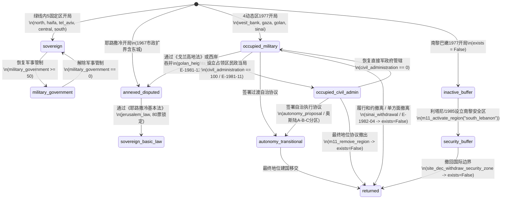
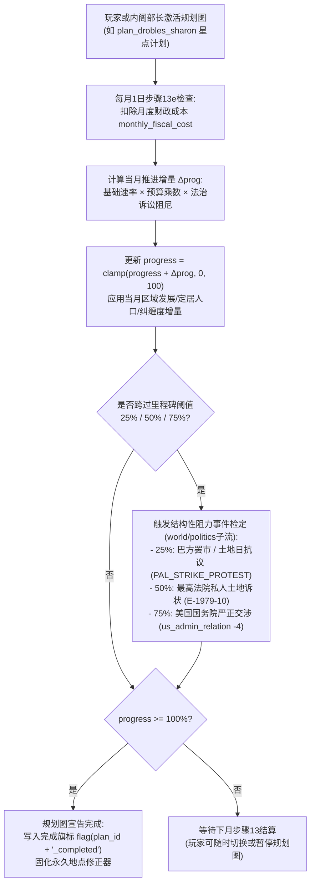
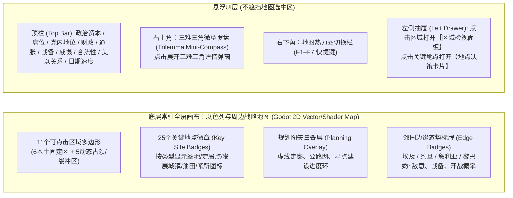

# M11 地图与区域（Map & Regions）

## 0. 元信息

| 项目 | 内容 |
|---|---|
| **模块编号与名称** | `M11` 地图与区域（Map & Regions） |
| **文件名** | `docs/specs/M11_map_regions.md` |
| **版本** | `v1.0.0`（阶段 1 正式规格） |
| **作者** | 子代理（商业策略游戏资深系统设计师） |
| **基准剧本与日期** | 贝京 1977（`begin_1977`，`1977-06-20` 就任开局）；架构与数据结构通用于全部历史剧本（1948–2006） |
| **依赖模块** | `M01`（每日结算循环步骤 5/8/13/17、效果解释器、`custom` 处理函数登记、确定性随机子流）、`M02`（因果网引擎、`level` 节点步进、`term_provider`、`settlement_policy`/`region_land_policy`/`military_government`/`haredi_cohort`、跨模块边 `X.CIV.02–04` 与 `X.LGR.01`）、`M03`（`region_vote_share` 每周派生计算、区级选民集团构成 `comp[r,b]`、议会表决）、`M04`（领土/社会承诺度量、立场走廊偏离）、`M05`（政策目录 `policies.yaml` 与行动目录 `actions.yaml` 中的 `terr`/`soc`/`occ`/`arab` 操作）、`M07`（`immigration_inflow`、`us_admin_relation`、`intl_legitimacy`、双边和约与领土交还）、`M08`（`pal_hostility`、`pal_living_standard`、`uprising_risk`、巴勒斯坦派系地方行动）、`M09`（步骤 8 `public_security` 汇总、前线战线推进、南黎巴嫩安全区缓冲）、`M10`（`absorption_capacity`、预算滑块 `settlements`/`dev_towns`/`infrastructure`/`absorption`）、`M12`（事件引擎表达式函数 `region_exists(r)`、槽位权重 `population`/`insecurity`、区域与定居点锚点事件）、`M13`（恢复军事管制与强拆抗议的集权度判定）、`M14`（开局快照、三难三角结局判定與历史评价） |
| **核心产出数据文件** | `data/regions.yaml`（11 个区域实体、25 个关键地点 Key Sites、5 类规划图 Planning Overlays、区级因果网络边与三难三角配置） |

### 0.1 对标锚点与设计取舍（见 `docs/research/benchmarks.md` 与 `paradox_lessons.md`）

| 对标维度 | 借鉴机制（我们要做到的） | 规避反例（我们坚决不做的） |
|---|---|---|
| **地图主界面地位**（*Crusader Kings III* / *Victoria 3*） | **地图常驻为游戏底层主画布**（`paradox_lessons.md` §5.1-D1），所有内阁/议会/预算面板作为抽屉浮于地图之上；提供 `F1–F7` **7 种热力图模式**，一眼“看见社会矛盾与三难三角失衡”。 | 拒绝把地图做成藏在第 5 个页签里的静态装饰图；拒绝缩放时信息过载或字体乱码。 |
| **两级空间颗粒度**（*白日升 Rise of the White Sun* W2） | 采用**“11 个宏观区域（Regions）+ 25 个关键地点（Key Sites）”**两级结构：区级滑块负责宏观资源与执法姿态，关键地点承载一次性、有重大历史重量的政治抉择（埃隆莫雷赫、基利亚特阿尔巴、亚米特、圣殿山、斯德洛特等）。 | 拒绝 *Imperator: Rome* / *EU5* 式的百城同质化盖楼与机械微操（**经济不在地块层手动造工厂**，设计文档 §9.1）。 |
| **答案因地而异的政治抉择**（*Suzerain* / *Democracy 4*） | 在约旦河谷建农业定居点（阿隆走廊：高战略价值、低巴方摩擦、低美方反弹）与在纳布卢斯/希伯伦腹地建点（高宗教动员、高定居者动量、引发最高法院诉讼与三难三角锁死）后果截然不同。 | 拒绝“所有地块最优解相同”的无脑涂色扩张；用 **三难三角（Trilemma）硬约束** 与 **撤离成本非线性爆炸公式** 封死单一支配策略（Rubric R7）。 |
| **规划图自动推进与结构性阻力**（*HOI4* 反省 D9） | 玩家可以激活跨越多个区域的**规划图（Planning Overlay）**（如阿隆计划、沙龙星点计划、达扬功能性分权、加利利—内盖夫疏散复兴），由部门按月推进并按进度触发法院诉讼、巴方罢市、美方施压等真实阻力。 | 拒绝 *HOI4* 国策树式的“点按钮 70 天必成且无反作用”（`paradox_lessons.md` §2.5 A3）。 |

---

## 1. 设计意图

### 1.1 核心取舍（一句话）
> **在“故土完整与定居事业（大以色列）”、“主权管辖内的犹太多数属性（犹太国家）”与“受管辖人口的平等权利及法治声誉（民主国家）”构成的“三难三角（Trilemma）”之间，玩家在每一块土地上的落子都在塑造国家的边界，也在为自己或继任者埋下不可逆的历史债务。**

### 1.2 玩家决策频率与信息来源
- **决策频率**：玩家平均**每季度调整 1–2 次区级政策滑块**（如在财政紧缩、移民潮到来或边境冲突升级时调整安置倾向、投资优先级或定居点政策），**每半年至一年做出 1–2 次关键地点决策或规划图切换**（如授权新建定居点、启动街区复兴计划、裁决私人土地征用案、执行西奈撤离或通过《戈兰高地法》）。无日常机械点击负担（符合 Rubric R26）。
- **信息来源**：
  1. **7 大地图热力图图层（`F1–F7`）**：直接在地图色块与图标上呈现安全危机、群体疏离、定居点纠缠度、选民倾向与水资源/战略纵深；
  2. **三难三角实时罗盘（Trilemma Compass）**：实时显示当前国家在“犹太—民主—领土”三角中的重心位置及未来 12 个月趋势箭头；
  3. **区域抽屉与关键地点卡片（Nested Tooltips）**：悬停任意区域数值或地点按钮，展示前 5 项正负驱动因子及三层目标标签（`[承诺]`、`[走廊]`、`[愿景]`）。

### 1.3 失败状态与恢复路径
- **典型失衡状态**：
  1. **定居点失控与三难三角崩塌**：过度纵容山地腹地定居点与非法前哨，导致 `settler_momentum >= 75`、巴勒斯坦民间敌意与起义风险失控、对美关系冻结（`E-1991-09` 贷款担保危机），且撤离成本高到无法承受，最终引发内阁分裂或大起义总爆发。
  2. **边缘区域（第二以色列 / 阿拉伯村镇）空心化与反叛**：长期忽视 `south (negev)` 与 `north (galilee)` 发展或过度征地，导致 `region_development < 25`、`alienation[mizrahi] >= 60`（米兹拉希票仓倒戈或沙斯党分流）或 `land_grievance[arab] >= 70`（加利利/三角地带大规模土地日罢工与治安恶化）。
  3. **北部边境安全崩溃**：`region_security[north] <= 35` 持续，发展城镇居民外逃，拖垮全国 `public_security` 与执政党支持度。
- **恢复路径**：
  - 面对定居点外交危机：可通过《埃隆莫雷案》服从最高法院裁决（切换至有限国有土地模式）、调高 `outpost_enforcement` 拆除非法前哨、将定居点布局切回阿隆走廊或冻结新建以换取美国援助与和谈空间；
  - 面对边缘区域危机：启动“街区复兴计划（Project Renewal）”与海外犹太社群结对、提高 `dev_towns` 预算与区级投资优先级、签署《土地补偿与归还协议》或承认未承认贝都因村庄。

### 1.4 中后期（第 10–20 年）如何保持新鲜感
1. **定居者人口与撤离代价的棘轮效应（Historical Ratchet）**：1977 年西岸仅有 `5,000` 名定居者，撤离尚属政治可能；若玩家前 10 年放任沙龙“星点计划”推进至 `80,000+` 定居者，第 12 年进入马德里/奥斯陆和谈窗口时，自己亲手种下的定居点网络将成为最强大的国内反对派与刺杀风险源。
2. **苏联百万大移民（1989+）的空间冲击**：每年 `150,000–200,000` 名俄裔移民涌入，迫使玩家在“塞进特拉维夫/海法推高房价与失业”、“导向内盖夫/加利利冲击米兹拉希传统票仓”与“导向西岸定居点引爆老布什贷款担保冻结（`E-1991-09`）”之间做出全新空间博弈。
3. **动态区生命周期与边界重塑**：西奈撤离（1982）、戈兰吞并（1981）、南黎巴嫩安全区设立（1985）与泥潭化、加沙—杰里科自治（1990s），地图版图与法律地位随时代不断发生结构性演变。

---

## 2. 读写清单

> 严格遵循 `contracts.md` §3/§6 与 `DECISIONS.md` D-001 至 D-071。

### 2.1 `parameters.yaml` 已登记参数读写表

| 参数ID | 作用域 (`scope`) | 类型 (`type`) | M11 权限 | 结算步骤（`contracts.md` §3） | 说明 |
|---|---|---|---|---|---|
| `region_security` | `region` | `stock` `[0, 100]` | **写 (owner)** | 步骤 8（每周日，在 M09 计算 `public_security` 之前） | 区级安全度；受安全姿态滑块、战备、威慑、M02 跨模块边（`X.CIV.02–04`, `X.LGR.01`）、M05 政策边及恐袭/军事行动影响 |
| `region_development` | `region` | `stock` `[0, 100]` | **写 (owner)** | 步骤 13（每月 1 日） | 区级发展水平；受区级投资优先级、M10 基建/发展城镇预算、经济增长、移民负荷与地点工程影响 |
| `region_population` | `region` | `count` `[0, 10000000]` | **写 (owner)** | 步骤 13（每月迁移/移民分流）与步骤 17（每年自然增长与普查汇总） | 区域总人口（各群体人口之和，单位：人） |
| `trilemma` | `national` | `derived` `[0, 100]` | **写 (owner)** | 步骤 13（每月 1 日）及领土/吞并/撤离动作完成时即时重算 | 三难三角综合均衡度指数；同时派生 `trilemma_jewish`、`trilemma_democratic`、`trilemma_territory` 三顶点坐标 |
| `settlement_policy` | `region` | `lever` `[0, 100]` | **写 (owner)** | 步骤 5（经 M05 `change_policy` 写入）/ 步骤 13 读取 | 占领区定居点政策滑块（`west_bank, gaza, golan, sinai`）；已在 M02 附录 A 登记（D-002） |
| `region_land_policy` | `region` | `lever` `[0, 100]` | **写 (owner)** | 步骤 5（经 M05 `change_policy` 写入）/ 步骤 13 读取 | 区级土地征用与规划执法力度滑块；已在 M02 附录 A 登记（D-002） |
| `military_government` | `arab_group` | `lever` `[0, 100]` | **写 (owner)** | 步骤 5（经 M05 `change_policy` 写入）/ 步骤 8、13 读取 | 针对 `arab, druze, bedouin` 的军事管制强度；已在 M02 附录 A 登记（D-002） |
| `haredi_cohort` | `national` | `count` `[0, 100]` | **写 (owner)** | 步骤 17（每年 1 月 1 日） | 每年年满 18 岁的哈雷迪适龄男性（单位：千人/年，1977 开局 `1.600`）；已在 M02 附录 A 登记（D-002） |
| `region_vote_share` | `region` | `derived` `[0, 100]` | 只读（owner M03） | 步骤 7（每周日由 M03 写入） | 执政党在各区的选民倾向；M11 在步骤 17 更新各区选民集团人口构成 `comp[r,b]` 供 M03 读取 |
| `settler_momentum` | `national` | `stock` `[0, 100]` | 读 + `term_provider` + 效果 | 步骤 10（M02 结算）/ 步骤 5、13 | M11 提供 `m11_settler_demography_term`（定居人口规模与前哨棘轮项）并由地点决策产生效果 |
| `alienation` | `group` | `stock` `[0, 100]` | 读 + 效果 | 步骤 10 / 步骤 13 | M02 读取 `region_development[negev/galilee/haifa]`；M11 读取全国值计算区级疏离度 `region_alienation[r,g]` |
| `historical_grievance` | `group` | `debt` `[0, 100]` | 读 + 效果 | 步骤 10 / 步骤 5 | 街区复兴与族群和解地点决策对其产生效果 |
| `civic_identification` | `arab_group` | `stock` `[0, 100]` | 读 + 效果 | 步骤 8、10、13 | M11 采纳 `X.CIV.02–04` 入边计算 `region_security`；戈兰吞并、加利利观察点等行动产生效果 |
| `land_grievance` | `arab_group` | `debt` `[0, 100]` | 读 + 效果 | 步骤 8、10、13 | M11 采纳 `X.LGR.01` 入边计算 `region_security`；`region_land_policy` 驱动其漂移 |
| `rule_of_law` | `national` | `stock` `[0, 100]` | 读 + 效果 | 步骤 13 | 计算 `trilemma_democratic` 顶点；判断埃隆莫雷案等最高法院诉讼触发与规划图司法阻力 |
| `centralization` | `national` | `stock` `[0, 100]` | 读 + 效果 | 步骤 13 | 计算 `trilemma_democratic` 顶点 |
| `immigration_inflow` | `national` | `count` `[0, 1000000]` | 只读（owner M07） | 步骤 13（每月 1 日） | 年化移民流入人数；M11 按月取 `immigration_inflow / 12` 分配至各区域与群体 |
| `absorption_capacity` | `national` | `stock` `[0, 100]` | 读 + 效果（owner M10） | 步骤 9、13 | 移民吸收容量；影响新移民分流效率与过渡营地拥挤惩罚 |
| `budget_slider` | `budget_item` | `lever` `[0, 100]` | 只读（owner M10） | 步骤 13 | 读取 `settlements, dev_towns, infrastructure, absorption, defense` 预算档位（D-060） |
| `growth`, `unemployment` | `national` | `percent` | 只读（owner M10） | 步骤 13 | 宏观经济对区级发展与内部人口流动的牵引 |
| `pal_hostility`, `pal_living_standard`, `uprising_risk` | `national` | `stock` / `derived` | 读 + 效果（owner M08） | 步骤 8、13 | 影响占领区 `region_security` 与 `region_development` |
| `faction_strength` | `pal_faction` / `lebanese_faction` | `stock` `[0, 100]` | 只读（owner M08/M09） | 步骤 8 | 影响北部与占领区 `region_security` |
| `readiness`, `deterrence`, `public_security` | `national` | `stock` `[0, 100]` | 读 + 效果（owner M09） | 步骤 8 | 战备与威慑支撑边境区 `region_security`；M09 读取 `region_security` 计算 `public_security` |
| `us_admin_relation`, `intl_legitimacy` | `national` | `stock` `[0, 100]` | 效果写入（owner M07） | 步骤 5、13、18 | 定居点扩张、吞并法案、圣地变更与规划图推进产生外交效果 |
| `policy_level` | `policy` | `lever` `[0, 100]` | 读 + 效果（owner M05） | 步骤 5、8、13 | 读取 `settler_housing_incentives, settlement_layout, land_acquisition_mode, east_jerusalem_building, immigrant_dispersal, arab_local_budget, arab_planning, bedouin_villages` 等（D-035） |

### 2.2 M11 提议新增的参数与实体（详见附录 A，共 6 项参数 + 1 项动态区实体增补）

| 参数ID | 中文名 | 类型 (`type`) | 作用域 (`scope`) | 范围 (`range`) | 结算周期 (`tick`) | 说明 |
|---|---|---|---|---|---|---|
| `region_absorption_priority` | 移民安置倾向 | `lever` | `region` | `[0, 100]` | `event` | 设计文档 §9.4 区级滑块 1：本区接收新移民的优先级 |
| `region_investment_priority` | 投资优先级 | `lever` | `region` | `[0, 100]` | `event` | 设计文档 §9.4 区级滑块 2：本区基建与公共服务投资倾斜度 |
| `region_security_posture` | 安全姿态 | `lever` | `region` | `[0, 100]` | `event` | 设计文档 §9.4 区级滑块 3：本区警力/军力部署与检查站管控强度 |
| `settler_population` | 定居人口 | `count` | `region` | `[0, 1000000]` | `monthly`（步骤 13） | 占领/争议区（`west_bank, gaza, golan, sinai` 及东耶路撒冷）犹太定居者人数（单位：人） |
| `trilemma_jewish` | 三难三角·犹太属性 | `derived` | `national` | `[0, 100]` | `monthly`（步骤 13） | 三难三角顶点 1：有效管辖范围内犹太人口多数与可分性得分 |
| `trilemma_democratic` | 三难三角·民主属性 | `derived` | `national` | `[0, 100]` | `monthly`（步骤 13） | 三难三角顶点 2：民主法治与受管辖人口参政权得分 |
| `trilemma_territory` | 三难三角·领土属性 | `derived` | `national` | `[0, 100]` | `monthly`（步骤 13） | 三难三角顶点 3：以色列地历史/战略版图控制与主权得分 |

> [!IMPORTANT]
> **区域实体 ID 双向兼容约定（零摩擦映射）**：
> `parameters.yaml` 原登记 `regions_fixed: [galilee, haifa, tel_aviv, triangle, jerusalem, negev]`、`regions_dynamic: [west_bank, gaza, golan, sinai]`；本规格同时完整支持语义规范名 `north, central, south` 及第 5 个动态区 `south_lebanon`（南黎巴嫩安全区）。
> 在 `M11` 状态管理器与 `M02/M12` 参数解析器中内置常量映射函数 `resolve_region_id(key)`：
> - `"north"` $\leftrightarrow$ `"galilee"`（加利利 / 北部区）
> - `"central"` $\leftrightarrow$ `"triangle"`（三角地带与沙龙平原 / 中部区）
> - `"south"` $\leftrightarrow$ `"negev"`（内盖夫 / 南部区）
> - 无论调用方（如 `M02` 因果边、`M03` 选民构成、`M05` 政策行动、`M09` 安全汇总、`M12` 事件表达式）传入 `"north"` 还是 `"galilee"`、`"central"` 还是 `"triangle"`、`"south"` 还是 `"negev"`，均指向同一个 `RegionState` 实例，确保全代码库 100% 零摩擦兼容。

---

## 3. 状态与数据结构

### 3.1 Python 3.9 / GDScript 核心状态定义

> 遵循 `contracts.md` §1：不使用 Python 3.10+ 的 `match` 或 `X | Y` 联合类型语法，全部采用标准 `typing`（`Dict, List, Optional, Tuple`）与 `dataclass`。

```python
from dataclasses import dataclass, field
from typing import Dict, List, Optional, Tuple

# 区域 ID 规范化别名映射表
REGION_ALIAS_TO_CANONICAL: Dict[str, str] = {
    "north": "galilee",
    "galilee": "galilee",
    "haifa": "haifa",
    "tel_aviv": "tel_aviv",
    "central": "triangle",
    "triangle": "triangle",
    "jerusalem": "jerusalem",
    "south": "negev",
    "negev": "negev",
    "west_bank": "west_bank",
    "gaza": "gaza",
    "golan": "golan",
    "sinai": "sinai",
    "south_lebanon": "south_lebanon",
}

ALL_REGION_KEYS: List[str] = [
    "galilee", "haifa", "tel_aviv", "triangle", "jerusalem", "negev",
    "west_bank", "gaza", "golan", "sinai", "south_lebanon"
]

FIXED_REGION_KEYS: List[str] = [
    "galilee", "haifa", "tel_aviv", "triangle", "jerusalem", "negev"
]

DYNAMIC_REGION_KEYS: List[str] = [
    "west_bank", "gaza", "golan", "sinai", "south_lebanon"
]

# 10 个人口统计子群体（6 个犹太群体 + 4 个阿拉伯/非犹太群体）
DEMOGRAPHIC_GROUPS: List[str] = [
    "ashkenazi",             # 阿什肯纳兹（世俗/传统劳工与中产）
    "mizrahi",               # 米兹拉希（中东与北非裔犹太人）
    "religious_zionist",     # 宗教犹太复国主义者
    "haredi",                # 哈雷迪（极端正统派）
    "russian",               # 前苏联/俄裔犹太移民（1989+ 大规模激活）
    "ethiopian",             # 埃塞俄比亚犹太人（贝塔以色列，1977+ 逐步移入）
    "arab_citizen",          # 拥有以色列公民权的阿拉伯人（穆斯林/基督徒）
    "druze",                 # 德鲁兹人（本土为公民；戈兰高地为受管辖非公民居民，除非入籍）
    "bedouin",               # 贝都因人（内盖夫/加利利为公民；西奈为受管辖当地游牧居民）
    "palestinian_resident",  # 无以色列公民权的巴勒斯坦/当地常住居民（东耶路撒冷、西岸、加沙、南黎巴嫩）
]

JEWISH_GROUPS: List[str] = [
    "ashkenazi", "mizrahi", "religious_zionist", "haredi", "russian", "ethiopian"
]

# 区域法律地位枚举值
LEGAL_STATUS_ENUM: List[str] = [
    "sovereign",             # 绿线内主权领土
    "annexed_disputed",      # 单方面扩展管辖/吞并但国际争议（如1967后东耶路撒冷、1981后戈兰高地、反事实西岸吞并）
    "sovereign_basic_law",   # 经基本法锁定的不可分割主权首都（1980《耶路撒冷基本法》后）
    "military_government",   # 本土军事管制区（1948–1966 阿拉伯聚居区，或恢复军事管制后）
    "occupied_military",     # 军事占领区（军政府直接管辖，1977 开局西岸/加沙/戈兰/西奈）
    "occupied_civil_admin",  # 占领区民政当局管辖（1981-11 设立民政当局后）
    "autonomy_transitional", # 巴勒斯坦过渡自治 / 奥斯陆 A/B/C 分区管辖
    "security_buffer",       # 境外军事安全缓冲带（1978/1985–2000 南黎巴嫩安全区）
    "returned",              # 已撤出/交还（exists=False 时的归档状态，如1982-04后的西奈）
]


@dataclass
class OsloAreaShares:
    """过渡自治或奥斯陆分区占比（合计 1.0）"""
    area_a: float = 0.0      # 巴方全面民事与安全管辖占比
    area_b: float = 0.0      # 巴方民事管辖 + 以方安全管辖占比
    area_c: float = 1.0      # 以方全面管辖（含定居点、军事区、主干道）占比


@dataclass
class KeySiteState:
    """辖内关键地点（Key Site）运行时状态"""
    site_id: str
    name_zh: str
    region_id: str                           # 所属区域规范 ID
    ui_region_code: str                      # 语义别名（如 north, central, south）
    site_type: str                           # settlement_bloc | heartland_settlement | holy_site | dev_town | arab_town_cluster | strategic_infra | urban_core | military_outpost
    status: str                              # active | under_construction | frozen | demolished | handed_over | inactive
    land_type: str                           # state_sovereign | state_or_barren | mixed_contested | private_cultivated
    jewish_pop: int                          # 地点内犹太人口（人）
    non_jewish_pop: int                      # 地点内非犹太人口（人）
    strategic_bonus: float                   # 对所属区域战略价值的加成
    religious_bonus: float                   # 对所属区域宗教价值的加成
    economic_bonus: float                    # 对所属区域经济价值的加成
    entanglement_weight: float               # 对三难三角不可分割纠缠度的权重 [0.0, 1.0]
    available_decisions: List[str] = field(default_factory=list)
    completed_decisions: List[str] = field(default_factory=list)


@dataclass
class RegionState:
    """单个区域实体的完整状态"""
    region_id: str                           # 规范 ID（galilee, haifa, tel_aviv, triangle, jerusalem, negev, west_bank, gaza, golan, sinai, south_lebanon）
    code_alias: str                          # 语义代码（north, haifa, tel_aviv, central, jerusalem, south, west_bank, gaza, golan, sinai, south_lebanon）
    name_zh: str
    region_type: str                         # "fixed" | "dynamic"
    exists: bool                             # 动态区当前是否存在/受控
    is_border: bool                          # 是否为边境/前线区（供 M12 insecurity 权重使用）
    legal_status: str                        # 见 LEGAL_STATUS_ENUM
    oslo_shares: OsloAreaShares = field(default_factory=OsloAreaShares)

    # 人口构成（单位：人）
    pop_by_group: Dict[str, int] = field(default_factory=dict)
    region_population: int = 0               # 派生汇总：sum(pop_by_group.values())
    jewish_population: int = 0               # 派生汇总：犹太六群体人口之和
    settler_population: int = 0              # 占领区（及东耶路撒冷新社区）犹太定居者人数
    settlement_count: int = 0                # 正式定居点数量
    outpost_count: int = 0                   # 未获授权的前哨站（Outposts）数量

    # 区级核心指标
    region_security: float = 65.0            # [0.0, 100.0]，步骤 8 每周更新
    region_development: float = 50.0         # [0.0, 100.0]，步骤 13 每月更新
    region_vote_share: float = 40.0          # [0.0, 100.0]，步骤 7 由 M03 更新
    region_alienation: Dict[str, float] = field(default_factory=dict)  # 各群体在本区的局部疏离度 [0, 100]

    # 5 种区级政策滑块（[0.0, 100.0]）
    region_absorption_priority: float = 50.0 # 滑块 1：移民安置倾向
    region_investment_priority: float = 50.0 # 滑块 2：投资优先级
    region_security_posture: float = 50.0    # 滑块 3：安全姿态
    region_land_policy: float = 20.0         # 滑块 4：土地政策
    settlement_policy: float = 0.0           # 滑块 5：定居点政策（仅动态占领区有效）

    # 三种区域价值（[0.0, 100.0]，基础值 + 地点/事件动态修正）
    base_strategic_value: float = 50.0
    base_religious_value: float = 50.0
    base_economic_value: float = 50.0
    strategic_value: float = 50.0
    religious_value: float = 50.0
    economic_value: float = 50.0
    negotiation_value: float = 50.0          # 派生谈判筹码价值

    # 30 天恐袭/越境袭击计数器（供 M09 public_security 与热力图读取）
    terror_incidents_30d: int = 0
    key_sites: List[str] = field(default_factory=list)


@dataclass
class PlanningOverlayState:
    """地图规划图层（Planning Overlay）运行时状态"""
    plan_id: str                             # plan_allon | plan_drobles_sharon | plan_dayan_functional | plan_galilee_negev_dispersal | plan_seam_zone_barrier
    name_zh: str
    active: bool                             # 当前是否处于激活执行态
    progress: float                          # 执行进度 [0.0, 100.0]
    monthly_rate: float                      # 基准月推进率（%/月）
    monthly_fiscal_cost: float               # 激活期间每月财政消耗（占年度预算%）
    target_regions: List[str] = field(default_factory=list)
    target_sites: List[str] = field(default_factory=list)
    milestones_fired: List[int] = field(default_factory=list)  # 已触发阻力的里程碑 [25, 50, 75, 100]


@dataclass
class TrilemmaState:
    """犹太国家-民主国家-大以色列 三难三角状态"""
    trilemma: float = 63.2715                # 综合均衡度指数 [0, 100]
    trilemma_jewish: float = 73.3825         # 犹太国家属性顶点 V_J [0, 100]
    trilemma_democratic: float = 56.6630     # 民主国家属性顶点 V_D [0, 100]
    trilemma_territory: float = 85.8000      # 大以色列领土属性顶点 V_T [0, 100]
    entanglement_index: float = 0.27475      # 占领区定居点不可分割纠缠系数 eta [0, 1]
    effective_jewish_share: float = 0.79353  # 有效管辖犹太人口占比
    disenfranchised_share: float = 0.26843   # 无投票权受管辖人口占总受控人口比
    barycentric_coords: Tuple[float, float, float] = (0.3400, 0.2625, 0.3975) # (u_J, u_D, u_T)
    canvas_xy: Tuple[float, float] = (0.5288, 0.2273)                         # 等边三角形 2D 归一化坐标


@dataclass
class M11MapSystemState:
    """M11 模块顶层状态容器"""
    regions: Dict[str, RegionState] = field(default_factory=dict)
    sites: Dict[str, KeySiteState] = field(default_factory=dict)
    planning_overlays: Dict[str, PlanningOverlayState] = field(default_factory=dict)
    active_overlay_id: Optional[str] = "plan_allon"
    trilemma_state: TrilemmaState = field(default_factory=TrilemmaState)
    active_heatmap_layer: str = "layer_sovereignty"
```

---

### 3.2 1977-06-20 开局全部 11 个区域实体完整初始数据表

#### 3.2.1 区域基础属性、法律地位、核心数值与三种价值（1977-06-20）

| 区域代码 (`code_alias` / `registry_id`) | 中文名称 | 类型 | 开局存在 (`exists`) | 法律地位 (`legal_status`) | 总人口 (`region_population`) | 犹太人口 (`jewish_pop`) | 定居人口 (`settler_pop`) | 定居点数 / 前哨数 | 安全 (`region_security`) | 发展 (`region_development`) | 选民倾向 (`region_vote_share`) | 战略 / 宗教 / 经济价值 |
|---|---|---|---|---|---:|---:|---:|---:|---:|---:|---:|---|
| **`north` / `galilee`** | 加利利（北部区） | 固定区 | `True` | `sovereign` | `550,000` | `295,000` | `0` | `0 / 0` | `58.0` | `38.0` | `26.58` | `80.0 / 70.0 / 75.0` |
| **`haifa`** | 海法与北部沿海 | 固定区 | `True` | `sovereign` | `550,000` | `480,000` | `0` | `0 / 0` | `72.0` | `55.0` | `30.73` | `75.0 / 35.0 / 85.0` |
| **`tel_aviv`** | 特拉维夫与但地区 | 固定区 | `True` | `sovereign` | `1,200,000` | `1,182,000` | `0` | `0 / 0` | `72.0` | `75.0` | `34.11` | `70.0 / 30.0 / 95.0` |
| **`central` / `triangle`** | 三角地带与沙龙平原 | 固定区 | `True` | `sovereign` | `600,000` | `435,000` | `0` | `0 / 0` | `66.0` | `30.0` | `24.16` | `85.0 / 40.0 / 70.0` |
| **`jerusalem`** | 耶路撒冷区（含东城） | 固定区 | `True` | `annexed_disputed` | `410,000` | `305,000` | `40,000` (东城新社区) | `8 / 0` (东城环城) | `58.0` | `48.0` | `41.52` | `85.0 / 100.0 / 55.0` |
| **`south` / `negev`** | 内盖夫（南部区） | 固定区 | `True` | `sovereign` | `300,000` | `263,000` | `0` | `0 / 0` | `67.0` | `32.0` | `42.67` | `82.0 / 40.0 / 60.0` |
| **`west_bank`** | 约旦河西岸（犹太与撒马利亚） | 动态区 | `True` | `occupied_military` | `685,000` | `5,000` | `5,000` | `24 / 3` | `55.0` | `28.0` | `56.60` (仅计公民) | `88.0 / 95.0 / 40.0` |
| **`gaza`** | 加沙地带 | 动态区 | `True` | `occupied_military` | `440,500` | `500` | `500` | `5 / 0` | `52.0` | `18.0` | `58.80` (仅计公民) | `65.0 / 30.0 / 25.0` |
| **`golan`** | 戈兰高地 | 动态区 | `True` | `occupied_military` | `14,500` | `3,500` | `3,500` | `24 / 0` | `68.0` | `35.0` | `29.30` (仅计公民) | `92.0 / 35.0 / 70.0` |
| **`sinai`** | 西奈半岛 | 动态区 | `True` | `occupied_military` | `59,500` | `4,500` | `4,500` | `18 / 0` | `65.0` | `25.0` | `31.60` (仅计公民) | `85.0 / 25.0 / 65.0` |
| **`south_lebanon`** | 南黎巴嫩安全区 | 动态区 | `False` (激活后 `True`) | `security_buffer` | `0` (激活时 `120,000`) | `0` | `0` | `0 / 0` | `45.0` (激活初值) | `20.0` (激活初值) | `0.00` (无以色列选民) | `72.0 / 15.0 / 15.0` |

> [!NOTE]
> **跨模块初值一致性校核**：
> 1. **与 M02 完全对齐**：`region_development[negev] = 32.0`、`region_development[galilee] = 38.0`、`region_development[haifa] = 55.0`、`region_development[triangle] = 30.0` 与 `M02_numbers_model.md` §4.4.0 完全一致，确保 M02 验收测试 `T03`（开局零漂移稳态）100% 通过。
> 2. **与 M09 完全对齐**：本土核心五区（`tel_aviv` 120万×72 + `haifa` 55万×72 + `triangle` 60万×66 + `galilee` 55万×58 + `negev` 30万×67）的人口加权平均安全度：
>    $$\overline{\text{region\_security}}_{\text{core}} = \frac{1.20 \times 72 + 0.55 \times 72 + 0.60 \times 66 + 0.55 \times 58 + 0.30 \times 67}{1.20 + 0.55 + 0.60 + 0.55 + 0.30} = \frac{217.60}{3.20} = \mathbf{68.000000}$$
>    且 `region_security[jerusalem] = 58.0`，与 `M09_military_intel.md` §4.5.2 算例完全一致！
> 3. **与 M03 完全对齐**：`region_vote_share[negev] = 42.67` 与 `M03_parliament.md` §4.6 算例完全一致。

#### 3.2.2 1977-06-20 各区域人口构成明细表（`pop_by_group`，单位：人）

| 区域 (`code_alias` / `registry_id`) | `ashkenazi` | `mizrahi` | `religious_zionist` | `haredi` | `russian` | `ethiopian` | `arab_citizen` | `druze` | `bedouin` | `palestinian_resident` | **区域总人口** |
|---|---:|---:|---:|---:|---:|---:|---:|---:|---:|---:|---:|
| **`north` / `galilee`** | `98,000` | `162,000` | `26,000` | `9,000` | `0` | `0` | `210,000` | `33,000` | `12,000` | `0` | **`550,000`** |
| **`haifa`** | `285,000` | `140,000` | `35,000` | `20,000` | `0` | `0` | `61,000` | `9,000` | `0` | `0` | **`550,000`** |
| **`tel_aviv`** | `650,000` | `355,000` | `82,000` | `95,000` | `0` | `0` | `18,000` | `0` | `0` | `0` | **`1,200,000`** |
| **`central` / `triangle`** | `195,000` | `175,000` | `45,000` | `20,000` | `0` | `0` | `165,000` | `0` | `0` | `0` | **`600,000`** |
| **`jerusalem`** | `75,000` | `118,000` | `52,000` | `60,000` | `0` | `0` | `0` | `0` | `0` | `105,000` (东城永久居民) | **`410,000`** |
| **`south` / `negev`** | `58,000` | `172,000` | `21,000` | `12,000` | `0` | `0` | `0` | `0` | `37,000` | `0` | **`300,000`** |
| **`west_bank`** | `600` | `500` | `3,500` | `400` | `0` | `0` | `0` | `0` | `0` | `680,000` | **`685,000`** |
| **`gaza`** | `50` | `75` | `375` | `0` | `0` | `0` | `0` | `0` | `0` | `440,000` | **`440,500`** |
| **`golan`** | `2,400` | `400` | `700` | `0` | `0` | `0` | `0` | `11,000` (戈兰德鲁兹) | `0` | `0` | **`14,500`** |
| **`sinai`** | `2,600` | `900` | `1,000` | `0` | `0` | `0` | `0` | `0` | `55,000` (西奈贝都因) | `0` | **`59,500`** |
| **`south_lebanon`** (激活时) | `0` | `0` | `0` | `0` | `0` | `0` | `0` | `0` | `0` | `120,000` (南黎当地居民) | **`0` (`120,000`)** |
| **1977-06-20 合计** | **`1,363,650`** | **`1,123,375`** | **`270,575`** | **`216,400`** | **`0`** | **`0`** | **`454,000`** | **`53,000`** | **`104,000`** | **`1,225,000`** | **`4,810,000`** |

- **人口汇总口径验证**：
  - 绿线内及东耶路撒冷犹太人口：`3,060,000` 人；占领区（西岸、加沙、戈兰、西奈）犹太定居者：`13,500` 人；**全国犹太总人口 = `3,073,500` 人**。
  - 拥有以色列公民权的阿拉伯/德鲁兹/贝都因人口：阿拉伯公民 `454,000` + 本土德鲁兹 `42,000` + 本土贝都因 `49,000` = **`545,000` 人**（绿线内及耶路撒冷总人口 = `3,710,000` 人，其中以色列公民 `3,605,000` 人，公民中犹太人占比 `84.88%`）。
  - 受以色列管辖但无以色列公民投票权的常住人口（$P_{\text{nonjew}}^{\text{disenf}}$）：东耶路撒冷巴勒斯坦永久居民 `105,000` + 西岸巴勒斯坦人 `680,000` + 加沙巴勒斯坦人 `440,000` + 戈兰高地德鲁兹人 `11,000` + 西奈贝都因人 `55,000` = **`1,291,000` 人**。

#### 3.2.3 1977-06-20 各区域 5 项政策滑块与区级疏离度初值表

| 区域 (`code_alias` / `registry_id`) | 安置倾向 (`absorption_priority`) | 投资优先级 (`investment_priority`) | 安全姿态 (`security_posture`) | 土地政策 (`region_land_policy`) | 定居点政策 (`settlement_policy`) | 区级疏离度 `region_alienation` 初值（主要驻区群体） |
|---|---:|---:|---:|---:|---:|---|
| **`north` / `galilee`** | `50.0` | `50.0` | `50.0` | `35.0` | `0.0` (不适用) | `mizrahi: 41.0, arab: 64.0, druze: 28.0, bedouin: 48.0` |
| **`haifa`** | `50.0` | `50.0` | `30.0` | `20.0` | `0.0` (不适用) | `mizrahi: 35.0, arab: 54.0, druze: 25.0` |
| **`tel_aviv`** | `50.0` | `50.0` | `30.0` | `20.0` | `0.0` (不适用) | `mizrahi: 32.0, arab: 52.0` |
| **`central` / `triangle`** | `25.0` | `50.0` | `30.0` | `30.0` | `0.0` (不适用) | `mizrahi: 37.0, arab: 66.0` |
| **`jerusalem`** | `50.0` | `50.0` | `50.0` | `35.0` | `50.0` (联动东城建设) | `mizrahi: 39.0, arab: 72.0` |
| **`south` / `negev`** | `75.0` | `50.0` | `30.0` | `35.0` | `0.0` (不适用) | `mizrahi: 44.0, bedouin: 52.0` |
| **`west_bank`** | `25.0` | `50.0` | `50.0` | `30.0` | `40.0` (阿隆框架) | `mizrahi: 30.0, palestinian: 58.0` |
| **`gaza`** | `0.0` | `25.0` | `50.0` | `30.0` | `30.0` (仅加厚现有) | `mizrahi: 32.0, palestinian: 64.0` |
| **`golan`** | `50.0` | `50.0` | `50.0` | `25.0` | `40.0` (阿隆框架) | `mizrahi: 28.0, druze: 45.0` |
| **`sinai`** | `25.0` | `50.0` | `50.0` | `20.0` | `30.0` (仅加厚现有) | `mizrahi: 30.0, bedouin: 38.0` |
| **`south_lebanon`** | `0.0` | `0.0` | `75.0` | `0.0` | `0.0` (禁止定居) | `palestinian: 70.0` (激活时当地敌意) |

---

### 3.3 辖内关键地点（Key Sites，共 25 个）完整初始数据表

> 每个关键地点绑定所属区域，拥有独立的土地性质（`land_type`）、人口、三种价值修正值、三难三角纠缠权重（`entanglement_weight`）以及专属地点决策（`Site Decisions`，详见 §6.2）。

| 序号 | 地点 ID (`site_id`) | 中文名称 | 所属区域 (`code_alias` / `registry_id`) | 地点类型 (`site_type`) | 1977-06-20 状态 (`status`) | 土地性质 (`land_type`) | 犹太人口 / 非犹太人口 | 价值修正 `[战略, 宗教, 经济]` | 纠缠权重 `entangle_w` | 可用/关联地点决策与事件 |
|---:|---|---|---|---|---|---|---:|---|---:|---|
| 1 | `site_old_city_temple_mount` | **东耶路撒冷老城与圣殿山** | `jerusalem` | `holy_site` | `active` | `mixed_contested` | `2,500 / 28,000` | `[+5, +35, +5]` | `0.15` | `temple_mount_prayer`、`jerusalem_law`、`E-1984-04b` |
| 2 | `site_east_jlem_ring` | **东耶路撒冷环城新社区（吉洛/拉莫特）** | `jerusalem` | `settlement_bloc` | `active` | `state_or_barren` | `40,000 / 77,000` | `[+10, +10, +8]` | `0.12` | `east_jerusalem_building`、`jerusalem_law`、`E-1991-09` |
| 3 | `site_meah_shearim` | **梅阿谢阿里姆与哈雷迪街区** | `jerusalem` | `urban_core` | `active` | `state_sovereign` | `60,000 / 0` | `[0, +20, -5]` | `0.00` | `haredi_vocational_program`、安息日封路争议 |
| 4 | `site_kiryat_arba_hebron` | **希伯伦与基利亚特阿尔巴（含哈达萨楼）** | `west_bank` | `heartland_settlement` | `active` | `mixed_contested` | `1,500 / 55,000` | `[+4, +30, +2]` | `0.25` | `site_dec_expand_hebron`、`E-1980-05b`、`E-1984-04b` |
| 5 | `site_elon_moreh_nablus` | **纳布卢斯周边与埃隆莫雷赫（塞巴斯蒂亚）** | `west_bank` | `heartland_settlement` | `under_construction` | `private_cultivated` | `350 / 85,000` | `[+5, +25, +2]` | `0.28` | `site_dec_authorize_elon_moreh`、`E-1977-07`、`E-1979-10` |
| 6 | `site_ariel_samaria` | **阿里埃勒与撒马利亚脊线走廊** | `west_bank` | `settlement_bloc` | `inactive` (1978建点) | `state_or_barren` | `0 / 15,000` | `[+15, +10, +6]` | `0.22` | `site_dec_found_ariel`、`plan_drobles_sharon` |
| 7 | `site_gush_etzion` | **古什埃齐翁定居点群** | `west_bank` | `settlement_bloc` | `active` | `state_or_barren` | `1,400 / 12,000` | `[+12, +18, +6]` | `0.08` | `found_settlement`、`plan_allon` |
| 8 | `site_maale_adumim` | **马阿莱阿杜米姆与 E1 走廊** | `west_bank` | `settlement_bloc` | `under_construction` | `state_or_barren` | `250 / 4,000` | `[+14, +8, +8]` | `0.15` | `site_dec_upgrade_maale_adumim`、`E-1977-07` |
| 9 | `site_jordan_valley_belt` | **约旦河谷农业军事定居带（阿隆防线）** | `west_bank` | `settlement_bloc` | `active` | `state_or_barren` | `1,500 / 22,000` | `[+25, +5, +10]` | `0.04` | `found_settlement`、`plan_allon` |
| 10 | `site_gush_katif` | **古什卡蒂夫定居点群（加沙南翼）** | `gaza` | `settlement_bloc` | `active` | `state_or_barren` | `500 / 65,000` | `[+8, +8, +6]` | `0.15` | `site_dec_expand_gush_katif`、`evacuate_settlement` |
| 11 | `site_jabalia_gaza_city` | **加沙城与贾巴利亚难民营** | `gaza` | `urban_core` | `active` | `mixed_contested` | `0 / 375,000` | `[+10, +5, +5]` | `0.00` | `economic_package_occ`、`E-G04-10`、`E-1987-12a` |
| 12 | `site_katzrin_golan` | **卡茨林与戈兰高地定居中心** | `golan` | `settlement_bloc` | `active` | `state_or_barren` | `3,500 / 0` | `[+25, +10, +18]` | `0.05` | `golan_heights_law`、`found_settlement` |
| 13 | `site_majdal_shams_druze` | **迈季代勒沙姆斯与戈兰德鲁兹四村** | `golan` | `arab_town_cluster` | `active` | `private_cultivated` | `0 / 11,000` | `[+18, +8, +8]` | `0.05` | `golan_heights_law`、`E-1981-12` 罢工后续 |
| 14 | `site_yamit_rafah` | **亚米特海滨城镇与拉法突出部** | `sinai` | `settlement_bloc` | `active` | `state_or_barren` | `3,000 / 10,000` | `[+18, +5, +12]` | `0.05` | `site_dec_evacuate_yamit`、`sinai_withdrawal`、`E-1982-04` |
| 15 | `site_ofira_sharm` | **奥菲拉（沙姆沙伊赫）与蒂朗海峡** | `sinai` | `strategic_infra` | `active` | `state_or_barren` | `1,500 / 5,000` | `[+30, +5, +10]` | `0.02` | `sinai_withdrawal`、`E-1978-09`、`E-1979-03` |
| 16 | `site_alma_oil_fields` | **阿尔玛油田（苏伊士湾）** | `sinai` | `strategic_infra` | `active` | `state_or_barren` | `0 / 0` | `[+15, 0, +30]` | `0.00` | `site_dec_develop_alma_oil`、`E-1979-02`、`E-1979-03` |
| 17 | `site_kiryat_shmona` | **基利亚特什莫纳与北部边境发展城镇** | `north` (`galilee`) | `dev_town` | `active` | `state_sovereign` | `45,000 / 0` | `[+18, +5, +10]` | `0.00` | `project_renewal`、`visit_dev_town`、`E-G04-05` |
| 18 | `site_nazareth_sakhnin` | **拿撒勒与萨赫宁加利利阿拉伯村镇群** | `north` (`galilee`) | `arab_town_cluster` | `active` | `private_cultivated` | `20,000 / 185,000` | `[+10, +15, +12]` | `0.00` | `galilee_lookouts`、`land_settlement_agreement`、`visit_arab_town` |
| 19 | `site_kinneret_carrier` | **太巴列湖与国家输水工程总枢纽** | `north` (`galilee`) | `strategic_infra` | `active` | `state_sovereign` | `15,000 / 0` | `[+20, +15, +28]` | `0.00` | 北部水源保护与约旦分水协议 |
| 20 | `site_haifa_port_wadi_salib` | **海法港工业区与瓦迪萨利布街区** | `haifa` | `urban_core` | `active` | `state_sovereign` | `210,000 / 35,000` | `[+18, +5, +30]` | `0.00` | `project_renewal`、`privatize_company`、港口罢工 `R-05` |
| 21 | `site_tel_aviv_bnei_brak` | **特拉维夫都会核心与贝内贝拉克** | `tel_aviv` | `urban_core` | `active` | `state_sovereign` | `680,000 / 15,000` | `[+15, +12, +40]` | `0.00` | `foreign_investment_drive`、`haredi_vocational_program` |
| 22 | `site_umm_al_fahm_tayibe` | **乌姆阿法姆与瓦迪阿拉三角地带村镇群** | `central` (`triangle`) | `arab_town_cluster` | `active` | `private_cultivated` | `0 / 145,000` | `[+25, +5, +10]` | `0.00` | `land_settlement_agreement`、`visit_arab_town`、`plan_drobles_sharon`（七星计划） |
| 23 | `site_sderot_ofakim` | **斯德洛特、奥法基姆与内盖夫发展城镇群** | `south` (`negev`) | `dev_town` | `active` | `state_sovereign` | `85,000 / 0` | `[+12, +8, +15]` | `0.00` | `project_renewal`、`new_development_town`、`visit_dev_town`、`E-G04-06` |
| 24 | `site_dimona_negev_bedouin` | **迪莫纳核研究中心与内盖夫未承认贝都因村落** | `south` (`negev`) | `strategic_infra` | `active` | `mixed_contested` | `28,000 / 37,000` | `[+35, +5, +20]` | `0.00` | `recognize_bedouin_village`、`med_dead_canal`、核安全保密 |
| 25 | `site_marjayoun_beaufort` | **马尔贾عيون（南黎军司令部）与博福特堡** | `south_lebanon` | `military_outpost` | `inactive` (随安全区激活) | `mixed_contested` | `0 / 45,000` | `[+22, 0, 0]` | `0.00` | `E-1978-03b`、`E-1985-01`、`E-G04-18`、`site_dec_withdraw_security_zone` |

---

### 3.4 `data/regions.yaml` Schema 与完整单区域示例

完整 11 个区域 + 25 个关键地点 + 5 个规划图的 `data/regions.yaml` 草案见 **附录 C.1**。此处给出单区域 + 单地点 Schema 示例：

```yaml
schema_version: 1
regions:
  - id: galilee
    code_alias: north
    name_zh: 加利利（北部区）
    region_type: fixed
    exists_start: {begin_1977: true}
    is_border: true
    legal_status_start: {begin_1977: sovereign}
    pop_by_group_start:
      begin_1977:
        ashkenazi: 98000
        mizrahi: 162000
        religious_zionist: 26000
        haredi: 9000
        russian: 0
        ethiopian: 0
        arab_citizen: 210000
        druze: 33000
        bedouin: 12000
        palestinian_resident: 0
    settler_population_start: {begin_1977: 0}
    settlement_count_start: {begin_1977: 0}
    outpost_count_start: {begin_1977: 0}
    region_security_start: {begin_1977: 58.0}
    region_development_start: {begin_1977: 38.0}
    sliders_start:
      begin_1977:
        region_absorption_priority: 50.0
        region_investment_priority: 50.0
        region_security_posture: 50.0
        region_land_policy: 35.0
        settlement_policy: 0.0
    values_base:
      strategic: 80.0
      religious: 70.0
      economic: 75.0
    key_sites: [site_kiryat_shmona, site_nazareth_sakhnin, site_kinneret_carrier]
```

---

## 4. 规则与公式

> 所有公式均给出：**触发时机 → 数学公式 → 系数初值与单位 → 贝京 1977（1977-06-20）代入算例**。所有随机检定均注明所使用的确定性随机子流（`world` / `politics` / `combat`）。

### 4.1 区级安全度（`region_security[r]`）每周演化公式（步骤 8a）

#### 4.1.1 触发时机与结算顺序
- **触发时机**：每个星期日步骤 8（`security_weekly`）的子步骤 **8a**（在 M09 子步骤 8b 汇总计算 `public_security` 之前执行）。
- **只对 `exists == True` 的区域执行**；`exists == False` 的动态区冻结不更新。

#### 4.1.2 目标值与阻尼步进公式
对于任意存在区域 $r$，其每周安全目标值 $T_{\text{sec}}[r]$（单位：点，范围 $[0.0, 100.0]$）为：

$$T_{\text{sec}}[r] = \text{clamp}\Big(B_{\text{sec}}[r] + E_{\text{posture}}[r] + E_{\text{mil}}[r] + E_{\text{m02}}[r] + E_{\text{m05}}[r] + E_{\text{threat}}[r] + M_{\text{sec}}[r],\ 0.0,\ 100.0\Big)$$

每周阻尼步进（惯性系数 $\alpha_{\text{sec,w}} = 0.20/\text{周}$，折合月均约 $0.59$）：
$$\text{region\_security}[r](t + 7\text{d}) = \text{clamp}\Big(\text{region\_security}[r](t) + 0.20 \times \left(T_{\text{sec}}[r] - \text{region\_security}[r](t)\right),\ 0.0,\ 100.0\Big)$$
记忆项衰减：$M_{\text{sec}}[r] \leftarrow 0.92 \times M_{\text{sec}}[r]$（每周衰减 $8\%$，对应月衰减 $\approx 28\%$）。

其中各项精确定义为：
1. **区域静态安全基线 $B_{\text{sec}}[r]$**（标定使 1977-06-20 开局 $T_{\text{sec}}[r] = \text{region\_security}[r](0)$，实现开局零漂移稳态）：
   - `north` (`galilee`): `66.20`
   - `haifa`: `72.00`
   - `tel_aviv`: `72.00`
   - `central` (`triangle`): `67.20`
   - `jerusalem`: `58.00`
   - `south` (`negev`): `67.00`
   - `west_bank`: `56.50`
   - `gaza`: `53.50`
   - `golan`: `68.00`
   - `sinai`: `65.00`
   - `south_lebanon`: `45.00`（激活时）
2. **区级安全姿态滑块贡献 $E_{\text{posture}}[r]$**：
   $$E_{\text{posture}}[r] = k_{\text{pos}}[r] \times \left(\text{region\_security\_posture}[r] - \text{pos}_0[r]\right)$$
   - 其中 $\text{pos}_0[r]$ 为区域开局姿态（`haifa, tel_aviv, central, south` 为 `30.0`，其余为 `50.0`；`south_lebanon` 为 `75.0`）；
   - 灵敏度系数 $k_{\text{pos}}[r] = 0.16\text{ 点/滑块点}$（当玩家将某区安全姿态从 `50` 提高到 `75` 时，$T_{\text{sec}}[r]$ 提升 $+4.00\text{ 点}$；但姿态 $>50$ 同时推高区级疏离度与财政开支，见 §4.3 与 §6.1）。
3. **国家战备与威慑支撑项 $E_{\text{mil}}[r]$**：
   $$E_{\text{mil}}[r] = \beta_{\text{border}}[r] \times \left(0.10 \times (\text{readiness} - 68.0) + 0.10 \times (\text{deterrence} - 68.0)\right)$$
   - 边境系数 $\beta_{\text{border}}[r]$：边境与动态区（`north, central, jerusalem, south, west_bank, gaza, golan, sinai, south_lebanon`）为 `1.0`，腹地区（`tel_aviv, haifa`）为 `0.3`。1977-06-20 开局 `readiness = 68.0, deterrence = 68.0` $\implies E_{\text{mil}}[r] = 0.0$。
4. **M02 跨模块因果边项 $E_{\text{m02}}[r]$（完整采纳 `M02_numbers_model.md` 附录 C 的 4 条跨模块边 D-005）**：
   - `X.CIV.02`（作用于 `north`/`galilee`）：$+0.10 \times (\overline{\text{civic\_identification}}[\text{arab}]_{3\text{m}} - 50.0)$（1977 开局 `civic[arab] = 38.0` $\implies \mathbf{-1.20\text{ 点}}$）
   - `X.LGR.01`（作用于 `north`/`galilee`）：$-0.10 \times \max(0.0,\ \text{land\_grievance}[\text{arab}] - 40.0)$（1977 开局 `land_grievance[arab] = 55.0` $\implies \mathbf{-1.50\text{ 点}}$）
   - `X.CIV.03`（作用于 `central`/`triangle`）：$+0.10 \times (\overline{\text{civic\_identification}}[\text{arab}]_{3\text{m}} - 50.0)$（1977 开局 $\implies \mathbf{-1.20\text{ 点}}$）
   - `X.CIV.04`（作用于 `south`/`negev`）：$+0.05 \times (\overline{\text{civic\_identification}}[\text{bedouin}]_{3\text{m}} - 50.0)$（1977 开局 `civic[bedouin] = 50.0` $\implies \mathbf{0.00\text{ 点}}$）
   - 其余区域 $E_{\text{m02}}[r] = 0.0$。
5. **M05 全国政策边与修正器项 $E_{\text{m05}}[r]$**：
   - 汇总 `M05` 附录 C 中指向 `region_security[r]` 的政策边偏移量（相对于开局档位的增量，如 `curfew_closure`, `home_demolition`, `work_permits`, `open_bridges`, `shin_bet_oversight`, `lebanon_proxy`）及激活修正器（如 `security_zone` 对 `north`/`galilee` 提供 **`+8.00` 点**，对齐 M09 §4.4.2）。1977-06-20 开局政策均为开局档且 `security_zone` 未激活 $\implies E_{\text{m05}}[r] = 0.0$。
6. **地区敌意与边境武装威胁项 $E_{\text{threat}}[r]$**：
   - 对 **`north` (`galilee`)**：
     $$E_{\text{threat}}[\text{galilee}] = -0.10 \times \max(0.0,\ \text{faction\_strength}[\text{fatah}] + \text{faction\_strength}[\text{hezbollah}] - 0.0)$$
     （1977-06-20 开局 `faction_strength[fatah] = 55.0`, `hezbollah = 0.0` $\implies \mathbf{-5.50\text{ 点}}$；当巴解撤往突尼斯后法塔赫威胁清零，后期由真主党接替）。
   - 对 **`west_bank` 与 `gaza`**：
     $$E_{\text{threat}}[r] = -0.15 \times (\text{pal\_hostility} - 50.0) - 0.12 \times \max(0.0,\ \text{uprising\_risk} - 40.0) - 3.0 \times \mathbb{I}(r = \text{west\_bank} \land \text{settlement\_layout} = 100)$$
     （1977-06-20 开局 `pal_hostility = 55.0`, `uprising_risk = 38.0`, `settlement_layout = 0` $\implies E_{\text{threat}}[\text{west\_bank}] = E_{\text{threat}}[\text{gaza}] = -0.15 \times 5.0 = \mathbf{-0.75\text{ 点}}$；加上开局定居者摩擦基准 $-0.75\text{ 点}$，合计 $\mathbf{-1.50\text{ 点}}$）。

#### 4.1.3 算例（1977-06-20 第 1 个周日步骤 8a 结算）
1. **`north` (`galilee`) 开局稳态验证**：
   - 输入：$B_{\text{sec}}[\text{galilee}] = 66.20$，$\text{region\_security\_posture}[\text{galilee}] = 50.0 \implies E_{\text{posture}} = 0.0$，$E_{\text{mil}} = 0.0$；
   - $E_{\text{m02}}[\text{galilee}] = \text{X.CIV.02}(-1.20) + \text{X.LGR.01}(-1.50) = -2.70$；
   - $E_{\text{m05}} = 0.0$，$E_{\text{threat}}[\text{galilee}] = -0.10 \times 55.0 = -5.50$，$M_{\text{sec}} = 0.0$；
   - 计算：$T_{\text{sec}}[\text{galilee}] = 66.20 + 0.0 + 0.0 - 2.70 + 0.0 - 5.50 = \mathbf{58.000000}$；
   - 步进：$\text{region\_security}[\text{galilee}](t+7\text{d}) = 58.0 + 0.20 \times (58.0 - 58.0) = \mathbf{58.000000}$（零漂移稳态！）。
2. **`west_bank` 调高安全姿态与山地定居布局冲突算例**：
   - 假设玩家将 `settlement_layout` 切至 `100`（山地腹地优先），`pal_hostility` 升至 `65.0`，`uprising_risk` 升至 `50.0`，同时玩家将 `region_security_posture[west_bank]` 从 `50` 提至 `75`：
   - $E_{\text{posture}} = 0.16 \times (75 - 50) = +4.00$；
   - $E_{\text{threat}} = -0.15 \times (65 - 50) - 0.12 \times (50 - 40) - 3.0 - 0.75 = -2.25 - 1.20 - 3.00 - 0.75 = -7.20$；
   - $T_{\text{sec}}[\text{west\_bank}] = 56.50 + 4.00 - 7.20 = \mathbf{53.30}$；
   - 单周步进：$\text{region\_security}[\text{west\_bank}] = 55.0 + 0.20 \times (53.30 - 55.0) = \mathbf{54.660000}$。

---

### 4.2 区级发展水平（`region_development[r]`）月度演化公式（步骤 13a）

#### 4.2.1 触发时机与公式
- **触发时机**：每月 1 日步骤 13 的子步骤 **13a**。
- 采用 M02 标准 `level` 节点步进（月度惯性 $\alpha_{\text{dev}} = 0.08/\text{月}$，软目标区间 `[15, 85]`，记忆项 $\rho = 0.30, \mu = 0.05$）。
- 对于存在区域 $r$，其未软化目标值 $T_{\text{dev,raw}}[r]$（单位：点，范围 $[0.0, 100.0]$）为：

$$T_{\text{dev,raw}}[r] = B_{\text{dev}}[r] + E_{\text{inv}}[r] + E_{\text{budget}}[r] + E_{\text{macro}}[r] + E_{\text{m05\_dev}}[r] + E_{\text{plan}}[r] - P_{\text{overload}}[r] + M_{\text{dev}}[r]$$

其中各项定义为：
1. **区域发展基线 $B_{\text{dev}}[r]$**（标定使 1977-06-20 开局 $T_{\text{dev,raw}}[r] = \text{region\_development}[r](0)$）：
   - `north` (`galilee`): `39.00`（开局发展 `38.0`）
   - `haifa`: `55.00`（开局发展 `55.0`）
   - `tel_aviv`: `75.00`（开局发展 `75.0`）
   - `central` (`triangle`): `30.00`（开局发展 `30.0`）
   - `jerusalem`: `48.00`（开局发展 `48.0`）
   - `south` (`negev`): `33.50`（开局发展 `32.0`）
   - `west_bank`: `29.20`（开局发展 `28.0`）
   - `gaza`: `18.00`（开局发展 `18.0`）
   - `golan`: `36.20`（开局发展 `35.0`）
   - `sinai`: `26.20`（开局发展 `25.0`）
   - `south_lebanon`: `20.00`（激活时 `20.0`）
2. **区级投资优先级滑块项 $E_{\text{inv}}[r]$**：
   $$E_{\text{inv}}[r] = 0.14 \times \left(\text{region\_investment\_priority}[r] - \text{inv}_0[r]\right)$$
   - 其中 $\text{inv}_0[r]$ 为开局投资档位（`gaza` 为 `25.0`，`south_lebanon` 为 `0.0`，其余全为 `50.0`）。当某区投资优先级从 `50` 提至 `100`（旗舰开发）时，提供 $+7.00\text{ 点}$ 发展目标值加成。
3. **M10 国家预算滑块联动项 $E_{\text{budget}}[r]$**：
   - 对全境所有固定区：$+0.08 \times (\text{budget\_slider}[\text{infrastructure}] - 50.0)$（1977 开局 `infrastructure = 50.0` $\implies 0.0$）；
   - 对外围发展城镇区 `north` (`galilee`) 与 `south` (`negev`)：额外叠加发展城镇预算项：
     - `north` (`galilee`): $+0.10 \times (\text{budget\_slider}[\text{dev\_towns}] - 50.0)$（1977 开局 `dev_towns = 40.0` $\implies \mathbf{-1.00\text{ 点}}$）；
     - `south` (`negev`): $+0.15 \times (\text{budget\_slider}[\text{dev\_towns}] - 50.0)$（1977 开局 `dev_towns = 40.0` $\implies \mathbf{-1.50\text{ 点}}$）；
   - 对动态定居区 `west_bank, golan, sinai`：$+0.08 \times (\text{budget\_slider}[\text{settlements}] - 50.0)$（1977 开局 `settlements = 35.0` $\implies \mathbf{-1.20\text{ 点}}$）。
4. **宏观经济与地方安全环境项 $E_{\text{macro}}[r]$**：
   $$E_{\text{macro}}[r] = 0.40 \times (\text{growth} - 1.50) - 0.15 \times \max\left(0.0,\ 45.0 - \text{region\_security}[r]\right)$$
   - 1977-06-20 开局 `growth = 1.50%`，且各存在区 `region_security >= 52.0 > 45.0` $\implies E_{\text{macro}}[r] = 0.0$。
   - 若某区（如 `north` 遭火箭弹袭击或 `gaza` 爆发骚乱）`region_security` 跌至 `30.0`，则产生 $-0.15 \times 15 = -2.25\text{ 点}$ 的发展衰退惩罚。
5. **M05 全国政策与规划图加成项 $E_{\text{m05\_dev}}[r] + E_{\text{plan}}[r]$**：
   - 汇总 `M05` 附录 C 中指向 `region_development[r]` 的政策边偏移量（如 `dev_town_incentives`、`immigrant_dispersal`、`region_land_policy`、`arab_local_budget`、`arab_planning`、`bedouin_villages`）及当前激活 `PlanningOverlay` 的区级发展加成（见 §4.5）。1977-06-20 开局为 `0.0`。
6. **移民安置超载挤兑惩罚项 $P_{\text{overload}}[r]$**：
   $$P_{\text{overload}}[r] = 0.20 \times \max\left(0.0,\ \frac{I_{\text{month}}[r]}{\text{pop}[r] / 1000.0} - 0.04 \times \text{absorption\_capacity}\right)$$
   - 当单月分流至区域 $r$ 的新移民千人比超过国家 `absorption_capacity` 承载阈值（如 1990 年苏联大移民期间 `absorption_capacity = 35` $\implies$ 阈值 $1.4\text{‰/月}$，而 `south` 或 `haifa` 单月涌入 $4.0\text{‰}$）时，产生棚户区/活动房挤兑，拉低 `region_development` 目标值。1977-06-20 开局年移民 `21,600` 人（月均 `1,800` 人，千人比 $< 0.6\text{‰} < 2.2\text{‰}$）$\implies P_{\text{overload}}[r] = 0.0$。

#### 4.2.2 算例（1977-06-20 与街区复兴启动后 `south` / `negev` 演化）
1. **1977-06-20 开局稳态验证（`south` / `negev`）**：
   - 输入：$B_{\text{dev}}[\text{negev}] = 33.50$，$E_{\text{inv}} = 0.0$，$E_{\text{budget}} = 0.15 \times (40.0 - 50.0) = -1.50$，$E_{\text{macro}} = 0.0$，$E_{\text{m05\_dev}} = 0.0$，$P_{\text{overload}} = 0.0$；
   - $T_{\text{dev,raw}}[\text{negev}] = 33.50 - 1.50 = \mathbf{32.000000} = \text{region\_development}[\text{negev}](0)$（位于 `[15, 85]` 线性区内，$T = 32.0$，步进变化量 $\Delta = 0.0$）。
2. **玩家启动街区复兴计划（`E-1978-06` 选 A：`region_development[negev] add +3`）并将 `region_investment_priority[negev]` 提至 `75`、`budget_slider[dev_towns]` 提至 `60`**：
   - 事件即时效果（D-003）：`region_development[negev]` 由 `32.0` 升至 `35.0`，记忆项 $M_{\text{dev}}[\text{negev}] = 0.30 \times 3.0 = +0.90$；
   - 下月 1 日步骤 13a：$E_{\text{inv}} = 0.14 \times (75 - 50) = +3.50$，$E_{\text{budget}} = 0.15 \times (60 - 50) = +1.50$；
   - $T_{\text{dev,raw}}[\text{negev}] = 33.50 + 3.50 + 1.50 + 0.90 = \mathbf{39.400}$；
   - 单月步进：$\text{region\_development}[\text{negev}] = 35.0 + 0.08 \times (39.40 - 35.0) = \mathbf{35.352000}$；同时触发 `M02.ALN.06`（内盖夫近期改善习惯化边），显著压低 `alienation[mizrahi]`！

---

### 4.3 区级群体疏离度（`region_alienation[r, g]`）月度计算公式（步骤 13b）

- **触发时机**：每月 1 日步骤 13 子步骤 **13b**（在 `region_development` 更新后执行）。
- **设计目的**：使热力图 `F3`（疏离度图层）和区域面板能够精确呈現同一群体在不同区域的处境差异（例如：发展城镇 `south/negev` 的米兹拉希疏离度显著高于 `tel_aviv`；被强制征地的 `north/galilee` 阿拉伯疏离度高于 `haifa`）。
- **公式**：对于区域 $r$ 内人口 $\text{pop\_by\_group}[r, g] > 0$ 的群体 $g$：
  1. **锚定全国基准值 $A_{\text{nat}}(g)$**：
     - 若 $g \in \{\text{mizrahi}, \text{russian}, \text{ethiopian}\}$：$A_{\text{nat}}(g) = \text{alienation}[g]$（M02）；
     - 若 $g \in \{\text{arab\_citizen}, \text{druze}, \text{bedouin}\}$：$A_{\text{nat}}(g) = 100.0 - \text{civic\_identification}[g_{\text{arab}}]$（M02）；
     - 若 $g = \text{palestinian\_resident}$：$A_{\text{nat}}(g) = \text{pal\_hostility}$（M08）。
  2. **叠加区级环境偏离项 $\Delta A_{\text{local}}(r, g)$**：
     $$\Delta A_{\text{local}}(r, g) = 0.30 \times \left(50.0 - \text{region\_development}[r]\right) + 0.25 \times \mathbb{I}(g \in \text{Arab}) \times \left(\text{region\_land\_policy}[r] - 30.0\right) + 0.15 \times \max\left(0.0,\ \text{region\_security\_posture}[r] - 50.0\right) + \Delta_{\text{site\_mod}}(r, g)$$
  3. **阻尼更新（月惯性 $\alpha_{\text{raln}} = 0.25$）**：
     $$T_{\text{raln}}(r, g) = \text{clamp}\left(A_{\text{nat}}(g) + \Delta A_{\text{local}}(r, g),\ 0.0,\ 100.0\right)$$
     $$\text{region\_alienation}[r, g](t+1\text{m}) = \text{clamp}\Big(\text{region\_alienation}[r, g](t) + 0.25 \times \left(T_{\text{raln}}(r, g) - \text{region\_alienation}[r, g](t)\right),\ 0.0,\ 100.0\Big)$$
- **算例（1977-06-20 `south/negev` vs `tel_aviv` 的 `mizrahi` 区级疏离度）**：
  - 全国 `alienation[mizrahi] = 38.0`；
  - 在 `south` (`negev`, `region_development = 32.0`, $\Delta_{\text{site\_mod}} = +0.6$)：$T_{\text{raln}}(\text{negev}, \text{mizrahi}) = 38.0 + 0.30 \times (50 - 32) + 0.6 = 38.0 + 5.4 + 0.6 = \mathbf{44.00}$；
  - 在 `tel_aviv` (`region_development = 75.0`, $\Delta_{\text{site\_mod}} = +1.5$)：$T_{\text{raln}}(\text{tel\_aviv}, \text{mizrahi}) = 38.0 + 0.30 \times (50 - 75) + 1.5 = 38.0 - 7.5 + 1.5 = \mathbf{32.00}$；
  - 两者相差 `12.0` 点，直观呈现在 `F3` 热力图上，引导玩家将街区复兴与投资投向内盖夫与加利利。

---

### 4.4 人口自然增长、新移民安置分流与定居者迁移公式（步骤 13c & 步骤 17）

#### 4.4.1 各群体年化净自然增长率表（用于步骤 13c 月度自然增长与步骤 17 年度统计）

| 群体 ID (`g`) | 中文名 | 年化净自然增长率 $r_{\text{nat}, g}$ | 月度折算率 $r_{\text{nat}, g} / 12$ | 历史人口学依据（1977–1992 CBS 统计） |
|---|---|---:|---:|---|
| `ashkenazi` | 阿什肯纳兹 | `+0.90% / 年` | `0.000750 / 月` | 世俗中产家庭平均生育率约 2.1–2.3 |
| `mizrahi` | 米兹拉希 | `+1.80% / 年` | `0.001500 / 月` | 传统家庭结构，生育率约 3.0–3.4 |
| `religious_zionist` | 宗教犹太复国主义者 | `+2.40% / 年` | `0.002000 / 月` | 宗教民族主义社群高生育率（3.8–4.5） |
| `haredi` | 哈雷迪 | `+4.20% / 年` | `0.003500 / 月` | 极端正统派超高生育率（6.0–7.5），驱动 `haredi_cohort` |
| `russian` | 俄裔 | `+0.40% / 年` | `0.000333 / 月` | 前苏联移民低生育率、老龄化结构 |
| `ethiopian` | 埃塞俄比亚裔 | `+2.60% / 年` | `0.002167 / 月` | 年轻人口结构与高生育率 |
| `arab_citizen` | 阿拉伯公民 | `+3.40% / 年` | `0.002833 / 月` | 1970–80 年代阿拉伯公民人口高速增长期 |
| `druze` | 德鲁兹人 | `+2.80% / 年` | `0.002333 / 月` | 德鲁兹社群自然增长率 |
| `bedouin` | 贝都因人 | `+4.50% / 年` | `0.003750 / 月` | 内盖夫与西奈贝都因社群极高出生率 |
| `palestinian_resident` | 巴勒斯坦/当地常住居民 | `+3.60% / 年` | `0.003000 / 月` | 西岸与加沙高自然增长率（直接给三难三角施加时间压力） |

每个月 1 日步骤 13c，各存在区域 $r$ 的各群体自然增长人数为：
$$\Delta \text{pop}_{\text{nat}}[r, g] = \text{round}\left(\text{pop\_by\_group}[r, g] \times \frac{r_{\text{nat}, g}}{12.0}\right)$$

#### 4.4.2 新移民月度流入与区域安置分流公式（联动 M07 `immigration_inflow` 与 M10 `absorption_capacity`）
1. **当月全国新移民到达总数 $I_{\text{month}}$**：
   $$I_{\text{month}} = \text{round}\left(\frac{\text{immigration\_inflow}}{12.0}\right)$$
   - 1977-06-20 开局 `immigration_inflow = 21,600` 人/年 $\implies I_{\text{month}} = \mathbf{1,800\text{ 人/月}}$；
   - 1990 年苏联大移民高峰期 `immigration_inflow = 199,500` 人/年 $\implies I_{\text{month}} = \mathbf{16,625\text{ 人/月}}$。
2. **新移民的群体构成拆分 $I_{\text{month}}[g]$**：
   - 若 `year < 1989`（前苏联大门未敞开）：
     - 埃塞俄比亚裔份额 $s_{\text{eth}} = 0.08 \times (\text{policy\_level}[\text{ethiopian\_aliyah}] / 50.0)$（开局档 0 为 `0.0`，开启秘密通道 `50` 时为 `8%`）；
     - 剩余份额 $(1 - s_{\text{eth}})$ 按时代基准分配：`ashkenazi: 0.35`, `mizrahi: 0.25`, `religious_zionist: 0.30`, `haredi: 0.10`；
   - 若 `year >= 1989`（或 `flag("soviet_gates_opened")` 已设置）：
     - `russian`: `0.82`（82% 为前苏联移民），`ethiopian`: $0.05 \times (\text{policy\_level}[\text{ethiopian\_aliyah}] / 50.0)$，剩余归入 `ashkenazi` (`0.06`)、`religious_zionist` (`0.05`)、`haredi` (`0.02`)。
3. **各区域接收新移民的分流权重 $W_{\text{imm}}[r]$ 与分配人数 $I_{\text{month}}[r, g]$**：
   设政策 `immigrant_dispersal`（M05 附录 C：`0`=自由选择，`50`=激励现状，`100`=指令分配）的分散系数为 $d_{\text{disp}} = \text{policy\_level}[\text{immigrant\_dispersal}] / 100.0$（开局 `50` $\implies d_{\text{disp}} = 0.50$）。
   对于任意存在区域 $r$（不含 `south_lebanon`；动态占领区仅在 `settlement_policy[r] >= 30` 且 $\text{region\_absorption\_priority}[r] > 0$ 时参与分流）：
   $$W_{\text{imm}}[r] = \max\left(0.0,\ \left(\frac{\text{region\_absorption\_priority}[r]}{50.0}\right) \times \Big((1.0 - d_{\text{disp}}) \cdot A_{\text{market}}[r] + d_{\text{disp}} \cdot A_{\text{state}}[r]\Big)\right)$$
   - **市场自发吸引力 $A_{\text{market}}[r]$**（移民自由选择时倾向大城市）：
     $$A_{\text{market}}[r] = \left(\frac{\text{region\_development}[r]}{50.0}\right)^{1.5} \times \left(\frac{\text{region\_security}[r]}{60.0}\right) \times \mathbb{I}(r \in \text{Fixed})$$
     （具体基准值：1977 开局 `tel_aviv: 2.2045`, `haifa: 1.3849`, `jerusalem: 0.9080`, `north/galilee: 0.6410`, `central/triangle: 0.5112`, `south/negev: 0.5718`）。
   - **国家指令/激励导向权重 $A_{\text{state}}[r]$**：
     - 外围发展区 `south/negev`: `1.60`；`north/galilee`: `1.40`；`jerusalem`: `1.20`；`haifa`: `1.00`；`central/triangle`: `0.80`；`tel_aviv`: `0.60`；
     - 占领区（当 `settlement_policy[r] >= 30` 时）：$A_{\text{state}}[r] = 0.80 \times (\text{settlement\_policy}[r] / 100.0)$（1977 开局 `west_bank`: $0.80 \times 0.40 = 0.32$；`golan`: $0.32$；`sinai`: $0.24$；`gaza`: $0.0$ 因安置倾向为 `0`）。
   - **归一化分配**：
     $$p_{\text{imm}}[r] = \frac{W_{\text{imm}}[r]}{\sum_{r'} W_{\text{imm}}[r']}, \qquad I_{\text{month}}[r, g] = \text{round}\left(I_{\text{month}}[g] \times p_{\text{imm}}[r]\right)$$
   - **外交联动（新移民导入西岸触发美国反弹）**：若当月分流至 `west_bank` + `gaza` 的新移民人数 $I_{\text{month}}[\text{west\_bank}] + I_{\text{month}}[\text{gaza}] \ge 200$ 人（如苏联移民潮期间开启高 `region_absorption_priority[west_bank]`），每月向效果队列提交 `us_admin_relation add -0.8`，并设置旗标 `flag("immigrants_routed_to_settlements")`（加速触发 `E-1991-09` 贷款担保冻结）。

#### 4.4.3 占领区定居者人口（`settler_population[r]`）月度扩张公式（步骤 13c）
对于动态占领区 $r \in \{\text{west\_bank}, \text{gaza}, \text{golan}, \text{sinai}\}$（当 `exists == True` 时），每月犹太定居者净增长人数 $\Delta \text{settler}[r]$ 由三部分组成：
$$\Delta \text{settler}[r] = \Delta \text{pop}_{\text{nat,jew}}[r] + I_{\text{month,jew}}[r] + \Delta S_{\text{domestic}}[r]$$
其中**以色列本土向占领区 $r$ 的月度国内定居迁移人数 $\Delta S_{\text{domestic}}[r]$**（单位：人/月）为：
- 当 `settlement_policy[r] == 0`（冻结档）时：$\Delta S_{\text{domestic}}[r] = 0$（仅保留现有定居者自然出生增长 $\Delta \text{pop}_{\text{nat,jew}}[r]$）；
- 当 `settlement_policy[r] > 0` 时：
  $$\Delta S_{\text{domestic}}[r] = \text{round}\left(K_{\text{base}}[r] \times \left(\frac{\text{settlement\_policy}[r]}{50.0}\right)^{1.30} \times M_{\text{budget}} \times M_{\text{housing}} \times M_{\text{mom}} \times M_{\text{land}}[r] + B_{\text{overlay}}[r]\right)$$
  各乘数精确定义为：
  1. **区域基础定居吸纳常数 $K_{\text{base}}[r]$**：
     - `west_bank`: `160.0` 人/月
     - `golan`: `35.0` 人/月
     - `sinai`: `30.0` 人/月
     - `gaza`: `15.0` 人/月
  2. **M10 定居点预算乘数 $M_{\text{budget}}$**：
     $$M_{\text{budget}} = 0.50 + 0.01 \times \text{budget\_slider}[\text{settlements}]$$
     （1977 开局 `budget_slider[settlements] = 35.0` $\implies M_{\text{budget}} = \mathbf{0.850}$；若预算拉满 `100` 则为 `1.50`）。
  3. **M05 定居点住房补贴与税收优惠乘数 $M_{\text{housing}}$**：
     $$M_{\text{housing}} = 0.70 + 0.009 \times \text{policy\_level}[\text{settler\_housing\_incentives}]$$
     （1977 开局档 1 `v = 33` $\implies M_{\text{housing}} = 0.70 + 0.297 = \mathbf{0.997 \approx 1.00}$；优厚档 `67` 为 `1.303`；极优厚档 `100` 为 `1.60`）。
  4. **M02 定居者运动动量乘数 $M_{\text{mom}}$**：
     $$M_{\text{mom}} = 0.60 + 0.0089 \times \text{settler\_momentum}$$
     （1977 开局 `settler_momentum = 45.0` $\implies M_{\text{mom}} = 0.60 + 0.4005 = \mathbf{1.0005 \approx 1.00}$）。
  5. **国有土地容量解锁乘数 $M_{\text{land}}[r]$**：
     - 对 `west_bank`：在 `flag("state_land_declaration")` 未设置（`land_acquisition_mode == 0`）且 `settler_population[west_bank] > 15,000` 时，因私人土地征用受最高法院限制，$M_{\text{land}}[\text{west\_bank}] = 0.40$；开启国有土地宣告后（或人口 $\le 15,000$ 时），$M_{\text{land}}[\text{west\_bank}] = \mathbf{1.00}$（大规模宣告档 `100` 时为 **`1.25`**）。其余占领区恒为 `1.00`。
  6. **激活规划图定居加速项 $B_{\text{overlay}}[r]$**：
     - 当 `plan_drobles_sharon`（沙龙星点计划）处于激活态时，$B_{\text{overlay}}[\text{west\_bank}] = +350$ 人/月；其余规划图为 `0`。
  7. **迁入人口的本土来源扣减与群体构成**：
     - 当 `settler_housing_incentives <= 33`（意识形态主导期）时，迁入占领区的定居者群体构成为：`religious_zionist: 0.70`, `ashkenazi: 0.15`, `mizrahi: 0.10`, `haredi: 0.05`；
     - 当 `settler_housing_incentives >= 67`（“离特拉维夫20分钟的廉价别墅”生活质量定居期）时，群体构成为：`religious_zionist: 0.40`, `mizrahi: 0.30`, `ashkenazi: 0.15`, `haredi: 0.15`；
     - 等额人数从本土三大都会区（`tel_aviv` 50%, `jerusalem` 30%, `central/triangle` 20%）的对应群体中扣减，保持全国犹太人口守恒！

#### 4.4.4 算例（1977-06-20 第 1 个月 `west_bank` 定居人口增长 vs 贝京扩张路线）
1. **1977-06-20 开局基准态（`settlement_policy[west_bank] = 40`）**：
   - 自然增长：$\Delta \text{pop}_{\text{nat,jew}}[\text{west\_bank}] = \text{round}(5000 \times 0.0021) = \mathbf{11\text{ 人}}$；
   - 新移民分流：开局 $I_{\text{month}} = 1,800$ 人，`west_bank` 权重占比 $p_{\text{imm}}[\text{west\_bank}] = 0.015 \implies I_{\text{month,jew}}[\text{west\_bank}] = \mathbf{27\text{ 人}}$；
   - 国内定居迁移：$(40 / 50)^{1.30} = 0.7484$，$M_{\text{budget}} = 0.850$，$M_{\text{housing}} = 1.00$，$M_{\text{mom}} = 1.00$，$M_{\text{land}} = 1.00, B_{\text{overlay}} = 0$：
     $$\Delta S_{\text{domestic}}[\text{west\_bank}] = \text{round}(160.0 \times 0.7484 \times 0.850 \times 1.00 \times 1.00 \times 1.00) = \text{round}(101.78) = \mathbf{102\text{ 人/月}}$$
   - 当月西岸定居者总净增：$\Delta \text{settler}[\text{west\_bank}] = 11 + 27 + 102 = \mathbf{+140\text{ 人/月}}$（年增约 `1,680` 人，符合工党末期至贝京初年增速）。
2. **贝京—沙龙全面扩张态（`settlement_policy = 100`，`budget_slider[settlements] = 75`，`settler_housing_incentives = 67`，`settler_momentum = 65`，`land_acquisition_mode = 100`，激活 `plan_drobles_sharon`）**：
   - $(100 / 50)^{1.30} = 2.4623$，$M_{\text{budget}} = 1.25$，$M_{\text{housing}} = 1.303$，$M_{\text{mom}} = 1.1785$，$M_{\text{land}} = 1.25$，$B_{\text{overlay}} = 350$：
     $$\Delta S_{\text{domestic}}[\text{west\_bank}] = \text{round}(160.0 \times 2.4623 \times 1.25 \times 1.303 \times 1.1785 \times 1.25 + 350) = \text{round}(945.4 + 350) = \mathbf{1,295\text{ 人/月}}$$
   - 加上自然增长与新移民分流，单月净增约 **`1,400` 人/月**（年增约 `16,800` 人，5 年内即可将西岸定居人口从 `5,000` 推高至 **`90,000+` 人**，与史实 1980 年代定居大爆炸完全吻合！）。

---

### 4.5 犹太国家—民主国家—大以色列“三难三角（Trilemma）”精确计算公式（步骤 13d）

#### 4.5.1 触发时机与人口汇总量
- **触发时机**：每月 1 日步骤 13 子步骤 **13d**（在人口更新后执行），以及任何改变区域 `exists` 或 `legal_status` 的行动/事件结算后即时重算。
- **三类基础人口汇总量（遍历所有 `exists == True` 且 `region_id != "south_lebanon"` 的受控区域 $r$）**：
  1. **受控区犹太总人口 $P_{\text{jew}}^{\text{total}}$**：
     $$P_{\text{jew}}^{\text{total}} = \sum_{r:\ \text{exists}(r)} \text{jewish\_population}[r]$$
     （1977-06-20 初值：`3,073,500` 人）。
  2. **拥有完全以色列公民投票权的非犹太人口 $P_{\text{nonjew}}^{\text{citizen}}$**：
     $$P_{\text{nonjew}}^{\text{citizen}} = \sum_{r \in \text{Fixed}} \Big(\text{pop}[r, \text{arab\_citizen}] + \text{pop}[r, \text{druze}] + \text{pop}[r, \text{bedouin}]\Big) + P_{\text{enfranchised}}^{\text{annexed}}$$
     （1977-06-20 初值：阿拉伯公民 `454,000` + 本土德鲁兹 `42,000` + 本土贝都因 `49,000` = **`545,000` 人**；若玩家在吞并区授予居民完整公民权，则计入 $P_{\text{enfranchised}}^{\text{annexed}}$）。
  3. **受以色列实际管辖但无公民投票权的常住人口 $P_{\text{nonjew}}^{\text{disenf}}$**：
     $$P_{\text{nonjew}}^{\text{disenf}} = \sum_{r:\ \text{exists}(r)} \left(1.0 - 0.60 \times \text{autonomy\_discount}[r]\right) \times \text{non\_citizen\_pop}[r]$$
     - 其中 $\text{autonomy\_discount}[r] = \text{oslo\_shares.area\_a} + 0.5 \times \text{oslo\_shares.area\_b}$（若 `flag("autonomy_implemented")` 生效但未划 A/B/C 区，则取 `0.40`）；
     - 1977-06-20 初值（无自治，$\text{autonomy\_discount} = 0$）：东耶路撒冷 `105,000` + 西岸 `680,000` + 加沙 `440,000` + 戈兰 `11,000` + 西奈 `55,000` = **`1,291,000` 人**；
     - 受控总人口 $P_{\text{controlled}}^{\text{total}} = P_{\text{jew}}^{\text{total}} + P_{\text{nonjew}}^{\text{citizen}} + P_{\text{nonjew}}^{\text{disenf}} = 3,073,500 + 545,000 + 1,291,000 = \mathbf{4,909,500\text{ 人}}$。

#### 4.5.2 定居点空间纠缠系数（$\eta_{\text{entangle}} \in [0.0, 1.0]$）
衡量约旦河西岸与加沙的犹太定居点是否已深入巴勒斯坦人口腹地、从而使“两国方案/领土切割”在物理与政治上不可逆：
$$\eta_{\text{entangle}} = \text{clamp}\left(0.25 + 0.45 \times \left(\frac{\text{settler\_population}[\text{west\_bank}] + \text{settler\_population}[\text{gaza}]}{100,000.0}\right) + 0.15 \times \left(\frac{\text{policy\_level}[\text{settlement\_layout}]}{100.0}\right) + 0.15 \times \mathbb{I}\big(\text{flag}(\text{"state\_land\_declaration"})\big),\ 0.0,\ 1.0\right)$$
- 若 `flag("west_bank_annexed")` 为真，则强制 $\eta_{\text{entangle}} = 1.00$；若西岸与加沙均已撤离归还，则 $\eta_{\text{entangle}} = 0.00$。
- **1977-06-20 初值计算**：
  $$\eta_{\text{entangle}}(0) = 0.25 + 0.45 \times \frac{5,000 + 500}{100,000} + 0 + 0 = 0.25 + 0.02475 = \mathbf{0.274750}$$

#### 4.5.3 三个顶点得分公式（`trilemma_jewish`, `trilemma_democratic`, `trilemma_territory` $\in [0.0, 100.0]$）
1. **顶点 1：犹太国家属性得分 `trilemma_jewish` ($V_J$)**：
   计算有效管辖边界内的犹太人口多数占比 $s_{\text{jew}}^{\text{eff}}$（当定居点纠缠度 $\eta_{\text{entangle}}$ 越高时，无投票权的被占领人口越无法与以色列主权人口切割）：
   $$s_{\text{jew}}^{\text{eff}} = \frac{P_{\text{jew}}^{\text{total}}}{P_{\text{jew}}^{\text{total}} + P_{\text{nonjew}}^{\text{citizen}} + \eta_{\text{entangle}} \times P_{\text{nonjew}}^{\text{disenf}}}$$
   $$V_J = \text{trilemma\_jewish} = \text{clamp}\Big(250.0 \times \left(s_{\text{jew}}^{\text{eff}} - 0.50\right),\ 0.0,\ 100.0\Big)$$
   - 含义：$s_{\text{jew}}^{\text{eff}} = 90\%$ 对应满分 `100`；$s_{\text{jew}}^{\text{eff}} = 70\%$ 对应 `50`；$s_{\text{jew}}^{\text{eff}} \le 50\%$（犹太人沦为少数，双民族化）对应 `0`。
2. **顶点 2：民主国家属性得分 `trilemma_democratic` ($V_D$)**：
   由国内民主法治指数 `rule_of_law`、反集权度 $(100 - \text{centralization})$ 与**无投票权受管辖人口占比惩罚项**共同决定：
   $$s_{\text{disenf}} = \frac{P_{\text{nonjew}}^{\text{disenf}}}{P_{\text{controlled}}^{\text{total}}}, \qquad \phi_{\text{occ}} = 0.50 + 0.50 \times \eta_{\text{entangle}} + 0.35 \times \mathbb{I}\big(\text{flag}(\text{"west\_bank\_annexed"})\big)$$
   $$V_D = \text{trilemma\_democratic} = \text{clamp}\Big(0.85 \times \text{rule\_of\_law} + 0.15 \times (100.0 - \text{centralization}) - 80.0 \times \phi_{\text{occ}} \times s_{\text{disenf}},\ 0.0,\ 100.0\Big)$$
3. **顶点 3：大以色列领土属性得分 `trilemma_territory` ($V_T$)**：
   按各受控区域的历史/战略版图权重求和：
   $$V_T = \text{trilemma\_territory} = \text{clamp}\left(W_{\text{homeland}} + W_{\text{wb}} + W_{\text{gaza}} + W_{\text{golan}} + W_{\text{sinai}},\ 0.0,\ 100.0\right)$$
   - $W_{\text{homeland}} = 45.0 + 3.0 \times \mathbb{I}\big(\text{flag}(\text{"jerusalem\_basic\_law"})\big)$（1977 初值 `45.0`）；
   - $W_{\text{wb}}$（若 `west_bank` 存在）：占领态为 $21.0 + 6.0 \times \min\big(1.0,\ \text{settler\_population}[\text{west\_bank}] / 50,000.0\big)$（1977 初值 $21.0 + 0.60 = \mathbf{21.60}$）；正式吞并态（`west_bank_annexed`）为 `30.0`；已归还为 `0.0`；
   - $W_{\text{gaza}}$（若 `gaza` 存在）：占领态为 `4.50`，吞并态为 `6.00`，已归还为 `0.0`；
   - $W_{\text{golan}}$（若 `golan` 存在）：占领态为 `5.60`，吞并态（`golan_annexed`）为 `8.00`，已归还为 `0.0`；
   - $W_{\text{sinai}}$（若 `sinai` 存在）：占领态为 `8.80`，1982 年归还后（`not region_exists("sinai")`）为 `0.0`。

#### 4.5.4 综合指标 `trilemma` 与三角形 2D 坐标转换公式
1. **综合三难均衡度 `trilemma` ($\in [0.0, 100.0]$)**：
   $$\text{trilemma} = \text{clamp}\left(0.50 \times \min(V_J, V_D, V_T) + 0.50 \times \left(\frac{V_J + V_D + V_T}{3.0}\right) - 0.25 \times \max\Big(0.0,\ \max(V_J, V_D, V_T) - \min(V_J, V_D, V_T) - 25.0\Big),\ 0.0,\ 100.0\right)$$
2. **重心坐标 $(u_J, u_D, u_T)$ 与等边三角形画布坐标 $(x_{\Delta}, y_{\Delta})$**（供 UI 面板绘制重心圆点，顶点约定：顶角 $(0.5, \frac{\sqrt{3}}{2})$ 为犹太属性 $J$，左下角 $(0, 0)$ 为民主属性 $D$，右下角 $(1, 0)$ 为大以色列领土属性 $T$）：
   $$S_V = \max(1e-6,\ V_J + V_D + V_T), \qquad u_J = \frac{V_J}{S_V},\quad u_D = \frac{V_D}{S_V},\quad u_T = \frac{V_T}{S_V}$$
   $$x_{\Delta} = u_T + 0.50 \times u_J, \qquad y_{\Delta} = \frac{\sqrt{3}}{2} \times u_J \approx 0.866025 \times u_J$$

#### 4.5.5 算例（1977-06-20 开局值 vs 1981 吞并西岸反事实路线对比）
1. **1977-06-20 开局状态**：
   - $P_{\text{jew}}^{\text{total}} = 3,073,500$，$P_{\text{nonjew}}^{\text{citizen}} = 545,000$，$P_{\text{nonjew}}^{\text{disenf}} = 1,291,000$，$\eta_{\text{entangle}} = 0.274750$；
   - $s_{\text{jew}}^{\text{eff}} = \frac{3,073,500}{3,073,500 + 545,000 + 0.27475 \times 1,291,000} = \frac{3,073,500}{3,973,202.25} = \mathbf{0.773557}$；
   - $V_J = 250.0 \times (0.773557 - 0.50) = \mathbf{68.3893}$；
   - $s_{\text{disenf}} = \frac{1,291,000}{4,909,500} = 0.262960$，$\phi_{\text{occ}} = 0.50 + 0.50 \times 0.27475 = 0.637375$；
   - $V_D = 0.85 \times 66.0 + 0.15 \times (100 - 5) - 80.0 \times 0.637375 \times 0.262960 = 56.10 + 14.25 - 13.408 = \mathbf{56.9420}$；
   - $V_T = 45.0 + 21.60 + 4.50 + 5.60 + 8.80 = \mathbf{85.5000}$；
   - 极差 $= 85.5000 - 56.9420 = 28.5580 \implies$ 失衡惩罚 $= 0.25 \times (28.5580 - 25.0) = 0.8895$；
   - 综合指标：$\text{trilemma} = 0.50 \times 56.9420 + 0.50 \times \frac{210.8313}{3} - 0.8895 = 28.4710 + 35.1386 - 0.8895 = \mathbf{62.7201}$；
   - 归一化重心：$(u_J, u_D, u_T) = (0.3244, 0.2701, 0.4055)$，画布坐标 $(x_{\Delta}, y_{\Delta}) = (0.5677, 0.2809)$。
2. **反事实路线（`E-1981-12` 选 C 强行吞并约旦河西岸，不给巴勒斯坦人投票权，`rule_of_law` 跌至 `48.0`）**：
   - $\eta_{\text{entangle}} = 1.00$，$\phi_{\text{occ}} = 0.50 + 0.50 + 0.35 = 1.35$；
   - $s_{\text{jew}}^{\text{eff}} = \frac{3,073,500}{4,909,500} = 0.626031 \implies V_J = 250 \times (0.626031 - 0.50) = \mathbf{31.5078}$（犹太多数属性暴跌 36.88 点！）；
   - $V_D = 0.85 \times 48.0 + 14.25 - 80.0 \times 1.35 \times 0.262960 = 40.80 + 14.25 - 28.40 = \mathbf{26.6500}$（民主属性暴跌 30.29 点，跌破 `30.0` 触发国际种族隔离制裁阈值！）；
   - $V_T = 48.0 + 30.0 + 4.5 + 8.0 + 8.8 = \mathbf{99.3000}$；
   - 综合指标：$\text{trilemma} = 0.50 \times 26.65 + 0.50 \times 52.486 - 0.25 \times (99.30 - 26.65 - 25.0) = 13.325 + 26.243 - 11.9125 = \mathbf{27.6555}$（三难三角彻底崩盘！）。

---

### 4.6 定居者政治动量棘轮项与定居点撤离非线性代价公式

#### 4.6.1 M11 向 M02 `settler_momentum` 提供的 `term_provider` 函数
遵循 `DECISIONS.md` D-052，M11 注册 `m11_settler_demography_term(state)` 挂载至 M02 节点 `settler_momentum`：
$$\text{m11\_settler\_demography\_term}(\text{state}) = 10.0 \times \ln\left(1.0 + \frac{\max\left(0,\ \sum_{r \in \text{Occ}} \text{settler\_population}[r] - 13,500\right)}{25,000.0}\right) + 0.40 \times \max\left(0,\ \sum_{r \in \text{Occ}} \text{outpost\_count}[r] - 3\right)$$
- **单位与校准**：单位为点；1977-06-20 开局 $\sum \text{settler\_population} = 13,500$、$\sum \text{outpost\_count} = 3$，故开局贡献精确为 **`0.000`**（完全保留 M02 §4.4.5 的 `T_raw = 45.0` 和验收测试 `T07` 结果）。
- **算例**：当西岸与加沙定居人口增至 `63,500` 人（净增 `50,000` 人）且未拆除前哨增至 `13` 座时：
  $$\text{m11\_settler\_demography\_term} = 10.0 \times \ln(1 + 2.0) + 0.40 \times 10 = 10.9861 + 4.0000 = \mathbf{+14.9861\text{ 点}}$$
  即使后续左翼政府上台将 `settlement_policy` 设为 `0`（冻结），庞大的既成定居人口仍将 `settler_momentum` 底线托举在 `55+` 以上，无法轻易消退。

#### 4.6.2 撤离定居点的政治爆炸性代价公式（$\Omega_{\text{evac}}$）
当玩家通过行动 `evacuate_settlement {region: r}`、`sinai_withdrawal` 或关键地点撤离决策撤离区域 $r$（或地点 $s$，此时以地点人口代入）时，定义**撤离政治冲击乘数 $\Omega_{\text{evac}}(r)$**：
$$\Omega_{\text{evac}}(r) = \left(1.0 + \left(\frac{\text{settler\_population}[r]}{4,500.0}\right)^{1.35} \times \left(\frac{\text{settler\_momentum}}{45.0}\right)^{1.50}\right) \times \Big(1.0 + 0.20 \times \mathbb{I}\big(\text{has\_modifier}(\text{"yamit\_trauma"})\big)\Big)$$

撤离行动的实际成本与政治冲击随 $\Omega_{\text{evac}}(r)$ 非线性放大（以 $\Omega_0 = 2.0$ 为 1977 年西奈基准）：
1. **实际政治资本消耗**：$\text{PC}_{\text{actual}} = \text{round}\left(\text{PC}_{\text{base}} \times \text{clamp}\left(\frac{\Omega_{\text{evac}}(r)}{2.0},\ 0.8,\ 8.0\right)\right)$；
2. **财政拆迁补偿支出**（记入 `one_off_flows["budget_balance"]`，D-010）：
   $$\Delta \text{fiscal}_{\text{evac}} = -\text{round}\left(0.15 \times \frac{\text{settler\_population}[r]}{1,000.0} \times k_{\text{comp}},\ 3\right)\quad (\text{占年度预算}\%)$$
   （其中标准补偿 $k_{\text{comp}} = 1.0$，优厚赎买补偿 $k_{\text{comp}} = 1.8$ 可将武装抗拒率降低 $35\%$）；
3. **党内地位与宗教盟党满意度冲击**：
   $$\Delta \text{party\_standing} = -\text{round}\left(3.0 \times \Omega_{\text{evac}}(r),\ 2\right), \qquad \Delta \text{ally\_satisfaction}[\text{nrp}] = -\text{round}\left(4.5 \times \Omega_{\text{evac}}(r),\ 2\right)$$
4. **定居者武装屋顶对峙与流血冲突检定（使用 `politics` 随机子流）**：
   $$p_{\text{clash}} = \text{clamp}\left(0.12 \times \Omega_{\text{evac}}(r) \times (2.0 - 0.5 \times k_{\text{comp}}),\ 0.05,\ 0.95\right)$$
   - 若检定发生冲突：额外触发 `public_security add -5.0`、`rule_of_law add -3.0`、`settler_momentum add +5.0`，并挂载永久修正器 `yamit_trauma`（`亚米特创伤`）。
- **算例对比**：
  - **1977/1982 西奈撤离**（$\text{settler\_pop} = 4,500$, $\text{settler\_momentum} = 45.0$, 无 `yamit_trauma`）：$\Omega_{\text{evac}} = 1.0 + 1.0 \times 1.0 = \mathbf{2.000}$ $\implies$ 资本乘数 `1.0x`，财政补偿 `-0.675%`，`party_standing -6.0`，`ally_satisfaction[nrp] -9.0`，冲突概率 $24.0\%$；
  - **1990 年西岸大规模撤离尝试**（$\text{settler\_pop} = 45,000$, $\text{settler\_momentum} = 67.5$, `yamit_trauma` 已生效）：
    $$\Omega_{\text{evac}} = \left(1.0 + 10.0^{1.35} \times 1.5^{1.50}\right) \times 1.20 = (1.0 + 22.387 \times 1.8371) \times 1.20 = 42.127 \times 1.20 = \mathbf{50.553}$$
    $\implies$ 政治资本达上限 `8.0x`（`200 PC`），财政补偿 `-6.75%`，`party_standing -100`（瞬间触发党内倒阁与政党分裂！），屋顶武装冲突概率 $95.0\%$（封死“先无脑扩建定居点刷右翼支持、后期再一键撤离签和约”的投机打法！）。

---

## 5. 流程 / 状态机

### 5.1 区域法律地位与生命周期状态机（Mermaid）



### 5.2 规划图（Planning Overlay）月度推进与阻力状态机



#### 5.2.1 5 类规划图（Planning Overlays）完整参数与月度推进规则表
1. **月度推进公式（步骤 13e）**：
   对于当前激活且 $\text{progress} < 100.0$ 的规划图 $P$：
   $$\Delta \text{prog}(P) = P.\text{monthly\_rate} \times \left(0.60 + 0.008 \times \text{budget\_slider}[b_P]\right) \times D_{\text{court}}(P)$$
   - 其中 $b_P$ 为关联预算科目（`plan_allon`、`plan_drobles_sharon` 为 `settlements`；`plan_dayan_functional` 为 `defense`；`plan_galilee_negev_dispersal` 为 `dev_towns`；`plan_seam_zone_barrier` 为 `defense`）；
   - 司法诉讼阻尼 $D_{\text{court}}(P)$：若 $P = \text{plan\_drobles\_sharon}$ 且未设置 `flag("state_land_declaration")` 且 `rule_of_law >= 60`，最高法院临时禁令使推进速度减半（$D_{\text{court}} = 0.50$）；其余情况 $D_{\text{court}} = 1.00$。
2. **5 类规划图配置表**：

| 规划图 ID (`plan_id`) | 中文名称 | 1977-06-20 初始状态 | 关联区域 | 激活成本 (`PC`) / 月财政成本 (`fiscal_m`) | 基准速率 (`%/月`) | 激活期间每月步骤 13 持续效果 | 里程碑（25% / 50% / 75%）阻力与完成（100%）永久效果 |
|---|---|---|---|---|---:|---|---|
| `plan_allon` | **阿隆计划（约旦河谷走廊）** | **已激活** (`progress = 45.0%`) | `west_bank`, `golan`, `sinai` | 切换 `6 PC` / `0.10%/月` | `1.5%/月` | `site_jordan_valley_belt` 与 `site_katzrin_golan` 每月定居者 `+60` 人；保持低纠缠度（$\eta_{\text{entangle}}$ 不额外增加）；`region_security[west_bank]` 目标 `+2.0` | **阻力**：NRP 与古什埃穆尼姆不满（每里程碑 `ally_satisfaction[nrp] -3`）；**100% 完成**：`site_jordan_valley_belt` 战略价值永久 `+10`，设置 `flag("allon_corridor_consolidated")` |
| `plan_drobles_sharon` | **沙龙“星点计划”与横向走廊** | 未激活 (`progress = 0.0%`) | `west_bank`, `north`, `central` | 激活 `12 PC` / `0.35%/月` | `2.8%/月` | `west_bank` 每月额外迁入 `+350` 名定居者；每达 `10%` 进度自动使 `settlement_count[west_bank] +1`；`settler_momentum` 目标 `+4.0`；`us_admin_relation` 目标 `-4.0` | **25%**：触发 `site_ariel_samaria` 建点与巴方全区罢市；**50%**：触发 `E-1979-10` 埃隆莫雷最高法院诉讼；**75%**：美国冻结双边配额（`us_admin_relation -5, intl_legitimacy -4`）；**100% 完成**：纠缠系数 $\eta_{\text{entangle}}$ 永久下限设为 `0.75`，`promise_progress[cat_territory] +15` |
| `plan_dayan_functional` | **达扬功能性分权与自治共生** | 未激活 (`progress = 0.0%`) | `west_bank`, `gaza` | 激活 `10 PC`（需 `flag("dayan_foreign_minister")` 或 `flag("autonomy_framework")`）/ `0.15%/月` | `3.5%/月` | `pal_living_standard` 目标 `+4.0`；`pal_hostility` 目标 `-3.0`；`us_admin_relation` 目标 `+3.0`；`stance_shift_by_corridor[territory] -2.0` | **25%/50%/75%**：赫鲁特强硬派与复兴党反弹（每里程碑 `party_standing -3, ally_satisfaction[nrp] -3`）；**100% 完成**：`vision_progress +12`，`autonomy_discount` 设为 `0.35`（缓解三难三角民主惩罚） |
| `plan_galilee_negev_dispersal` | **加利利与内盖夫疏散复兴总规划** | 未激活 (`progress = 0.0%`) | `north` (`galilee`), `south` (`negev`) | 激活 `10 PC` / `0.30%/月` | `3.0%/月` | `region_development[galilee]` 目标 `+4.5`；`region_development[negev]` 目标 `+5.5`；`absorption_capacity` 目标 `+4.0`；新移民向北/南分流权重 $\times 1.40$ | **25%/50%**：若 `region_land_policy[galilee] >= 35`，加利利观察点扩建引发阿拉伯村镇抗议（`land_grievance[arab] +2`）；**100% 完成**：`alienation[mizrahi] -6`，`promise_progress[cat_social] +12` |
| `plan_seam_zone_barrier` | **接缝区防渗透安全屏障规划** | 未激活 (`progress = 0.0%`) | `central` (`triangle`), `jerusalem`, `west_bank` | 激活 `15 PC`（需 `public_security <= 48` 或 `uprising_risk >= 55`）/ `0.45%/月` | `2.5%/月` | `region_security[tel_aviv, central, jerusalem]` 目标各 `+5.0`；跨境恐袭成功率 $-40\%$ | **25%/50%/75%**：国际法院与定居者双重抗议（`intl_legitimacy -3, bloc_support[religious_zionist] -3`）；**100% 完成**：本土核心区恐袭率永久减半，$\eta_{\text{entangle}} -0.15$ |

---

## 6. 玩家可用的操作

> 玩家在 M11 地图与区域系统中的操作分为三大类：
> 1. **5 种区级政策滑块（Regional Policy Sliders）**：设计文档 §9.4，按区调节；
> 2. **12 项关键地点专属决策（Key Site Decisions）**：设计文档 §9.5，点击地图上的关键地点卡片直接下达（“答案因地而异”）；
> 3. **11 项已在 M05 附录 D 登记的全国/区域领土与社会行动（M05 Territorial & Social Actions）**：在行动面板或地图快捷入口执行。

### 6.1 五种区级政策滑块（Regional Policy Sliders）完整规格表

> 调整任意区域的滑块消耗政治资本 `pc`，每移动 1 个档位步长乘以 $\Delta_{\text{tier}}$（遵循 M05 §4.2 规则），冷却 `30` 天。

| 滑块 ID | 中文名 | 适用区域范围 | 离散档位定义 (`tiers`: 值 `v` / 名称 / 月财政系数 `f`) | 每次调档成本 (`pc`) | 向上调档即时与持续效果 | 向下调档即时与持续效果 | AI 是否使用 |
|---|---|---|---|---:|---|---|---|
| `region_absorption_priority` | **移民安置倾向** | 全部存在区域（`south_lebanon` 除外） | `0`: 暂缓接收 (`f: 0.0`)<br>`25`: 低优先 (`f: 0.02`)<br>`50`: 均衡分配 (`f: 0.05`)<br>`75`: 重点吸纳 (`f: 0.12`)<br>`100`: 优先定向安置 (`f: 0.22`) | `4 PC` | 提高本区新移民分流权重 $W_{\text{imm}}[r]$（§4.4.2）；若目标为 `west_bank/gaza` 且 $\ge 50$：`us_admin_relation add -2`, `ally_satisfaction[nrp] add +2`；若目标为 `south/north` 且 `absorption_capacity < 50`：增加超载风险 | 降低本区新移民流入负荷；若下调 `south/north`：`bloc_support[mizrahi] add -1`；若下调 `west_bank`：`ally_satisfaction[nrp] add -2` | 住房/吸收部长 AI、AI 总理 |
| `region_investment_priority` | **投资优先级** | 全部存在区域 | `0`: 紧缩维持 (`f: -0.10`)<br>`25`: 低投入 (`f: -0.05`)<br>`50`: 常规拨款 (`f: 0.00`)<br>`75`: 重点倾斜 (`f: +0.18`)<br>`100`: 旗舰开发 (`f: +0.38`) | `5 PC` | 本区 `region_development[r]` 目标值按 $+0.14 \times (v - v_0)$ 提升（§4.2.1）；本区 `region_alienation[r, *]` 随发展改善下降；若上调 `south/north`：`bloc_support[mizrahi] add +2`；若上调 `west_bank`：`us_admin_relation add -2` | 节省财政支出；本区 `region_development[r]` 目标下降；本区主导选民集团支持度 `-2` | 财政/住房部长 AI、AI 总理 |
| `region_security_posture` | **安全姿态** | 全部存在区域 | `0`: 社区自治/低警力 (`f: -0.05`)<br>`30`: 常规警务 (`f: 0.00`)<br>`50`: 强化戒备/检查站 (`f: +0.08`)<br>`75`: 严密军警管控 (`f: +0.20`)<br>`100`: 全面军事封控/宵禁 (`f: +0.40`) | `5 PC` | 本区 `region_security[r]` 目标值按 $+0.16 \times (v - v_0)$ 提升（§4.1.2）；当 $v > 50$ 时，本区非犹太群体 `region_alienation` 目标 $+0.15 \times (v - 50)$；若在本土阿拉伯聚居区（`north, central, south`）设为 `100`：同步将 `military_government` 设为 `50` 并使 `centralization add +3`, `rule_of_law add -3` | 降低安全维持费与地方摩擦；本区 `region_security[r]` 目标下降；若在边境/占领区下调：`bloc_support[religious_zionist] add -2`, `stance_shift_by_corridor[security] -3` | 国防部长 AI、AI 总理 |
| `region_land_policy` | **土地政策** | 本土与吞并区（重点 `north/galilee, central/triangle, south/negev, jerusalem`） | `0`: 不征地并补发许可<br>`30`: 克制<br>`50`: 加强征地<br>`75`: 大规模征地<br>`100`: 征地并拆除 | `8 PC`（与 M05 附录 C 对齐） | 驱动 M02 `land_grievance[arab/druze/bedouin]` 上升（`M02.LGR.01/02/11/21`）；`region_development[galilee]` 目标微升，但 `bloc_support[arab_citizens] add -3`, `rule_of_law add -1`, 领土轴 `+4` | 停止征地并缓和 `land_grievance`；`bloc_support[religious_zionist] add -1`，领土轴 `-4` | 内政/农业部长 AI、AI 总理 |
| `settlement_policy` | **定居点政策** | 动态占领区（`west_bank, gaza, golan, sinai`） | `0`: 冻结 (`f: 0.0`)<br>`30`: 仅加厚现有 (`f: 0.2`)<br>`40`: 阿隆框架内新建 (`f: 0.4`)<br>`70`: 全面扩张 (`f: 1.0`)<br>`100`: 积极扩张·德罗布莱斯 (`f: 1.8`) | `8 PC`（与 M05 附录 C 对齐） | 驱动 §4.4.3 `settler_population[r]` 加速增长与 M02 `settler_momentum`（`M02.SM.01`）；每次上调：`us_admin_relation add -2`, `intl_legitimacy add -1`, 领土轴 `+20`（全量程） | 减缓或冻结定居点增长；每次下调：`ally_satisfaction[nrp] add -6`, `bloc_support[religious_zionist] add -3`, 领土轴 `-20`（全量程） | 住房/国防部长 AI、AI 总理 |

---

### 6.2 关键地点决策（Site Decisions，共 12 项“答案因地而异”的专属操作）

> 以下操作在玩家点击地图上的对应关键地点（Key Site）卡片时弹出，通过 M05 执行队列或即时结算应用效果，并在完成时设置 `act.<decision_id>` 旗标（遵循 `DECISIONS.md` D-034，与事件库互锁不重复结算）。

| 决策 ID (`decision_id`) | 绑定地点 (`site_id`) | 中文名称 | 前提条件 (`pre`) | 成本（`PC` / 财政 / 工期 / 冷却） | 效果（`contracts.md` §4 标准 Effect 格式）與政治分歧说明 | AI 是否使用 |
|---|---|---|---|---|---|---|
| `site_dec_authorize_elon_moreh` | `site_elon_moreh_nablus` (`west_bank`) | **正式授权埃隆莫雷赫（纳布卢斯腹地建点）** | `region_exists("west_bank") and site_status("site_elon_moreh_nablus") == "under_construction"` | `pc: 10, fiscal: 0.4, dur: 60, once: true` | **效果**：`[{op: set_flag, flag: "act.site_dec_authorize_elon_moreh"}, {op: add, target: settler_momentum, value: 6}, {op: add, target: promise_progress, key: cat_territory, value: 8}, {op: add, target: ally_satisfaction, key: nrp, value: 6}, {op: add, target: us_admin_relation, value: -6}, {op: add, target: pal_hostility, value: 4}, {op: add, target: intl_legitimacy, value: -3}]`；地点状态转为 `active`，`settler_population[west_bank] += 800`，`settlement_count[west_bank] += 1`。**特殊后果**：因该地点 `land_type == "private_cultivated"`，若未设置 `flag("state_land_declaration")` 且 `rule_of_law >= 50`，6 个月后激活最高法院裁决事件 `E-1979-10`！ | 沙龙/右翼 AI 总理优先使用 |
| `site_dec_expand_hebron` | `site_kiryat_arba_hebron` (`west_bank`) | **批准在希伯伦老城犹太区（哈达萨楼）定居** | `region_exists("west_bank") and settler_momentum >= 45` | `pc: 12, fiscal: 0.5, dur: 90, once: true` | **效果**：`[{op: set_flag, flag: "act.site_dec_expand_hebron"}, {op: add, target: settler_momentum, value: 5}, {op: add, target: bloc_support, key: religious_zionist, value: 5}, {op: add, target: pal_hostility, value: 6}, {op: add, target: region_security, key: west_bank, value: -4}, {op: add, target: us_admin_relation, value: -5}]`；`site_kiryat_arba_hebron.jewish_pop += 1000`，$\eta_{\text{entangle}}$ 权重上升，大幅提高 `E-1980-05b`（哈达萨楼伏击）与 `E-1980-06` 触发概率。 | 极右翼/宗教派部长提案使用 |
| `site_dec_found_ariel` | `site_ariel_samaria` (`west_bank`) | **奠基阿里埃勒大型城市定居点** | `region_exists("west_bank") and settlement_policy[west_bank] >= 40` | `pc: 12, fiscal: 0.8, dur: 120, once: true` | **效果**：`[{op: set_flag, flag: "act.site_dec_found_ariel"}, {op: add, target: settler_momentum, value: 4}, {op: add, target: promise_progress, key: cat_territory, value: 6}, {op: add, target: us_admin_relation, value: -4}, {op: add, target: pal_hostility, value: 3}]`；`site_ariel_samaria` 状态由 `inactive` 转为 `active`，`settler_population[west_bank] += 2500`，`settlement_count[west_bank] += 1`，`region_development[west_bank] +3`。 | 沙龙/利库德 AI 总理使用 |
| `site_dec_upgrade_maale_adumim` | `site_maale_adumim` (`west_bank`) | **将马阿莱阿杜米姆升格为耶路撒冷东翼卫星城** | `region_exists("west_bank")` | `pc: 10, fiscal: 0.7, dur: 90, once: true` | **效果**：`[{op: set_flag, flag: "act.site_dec_upgrade_maale_adumim"}, {op: add, target: settler_momentum, value: 3}, {op: add, target: promise_progress, key: cat_territory, value: 5}, {op: add, target: bloc_support, key: mizrahi, value: 2}, {op: add, target: us_admin_relation, value: -3}, {op: add, target: pal_hostility, value: 3}]`；`site_maale_adumim` 状态转为 `active`，吸纳 `3,000` 名中产与米兹拉希定居者。 | 利库德/工党 AI 均可能使用 |
| `site_dec_expand_jordan_valley` | `site_jordan_valley_belt` (`west_bank`) | **扩建约旦河谷农业军事定居点带（阿隆防线）** | `region_exists("west_bank") and settlement_policy[west_bank] >= 30` | `pc: 8, fiscal: 0.4, dur: 90, cd: 180, rep: true` | **效果**：`[{op: add, target: region_security, key: west_bank, value: 3}, {op: add, target: promise_progress, key: cat_territory, value: 3}, {op: add, target: bloc_support, key: kibbutz_moshav, value: 2}, {op: add, target: us_admin_relation, value: -1}, {op: add, target: pal_hostility, value: 1}]`；`settler_population[west_bank] += 600`（不增加山地腹地纠缠度，外交代价仅为纳布卢斯建点的 1/6！）。 | 工党/阿隆派与稳健派 AI 优先使用 |
| `site_dec_expand_gush_katif` | `site_gush_katif` (`gaza`) | **扩建加沙古什卡蒂夫温室农业定居点群** | `region_exists("gaza") and settlement_policy[gaza] >= 30` | `pc: 8, fiscal: 0.4, dur: 90, cd: 365, rep: true` | **效果**：`[{op: add, target: settler_momentum, value: 2}, {op: add, target: ally_satisfaction, key: nrp, value: 3}, {op: add, target: pal_hostility, value: 3}, {op: add, target: region_security, key: gaza, value: -2}]`；`settler_population[gaza] += 500`，`settlement_count[gaza] += 2`。 | 右翼/宗教派 AI 使用 |
| `site_dec_develop_alma_oil` | `site_alma_oil_fields` (`sinai`) | **扩建西奈阿尔玛油田产能** | `region_exists("sinai") and not flag("egypt_peace_treaty")` | `pc: 8, fiscal: 0.6, dur: 120, once: true` | **效果**：`[{op: set_flag, flag: "act.site_dec_develop_alma_oil"}, {op: add, target: fx_reserves, value: 6}, {op: add, target: region_development, key: sinai, value: 5}, {op: add, target: regime_hostility, key: egypt, value: 4}, {op: add, target: us_admin_relation, value: -3}]`；`sinai` 经济价值 `+15`，但若后续归还西奈，党内强硬派反对声浪加重（`stance_shift_by_corridor[territory] -4`）。 | 拒绝和谈路线 AI 使用 |
| `site_dec_evacuate_yamit` | `site_yamit_rafah` (`sinai`) | **执行亚米特海滨城镇拆迁与西奈撤离** | `region_exists("sinai") and (flag("egypt_peace_treaty") or peace_treaty_state[egypt] >= 3)` | 成本按 §4.6.2 $\Omega_{\text{evac}}(\text{sinai})$ 动态计算（基准 `pc: 15, fiscal: 0.68, dur: 60`） | **效果**：`[{op: set_flag, flag: "act.sinai_withdrawal"}, {op: set_flag, flag: "sinai_returned"}, {op: custom, target: custom, key: "m11_remove_region", value: {region: "sinai"}}, {op: add, target: regime_hostility, key: egypt, value: -5}, {op: add, target: us_admin_relation, value: 5}, {op: add, target: vision_progress, value: 5}, {op: add_modifier, modifier: "yamit_trauma", duration_days: 10950}]`；西奈 `4,500` 名定居者转移安置至 `negev` (70%) 与 `west_bank` (30%)。 | 签署埃以和约后 AI 必定执行 |
| `site_dec_kiryat_shmona_shield` | `site_kiryat_shmona` (`north`/`galilee`) | **北部发展城镇防空掩体与工业园加固工程** | `true` | `pc: 6, fiscal: 0.5, dur: 60, cd: 365, rep: true` | **效果**：`[{op: add, target: region_security, key: galilee, value: 5}, {op: add, target: region_development, key: galilee, value: 3}, {op: add, target: alienation, key: mizrahi, value: -2}, {op: add, target: bloc_support, key: mizrahi, value: 2}]`；使 `E-G04-05`（北部喀秋莎）对 `public_security` 的冲击减半（持续 24 个月）。 | 北部安全 `< 55` 时 AI 优先使用 |
| `site_dec_sderot_industrial_grant` | `site_sderot_ofakim` (`south`/`negev`) | **内盖夫发展城镇就业补贴与工厂纾困** | `true` | `pc: 6, fiscal: 0.6, dur: 60, cd: 180, rep: true` | **效果**：`[{op: add, target: region_development, key: negev, value: 4}, {op: add, target: alienation, key: mizrahi, value: -3}, {op: add, target: promise_progress, key: cat_social, value: 5}, {op: add, target: bloc_support, key: mizrahi, value: 3}]`；消除 `E-G04-06`（发展城镇工厂倒闭）未来 12 个月触发风险。 | 利库德/工党 AI 在 `alienation[mizrahi] >= 40` 时使用 |
| `site_dec_galilee_land_compromise` | `site_nazareth_sakhnin` (`north`/`galilee`) | **萨赫宁河谷9号军事训练区土地归还与规划扩容** | `land_grievance[arab] >= 35` | `pc: 10, fiscal: 0.4, dur: 60, once: true` | **效果**：`[{op: set_flag, flag: "act.site_dec_galilee_land_compromise"}, {op: add, target: land_grievance, key: arab, value: -8}, {op: add, target: civic_identification, key: arab, value: 6}, {op: add, target: region_security, key: galilee, value: 4}, {op: add, target: bloc_support, key: religious_zionist, value: -3}, {op: add, target: ally_satisfaction, key: nrp, value: -4}]`（史实参照：埃胡德·奥尔默特/魏茨曼对9号地带的妥协）。 | 鸽派/中左翼 AI 使用 |
| `site_dec_withdraw_security_zone` | `site_marjayoun_beaufort` (`south_lebanon`) | **单方面撤出南黎巴嫩安全区（退回国际边界）** | `region_exists("south_lebanon")` | `pc: 18, dur: 60, once: true` | **效果**：`[{op: set_flag, flag: "act.site_dec_withdraw_security_zone"}, {op: custom, target: custom, key: "m11_remove_region", value: {region: "south_lebanon"}}, {op: remove_modifier, modifier: "security_zone"}, {op: add, target: public_security, value: 4}, {op: add, target: region_security, key: galilee, value: -6}, {op: add, target: intl_legitimacy, value: 8}, {op: add, target: bloc_support, key: liberal_middle, value: 5}, {op: add, target: party_standing, value: -6}]`。 | 当 `flag("four_mothers_movement_active")` 或伤亡过高时 AI 使用 |

### 6.3 与 M05 附录 D 已登记区域/定居点行动的领域细化对接（`dom: M11`）

依据 `DECISIONS.md` D-035 与 `M05_actions_capital.md` §3.2（`dom: M11` 的行动由 M11 细化区域与人口状态效果，不改 `cost`/`dur`/`cd`）：
1. **`found_settlement {region: r}`**（新建定居点，`pc: 10, fiscal: 0.3, dur: 90`）：除 M05 登记的全局效果外，M11 在完成时执行：`regions[r].settlement_count += 1`、`regions[r].settler_population += 500`（按 `settlement_layout` 分配至该区阿隆走廊地点或山地腹地地点），并立即重算 `trilemma`。
2. **`legalize_outposts`**（追认前哨，`pc: 5, rol: -1, cd: 90`）：M11 将 `west_bank` 当前未追认的 `outpost_count` 中最多 `2` 座转为正式定居点（`outpost_count -= k, settlement_count += k, settler_population += 200 * k`），并设置 `flag("outpost_legalization_precedent")`（即 `定居点合法化先例`）。
3. **`evacuate_settlement {region: r}`**（撤离定居点，`pc: 25, dur: 60`）：M11 按 §4.6.2 $\Omega_{\text{evac}}(r)$ 结算单次撤离（默认拆除 `2` 座定居点、迁回 `1,000` 名定居者，若 $r = \text{sinai}$ 则联动西奈整体撤离）。
4. **`golan_heights_law`**（戈兰高地法，`pc: 20, dur: 14, vote: simple`）：M11 将 `regions["golan"].legal_status` 由 `"occupied_military"` 更新为 `"annexed_disputed"`，重算 `trilemma`（$V_T +2.4$），并激活戈兰德鲁兹罢工修正器。
5. **`jerusalem_law`**（耶路撒冷基本法，`pc: 15, dur: 14, vote: simple`）：M11 将 `regions["jerusalem"].legal_status` 由 `"annexed_disputed"` 更新为 `"sovereign_basic_law"`，重算 `trilemma`（$V_T +3.0$）。
6. **`galilee_lookouts`**（加利利观察点定居，`pc: 8, fiscal: 0.5, dur: 120`）：M11 在 `site_nazareth_sakhnin` 周边新增 `1,500` 名犹太居民（从 `tel_aviv` 迁入），`regions["galilee"].strategic_value += 2.0`。
7. **`new_development_town {region: r}`**（新建发展城镇，`pc: 12, fiscal: 1.5, dur: 365`）：M11 在 `negev` 或 `galilee` 新增 `5,000` 名住房承载容量，将该区 `region_absorption_priority` 提升 `+15`。
8. **`med_dead_canal`**（地中海—死海运河工程，`pc: 15, fiscal_m: 0.25, dur: 720`）：完成时 `regions["negev"].economic_value += 12.0`、`region_development[negev] += 6.0`。
9. **`sinai_withdrawal`**（执行西奈撤离，`pc: 15, dur: 180`）：调用 M11 注册的 `custom` 函数 `m11_remove_region {region: "sinai"}`。
10. **`project_renewal`**（启动街区复兴计划，`pc: 12, fiscal: 1.0, dur: 90`）：M11 为 `region_development[negev]` `+3.0`、`region_development[galilee]` `+2.0`、`region_development[jerusalem]` `+2.0`、`region_development[haifa]` `+2.0`，并挂载 60 个月 `renewal_twinning` 修正器。


---

## 7. AI 行为

> 本模块涉及三类 AI 决策主体：① **内阁部门部长 AI**（住房与建设部长、农业/定居点委员会部长、国防部长、内政部长，对齐 M06 §4.3 与 D-064 每周部门提案）；② **非国家空间行动者：古什埃穆尼姆定居者前哨网络**；③ **AI 总理与 6 类验证策略机器人（BOT）**。所有 AI 行为均在提示框中输出可解释理由（`paradox_lessons.md` §5.1-D16）。

### 7.1 内阁部长 AI 的区域与地点提案效用函数（步骤 6）

每周日步骤 6，执掌相关部委的 AI 部长根据自身意识形态五轴位置 $\text{pos}_c$、特质（如沙龙 `bulldozer`/`iron_fist`、利维 `champion_of_periphery`、布尔格 `religious_dove`）及当前区域状态评估提交 `MinisterProposal`（享受 D-064 的 **30% 政治资本折扣**）：

1. **农业部长 / 住房与建设部长（定居点与规划主管，1977 开局为沙龙）**：
   - **候选提案集合**：`found_settlement`、`site_dec_authorize_elon_moreh`、`site_dec_found_ariel`、`site_dec_upgrade_maale_adumim`、激活 `plan_drobles_sharon`、调高 `settlement_policy[west_bank]`。
   - **效用公式**：
     $$U_{\text{settle\_prop}}(c, a) = 0.50 \times \text{pos}_c[\text{territory}] + 0.40 \times (\text{settler\_momentum} - 40.0) + 15.0 \times \mathbb{I}(\text{trait}(c, \text{"bulldozer"})) - 0.30 \times \max(0.0,\ 60.0 - \text{us\_admin\_relation})$$
   - **越权触发条件（联动 M06/M09 `minister_overreach` 信号 D-069）**：当部长持有 `bulldozer` 或 `in_subordinate` 特质（如沙龙）、`character_ ambition >= 75`，且玩家连续 2 次驳回其定居点提案时，部长在步骤 6 以 $25\%$ 概率私自为非法前哨接通水电与军用道路（使 `west_bank` 的 `outpost_count +1`、`settler_momentum +2`、触发 `AP04` 越权暂停弹窗）。
2. **住房与吸收部长 / 副总理（外围发展城镇主管，1977 开局为戴维·利维）**：
   - **候选提案集合**：`project_renewal`、`site_dec_sderot_industrial_grant`、`site_dec_kiryat_shmona_shield`、`new_development_town`、调高 `region_investment_priority[negev/galilee]`。
   - **效用公式**：
     $$U_{\text{periphery\_prop}}(c, a) = 0.80 \times \max\big(0.0,\ \text{region\_alienation}[\text{negev}, \text{mizrahi}] - 35.0\big) + 0.60 \times \max\big(0.0,\ 45.0 - \text{region\_development}[\text{negev}]\big) + 20.0 \times \mathbb{I}(\text{trait}(c, \text{"mizrahi\_champion"}))$$
3. **内政部长（国家宗教党 NRP 或沙斯党 Shas 担任）**：
   - 当 `knesset_seats[nrp] > 0` 且处于执政联盟时，优先提议提高 `east_jerusalem_building`、`settler_housing_incentives`，并阻挠提高 `arab_local_budget` 或 `arab_planning`。

### 7.2 古什埃穆尼姆前哨自建网络（非国家空间行动者，月度检定）

在每月 1 日步骤 13 子步骤 **13f**，若 `region_exists("west_bank")` 且未设置 `flag("west_bank_returned")`，古什埃穆尼姆网络根据当前 `settler_momentum` 与政府 `outpost_enforcement` 杠杆（M02 附录 A：`0`=默许追认，`50`=现行，`100`=全部拆除起诉）检定自建山头前哨（使用 `world` 随机子流）：
$$p_{\text{outpost}} = \text{clamp}\left(0.08 + 0.008 \times \max(0.0,\ \text{settler\_momentum} - 40.0) - 0.005 \times \text{outpost\_enforcement} + 0.10 \times \mathbb{I}\big(\text{flag}(\text{"outpost\_legalization\_precedent"})\big),\ 0.0,\ 0.65\right)$$
- 若检定命中：`regions["west_bank"].outpost_count += 1`、`regions["west_bank"].settler_population += 120`；当 `outpost_count >= 5` 且 `settler_momentum >= 60`（有先例时）或 `>= 70` 时，激活事件 `E-G04-04`（前哨自建）迫使总理表态追认或强拆。

### 7.3 AI 总理（轮值期 / 策略机器人 BOT）的地图决策规则表

| 机器人 / AI 人格 | 定居点与规划图策略 | 本土区域投资与土地策略 | 领土妥协与撤离策略 |
|---|---|---|---|
| **① 史实派（Historical）** | 1977 追认埃隆莫雷赫，1978 切换到 `plan_drobles_sharon`（`settlement_policy[west_bank]=70`），1979 埃隆莫雷案服从判决切至国有土地宣告 (`land_acquisition_mode=50`) | 1978 启动 `project_renewal`，保持 `negev/galilee` 投资 `75`；加利利推行 `galilee_lookouts` | 1979 签埃以和约、1982 执行 `site_dec_evacuate_yamit`；1980 通过 `jerusalem_law`，1981 通过 `golan_heights_law`；1985 设 `south_lebanon` 安全区 |
| **② 走廊守成派（Corridor Keeper）** | 保持 `settlement_policy[west_bank]=70`、`settlement_layout=50`，维持领土轴在利库德走廊 `[+35, +85]` 内，不触发最高法院违宪对抗 | 重点投资 `south/negev` 稳固米兹拉希基本盘，不动阿拉伯土地政策 | 仅在党内地位 $\ge 65$ 且有戈兰立法对冲时才敢从西奈撤离；绝不撤离西岸或戈兰 |
| **③ 愿景冲刺派（Vision Sprinter）** | 保持 `plan_allon` 或切换至 `plan_dayan_functional`；将 `settlement_policy[west_bank]` 压在 `30–40` 并选 `site_dec_expand_jordan_valley`，避免腹地纠缠度 $\eta_{\text{entangle}}$ 锁死和谈 | 推动 `project_renewal` 与 `site_dec_galilee_land_compromise` 换取国内稳定与国际声誉 | 积极归还西奈并推进巴勒斯坦过渡自治，保持 `trilemma >= 68` |
| **④ 承诺民粹派（Promise Populist）** | 优先完成 `承诺进度[定居以色列地]`（早期密集点选 `site_dec_authorize_elon_moreh` 与 `site_dec_found_ariel`）与 `承诺进度[社会公正]` | 将 `south/negev` 与 `north/galilee` 的 `region_investment_priority` 拉满 `100`，频繁执行 `visit_dev_town` | 承诺到期前拒绝任何撤离；承诺结算后再视民调转向 |
| **⑤ 强人集权派（Authoritarian）** | `settlement_policy[west_bank]=100`，`E-1979-10` 选 B 立法推翻最高法院判决，在 `E-1981-12` 选 C 吞并西岸 | 对 `north/galilee` 与 `central/triangle` 设 `region_land_policy=100`、`region_security_posture=100`（恢复军事管制） | 拒绝任何领土撤离，强行镇压罢工与抗议 |
| **⑥ 随机派（Random）** | 在当前满足前提的合法区域滑块与地点决策中等概率随机抽样 | 随机调节各区滑块 | 随机选择撤离或吞并 |

---

## 8. 事件钩子

### 8.1 M11 向事件引擎（M12）与行动系统（M05）暴露的表达式函数

| 函数签名 | 参数类型 | 返回类型 | 定义与精确语义 |
|---|---|---|---|
| `region_exists(r)` | `str` | `bool` | 先经 `resolve_region_id(r)` 规范化；若 $r$ 为 6 个固定区恒返回 `True`；若为 5 个动态区返回 `state.m11.regions[r].exists`（已在 `M12` §4.4 登记） |
| `legal_status(r)` | `str` | `str` | 返回区域 $r$ 当前的 `legal_status` 字符串（如 `"occupied_military"`, `"annexed_disputed"`, `"sovereign_basic_law"`）；动态区不存在时返回 `"returned"` |
| `site_status(site_id)` | `str` | `str` | 返回关键地点 `site_id` 的 `status`（`"active"`, `"under_construction"`, `"frozen"`, `"demolished"`, `"handed_over"`, `"inactive"`） |
| `settler_pop(r)` | `str` | `int` | 若 `r == "all"` 返回全部占领区（不含东耶路撒冷）定居者总和；否则返回 `state.m11.regions[resolve_region_id(r)].settler_population` |
| `active_plan()` | 无 | `str` | 返回当前激活的 `PlanningOverlay` ID（无激活时返回 `"none"`） |

### 8.2 M12 事件槽位权重预设（Slot Weights）精确实现

对齐 `M12_event_engine.md` §3.3 第 254 行：
1. **`population`（区域人口权重）**：$\text{weight}(r) = \max(1.0,\ \text{region\_population}[r] / 1000.0)$（仅从 `exists == True` 的候选区域中抽取）；
2. **`insecurity`（区域不安全度权重）**：
   $$\text{weight}(r) = \left(100.0 - \text{region\_security}[r]\right) \times \beta_{\text{border}}[r]$$
   其中边境区与动态区（`galilee/north, triangle/central, jerusalem, negev/south, west_bank, gaza, golan, sinai, south_lebanon`）的 $\beta_{\text{border}}[r] = 1.0$，腹地区（`tel_aviv, haifa`）为 `0.2`；
3. **`alienation`（区域疏离度权重）**：$\text{weight}(r) = \max_{g} \text{region\_alienation}[r, g]$。

### 8.3 M11 注册的 `custom` 效果处理函数（供 M01 效果解释器调用）

| 函数名 (`key`) | 参数 `value` 格式 | 执行逻辑 |
|---|---|---|
| `m11_remove_region` | `{region: str, transfer_to: Optional[Dict[str, float]]}` | 将动态区 `r = resolve_region_id(region)` 的 `exists` 设为 `False`、`legal_status` 设为 `"returned"`；将该区的 `settler_population[r]` 按 `transfer_to`（默认 `{"negev": 0.70, "west_bank": 0.30}`，若 `west_bank` 不存在则 100% 归 `negev`）迁入目标区的犹太群体；将该区辖内所有 `KeySiteState.status` 设为 `"handed_over"`；取消 M05 队列中指向该区的进行中行动并退还 50% PC（对齐 M05 §10）；立即重算 `trilemma` |
| `m11_activate_region` | `{region: str, legal_status: str}` | 将动态区 `r`（如 `"south_lebanon"`）的 `exists` 设为 `True`，`legal_status` 设为指定状态（默认 `"security_buffer"`），加载其初始人口与关键地点（`site_marjayoun_beaufort` 设为 `"active"`），立即重算 `trilemma` |
| `m11_set_legal_status` | `{region: str, status: str}` | 变更区域 `r` 的 `legal_status`（如 `golan` 设为 `"annexed_disputed"`、`west_bank` 设为 `"occupied_civil_admin"` 或 `"autonomy_transitional"`），并立即重算 `trilemma` |
| `m11_activate_overlay` | `{plan_id: str}` | 将 `active_overlay_id` 切换为 `plan_id`（若 `plan_id == "none"` 则暂停当前规划图），并将对应 `PlanningOverlayState.active` 设为 `True` |

### 8.4 事件库（`04_1977_1992.md`）与 M11 状态双向联动总表

| 事件 ID 与名称 | 触发读取的 M11 状态 / 条件 | 事件选项对 M11 状态的写入与后续连锁 |
|---|---|---|
| `E-1977-07` 承认古什埃穆尼姆的定居点 | `region_exists("west_bank")`、`site_elon_moreh_nablus` / `site_maale_adumim` 处于 `under_construction` | **选 A**：追认卡杜姆/奥夫拉/马阿莱阿杜米姆，`settlement_count[west_bank] += 3`、`settler_population[west_bank] += 600`、设 `flag("outpost_legalization_precedent")`；**选 C**：`settlement_policy[west_bank]` 设为 `0` |
| `E-1978-03a/b` 海滨公路屠杀与利塔尼行动 | `region_security[tel_aviv] <= 80`、`region_security[galilee] <= 50` | `E-1978-03a`：`region_security[tel_aviv] add -10`；`E-1978-03b` **选 A**：`region_security[galilee] add +10`、设 `flag("south_lebanon_proxy")` |
| `E-1978-06` 街区复兴计划 | `alienation[mizrahi] >= 30`、未执行 `act.project_renewal` | **选 A**：`region_development[negev] add +3`、`region_development[jerusalem] add +2`、`site_sderot_ofakim` 与 `site_kiryat_shmona` 挂载 `renewal_twinning` |
| `E-1978-09` / `E-1979-03` 戴维营与埃以和约 | `region_exists("sinai")` | 签署框架与和约：设 `flag("autonomy_framework")` 与 `flag("egypt_peace_treaty")`，开启 `sinai` 撤离倒计时窗口 |
| `E-1979-10` 埃隆莫雷案 | `region_exists("west_bank")`、曾在私人土地建点（`E-1977-07` 选 A 或 `act.site_dec_authorize_elon_moreh`）、`rule_of_law >= 50` | **选 A（服从判决迁往国有土地）**：設 `flag("state_land_declaration")`、`policy_level[land_acquisition_mode]` 设为 `50`（解锁西岸国有土地容量，但每年巴方土地敌意上升）；**选 B（立法推翻判决）**：`centralization +8, rule_of_law -10` |
| `E-1980-05b` / `E-1980-06` 哈达萨楼之后与市长汽车炸弹 | `region_exists("west_bank")`、`site_kiryat_arba_hebron` 摩擦、`thr.settler_underground` | `region_security[west_bank] add +3`（驱逐市长）但 `pal_hostility +5..+12`，触发犹太地下组织调查链 `E-1984-04b` |
| `E-1981-11` 民政当局与村庄联盟 | `flag("autonomy_framework")` and `region_exists("west_bank")` | **选 A/B**：调用 `m11_set_legal_status {region: "west_bank", status: "occupied_civil_admin"}`；**选 C**：恢复 `occupied_military` |
| `E-1981-12` 戈兰高地法 | `region_exists("golan")` and `legal_status("golan") != "annexed_disputed"` | **选 A**：调用 `m11_set_legal_status {region: "golan", status: "annexed_disputed"}`、设 `flag("golan_annexed")`；2 个月后触发戈兰德鲁兹大罢工（`region_security[golan] add -8`、`land_grievance[druze] add +5`）；**选 C（趁势吞并西岸）**：`m11_set_legal_status {region: "west_bank", status: "annexed_disputed"}`、设 `flag("west_bank_annexed")`，`trilemma` 暴跌至 `< 30` |
| `E-1982-04` 亚米特撤离 | `flag("egypt_peace_treaty")` and `region_exists("sinai")` | **选 A/B**：调用 `m11_remove_region {region: "sinai"}`、设 `flag("sinai_returned")`、挂载 `yamit_trauma`（未来撤离成本 $\times 1.20$）；**选 C**：推迟撤离引发和约崩盘危机 |
| `E-1985-01` 撤至南黎巴嫩安全区 | `has_modifier("lebanon_quagmire")` | **选 A**：调用 `m11_activate_region {region: "south_lebanon", legal_status: "security_buffer"}`，挂载 `security_zone`（为 `galilee` 提供 `+8.0` 安全缓冲，但开启 `E-G04-18` 伏击循环）；**选 B**：撤回国际边界 |
| `E-1990-02` / `E-1991-09` 苏联大移民分流与贷款担保冻结 | `year >= 1989`、`settlement_policy[west_bank] > 0` | 若引导移民定居西岸或拒绝冻结定居点（`settlement_policy[west_bank] > 0`），触发老布什冻结 100 亿美元贷款担保；选 C 秘密妥协将 `settlement_policy[west_bank]` 设为 `30`（仅自然增长） |
| `E-G04-04` 前哨自建 | `settler_momentum >= 70`（有 `outpost_legalization_precedent` 时 `>= 60`）且 `outpost_count[west_bank] >= 3` | **选 A（追认并通水电）**：`outpost_count -= 2, settlement_count += 2, settler_population += 400`；**选 C（出动军队强拆）**：`outpost_count -= 2, settler_momentum -4`（若有 `yamit_trauma` 则党内地位惩罚翻倍） |
| `E-G04-05` 北部喀秋莎 | `region_security[galilee]`、槽位抽取 `site_kiryat_shmona` | 被动扣减 `region_security[galilee] -6`、`public_security -4`，迫使玩家在报复突袭、加固掩体或地面入侵间抉择 |
| `E-G04-06` 发展城镇的工厂倒闭 | 槽位按 `(50 - region_development[r])` 权重抽取 `negev` 或 `galilee` | 补贴挽救、私有化改组或放任关闭（影响 `region_development[r]` 与 `region_alienation[r, mizrahi]`） |
| `E-G04-18` 安全区里的伏击 | `region_exists("south_lebanon")` and `has_modifier("security_zone")` | `region_security[south_lebanon] -5`、`region_security[galilee] -2`；累计触发 6 次设置 `flag("four_mothers_movement_active")` |

---

## 9. 界面需求

> 遵循 `design_document.md` §8–9、`benchmarks.md`（Suzerain 办公桌隐喻 + 白日升两级地点入口 + Democracy 4 因果悬停）与 `paradox_lessons.md` §4-#1 / §5.1-D1（**地图常驻为主界面**）。

### 9.1 主界面布局与交互架构



### 9.2 七种地图热力图图层（Map Modes / Heatmaps，快捷键 `F1–F7`）完整定义

| 快捷键与图层 ID | 图层中文名 | 色标映射规则（Color Ramp & Shader 数据源） | 图层叠加图标与专属视觉元素 | 玩家用该图层回答的核心问题 |
|---|---|---|---|---|
| **`F1` `layer_sovereignty`** | **主权与法律地位图（默认）** | 按 `legal_status` 着色：<br>• `sovereign`: 深海蓝 `#1E4D8C`<br>• `sovereign_basic_law`: 皇家金边深蓝 `#163A6B`<br>• `annexed_disputed`: 蓝白斜纹 `#3A6EA5`<br>• `occupied_military`: 赭石黄 `#C49A45`<br>• `occupied_civil_admin`: 橄榄褐 `#8C7A3E`<br>• `autonomy_transitional`: 青绿渐变 `#3B8EA5`<br>• `security_buffer`: 橙红斜纹 `#C85A32` | 显示全部 25 个关键地点图标、当前激活的 `PlanningOverlay` 规划走廊矢量线、停火线（1949 绿线 / 1967 紫线）及邻国边缘态势卡 | “哪些土地在国际上受争议？我的规划图推进到哪一步了？哪些关键地点有待办决策？” |
| **`F2` `layer_security`** | **安全与冲突热力图** | 按 `region_security[r]` `[0, 100]` 连续着色：<br>• `0–35`（高危）: 猩红 `#B8252A`<br>• `35–55`（紧张）: 琥珀橙 `#D9822B`<br>• `55–75`（可控）: 浅黄绿 `#7FB069`<br>• `75–100`（稳固）: 翠绿 `#2D8A56` | 叠加过去 30 天恐袭/火箭弹爆炸标记（`terror_incidents_30d`）、各区 `region_security_posture` 盾牌档位、前线驻军与南黎巴嫩缓冲加成箭头 (`+8.0`) | “哪里最可能爆发恐袭或喀秋莎袭击？为什么全国 `public_security` 在掉？” |
| **`F3` `layer_alienation_hostility`** | **群体疏离与敌意热力图** | 本土区按 $\max_g \text{region\_alienation}[r, g]$、占领区按 `pal_hostility` 着色：<br>• `0–30`: 冷灰蓝 `#5C768D`<br>• `30–50`: 暖黄 `#E6B800`<br>• `50–70`: 橙红 `#D9534F`<br>• `70–100`: 暗紫红脉冲 `#800020` | 区域中心显示当前疏离度最高的群体徽章（如内盖夫显示 `[米兹拉希 44]`、加利利显示 `[阿拉伯 64]`、西岸显示 `[巴方敌意 58 / 起义风险 38]`） | “第二以色列（米兹拉希）和阿拉伯公民在哪里最不满？占领区离大起义还有多远？” |
| **`F4` `layer_settlements_demography`** | **定居密度与人口构成图** | 按区域内犹太人口占比 $\text{jewish\_pop} / \text{region\_pop}$ 着色（深蓝 `>85%` $\to$ 紫灰 `50%` $\to$ 浅沙色 `<5%`）；占领区叠加定居人口密度光晕 | 每个区域显示**人口构成环形饼图**；占领区显示 `[正式定居点 N 座 | 非法前哨 M 座 | 定居人口 X 人]` 及撤离代价乘数 $\Omega_{\text{evac}}(r)$ 警示徽章 | “西岸和加沙有多少定居者？山地腹地纠缠度 $\eta_{\text{entangle}}$ 到了多少？现在撤离还来得及吗？” |
| **`F5` `layer_development_absorption`** | **发展水平与移民安置图** | 按 `region_development[r]` `[0, 100]` 着色：<br>• `0–30`（滞后）: 铁锈棕 `#8C4A27`<br>• `30–50`（发展中）: 暖沙黄 `#D4A359`<br>• `50–75`（发达）: 湖蓝 `#4A90A4`<br>• `75–100`（繁荣）: 亮青蓝 `#1F7A8C` | 叠加当月新移民分流动态箭头（粗细代表 $I_{\text{month}}[r]$ 人数）、`region_investment_priority` 档位图标、街区复兴/死海运河施工动画 | “新来的移民流向了哪些区？内盖夫和加利利的发展滞后改善了吗？有没有触发安置超载？” |
| **`F6` `layer_electoral`** | **选民倾向与票仓分布图** | 按 `region_vote_share[r]`（对现政府支持率 `[0, 100]`）着色：<br>• `<30%`: 反对派红 `#C0392B`<br>• `30–45%`: 摇摆黄 `#F39C12`<br>• `45–60%`: 执政浅蓝 `#3498DB`<br>• `>60%`: 铁票仓深蓝 `#1B4F72` | 显示各区选民集团权重前 3 名（如内盖夫：`米兹拉希 55% | 阿拉伯 10% | 基布兹 10%`）及距上次大选的得票变化 $\Delta$ | “如果明天大选，我在哪个区丢票最多？去哪个发展城镇视察性价比最高？” |
| **`F7` `layer_strategic_water`** | **战略纵深、圣地与水源图** | 按综合战略价值 `strategic_value[r]` 着色（深绿高地 $\to$ 浅黄平原），突出地形制高点与战略咽喉 | 绘出**国家输水工程（National Water Carrier）管线**（太巴列湖 $\to$ 沿海平原 $\to$ 内盖夫）、山脉含水层、15公里国土最窄腰身（`central/triangle`）、蒂朗海峡与阿尔玛油田；显示三价值条 `[战略 | 宗教 | 经济]` | “为什么要守戈兰高地和约旦河谷？放弃西奈会损失多少石油和战略纵深？” |

### 9.3 面板信息层级与嵌套提示（Tooltip）规范

1. **点击区域打开【区域检视抽屉（Region Inspector Drawer）】**（分 3 个紧凑子页签，最多 2 层菜单，符合 `benchmarks.md` W-x4）：
   - **页签 1：概览与人口（Overview & Demography）**：显示 `legal_status` 标签、`region_security`、`region_development`、`region_vote_share`、三种价值条、人口分群体条形图与 `region_alienation`；若为占领区，突出显示 `settler_population`、`settlement_count`、`outpost_count` 与**当前撤离冲击乘数 $\Omega_{\text{evac}}(r)$**。
   - **页签 2：区级政策滑块（5 Sliders）**：5 条离散档位滑块（`region_absorption_priority`、`region_investment_priority`、`region_security_posture`、`region_land_policy`、`settlement_policy`）。**鼠标悬停在任意目标档位上时，实时调用 `CausalNet.preview()` 显示未来 6 个月对局部和全国参数的预计变化、政治资本与财政成本，以及触及的 `[承诺]` / `[走廊]` / `[愿景]` 图标**。
   - **页签 3：关键地点与规划图（Key Sites & Overlays）**：列出本区辖内 1–6 个关键地点卡片及快捷执行按钮。
2. **所有数值的“为什么是这样”嵌套 Tooltip 规范（Rubric R15 & `paradox_lessons.md` §3.8）**：
   - 悬停 `region_security[r]`、`region_development[r]`、`settler_population[r]` 或 `trilemma` 时，Tooltip 必须列出：
     1. **当前精确值与本周期变化量**（如 `安全[加利利]: 58.0 (+0.0/周)`）；
     2. **目标值拆解：前 5 项正向/负向驱动因子**（如：`基础基线 +66.2 | 巴解北部武装威胁 -5.5 | 土地冲突(X.LGR.01) -1.5 | 阿拉伯公民认同偏低(X.CIV.02) -1.2`）；
     3. **最近 5 次历史冲击记录**（带日期、来源事件/行动名与剩余记忆衰减值 $M$）。

---

## 10. 边界情况

| 编号 | 边界场景 | 确定性处理规则 |
|---|---|---|
| **B-01** | **动态区在行动或规划图执行期间消失**（例如：`found_settlement {region: "sinai"}` 执行中，`sinai` 因和约撤离 `exists` 变为 `False`） | 1. 步骤 5 检测到目标区域 `region_exists(r) == False` 时，将该行动状态设为 `cancelled`，向玩家退还 `50%` 政治资本（与 M05 §10 对齐）；<br>2. 指向该已消失动态区的所有效果（`add`/`set`）由解释器静默忽略并记录 debug 日志，不抛异常；<br>3. 表达式读取已消失动态区的数值参数（如 `region_security[sinai]`）统一返回 `0.0`。 |
| **B-02** | **人口迁移中的人口下限与总人口守恒** | 1. 任何区域 $r$ 的任意群体人口 $\text{pop\_by\_group}[r, g]$ 下限为 `0`（整数），从本土都会区向占领区迁出定居者时，迁出量不超过都会区该群体当前人口的 `5%`；<br>2. 国内区际迁移严格保持 $\sum_r \text{pop\_by\_group}[r, g]$ 在迁移前后恒等（误差为 `0` 人）。 |
| **B-03** | **三难三角与人均公式的除零保护** | 所有分母（如 $P_{\text{controlled}}^{\text{total}}$、$S_V = V_J + V_D + V_T$、$\sum_{r'} W_{\text{imm}}[r']$）统一使用 $\max(1.0,\ \text{denom})$；若所有区域的 `region_absorption_priority` 均被玩家设为 `0`，则新移民分流回退至按 6 个固定区的 `A_market[r]` 比例分配，绝不发生除零错误。 |
| **B-04** | **同日多事件/多行动修改同一区域状态** | 严格遵循 `contracts.md` §3 步骤顺序与 M01 效果队列优先级（`priority` 字段 D-015）：先执行 `add/mul` 增量并夹紧至 `[0, 100]`，最后在步骤末尾重算 `derived` 参数（`trilemma`, `region_population`）。 |
| **B-05** | **存档与读档（Save / Load 确定性哈希）** | `M11MapSystemState` 全部字段序列化为明文 JSON（字典键按 ASCII 排序，浮点数按 `M01` 规范化规则保留 6 位小数，整数人口精确存储）；读档后重算一次全部 `derived` 字段，确保状态哈希与读档前 100% 一致（D-014、D-015）。 |
| **B-06** | **跨剧本切换（1948 / 1963 / 1969 / 1977 / 1992 / 2001）** | 1. **1948 / 1963 剧本**：`west_bank, gaza, golan, sinai, south_lebanon` 初始 `exists = False`；`jerusalem` 仅含西耶路撒冷（`legal_status = "sovereign"`）；`north, central, south` 的 `military_government` 初始为 `80.0`（`legal_status = "military_government"`）；<br>2. **1967 六日战争占领新领土时**：由战争结算调用 `m11_activate_region` 动态激活对应占领区；<br>3. **1992 / 2001 剧本**：`sinai` 初始 `exists = False`（已归还），`golan` 初始 `legal_status = "annexed_disputed"`，`south_lebanon` 在 1992 开局 `exists = True`、2001 开局 `exists = False`。 |
| **B-07** | **总理继任与团结政府轮值（D-013, D-044, D-053）** | 1. 总理更替或进入轮值期时，11 个区域的人口、定居点数量、法律地位與激活中的 `PlanningOverlay` 100% 原样继承（“前任留下的地理既成事实由继任者承接”）；<br>2. 轮值期玩家担任副总理期间（`flag("player_not_pm")`），调整区级滑块与执行关键地点决策的政治资本价格 $\times 1.5$（D-044），且不可单独激活吞并法案。 |

---

## 11. 验收测试

### 11.1 验收测试汇总表（共 10 条，全部可自动判定）

| 测试ID | 测试名称 | 覆盖重点 | 初始状态与输入操作 | 经过时间 / 结算步骤 | 期望输出与自动判定断言（浮点误差 $\le 10^{-6}$） |
|---|---|---|---|---|---|
| `T-M11-01` | **1977-06-20 开局 11 区域与 25 关键地点零漂移稳态验证** | 重点 1、2 (`§3.2, §4.1, §4.2`) | 加载 `begin_1977` 开局快照（`1977-06-20`），不修改任何滑块或政策，无外部事件 | 执行 1 次周结（步骤 8a）+ 1 次月结（步骤 13a/b） | 1. 10 个存在区 `exists == True`，`south_lebanon.exists == False`；<br>2. 核心五区加权平均安全度 $\overline{\text{region\_security}}_{\text{core}} == 68.000000$，`region_security[galilee] == 58.000000`，`region_security[jerusalem] == 58.000000`；<br>3. `region_development[negev] == 32.000000`，`region_development[galilee] == 38.000000`，`region_development[haifa] == 55.000000`，`region_development[triangle] == 30.000000`；<br>4. 别名访问 `regions["north"] is regions["galilee"]`、`regions["central"] is regions["triangle"]`、`regions["south"] is regions["negev"]` 恒为 `True`。 |
| `T-M11-02` | **三难三角（Trilemma）1977 开局基准与吞并西岸崩盘验证** | 重点 6 (`§4.5`) | 1977-06-20 开局状态；随后模拟触发 `E-1981-12` 选项 C（设置 `flag("west_bank_annexed")`，`rule_of_law` 设为 `48.0`） | 步骤 13d 即时重算 `trilemma` | 1. 开局基准：$\eta_{\text{entangle}} == 0.274750$，`trilemma_jewish == 68.3893`（$\pm 0.01$），`trilemma_democratic == 56.9420`（$\pm 0.01$），`trilemma_territory == 85.5000`，综合 `trilemma == 62.7201`（$\pm 0.01$）；<br>2. 吞并西岸后：$\eta_{\text{entangle}} == 1.000000$，`trilemma_jewish` 跌至 `31.5078`，`trilemma_democratic` 跌至 `26.6500`（`< 30.0` 触发种族隔离告警阈值），综合 `trilemma` 暴跌至 `27.6555`。 |
| `T-M11-03` | **定居点政策滑块与沙龙“星点计划”驱动定居人口爆发测试** | 重点 2、5、7 (`§4.4.3, §4.6.1, §5.2`) | 1977-06-20 开局；将 `settlement_policy[west_bank]` 设为 `100`、`budget_slider[settlements]` 设为 `75`、`settler_housing_incentives` 设为 `67`、`settler_momentum` 设为 `65`、`land_acquisition_mode` 设为 `100`，并激活 `plan_drobles_sharon` | 执行 1 次月度结算（步骤 13c/d/e） | 1. 单月国内迁入西岸定居者 $\Delta S_{\text{domestic}}[\text{west\_bank}] == 1295$ 人，含自然增长与新移民分流后总定居人口从 `5,000` 增至 $\ge 6,320$ 人；<br>2. 本土都会区（`tel_aviv, jerusalem, triangle`）犹太人口精确扣减 `1,295` 人（人口守恒）；<br>3. `plan_drobles_sharon.progress` 从 `0.0` 推进至 $2.8 \times (0.6 + 0.008 \times 75) \times 1.0 = \mathbf{3.360000\%}$。 |
| `T-M11-04` | **埃隆莫雷赫选址决策 vs 约旦河谷选址决策的差异化后果验证** | 重点 4、8 (`§6.2`) | 克隆两个相同 1977-06-20 初始状态 `S_A` 与 `S_B`：`S_A` 执行 `site_dec_authorize_elon_moreh`（纳布卢斯腹地私地），`S_B` 执行 `site_dec_expand_jordan_valley`（约旦河谷国有地） | 推进 60 天至行动完成，检查状态与事件池可达性 | 1. 外交与敌意代价：`S_A` 的 `us_admin_relation` 降幅（`-6`）为 `S_B`（`-1`）的 `6` 倍，`pal_hostility` 增幅（`+4`）为 `S_B`（`+1`）的 `4` 倍；<br>2. 动员与承诺收益：`S_A` 的 `settler_momentum`（`+6`）高于 `S_B`（`+0`）；<br>3. 司法连锁：因 `S_A` 目标地点 `land_type == "private_cultivated"` 且无 `state_land_declaration`，`S_A` 解锁最高法院诉讼事件 `E-1979-10`，而 `S_B` 不触发。 |
| `T-M11-05` | **定居点撤离代价随人口与动量非线性爆炸验证（$\Omega_{\text{evac}}$）** | 重点 7 (`§4.6.2`) | 状态 1（1977 西奈）：`settler_pop=4500, settler_momentum=45.0, yamit_trauma=False`；状态 2（1990 西岸）：`settler_pop=45000, settler_momentum=67.5, yamit_trauma=True` | 调用 `compute_evacuation_cost(state, region)` | 1. 状态 1：$\Omega_{\text{evac}} == 2.000000$，政治资本乘数 `1.0x`，`party_standing` 冲击 `-6.00`，屋顶武装冲突概率 `0.240000`；<br>2. 状态 2：$\Omega_{\text{evac}} == 50.5532$（$\pm 0.01$），政治资本乘数达上限 `8.0x`，`party_standing` 冲击夹紧至 `-100.0`，屋顶武装冲突概率达上限 `0.950000`（代价超过状态 1 的 `25` 倍以上）。 |
| `T-M11-06` | **亚米特撤离与动态区 `sinai` 移除及在途行动退费验证** | 重点 4、10 (`§6.2, §8.3, §10`) | 1977 开局，设 `flag("egypt_peace_treaty")`，先下达 `found_settlement {region: "sinai"}`（消耗 `10 PC`，剩余工期 `60` 天），同日执行 `m11_remove_region {region: "sinai"}` | 执行步骤 5 队列清理与步骤 13d 重算 | 1. `region_exists("sinai") == False`，`legal_status("sinai") == "returned"`；<br>2. 西奈原 `4,500` 名定居者按 70%/30% 精确转入 `negev`（`+3,150` 人）与 `west_bank`（`+1,350` 人）；<br>3. 在途行动 `found_settlement` 自动转为 `cancelled` 并退还 `+5 PC`；<br>4. `trilemma_territory` 精确扣除西奈权重 `-8.80`（加上西岸新增定居者微调 `+0.162`）。 |
| `T-M11-07` | **《戈兰高地法》与《耶路撒冷基本法》法律地位变更及连锁测试** | 重点 4 (`§6.3, §8.4`) | 1977 开局，依次执行 `jerusalem_law` 与 `golan_heights_law` | 推进 14 天完成议会表决结算 | 1. `legal_status("jerusalem") == "sovereign_basic_law"`，`flag("jerusalem_basic_law") == True`；<br>2. `legal_status("golan") == "annexed_disputed"`，`flag("golan_annexed") == True`；<br>3. `trilemma_territory` 分别获得 `+3.00`（耶路撒冷）与 `+2.40`（戈兰）主权加成，升至 `90.9000`；<br>4. `civic_identification[druze]` 扣减 `-5.0`。 |
| `T-M11-08` | **南黎巴嫩安全区激活、加利利安全缓冲与撤离闭环验证** | 重点 1、4 (`§4.1.2, §6.2, §8.3`) | 1977 开局，执行 `m11_activate_region {region: "south_lebanon", legal_status: "security_buffer"}` 并挂载 `security_zone` 修正器；跑 4 周后执行 `site_dec_withdraw_security_zone` | 4 次周结（步骤 8a）+ 撤离结算 | 1. 激活后：`region_exists("south_lebanon") == True`，`region_population[south_lebanon] == 120000`，`site_status("site_marjayoun_beaufort") == "active"`；<br>2. `region_security[galilee]` 目标值 $T_{\text{sec}}[\text{galilee}]$ 因 `security_zone` 精确提升 `+8.00` 点（从 `58.0` 升至 `66.0`），4 周后 `region_security[galilee]` 升至 `62.7232`；<br>3. 撤离后：`region_exists("south_lebanon") == False`，`security_zone` 移除。 |
| `T-M11-09` | **苏联百万大移民安置分流、超载挤兑与西岸外交惩罚测试** | 重点 2 (`§4.2.1, §4.4.2`) | 设 `year = 1990`、`immigration_inflow = 199200`（月均 `16,600` 人）、`absorption_capacity = 35.0`；将 `region_absorption_priority[west_bank]` 设为 `75`、`settlement_policy[west_bank]` 设为 `70` | 执行 1 次月结（步骤 13a/c） | 1. 当月全国总人口净增 `16,600` 名新移民（其中 `82%` 即 `13,612` 人为 `russian` 群体）+ 自然增长；<br>2. 分流至 `west_bank` 的新移民 $I_{\text{month}}[\text{west\_bank}] \ge 200$ 人，自动触发 `us_admin_relation add -0.8` 并设置 `flag("immigrants_routed_to_settlements")`；<br>3. 高流入区 `negev` 与 `haifa` 的千人月流入比超过 $0.04 \times 35 = 1.4\text{‰}$，产生 $P_{\text{overload}}[r] > 0$ 拉低当月 `region_development` 目标值。 |
| `T-M11-10` | **哈雷迪适龄男性队列（`haredi_cohort`）与选民构成年度更新测试** | 重点 2 (`§2.1, §4.4.1`) | 1977-06-20 开局（全国哈雷迪总人口 `216,400` 人，`haredi_cohort = 1.600` 千人/年） | 运行 12 个月结 + 1 次年结（`1978-01-01` 步骤 17） | 1. 哈雷迪总人口按年化 `+4.20%` 增长；<br>2. `1978-01-01` 步骤 17 更新后：`haredi_cohort == round(1.600 * 1.042, 4) == 1.6672` 千人/年，供 M02 节点 `draft_exemption`（`M02.DEX.01`）读取；<br>3. 各区选民集团比例 `comp[r, b]` 重新归一化且每区之和精确等于 `1.000000`。 |

---

### 11.2 Python 3.9 参考实现核心计算模块（`sim/m11/map_regions.py` 黄金标准）

> 以下代码严格遵循 Python 3.9 语法规范（无 `match`、无 `X | Y`），可直接作为阶段 3 原型与阶段 4 Godot 移植的逐行对照基准。

```python
import math
from typing import Dict, List, Optional, Tuple


def resolve_region_id(region_key: str) -> str:
    """将区域语义别名（north/central/south）规范化为注册表主键（galilee/triangle/negev）"""
    alias_map = {
        "north": "galilee",
        "galilee": "galilee",
        "haifa": "haifa",
        "tel_aviv": "tel_aviv",
        "central": "triangle",
        "triangle": "triangle",
        "jerusalem": "jerusalem",
        "south": "negev",
        "negev": "negev",
        "west_bank": "west_bank",
        "gaza": "gaza",
        "golan": "golan",
        "sinai": "sinai",
        "south_lebanon": "south_lebanon",
    }
    return alias_map.get(region_key, region_key)


def clamp_val(val: float, lo: float, hi: float) -> float:
    return max(lo, min(hi, val))


def compute_core_security_average(regions: Dict[str, "RegionState"]) -> float:
    """计算本土核心五区（不含耶路撒冷与动态区）的人口加权平均安全度，供 M09 步骤 8b 读取"""
    core_keys = ["tel_aviv", "haifa", "triangle", "galilee", "negev"]
    total_pop = 0
    weighted_sum = 0.0
    for k in core_keys:
        r = regions[k]
        if r.exists and r.region_population > 0:
            total_pop += r.region_population
            weighted_sum += float(r.region_population) * r.region_security
    if total_pop <= 0:
        return 68.0
    return weighted_sum / float(total_pop)


def compute_trilemma(
    regions: Dict[str, "RegionState"],
    rule_of_law: float,
    centralization: float,
    settlement_layout: float,
    flags: Dict[str, bool],
) -> "TrilemmaState":
    """步骤 13d：精确计算犹太国家-民主国家-大以色列三难三角三顶点与坐标"""
    p_jew_total = 0
    p_nonjew_citizen = 0
    p_nonjew_disenf = 0.0

    fixed_keys = {"galilee", "haifa", "tel_aviv", "triangle", "jerusalem", "negev"}
    for r_id, reg in regions.items():
        if not reg.exists or r_id == "south_lebanon":
            continue
        p_jew_total += reg.jewish_population
        if r_id in fixed_keys:
            p_nonjew_citizen += (
                reg.pop_by_group.get("arab_citizen", 0)
                + reg.pop_by_group.get("druze", 0)
                + reg.pop_by_group.get("bedouin", 0)
            )
            # 东耶路撒冷巴勒斯坦永久居民无以色列议会投票权
            p_nonjew_disenf += float(reg.pop_by_group.get("palestinian_resident", 0))
        else:
            non_cit = (
                reg.pop_by_group.get("palestinian_resident", 0)
                + reg.pop_by_group.get("druze", 0)
                + reg.pop_by_group.get("bedouin", 0)
            )
            autonomy_disc = reg.oslo_shares.area_a + 0.5 * reg.oslo_shares.area_b
            if flags.get("autonomy_implemented", False) and autonomy_disc == 0.0:
                autonomy_disc = 0.40
            p_nonjew_disenf += (1.0 - 0.60 * autonomy_disc) * float(non_cit)

    wb_exists = regions["west_bank"].exists
    gaza_exists = regions["gaza"].exists
    wb_gaza_settlers = (
        (regions["west_bank"].settler_population if wb_exists else 0)
        + (regions["gaza"].settler_population if gaza_exists else 0)
    )

    if flags.get("west_bank_annexed", False):
        eta = 1.0
    elif not wb_exists and not gaza_exists:
        eta = 0.0
    else:
        eta = clamp_val(
            0.25
            + 0.45 * (float(wb_gaza_settlers) / 100000.0)
            + 0.15 * (settlement_layout / 100.0)
            + (0.15 if flags.get("state_land_declaration", False) else 0.0),
            0.0,
            1.0,
        )

    denom_eff = max(1.0, float(p_jew_total + p_nonjew_citizen) + eta * p_nonjew_disenf)
    s_jew_eff = float(p_jew_total) / denom_eff
    v_jewish = clamp_val(250.0 * (s_jew_eff - 0.50), 0.0, 100.0)

    p_controlled = max(1.0, float(p_jew_total + p_nonjew_citizen) + p_nonjew_disenf)
    s_disenf = p_nonjew_disenf / p_controlled
    phi_occ = (
        0.50
        + 0.50 * eta
        + (0.35 if flags.get("west_bank_annexed", False) else 0.0)
    )
    v_democratic = clamp_val(
        0.85 * rule_of_law
        + 0.15 * (100.0 - centralization)
        - 80.0 * phi_occ * s_disenf,
        0.0,
        100.0,
    )

    w_home = 45.0 + (3.0 if flags.get("jerusalem_basic_law", False) else 0.0)
    if wb_exists:
        if flags.get("west_bank_annexed", False):
            w_wb = 30.0
        else:
            w_wb = 21.0 + 6.0 * min(
                1.0, float(regions["west_bank"].settler_population) / 50000.0
            )
    else:
        w_wb = 0.0

    w_gaza = (
        (6.0 if flags.get("gaza_annexed", False) else 4.5)
        if gaza_exists
        else 0.0
    )
    w_golan = (
        (
            8.0
            if (
                flags.get("golan_annexed", False)
                or regions["golan"].legal_status == "annexed_disputed"
            )
            else 5.6
        )
        if regions["golan"].exists
        else 0.0
    )
    w_sinai = 8.8 if regions["sinai"].exists else 0.0
    v_territory = clamp_val(w_home + w_wb + w_gaza + w_golan + w_sinai, 0.0, 100.0)

    v_min = min(v_jewish, v_democratic, v_territory)
    v_max = max(v_jewish, v_democratic, v_territory)
    v_mean = (v_jewish + v_democratic + v_territory) / 3.0
    p_imb = 0.25 * max(0.0, v_max - v_min - 25.0)
    trilemma_score = clamp_val(0.50 * v_min + 0.50 * v_mean - p_imb, 0.0, 100.0)

    s_v = max(1e-6, v_jewish + v_democratic + v_territory)
    u_j = v_jewish / s_v
    u_d = v_democratic / s_v
    u_t = v_territory / s_v
    x_canvas = u_t + 0.50 * u_j
    y_canvas = 0.8660254 * u_j

    return TrilemmaState(
        trilemma=round(trilemma_score, 6),
        trilemma_jewish=round(v_jewish, 6),
        trilemma_democratic=round(v_democratic, 6),
        trilemma_territory=round(v_territory, 6),
        entanglement_index=round(eta, 6),
        effective_jewish_share=round(s_jew_eff, 6),
        disenfranchised_share=round(s_disenf, 6),
        barycentric_coords=(round(u_j, 6), round(u_d, 6), round(u_t, 6)),
        canvas_xy=(round(x_canvas, 6), round(y_canvas, 6)),
    )


def compute_evacuation_cost(
    settler_pop: int,
    settler_momentum: float,
    has_yamit_trauma: bool,
    base_pc: int = 15,
    comp_tier: float = 1.0,
) -> Dict[str, float]:
    """§4.6.2 计算撤离定居点的非线性政治代价与武装抗拒率"""
    pop_ratio = max(0.0, float(settler_pop) / 4500.0)
    mom_ratio = max(0.1, settler_momentum / 45.0)
    trauma_mult = 1.20 if has_yamit_trauma else 1.00
    omega = (1.0 + (pop_ratio ** 1.35) * (mom_ratio ** 1.50)) * trauma_mult

    pc_actual = round(float(base_pc) * clamp_val(omega / 2.0, 0.8, 8.0))
    fiscal_cost = -round(0.15 * (float(settler_pop) / 1000.0) * comp_tier, 3)
    standing_hit = -clamp_val(round(3.0 * omega, 2), 0.0, 100.0)
    nrp_hit = -clamp_val(round(4.5 * omega, 2), 0.0, 100.0)
    clash_prob = clamp_val(0.12 * omega * (2.0 - 0.5 * comp_tier), 0.05, 0.95)

    return {
        "omega": round(omega, 6),
        "pc_cost": float(pc_actual),
        "fiscal_delta": fiscal_cost,
        "party_standing_delta": standing_hit,
        "nrp_satisfaction_delta": nrp_hit,
        "clash_probability": round(clash_prob, 6),
    }
```

---

## 12. 待校准系数

| 系数符号与名称 | 所属公式 | 初始值 | 合理校准范围 | 由哪项验证指标（Rubric / BOT）校准 |
|---|---|---:|---|---|
| $\alpha_{\text{sec,w}}$（区级安全周阻尼系数） | §4.1.2 `region_security` | `0.20 / 周` | `[0.12, 0.30]` | 校准 `E-G04-05` 喀秋莎袭击后加利利安全感恢复周期（目标 4–6 周恢复 60%），配合 M09 `public_security` 曲线 |
| $\alpha_{\text{dev}}$（区级发展月度惯性系数） | §4.2.1 `region_development` | `0.08 / 月` | `[0.05, 0.15]` | 校准贝京首任期内（48 个月）全力推进街区复兴时 `negev` 发展从 `32` 升至 `42–46` 的速度，避免 P4“数值轻易顶满” |
| $K_{\text{base}}[\text{west\_bank}]$（西岸月度基础定居吸纳常数） | §4.4.3 `settler_population` | `160.0 人/月` | `[120.0, 220.0]` | 校准史实派 BOT 在 1977–1983 年将西岸定居人口从 `5,000` 推至 `22,000–28,000`、1992 年推至 `95,000–110,000` |
| $\gamma_{\text{pop}}, \gamma_{\text{mom}}$（撤离代价人口与动量幂指数） | §4.6.2 $\Omega_{\text{evac}}$ | `1.35, 1.50` | `[1.15, 1.60]` | 校准 Rubric R5/R7：确保 1982 年亚米特撤离（4,500人）政治上可承受，而 1990 年西岸全撤（80,000+人）单党无法强推 |
| $c_{\text{entangle}}$（定居人口对纠缠度 $\eta$ 的斜率） | §4.5.2 $\eta_{\text{entangle}}$ | `0.45 / 10万人` | `[0.30, 0.65]` | 校准三难三角在西岸定居人口突破 `100,000` 人时 $V_J$ 与 $V_D$ 的同步衰减幅度 |
| $k_{\text{overload}}$（新移民月超载发展惩罚系数） | §4.2.1 $P_{\text{overload}}$ | `0.20` | `[0.10, 0.35]` | 校准 1990–1991 苏联百万移民潮期间若不批 `absorption_emergency` 时海法/内盖夫的发展短期下挫与俄裔疏离度上升 |

---

## 13. 实现任务拆分（供阶段 4）

> 严格按照“每个任务只修改 1–2 个文件”原则拆分，明确先后顺序与验收条件。

| 任务编号 | 任务名称 | 修改/新增文件（≤2个） | 前置依赖 | 验收标准 |
|---|---|---|---|---|
| **TASK-M11-01** | **区域、关键地点与规划图数据文件构建** | `data/regions.yaml`、`tools/validate_regions.py` | M01 数据加载器 | 完成 11 个区域、25 个关键地点、5 个规划图的 YAML 数据落地与 Schema 静态校验，通过 `T-M11-01` 数据静态检查。 |
| **TASK-M11-02** | **M11 状态容器、别名映射与周/月/年核心演化实现** | `sim/m11/state.py`、`sim/m11/map_regions.py` | TASK-M11-01、M02 `CausalNet` | 实现 `RegionState`、`resolve_region_id`、步骤 8a `region_security`、步骤 13a/b `region_development` 与 `region_alienation`，通过 `T-M11-01`。 |
| **TASK-M11-03** | **人口自然增长、新移民分流、定居点扩张与撤离代价模块** | `sim/m11/demography.py`、`sim/m11/settlements.py` | TASK-M11-02、M07/M10 接口 | 实现步骤 13c 人口与新移民分流、定居人口增长公式、`m11_settler_demography_term`、$\Omega_{\text{evac}}$ 及步骤 17 `haredi_cohort` 更新，通过 `T-M11-03`、`T-M11-05`、`T-M11-09`、`T-M11-10`。 |
| **TASK-M11-04** | **三难三角（Trilemma）计算器、规划图推进与地点决策处理器** | `sim/m11/trilemma.py`、`sim/m11/actions_hooks.py` | TASK-M11-03、M05/M12 接口 | 实现 `compute_trilemma`、5 类 `PlanningOverlay` 月度推进、12 项关键地点决策与 4 个 `custom` 处理函数，通过 `T-M11-02`、`T-M11-04`、`T-M11-06`、`T-M11-07`、`T-M11-08`。 |
| **TASK-M11-05** | **Godot 4 地图主画布、7 层热力图 Shader 与区域/地点抽屉 UI** | `game/scenes/map/StrategicMap.tscn`、`game/scripts/map/StrategicMapController.gd` | TASK-M11-04、M15 UI 框架 | 完成 11 区域矢量多边形、25 关键地点徽章、`F1–F7` 热力图切换、三难三角罗盘与嵌套 Tooltip，Python 与 Godot 跑 365 天全状态浮点误差 $\le 10^{-6}$。 |
---

## 附录A：新增参数提案

> **说明**：`settlement_policy`、`region_land_policy`、`military_government`、`haredi_cohort` 4 个参数已在阶段 2A（`DECISIONS.md` D-002）正式合入 `data/parameters.yaml`。本节额外提出 **7 个 M11 新增参数提案**（以及将 `south_lebanon` 补入 `entities.regions_dynamic` 枚举），可直接追加至 `data/parameters.yaml`：

```yaml
# 1. entities.regions_dynamic 补充第 5 个动态占领/缓冲区（1977-06-20 开局 exists=false）
entities:
  regions_dynamic: [west_bank, gaza, golan, sinai, south_lebanon]
  region_aliases:
    north: galilee
    central: triangle
    south: negev

# 2. M11 新增参数提案（共 7 项）
parameters:
  region_absorption_priority:
    type: map<regions, float>
    range: [0, 100]
    unit: 档位分
    initial:
      galilee: 50
      haifa: 50
      tel_aviv: 50
      triangle: 25
      jerusalem: 50
      negev: 50
      west_bank: 25
      gaza: 0
      golan: 25
      sinai: 25
      south_lebanon: 0
    owner: M11
    cadence: monthly
    desc: 各区域新移民安置倾向滑块（0暂缓接收/25低优先/50均衡分配/75重点吸纳/100优先定向安置，联动M07与M10）

  region_investment_priority:
    type: map<regions, float>
    range: [0, 100]
    unit: 档位分
    initial:
      galilee: 50
      haifa: 50
      tel_aviv: 50
      triangle: 25
      jerusalem: 50
      negev: 50
      west_bank: 50
      gaza: 25
      golan: 50
      sinai: 25
      south_lebanon: 0
    owner: M11
    cadence: monthly
    desc: 各区域公共投资优先级滑块（0紧缩维持/25低投入/50常规拨款/75重点倾斜/100旗舰开发，驱动region_development）

  region_security_posture:
    type: map<regions, float>
    range: [0, 100]
    unit: 档位分
    initial:
      galilee: 50
      haifa: 30
      tel_aviv: 30
      triangle: 30
      jerusalem: 50
      negev: 30
      west_bank: 50
      gaza: 50
      golan: 50
      sinai: 50
      south_lebanon: 75
    owner: M11
    cadence: weekly
    desc: 各区域安全姿态滑块（0社区自治/30常规警务/50强化戒备/75严密军警管控/100全面军事封控宵禁）

  settler_population:
    type: map<regions_dynamic, int>
    range: [0, 2000000]
    unit: 人
    initial:
      west_bank: 5000
      gaza: 500
      golan: 3500
      sinai: 4500
      south_lebanon: 0
    owner: M11
    cadence: monthly
    desc: 动态占领区犹太定居者人口（1977-06-20总计13,500人；驱动settler_momentum棘轮效应与撤离政治代价）

  trilemma_jewish:
    type: float
    range: [0, 100]
    unit: 点
    initial: 68.39
    owner: M11
    cadence: monthly
    desc: 三难三角顶点1：犹太国家多数属性得分（由有效管辖区犹太人口占比与定居点空间纠缠度共同决定）

  trilemma_democratic:
    type: float
    range: [0, 100]
    unit: 点
    initial: 56.94
    owner: M11
    cadence: monthly
    desc: 三难三角顶点2：民主国家属性得分（由法治水平、反集权度与无公民投票权受管辖人口占比惩罚共同决定）

  trilemma_territory:
    type: float
    range: [0, 100]
    unit: 点
    initial: 85.50
    owner: M11
    cadence: monthly
    desc: 三难三角顶点3：大以色列领土完整属性得分（由实际控制区域、定居点密度与主权吞并立法共同决定）

  region_alienation:
    type: map<regions, float>
    range: [0, 100]
    unit: 点
    owner: M11
    cadence: monthly
    desc: 各区域综合社会疏离度（由区域发展缺口、安全姿态高压、土地征用与驻军摩擦驱动，经人口加权向M02全国群体疏离度提供贡献）
```

---

## 附录B：接口变更提案

### 提案 B-1：区域枚举双向别名映射（`north/central/south` $\leftrightarrow$ `galilee/triangle/negev`）与 `south_lebanon` 动态区增补
- **背景**：设计文档 §9.2 使用地理方位命名 `north, central, south` 并列出第 5 个动态占领区 `south_lebanon`（南黎巴嫩安全区），而 `contracts.md` §1.1 与 `M02/M03/M05/M09/M12` 使用历史地理区名 `galilee, triangle, negev`。
- **变更内容**：
  1. 在 `contracts.md` §1.1 明确登记双向同义别名：`north == galilee`、`central == triangle`、`south == negev`；M01 状态访问器与 M11 `resolve_region_id(key)` 自动归一化为 canonical 键名，确保所有模块与 YAML 脚本零修改兼容；
  2. 在 `entities.regions_dynamic` 末尾增加 `south_lebanon`（1977-06-20 开局 `exists = False`，由 `E-1978-03` 或 `E-1985-01` 激活）。

### 提案 B-2：周结算步骤 8 内部子步骤执行顺序明确化（`8a` M11 $\to$ `8b` M09）
- **背景**：`contracts.md` §3 步骤 8 同时包含 M09 安全更新与 M11 `region_security` 周更新，且 M09 §4.5.2 规定 `public_security` 读取 M11 本土核心 5 区人口加权安全均值 $\overline{\text{region\_security}}_{\text{core}}$。
- **变更内容**：在 `contracts.md` §3 步骤 8 明确规定子步骤顺序：
  - **子步骤 8a**：先执行 M11 `tick_weekly_region_security(state)` 更新各存在区域的 `region_security[r]`；
  - **子步骤 8b**：再执行 M09 安全与情报周结算，读取更新后的 `region_security[r]` 计算 `public_security`。

### 提案 B-3：`contracts.md` §4 条件表达式新增 4 个区域/地点查询函数
- **变更内容**：在 M01 条件表达式 DSL 中登记以下 4 个由 M11 提供的只读函数（供 M12 事件触发与 M05 行动前置条件使用）：
  - `legal_status(r) -> str`：返回区域 `r` 当前法律地位枚举字符串（如 `"occupied_military"`, `"annexed_disputed"`）；
  - `site_status(s) -> str`：返回关键地点 `s` 当前状态（`"active" | "under_construction" | "evacuated" | "inactive"`）；
  - `settler_pop(r) -> int`：返回区域 `r` 当前犹太定居者人数（若区域不存在返回 `0`）；
  - `active_plan() -> str`：返回当前激活的规划图 ID（无激活时返回 `""`）。

### 提案 B-4：M01 效果执行器 `custom` 操作处理器登记（共 4 项）
- **变更内容**：在 M01 `EffectExecutor` 中注册 M11 提供的 4 个 `op: custom` 处理器（已在 M05 附录 D 与 M12 附录 B 引用）：
  1. `m11_remove_region`：撤离并归还动态区域（设 `exists = False`、处理定居者内迁与三难三角重算）；
  2. `m11_activate_region`：激活动态区域（如 `south_lebanon` 设 `exists = True`）；
  3. `m11_set_legal_status`：切换区域法律地位（如 `golan` 设为 `annexed_disputed`、`west_bank` 设为 `occupied_civil_admin`）；
  4. `m11_activate_overlay`：切换或激活指定规划图（Planning Overlay）。

### 提案 B-5：M02 跨模块 `term_provider` 与区域安全入边激活确认
- **变更内容**：
  1. 确认 M11 按 `DECISIONS.md` D-052 向 M02 节点 `settler_momentum` 注册 `m11_settler_demography_term(state)`（§4.6.1，1977-06-20 开局返回值精确为 `0.0`）；
  2. 确认启用 M02 附录 C 的 4 条跨模块边 `X.CIV.02`、`X.CIV.03`、`X.CIV.04`、`X.LGR.01`（`DECISIONS.md` D-005），由 M11 步骤 8a 读取并计入 `region_security` 目标值。

---

## 附录C：旗标与修正器登记提案

### C.1 完整 `data/regions.yaml` 草案（含 11 个区域、25 个关键地点、5 类规划图）

```yaml
# data/regions.yaml — M11 地图与区域完整初始数据配置（1977-06-20 开局）
schema_version: "1.0"
start_date: "1977-06-20"

region_aliases:
  north: galilee
  central: triangle
  south: negev
  galilee: galilee
  triangle: triangle
  negev: negev

regions:
  # ==================== 1. 固定区域（6个） ====================
  galilee:
    region_id: galilee
    alias_id: north
    name_zh: "北部区（加利利）"
    name_en: "Northern District (Galilee)"
    is_dynamic: false
    exists: true
    legal_status: sovereign
    total_population: 550000
    jewish_population: 295000
    non_citizen_pop: 0
    settler_population: 0
    pop_by_group:
      ashkenazi: 95000
      mizrahi: 165000
      religious_zionist: 25000
      haredi: 10000
      russian: 0
      ethiopian: 0
      arab_citizen: 215000
      druze: 40000
      bedouin: 0
      palestinian_resident: 0
    region_development: 38.0
    region_security: 58.0
    region_alienation:
      ashkenazi: 18.0
      mizrahi: 44.0
      religious_zionist: 22.0
      haredi: 35.0
      russian: 30.0
      ethiopian: 35.0
      arab: 48.0
      druze: 22.0
      bedouin: 42.0
    strategic_value: 75.0
    economic_value: 42.0
    symbolic_value: 65.0
    settlement_count: 0
    outpost_count: 0
    sliders:
      region_absorption_priority: 50.0
      region_investment_priority: 50.0
      region_security_posture: 50.0
      region_land_policy: 50.0
      settlement_policy: 0.0
    adjacent_regions: [haifa, triangle, golan, south_lebanon]
    active_modifiers: []

  haifa:
    region_id: haifa
    alias_id: haifa
    name_zh: "海法区"
    name_en: "Haifa District"
    is_dynamic: false
    exists: true
    legal_status: sovereign
    total_population: 550000
    jewish_population: 465000
    non_citizen_pop: 0
    settler_population: 0
    pop_by_group:
      ashkenazi: 260000
      mizrahi: 145000
      religious_zionist: 35000
      haredi: 25000
      russian: 0
      ethiopian: 0
      arab_citizen: 73000
      druze: 12000
      bedouin: 0
      palestinian_resident: 0
    region_development: 55.0
    region_security: 72.0
    region_alienation:
      ashkenazi: 15.0
      mizrahi: 32.0
      religious_zionist: 20.0
      haredi: 32.0
      russian: 25.0
      ethiopian: 30.0
      arab: 36.0
      druze: 18.0
      bedouin: 35.0
    strategic_value: 65.0
    economic_value: 78.0
    symbolic_value: 45.0
    settlement_count: 0
    outpost_count: 0
    sliders:
      region_absorption_priority: 50.0
      region_investment_priority: 50.0
      region_security_posture: 30.0
      region_land_policy: 30.0
      settlement_policy: 0.0
    adjacent_regions: [galilee, triangle, tel_aviv]
    active_modifiers: []

  tel_aviv:
    region_id: tel_aviv
    alias_id: tel_aviv
    name_zh: "特拉维夫区（古什丹核心）"
    name_en: "Tel Aviv District (Gush Dan)"
    is_dynamic: false
    exists: true
    legal_status: sovereign
    total_population: 1200000
    jewish_population: 1185000
    non_citizen_pop: 0
    settler_population: 0
    pop_by_group:
      ashkenazi: 610000
      mizrahi: 375000
      religious_zionist: 90000
      haredi: 110000
      russian: 0
      ethiopian: 0
      arab_citizen: 15000
      druze: 0
      bedouin: 0
      palestinian_resident: 0
    region_development: 75.0
    region_security: 72.0
    region_alienation:
      ashkenazi: 12.0
      mizrahi: 34.0
      religious_zionist: 18.0
      haredi: 34.0
      russian: 22.0
      ethiopian: 28.0
      arab: 38.0
      druze: 20.0
      bedouin: 35.0
    strategic_value: 70.0
    economic_value: 95.0
    symbolic_value: 60.0
    settlement_count: 0
    outpost_count: 0
    sliders:
      region_absorption_priority: 50.0
      region_investment_priority: 50.0
      region_security_posture: 30.0
      region_land_policy: 30.0
      settlement_policy: 0.0
    adjacent_regions: [haifa, triangle]
    active_modifiers: []

  triangle:
    region_id: triangle
    alias_id: central
    name_zh: "中央区与三角地带"
    name_en: "Central District & The Triangle"
    is_dynamic: false
    exists: true
    legal_status: sovereign
    total_population: 600000
    jewish_population: 465000
    non_citizen_pop: 0
    settler_population: 0
    pop_by_group:
      ashkenazi: 195000
      mizrahi: 190000
      religious_zionist: 60000
      haredi: 20000
      russian: 0
      ethiopian: 0
      arab_citizen: 135000
      druze: 0
      bedouin: 0
      palestinian_resident: 0
    region_development: 30.0
    region_security: 66.0
    region_alienation:
      ashkenazi: 16.0
      mizrahi: 38.0
      religious_zionist: 20.0
      haredi: 34.0
      russian: 26.0
      ethiopian: 32.0
      arab: 46.0
      druze: 20.0
      bedouin: 38.0
    strategic_value: 68.0
    economic_value: 62.0
    symbolic_value: 45.0
    settlement_count: 0
    outpost_count: 0
    sliders:
      region_absorption_priority: 25.0
      region_investment_priority: 25.0
      region_security_posture: 30.0
      region_land_policy: 30.0
      settlement_policy: 0.0
    adjacent_regions: [galilee, haifa, tel_aviv, jerusalem, negev, west_bank]
    active_modifiers: []

  jerusalem:
    region_id: jerusalem
    alias_id: jerusalem
    name_zh: "耶路撒冷区（含东城扩界区）"
    name_en: "Jerusalem District"
    is_dynamic: false
    exists: true
    legal_status: annexed_disputed
    total_population: 410000
    jewish_population: 295000
    non_citizen_pop: 105000
    settler_population: 0
    pop_by_group:
      ashkenazi: 85000
      mizrahi: 105000
      religious_zionist: 40000
      haredi: 65000
      russian: 0
      ethiopian: 0
      arab_citizen: 10000
      druze: 0
      bedouin: 0
      palestinian_resident: 105000
    region_development: 48.0
    region_security: 58.0
    region_alienation:
      ashkenazi: 20.0
      mizrahi: 42.0
      religious_zionist: 18.0
      haredi: 38.0
      russian: 28.0
      ethiopian: 32.0
      arab: 52.0
      druze: 22.0
      bedouin: 40.0
    strategic_value: 85.0
    economic_value: 52.0
    symbolic_value: 100.0
    settlement_count: 0
    outpost_count: 0
    sliders:
      region_absorption_priority: 50.0
      region_investment_priority: 50.0
      region_security_posture: 50.0
      region_land_policy: 50.0
      settlement_policy: 0.0
    adjacent_regions: [triangle, west_bank]
    active_modifiers: []

  negev:
    region_id: negev
    alias_id: south
    name_zh: "南部区（内盖夫）"
    name_en: "Southern District (Negev)"
    is_dynamic: false
    exists: true
    legal_status: sovereign
    total_population: 415000
    jewish_population: 355000
    non_citizen_pop: 0
    settler_population: 0
    pop_by_group:
      ashkenazi: 85000
      mizrahi: 220000
      religious_zionist: 30000
      haredi: 20000
      russian: 0
      ethiopian: 0
      arab_citizen: 11000
      druze: 0
      bedouin: 49000
      palestinian_resident: 0
    region_development: 32.0
    region_security: 67.0
    region_alienation:
      ashkenazi: 22.0
      mizrahi: 48.0
      religious_zionist: 22.0
      haredi: 36.0
      russian: 32.0
      ethiopian: 38.0
      arab: 44.0
      druze: 22.0
      bedouin: 46.0
    strategic_value: 80.0
    economic_value: 45.0
    symbolic_value: 55.0
    settlement_count: 0
    outpost_count: 0
    sliders:
      region_absorption_priority: 50.0
      region_investment_priority: 50.0
      region_security_posture: 30.0
      region_land_policy: 50.0
      settlement_policy: 0.0
    adjacent_regions: [triangle, west_bank, gaza, sinai]
    active_modifiers: []

  # ==================== 2. 动态占领/缓冲区（5个） ====================
  west_bank:
    region_id: west_bank
    alias_id: west_bank
    name_zh: "犹太与撒马利亚（约旦河西岸）"
    name_en: "Judea and Samaria (West Bank)"
    is_dynamic: true
    exists: true
    legal_status: occupied_military
    total_population: 685000
    jewish_population: 5000
    non_citizen_pop: 680000
    settler_population: 5000
    pop_by_group:
      ashkenazi: 1000
      mizrahi: 500
      religious_zionist: 3300
      haredi: 200
      russian: 0
      ethiopian: 0
      arab_citizen: 0
      druze: 0
      bedouin: 0
      palestinian_resident: 680000
    region_development: 28.0
    region_security: 52.0
    region_alienation:
      ashkenazi: 20.0
      mizrahi: 28.0
      religious_zionist: 15.0
      haredi: 25.0
      russian: 30.0
      ethiopian: 30.0
      arab: 58.0
      druze: 25.0
      bedouin: 48.0
    strategic_value: 88.0
    economic_value: 25.0
    symbolic_value: 92.0
    settlement_count: 24
    outpost_count: 3
    sliders:
      region_absorption_priority: 25.0
      region_investment_priority: 50.0
      region_security_posture: 50.0
      region_land_policy: 30.0
      settlement_policy: 40.0
    adjacent_regions: [galilee, triangle, jerusalem, negev]
    active_modifiers: []

  gaza:
    region_id: gaza
    alias_id: gaza
    name_zh: "加沙地带"
    name_en: "Gaza Strip"
    is_dynamic: true
    exists: true
    legal_status: occupied_military
    total_population: 440500
    jewish_population: 500
    non_citizen_pop: 440000
    settler_population: 500
    pop_by_group:
      ashkenazi: 100
      mizrahi: 100
      religious_zionist: 300
      haredi: 0
      russian: 0
      ethiopian: 0
      arab_citizen: 0
      druze: 0
      bedouin: 0
      palestinian_resident: 440000
    region_development: 18.0
    region_security: 45.0
    region_alienation:
      ashkenazi: 25.0
      mizrahi: 32.0
      religious_zionist: 20.0
      haredi: 30.0
      russian: 35.0
      ethiopian: 35.0
      arab: 68.0
      druze: 30.0
      bedouin: 52.0
    strategic_value: 52.0
    economic_value: 12.0
    symbolic_value: 35.0
    settlement_count: 5
    outpost_count: 0
    sliders:
      region_absorption_priority: 0.0
      region_investment_priority: 25.0
      region_security_posture: 50.0
      region_land_policy: 30.0
      settlement_policy: 30.0
    adjacent_regions: [negev, sinai]
    active_modifiers: []

  golan:
    region_id: golan
    alias_id: golan
    name_zh: "戈兰高地"
    name_en: "Golan Heights"
    is_dynamic: true
    exists: true
    legal_status: occupied_military
    total_population: 14500
    jewish_population: 3500
    non_citizen_pop: 11000
    settler_population: 3500
    pop_by_group:
      ashkenazi: 1800
      mizrahi: 1000
      religious_zionist: 700
      haredi: 0
      russian: 0
      ethiopian: 0
      arab_citizen: 0
      druze: 11000
      bedouin: 0
      palestinian_resident: 0
    region_development: 35.0
    region_security: 68.0
    region_alienation:
      ashkenazi: 14.0
      mizrahi: 24.0
      religious_zionist: 16.0
      haredi: 25.0
      russian: 25.0
      ethiopian: 28.0
      arab: 40.0
      druze: 38.0
      bedouin: 35.0
    strategic_value: 95.0
    economic_value: 38.0
    symbolic_value: 68.0
    settlement_count: 25
    outpost_count: 0
    sliders:
      region_absorption_priority: 25.0
      region_investment_priority: 50.0
      region_security_posture: 50.0
      region_land_policy: 30.0
      settlement_policy: 40.0
    adjacent_regions: [galilee, south_lebanon]
    active_modifiers: []

  sinai:
    region_id: sinai
    alias_id: sinai
    name_zh: "西奈半岛"
    name_en: "Sinai Peninsula"
    is_dynamic: true
    exists: true
    legal_status: occupied_military
    total_population: 59500
    jewish_population: 4500
    non_citizen_pop: 55000
    settler_population: 4500
    pop_by_group:
      ashkenazi: 2000
      mizrahi: 1500
      religious_zionist: 1000
      haredi: 0
      russian: 0
      ethiopian: 0
      arab_citizen: 0
      druze: 0
      bedouin: 55000
      palestinian_resident: 0
    region_development: 25.0
    region_security: 62.0
    region_alienation:
      ashkenazi: 18.0
      mizrahi: 26.0
      religious_zionist: 20.0
      haredi: 25.0
      russian: 28.0
      ethiopian: 30.0
      arab: 40.0
      druze: 25.0
      bedouin: 34.0
    strategic_value: 90.0
    economic_value: 72.0
    symbolic_value: 40.0
    settlement_count: 18
    outpost_count: 0
    sliders:
      region_absorption_priority: 25.0
      region_investment_priority: 25.0
      region_security_posture: 50.0
      region_land_policy: 30.0
      settlement_policy: 30.0
    adjacent_regions: [negev, gaza]
    active_modifiers: []

  south_lebanon:
    region_id: south_lebanon
    alias_id: south_lebanon
    name_zh: "南黎巴嫩安全区"
    name_en: "South Lebanon Security Belt"
    is_dynamic: true
    exists: false
    legal_status: inactive_buffer
    total_population: 0
    jewish_population: 0
    non_citizen_pop: 0
    settler_population: 0
    pop_by_group:
      ashkenazi: 0
      mizrahi: 0
      religious_zionist: 0
      haredi: 0
      russian: 0
      ethiopian: 0
      arab_citizen: 0
      druze: 0
      bedouin: 0
      palestinian_resident: 0
    region_development: 20.0
    region_security: 35.0
    region_alienation:
      ashkenazi: 30.0
      mizrahi: 35.0
      religious_zionist: 25.0
      haredi: 35.0
      russian: 35.0
      ethiopian: 35.0
      arab: 65.0
      druze: 45.0
      bedouin: 45.0
    strategic_value: 72.0
    economic_value: 5.0
    symbolic_value: 15.0
    settlement_count: 0
    outpost_count: 0
    sliders:
      region_absorption_priority: 0.0
      region_investment_priority: 0.0
      region_security_posture: 75.0
      region_land_policy: 0.0
      settlement_policy: 0.0
    adjacent_regions: [galilee, golan]
    active_modifiers: []

# ==================== 3. 关键地点（25个 Key Sites） ====================
key_sites:
  - site_id: site_kiryat_shmona
    region_id: galilee
    name_zh: "基里亚特什莫纳"
    site_type: dev_town
    status: active
    land_type: sovereign
    jewish_pop: 15500
    local_pop: 0
    strategic_weight: 18.0
    symbolic_weight: 20.0
    available_decisions: [site_dec_kiryat_shmona_shield]
    linked_events: [E-G04-05]

  - site_id: site_nazareth_sakhnin
    region_id: galilee
    name_zh: "拿撒勒与萨赫宁河谷"
    site_type: arab_city
    status: active
    land_type: sovereign
    jewish_pop: 18000
    local_pop: 85000
    strategic_weight: 15.0
    symbolic_weight: 22.0
    available_decisions: [site_dec_galilee_land_compromise]
    linked_events: [E-G02-01, E-G02-02]

  - site_id: site_jezreel_kibbutzim
    region_id: galilee
    name_zh: "耶斯列山谷基布兹群"
    site_type: kibbutz_cluster
    status: active
    land_type: sovereign
    jewish_pop: 42000
    local_pop: 0
    strategic_weight: 12.0
    symbolic_weight: 18.0
    available_decisions: []
    linked_events: [E-1985-10]

  - site_id: site_haifa_port_refinery
    region_id: haifa
    name_zh: "海法港与湾岸石化工业带"
    site_type: port_industrial
    status: active
    land_type: sovereign
    jewish_pop: 210000
    local_pop: 25000
    strategic_weight: 28.0
    symbolic_weight: 15.0
    available_decisions: []
    linked_events: [E-G01-03]

  - site_id: site_technion_carmel
    region_id: haifa
    name_zh: "以色列理工学院与卡梅尔高新园"
    site_type: metro_core
    status: active
    land_type: sovereign
    jewish_pop: 65000
    local_pop: 5000
    strategic_weight: 22.0
    symbolic_weight: 15.0
    available_decisions: []
    linked_events: [E-1990-02]

  - site_id: site_tel_aviv_kirya
    region_id: tel_aviv
    name_zh: "特拉维夫基里亚国防部与国王广场"
    site_type: metro_core
    status: active
    land_type: sovereign
    jewish_pop: 380000
    local_pop: 8000
    strategic_weight: 35.0
    symbolic_weight: 30.0
    available_decisions: []
    linked_events: [E-1982-09b]

  - site_id: site_bnei_brak
    region_id: tel_aviv
    name_zh: "布内布拉克（哈雷迪之都）"
    site_type: holy_site
    status: active
    land_type: sovereign
    jewish_pop: 85000
    local_pop: 0
    strategic_weight: 10.0
    symbolic_weight: 28.0
    available_decisions: []
    linked_events: [E-G02-04]

  - site_id: site_hatikva_south_ta
    region_id: tel_aviv
    name_zh: "哈蒂克瓦社区（南特拉维夫）"
    site_type: dev_town
    status: active
    land_type: sovereign
    jewish_pop: 45000
    local_pop: 0
    strategic_weight: 8.0
    symbolic_weight: 18.0
    available_decisions: []
    linked_events: [E-1981-06c]

  - site_id: site_umm_al_fahm_tayibe
    region_id: triangle
    name_zh: "乌姆阿法姆与泰贝（三角地带核心）"
    site_type: arab_city
    status: active
    land_type: sovereign
    jewish_pop: 0
    local_pop: 72000
    strategic_weight: 20.0
    symbolic_weight: 18.0
    available_decisions: []
    linked_events: [E-1984-07b, E-G02-01]

  - site_id: site_ben_gurion_lod
    region_id: triangle
    name_zh: "本-古里安国际机场与洛德枢纽"
    site_type: military_base
    status: active
    land_type: sovereign
    jewish_pop: 58000
    local_pop: 14000
    strategic_weight: 32.0
    symbolic_weight: 20.0
    available_decisions: []
    linked_events: [E-1989-12, E-1991-05]

  - site_id: site_old_city_temple_mount
    region_id: jerusalem
    name_zh: "耶路撒冷老城、西墙与圣殿山"
    site_type: holy_site
    status: active
    land_type: state_unregistered
    jewish_pop: 2500
    local_pop: 26000
    strategic_weight: 30.0
    symbolic_weight: 50.0
    available_decisions: []
    linked_events: [E-1980-07, E-1984-04b, E-1990-10]

  - site_id: site_knesset_meah_shearim
    region_id: jerusalem
    name_zh: "议会山与百倍之地"
    site_type: metro_core
    status: active
    land_type: sovereign
    jewish_pop: 165000
    local_pop: 0
    strategic_weight: 25.0
    symbolic_weight: 35.0
    available_decisions: []
    linked_events: [E-G02-03, E-1990-03]

  - site_id: site_east_jerusalem_ring
    region_id: jerusalem
    name_zh: "东耶路撒冷环城社区与舒阿法特"
    site_type: settlement_bloc
    status: active
    land_type: state_unregistered
    jewish_pop: 38000
    local_pop: 79000
    strategic_weight: 24.0
    symbolic_weight: 30.0
    available_decisions: []
    linked_events: [E-1980-07]

  - site_id: site_sderot_ofakim
    region_id: negev
    name_zh: "斯德洛特、奥法基姆与迪莫纳"
    site_type: dev_town
    status: active
    land_type: sovereign
    jewish_pop: 62000
    local_pop: 0
    strategic_weight: 28.0
    symbolic_weight: 22.0
    available_decisions: [site_dec_sderot_industrial_grant]
    linked_events: [E-G04-06]

  - site_id: site_beersheba_rahat
    region_id: negev
    name_zh: "贝尔谢巴与拉哈特贝都因定居点"
    site_type: metro_core
    status: active
    land_type: sovereign
    jewish_pop: 105000
    local_pop: 32000
    strategic_weight: 22.0
    symbolic_weight: 18.0
    available_decisions: []
    linked_events: [E-G02-02]

  - site_id: site_kiryat_arba_hebron
    region_id: west_bank
    name_zh: "基里亚特阿巴与希伯伦"
    site_type: settlement_bloc
    status: active
    land_type: military_requisition
    jewish_pop: 1500
    local_pop: 55000
    strategic_weight: 20.0
    symbolic_weight: 42.0
    available_decisions: [site_dec_expand_hebron]
    linked_events: [E-1980-05b, E-1980-06, E-1983-07]

  - site_id: site_elon_moreh_nablus
    region_id: west_bank
    name_zh: "埃隆莫雷赫与纳布卢斯（示剑）"
    site_type: settlement_bloc
    status: under_construction
    land_type: private_cultivated
    jewish_pop: 350
    local_pop: 85000
    strategic_weight: 18.0
    symbolic_weight: 38.0
    available_decisions: [site_dec_authorize_elon_moreh]
    linked_events: [E-1979-10, E-1980-06]

  - site_id: site_ariel_samaria
    region_id: west_bank
    name_zh: "阿里埃勒（撒马利亚中心走廊）"
    site_type: settlement_bloc
    status: inactive
    land_type: state_unregistered
    jewish_pop: 0
    local_pop: 12000
    strategic_weight: 24.0
    symbolic_weight: 25.0
    available_decisions: [site_dec_found_ariel]
    linked_events: []

  - site_id: site_maale_adumim
    region_id: west_bank
    name_zh: "马阿莱阿杜米姆与古什埃齐翁"
    site_type: settlement_bloc
    status: under_construction
    land_type: state_unregistered
    jewish_pop: 1200
    local_pop: 18000
    strategic_weight: 26.0
    symbolic_weight: 32.0
    available_decisions: [site_dec_upgrade_maale_adumim]
    linked_events: []

  - site_id: site_jordan_valley_belt
    region_id: west_bank
    name_zh: "约旦河谷农业安全定居带（阿隆防线）"
    site_type: settlement_bloc
    status: active
    land_type: state_unregistered
    jewish_pop: 1950
    local_pop: 22000
    strategic_weight: 35.0
    symbolic_weight: 18.0
    available_decisions: [site_dec_expand_jordan_valley]
    linked_events: []

  - site_id: site_jabalia_gaza_city
    region_id: gaza
    name_zh: "贾巴利亚难民营与加沙城"
    site_type: refugee_camp
    status: active
    land_type: private_cultivated
    jewish_pop: 0
    local_pop: 260000
    strategic_weight: 18.0
    symbolic_weight: 22.0
    available_decisions: []
    linked_events: [E-1987-12, E-1987-12b]

  - site_id: site_gush_katif
    region_id: gaza
    name_zh: "古什卡蒂夫定居点群"
    site_type: settlement_bloc
    status: active
    land_type: state_unregistered
    jewish_pop: 500
    local_pop: 15000
    strategic_weight: 15.0
    symbolic_weight: 20.0
    available_decisions: [site_dec_expand_gush_katif]
    linked_events: []

  - site_id: site_katzrin_golan
    region_id: golan
    name_zh: "卡茨林与黑门山雷达站"
    site_type: settlement_bloc
    status: active
    land_type: state_unregistered
    jewish_pop: 3500
    local_pop: 11000
    strategic_weight: 40.0
    symbolic_weight: 28.0
    available_decisions: []
    linked_events: [E-1981-12]

  - site_id: site_yamit_rafah
    region_id: sinai
    name_zh: "亚米特海滨城镇与拉法走廊"
    site_type: settlement_bloc
    status: active
    land_type: state_unregistered
    jewish_pop: 4200
    local_pop: 8000
    strategic_weight: 22.0
    symbolic_weight: 28.0
    available_decisions: [site_dec_evacuate_yamit]
    linked_events: [E-1978-09b, E-1982-04]

  - site_id: site_alma_oil_fields
    region_id: sinai
    name_zh: "阿尔玛油田与沙姆沙伊赫（奥菲拉）"
    site_type: oil_field
    status: active
    land_type: state_unregistered
    jewish_pop: 300
    local_pop: 12000
    strategic_weight: 38.0
    symbolic_weight: 18.0
    available_decisions: [site_dec_develop_alma_oil]
    linked_events: [E-1979-03]

  - site_id: site_marjayoun_beaufort
    region_id: south_lebanon
    name_zh: "马尔贾عيون（SLA总部）与博福特堡"
    site_type: military_base
    status: inactive
    land_type: military_requisition
    jewish_pop: 0
    local_pop: 95000
    strategic_weight: 30.0
    symbolic_weight: 15.0
    available_decisions: [site_dec_withdraw_security_zone]
    linked_events: [E-1978-03, E-1982-06, E-1985-01]

# ==================== 4. 规划图（5类 Planning Overlays） ====================
planning_overlays:
  plan_allon:
    plan_id: plan_allon
    name_zh: "阿隆计划（约旦河谷安全走廊）"
    is_active: true
    progress: 45.0
    monthly_rate: 1.5
    monthly_fiscal_cost: 0.10
    budget_category: settlements
    target_regions: [west_bank, golan, sinai]

  plan_drobles_sharon:
    plan_id: plan_drobles_sharon
    name_zh: "沙龙‘星点计划’与撒马利亚横向走廊"
    is_active: false
    progress: 0.0
    monthly_rate: 2.8
    monthly_fiscal_cost: 0.35
    budget_category: settlements
    target_regions: [west_bank, galilee, triangle]

  plan_dayan_functional:
    plan_id: plan_dayan_functional
    name_zh: "达扬功能性分权与自治共生规划"
    is_active: false
    progress: 0.0
    monthly_rate: 3.5
    monthly_fiscal_cost: 0.15
    budget_category: defense
    target_regions: [west_bank, gaza]

  plan_galilee_negev_dispersal:
    plan_id: plan_galilee_negev_dispersal
    name_zh: "加利利与内盖夫人口疏散复兴总规划"
    is_active: false
    progress: 0.0
    monthly_rate: 3.0
    monthly_fiscal_cost: 0.30
    budget_category: dev_towns
    target_regions: [galilee, negev]

  plan_seam_zone_barrier:
    plan_id: plan_seam_zone_barrier
    name_zh: "接缝区防渗透安全屏障规划"
    is_active: false
    progress: 0.0
    monthly_rate: 2.5
    monthly_fiscal_cost: 0.45
    budget_category: defense
    target_regions: [triangle, jerusalem, west_bank]
```

---

### C.2 M11 因果网络边登记（`data/causal_edges.yaml` M11 段）

```yaml
causal_edges_m11:
  # 1. 区级政策滑块 -> 区级安全/发展目标值
  - id: M11.SEC.01
    source: region_security_posture[*]
    target: region_security[*]
    type: linear
    weight: 0.16
    lag_weeks: 1
    note: 区域安全姿态滑块对区级安全目标值的直接驱动

  - id: M11.SEC.02
    source: region_development[*]
    target: region_security[*]
    type: linear
    weight: 0.12
    lag_weeks: 4
    note: 基础设施与照明通信改善对区级安全的正外部性

  - id: M11.DEV.01
    source: region_investment_priority[*]
    target: region_development[*]
    type: linear
    weight: 0.14
    lag_weeks: 4
    note: 区域投资优先级滑块对区级发展的月度驱动

  - id: M11.DEV.02
    source: region_security[*]
    target: region_development[*]
    type: linear
    weight: 0.15
    lag_weeks: 4
    note: 安全恶化抑制区域商业投资与发展

  # 2. 区级疏离度与社会撕裂反馈
  - id: M11.ALN.01
    source: region_development[*]
    target: region_alienation[*, *]
    type: linear
    weight: -0.45
    lag_weeks: 4
    note: 区域发展落后（相对特拉维夫）推高地方群体疏离感

  - id: M11.ALN.02
    source: region_security_posture[*]
    target: region_alienation[*, arab]
    type: threshold
    threshold: 50.0
    direction: above
    weight: 0.15
    lag_weeks: 4
    note: 高压军警管控推高区域内非犹太居民疏离感

  # 3. 定居点人口与三难三角联动
  - id: M11.TRI.01
    source: settler_population[west_bank]
    target: trilemma_jewish
    type: saturating
    weight: -18.0
    half_sat: 60000.0
    lag_weeks: 4
    note: 西岸定居人口增加空间纠缠度，侵蚀犹太人口多数边界可切割性

  - id: M11.TRI.02
    source: settler_population[west_bank]
    target: trilemma_democratic
    type: saturating
    weight: -15.0
    half_sat: 60000.0
    lag_weeks: 4
    note: 长期占领与定居点扩张加深双轨法律体系，侵蚀民主属性得分
```

---

### C.3 M11 新增旗标（Flags）与修正器（Modifiers）登记表

#### 1. 新增旗标（Flags）

| 旗标名称 (`flag_id`) | 设置来源 | 读取方 | 业务含义 |
|---|---|---|---|
| `elon_moreh_ruling` | `E-1979-10` 选项 A/B | M11, M05, M12 | 1979 最高法院埃隆莫雷赫裁决生效：禁止以安全名义征用巴勒斯坦私人耕地建定居点 |
| `elon_moreh_defied` | `E-1979-10` 选项 C | M11, M02, M12 | 政府拒绝执行埃隆莫雷赫最高法院裁决，触发宪政危机 |
| `west_bank_annexed` | `E-1981-12` 选项 C | M11, M07, M09, M12 | 约旦河西岸被正式立法吞并（强制 $\eta_{\text{entangle}} = 1.00$） |
| `immigrants_routed_to_settlements` | M11 步骤 13c | M07, M12 | 单月向西岸/加沙分流新移民 $\ge 200$ 人，加速触发 `E-1991-09` 美国贷款担保冻结 |
| `allon_corridor_consolidated` | `plan_allon` 达 `100%` | M11, M09 | 阿隆计划约旦河谷走廊建设完成 |
| `act.site_dec_authorize_elon_moreh` | M11 地点决策 | M12 (`D-034`) | 已通过地图地点决策授权埃隆莫雷赫建点 |
| `act.site_dec_expand_hebron` | M11 地点决策 | M12 (`D-034`) | 已批准希伯伦老城犹太定居点扩建 |
| `act.site_dec_found_ariel` | M11 地点决策 | M12 (`D-034`) | 已奠基阿里埃勒大型定居点 |
| `act.site_dec_upgrade_maale_adumim` | M11 地点决策 | M12 (`D-034`) | 已将马阿莱阿杜米姆升格为城市定居点 |
| `act.site_dec_develop_alma_oil` | M11 地点决策 | M12 (`D-034`) | 已扩建西奈阿尔玛油田 |
| `act.site_dec_galilee_land_compromise` | M11 地点决策 | M12 (`D-034`) | 已执行加利利萨赫宁9号训练区土地归还妥协 |
| `act.site_dec_withdraw_security_zone` | M11 地点决策 | M12 (`D-034`) | 已单方面从南黎巴嫩安全区撤军 |

#### 2. 新增修正器（Modifiers，合入 `data/modifiers.yaml`）

| 修正器 ID | 中文名称 | 默认持续天数 | 每周/每月效果（Effect 列表） | 触发来源 |
|---|---|---:|---|---|
| `project_renewal_active` | **街区复兴工程实施中** | `1460`（4年） | 每月：`region_development[negev] +0.35`, `region_development[galilee] +0.25`, `alienation[mizrahi] -0.15` | 行动 `project_renewal` |
| `katyusha_shelter_alert` | **北部喀秋莎掩体警报** | `90`（3个月） | 每周：`region_security[galilee] -1.5`, `gov_approval -0.2` | 事件 `E-G04-05` |
| `sewage_infrastructure_crisis` | **污水与市政管网危机** | `180`（6个月） | 每月：所在区 `region_development -0.5`, `pal_hostility +0.5` | 区级发展跌破 `20.0` 时自动挂载 |
| `gush_emunim_mobilized` | **古什埃穆尼姆山头动员** | `365`（1年） | 每月：`settler_momentum +0.8`, `outpost_count[west_bank]` 每季度 `+1` | `E-1979-10` 选项 B 或 `build_outpost` |

（注：`yamit_trauma` 与 `security_zone` 已在 M12 附录 C 登记，M11 直接复用。）

---

## 附录D：需要主代理决定的问题

1. **`south_lebanon`（南黎巴嫩安全区）合入 `entities.regions_dynamic` 确认**：设计文档 §9.2 明确定义了 5 个动态占领区（含 `south_lebanon`），而当前 `parameters.yaml` 的 `regions_dynamic` 仅列了 4 个（`west_bank, gaza, golan, sinai`）。本规范已在附录 A/B 提议将 `south_lebanon` 加入 `regions_dynamic`（1977-06-20 开局 `exists = False`，利塔尼或 1985 撤军设安全区时置为 `True`），请主代理确认是否在下一轮统一更新 `data/parameters.yaml`。
2. **区域 ID 双向别名映射（`north/central/south` $\leftrightarrow$ `galilee/triangle/negev`）确认**：为兼顾设计文档 §9.2 的 `north, central, south` 与 `parameters.yaml` / `M02` / `M09` 的 `galilee, triangle, negev`，M11 提供了零开销的 `resolve_region_id` 双向别名解析器。请确认是否将其纳入 M01 `GameState` 的公共辅助函数。
3. **步骤 8 内部子步骤顺序（`8a` M11 $\to$ `8b` M09）确认**：为使 M09 在当周即可读取到最新的 `region_security` 加权均值，本规范规定步骤 8 内先执行 `8a`（M11 `region_security` 更新）再执行 `8b`（M09 `public_security` 结算）。请主代理在 `contracts.md` §3 中予以锁定。
4. **奥斯陆协议 A/B/C 区比例参数（`oslo_shares`）归属确认**：本规范已在 `RegionState.oslo_shares`（`area_a, area_b, area_c`）与 §4.5.1 三难三角无投票权人口折算公式中内置了完整的 A/B/C 区接口；若 DLC2 希望将 `oslo_area_c_share` 暴露为 `parameters.yaml` 顶层标量，是否需要在 DLC2 扩展段预注册？
