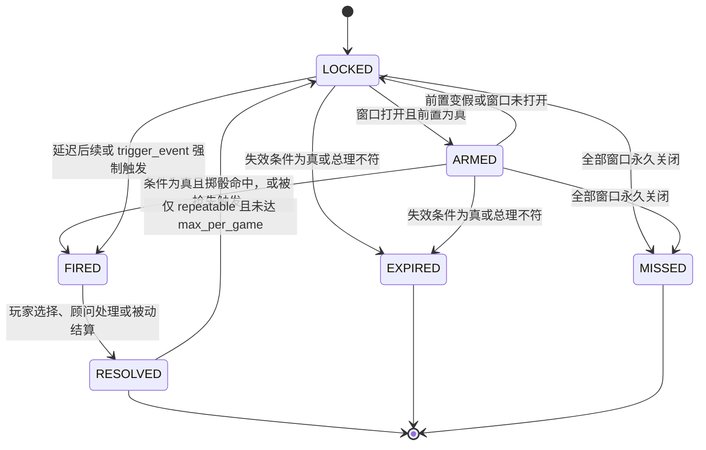
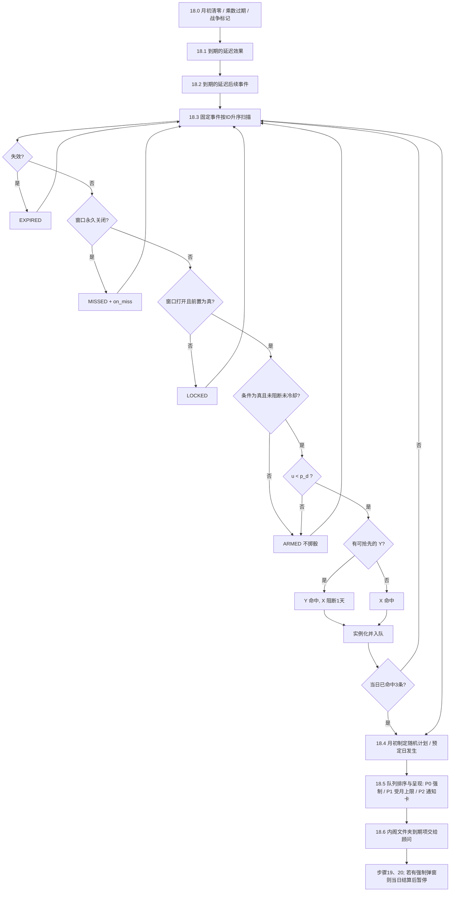

# M12 事件引擎

## 0. 元信息

| 项 | 内容 |
|---|---|
| 版本 | v1.0（2026-10-16） |
| 作者 | 子代理：商业策略游戏资深系统设计师（M12 规格） |
| 依赖规格 | M01（日期、随机数子流、暂停、`custom` 处理函数登记）、M03（组阁与竞选钩子、`region_vote_share` 计算项）、M04（承诺ID与类别标签、立场走廊方向）、M06（人物ID、职位ID、在任/在世查询）、M07/M09（战争状态、停火日期）、M11（动态区存在性）、M14（剧本ID、开局快照）、M15（弹窗与内阁文件夹的界面） |
| 被依赖 | 所有产生事件的模块；`tools/` 的转换与校验脚本；Python 参考实现 `sim/` 与 Godot `game/` |
| 适用范围 | 全部剧本；本文所有算例和初始数据以“贝京 1977”（开局 1977-06-20）为准 |
| 本模块持有的参数 | 无（contracts §6：M12 只执行效果）。M12 持有的是**引擎内部状态**（见第3.1节），不进入 parameters.yaml |

### 0.1 本模块负责满足的对标标准

| 标准（出处） | 门槛 | 本规格的满足方式 |
|---|---|---|
| R3 每局新事件比例（benchmarks §6.2） | 同原型换种子第2局未见事件 ≥ 35%，换原型 ≥ 50%，第5局 ≥ 15%；重复事件中 ≥ 60% 显示变体或摘要 | §4.10 覆盖率指标定义与计算脚本；§4.7 变体选择；§9.3 已读事件显示摘要版 |
| R4 事件池与单局覆盖 | 旗舰剧本可触发池 ≥ 250；一局读到 60–120 条；单局覆盖率 ≤ 45% | §4.10 定义“可触发池”的计算口径；§11 测试 T17 |
| R6 分叉密度 | 每游戏年 ≥ 8 个分叉型抉择 | §4.9 校验脚本 V-21 构建“旗标→事件可达性”依赖图并统计 |
| R10 延迟后果 | ≥ 30% 抉择事件有 ≥ 3 个月后结算的后果 | §4.9 校验 V-19 静态统计 `schedule_event`、带时长的修正器、`after_event` 窗口 |
| R18 去AI腔 | 禁用句式每千字 ≤ 0.5 次；阴谋/人物事件无名“他”占比 0 | §4.8 禁用句式表（22 条正则）、自动检测脚本 `tools/lint_text.py`、阈值 |
| R20 多视角 | 锚点事件 100% 附 ≥ 3 个群体视角 | §3.3 `perspectives` 字段；校验 V-15 |
| R21 随机事件情绪比例 | R- 中正面和中性 ≥ 35%；季节与地理前提 100% 正确 | §3.4 `tone`、`season_months`、`slots.*.filter` 字段；校验 V-16、V-17 |
| R26 打断频率 | 非战时每月强制弹窗 ≤ 3 | §4.5 弹窗队列：强制弹窗月度上限 3，超出部分进“内阁文件夹”（不暂停） |
| R27 漏读兜底 | 危险阈值越线时 100% 触发强制简报 | §8.3 提供 `kind: briefing` 事件类型与 M15 钩子 |
| R31 / E9 历史引力 | 史实型机器人重演率 70–80%，反向型 ≤ 40% | §4.2 概率公式全部为可校准系数；§12 列出校准方法 |
| E1 固定事件唯一性 | 同一 E- 一局 1 次 | §4.1 状态机：FIRED 不可逆；运行时断言 A-01（E-Gxx 例外见待决问题1） |
| E2 随机事件上限 | 不超过上限；间隔 ≥ 冷却；同一文本变体 24 个月不重复 | §4.3 冷却、上限；§4.7 变体 24 个月排除规则 |
| E3 单事件占比 | 任意单条 R- ≤ 全部弹窗 3% | §4.3 重复衰减 + 3% 硬上限 |
| E4 去重率 | 20 年 ≥ 85% | §4.7 变体键与“耗尽降权”；§4.7.4 算例 |
| E5 事件频率 | 平时每月 1–3 条，峰值 ≤ 6；随机 ≤ 2 | §4.3 随机月上限 2；§4.5 固定事件每日上限 3 |
| E8 后果持久化 | ≥ 80% 抉择事件写入关系、旗标或延迟后续 | 校验 V-18 |
| D6 / A6（paradox_lessons §5） | 后果写进人物与世界 | 同 E8；效果格式支持 `relation` 与旗标 |
| D7 / A7 | R- 至少 3 种文本变体，第2、3次引用上一次 | §3.4 `variants` ≥ 3（校验 V-12）、`repeat_changes` 必填（V-13） |
| D18 数据驱动、可模组 | 事件全部在外部文件 | §3 YAML schema，构建为 JSON；引擎只解释执行 |
| D19 性能预算 | 事件条件不做无谓全量评估 | §4.1 预过滤（窗口、状态索引）；§10 性能上限 |
| K-x1 / P1 朴正熙纪事 AI 腔 | 文本可信 | §4.8 |
| K-x6 / P9 随机事件多为负面、季节错误 | 情绪比例与季节前提 | `tone`、`season_months` |
| S-x2 / S7 Suzerain 重读成本 | 已读快进、摘要 | §9.3 摘要版 |
| S2 Suzerain 漏读兜底 | 危机强制推到面前 | §8.3 |
| W-x4 / W-x5 白日升通知堆积、事件稀少 | 通知可过期、事件量足 | §4.5 内阁文件夹 7 天自动处理；R4 计数 |

**对五个总锚点的贡献**

| 总锚点 | 本模块的做法 |
|---|---|
| 深度与重复可玩性超过《朴正熙纪事》 | 全部固定事件条件触发（窗口 + 前置 + 数值条件 + 月概率），随机事件槽位 × 变体 × 重复阶段生成不同文本；未见事件比例写成自动指标（R3） |
| UI 观感以 Suzerain 为标准 | 事件弹窗分三层：标题与正文必读、多视角选读、效果数字在悬停提示中（§9）；已读事件显示摘要 |
| 规模最接近白日升 | 单剧本可触发池 ≥ 250 条，单局 60–120 条（R4） |
| 政治深度接近 Democracy 4 | 随机事件“发生随机、后果按状态缩放”（`scale` 表达式读取国家状态）；表达式语言让所有概率可解释（悬停显示各加项） |
| 观感接近P社但复杂度更低 | P社式事件弹窗（标题、插图、正文、选项、悬停效果）；队列与暂停规则只有 3 级优先级、1 个月度上限 |

---

## 1. 设计意图

### 1.1 核心取舍
事件引擎为玩家制造的核心取舍是：**每个弹窗的每个选项都在承诺、立场走廊、愿景三层之间至少得罪一层，而且今天的选择会改变几个月后哪些事件可能发生。**

### 1.2 决策频率与信息来源
| 项 | 数值 |
|---|---|
| 平时每月需要玩家做选择的事件 | 平均 1–3 条（E5）：其中固定事件约 1.2 条，随机事件中的抉择型约 0.6 条 |
| 平时每月强制暂停的弹窗 | ≤ 3 个（R26） |
| 战时每月 | 不设强制上限，峰值不超过 8 条（§4.5） |
| 决策信息来源 | ① 弹窗正文与多视角；② 选项悬停提示（效果数字、风险提示）；③ 告警条中的“事件前兆”（条件已满足、正在掷骰的锚点事件，以模糊措辞显示，见 §9.4）；④ 事件日志 |

### 1.3 失败状态与恢复路径
事件引擎本身没有失败状态。它负责避免三种**体验失败**：
| 体验失败 | 检测 | 恢复机制 |
|---|---|---|
| 弹窗淹没（某月 > 3 个强制弹窗） | 运行时计数 `month_forced_count` | 超出部分进入内阁文件夹，7 天后顾问自动处理（§4.5） |
| 事件荒漠（连续 60 天无任何事件） | 运行时计数 `days_since_last_popup` | 随机事件归一系数 f 上限从 3.0 临时提到 4.0，直到下一条事件出现（§4.3.3） |
| 同一事件刷屏 | 3% 硬上限、重复衰减 | §4.3.2 |

### 1.4 第10–20年如何保持新鲜感
1. 固定事件按时代窗口与条件解锁：贝京剧本 1977–1992 年有 E-1977-xx 至 E-1992-xx 共约 110 条锚点/人物事件，之后衔接 05 文件的 1992–2006 事件。
2. 随机事件的时代变体（`era_variants`）在 1970、1990 年等节点改变文本和选项。
3. 重复变化（`repeat_changes`）：第2次、第3次发生时出现新选项（例如“全国道路安全计划”），把重复变成政策入口。
4. 变体键耗尽降权（§4.7.3）：用旧的事件自动让位给未见过的事件。
5. 覆盖率指标 L4（paradox_lessons）：第15年新内容出现率 ≥ 20%，由 §4.10 的脚本测量。

---

## 2. 读写清单

M12 不拥有任何参数（contracts §6）。它在结算步骤 18 读取上一步结束时的全部状态；所有写入都通过**效果队列**提交给效果解释器（contracts §4），由效果解释器按 owner 规则应用。下表中“效果”表示 M12 代表事件提交效果、不直接写入。

| 参数ID | 读/写 | 结算步骤（contracts §3） | 说明 |
|---|---|---|---|
| political_capital, party_standing, ally_satisfaction, bloc_support, promise_progress, stance_deviation, vision_progress, centralization, relation, health | 读 + 效果 | 18 | 条件、概率加项、顾问打分（§7）；选项效果 |
| coalition_seats | 读 + 效果（只允许 `op: add`，由 M03 校验） | 18 | 条件，例如 E-G04-03 |
| budget_balance, public_debt, fx_reserves, inflation, growth, unemployment, readiness, mobilization, absorption_capacity, immigration_inflow, state_integration, arms_reliability | 读 + 效果 | 18 | 条件、`scale` 表达式 |
| religious_status_quo, draft_exemption, alienation, historical_grievance, civic_identification, land_grievance | 读 + 效果 | 18 | 矛盾阈值事件 |
| intl_legitimacy, us_admin_relation, us_congress_relation, power_relation | 读 + 效果 | 18 | 外交事件 |
| settler_momentum, economic_model, inequality, union_strength, rule_of_law, public_security, judicial_conflict | 读 + 效果 | 18 | 结构事件 |
| regime_hostility, popular_hostility, regime_stability, pal_hostility, pal_living_standard, faction_strength, faction_legitimacy, deterrence, complacency | 读 + 效果 | 18 | 外部冲突事件；`complacency` 只在条件中读取，界面不显示其数值 |
| region_security, region_development, region_population | 读 + 效果 | 18 | 槽位权重、`scale` |
| nuclear_progress, nuclear_exposure_risk, enemy_nuclear_progress, islamic_assoc_strength, historical_rating | 读 + 效果 | 18 | 隐藏层；对应效果在弹窗中显示为“?”（§9.2） |
| strategic_dependence, trilemma, war_probability, uprising_risk, region_vote_share | 只读 | 18 | `derived` 类型：禁止作为效果 `target`（校验 V-07）；只能通过修正器的计算项影响（附录B-4） |

另外 M12 读取以下**非参数状态**：日期（M01）、旗标集合、修正器集合（含键与剩余天数）、人物在世/在任/职位（M06）、动态区存在性（M11）、战争状态与停火日期（M07/M09）、当前剧本ID与当前总理（M14）、当前政府就任日期（M03）。

---

## 3. 状态与数据结构

### 3.1 引擎内部状态（存档必须完整保存）

| 字段 | 类型 | 范围/取值 | 默认值 | 说明 |
|---|---|---|---|---|
| `status[event_id]` | 枚举 | LOCKED, ARMED, FIRED, RESOLVED, EXPIRED, MISSED | LOCKED | 固定事件状态机（§4.1）。随机事件不使用 |
| `fired[event_id]` | 列表 | 每项 {fire_date, resolve_date, option, variant_key, slots, auto} | 空 | 每次发生追加一项；固定事件（非 E-G）最多 1 项 |
| `counts_game[event_id]` | 整数 | ≥ 0 | 0 | 本局发生次数 |
| `counts_term[event_id]` | 整数 | ≥ 0 | 0 | 本届政府任期内发生次数；新政府宣誓日清零（用于 `repeat_changes`） |
| `cooldown_until[event_id]` | 日期 | — | 无 | 冷却结束日（含当日可再发生） |
| `blocked_until[event_id]` | 日期 | — | 无 | “插在之前”机制造成的暂时阻断（§4.6） |
| `multipliers[event_id]` | 列表 | 每项 {value: 0–10, expires: 日期或 null, source: 事件ID+选项} | 空 | 事前决策点乘数（§4.2.3） |
| `variant_history[event_id]` | 列表 | 每项 {variant_key, date} | 空 | 变体去重（§4.7） |
| `scheduled` | 列表 | 每项 {seq, event_id, date, force, source, slots} | 空 | 延迟后续事件（§4.6.2） |
| `queue` | 列表 | 每项 PopupItem（见下） | 空 | 当日待呈现的弹窗 |
| `cabinet_folder` | 列表 | 每项 PopupItem + deadline | 空 | 内阁文件夹（§4.5.3） |
| `month_plan` | 列表 | 每项 {event_id, day} | 空 | 本月随机事件的预定日（§4.3） |
| `month_forced_count` | 整数 | ≥ 0 | 0 | 本月已呈现的强制弹窗数，每月1日清零 |
| `month_random_count` | 整数 | 0–2 | 0 | 本月已发生随机事件数 |
| `month_had_war` | 布尔 | — | false | 本月是否出现过战争状态 |
| `last_major_date` | 日期 | — | 无 | 最近一次 `major: true` 事件的弹出日 |
| `popup_total` | 整数 | ≥ 0 | 0 | 本局弹窗总数（含顾问处理、被动通知），用于 3% 规则与去重率 |
| `days_since_last_popup` | 整数 | ≥ 0 | 0 | 事件荒漠检测 |
| `seq_counter` | 整数 | ≥ 0 | 0 | 全局自增序号，保证同日排序确定 |

**PopupItem**：{instance_id, event_id, priority, fire_seq, slots: {名: 值}, variant_key, repeat_stage, scale_k, insert_before: [事件ID], deadline: 日期或 null, state: pending/presented/resolved}

**存档外的玩家档案**（跨局，不进存档）：`profile/seen_events.json` = {event_id: {first_seen_game: 整数, times_seen: 整数, variant_keys: [字符串]}}，用于“已读摘要”（§9.3）与覆盖率（§4.10）。

### 3.2 文件组织
| 文件 | 内容 |
|---|---|
| `data/events/E_1948_1955.yaml` … `E_1992_2006.yaml` | 固定事件，与 docs/events 01–05 一一对应 |
| `data/events/R_random.yaml` | 随机事件，对应 06 |
| `data/events/id_map.yaml` | 中文旗标/修正器/人物/槽位名 → 英文ID 映射（§4.9.3） |
| `data/events/event_config.yaml` | 引擎系数（§12 的全部系数） |
| `data/tests/expr_cases.yaml` | 表达式测试用例（§4.4.7），Python 与 GDScript 共用 |
| 构建产物 `build/events.json` | 由 `tools/build_events.py` 合并、校验后输出，游戏只读取 JSON |

每个 YAML 文件的顶层结构：
```yaml
schema_version: 1
flags:        # 本文件首次设置的旗标声明
  - {id: dayan_foreign_minister, zh: 达扬外长, hidden: false}
modifiers:    # 本文件首次定义的修正器（定义格式见 §3.5）
  - {...}
events:       # 事件列表
  - {...}
```

### 3.3 固定事件（E-）schema

对应 docs/events/README.md 第1节模板与第5节触发规范。**必填**列中“是”表示缺失时校验报错。

| 字段 | 类型 | 必填 | 默认 | 说明与对应 Markdown 字段 |
|---|---|---|---|---|
| `id` | 字符串 | 是 | — | 正则 `^E-(\d{4}-\d{2}[a-z]?|G0[1-5]-\d{2})$` |
| `kind` | 枚举 | 是 | — | `fixed` |
| `type` | 枚举 | 是 | — | `anchor`（锚点）/ `structure`（结构）/ `character`（人物）/ `flavor`（风味）/ `regional`（区域）/ `followup`（后续）/ `opening`（开局）/ `counterfactual`（架空）/ `briefing`（简报，§8.3） |
| `form` | 枚举 | 是 | — | `choice`（抉择）/ `passive`（被动）/ `predecision`（事前政策决策点，README §4 第4条） |
| `title` | 字符串 | 是 | — | 标题，≤ 16 个汉字 |
| `major` | 布尔 | 否 | false | 重大事件：强制弹窗、触发 14 天随机事件暂停、必须有 ≥ 3 个视角 |
| `minor` | 布尔 | 否 | false | 【小】：允许顾问自动处理 |
| `repeatable` | 布尔 | 否 | false | 只允许 `E-Gxx-xx` 设为 true；为 true 时必须有 `trigger.cooldown_months` |
| `max_per_game` | 整数 | 否 | 1（repeatable 时 4） | 本局次数上限 |
| `requires_pm` | 字符串或 null | 否 | null | 只在指定总理（人物ID）执政时有效；换人后该事件转为 EXPIRED |
| `scenario_tags` | 字符串列表 | 否 | [] | 用于覆盖率统计的剧本归属，例如 `[begin_1977]` |
| `living_persons` | 字符串列表 | 否 | [] | 【在世人物】的人物ID；界面以职位称呼（§4.8.4） |
| `trigger` | 对象 | 是 | — | 见下表 |
| `background` | 字符串 | 是 | — | 背景，1–4 句，≤ 220 个汉字 |
| `summary` | 字符串 | 是 | — | 摘要版，≤ 40 个汉字，用于已读事件（§9.3） |
| `options` | 列表 | `choice`/`predecision` 时是 | — | 2–3 项（重复变化可加到 4 项），见 §3.3.2 |
| `passive_effects` | 效果列表 | `passive` 时是 | — | 被动效果 |
| `followup_choice` | 对象 | 否 | null | 被动事件附带的立即抉择（如 R-01a），结构同一个只含 `options` 的事件 |
| `perspectives` | 列表 | `major: true` 时是（≥ 3 项） | [] | 每项 {group: 英文ID, label: 中文群体名 ≤ 8 字, text: ≤ 60 字} |
| `notes` | 字符串 | 否 | "" | 设计备注，不显示给玩家 |
| `presentation` | 对象 | 否 | {} | {priority_bonus: 0–99, illustration: 资源ID, insert_before: [事件ID]} |

#### 3.3.1 `trigger` 子结构

| 字段 | 类型 | 必填 | 默认 | 说明与对应 Markdown 字段 |
|---|---|---|---|---|
| `window` | 对象或对象列表 | 是 | — | 窗口。列表表示“任一窗口打开即可”。三种写法：①绝对 `{from: 1977-09-01, to: 1979-12-31}`；②相对 `{after_event: E-1977-11, from_months: 6, to_months: 14}`（以该事件 resolve_date 起算，日历月）；③开局 `{scenario_start: begin_1977}`（只在该剧本第 0 天有效）。时代通用事件写 `{from: 1977-06-20, to: 1992-07-12}` |
| `hook` | 字符串或 null | 否 | null | 只在指定钩子触发时评估（§8.2），例如 `coalition_formation`；有 hook 时不做每日评估 |
| `prerequisites` | 表达式（布尔） | 否 | `true` | 前置：旗标、已发生事件、动态区、人物在任 |
| `condition` | 表达式（布尔） | 是 | — | 条件：**必须包含 ≥ 1 个参数比较**（校验 V-05，README §5 禁止只按日期触发） |
| `probability` | 对象 | 是 | — | 见 §3.3.3 |
| `cooldown_months` | 整数 | repeatable 时是 | null | 冷却（日历月） |
| `invalidation` | 表达式（布尔） | 否 | `false` | 失效：为真时转为 EXPIRED，永远不再发生 |
| `on_miss` | 对象 | 否 | `{effects: []}` | 未触发：窗口关闭仍未发生时执行一次。字段 {effects: 效果列表, trigger: 事件ID 或 null（强制触发替代事件）, extend_months: 整数（只延长一次窗口，用于“窗口延长6个月（仅一次）”）} |

#### 3.3.2 选项子结构

| 字段 | 类型 | 必填 | 默认 | 说明 |
|---|---|---|---|---|
| `id` | 字符串 | 是 | — | `A` / `B` / `C` / `D` |
| `title` | 字符串 | 是 | — | 「」内的选项标题，≤ 16 个汉字 |
| `historical` | 布尔 | 否 | false | 【史实】 |
| `tags` | 字符串列表 | 否 | [] | 取值表：`restraint`（克制）、`hardline`（强硬）、`authoritarian`（推高集权度）、`extreme`（极端：驱逐、屠杀、集体惩罚）、`peace`、`economic`、`social`。修正器的选项标签效果（§3.5）与顾问规则（§7）读取 |
| `requires` | 表达式（布尔） | 否 | `true` | 可选条件；不满足时选项灰显并在悬停中写出原因 |
| `risk_hint` | 枚举 | `predecision` 时是 | null | `低` / `中` / `高`，只显示风险，不显示乘数（§4.2.3） |
| `effects` | 效果列表 | 是 | — | contracts §4 格式 + 附录B 扩展 |
| `text` | 字符串 | 否 | "" | 选项下方的一句话说明，≤ 40 字 |

#### 3.3.3 `probability` 子结构

| 字段 | 类型 | 必填 | 默认 | 说明 |
|---|---|---|---|---|
| `period` | 枚举 | 是 | — | `month`（每月）/ `week`（每周）/ `day`（每日）/ `immediate`（条件满足即发生，等价每次 100%） |
| `base` | 数 | `immediate` 以外是 | — | 0–1 |
| `add` | 列表 | 否 | [] | 每项二选一：`{when: 布尔表达式, value: 数}` 或 `{expr: 数值表达式}` |
| `mult` | 列表 | 否 | [] | 每项 `{when: 布尔表达式, value: 数}`，满足时乘以 value |

### 3.4 随机事件（R-）schema

对应 README 第6.2节。与固定事件共用 `title`、`background`、`summary`、`options`、`passive_effects`、`followup_choice`、`perspectives`、`presentation`、`living_persons`。

| 字段 | 类型 | 必填 | 默认 | 说明与对应 Markdown 字段 |
|---|---|---|---|---|
| `id` | 字符串 | 是 | — | 正则 `^R-\d{2}[a-z]?$` |
| `kind` | 枚举 | 是 | — | `random` |
| `category` | 枚举 | 是 | — | 类别：`disaster`（灾害与事故）、`economy`（经济波动）、`social`（社会与劳工）、`politics`（政坛与人事）、`security`（安全）、`foreign`（外交与海外）、`flavor`（风味与文化） |
| `form` | 枚举 | 是 | — | `choice` / `passive` |
| `magnitude` | 枚举 | 是 | — | `small` / `medium` / `large`（README §3 尺度；用于月上限的保留顺序） |
| `tone` | 枚举 | 是 | — | `positive` / `neutral` / `negative`（R21 统计） |
| `minor` | 布尔 | 否 | false | 【小】 |
| `era` | [整数, 整数] | 是 | — | 时代：起止年份（含） |
| `prerequisites` | 表达式 | 否 | `true` | 前提：只允许存在性条件（动态区、旗标、人物在任），校验 V-11 禁止在此处比较参数 |
| `base_prob_month` | 数 | 是 | — | 基础概率（每月，0–1） |
| `season_months` | 整数列表或 null | 否 | null | 只在这些月份掷骰（1–12） |
| `cooldown_months` | 整数 | 是 | — | 冷却 |
| `cap` | 对象 | 否 | {} | 上限：`{per_term: N}` 和/或 `{per_game: N}`；某变体的上限写在变体内 |
| `slots` | 有序映射 | 否 | {} | 随机槽位，键为英文槽位名，值见 §3.4.1 |
| `variant_slot` | 字符串或 null | 否 | 第一个槽位名 | 计入变体键的主槽位（§4.7.1） |
| `scale` | 对象 | 否 | `{expr: "1", min: 0.5, max: 2.0}` | 规模系数 k：`{expr: 数值表达式, terms: [{when: 布尔表达式, add: 数}, {when: ..., mul: 数}], min: 0.5, max: 2.0}`。计算顺序：expr → 依次应用 terms → 夹紧到 [min, max] |
| `variants` | 列表 | 是（≥ 3 项，校验 V-12） | — | 文本变体，每项 {id: `v1`…, when: 布尔表达式（默认 true）, weight: 数（默认 1）, background: 字符串} |
| `repeat_changes` | 列表 | 是（≥ 1 项，V-13） | — | 重复变化，每项 {n: 2 或 3, title_prefix: 字符串, background_prefix: 字符串, add_options: [选项], option_effect_scale: {选项ID: 倍数}, extra_effects: 效果列表, set_flags: [旗标ID]}。阶段 = min(counts_term 加 1 后的值, 列表中最大的 n)；阶段 1 不改变 |
| `era_variants` | 列表 | 否 | [] | 时代变体，每项 {when: 布尔表达式, background_suffix: 字符串, scale_add: 数, add_options: [选项], remove_options: [选项ID], option_extra_effects: {选项ID: 效果列表}, slot_overrides: {槽位名: 槽位定义}}。所有 when 为真的项按列表顺序叠加 |

#### 3.4.1 槽位定义

| 字段 | 类型 | 说明 |
|---|---|---|
| `type` | 枚举 | `region` / `town` / `group` / `arab_group` / `minister` / `party` / `country` / `faction` / `enum` |
| `zh` | 字符串 | 文本中的中文占位名，例如 `区` |
| `values` | 列表 | `enum` 必填：每项 {id, zh, weight（默认 1）}；`region` 等可以给出子集 {id, weight} |
| `weight` | 表达式或预设名 | 预设名：`population`（区人口）、`insecurity`（(100 − region_security[x]) × 边境系数，边境区与动态区为 1，腹地为 0.2）、`alienation`、`ambition`（野心 + (100 − 忠诚)）、`dissatisfaction`（100 − ally_satisfaction[x]）、`hostility`（regime_hostility[x]）、`strength`（faction_strength[x]），对应 06 文件 §0.3；表达式中用 `{self}` 代表候选值 |
| `filter` | 布尔表达式 | 候选过滤，`{self}` 代表候选值；用于地理与季节正确性（R21） |
| `from_slot` | 字符串 | `town` 类型：从已抽出的区的关键地点表抽取 |
| `optional` | 布尔 | 默认 false。无候选时：optional 为 false 则整条事件作废（不计冷却、不计弹窗），为 true 则引用该槽位的效果被跳过 |

### 3.5 修正器定义（事件文件内声明）

| 字段 | 类型 | 说明 |
|---|---|---|
| `id` | 字符串 | 英文ID（§4.9.3） |
| `zh` | 字符串 | 中文名，弹窗与提示中显示 |
| `scope` | 枚举 | `national` / `region` / `party` / `bloc` / `group` / `country` / `character` / `faction` |
| `monthly_effects` | 效果列表 | 每月1日（步骤 18 开头）提交一次 |
| `terms` | 列表 | 计算项 {param: 参数ID, key: 键或 `{key}`, add: 数, mul: 数}，由参数 owner 模块在计算该参数时读取（含 derived 参数，附录B-4） |
| `option_tag_effects` | 列表 | {tag: 选项标签, effects: 效果列表}：修正器存续期间，玩家选择带该标签的选项时追加这些效果 |
| `event_prob_add` | 列表 | {event: 事件ID, value: 数}：存续期间该事件月概率加 value |
| `stack` | 枚举 | `refresh`（重复添加时刷新时长，默认）/ `stack`（可叠加，最多 3 层） |

### 3.6 效果格式（contracts §4 + 附录B 扩展）

| op | 必填字段 | 说明 |
|---|---|---|
| `add` / `set` / `mul` | `target`, `value`；scope 非 national 时 `key` | 参数修改；`key` 可以是实体ID、槽位 `"{region}"`、职位ID（附录B-3）、承诺类别（`cat_economy` 等，README §2.8） |
| `set_flag` / `clear_flag` | `flag` | 旗标；可选 `duration_days`（到期自动清除） |
| `add_modifier` | `modifier`, `duration_days`（null = 永久）；可选 `key` | 修正器 |
| `remove_modifier` | `modifier`；可选 `key` | — |
| `trigger_event` | `event` | 立即强制触发（忽略条件与概率），同日进入队列 |
| `schedule_event` | `event`，`delay_days` 或 `delay_range_days: [min, max]`；可选 `force`（默认 false） | 延迟后续（§4.6.2） |
| `event_multiplier` | `event`, `value`；可选 `duration_days`（默认 null = 直到目标事件 RESOLVED/EXPIRED/MISSED） | 事前决策点乘数（附录B-1） |
| `random_branch` | `branches: [{weight, effects}]` | 互斥随机分支，权重和为 1（附录B-1） |
| `if` | `cond`, `then`；可选 `else` | 条件效果（附录B-1） |
| `add_relation` / `change_seat` / `custom` | 按 contracts §4 与 M01/M03/M06 规格 | M12 原样转交 |

通用可选字段：`scale`（数值表达式，乘到 value 上）、`delay_days`（整数，≥ 1 时进入延迟效果队列，到期日步骤 18 开头提交）、`chance`（0–1，独立掷骰）、`display`（`shown` 默认 / `hidden` 不在悬停中显示 / `fuzzy` 显示为“?”）。

### 3.7 完整示例：贝京 1977 的 4 条事件

> 以下由 docs/events/04_1977_1992.md 与 06_random_events.md 逐字段转写。数值与原文一致；转写时新增的字段在注释中以“转写新增”标明。承诺键 `peace_security`、人物ID `sadat` 等以 M04/M06 规格为准（待决问题3）。

#### 3.7.1 带链条的抉择事件：E-1977-11 萨达特访问耶路撒冷

```yaml
flags:
  - {id: dayan_foreign_minister, zh: 达扬外长, hidden: false}
  - {id: sadat_missed, zh: 错失萨达特, hidden: false}
  - {id: sadat_visit_happened, zh: 萨达特已访问, hidden: false}      # 转写新增：E-1978-09 前置“选择 B 且萨达特如期访问”需要它
  - {id: sadat_visit_cancelled, zh: 萨达特取消访问, hidden: false}   # 转写新增
  - {id: egypt_peace_treaty_signed, zh: 埃以和约已签署, hidden: false}

events:
  - id: E-1977-11
    kind: fixed
    type: anchor
    form: choice
    major: true
    title: 萨达特访问耶路撒冷
    scenario_tags: [begin_1977]
    trigger:
      window: {from: 1977-09-01, to: 1979-12-31}
      prerequisites: >-
        character_in_office("sadat") and region_exists("sinai")
        and not flag("egypt_peace_treaty_signed") and not at_war("egypt")
      condition: >-
        regime_hostility[egypt] <= 60 and regime_stability[egypt] >= 30
        and (flag("dayan_foreign_minister") or relation[foreign_minister] >= 20)
      probability:
        period: month
        base: 0.15
        add:
          - {when: 'flag("dayan_foreign_minister")', value: 0.20}
          - {expr: '0.05 * floor(max(0, 60 - regime_hostility[egypt]) / 10)'}
          - {when: 'us_admin_relation >= 60', value: 0.05}
      invalidation: 'not character_in_office("sadat") or at_war("egypt")'
      on_miss:
        effects:
          - {op: set_flag, flag: sadat_missed}
    background: >-
      1977年11月9日，萨达特在埃及议会表示愿意“到天涯海角，甚至到以色列议会”去寻求和平。
      11月19日他飞抵本-古里安机场，次日在议会演讲，要求以色列撤出全部占领地并解决巴勒斯坦问题。
    summary: 萨达特要来耶路撒冷，条件是谈全部占领地。
    options:
      - id: A
        title: 正式邀请，以国礼接待
        historical: true
        tags: [peace]
        effects:
          - {op: add, target: regime_hostility, key: egypt, value: -20}
          - {op: add, target: intl_legitimacy, value: 10}
          - {op: add, target: us_admin_relation, value: 8}
          - {op: add, target: us_congress_relation, value: 5}
          - {op: add, target: promise_progress, key: peace_security, value: 10}
          - {op: add, target: vision_progress, value: 10}
          - {op: add, target: public_security, value: 5}
          - {op: add, target: popular_hostility, key: egypt, value: -5}
          - {op: add, target: regime_stability, key: egypt, value: -3}
          - {op: add, target: regime_hostility, key: syria, value: 5}
          - {op: add, target: faction_legitimacy, key: fatah, value: 3}
          - {op: set_flag, flag: sadat_visit_happened}
      - id: B
        title: 有条件邀请：先不谈西岸
        tags: [hardline]
        effects:
          - {op: add, target: regime_hostility, key: egypt, value: -8}
          - {op: add, target: stance_deviation, key: territory, value: -3}
          - op: random_branch
            branches:
              - weight: 0.6        # 萨达特取消行程
                effects:
                  - {op: add, target: intl_legitimacy, value: -5}
                  - {op: add, target: us_admin_relation, value: -5}
                  - {op: add, target: vision_progress, value: -5}
                  - {op: set_flag, flag: sadat_visit_cancelled}
              - weight: 0.4        # 如期访问
                effects:
                  - {op: set_flag, flag: sadat_visit_happened}
      - id: C
        title: 怀疑是骗局，提高南线战备
        tags: [hardline]
        effects:
          - {op: add, target: readiness, value: 5}
          - {op: add, target: budget_balance, value: -1}
          - {op: add, target: regime_hostility, key: egypt, value: 5}
          - {op: add, target: us_admin_relation, value: -10}
          - {op: add, target: intl_legitimacy, value: -8}
          - {op: add, target: promise_progress, key: peace_security, value: -10}
          - {op: add, target: relation, key: weizman, value: -10}
          - {op: set_flag, flag: sadat_missed}
    perspectives:
      - {group: israeli_street, label: 以色列街头, text: 电视里埃及总统走下舷梯，迎接他的是梅厄夫人、沙龙和整个内阁，四年前的敌人此刻在微笑。}
      - {group: egypt, label: 埃及, text: 萨达特在赌，他要把西奈要回来，也要把美国拉过来。}
      - {group: palestinians, label: 巴勒斯坦人, text: 大马士革、巴格达和贝鲁特都说他出卖了我们；我们的名字会出现在谈判桌上吗？}
    notes: 12月贝京在伊斯梅利亚提出巴勒斯坦阿拉伯人自治方案，作为 E-1978-09 的前置选项。未触发时此后任何和约事件要求 regime_hostility[egypt] <= 30，由 E-1979-03 等事件读取 sadat_missed 实现。
```

**链条的下一环**（E-1978-09 的触发部分，展示相对窗口与对上一环选项的读取）：
```yaml
  - id: E-1978-09
    kind: fixed
    type: anchor
    form: choice
    major: true
    title: 戴维营
    trigger:
      window: {after_event: E-1977-11, from_months: 6, to_months: 14}
      prerequisites: >-
        (event_choice("E-1977-11") == "A" or flag("sadat_visit_happened"))
        and character_in_office("sadat")
        and (not has_modifier("cool_realist") or us_admin_relation >= 60)
      condition: 'regime_hostility[egypt] <= 40 and us_admin_relation >= 40'
      probability:
        period: month
        base: 0.20
        add:
          - {expr: '0.05 * floor(max(0, us_admin_relation - 40) / 10)'}
          - {when: 'flag("dayan_foreign_minister") or relation[weizman] >= 20', value: 0.05}
      invalidation: 'flag("sadat_missed") or not character_in_office("sadat") or at_war("egypt")'
      on_miss:
        effects:
          - {op: set_flag, flag: sadat_missed}
    # 其余字段省略
```

#### 3.7.2 被动事件：E-1978-03a 海滨公路屠杀（后接 E-1978-03b）

```yaml
modifiers:
  - id: demand_retaliation
    zh: 要求报复
    scope: national
    option_tag_effects:
      - tag: restraint
        effects:
          - {op: add, target: party_standing, value: -5}
    event_prob_add:
      - {event: E-1978-03b, value: 0.20}
    stack: refresh

events:
  - id: E-1978-03a
    kind: fixed
    type: anchor
    form: passive
    major: true
    title: 海滨公路屠杀
    scenario_tags: [begin_1977]
    trigger:
      window: {from: 1977-06-01, to: 1982-06-30}
      prerequisites: 'not flag("plo_moved_to_tunis")'
      condition: 'faction_strength[fatah] >= 50 and region_security[tel_aviv] <= 80'
      probability:
        period: month
        base: 0.04
        add:
          - {when: 'event_done("E-1977-11") and months_since(event("E-1977-11")) < 12', value: 0.08}
          - {expr: '0.03 * floor(max(0, 50 - deterrence) / 10)'}   # 威慑值不在条件中，参照点取 50（§4.9.2 规则 C-7）
      invalidation: 'flag("plo_moved_to_tunis") or faction_strength[fatah] < 30'
    background: >-
      1978年3月11日，法塔赫武装人员从海上登陆，劫持海滨公路上的一辆公共汽车，
      在驶向特拉维夫途中与警方交火，38名以色列平民遇难，其中13名儿童。
    summary: 海滨公路上的公共汽车被劫，38名平民遇难。
    passive_effects:
      - {op: add, target: public_security, value: -15}
      - {op: add, target: region_security, key: tel_aviv, value: -10}
      - {op: add_modifier, modifier: demand_retaliation, duration_days: 90}
      - {op: add, target: faction_strength, key: fatah, value: 3}
      - {op: add, target: faction_legitimacy, key: fatah, value: 3}
      - {op: add, target: intl_legitimacy, value: 3}
    perspectives:
      - {group: victims_families, label: 遇难者家属, text: 车上有去海边郊游的孩子，他们的名字明天会登在每一份报纸上。}   # 转写新增：原文无视角，major 事件要求 ≥ 3 项
      - {group: refugee_camps, label: 难民营, text: 在拉希迪耶营地，袭击者的照片被贴在墙上。}
      - {group: idf_command, label: 总参谋部, text: 北方司令部已经把利塔尼河以南的作战地图摊在桌上。}
```

E-1978-03b 的触发（展示多窗口与对前一被动事件的承接）：
```yaml
  - id: E-1978-03b
    kind: fixed
    type: followup
    form: choice
    title: 利塔尼行动
    trigger:
      window:
        - {after_event: E-1978-03a, from_months: 0, to_months: 1}
        - {from: 1977-06-01, to: 1981-12-31}
      prerequisites: >-
        (event_done("E-1978-03a") or has_modifier("recent_lebanon_attack"))
        and not flag("idf_in_south_lebanon")
      condition: '(region_security[galilee] <= 50 or public_security <= 45) and readiness >= 40'
      probability:
        period: month
        base: 0.10
        add:
          - {when: 'event_done("E-1978-03a") and months_since(event("E-1978-03a")) <= 1', value: 0.70}
      # demand_retaliation 的 event_prob_add 再加 0.20
      invalidation: 'flag("south_lebanon_proxy_militia") or flag("idf_in_south_lebanon")'
      on_miss:
        effects:
          - {op: add, target: party_standing, value: -3}
    # 选项省略
```

#### 3.7.3 事前政策决策点：E-1980-05b 哈达萨楼之后（乘数作用于 E-1980-06）

```yaml
modifiers:
  - id: recent_settler_attack      # 转写新增：替代“近1个月内发生针对定居者的致命袭击”，由袭击类事件添加，30 天
    zh: 定居者遇袭
    scope: national
    stack: refresh

events:
  - id: E-1980-05b
    kind: fixed
    type: anchor
    form: predecision
    title: 哈达萨楼之后
    scenario_tags: [begin_1977]
    trigger:
      window: {from: 1977-06-20, to: 1992-07-12}
      prerequisites: 'has_modifier("recent_settler_attack") and region_exists("west_bank")'
      condition: 'settler_momentum >= 50'
      probability: {period: immediate}
    background: >-
      1980年5月2日，巴勒斯坦武装人员在希伯伦的哈达萨楼外伏击从祈祷归来的定居者，6名耶希瓦学生遇难。
      定居者要求政府“做出犹太人的回应”。辛贝特报告：部分定居者正在私下讨论报复行动，但缺乏具体情报。
    summary: 希伯伦6名耶希瓦学生遇难，辛贝特警告定居者可能报复。
    presentation:
      insert_before: [E-1980-06]
    options:
      - id: A
        title: 驱逐市长，不处理定居者情绪
        historical: true
        tags: [hardline]
        risk_hint: 高
        effects:
          - {op: event_multiplier, event: E-1980-06, value: 1.0, display: hidden}
          - {op: add, target: region_security, key: west_bank, value: 3}
          - {op: add, target: pal_hostility, value: 5}
          - {op: add, target: intl_legitimacy, value: -4}
          - {op: add, target: settler_momentum, value: 3}
          - {op: add, target: ally_satisfaction, key: nrp, value: 3}
      - id: B
        title: 驱逐市长，并渗透激进网络
        risk_hint: 中
        effects:
          - {op: event_multiplier, event: E-1980-06, value: 0.4, display: hidden}
          - {op: add, target: region_security, key: west_bank, value: 3}
          - {op: add, target: pal_hostility, value: 5}
          - {op: add, target: intl_legitimacy, value: -4}
          - {op: add, target: political_capital, value: -10}
          - {op: add, target: ally_satisfaction, key: nrp, value: -5}
          - {op: add, target: bloc_support, key: religious_zionist, value: -3}
          - {op: add, target: relation, key: shin_bet_chief, value: 5}
      - id: C
        title: 不驱逐市长，收缴非法武器
        tags: [restraint]
        risk_hint: 低
        effects:
          - {op: event_multiplier, event: E-1980-06, value: 0.15, display: hidden}
          - {op: add, target: settler_momentum, value: -5}
          - {op: add, target: party_standing, value: -8}
          - {op: add, target: ally_satisfaction, key: nrp, value: -10}
          - {op: add, target: bloc_support, key: religious_zionist, value: -6}
          - {op: add, target: stance_deviation, key: security, value: 8}
          - {op: add, target: public_security, value: -3}
          - {op: add, target: intl_legitimacy, value: 3}
    perspectives:
      - {group: settlers, label: 定居者, text: 我们的孩子在希伯伦的街上被枪杀，政府只会开会。}
      - {group: pal_mayors, label: 巴勒斯坦市长, text: 被驱逐的是民选市长，不是枪手。}
      - {group: shin_bet, label: 辛贝特, text: 监控阿拉伯人是我们的日常，监控犹太人需要部长签字。}
```

E-1980-06 的概率部分（乘数由引擎自动乘入，YAML 中不写）：
```yaml
      probability:
        period: month
        base: 0.10
        add:
          - {expr: '0.05 * floor(max(0, 65 - rule_of_law) / 10)'}
          - {when: 'event_done("E-G04-09") and months_since(event("E-G04-09")) < 6', value: 0.05}
```

#### 3.7.4 随机事件：R-05 公交车事故

> docs/events/04_1977_1992.md 不含 R- 事件，随机事件范例取自 06_random_events.md。

```yaml
modifiers:
  - id: local_resentment
    zh: 地方怨气
    scope: region
    terms:
      - {param: region_vote_share, key: "{key}", add: -2}   # 作用于执政党在该区的选民倾向；derived 参数只能经计算项影响
    stack: stack

events:
  - id: R-05
    kind: random
    category: disaster
    form: choice
    magnitude: small
    tone: negative
    era: [1948, 2006]
    base_prob_month: 0.03
    cooldown_months: 6
    slots:
      region: {type: region, zh: 区, weight: population}
      passengers:
        type: enum
        zh: 乘客
        values:
          - {id: students, zh: 郊游的学生}
          - {id: pilgrims, zh: 朝圣者}
          - {id: soldiers, zh: 回营的士兵}
          - {id: commuters, zh: 通勤的工人}
          - {id: tourists, zh: 游客}
      company:
        type: enum
        zh: 公司
        values:
          - {id: egged, zh: 埃格德合作社}
          - {id: dan, zh: 丹合作社}
          - {id: local, zh: 一家地方小公司}
      coalition_party: {type: party, zh: 政党, weight: dissatisfaction}
      union_party: {type: party, zh: 工会背景的盟党, filter: 'party_has_tag({self}, "labor_union")', optional: true}
    variant_slot: region
    scale:
      expr: '1 + (50 - region_development[{region}]) / 100'
      terms:
        - {when: 'slot("passengers") == "students"', add: 0.3}
      min: 0.5
      max: 2.0
    variants:
      - id: v1
        background: 一辆载着{乘客}的{公司}客车在{区}的山路上冲出护栏，滚落山谷。车上的人大部分没能救出来。
      - id: v2
        background: 下午四点，{公司}的一辆客车在{区}的急弯处失控，翻进旱谷。车上坐的是{乘客}，救护车开了四十分钟才到。
      - id: v3
        background: 警方第一份通报只有两行：{区}境内，{公司}客车坠崖，乘客是{乘客}。到晚上，电台整点新闻开始念死者名单。
    summary: '{区}发生客车坠崖，乘客是{乘客}。'
    options:
      - id: A
        title: 成立调查委员会
        text: 追究运输合作社的责任。
        effects:
          - {op: add, target: political_capital, value: -5}
          - {op: add, target: rule_of_law, value: 1}
          - {op: add, target: union_strength, value: -2}
          - {op: add, target: ally_satisfaction, key: "{union_party}", value: -3}
      - id: B
        title: 拨专款修整{区}的道路
        effects:
          - {op: add, target: budget_balance, value: -0.5, scale: k}
          - {op: add, target: region_development, key: "{region}", value: 2}
          - {op: add, target: ally_satisfaction, key: "{coalition_party}", value: -2}
      - id: C
        title: 慰问家属，低调处理
        tags: [restraint]
        effects:
          - {op: add_modifier, modifier: local_resentment, key: "{region}", duration_days: 180}
    repeat_changes:
      - n: 2
        title_prefix: 又是这条路：
        background_prefix: 这是本届政府任内的第二起。
        option_effect_scale: {C: 2.0}
      - n: 3
        background_prefix: 一年里的第三辆客车。交通部长的电话从早上响到晚上。
        add_options:
          - id: D
            title: 全国道路安全计划
            effects:
              - {op: add, target: budget_balance, value: -1.5}
              - {op: add_modifier, modifier: road_safety_plan, duration_days: null}   # 修正器定义：R-05 的 scale × 0.6
              - {op: add, target: relation, key: transport_minister, value: 5}
    era_variants:
      - when: 'year <= 1959'
        scale_add: 0.3
        background_suffix: 车上多是刚下船不久的新移民。
      - when: 'year >= 1970'
        background_suffix: 事发路段是通往埃拉特的阿拉瓦公路。
      - when: 'year >= 1990'
        slot_overrides:
          passengers:
            type: enum
            zh: 乘客
            values:
              - {id: students, zh: 郊游的学生}
              - {id: commuters, zh: 通勤的工人}
              - {id: tourists, zh: 游客}
              - {id: foreign_workers, zh: 外籍劳工}
        option_extra_effects:
          A:
            - {op: add, target: economic_model, value: -1}
```

> 说明：`k` 在 `scale` 字段中是保留字，代表本次实例的规模系数；选项 C 原文“选民倾向[{区}] 对执政党 −2×k”中，`region_vote_share` 为 derived，转写为修正器计算项（每层 −2，持续 180 天）；×k 的部分以 `stack` 层数实现：k ≥ 1.5 时添加 2 层（转写规则 C-9）。

---

## 4. 规则与公式

> 随机子流（contracts §1）：固定事件掷骰、效果 `chance`、`random_branch`、`delay_range_days` 使用 **events** 子流；随机事件月度掷骰、预定日、槽位抽取、变体选择使用 **random_events** 子流。每次抽取调用一次 `next()`，返回 [0, 1) 的双精度数。生成器算法由 M01 规定。抽取顺序在各小节中逐条写明，Python 与 GDScript 必须一致。

### 4.1 每日调度：固定事件

**触发时机**：每个游戏日，结算步骤 18。

**步骤 18 的子步骤（固定顺序）**
| 子步骤 | 内容 |
|---|---|
| 18.0 | 若今天是每月1日：`month_forced_count = 0`，`month_random_count = 0`，`month_had_war = false`。清除 `expires < 今天` 的乘数；若 `at_war()` 为真，`month_had_war = true` |
| 18.1 | 提交今天到期的延迟效果（带 `delay_days` 的效果） |
| 18.2 | 处理今天到期的延迟后续事件（§4.6.2），按 (date, seq) 升序 |
| 18.3 | 固定事件扫描（本节） |
| 18.4 | 随机事件：每月1日制定月计划；今天是预定日的随机事件发生（§4.3） |
| 18.5 | 队列排序与呈现（§4.5） |
| 18.6 | 内阁文件夹中 `deadline ≤ 今天` 的项由顾问处理（§7） |

**18.3 固定事件扫描算法**
1. 取全部 `kind: fixed` 且没有 `hook` 的事件，按 `id` 字符串升序（Unicode 码位比较；因此 `E-1977-xx` 排在 `E-G04-xx` 之前，`E-1978-03a` 排在 `E-1978-03b` 之前）。
2. 跳过状态为 FIRED、RESOLVED（非 repeatable）、EXPIRED、MISSED 的事件。repeatable 事件在 RESOLVED 后、`counts_game < max_per_game` 时回到 LOCKED。
3. 对每个剩余事件依次判断：
   1. `requires_pm` 非空且当前总理不是该人物 → EXPIRED。
   2. `invalidation` 为真 → EXPIRED。
   3. 窗口：任一窗口满足 `from ≤ 今天 ≤ to` 为“打开”；全部窗口都满足“`to < 今天`，或相对窗口的锚事件已 EXPIRED/MISSED”为“永久关闭”；其余为“未打开”。
   4. 永久关闭：若 `on_miss.extend_months` 非空且尚未延长过 → 把 `to` 最晚的窗口的 `to` 推后 `extend_months` 个日历月，保持 LOCKED；否则 → MISSED，执行 `on_miss.effects`，若 `on_miss.trigger` 非空则强制触发该事件（`trigger_event` 语义）。
   5. 窗口打开且 `prerequisites` 为真 → ARMED；否则 LOCKED，继续下一个事件。
   6. ARMED 时，若 `blocked_until ≥ 今天`，或 `cooldown_until > 今天`，或 `condition` 为假 → 不掷骰。
   7. 否则计算日概率 `p_d`（§4.2），从 **events** 子流抽取 `u`；`u < p_d` 则“命中”。命中时先执行“插在之前”检查（§4.6.1），再把事件标为 FIRED、实例化（§4.7）、入队。
4. **每日固定事件上限 3 条**：当天已命中 3 条后停止扫描（后续事件当天不掷骰、不消耗随机数），第二天照常。延迟后续（18.2）、`trigger_event` 与开局事件不计入此上限。

**日期规则**
| 规则 | 定义 |
|---|---|
| Markdown 中的月份窗口 | “1977-09” 作为 `from` 取当月1日，作为 `to` 取当月最后一天 |
| `add_months(d, n)` | 年月加 n，日保持不变；超过当月天数时取当月最后一天（1980-01-31 + 1 = 1980-02-29） |
| 相对窗口 | `from = add_months(resolve_date, from_months)`，`from_months = 0` 时取 `resolve_date + 1天`；`to = add_months(resolve_date, to_months)` |
| 冷却 | `cooldown_until = add_months(fire_date, cooldown_months)` |
| 时长（`duration_days`） | 1 个月按 30 天换算（“12个月” = 360 天） |
| 日序号 | `day_index(d)` = d 与 1948-01-01 相差的天数（1948-01-01 = 0） |

**算例**：E-1977-11 的窗口 `{from: 1977-09-01, to: 1979-12-31}`。开局日 1977-06-20 为“未打开”，状态 LOCKED；1977-09-01 起若萨达特在任、存在西奈、未签和约、未交战，状态转为 ARMED；若 1979-12-31 结束仍未命中，1980-01-01 转为 MISSED 并设置旗标 `sadat_missed`。

### 4.2 概率公式

#### 4.2.1 月概率
```
p_raw = base + Σ add_i + Σ (活跃修正器的 event_prob_add 中指向本事件的 value)
p_m   = clamp( clamp(p_raw, 0, 1) × Π mult_i × M_event , 0, 1 )
M_event = Π（multipliers[event_id] 中未过期项的 value），无乘数时为 1；乘积夹紧到 [0, 10]
```
- `add_i`：`{when, value}` 项在 when 为真时取 value；`{expr}` 项取表达式值（可以为负）。
- `mult_i`：when 为真时取 value，否则取 1。
- 单位：概率（0–1，无量纲）。

#### 4.2.2 换算为日概率
```
L = 当月天数（period: month）| 7（period: week）| 1（period: day）
p_d = 0                        若 p_m ≤ 0
p_d = 1                        若 p_m ≥ 1 或 period: immediate
p_d = 1 − exp( ln(1 − p_m) / L )  其他情况
```
这样，条件在整个月内持续满足时，该月内至少命中一次的概率恰好等于 `p_m`。两种实现都必须用 `exp` 与自然对数 `log` 计算，不用幂函数。

**算例1（换算）**：`p_m = 0.15`，6 月（L = 30）：ln(0.85) = −0.1625189，÷30 = −0.0054173，exp = 0.9945973，`p_d = 0.0054027`。

**算例2（E-1977-11，表达式夹具 TS-1，见 §4.4.7）**：
- base 0.15；`flag("dayan_foreign_minister")` 为真 +0.20；`0.05 × floor(max(0, 60 − 55)/10) = 0.05 × 0 = 0`；`us_admin_relation = 62 ≥ 60` +0.05。
- `p_raw = 0.40`，无乘数，`p_m = 0.40`。6 月 L = 30：ln(0.6) = −0.5108256，÷30 = −0.0170275，`p_d = 1 − 0.9831166 = 0.0168834`。
- 期望等待天数 = 1/0.0168834 ≈ 59 天。

**算例3（E-1980-06，事前决策点乘数）**：`rule_of_law = 45`，玩家在 E-1980-05b 选了 B（乘数 0.4），E-G04-09 未发生，月份为 7 月（L = 31）：
- `p_raw = 0.10 + 0.05 × floor(max(0, 65 − 45)/10) = 0.10 + 0.05 × 2 = 0.20`
- `p_m = 0.20 × 0.4 = 0.08`
- ln(0.92) = −0.0833816，÷31 = −0.0026897，`p_d = 1 − 0.9973139 = 0.0026861`

#### 4.2.3 事前决策点（README §4 第4条）
- `form: predecision` 的事件，每个选项必须带 `event_multiplier` 效果和 `risk_hint`。
- `event_multiplier` 效果向 `multipliers[目标]` 追加 {value, expires, source}；`duration_days` 为 null 时，到目标事件 RESOLVED、EXPIRED 或 MISSED 时删除。
- 风险提示与乘数的对应（校验 V-14 强制一致）：

| risk_hint | 乘数 m |
|---|---|
| 低 | m ≤ 0.25 |
| 中 | 0.25 < m ≤ 0.6 |
| 高 | m > 0.6 |

- 界面只显示 risk_hint，不显示 m、不显示目标事件的概率（§9.2）。E-1980-05b：A 1.0（高）、B 0.4（中）、C 0.15（低），符合上表。

#### 4.2.4 历史引力校准接口（R31 / E9）
- 每条 `type: anchor` 事件的 `base` 是初值。`tools/calibrate_anchors.py` 用“史实型”机器人跑 500 局，若某锚点重演率 r 不在 [0.70, 0.80]，按 `base_new = base × 0.75 / max(r, 0.05)` 修正，最多迭代 6 轮，`base_new` 夹紧到 [0.005, 0.95]；其他字段不改。
- 校准结果写入 `data/events/calibration.yaml`（{event_id: base}），构建时覆盖 YAML 中的 base。

### 4.3 随机事件调度

#### 4.3.1 月计划（每月1日；剧本开局日不是1日时，开局日也执行一次，s = 开局日的日号）

| 步 | 规则 |
|---|---|
| 1 筛选 | 候选 = 全部 `kind: random` 中同时满足：`era[0] ≤ year ≤ era[1]`；`prerequisites` 为真；`season_months` 为 null 或包含本月；`cooldown_until ≤ 今天`；`counts_term < cap.per_term`、`counts_game < cap.per_game`（未设置的上限视为无穷）；`counts_game < ceil(0.03 × max(popup_total, 200))`（3% 硬上限）；危机期间（§4.3.4）只保留 `category ∈ {security, disaster}` |
| 2 权重 | `p_i = base_prob_month_i × 0.5^(n60_i) × X_i`。n60 = 该事件 fire_date 满足 `months_since < 60` 的次数；X_i = 0.25（变体耗尽，§4.7.3）否则 1 |
| 3 归一 | `S = Σ p_i`。S = 0 时本月无随机事件。非危机：`f = clamp(T / S, 0.25, F_max)`，T = 1.0，F_max = 3.0；若 `days_since_last_popup ≥ 60`，F_max = 4.0。危机：f = 1。`p''_i = min(p_i × f, 0.5)` |
| 4 掷骰 | 候选按 id 升序，每条从 **random_events** 子流抽 `u_i`，`u_i < p''_i` 为命中 |
| 5 同类限制 | 同一 category 的多条命中只保留 `u_i / p''_i` 最小的一条 |
| 6 月上限 | 名额 = 2 − month_random_count。命中按以下键排序后保留前“名额”条：①`category == security` 优先；②`magnitude == large` 优先；③`form == passive` 优先；④`u_i / p''_i` 小者优先；⑤id 升序 |
| 7 预定日 | 设 D = 当月天数，h = floor((D − s + 1) / 2)。保留的第1条：`day = s + floor(u × h)`；第2条：`day = s + h + floor(u × (D − s + 1 − h))`；u 依次从 random_events 子流抽取 |
| 8 预定日当天 | 重新检查第1步全部条件（含危机）；不满足则作废，不顺延、不计冷却。满足则：counts、cooldown 更新，抽槽位（§4.7.2）、选变体、算 k，入队，`month_random_count += 1` |

**单位**：`base_prob_month` 为每月概率；T 为每月期望条数。

**算例（1977年7月，贝京剧本，非危机）**
- 假设筛选后有 46 条候选，`S = 1.10`。`f = clamp(1.0/1.10, 0.25, 3.0) = 0.9091`。
- R-05：`p = 0.03 × 0.5^0 × 1 = 0.03`，`p'' = 0.03 × 0.9091 = 0.02727`。
- 若 R-05 在过去 60 个月内发生过 2 次：`p = 0.03 × 0.25 = 0.0075`，`p'' = 0.00682`。
- 若掷骰命中 R-05（disaster，u = 0.01）与 R-17（social，u = 0.02, p'' = 0.0364）与 R-38（security）三条：同类限制无影响；排序后 R-38（security）第1、R-05 与 R-17 比较 `u/p''`：R-05 = 0.367，R-17 = 0.549 → R-05 第2；R-17 作废。
- 7 月 D = 31，s = 1，h = 15：R-38 预定日 = 1 + floor(u × 15)，R-05 预定日 = 16 + floor(u × 16)。

**算例（期望频率与 3% 规则）**：20 年 = 240 个月，非危机月约 220 个，平均每月实际发生约 0.95 条（同类限制与上限损失约 5%），共约 210 条随机事件；固定事件 20 年约 250 条；`popup_total ≈ 460`。R-05 每月 `p'' ≈ 0.027`，扣除 6 个月冷却后 20 年约 6 次，占 1.3%；3% 硬上限为 `ceil(0.03 × 460) = 14` 次，只在早期候选少、f 被推到 3.0 时起作用。

#### 4.3.2 重复衰减与 3% 硬上限
- 衰减系数 0.5/次（60 个月滚动窗口），见步骤2。
- 硬上限 `ceil(0.03 × max(popup_total, 200))`：开局时为 6 次；`popup_total = 460` 时为 14 次。

#### 4.3.3 事件荒漠
`days_since_last_popup`：每有一条事件入队（任何优先级）清零，否则每日 +1。≥ 60 时 F_max 提到 4.0（只影响下一次月计划）。

#### 4.3.4 危机暂停（README §6.3、06 文件 §0.4）
危机状态为真的条件（任一）：
1. `at_war()` 为真；
2. 最近一次停火日期（M07/M09 提供）距今 ≤ 30 天；
3. `last_major_date` 距今 ≤ 14 天（`major: true` 事件弹出后 14 天内）。

危机期间：月计划只保留 security 与 disaster，f = 1；预定日当天若进入危机，非 security/disaster 的预定事件作废。战争期间 security 类随机事件若与正在进行的战线重叠（`slots.region` 抽中的区处于交战），由 M09 战争系统结算，M12 不弹窗；前提中含 `at_war()` 的事件照常弹窗。

“选前 60 天”不暂停：`category == politics` 的候选 `p_i × 1.5`（在步骤2中乘入）。

### 4.4 表达式语言（contracts §5 的完整语法）

#### 4.4.1 词法
| 记号 | 正则 / 规则 |
|---|---|
| 空白 | `[ \t\r\n]+`，忽略 |
| NUMBER | `\d+(\.\d+)?`（不允许 `.5`、`1e3`、千位分隔） |
| STRING | `"[^"\n]*"`（只允许双引号，无转义） |
| IDENT | `[a-z_][a-z0-9_]*`（只允许小写 ASCII） |
| SLOT | `\{[a-z_][a-z0-9_]*\}` |
| 关键字 | `and` `or` `not` `true` `false`（是 IDENT 的保留子集） |
| 运算符 | `==` `!=` `<=` `>=` `<` `>` `+` `-` `*` `/` `(` `)` `[` `]` `,` |
| 其他字符 | 一律 `E_LEX`（包括 `≥`、`≤`、全角括号、`%`、`×`） |
| 长度与深度 | 表达式 ≤ 512 字符，括号与调用嵌套 ≤ 32 层，否则 `E_DEPTH` |

#### 4.4.2 文法（EBNF）
```ebnf
expression  = or_expr ;
or_expr     = and_expr , { "or" , and_expr } ;
and_expr    = not_expr , { "and" , not_expr } ;
not_expr    = "not" , not_expr | cmp_expr ;
cmp_expr    = add_expr , [ cmp_op , add_expr ] ;          (* 不可连写：a < b < c 为 E_PARSE *)
cmp_op      = "==" | "!=" | "<" | "<=" | ">" | ">=" ;
add_expr    = mul_expr , { ( "+" | "-" ) , mul_expr } ;
mul_expr    = unary , { ( "*" | "/" ) , unary } ;
unary       = "-" , unary | primary ;
primary     = NUMBER | STRING | "true" | "false" | SLOT
            | call | ref | "(" , expression , ")" ;
call        = IDENT , "(" , [ expression , { "," , expression } ] , ")" ;
ref         = IDENT , [ "[" , key , "]" ] ;
key         = IDENT | SLOT ;
```
`call` 与 `ref` 的区分：IDENT 后紧跟 `(` 为调用。

#### 4.4.3 运算优先级（高 → 低）
| 级 | 运算 | 结合性 |
|---|---|---|
| 1 | `( )`、函数调用、`[ ]` 索引 | — |
| 2 | 一元 `-` | 右 |
| 3 | `*` `/` | 左 |
| 4 | `+` `-` | 左 |
| 5 | `==` `!=` `<` `<=` `>` `>=` | 不结合 |
| 6 | `not` | 右 |
| 7 | `and` | 左，短路 |
| 8 | `or` | 左，短路 |

注意：`not a >= 50` 解析为 `not (a >= 50)`。

#### 4.4.4 类型与求值规则
| 规则 | 内容 |
|---|---|
| 类型 | number（IEEE 754 双精度）、bool、string 三种。所有类型在载入时静态确定 |
| 参数引用 | IDENT 是 parameters.yaml 中的 id 时为参数引用，类型 number。scope = national 的参数**不得**带键；其他 scope **必须**带键；否则 `E_KEY` |
| 键的合法值 | 该 scope 的实体表（parameters.yaml entities）；`character` scope 另接受人物ID与职位ID；`promise` scope 接受当前剧本的承诺键与 6 个类别键 `cat_economy` `cat_security` `cat_social` `cat_peace` `cat_religion` `cat_immigration`；`arab_state` scope 另接受 `peripheral_states`（附录B-3）；SLOT 在实例化时代入 |
| 值的来源 | 结算步骤 17 结束时的状态快照（contracts §3） |
| 内置变量 | `year`、`month`（1–12）、`day`（1–31）：当天日期；`k`：当前随机事件实例的规模系数，只在随机事件的效果 `scale` 与选项中可用，其他上下文为 `E_REF` |
| 算术 | number 与 number；`/` 的除数为 0 时结果为 0 并记录警告 `E_DIV0` |
| 比较 | `< <= > >=` 只接受 number；`== !=` 接受同类型（number 用 `|a − b| ≤ 1e-9` 判等；string 精确比较；bool 精确比较）；混合类型 `E_TYPE` |
| 逻辑 | `and or not` 只接受 bool；`and` 左侧为 false 时不求值右侧，`or` 左侧为 true 时不求值右侧 |
| 上下文类型 | `prerequisites` `condition` `invalidation` `when` `filter` `requires` `cond` 必须为 bool；`expr` `scale` `weight` 必须为 number；不符为 `E_TYPE` |
| SLOT 作为 primary | 值为该槽位抽中的实体ID（string）；不在事件实例上下文中（例如固定事件的条件）为 `E_SLOT` |

#### 4.4.5 内置函数
| 函数 | 参数 | 返回 | 语义 |
|---|---|---|---|
| `flag(s)` | string | bool | 旗标是否已设置 |
| `has_modifier(s)` / `has_modifier(s, key)` | string[, string] | bool | 修正器是否存续；带 key 时只看该键 |
| `event_done(s)` | string | bool | 该事件至少有一次 RESOLVED |
| `event(s)` | string | number | 最近一次 resolve_date 的日序号；从未发生为 −1 |
| `event_choice(s)` | string | string | 最近一次结算所选选项ID；被动事件或未发生为 `""` |
| `months_since(d)` | number | number | d = −1 时 9999；否则 `(Y2 − Y1) × 12 + (M2 − M1) − (D2 < D1 ? 1 : 0)`，(Y1,M1,D1) 为 d 对应日期，(Y2,M2,D2) 为今天 |
| `days_since(d)` | number | number | d = −1 时 999999；否则 `day_index(今天) − d` |
| `character_in_office(s)` | string | bool | 人物担任任何职位（以色列内阁、总参谋部、情报机构、党魁；外国人物为国家元首或政府首脑），由 M06 提供 |
| `character_alive(s)` | string | bool | 人物在世（附录B-2） |
| `region_exists(s)` | string | bool | 动态区存在（固定区恒为 true），由 M11 提供 |
| `at_war()` / `at_war(s)` | — / string | bool | 任一战线 / 与该国处于交战状态，由 M07/M09 提供 |
| `scenario()` | — | string | 当前剧本ID，例如 `"begin_1977"` |
| `era()` | — | number | 1：≤ 1955-12-31；2：1956-01-01–1967-06-04；3：1967-06-05–1977-06-19；4：1977-06-20–1992-07-12；5：≥ 1992-07-13 |
| `repeat_count(s)` | string | number | `counts_term[s]` |
| `term_months()` | — | number | 当前政府宣誓日到今天的 `months_since` |
| `slot(s)` | string | string | 当前实例中槽位 s 的实体ID；无实例上下文为 `E_SLOT` |
| `party_has_tag(p, t)` | string, string | bool | 政党 p 是否带标签 t（M03 政党数据） |
| `min(a, b, …)` / `max(a, b, …)` | ≥ 2 个 number | number | — |
| `clamp(x, lo, hi)` | 3 个 number | number | `min(max(x, lo), hi)`；lo > hi 时按此式计算，不报错 |
| `floor(x)` | number | number | 向负无穷取整 |
| `abs(x)` | number | number | 绝对值 |

参数个数不符为 `E_ARITY`；未登记的函数名为 `E_REF`。

#### 4.4.6 错误处理
| 代码 | 阶段 | 触发 | 处理 |
|---|---|---|---|
| `E_LEX` | 载入 | 非法字符 | 构建失败（`tools/build_events.py` 退出码 1），报告文件、事件ID、字段、列号 |
| `E_PARSE` | 载入 | 文法错误、连写比较、缺操作数 | 同上 |
| `E_DEPTH` | 载入 | 超长或嵌套过深 | 同上 |
| `E_REF` | 载入 | 未知参数、函数、旗标ID、修正器ID、事件ID（字符串参数中的事件ID也检查） | 同上 |
| `E_KEY` | 载入 | 键缺失、多余或不在合法值表 | 同上 |
| `E_TYPE` | 载入 | 类型不符、上下文类型不符 | 同上 |
| `E_ARITY` | 载入 | 参数个数不符 | 同上 |
| `E_DIV0` | 运行 | 除数为 0 | 结果取 0，写入警告日志，继续 |
| `E_SLOT` | 运行 | 槽位未抽中（optional 槽位无候选） | bool 上下文取 false，number 上下文取 0，写入警告日志 |

游戏运行时只读取已通过构建的 JSON，因此运行时只可能出现 `E_DIV0` 与 `E_SLOT`。

#### 4.4.7 表达式测试用例（`data/tests/expr_cases.yaml`，两种实现必须全部通过）

**测试夹具 TS-1**
| 项 | 值 |
|---|---|
| 日期 | 1978-06-15；剧本 `begin_1977`；当前政府宣誓日 1977-06-20 |
| 参数 | `alienation[mizrahi] = 45`，`alienation[ethiopian] = 35`，`region_development[haifa] = 25`，`region_development[negev] = 40`，`regime_hostility[egypt] = 55`，`regime_hostility[syria] = 80`，`regime_stability[egypt] = 50`，`us_admin_relation = 62`，`political_capital = 35`，`inflation = 42.5`，`stance_deviation[territory] = 12`，`relation[dayan] = 25`，`rule_of_law = 68` |
| 旗标 | 已设置：`dayan_foreign_minister`；已声明未设置：`sadat_missed`、`settlers_momentum_high` |
| 修正器 | `demand_retaliation`（national） |
| 事件 | E-1977-11 于 1977-11-20 RESOLVED，选项 A；E-1978-03a（被动）于 1978-03-11 RESOLVED；E-1978-09 LOCKED |
| 人物 | 在任：sadat、dayan、weizman；不在任：rabin |
| 动态区 | sinai、west_bank、gaza、golan 存在；无战争 |
| 计数 | `counts_term[R-05] = 1` |
| 实例上下文 | 事件 R-05，槽位 {region: haifa, passengers: students}，k = 1.55（= 1 + (50 − 25)/100 + 0.3） |

| 编号 | 表达式 | 期望 | 说明 |
|---|---|---|---|
| X01 | `1 + 2 * 3` | 7 | 乘法优先 |
| X02 | `(1 + 2) * 3` | 9 | 括号 |
| X03 | `10 / 4` | 2.5 | 浮点除法 |
| X04 | `10 - 4 - 3` | 3 | 左结合 |
| X05 | `100 / 10 / 5` | 2 | 左结合 |
| X06 | `-3 + 5` | 2 | 一元负号 |
| X07 | `-(-3)` | 3 | 嵌套负号 |
| X08 | `2 * -3` | −6 | 一元负号在乘号后 |
| X09 | `  2*3  ` | 6 | 空白忽略 |
| X10 | `alienation[mizrahi]` | 45 | 带键参数 |
| X11 | `alienation[mizrahi] >= 40 and region_development[haifa] < 30` | true | contracts §5 示例1 |
| X12 | `alienation[mizrahi] >= 50 or region_development[haifa] < 30` | true | or |
| X13 | `not alienation[mizrahi] >= 50` | true | not 低于比较 |
| X14 | `not (alienation[mizrahi] >= 40)` | false | — |
| X15 | `true or false and false` | true | and 高于 or |
| X16 | `(true or false) and false` | false | — |
| X17 | `flag("dayan_foreign_minister")` | true | — |
| X18 | `flag("sadat_missed")` | false | — |
| X19 | `flag("settlers_momentum_high") or months_since(event("E-1977-11")) > 6` | false | contracts §5 示例2；6 > 6 为假 |
| X20 | `months_since(event("E-1977-11")) >= 6` | true | 12 + (6 − 11) − 1 = 6 |
| X21 | `months_since(event("E-1978-03a"))` | 3 | — |
| X22 | `days_since(event("E-1978-03a"))` | 96 | 3-11 至 6-15 |
| X23 | `months_since(event("E-1978-09"))` | 9999 | 未发生 |
| X24 | `event("E-1978-09")` | −1 | 未发生 |
| X25 | `event_done("E-1977-11")` | true | — |
| X26 | `event_done("E-1978-09")` | false | — |
| X27 | `event_choice("E-1977-11") == "A"` | true | 字符串比较 |
| X28 | `event_choice("E-1978-03a") == ""` | true | 被动事件无选项 |
| X29 | `0.25 * (1 + (60 - regime_hostility[egypt]) / 100)` | 0.2625 | contracts §5 示例3 |
| X30 | `min(3, 1, 2)` | 1 | 可变参数 |
| X31 | `max(regime_hostility[egypt], regime_hostility[syria])` | 80 | — |
| X32 | `clamp(150, 0, 100)` | 100 | — |
| X33 | `clamp(-5, 0, 100)` | 0 | — |
| X34 | `clamp(5, 10, 0)` | 0 | lo > hi 不报错 |
| X35 | `floor(7.9) + floor(-0.5)` | 6 | 7 + (−1) |
| X36 | `abs(-4.5)` | 4.5 | — |
| X37 | `0.05 * floor(max(0, 60 - regime_hostility[egypt]) / 10)` | 0 | “每低10点”换算 |
| X38 | `0.05 * floor(max(0, 100 - regime_hostility[egypt]) / 10)` | 0.2 | floor(4.5) = 4 |
| X39 | `year >= 1977 and year <= 1992` | true | 内置变量 |
| X40 | `year * 100 + month` | 197806 | — |
| X41 | `era()` | 4 | — |
| X42 | `character_in_office("sadat") and not character_in_office("rabin")` | true | — |
| X43 | `has_modifier("demand_retaliation")` | true | — |
| X44 | `region_development[{region}]` | 25 | 槽位键 |
| X45 | `1 - region_development[negev] / 200` | 0.8 | contracts §4 示例 scale |
| X46 | `inflation > 42.5` | false | — |
| X47 | `inflation >= 42.5` | true | — |
| X48 | `0.1 + 0.2 == 0.3` | true | 判等容差 1e-9 |
| X49 | `political_capital >= 30 and stance_deviation[territory] < 10` | false | — |
| X50 | `scenario() == "begin_1977"` | true | — |
| X51 | `region_exists("sinai") and not at_war()` | true | — |
| X52 | `repeat_count("R-05") + 1` | 2 | — |
| X53 | `term_months()` | 11 | 12 + 0 − 1 |
| X54 | `slot("passengers") == "students"` | true | — |
| X55 | `k * 2` | 3.1 | 规模系数 |
| X56 | `false and 5 / 0 > 1` | false，无警告 | 短路 |
| X57 | `5 / 0` | 0，警告 E_DIV0 | — |
| X58 | `1 < 2 < 3` | E_PARSE | 比较不可连写 |
| X59 | `alienation[martians]` | E_KEY | 非法键 |
| X60 | `unknown_param > 3` | E_REF | 未知参数 |
| X61 | `flag(dayan_foreign_minister)` | E_REF | 缺引号，被当作参数引用 |
| X62 | `1 + true` | E_TYPE | — |
| X63 | `"A" < "B"` | E_TYPE | 字符串只能 == != |
| X64 | `true and 1` | E_TYPE | — |
| X65 | `max()` | E_ARITY | — |
| X66 | `2 ≥ 1` | E_LEX | 必须写 `>=` |
| X67 | `alienation[mizrahi] >=` | E_PARSE | 缺右操作数 |
| X68 | `political_capital[haifa]` | E_KEY | national 参数不得带键 |
| X69 | `alienation >= 3` | E_KEY | group 参数必须带键 |
| X70 | 上下文 condition：`alienation[mizrahi] + 1` | E_TYPE | 条件必须为 bool |

用例文件格式：`- {id: X01, expr: "1 + 2 * 3", context: expr, expect: 7}`；错误用例 `expect_error: E_PARSE`；警告用例 `expect_warning: E_DIV0`。number 期望值用 `|实际 − 期望| ≤ 1e-9` 判定。

### 4.5 弹窗队列、优先级与强制弹窗上限

#### 4.5.1 优先级
| 级别 | 基础分 | 归入条件（按顺序判断，先满足者归入） |
|---|---|---|
| P0 | 300 | `major: true`；或 `type: anchor` 且 `form` 为 choice/predecision；或 `type: opening`；或战争期间的 `category: security` 随机事件 |
| P1 | 200 | 其余 choice / predecision；被动事件的 `followup_choice` 部分 |
| P2 | 100 | 其余 passive |

`priority = 基础分 + presentation.priority_bonus`（0–99）。

#### 4.5.2 排序（18.5）
1. 按 (priority 降序, fire_seq 升序) 排序。
2. “插在之前”约束：对队列中每个 Y，若 `Y.insert_before` 中的某个 X 也在队列中且排在 Y 之前，把 Y 移到 X 紧前。重复直到一轮无移动（最多 n² 轮；环路已被校验 V-20 排除）。

#### 4.5.3 呈现规则
| 项 | 规则 |
|---|---|
| P2 | 被动效果已在命中当天提交；呈现为不暂停的通知卡（8 秒自动收起）并写入事件日志；`popup_total += 1` |
| P0 | 一律呈现并请求暂停（M01）；`month_forced_count += 1` |
| P1 且 `minor: true` 且玩家设置“顾问处理【小】事件”=开（默认开） | 顾问立即按 §7 处理；写入日志“顾问已处理”；不计强制弹窗 |
| P1 其他 | 若 `month_had_war` 为假且 `month_forced_count < 3`：呈现并暂停，计数 +1。若 `month_had_war` 为真且 `month_forced_count < 8`：同上。否则进入内阁文件夹，`deadline = 今天 + 7天` |
| 内阁文件夹 | 告警条显示文件夹图标与项数；玩家可随时打开逐项处理；不暂停；到 deadline 由顾问处理 |
| 同日多个强制弹窗 | 按队列顺序逐个呈现，每个都计数 |
| 选项效果的提交时间 | 玩家在暂停中选择时立即提交并应用；`resolve_date = 当天`（附录B-7） |
| 计数 | 每个实例无论呈现、顾问处理还是通知卡，`popup_total += 1`，`days_since_last_popup = 0` |

**算例**：1978 年 3 月（无战争）。3-02 呈现 E-G04-02（P1，计数 1）；3-11 E-1978-03a 命中（major，P0，计数 2，`last_major_date = 3-11`，随机事件进入 14 天危机暂停）；3-12 E-1978-03b 命中（`type: followup`，P1；此时计数 2 < 3，呈现，计数 3）；3-20 R-05 预定日：3-20 距 3-11 为 9 天，处于危机，R-05 为 disaster 保留，P1 非 minor，`month_forced_count = 3` 已满 → 进入内阁文件夹，deadline 3-27。

### 4.6 “插在另一事件之前”与延迟后续

#### 4.6.1 插在之前（`presentation.insert_before`）
两层语义：
1. **同日排序**：见 §4.5.2。
2. **抢先触发**：事件 X 在 18.3 命中时，按 id 升序查找满足以下全部条件的事件 Y：`X ∈ Y.insert_before`；Y 状态为 LOCKED 或 ARMED；Y 有窗口打开；Y 的 `prerequisites` 与 `condition` 为真；`Y.blocked_until < 今天`。找到第一个 Y 时：
   - Y 立即命中（忽略 Y 的概率），计入当日上限；
   - X 本次命中作废（已消耗的随机数不退回），`X.blocked_until = 今天 + 1天`；
   - Y 处于 FIRED（未 RESOLVED）期间，X 一直被阻断（例如 Y 进了内阁文件夹）；
   - Y 自身也有 `insert_before` 时递归处理，深度 ≤ 3。

**算例**：假设 1980-07-03 E-1980-06 掷骰命中，而 E-1980-05b 的条件此刻满足但还没发生（例如数据作者把 E-1980-06 的前置写成只要求地下网络存在）。引擎改为让 E-1980-05b 当天命中、弹出；E-1980-06 当天不发生，`blocked_until = 1980-07-04`。玩家当晚选 C（乘数 0.15），E-1980-06 从 1980-07-05 起以 `p_m = 0.20 × 0.15 = 0.03` 重新掷骰。

#### 4.6.2 延迟后续事件（`schedule_event`）
| 字段 | 规则 |
|---|---|
| 日期 | `date = resolve_date + delay_days`；给出 `delay_range_days: [a, b]` 时 `delay = a + floor(u × (b − a + 1))`，u 来自 events 子流 |
| 记录 | 追加到 `scheduled`，`seq = ++seq_counter`，同时保存源实例的槽位（后续事件可以读取同一槽位） |
| 到期（18.2） | `force: true`：直接命中（目标为非 repeatable 且已 FIRED/RESOLVED 时作废并写警告 `W_DUP`）。`force: false`：只检查目标的 `prerequisites` 与 `condition`（不看窗口、不看概率），为真则命中，否则作废并写日志“后续条件不满足” |
| 上限 | 延迟后续不计入每日 3 条上限，但计入强制弹窗上限 |

**算例**：E-1980-06 选项 A 原文“12–48个月后触发 E-1984-04b”，转写为 `{op: schedule_event, event: E-1984-04b, delay_range_days: [360, 1440], force: false}`。resolve_date = 1980-06-05，u = 0.25：delay = 360 + floor(0.25 × 1081) = 630 天，到期日 1982-02-25。

### 4.7 去重与变体选择

#### 4.7.1 变体键
| 事件 | 变体键 |
|---|---|
| 非 repeatable 固定事件 | `event_id` |
| 随机事件、repeatable 固定事件 | `event_id | variant_id | 主槽位值（无主槽位为 "-"） | r阶段` ，例如 `R-05|v2|haifa|r1` |

去重率 E4 = 本局不同变体键数 ÷ `popup_total`。

#### 4.7.2 实例化顺序（同一实例内，random_events 子流依次抽取）
1. **槽位**：按 YAML 声明顺序逐个抽取。候选 = 类型对应的实体（应用 `values` 子集、`filter`、`era_variants.slot_overrides`）。主槽位（`variant_slot`）额外排除“本事件在 24 个月内用过的值”，全部被排除时恢复全部候选。权重为 0 的候选排除。加权抽取：按声明顺序累加权重 W，取第一个满足 `u × W < 累计权重` 的候选。
2. **阶段**：`stage = min(counts_term + 1, max(repeat_changes 中的 n))`，没有 repeat_changes 时为 1。
3. **变体**：候选 = `when` 为真的变体。排除变体键 24 个月内用过的；剩余中“本局从未用过”的为优先集。优先集非空 → 按 weight 加权抽取；优先集为空 → 在未排除的变体中取最近一次使用最早者（同时间取 id 小者），不抽随机数；全部被排除 → 在全部候选中取最近一次使用最早者。步骤3 无论走哪条分支，都只在优先集非空时消耗 1 个随机数。
4. **规模**：计算 k（§3.4 `scale`）。
5. **文本**：背景 = `repeat_changes[stage].background_prefix` + 变体背景 + 依次叠加的 `era_variants.background_suffix`；槽位以中文名代入（`{区}` → “海法与北部沿海”）。

#### 4.7.3 变体耗尽降权
事件的“可用组合” = 当前 `when` 为真的变体数 × 主槽位当前候选数。若本局已用过的 (variant_id, 主槽位值) 组合数 ≥ 可用组合数，则该事件“耗尽”，月计划中 X_i = 0.25。

#### 4.7.4 算例（20 年去重率）
- 固定事件约 250 条，每条变体键唯一。
- 随机事件约 210 条，来自约 45 条可用 R- 事件，平均每条 4.7 次。R-05 有 3 个变体 × 6 个固定区（另加存在的动态区）= 18–30 个组合，加上阶段区分，20 年发生 6 次几乎不会重复。
- 假设随机事件中有 15 次变体键与此前重复：去重率 = (250 + 210 − 15) / 460 = 96.7% ≥ 85%。
- 门槛情形：去重率降到 85% 需要 69 次重复，即平均每条 R- 重复 1.5 次以上，这只在变体数 < 3 或主槽位候选 ≤ 2 时出现，校验 V-12 已禁止变体 < 3。

### 4.8 事件文本规范与“去AI腔”

#### 4.8.1 格式规范
| 项 | 规则 |
|---|---|
| 语言 | 简体中文母版；数字用阿拉伯数字；标点全角；不夹英文（单位与型号如 F-16 除外） |
| 标题 | ≤ 16 字，名词短语或事件名，不用问句、不用感叹号 |
| 背景 | 1–4 句，≤ 220 字；第一句交代时间、地点或人物中的至少两项；只写事实与当事人的话，不写评价 |
| 摘要 | ≤ 40 字，一句 |
| 选项标题 | ≤ 16 字，以动词开头（“邀请”“拆除”“拖延”） |
| 多视角 | 每条 ≤ 60 字，第一人称或具体群体的直接引语；不同视角之间不互相回应 |
| 人名 | 首次出现用全名（“摩西·达扬”），之后用姓；与 `data/glossary/names.yaml` 一致 |
| 槽位 | 文本中写中文占位 `{区}`；YAML 中 `slots.*.zh` 与之对应，校验 V-02 检查每个占位都有定义 |
| 在世人物 | `living_persons` 中的人物在文本中用职位称呼（“辛贝特首长”），设置“使用职位称呼”默认开 |

#### 4.8.2 禁用句式表（`tools/lint_text.py`，Python `re`，作用于单个文本字段）
| ID | 名称 | 正则 | 例句 |
|---|---|---|---|
| P01 | 不是A而是B | `不是[^。！？；\n]{1,30}?而是` | 这不是失败，而是开始 |
| P02 | 与其说A不如说B | `与其说[^。！？\n]{1,30}?不如说` | 与其说是谈判，不如说是摊牌 |
| P03 | 多与少的对举 | `的人很多[，,][^。\n]{0,20}的人很少` | 喊口号的人很多，做事的人很少 |
| P04 | 不仅是A更是B | `不仅(仅)?是[^。！？\n]{1,30}?(更是|也是)` | 这不仅是一次访问，更是一次赌博 |
| P05 | 既是A也是B | `既是[^。！？\n]{1,20}?(也是|又是)` | 他既是将军，也是政客 |
| P06 | 提示语 | `值得注意的是|值得一提的是|需要指出的是|不可否认|毋庸置疑|显而易见` | — |
| P07 | 空洞总结开头 | `(^|[。！？])(总之|总而言之|归根结底|说到底|这一切都|某种意义上)` | 归根结底，这是一场信任危机 |
| P08 | 背景套话 | `在[^。！？\n]{1,15}?的(大)?背景下` | 在冷战的背景下 |
| P09 | 宏大标志句 | `标志着[^。\n]{0,10}(新|转折|开端|时代)|见证了` | 这标志着一个新时代 |
| P10 | “一场关于”的较量 | `一场关于[^。\n]{1,15}?的(较量|博弈|对话|考验)` | 一场关于未来的较量 |
| P11 | 时刻开头 | `(^|[。！？])(此刻|这一刻|那一刻)[，,]` | 这一刻，历史停住了 |
| P12 | 揭晓式冒号 | `答案(很简单|只有一个|是)[:：]` | 答案很简单：和平 |
| P13 | 三连排比（同首两字） | `([\u4e00-\u9fff]{2})[^，。；\n]{1,12}[，、]\1[^，。；\n]{1,12}[，、]\1` | 有人愤怒，有人沉默，有人离开 |
| P14 | 修辞性比喻词 | `仿佛|宛如|犹如|恰似` | 宛如一场风暴 |
| P15 | 抽象拔高词 | `深刻地|深深地|无疑|注定` | 这注定是漫长的一夜 |
| P16 | 破折号堆叠 | 单个字段中 `——` 出现次数 > 字段汉字数 / 100 + 1 | — |
| P17 | 问句收尾堆叠 | 单个字段中以 `？` 结尾的句子 ≥ 2 | — |
| P18 | 对称“没有……只有……” | `没有[^。！？\n]{1,15}?[，,]只有` | 没有赢家，只有幸存者 |
| P19 | 情绪标签 | `令人(唏嘘|动容|深思|感慨)|发人深省` | — |
| P20 | 模糊群体主语 | `(^|[。！？])(人们|许多人|很多人|有人说)` | 人们开始意识到 |
| PZ1 | 无名“他/她”（零容忍） | 事件 `type: character`、`category: politics`，或含标签 `conspiracy` 时：字段含 `[他她]` 且该事件全部文本中既无 `names.yaml` 中的人名、也无人物槽位（`{部长}` 等）、也无职位名表中的职位 | 他在内阁会议上拍了桌子 |
| PZ2 | 未替换的占位或英文ID（零容忍） | `\{[a-z_]+\}|[a-z]+_[a-z_]+` 出现在玩家可见文本中 | {region}的道路 |

P20 的“有人”只在句首计数；多视角字段免检 P20（它本身就是群体口吻）。

#### 4.8.3 自动检测方法与阈值
1. 收集每个事件的玩家可见文本：`title`、`background`、`summary`、`options[].title`、`options[].text`、`perspectives[].text`、`variants[].background`、`repeat_changes[].title_prefix/background_prefix`、`era_variants[].background_suffix`、`add_options` 内文本。
2. 汉字数 N = 匹配 `[\u4e00-\u9fff]` 的字符数；中文槽位占位 `{区}` 按 2 个汉字计。
3. 对每个字段运行 P01–P20、PZ1–PZ2，记录命中。
4. 阈值：

| 层级 | 阈值 | 不达标时 |
|---|---|---|
| 文件 | P01–P20 命中总数 ÷ (N/1000) ≤ 0.5 | 构建失败 |
| 单个事件 | P01–P20 命中 ≤ 1 | 构建失败 |
| 零容忍 | PZ1、PZ2 命中 = 0 | 构建失败 |
| 历史引语白名单 | 背景中以「」或“”括起、且 `notes` 中标注 `quote_ok: [字段名]` 的直接引语免检（史实原话，例如“到天涯海角”） | — |

**算例**：04 文件转写后玩家可见文本约 98,000 个汉字，P01–P20 命中 41 次：41 ÷ 98 = 0.418 ≤ 0.5，文件通过；其中 E-1981-06b 一条命中 2 次（P07、P20），该事件不通过，需要改写。

5. 构建门槛之外的发布检查（不在构建中自动执行）：人工盲评抽检 10% 事件，“像人写的” ≥ 80%（R18）；LLM 风格评分作为辅助。

### 4.9 从 Markdown 事件库批量转换为 YAML

#### 4.9.1 流程
```
docs/events/0X_*.md
  └─ tools/convert_events.py  → data/events/*.yaml（草稿，含 op: todo）+ build/convert_report.md
       └─ 人工 / LLM 处理 todo 与 id_map.yaml 中 id: null 的条目
            └─ tools/validate_events.py（V-01 … V-24）
                 └─ tools/lint_text.py（§4.8）
                      └─ tools/build_events.py → build/events.json（合并、应用 calibration.yaml）
```
转换脚本可以反复运行：已存在的 YAML 中人工修改过的事件（带 `manual: true`）不被覆盖，只报告差异。

#### 4.9.2 解析规则
| 规则 | 原文 | 转换 |
|---|---|---|
| C-1 标题 | `^### ((?:E|R)-[0-9A-Z]+(?:-[0-9]+[a-z]?)?)\s+(.+)$` | id、title；标题含“【小】”→ `minor: true` 并从标题删去 |
| C-2 字段 | `- **类型**：` 等 | 类型→type（锚点 anchor、结构 structure、人物 character、风味 flavor、区域 regional、后续 followup、开局 opening、架空 counterfactual）；选项形式→form（抉择 choice、被动 passive、“抉择（事前政策决策点）” predecision）；类别→category（灾害与事故 disaster、经济波动 economy、社会与劳工 social、政坛与人事 politics、安全 security、外交与海外 foreign、风味与文化 flavor） |
| C-3 参数名 | 中文名 | 用 parameters.yaml 的 `zh` 与 README §2 词典建立映射；别名：财政→budget_balance（去掉 %）、外汇→fx_reserves（去掉 %）、通胀→inflation、经济增长→growth、安全[区]→region_security、发展水平[区]→region_development、关系[大国]→power_relation、实力[派系]→faction_strength、合法性[派系]→faction_legitimacy、巴勒斯坦民间敌意→pal_hostility、民间敌意[国]→popular_hostility |
| C-4 键 | `[米兹拉希]` 等 | 按附录C 实体名表；人物名按 `names.yaml`；职位按职位表；承诺按剧本承诺表与类别表（经济类→cat_economy …） |
| C-5 效果片段 | 选项文本按顶层“；”切分（括号内的“；”不切） | 正则 `^(?P<name>[^\[\s（(]+)(?:\[(?P<key>[^\]]+)\])?\s*(?P<sign>[+＋−\-–])\s*(?P<num>\d+(?:\.\d+)?)(?P<pct>%)?(?:\s*[×x]\s*k)?(?P<rest>.*)$` → `{op: add, target, key, value: ±num}`；含 `×k` → `scale: k`；`rest` 中的括号说明写入 YAML 注释 |
| C-6 旗标与修正器 | `旗标：名`、`修正器「名」（N个月：说明）` | `{op: set_flag, flag: id}`；`{op: add_modifier, modifier: id, duration_days: N×30}`，“永久”→ null；修正器定义生成存根 `{id, zh, monthly_effects: [{op: todo, text: 说明}]}` |
| C-7 概率 | `每月 N%`；`X 每高/低 M 点 +q%`；`旗标/条件 时 +q%`；`× 乘数` | `base: N/100`；`{expr: 'q/100 * floor(max(0, X - T) / M)'}`（“高”）或 `(T - X)`（“低”），**T = X 在本事件“条件”中的阈值；X 不在条件中时，stock/percent 类型取 50，axis 类型取 0**；`{when: 条件, value: q/100}`；`mult` |
| C-8 条件文本 | 且 / 或 / ≥ / ≤ / 全角括号 | `and` / `or` / `>=` / `<=` / ASCII 括号；`旗标：x`→`flag("id")`；`人物[x] 在任`→`character_in_office("id")`；`人物[x] 在世`→`character_alive("id")`；`存在动态区「x」`→`region_exists("id")`；`E-xxxx 已触发/已结算`→`event_done("E-xxxx")`；`E-xxxx 选择 A`→`event_choice("E-xxxx") == "A"`；`修正器「x」生效`→`has_modifier("id")`；不含参数与运算符的括号说明移入注释 |
| C-9 写入 derived 参数 | 例如 选民倾向[区] −2 | 生成修正器计算项 `terms`；×k 时按 k < 1.5 为 1 层、k ≥ 1.5 为 2 层；标记 `todo_review` |
| C-10 概率分支 | `N%概率X（X时：效果；否则/成功时：效果）` | `random_branch`，权重 N/100 与 1 − N/100 |
| C-11 后续 | `后续：→ E-xxxx`；`N个月后`；`N–M个月后` | 目标事件有 `after_event` 窗口时不生成效果；否则 `schedule_event`，`delay_days = N×30` 或 `delay_range_days: [N×30, M×30]`，`force: false` |
| C-12 未匹配 | 任何未匹配片段 | `{op: todo, text: 原文}`，V-01 报错，必须人工处理 |
| C-13 按走廊 | `立场偏离[经济] ±N（按走廊）` | `{op: custom, handler: stance_shift_by_corridor, key: economy, value: N, direction: todo}`，direction 人工填写（M04 登记该处理函数） |
| C-14 职位关系 | `人物关系[财政部长]` | `{op: add, target: relation, key: finance_minister, …}` |
| C-15 视角 | `- **多视角**：` 下的 `- 群体：文本` | `perspectives`，group 按群体名表生成英文ID，未登记者为 todo |

转换报告给出：事件数、效果片段数、自动解析率（目标 ≥ 90%）、todo 清单（文件、事件、原文）。

#### 4.9.3 旗标、修正器等的英文ID分配规则
| 规则 | 内容 |
|---|---|
| ID-1 格式 | `^[a-z][a-z0-9_]{2,39}$` |
| ID-2 用词 | 英文单词；专有名词用 `names.yaml` 的转写（达扬→dayan，萨达特→sadat，古什埃穆尼姆→gush_emunim）；不用拼音 |
| ID-3 旗标 | `<主体>_<状态>`：已签署→`_signed`，成立→`_founded`，执政→`_in_government`，错失→`_missed`，存在→`_active`；隐藏旗标前缀 `hidden_`；随机事件的记忆旗标前缀 `mem_`；世界轨道设置的旗标前缀 `world_` |
| ID-4 修正器 | 英文名词短语，无前缀 |
| ID-5 带槽位的名字 | 去掉槽位、改为键：`{政党}退出威胁` → `party_exit_threat`，`key: "{party}"`；`{行业}罢工` → `industry_strike`，`key: "{industry}"` |
| ID-6 冲突 | 两个中文名映射到同一ID时，后登记者加 `_b`、`_c` |
| ID-7 旗标与修正器同名 | 同一中文名既是旗标又是修正器（例如“信仰集团”）：旗标用基础ID，修正器加后缀 `_mod` |
| ID-8 映射文件 | `data/events/id_map.yaml`：`- {zh: 达扬外长, kind: flag, id: dayan_foreign_minister, source: [E-1977-06, E-1977-11, E-1978-09]}`；转换脚本为新名字写入 `id: null`，人工补齐后重跑 |
| ID-9 稳定性 | 已发布的ID不得改名；废弃时保留旧ID并写 `alias_of: 新ID` |
| ID-10 槽位名 | {区}→region，{城镇}→town，{城市}→city，{设施}→facility，{群体}→group，{部长}→minister，{政党}→party，{国家}→country，{派系}→faction，{行业}→industry，{商品}→commodity，{议题}→issue，{方向}→direction；未列出者 todo |

**映射示例**
| 中文 | 种类 | 英文ID |
|---|---|---|
| 达扬外长 | 旗标 | `dayan_foreign_minister` |
| 错失萨达特 | 旗标 | `sadat_missed` |
| 自治框架 | 旗标 | `autonomy_framework_signed` |
| 埃以和约已签署 | 旗标 | `egypt_peace_treaty_signed` |
| 南黎巴嫩代理民兵 | 旗标 | `south_lebanon_proxy_militia` |
| 利库德执政 | 旗标 | `likud_in_government` |
| 巴解撤往突尼斯 | 旗标 | `plo_moved_to_tunis` |
| 两伊战争 | 旗标（世界） | `world_iran_iraq_war` |
| 要求报复 | 修正器 | `demand_retaliation` |
| 冻结之争 | 修正器 | `settlement_freeze_dispute` |
| 信仰集团 | 旗标 / 修正器 | `gush_emunim_bloc` / `gush_emunim_bloc_mod` |
| {政党}退出威胁 | 旗标 | `party_exit_threat`（key `{party}`） |

#### 4.9.4 校验规则（`tools/validate_events.py`）
| ID | 检查 | 级别 |
|---|---|---|
| V-01 | 不存在 `op: todo` | 错误 |
| V-02 | 按 kind/form 的必填字段齐全；文本中每个中文占位都有槽位定义 | 错误 |
| V-03 | id 唯一且符合正则；文件内与跨文件唯一 | 错误 |
| V-04 | 全部表达式通过词法、文法、类型检查（§4.4） | 错误 |
| V-05 | 每条 E- 的 `condition` 至少含 1 个参数比较 | 错误 |
| V-06 | 效果 `target` 在 parameters.yaml 中，键合法 | 错误 |
| V-07 | 效果 `target` 不是 derived 类型 | 错误 |
| V-08 | 引用的旗标已声明；只读未设置的旗标必须是系统旗标或 `world_` 旗标 | 错误 |
| V-09 | 引用的修正器已定义 | 错误 |
| V-10 | 概率在 [0, 1]；窗口 from ≤ to；相对窗口与 `schedule_event` 指向的事件存在 | 错误 |
| V-11 | R- 的 `prerequisites` 不含参数比较 | 错误 |
| V-12 | R- 的 `variants` ≥ 3 | 错误 |
| V-13 | R- 的 `repeat_changes` ≥ 1 | 错误 |
| V-14 | predecision 的每个选项有 `event_multiplier` 与 `risk_hint`，且符合 §4.2.3 对照表 | 错误 |
| V-15 | `major: true` 的 `perspectives` ≥ 3；`type: anchor` 的 `perspectives` < 3 时警告（R20） | 错误 / 警告 |
| V-16 | 全部 R- 中 `tone ∈ {positive, neutral}` 的比例 ≥ 35%（R21） | 错误（库级） |
| V-17 | 文本含 `旱|雨|洪|热浪|山火|雪|沙尘` 的 R- 必须有 `season_months`；涉及海岸、山地、边境的槽位必须有 `filter` | 错误 / 警告 |
| V-18 | 抉择事件中至少一个选项写入 `relation`、旗标、修正器或 `schedule_event` 的比例 ≥ 80%（E8） | 错误（库级） |
| V-19 | 抉择事件中至少一个选项有 ≥ 90 天后结算的后果（`schedule_event`、`delay_days ≥ 90`、`duration_days ≥ 90` 的修正器、被其他事件 `after_event` 窗口引用）的比例 ≥ 30%（R10） | 错误（库级） |
| V-20 | `insert_before` 图无环；`force: true` 的 `schedule_event` 链无环 | 错误 |
| V-21 | 分叉密度报告：对每个抉择事件，若不同选项设置的旗标集合不同、且至少 1 条事件的前置读取其中的旗标，计为分叉型；按事件窗口中点年份统计每年分叉数，贝京剧本每年 ≥ 8（R6） | 警告 |
| V-22 | `tools/lint_text.py` 通过 | 错误 |
| V-23 | 抉择事件基础选项 2–3 个；每个选项至少有 1 个“不利”效果（对 `inflation` `unemployment` `inequality` `pal_hostility` `regime_hostility` `popular_hostility` `alienation` `historical_grievance` `land_grievance` `stance_deviation` `centralization` `complacency` `nuclear_exposure_risk` `draft_exemption` `judicial_conflict` 为正值，对其他参数为负值） | 错误 / 警告（不利效果缺失为警告） |
| V-24 | 带 `extreme` 标签的选项至少有一项 `intl_legitimacy` 或 `historical_rating` 的 add ≤ −10（X1） | 警告 |

### 4.10 事件覆盖率指标

**事件日志**（每局一份 `logs/event_log_<game_id>.jsonl`，每行一个实例）：
```json
{"date":"1977-11-21","event":"E-1977-11","variant_key":"E-1977-11","priority":300,"forced":true,"auto":false,"option":"A","folder":false,"persona":"historical","seed":17}
```

| 指标 | 公式 | 门槛（来源） |
|---|---|---|
| 未见事件比例 U_k | `|S_k \ (S_1 ∪ … ∪ S_{k−1})| / |S_k|`，S_k = 第 k 局出现过的事件ID集合（含通知卡与顾问处理） | 同原型换种子 U_2 ≥ 35%；换原型 U_2 ≥ 50%；U_5 ≥ 15%（R3） |
| 可触发池 P | 窗口与 [剧本开局日, 开局日 + 20 年] 有交集、且前置中不含与本剧本矛盾的 `scenario()` 比较的 E- 事件 + 时代与该区间有交集的 R- 事件 | 贝京剧本 ≥ 250（R4） |
| 单局覆盖率 C_k | `|S_k ∩ P| / |P|`，“一局”= 开局到首次卸任 | ≤ 45%；首个任期事件数 60–120（R4） |
| 重复显示变体率 V | 重复出现（同一玩家档案中该事件ID第2次及以后）的实例中，变体键与此前全部实例不同、或以摘要版呈现的比例 | ≥ 60%（R3） |
| 新内容出现率 L4 | 第 y 年首次出现的事件ID数 ÷ 第 y 年事件实例数 | 第15年 ≥ 20% |
| 单事件占比 E3 | `max_x counts_game[x] / popup_total`（x 为 R-） | ≤ 3% |
| 去重率 E4 | 不同变体键数 / popup_total | 20 年 ≥ 85% |

**算例**：同一“史实型”原型，种子 17 第1局出现 92 个事件ID；种子 18 第2局出现 95 个，其中 40 个第1局没有：U_2 = 40/95 = 42.1% ≥ 35%，达标。可触发池 P = 268，第1局覆盖 C_1 = 92/268 = 34.3% ≤ 45%，达标。

脚本：`tools/event_metrics.py --logs logs/ --pool build/events.json --scenario begin_1977`，输出上表全部指标与是否达标，任一不达标退出码 1。

---

## 5. 流程 / 状态机

### 5.1 固定事件状态机



文字说明：
1. LOCKED → ARMED 与 ARMED → LOCKED 每天在 18.3 重新判断，可以来回切换。
2. EXPIRED 优先于 MISSED：同一天两者都成立时记为 EXPIRED，不执行 `on_miss`。
3. MISSED 时执行一次 `on_miss`；`extend_months` 只延长一次，延长期间保持 LOCKED/ARMED。
4. FIRED 状态的事件不再掷骰；FIRED 到 RESOLVED 之间最长 7 天（内阁文件夹期限）。

### 5.2 每日步骤 18 流程



### 5.3 随机事件月计划流程


---

## 6. 玩家可用的操作

| 操作 | 前提 | 成本 | 冷却 | 效果 | AI 是否使用 |
|---|---|---|---|---|---|
| 选择事件选项 | 弹窗呈现中或打开内阁文件夹；选项 `requires` 为真 | 选项效果中写明的成本（政治资本、财政等） | 无 | 提交该选项的效果列表；`resolve_date = 当天` | 顾问在 §7 规则下代选 |
| 打开内阁文件夹 | 文件夹非空 | 无 | 无 | 逐项呈现，不计强制弹窗 | 否 |
| 设置“顾问处理【小】事件” | 任意时刻（设置菜单或事件弹窗角落的开关） | 无 | 无 | 开（默认）：`minor: true` 的 P1 事件立即由顾问处理；关：按普通 P1 处理 | 否 |
| 查看顾问处理记录并“改判” | 顾问处理后 3 天内，且该事件效果中没有 `random_branch`、`schedule_event` 已到期的项 | 政治资本 −5 | 每条事件 1 次 | 撤销顾问所选选项的全部即时效果（提交相反数的 add 效果；set_flag 改为 clear_flag），再提交玩家所选选项的效果 | 否 |
| 展开全文 / 收起为摘要 | 事件为已读（§9.3） | 无 | 无 | 只改变显示 | 否 |
| 设置“已读文本快进” | 任意时刻 | 无 | 无 | 开：打字机动画对已读事件跳过 | 否 |

“改判”的效果格式示例（R-05 顾问选 B，玩家改为 A，k = 1.25，槽位 {region: haifa, coalition_party: nrp, union_party: 无}）：
```yaml
- {op: add, target: political_capital, value: -5}          # 改判成本
- {op: add, target: budget_balance, value: 0.625}          # 撤销 B：-0.5 × 1.25 的相反数
- {op: add, target: region_development, key: haifa, value: -2}
- {op: add, target: ally_satisfaction, key: nrp, value: 2}
- {op: add, target: political_capital, value: -5}          # A 的效果
- {op: add, target: rule_of_law, value: 1}
- {op: add, target: union_strength, value: -2}             # union_party 无候选，A 的盟党效果跳过
```

---

## 7. AI 行为

### 7.1 顾问（唯一的事件决策 AI）
顾问在以下情况代替玩家选择：①`minor: true` 且设置为开；②内阁文件夹项到期。`major: true` 的事件永远不由顾问处理。

**可选集合**：排除 `requires` 为假的选项；排除带 `authoritarian` 或 `extreme` 标签的选项。可选集合为空时选 A。

**打分**（立即效果的期望值，按当前状态计算 `scale` 与 k；`chance` 按概率加权，`random_branch` 按权重加权，`if` 按当前状态取分支；带 `delay_days` 的效果同样计入）：
```
score(o) = −3 × Σ_axis Δstance_deviation[axis]
           + 2 × Σ_promise Δpromise_progress[promise]
           + 1 × Δparty_standing
           + 0.2 × Δpolitical_capital
```
- 单位：各参数的点数；score 无量纲。
- 取 score 最高者；并列时取选项ID靠前者。
- 含义：顾问“按玩家的立场走廊选择”（README §6.3），先守走廊，再顾承诺，再顾党内地位，最后才算政治资本。

**算例1（R-05，k = 1.25）**：A：0.2 × (−5) = −1.0；B：没有计分项，0；C：0。B 与 C 并列，取 B。

**算例2（E-1980-05b 若被设成 minor，实际不允许，仅作算法验证）**：A：Δstance = 0，0；B：0.2 × (−10) = −2；C：−3 × 8 + 1 × (−8) = −32。选 A。

### 7.2 其他 AI 行动者
AI 部长、盟党、外国政府不处理事件弹窗；它们的行为由 M06、M03、M07 产生效果或设置旗标，再由事件条件读取。`on_miss` 中“由AI自行推进”的写法转写为 `on_miss.effects`（例如 E-1977-08 的“由AI摩萨德缓慢建立苏丹通道”→ `{op: set_flag, flag: sudan_route_active}` 与对 E-1984-11 的 `event_multiplier` 0.9）。

---

## 8. 事件钩子

### 8.1 其他模块向 M12 提供的查询（表达式内置函数的数据来源）
| 函数 / 数据 | 提供模块 | 接口 |
|---|---|---|
| `character_in_office`、`character_alive`、职位ID → 人物ID | M06 | `is_in_office(id) -> bool`、`is_alive(id) -> bool`、`holder_of(office_id) -> id 或 null`（空缺时该键的 `relation` 取 0） |
| `region_exists` | M11 | `region_exists(id) -> bool` |
| `at_war`、最近停火日期 | M07/M09 | `at_war(country_or_null) -> bool`、`last_ceasefire_date() -> 日期或 null` |
| `scenario`、当前总理 | M14 | `scenario_id() -> str`、`prime_minister() -> id` |
| `term_months`、政府宣誓日、`party_has_tag` | M03 | `government_start_date() -> 日期`、`party_tags(id) -> list` |
| 承诺键与类别 | M04 | `promise_keys() -> list`、`promise_category(key) -> str` |
| `stance_shift_by_corridor` 处理函数 | M04（在 M01 登记） | `custom` 效果 |

### 8.2 事件钩子（`trigger.hook`）
有 `hook` 的事件不参加每日扫描，只在钩子触发当天按 §4.1 第3步规则判断（窗口、前置、条件、概率），`period` 必须为 `immediate` 或 `day`。

| 钩子名 | 发出模块 | 时机 | 例子 |
|---|---|---|---|
| `coalition_formation` | M03 | 组阁界面打开时 | E-1977-06 达扬出任外长、E-G04-03 宗教党的账单 |
| `election_campaign_week` | M03 | 大选前最后 4 周的每周一 | E-1981-06b（`period: week` 在钩子上下文中按每次钩子掷骰一次处理） |
| `war_start` / `ceasefire` | M09 | 战争开始 / 停火当天 | 战时动员事件 |
| `pm_change` | M14 | 新总理就任当天 | 继任者开局事件 |
| `budget_deadline_60d` | M10 | 预算期限前 60 天 | 预算危机事件 |
| `minister_overreach` | M06 | AI 部长越权行动产生时 | E-1982-06 系列 |

钩子事件在钩子发出当天的步骤 18 处理（发出模块在本日较早步骤登记钩子，M12 在 18.3 之后、18.4 之前处理）。

### 8.3 漏读兜底简报（R27）
- M15 记录每个面板最近一次被打开的日期。M12 提供 `type: briefing` 事件，其条件可以读取 M15 暴露的旗标 `panel_unseen_90d_<panel>`（由 M15 每日维护）。
- 简报事件为 `form: passive`、`major: false`，但优先级固定为 P0（强制呈现），每个面板冷却 6 个月。
- 示例条件：`flag("panel_unseen_90d_economy") and inflation >= 100`。

### 8.4 M12 向其他模块暴露的信息
| 信息 | 读取者 |
|---|---|
| 旗标 `event_engine_crisis`（危机暂停期间为真，M12 每日维护） | M15 告警条 |
| 事件日志、`fired`、`counts_game` | M14 总结画面（史官式转折点 R22 按时间排序读取 `major` 与分叉型事件） |
| 前兆列表：ARMED、条件为真且 `p_m ≥ 0.10` 的锚点事件 | M15 告警条（模糊措辞，§9.4） |

### 8.5 引用的事件库
全部 docs/events 文件；本规格范例转写 E-1977-11、E-1978-09（触发部分）、E-1978-03a、E-1978-03b（触发部分）、E-1980-05b、E-1980-06（概率部分）、R-05。

---

## 9. 界面需求

### 9.1 事件弹窗版式（对标 P社事件弹窗 + Suzerain 文本排版）
| 区域 | 内容 | 规则 |
|---|---|---|
| 顶部 | 标题、日期、类型图标（锚点为火漆印章，随机事件为电报纸） | 标题字号为正文的 1.5 倍 |
| 插图 | 档案照片风格横幅（`presentation.illustration`），缺省时按 category 用通用插图 | 高度占弹窗 30% |
| 正文 | 背景文本；打字机动画（可关闭），已读事件跳过 | 正文 ≥ 18px，行距 1.6，每行 ≤ 38 个汉字（R24） |
| 多视角 | 折叠在“各方怎么看”按钮下，展开后每条一行，群体名加粗 | 选读层（Suzerain 信息分层） |
| 选项 | 2–4 个按钮，标题 + 一行说明；【史实】选项右上角小字“史实” | 选项按钮上方用三个小图标标出它触及承诺 / 走廊 / 愿景中的哪几层（由效果 target 推断：`promise_progress`、`stance_deviation`、`vision_progress`） |
| 悬停提示 | 选项的全部效果，按“得 / 失”两栏，数字为 ≤ 2 位整数（四舍五入；小数效果显示“小幅”）；`display: hidden` 不显示；`fuzzy` 与隐藏参数显示“?”；`random_branch` 显示“可能：……（约 60%）”；predecision 只显示 `risk_hint` | 公式只出现在二级提示（按住 Shift）中（R25） |
| 条件解释 | 弹窗右下角“为什么现在发生”小字链接 | 悬停列出触发条件各项的当前值与概率加项（例如“政权敌意[埃及] 55 ≤ 60 ✓；达扬外长 +20%”），满足 Democracy 4 式可解释性 |

### 9.2 隐藏信息的呈现
- 事前决策点：选项提示只写“风险：低 / 中 / 高”，不写乘数，不写目标事件名。
- 隐藏参数（`complacency`、`nuclear_progress` 等）的效果显示“?”。

### 9.3 已读事件（S-x2、R3 的“摘要”）
- 玩家档案中 `times_seen ≥ 1` 的事件ID再次出现时，弹窗默认显示 `summary` 与选项，正文折叠在“展开全文”下；变体键是新的时（档案中没有）仍显示全文。
- 弹窗标题旁标注“第 N 次”（`counts_term`）。

### 9.4 告警条与内阁文件夹
| 元素 | 规则 |
|---|---|
| 内阁文件夹图标 | 有项时显示，数字角标为项数；最早到期项剩余 ≤ 2 天时变红 |
| 事件前兆 | 对 §8.4 的前兆列表，每条显示一句模糊措辞（数据字段 `presentation.omen`，≤ 20 字，例如“开罗方面传来异常的信号”）；不显示概率；最多同时 3 条 |
| 危机暂停 | 告警条显示“危机：日常事务暂缓”，悬停解释原因与结束日期 |
| 通知卡 | P2 事件右下角滑出，8 秒收起，点击打开完整弹窗；已处理的通知自动消失（R26） |

### 9.5 事件日志
按时间倒序；可按类型（固定/随机）、是否顾问处理筛选；每条可点开查看当时的选项与结果；顾问处理的条目在 3 天内显示“改判”按钮。

---

## 10. 边界情况

| 情况 | 处理 |
|---|---|
| 同日多事件 | 固定事件每日最多 3 条（18.3）；队列按 §4.5.2 排序；同日多个强制弹窗逐个呈现 |
| 事件命中后、呈现前条件变假 | 固定事件不复查（命中即锁定）；延迟后续与随机事件在到期日/预定日复查 |
| 效果写入越界 | 效果解释器按 range 夹紧（contracts §4）；M12 不预判 |
| 写入 derived 参数 | 构建期 V-07 拒绝 |
| 除零 | 结果 0，警告 E_DIV0 |
| 槽位无候选 | 非 optional：随机事件作废，不计冷却、不计弹窗；optional：引用该槽位的效果跳过 |
| 剧本开局日不是 1 日 | 开局日执行一次月计划，s = 开局日日号（贝京剧本 s = 20，D = 30，h = floor(11/2) = 5：第1条在 20–24 日，第2条在 25–30 日） |
| 存档/读档 | §3.1 全部字段、RNG 子流状态、延迟效果队列一起保存；读档后同输入同种子必须得到相同事件日志（T18） |
| 继任（换总理） | `requires_pm` 不符的事件转 EXPIRED；`counts_term` 清零；`fired`、旗标、冷却、`variant_history` 全部保留 |
| 剧本切换（以下一任总理继续） | 同继任；新剧本的开局事件（`scenario_start` 窗口）只在新剧本第 0 天评估 |
| 2006 年以后 | `era()` 保持 5；R- 的 `era` 上限过后不再进入候选；固定事件窗口全部关闭后只剩结构事件与随机事件 |
| 闰年 | `add_months` 规则处理 2 月 29 日；`day_index` 按公历计算 |
| repeatable 固定事件与 E1 | E-Gxx 允许多次（待决问题1），运行时断言 A-01 只检查非 G 的 E- 事件 |
| 选项全部不可选 | V-23 要求至少 2 个选项无 `requires`；运行时仍发生时选 A 并写警告 |
| `trigger_event` 指向已发生的非 repeatable 事件 | 作废并写警告 W_DUP |
| 战时弹窗过多 | 月强制上限 8，超出进入内阁文件夹 |
| 运行时断言 | A-01：非 G 的 E- 事件 `counts_game ≤ 1`；A-02：任何 R- 两次 fire_date 间隔 ≥ 冷却；A-03：同一变体键 24 个月内不重复（全部组合耗尽时除外，写警告）；A-04：非战时月 `month_forced_count ≤ 3` |
| 性能上限 | 步骤 18 在 400 条固定事件、60 条随机事件下单日耗时 ≤ 2 ms（Python 参考实现 ≤ 20 ms）；表达式在载入时编译为 AST，运行时不解析字符串 |

---

## 11. 验收测试（≥8条，可自动判定）

| 编号 | 初始状态 | 操作/经过时间 | 期望结果 |
|---|---|---|---|
| T01 | `data/tests/expr_cases.yaml` 的 70 条用例，夹具 TS-1 | Python 与 GDScript 解析器各运行一次 | 70 条全部符合期望（number 误差 ≤ 1e-9；错误码一致）；两种实现输出逐条相同 |
| T02 | `p_m = 0.15`，period month，L = 30 | 调用换算函数 | `p_d = 0.0054027 ± 1e-7`；以 events 子流蒙特卡洛 100,000 个 30 天月份，月内命中比例 = 0.150 ± 0.004 |
| T03 | 夹具 TS-1（E-1977-11 尚未发生，状态改为 ARMED） | 计算 E-1977-11 的 p_m 与 p_d | `p_m = 0.40`，`p_d = 0.0168834 ± 1e-7` |
| T04 | `rule_of_law = 45`，E-1980-05b 选项 B 已结算，7 月 | 计算 E-1980-06 的 p_m、p_d | `p_m = 0.08`，`p_d = 0.0026861 ± 1e-7`；界面数据中 E-1980-05b 的选项 B 只含 `risk_hint: 中`，不含 0.4 |
| T05 | 贝京开局；`regime_hostility[egypt]` 被测试钩子固定为 80 直到 1980-01-02 | 运行到 1980-01-02 | 1980-01-01 E-1977-11 状态为 MISSED，旗标 `sadat_missed` 已设置；E-1977-11 的 `counts_game = 0`；之后再把敌意改为 30 运行 365 天，E-1977-11 仍未发生 |
| T06 | 构造：E-1980-06 条件为真且前置不要求 E-1980-05b；E-1980-05b 可抢先；events 子流桩函数对 E-1980-06 返回 0.0 | 运行 1 天 | 当天 E-1980-05b 为 FIRED 且在队列中；E-1980-06 不是 FIRED，`blocked_until = 当天 + 1`；玩家选 C 后，第 3 天 E-1980-06 的乘数为 0.15 |
| T07 | 贝京剧本，100 个种子，史实型机器人 | 运行 20 年 | 非危机月份平均随机事件数 ∈ [0.8, 1.2]；没有任何月份随机事件 > 2；没有任何月份出现 2 条同类别随机事件 |
| T08 | 同 T07 | 统计危机期间（§4.3.4）发生的随机事件 | 100% 属于 security 或 disaster |
| T09 | 同 T07 | 统计每个种子中每条 R- 的 `counts_game / popup_total` | 100 个种子中全部 R- ≤ 3% |
| T10 | 同 T07 | 统计每个种子 20 年的去重率 | 100 个种子全部 ≥ 85% |
| T11 | 同 T07 | 扫描事件日志 | 不存在同一变体键在 24 个月内出现两次（运行时断言 A-03 无警告时）；非 G 的 E- 事件每个种子最多出现 1 次 |
| T12 | 同 T07，默认设置（顾问处理【小】事件 = 开） | 统计 `forced: true` 的实例 | 非战时月份 100% ≤ 3 个；全部月份平均 ∈ [1, 3]；战时月份 ≤ 8 |
| T13 | R-05 实例：k = 1.25，槽位 {region: haifa, coalition_party: nrp}，union_party 无候选 | 内阁文件夹到期，顾问处理 | 顾问选 B；提交的效果为 `budget_balance −0.625`、`region_development[haifa] +2`、`ally_satisfaction[nrp] −2` |
| T14 | E-1980-06 选 A，events 子流桩函数返回 u = 0.25，resolve_date 1980-06-05 | 结算 `schedule_event` | `scheduled` 中 E-1984-04b 的日期为 1982-02-25；到期日把 E-1984-04b 的条件设为假，结果为不发生且日志有“后续条件不满足” |
| T15 | docs/events/04_1977_1992.md | 运行 `tools/convert_events.py` | 输出 YAML 可被 yaml 解析；转换报告中自动解析率 ≥ 90%；本规格 §3.7 的 4 条事件经 `validate_events.py` 与 `lint_text.py` 检查 0 错误 |
| T16 | 一条测试事件，背景为“这不是失败，而是开始。他在内阁会议上拍了桌子。”，`type: character`，无人名 | 运行 `tools/lint_text.py` | 报告 P01 命中 1 次、PZ1 命中 1 次，退出码 1 |
| T17 | 两份事件日志：第1局事件ID 92 个；第2局 95 个，其中 40 个不在第1局；可触发池 268 | 运行 `tools/event_metrics.py` | 输出 U_2 = 0.421、C_1 = 0.343，两项均标为达标 |
| T18 | 贝京剧本，种子 17，1979-03-14 存档（存档时 `scheduled` 非空、内阁文件夹有 1 项） | 读档后与不读档各运行 365 天，相同玩家输入 | 两份事件日志逐行相同；全部参数差异 ≤ 1e-6 |
| T19 | R-05 于 1978-01-10 发生，冷却 6 个月 | 观察 1978-07-01 与 1978-08-01 的月计划候选 | 1978-07-01 不含 R-05（`cooldown_until = 1978-07-10`）；1978-08-01 含 R-05 |
| T20 | 贝京开局日 1977-06-20 | 运行开局日步骤 18 | 制定月计划，s = 20，h = 5；预定日第1条 ∈ [20, 24]，第2条 ∈ [25, 30] |
| T21 | 1978-03-11 E-1978-03a 弹出（major） | 观察 1978-03-12 至 1978-03-25 | 这 14 天内发生的随机事件 100% 为 security 或 disaster；`event_engine_crisis` 旗标为真；1978-03-26 起为假（无战争时） |
| T22 | 事件库全量 | 运行 `tools/validate_events.py` | V-16（R- 正面与中性 ≥ 35%）、V-18（≥ 80%）、V-19（≥ 30%）三项库级检查通过 |

---

## 12. 待校准系数

| 系数 | 初值 | 合理范围 | 由哪项验证指标校准 |
|---|---|---|---|
| 随机事件月目标 T | 1.0 条/月 | 0.8–1.4 | T07 实际均值 ∈ [0.8, 1.2]；E5 |
| 归一系数下限 / 上限 F_max | 0.25 / 3.0 | 0.1–0.5 / 2.0–4.0 | T07、早期剧本事件密度（L2 空转率 ≤ 35%） |
| 事件荒漠阈值 / 放宽后 F_max | 60 天 / 4.0 | 45–90 天 / 3.0–5.0 | L2 空转率 |
| 单条随机事件概率上限 | 0.5 | 0.3–0.6 | E3 |
| 随机月上限 | 2 条 | 2（README 已定） | E5 |
| 重复衰减底数 / 窗口 | 0.5 / 60 个月 | 0.3–0.7 / 36–96 个月 | E3、E4 |
| 3% 硬上限的分母下限 | 200 | 100–300 | E3（早期局） |
| 变体耗尽降权 | 0.25 | 0.1–0.5 | E4、R3 的 V ≥ 60% |
| 变体与主槽位排除期 | 24 个月 | 24（E2 已定） | E2 |
| 每日固定事件上限 | 3 条 | 2–4 | E5 峰值 ≤ 6 |
| 强制弹窗月上限（平时 / 战时） | 3 / 8 | 3（R26 已定）/ 6–10 | R26、E5 |
| 内阁文件夹期限 | 7 天 | 5–14 天 | R26、HUM 试玩 |
| 危机暂停（major 后 / 停火后） | 14 天 / 30 天 | 7–21 / 15–45 天 | E5、HUM |
| 选前 60 天政坛类概率倍数 | 1.5 | 1.2–2.0 | BOT 选前事件密度 |
| 顾问权重（走廊 / 承诺 / 党内 / 资本） | 3 / 2 / 1 / 0.2 | 各 0–5 | E7 选项分化度；HUM 对顾问选择的认同率 ≥ 70% |
| “每 N 点”参照点缺省值（stock / axis） | 50 / 0 | 固定 | 转换一致性（C-7） |
| 锚点事件 base | 事件文件初值 | 0.005–0.95 | R31：史实型重演率 70–80%（§4.2.4） |
| 风险提示分界 | 0.25 / 0.6 | 0.2–0.35 / 0.5–0.7 | HUM：玩家对风险档位的理解测试 |
| 去AI腔阈值 | 0.5 次/千字；单事件 ≤ 1 | 0.5（R18 已定） | R18 |
| 改判成本与时限 | 政治资本 5 / 3 天 | 0–10 / 1–7 天 | HUM |

---

## 13. 实现任务拆分（供阶段4）

| 序号 | 任务 | 改动文件 | 依赖 |
|---|---|---|---|
| 1 | 表达式词法、文法、类型检查、求值（Python） | `sim/expr.py` | 无 |
| 2 | 表达式测试用例文件与测试运行器 | `data/tests/expr_cases.yaml`、`sim/tests/test_expr.py` | 1 |
| 3 | 事件 schema 数据类与载入 | `sim/event_schema.py` | 1 |
| 4 | 校验脚本 V-01–V-24 | `tools/validate_events.py` | 3 |
| 5 | 文本检测脚本 | `tools/lint_text.py` | 3 |
| 6 | Markdown → YAML 转换脚本与 id_map 生成 | `tools/convert_events.py`、`data/events/id_map.yaml` | 3 |
| 7 | 转换 04 文件并人工处理 todo（首批：贝京剧本） | `data/events/E_1977_1992.yaml` | 4、5、6 |
| 8 | 转换 06 随机事件 | `data/events/R_random.yaml` | 4、5、6 |
| 9 | 固定事件调度（状态机、概率、插在之前、延迟后续） | `sim/event_scheduler.py` | 3 |
| 10 | 随机事件月计划、槽位、变体、去重 | `sim/event_random.py` | 3、9 |
| 11 | 弹窗队列、强制上限、内阁文件夹、顾问 | `sim/event_queue.py` | 9、10 |
| 12 | 构建脚本（合并、校准覆盖、输出 JSON） | `tools/build_events.py` | 4、5 |
| 13 | 覆盖率与频率指标脚本 | `tools/event_metrics.py` | 11 |
| 14 | 锚点校准脚本 | `tools/calibrate_anchors.py` | 11、13 及 M14 机器人 |
| 15 | GDScript 表达式解析器（通过任务2全部用例） | `game/scripts/events/expr.gd` | 2 |
| 16 | GDScript 调度器与队列（与 Python 逐日对拍） | `game/scripts/events/scheduler.gd`、`game/scripts/events/queue.gd` | 9、10、11、15 |
| 17 | 事件弹窗与内阁文件夹界面 | `game/scenes/ui/event_popup.tscn`、`game/scenes/ui/cabinet_folder.tscn` | 16 及 M15 |

---

## 附录A：新增参数提案

无。M12 不拥有参数；本规格需要的全部运行状态（§3.1）是引擎内部状态，系数（§12）放在 `data/events/event_config.yaml`，均不进入 parameters.yaml。

## 附录B：接口变更提案

| 编号 | 变更对象 | 内容 | 理由 |
|---|---|---|---|
| B-1 | contracts §4 效果 op | 新增 `event_multiplier`（字段 event、value、duration_days）、`random_branch`（字段 branches[{weight, effects}]）、`if`（字段 cond、then、else）。明确 `set_flag`/`clear_flag` 用字段 `flag`，`add_modifier`/`remove_modifier` 用字段 `modifier`，`trigger_event`/`schedule_event` 用字段 `event`（这些 op 不使用 `target`）；`schedule_event` 增加 `delay_range_days` 与 `force`；新增通用字段 `display` | 事前决策点乘数（README §4 第4条）、“N%概率……”与“若前置选了A则……”写法在事件库中大量出现；`target` 只用于参数，便于校验 |
| B-2 | contracts §5 表达式 | 允许字符串字面量、`true`/`false`、`==`/`!=` 比较字符串；内置函数增补 `event()`（contracts 示例已使用）、`event_choice()`、`days_since()`、`character_alive()`、`region_exists()`、`at_war()`、`scenario()`、`repeat_count()`、`term_months()`、`slot()`、`party_has_tag()`、`floor()`、`abs()`；内置变量增补 `month`、`day`、`k` | 事件库前置大量使用“存在动态区”“人物在世”“前置事件选项”“每低10点”；`floor` 用于“每 N 点 +q”换算 |
| B-3 | 参数键规则 | `character` scope 的键可以是职位ID（解析为当前任职者，空缺时值为 0、写入被跳过）；`promise` scope 接受 6 个类别键；`arab_state` scope 的键另接受 `peripheral_states` | README §2.6 已允许“人物关系[职位]”“政权敌意[任意国家]”；README §2.8 承诺类别 |
| B-4 | 修正器 | 修正器可以声明 `terms`（由参数 owner 在计算时读取，含 derived 参数）、`option_tag_effects`、`event_prob_add` | derived 参数禁止直接写入，但事件库有“选民倾向[区] −2”这类写法；“选择克制类选项时党内地位 −5”需要选项标签 |
| B-5 | contracts §3 步骤 18 | 明确子步骤 18.0–18.6（§4.1）；钩子事件在 18.3 之后处理 | 保证 Python 与 GDScript 的随机数抽取顺序一致 |
| B-6 | 对标标准 E1 | E-Gxx（时代通用结构事件）允许按冷却重复，E1“= 1”只适用于带日期编号的 E- 事件 | 04 文件第五部分明确写“可多次出现（每条均写明冷却）” |
| B-7 | contracts §3 玩家输入时机 | 玩家在暂停中做出的事件选择立即提交并应用，`resolve_date` 记为暂停所在日，不等到次日步骤 2 | 后续事件的相对窗口、`event_done` 需要确定的结算日 |
| B-8 | M01 登记的 `custom` 处理函数 | 登记 `stance_shift_by_corridor`（M04 实现） | README §2.8“±N（按走廊）” |

## 附录C：转换用实体名表（中文 → 英文ID）

| 类别 | 映射 |
|---|---|
| 选民集团 | 劳工派阿什肯纳兹→labor_ashkenazi；米兹拉希→mizrahi；基布兹与莫沙夫→kibbutz_moshav；宗教犹太复国主义者→religious_zionist；哈雷迪→haredi；阿拉伯公民→arab_citizens；俄裔→russian；中产自由派→liberal_middle |
| 群体（疏离度） | 米兹拉希→mizrahi；俄裔→russian；埃塞俄比亚裔→ethiopian |
| 阿拉伯群体 | 阿拉伯人→arab；德鲁兹人→druze；贝都因人→bedouin |
| 立场轴 | 领土→territory；安全→security；经济→economy；宗教→religion；外交→foreign |
| 大国 | 美国→usa；苏联→ussr；法国→france；英国→uk；西德→west_germany；海外犹太社群→diaspora |
| 阿拉伯国家 | 埃及→egypt；约旦→jordan；叙利亚→syria；黎巴嫩→lebanon；伊拉克→iraq；沙特→saudi |
| 外围国家 | 伊朗→iran；土耳其→turkey；埃塞俄比亚→ethiopia；苏丹→sudan；摩洛哥→morocco |
| 派系 | 传统地方显要→notables；法塔赫→fatah；左翼派别→left_factions；哈马斯→hamas；伊斯兰圣战→islamic_jihad；巴勒斯坦权力机构安全部门→pa_security；长枪党→phalange；南黎巴嫩军→sla；真主党→hezbollah |
| 区 | 加利利→galilee；海法（与北部沿海）→haifa；特拉维夫（与中部沿海）→tel_aviv；三角地带→triangle；耶路撒冷→jerusalem；内盖夫→negev；约旦河西岸→west_bank；加沙→gaza；戈兰高地→golan；西奈→sinai |
| 政党（常用） | 国家宗教党→nrp；阿古达/以色列正教党→agudat；自由党→liberals；工党→labor；马帕姆→mapam；沙斯→shas；复兴党→tehiya；梅雷茨→meretz；利库德→likud |
| 承诺类别 | 经济类→cat_economy；安全类→cat_security；社会类→cat_social；和平类→cat_peace；宗教类→cat_religion；移民类→cat_immigration |
| 职位（常用） | 外长→foreign_minister；国防部长→defense_minister；财政部长→finance_minister；交通部长→transport_minister；总参谋长→chief_of_staff；辛贝特首长→shin_bet_chief；摩萨德首长→mossad_chief |

## 附录D：需要主代理决定的问题

1. E-Gxx 可重复与 E1“同一 E- 一局 1 次”冲突：本规格按 B-6 处理，需要确认。
2. 玩家事件选择的应用时机（B-7）：立即应用，还是并入次日步骤 2。
3. 承诺键（如 `peace_security`）、人物ID、职位ID 由 M04/M06 规格定稿，本规格范例中的键需要与之对齐。
4. “顾问处理【小】事件”默认开启是否接受（影响 R26 与新手体验）。
5. 强制弹窗月上限 3 是否包含 P0（本规格：P0 计数但不被拦截，所以 P0 密集的月份可能超过 3；R26 门槛按“非战时”统计）。
