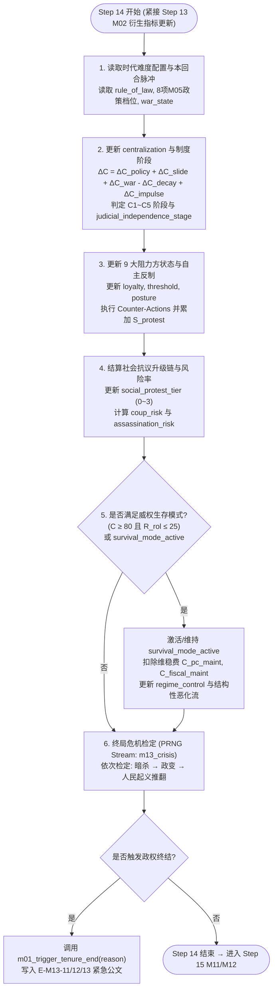
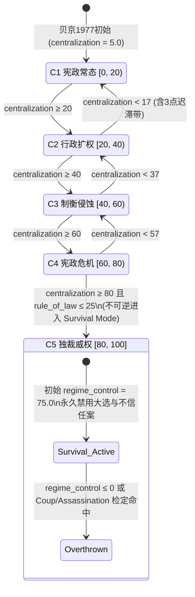
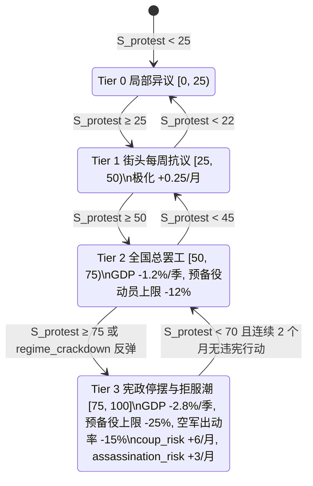

# M13 集权与独裁路线（Authoritarian Route & Institutional Erosion）

## 0. 元信息

- **模块编号**：`M13`
- **模块名称**：集权与独裁路线（Authoritarian Route & Institutional Erosion）
- **版本**：`v1.0.0`
- **作者**：系统设计师子代理（M13 集权与独裁路线）
- **依赖模块**：
  - [M01_core_loop.md](file:///Users/xtxsinan/.gemini/antigravity/scratch/israel_political_simulation/docs/specs/M01_core_loop.md)：每日结算步骤 14（`centralization_monthly`，条件 `is_month`，随机子流 `politics`）、任期终止原因枚举（`coup, assassination, overthrow, state_collapse, death`）、自动暂停触发器与信号总线。
  - [M02_numbers_model.md](file:///Users/xtxsinan/.gemini/antigravity/scratch/israel_political_simulation/docs/specs/M02_numbers_model.md)：`rule_of_law`（民主法治指数）、`judicial_conflict`（司法冲突度，1992 年起激活）、因果网 `rate` 模式步进、`term_provider` 动态贡献项注入机制（`D-052`）及正反馈环 `P5`（`rule_of_law ↔ centralization`，回路增益 $G \le 0.30$）约束。
  - [M03_parliament.md](file:///Users/xtxsinan/.gemini/antigravity/scratch/israel_political_simulation/docs/specs/M03_parliament.md)：议会特殊多数表决（`entrenched80` 80 票延长任期，`D-045`）、`m03_postpone_election {months}`、盟党退阁与政党分裂接口。
  - [M04_party_promises.md](file:///Users/xtxsinan/.gemini/antigravity/scratch/israel_political_simulation/docs/specs/M04_party_promises.md)：`party_standing`、`party_cohesion`、`faction_mood`、党内挑战者与选民犬儒度 `cynicism`。
  - [M05_actions_capital.md](file:///Users/xtxsinan/.gemini/antigravity/scratch/israel_political_simulation/docs/specs/M05_actions_capital.md)：8 条媒体/安全/宪政政策杠杆对 `centralization` 的声明边（`D-030`）及 6 项基础集权行动（`censorship_order, bypass_attorney_general, emergency_decree, shin_bet_surveil_opposition, pack_judiciary, postpone_election`）。
  - [M06_characters_ai.md](file:///Users/xtxsinan/.gemini/antigravity/scratch/israel_political_simulation/docs/specs/M06_characters_ai.md)：6 大非内阁制度首长（`supreme_court_president, attorney_general, chief_of_staff, shin_bet_chief, mossad_chief, central_bank_governor`）、人物特质（`legalist, constitutionalist`）、压力值 `character_stress`（`D-065`）与辞职/越权机制。
  - [M07_world_diplomacy.md](file:///Users/xtxsinan/.gemini/antigravity/scratch/israel_political_simulation/docs/specs/M07_world_diplomacy.md) & [M08_palestine.md](file:///Users/xtxsinan/.gemini/antigravity/scratch/israel_political_simulation/docs/specs/M08_palestine.md)：`us_congress_relation`、`us_admin_relation`、`intl_legitimacy`、`arms_reliability[usa]`、美援乘数 `us_aid`（`D-061`）与占领区镇压联动。
  - [M09_military_intel.md](file:///Users/xtxsinan/.gemini/antigravity/scratch/israel_political_simulation/docs/specs/M09_military_intel.md) & [M10_economy_budget.md](file:///Users/xtxsinan/.gemini/antigravity/scratch/israel_political_simulation/docs/specs/M10_economy_budget.md)：`readiness`、`deterrence`、`public_security`、`complacency`、`strike_risk`（`D-060`）、`growth`、`fx_reserves`。
  - [M12_event_engine.md](file:///Users/xtxsinan/.gemini/antigravity/scratch/israel_political_simulation/docs/specs/M12_event_engine.md) & `M14`：事件条件函数、弹窗队列、生存模式结局与 `historical_rating` 民主维度结算。
- **对标锚点（见 [benchmarks.md](file:///Users/xtxsinan/.gemini/antigravity/scratch/israel_political_simulation/docs/research/benchmarks.md) 与 [paradox_lessons.md](file:///Users/xtxsinan/.gemini/antigravity/scratch/israel_political_simulation/docs/research/paradox_lessons.md)）**：
  - **借鉴《为了祖国：朴正熙纪事》（K1、K3）**：将“要不要放手权力 / 为推进宏大愿景或度过危机而侵蚀制衡”做成深层道德与政治困境；基本法条文与紧急状态法令随玩家选择动态改写并呈现在宪政档案面板中。
  - **借鉴《Suzerain》（S1、S2、S-x4）**：用最高法院、总参谋部、总工会、美国国会等具名制度与人物对抗来体现威权滑坡，杜绝抽象进度条；政变与暗杀前必须触发明确的警告事件与补救窗口，避免“一步站错无预警暴死”。
  - **借鉴《Democracy 4》（D1、D6）**：在安全与情报面板中显式呈现极端派系地下狂热度、政变风险与暗杀风险的因果分解（Tooltip 可追溯到具体政策与法令）。
  - **超越与规避（A3、A16、R7）**：严禁做成 HOI4 式的“一键切换独裁政体按钮”或无代价增益路线。完全基于**以色列真实的制度脆弱性**（无成文宪法、1945 年英委《防卫（紧急状态）条例》未废除、1948 年起永久紧急状态、基本法简单多数可改、军事新闻审查官、总检察长无宪法任期保障、80 票延长议会任期）建模，并通过结构性反噬（美援冻结、资本与人才外逃、预备役停飞、总工会总罢工、独裁信息茧房推高战略自满度）确保**独裁路线永远不是刷分捷径**。

---

## 1. 设计意图

### 1.1 核心取舍（一句话）
**用制度侵蚀换取短期绕过议会、法院、媒体与总检察长掣肘的行政强推力，但每一分集权都会唤醒九大制度与社会阻力方的协同反扑，将政权一步步拖入大罢工、预备役拒服兵役、美援冻结、军事政变与极端分子刺杀的生存深渊。**

### 1.2 玩家决策频率与信息来源
- **决策频率**：
  - 在常规民选路线（`centralization <= 20`）下，玩家平均每 **4–6 个游戏月** 在危机时刻（如恶性通胀需跳过议会颁布紧急条例、辛贝特丑闻曝光需决定是否撤换总检察长、战争泥潭需审查反战报道）面临 **1 次**“是否动用非常规集权工具”的诱惑抉择。
  - 若主动走威权滑坡或进入威权生存模式（`centralization > 40`），玩家平均 **每月 1–2 次** 需要在镇压/分化九大阻力方、维持强力部门效忠、应对总罢工与预备役抗命危机之间做出高压决策。
- **信息来源**：
  1. **宪政与制度制衡面板（M13 专属子面板）**：实时展示 `centralization` 所属的 5 个阶段、9 大阻力方的敌意/动员度与反制阈值进度条。
  2. **安全与情报威胁简报（与 M09 联动）**：展示月度 `coup_risk`（政变风险）与 `assassination_risk`（暗杀风险，分列极右地下组织威胁与反独裁激进威胁）的精确驱动因子拆解。
  3. **社会抗议升级链指示器**：显示当前处于“平静 → 局部抗议 → 十万人集会与局部停飞 → 全国总罢工与预备役全面停摆”四级链条的哪一档及下月升级条件。

### 1.3 失败状态与恢复路径
- **失败状态**：
  1. **宪政反扑倒阁**：盟党集体退阁或党内宪政派分裂出走，导致议会通过不信任案或提前大选下台（`no_confidence` / `election_loss`）。
  2. **全国瘫痪逼宫**：总工会全国总罢工叠加预备役军官团拒绝服役，经济与战备双双停摆，迫使总理辞职（`resignation`）或在生存模式下被人民运动推翻（`overthrow`）。
  3. **恢复宪政型军事政变**：当 `coup_risk >= 60` 且下达非法镇压本国公民命令时，总参谋部拒绝执行“黑旗命令”并接管政府（`coup`）。
  4. **政治暗杀**：当 `assassination_risk >= 50` 且安保失守时，总理在集会或官邸遇刺（`assassination`，可来自反对领土让步的极右翼狂热分子，或反抗独裁的地下激进分子）。
- **恢复路径（悬崖勒马机制）**：
  - 在跨越 `centralization >= 80`（暂停民选）的不可逆红线之前，玩家随时可通过：① **保持 12 个月不动用集权行动**触发自然回落（`-0.5/月`）；② 执行**宪政修复行动**（如 `restore_judicial_independence` 恢复司法与总检察长独立、`lift_emergency_decrees` 废止非常规紧急条例、`accept_state_inquiry` 设立国家调查委员会问责）；③ 在大罢工/预备役抗命事件中选择**撤回违宪包、与总工会及最高法院达成宪政妥协**，将集权度拉回安全区间。

### 1.4 后期（第 10–20 年）如何保持新鲜感
- **时代制度演化改变博弈规则**：1970 年代靠控制 IBA 国营广播与军事审查即可压制舆论，但 1990 年代商业电视二台（Channel 2）开播、1992 年《基本法：人的尊严与自由》与 1995 年米兹拉希银行案“宪政革命”（激活 `judicial_conflict`）后，最高法院获得直接废除法律的违宪审查权，全球化高科技经济使资本外逃对法治崩塌极度敏感。
- **威权生存模式的“独裁熵增（Autocratic Entropy）”**：一旦跨入 `centralization >= 80` 中止大选，玩家不再面对四年一次的选举，但会陷入“强力部门索贿要价逐年递增 + 信息茧房掩盖外部战争危机 + 国际制裁持续收紧”的晚期威权困境。

---

## 2. 读写清单

> 严格遵循 [contracts.md](file:///Users/xtxsinan/.gemini/antigravity/scratch/israel_political_simulation/docs/contracts.md) §3 与 §6：M13 为 `centralization` 以及新增派生风险参数 `coup_risk`、`assassination_risk`、`social_protest_tier` 的唯一 `owner`，在每月结算日**步骤 14（`centralization_monthly`）**直接写入；对其他模块拥有的参数一律通过提交标准 `Effect`、挂载修正器边或注册 `term_provider`（`D-052`）修改。

| 参数ID / 状态 | 所属模块 | 读/写 | 结算步骤 | 说明 |
|---|---|---|---|---|
| `centralization` | M13 | **读写（owner）** | 步骤 14（月度） / 步骤 2, 5, 18（效果） | 集权度（`0..100`），1977 开局 `5.0`；步骤 14 计算政策杠杆速率、修正器与 12 个月无集权回落 |
| `coup_risk` | M13（附录A新增） | **读写（owner, derived）** | 步骤 14（月度） | 军事政变风险指数（`0..100`），1977 开局 `0.0` |
| `assassination_risk` | M13（附录A新增） | **读写（owner, derived）** | 步骤 14（月度） | 总理遇刺风险指数（`0..100`），1977 开局 `2.0` |
| `social_protest_tier` | M13（附录A新增） | **读写（owner, derived）** | 步骤 14（月度） | 社会抗议与停摆升级阶梯（`0..3` 整数档），1977 开局 `0` |
| `rule_of_law` | M02 | 读 + 效果写 | 步骤 10（M02 读 `centralization`） / 步骤 14（读） | 民主法治指数（1977 开局 `66.0`）；M13 读取以计算阻力方反弹、政变风险及 P5 滑坡边 |
| `judicial_conflict` | M02 | 读 + 效果写 | 步骤 10 / 步骤 14 | 司法冲突度（1992 年激活，初值 `10.0`）；驱动最高法院违宪审查频率 |
| `policy_level[id]` | M05 | 读 + `custom` 写 | 步骤 5, 14 | 读取 `military_censorship, shin_bet_oversight, iba_independence, commercial_tv, press_ordinance, comptroller_powers, emergency_regs_use` 等档位 |
| `military_government[ag]` | M11 | 读 + `custom` 写 | 步骤 14 | 阿拉伯/德鲁兹/贝都因区军事管制强度（1977 开局全 `0`） |
| `political_capital` | M05 | 读 + 效果写 | 步骤 2, 14, 15 | 集权行动消耗；威权生存模式每月维持费与危机应对消耗 |
| `party_standing` | M04 | 读 + 效果写 | 步骤 11, 14 | 党内地位（1977 开局 `78.0`）；党内宪政派反制时扣减 |
| `party_cohesion` | M04 | 读 + 效果写 | 步骤 11, 14 | 政党凝聚力；党内宪政派抗命或分裂时扣减 |
| `ally_satisfaction[p]` | M03 | 读 + 效果写 | 步骤 7, 14 | 盟党满意度；宪政危机触发温和盟党（如 `dash, liberals`）扣减或退阁 |
| `coalition_seats` | M03 | 读 | 步骤 7, 14, 19 | 联合政府席位数；判定 61 票 / 80 票门槛及生存模式议会冻结 |
| `bloc_support[b]` | M03 | 读 + 效果写 | 步骤 7, 14 | 读取并影响 `liberal_middle, labor_ashkenazi, religious_zionist, arab_citizens` 支持度 |
| `gov_axis_position[ax]` | M05 | 读 | 步骤 14 | 读取 `territory, security, religion` 轴位置，判定极右翼地下刺杀威胁 |
| `settler_momentum` | M02 | 读 + 效果写 | 步骤 10, 14 | 定居者运动动量（1977 开局 `45.0`）；与领土让步交互驱动极右暗杀风险 |
| `alienation[g]` | M02 | 读 | 步骤 10, 14 | 群体疏离度；驱动社会抗议动员度与激进暗杀风险 |
| `civic_identification[ag]` | M02 | 读 | 步骤 10, 14 | 阿拉伯公民国家认同度；绿线内军管或镇压时触发抗议 |
| `relation[c]` | M06 | 读 + 效果写 | 步骤 6, 14 | 读取 `supreme_court_president, attorney_general, chief_of_staff, shin_bet_chief, defense` 关系 |
| `character_stress[pm]` | M06 | 读 + 效果写 | 步骤 6, 14 | 总理个人压力（`D-065`）；具有 `constitutionalist` 特质的总理（如贝京）推行集权时额外增加压力 |
| `readiness` | M09 | 读 + `term_provider` / 效果写 | 步骤 8, 10, 14 | 战备水平；预备役军官团抗命/拒服兵役与将领清洗时受硬惩罚 |
| `mobilization` | M09 | 读 | 步骤 3, 14 | 当前动员水平；战时状态影响紧急状态法统容忍度 |
| `deterrence` | M09 | 读 + 效果写 | 步骤 10, 14 | 威慑值；预备役停飞与国内宪政瘫痪时下降 |
| `public_security` | M09 | 读 + 效果写 | 步骤 8, 14 | 公众安全感；大规模抗议、骚乱与紧急军管对其产生双向冲击 |
| `complacency` | M09 | 读 + 效果写 | 步骤 10, 14 | 战略自满度；独裁信息茧房与清洗情报官僚会导致每月额外增长 |
| `union_strength` | M10 | 读 + 效果写 | 步骤 9, 14 | 劳工总联合会实力（1977 开局 `70.0`）；决定 Histadrut 反独裁总罢工威力 |
| `strike_risk` | M10 | 读 + `term_provider` / 效果写 | 步骤 9, 14 | 罢工风险指数（`D-060`，1977 开局 `28.0`）；M13 宪政危机向其注入政治罢工加成 |
| `growth` | M10 | 读 + `term_provider` 写 | 步骤 14, 16 | 季度 GDP 增长率；大罢工、资本外逃、美援冻结与人才外流对其施加硬惩罚 |
| `fx_reserves` | M10 | 读 + 效果写 | 步骤 9, 14 | 外汇储备；资本外逃与美国冻结援助导致流失 |
| `budget_balance` | M10 | 读 + `one_off_flows` 写 | 步骤 9, 14 | 财政收支（`D-010`）；罢工停摆损失与威权安保维稳开支计入 `one_off_flows` |
| `us_congress_relation` | M07 | 读 + 效果写 | 步骤 12, 14 | 美国国会关系（1977 开局 `65.0`）；低于阈值触发国会听证会、军售冻结与援助削减 |
| `us_admin_relation` | M07 | 读 + 效果写 | 步骤 12, 14 | 美国政府关系（1977 开局 `58.0`） |
| `intl_legitimacy` | M07 | 读 + 效果写 | 步骤 12, 14 | 国际合法性（1977 开局 `52.0`） |
| `arms_reliability[usa]` | M07 | 读 + 效果写 | 步骤 12, 14 | 美国武器可靠度；美国国会冻结军售时下挫 |
| `historical_rating` | M14 | 效果写 | 步骤 20 | 历史评价；集权路线大幅扣减“民主与法治”维度得分 |

---

## 3. 状态与数据结构

### 3.1 M13 内部持久化状态（`state.m13`）

本模块在全局存档状态 `state.m13` 下维护以下确定性字段（所有浮点数在月度步骤 14 末尾按 `D-015` 量化至 `1e-6`）：

| 字段名 | 类型 | 范围 / 枚举 | 1977-06-20 默认初值 | 说明 |
|---|---|---|---|---|
| `stage` | `int` | `0..4` | `0` | 当前集权阶段：`0`=议会常态，`1`=强势行政，`2`=威权滑坡/宪政危机，`3`=紧急状态体制，`4`=个人独裁/暂停民选 |
| `months_since_auth_action` | `int` | `0..1200` | `12` | 距离上一次执行集权行动或事件集权选项的完整月数；$\ge 12$ 时触发 `-0.5/月` 自然回落 |
| `auth_actions_taken_total` | `int` | `0..999` | `0` | 本任期累计执行的集权类行动次数 |
| `postpone_election_count` | `int` | `0..10` | `0` | 当前议会届期内已推迟大选次数（常规状态下每届限 1 次；进入阶段 3 后可强行突破） |
| `override_clause_enacted` | `bool` | `true / false` | `false` | 是否已通过《基本法凌驾条款》（允许 61 票推翻最高法院裁决） |
| `judicial_committee_packed` | `bool` | `true / false` | `false` | 是否已改组并控制法官任命委员会（`pack_judiciary` 完成） |
| `ag_subordinated` | `bool` | `true / false` | `false` | 是否已将总检察长降格为温顺亲信（撤换独立总检察长并安插效忠派） |
| `security_chiefs_purged` | `bool` | `true / false` | `false` | 是否已对总参谋部与辛贝特高层实施政治效忠清洗 |
| `survival_mode_active` | `bool` | `true / false` | `false` | 是否已进入**威权生存模式**（当 `centralization >= 80.0` 或 `flag("elections_suspended")` 为真时激活） |
| `survival_months` | `int` | `0..1200` | `0` | 进入威权生存模式的累计月数（驱动“独裁熵增”维持成本） |
| `regime_control` | `float` | `[0.0, 100.0]` | `100.0` | 威权生存模式下的政权控制力（非生存模式下恒为 `100.0`；跌至 `0.0` 触发 `overthrow` 被推翻） |
| `sanction_tier` | `int` | `0..3` | `0` | 美国与国际民主制裁档位：`0`=无，`1`=外交警告，`2`=冻结先进军售与新增担保，`3`=削减常规美援 50% 与资本严管 |
| `protest_tier` | `int` | `0..3` | `0` | 社会抗议与停摆等级（同步镜像至参数 `social_protest_tier`）：`0`=平静，`1`=局部请愿，`2`=十万人示威与局部停工/停飞，`3`=全国总罢工与预备役全面停摆 |
| `protest_tier_months` | `int` | `0..120` | `0` | 当前 `protest_tier` 已持续的月数（Tier 3 持续满 3 个月触发政权崩溃检定） |
| `reservist_refusal_rate` | `float` | `[0.0, 40.0]` | `0.0` | 预备役军官团拒绝服役/停飞比例（单位：%，直接扣减 M09 `readiness` 与 `deterrence`） |
| `right_extremism_heat` | `float` | `[0.0, 100.0]` | `10.0` | 极右翼/宗教民族主义地下狂热度（犹太地下组织、“追杀者律 Din Rodef”煽动热度） |
| `anti_regime_heat` | `float` | `[0.0, 100.0]` | `0.0` | 反独裁/体制外激进抵抗热度 |
| `coup_warning_issued` | `bool` | `true / false` | `false` | 是否已弹出总参谋部宪政危机警告事件（保证政变前必有预警） |
| `assassination_warning_issued` | `bool` | `true / false` | `false` | 是否已弹出辛贝特遇刺高危警告事件（保证暗杀检定前必有预警） |
| `resist_actors` | `Dict[str, ResistActorState]` | 9 个固定键 | 见 §3.2 | 九大制度与社会阻力方的实时状态字典 |

### 3.2 九大阻力方数据结构（`ResistActorState`）

每个阻力方 $r \in \text{RESIST\_ACTORS}$（共 9 个枚举键：`supreme_court`, `attorney_general`, `idf_command`, `reservists`, `histadrut`, `independent_media`, `coalition_allies`, `us_institutions`, `party_constitutionalists`）包含以下字段：

| 字段名 | 类型 | 范围 | 说明 |
|---|---|---|---|
| `id` | `str` | 9 枚举之一 | 阻力方唯一标识 |
| `zh` | `str` | 字符串 | 中文名称 |
| `tension` | `float` | `[0.0, 100.0]` | 当前反制张力（越过 `threshold` 时触发自主反制行动） |
| `autonomy` | `float` | `[0.0, 100.0]` | 制度独立性/组织完整度（玩家可通过清洗、改组、立法削弱，但削弱本身会激化其他阻力方） |
| `threshold` | `float` | `[20.0, 90.0]` | 反制触发阈值（受时代难度曲线与玩家安抚/威慑修正） |
| `stance` | `str` | `"dormant" \| "vigilant" \| "confronting" \| "suppressed"` | 状态：`dormant`（平静 `<0.6*threshold`）、`vigilant`（警戒 `>=0.6*threshold`）、`confronting`（对抗 `>=threshold`）、`suppressed`（被瘫痪 `autonomy < 20`） |
| `cooldown_months` | `int` | `0..24` | 自主反制大动作触发后的冷却月数 |
| `strikes_count` | `int` | `0..99` | 本局已发动的反制次数 |

### 3.3 静态配置 Schema（`data/authoritarian.yaml`）与完整示例

```yaml
# data/authoritarian.yaml —— M13 集权与独裁路线静态配置
schema_version: 1

stages:
  - id: 0
    code: PARLIAMENTARY_NORMALCY
    zh: 议会常态
    range: [0.0, 20.0]
    pc_bonus_monthly: 0.0
    exec_speed_mult: 1.00
    unlocked_actions: [censorship_order, bypass_attorney_general]
    desc_zh: "以色列标准议会内阁制：无成文宪法，但最高法院、总检察长、独立报刊与联合政府内部制衡正常运转。"

  - id: 1
    code: EXECUTIVE_DOMINANCE
    zh: 强势行政
    range: [20.000001, 40.0]
    pc_bonus_monthly: 1.5
    exec_speed_mult: 1.10
    unlocked_actions: [emergency_decree, shin_bet_surveil_opposition, dismiss_attorney_general]
    desc_zh: "总理频繁援引1945年《防卫（紧急状态）条例》绕过议会委员会，内阁决策集中于厨房内阁，司法与媒体进入警戒状态。"

  - id: 2
    code: CONSTITUTIONAL_CRISIS
    zh: 威权滑坡与宪政危机
    range: [40.000001, 60.0]
    pc_bonus_monthly: 3.0
    exec_speed_mult: 1.20
    unlocked_actions: [pack_judiciary, enact_override_clause, postpone_election, clamp_down_press]
    desc_zh: "政府公开改造法官任命委员会、强推基本法凌驾条款或推迟大选；最高法院、总工会与预备役军官团爆发宪政对抗。"

  - id: 3
    code: EMERGENCY_REGIME
    zh: 紧急状态体制
    range: [60.000001, 79.999999]
    pc_bonus_monthly: 4.5
    exec_speed_mult: 1.35
    unlocked_actions: [loyalty_purge_security, martial_law_green_line, break_histadrut_monopoly, suspend_elections_indefinitely]
    desc_zh: "依靠长期紧急状态法令与清洗后的安全首长治国，议会沦为橡皮图章，街头十万人抗议与美国国会制裁全面降临。"

  - id: 4
    code: SUSPENDED_DEMOCRACY
    zh: 个人独裁与暂停民选
    range: [80.0, 100.0]
    pc_bonus_monthly: 6.0
    exec_speed_mult: 1.50
    unlocked_actions: [regime_crackdown, emergency_requisition]
    desc_zh: "大选无限期中止，胜负条件从‘连任’切换为‘威权生存’；政权随时面临恢复宪政型军事政变、刺杀或全国总瘫痪。"

era_difficulty:
  - era_id: founding_wartime
    years: [1948, 1965]
    zh: "建国战时与马帕伊一党主导期"
    pc_cost_mult: 0.75
    resistance_threshold_offset: 12.0
    base_autonomy_scale: 0.80
  - era_id: institutional_maturation
    years: [1966, 1976]
    zh: "议会制度成熟与问责确立期"
    pc_cost_mult: 1.00
    resistance_threshold_offset: 0.0
    base_autonomy_scale: 0.95
  - era_id: begin_constitutional_constraint
    years: [1977, 1991]
    zh: "政党轮替与贝京宪政主义约束期"
    pc_cost_mult: 1.15
    resistance_threshold_offset: -4.0
    base_autonomy_scale: 1.00
  - era_id: constitutional_revolution
    years: [1992, 2006]
    zh: "宪政革命与商业媒体全球化期"
    pc_cost_mult: 1.40
    resistance_threshold_offset: -12.0
    base_autonomy_scale: 1.20

resistance_actors_init_1977:
  supreme_court:          {zh: "最高法院（高院请愿庭 Bagatz）", tension: 10.0, autonomy: 85.0, base_threshold: 45.0, cooldown_months: 6}
  attorney_general:       {zh: "总检察长（阿哈龙·巴拉克）",     tension: 12.0, autonomy: 88.0, base_threshold: 40.0, cooldown_months: 4}
  idf_command:            {zh: "国防军总参谋部",               tension: 8.0,  autonomy: 85.0, base_threshold: 55.0, cooldown_months: 6}
  reservists:             {zh: "预备役军官团",                 tension: 5.0,  autonomy: 90.0, base_threshold: 50.0, cooldown_months: 3}
  histadrut:              {zh: "劳工总联合会（Histadrut）",    tension: 25.0, autonomy: 80.0, base_threshold: 48.0, cooldown_months: 4}
  independent_media:      {zh: "独立报刊与驻外记者团",         tension: 15.0, autonomy: 78.0, base_threshold: 42.0, cooldown_months: 3}
  coalition_allies:       {zh: "执政联盟温和伙伴（达什/自由党）", tension: 14.0, autonomy: 75.0, base_threshold: 46.0, cooldown_months: 3}
  us_institutions:        {zh: "美国国会与白宫",               tension: 10.0, autonomy: 100.0, base_threshold: 52.0, cooldown_months: 6}
  party_constitutionalists: {zh: "党内宪政派（梅里多尔/伯曼）", tension: 10.0, autonomy: 72.0, base_threshold: 44.0, cooldown_months: 4}
```

---

## 4. 规则与公式

### 4.1 集权度（`centralization`）的五阶段划分与制度脆弱性映射

#### 4.1.1 五阶段阈值与全局修正表
- **触发时机**：每当 `centralization` 发生变动（步骤 2、5、14、18）后立即重算 `state.m13.stage`。
- **阶段判定与制度效应表**：

| 阶段 | 名称 | `centralization` 区间 | 以色列真实制度切入点 | 行政收益（每月初步骤 15 / 步骤 5） | 结构性代价（持续生效） |
|---|---|---|---|---|---|
| **阶段 0** | **议会常态**<br>`PARLIAMENTARY_NORMALCY` | $[0.0,\; 20.0]$ | 1950 哈拉里决议暂缓制宪；1948 紧急状态虽未解除但仅作备而不用的技术框架 | 无额外加成（`pc_bonus = 0`，执行速度 $\times 1.00$） | 仅存在基础因果边 `M02.ROL.07`（`-0.10 × C`） |
| **阶段 1** | **强势行政**<br>`EXECUTIVE_DOMINANCE` | $(20.0,\; 40.0]$ | 援引 1945《防卫（紧急状态）条例》颁布经济/治安指令；以“厨房内阁”架空全会；绕过总检察长法律意见 | 政治资本月产出 **$+1.5$**；决议执行周期缩短 **$10\%$**；解锁 `emergency_decree, shin_bet_surveil_opposition, dismiss_attorney_general` | 跨越 `C > 30` 后激活 `M02.ROL.01`（斜率 `-0.50`）与 `M03.CY.01`（选民犬儒度上升）；1992 年后 `M02.JUD.01` 推高司法冲突 |
| **阶段 2** | **威权滑坡 / 宪政危机**<br>`CONSTITUTIONAL_CRISIS` | $(40.0,\; 60.0]$ | 利用无成文宪法弱点，凭 61 票简单多数修改基本法、增设“凌驾条款”架空高院；改组 9 人法官任命委员会；凭 80 票推迟大选 | 政治资本月产出 **$+3.0$**；决议执行周期缩短 **$20\%$**；法令在议会一读耗减半；解锁 `pack_judiciary, enact_override_clause, postpone_election, clamp_down_press` | 资本外逃与高科技人才外流启动（`growth` 惩罚）；最高法院、总工会、预备役军官团跨越阈值发动违宪裁决、政治罢工与联名拒服兵役 |
| **阶段 3** | **紧急状态体制**<br>`EMERGENCY_REGIME` | $(60.0,\; 80.0)$ | 动用 1933《新闻条例》关停独立报刊；在绿线内对阿拉伯区乃至犹太抗议区恢复军事管制；清洗总参谋部与辛贝特首长 | 政治资本月产出 **$+4.5$**；执行周期缩短 **$35\%$**；所有 `law: false` 政策调档免除内阁阻力；解锁 `loyalty_purge_security, martial_law_green_line, break_histadrut_monopoly, suspend_elections_indefinitely` | 美国国会启动军售冻结与美援扣减（`us_aid` 乘数下调）；独裁信息茧房使 `complacency` 每月额外 $+0.4$；政变风险 `coup_risk` 与暗杀风险急剧攀升 |
| **阶段 4** | **个人独裁 / 暂停民选**<br>`SUSPENDED_DEMOCRACY` | $[80.0,\; 100.0]$<br>或 `flag("elections_suspended")` | 无限期延长紧急状态并冻结议会改选（完全反事实终局形态） | 政治资本月产出 **$+6.0$**；执行周期缩短 **$50\%$**；**常规议会大选与不信任投票冻结**，切换入**威权生存模式** | 每月结算 `regime_control`（含递增的维稳财政与政治资本黒洞）；`complacency` 每月额外 $+0.8$；M14 历史评价“民主”维度封顶为负值（`-30 ~ -45`） |

#### 4.1.2 `centralization` 的月度演化公式（步骤 14）
- **触发时机**：每月结算日步骤 14（`centralization_monthly`）。
- **设计依据**：
  1. 遵循 [parameters.yaml](file:///Users/xtxsinan/.gemini/antigravity/scratch/israel_political_simulation/docs/registry/parameters.yaml) 定义：`drift: "−0.5/month if no authoritarian action in 12 months"`。
  2. 遵循 `D-030` 与 [M05_actions_capital.md](file:///Users/xtxsinan/.gemini/antigravity/scratch/israel_political_simulation/docs/specs/M05_actions_capital.md) 附录 C：8 条政策杠杆对 `centralization` 声明了持续因果边。为满足 `D-001` 换算及 [M02_numbers_model.md](file:///Users/xtxsinan/.gemini/antigravity/scratch/israel_political_simulation/docs/specs/M02_numbers_model.md) §4.7.1 正反馈环 `P5`（`rule_of_law ↓ → centralization ↑ → rule_of_law ↓` 回路增益 $G = 0.6 k \le 0.30 \implies k \le 0.50$）的硬约束，`centralization` 采用**带制度基线漂移与杠杆速率注入的 Stock 步进公式**。
  3. 对 M05 附录 C 中 3 条在 1977 开局档位不为 50 的政策边，按 `M05 附录 B-1`（目标模块可在覆盖表中设定拐点 `pivot` 与速率缩放）对齐 1977 开局中性点，使得 **1977-06-20 开局在无操作时净杠杆漂移精确为 `0.000`**。

- **M05 政策杠杆对 `centralization` 的入边与 M13 覆盖校准表**：

| 边ID | 政策杠杆来源 | M05 原始系数 $c_{\text{M05}}$ | 1977 开局值 $v_0$ | M13 校准拐点 $p_e$ | 月度速率系数 $c_e^{\text{rate}} = 0.10 \times c_{\text{M05}}$ | 惯性 $i_e$（月） | 1977 开局月贡献 | 说明 |
|---|---|---|---|---|---|---|---|---|
| `M05.military_censorship.04` | `policy_level[military_censorship]` | $+0.03$ | $50$ | $50$ | $+0.003$ | $3$ | $0.000$ | 广泛审查（100）时 $+0.15/\text{月}$；只删机密（0）时 $-0.15/\text{月}$ |
| `M05.shin_bet_oversight.04` | `policy_level[shin_bet_oversight]` | $+0.02$ | $100$ | $100$ | $+0.002$ | $3$ | $0.000$ | 1977 无书面规则（100）为中性；总检察长审查（50）时 $-0.10/\text{月}$；议会监督（0）时 $-0.20/\text{月}$ |
| `M05.military_government.03.*` | `military_government[arab/druze/bedouin]`（取3群体均值） | $+0.04$ | $0$ | $0$ | $+0.004$ | $3$ | $0.000$ | 1977 已废除军管（0）为中性；恢复全面军管（100）时 $+0.40/\text{月}$ |
| `M05.iba_independence.03` | `policy_level[iba_independence]` | $-0.04$ | $50$ | $50$ | $-0.004$ | $3$ | $0.000$ | 政府指导（0）时 $+0.20/\text{月}$；完全独立（100）时 $-0.20/\text{月}$ |
| `M05.commercial_tv.04` | `policy_level[commercial_tv]` | $-0.02$ | $0$ | $0$ | $-0.002$ | $3$ | $0.000$ | 1977 无商业台（0）为中性；开放商业频道（100）时 $-0.20/\text{月}$ |
| `M05.press_ordinance.02` | `policy_level[press_ordinance]` | $+0.05$ | $50$ | $50$ | $+0.005$ | $3$ | $0.000$ | 积极执行吊销报刊许可（100）时 $+0.25/\text{月}$；不执行（0）时 $-0.25/\text{月}$ |
| `M05.comptroller_powers.02` | `policy_level[comptroller_powers]` | $-0.04$ | $50$ | $50$ | $-0.004$ | $3$ | $0.000$ | 削弱审计长（0）时 $+0.20/\text{月}$；扩大审计长权限（100）时 $-0.20/\text{月}$ |
| `M05.emergency_regs_use.02` | `policy_level[emergency_regs_use]` | $+0.06$ | $50$ | $50$ | $+0.006$ | $3$ | $0.000$ | 扩大以紧急条例代立法（100）时 $+0.30/\text{月}$；最低（0）时 $-0.30/\text{月}$ |

- **法治崩塌滑坡入边（对应 M02 §4.7.1 环 `P5`）**：
  - 边 `M13.CEN.01`（`rule_of_law -> centralization`，形状 `below`，拐点 $p = 45.0$，惯性 $i = 3$）：当 3 个月平均民主法治指数 $\bar{R}_{\text{rol}} < 45.0$ 时，制度防线失守产生威权自发滑坡：
    $$F_{\text{rol\_slide}} = k_{\text{slide}} \cdot \max\big(0.0,\; 45.0 - \bar{R}_{\text{rol}}\big)$$
    其中单步系数 $k_{\text{slide}} = 0.02\text{ 点/月/法治点}$（对应水平等效系数 $k = k_{\text{slide}} / \alpha = 0.20 \le 0.50$，回路增益 $G = 0.6 \times 0.20 = 0.12 \le 0.30$，严格满足 M02 `P5` 与 `R32` 有界性要求！）。

- **月度集权度更新总公式**：
  1. 先更新 `months_since_auth_action`：若本月内未完成任何 `cat == "cent"` 的行动且未触发带 `centralization > 0` 加成的主动事件选项，则 `months_since_auth_action += 1`；否则在行动/事件发生时已重置为 `0`。
  2. 计算政策杠杆速率项 $F_{\text{levers}}$（单位：点/月）：
     $$F_{\text{levers}} = \sum_{e \in \text{LeverEdges}(centralization)} c_e^{\text{rate}} \cdot \big(\bar{s}_e - p_e\big)$$
     其中 $\bar{s}_e$ 为该杠杆过去 $i_e = 3$ 个月的移动平均值（按 M02 §4.3 规则计算）。
  3. 计算常驻制度修正器项 $F_{\text{inst}}$（单位：点/月）：
     $$F_{\text{inst}} = 0.15 \cdot \mathbb{I}(\text{override\_clause\_enacted}) + 0.15 \cdot \mathbb{I}(\text{judicial\_committee\_packed}) + 0.10 \cdot \mathbb{I}(\text{has\_modifier}(\text{"kitchen\_cabinet\_perm"}))$$
  4. 计算宪政克制自然回落项 $D_{\text{restraint}}$（单位：点/月）：
     $$D_{\text{restraint}} = \begin{cases} -0.50, & \text{若 } \text{months\_since\_auth\_action} \ge 12 \text{ 且 } F_{\text{levers}} \le 0.0 \text{ 且 } \neg\text{survival\_mode\_active} \\ 0.00, & \text{其他情况} \end{cases}$$
     *注：在自然回落生效时，若当前处于无集权行动的常规议会状态（`stage == 0`），`centralization` 最低通过自然回落降至剧本制度基线 $C_{\text{floor}} = 5.0$（除非玩家主动推行自由化改革使 $F_{\text{levers}} < 0$，此时可一路降至 $0.0$）。*
  5. 合成净月度变化量并夹紧：
     $$\Delta C = F_{\text{levers}} + F_{\text{rol\_slide}} + F_{\text{inst}} + D_{\text{restraint}}$$
     $$C' = \begin{cases} \operatorname{clamp}\big(\max(5.0,\; C + \Delta C),\; 0.0,\; 100.0\big), & \text{若 } C \ge 5.0 \text{ 且 } F_{\text{levers}} = 0 \text{ 且 } D_{\text{restraint}} = -0.50 \\ \operatorname{clamp}\big(C + \Delta C,\; 0.0,\; 100.0\big), & \text{其他情况} \end{cases}$$
- **单位**：集权度点（`0..100`）。
- **算例 4.1.2-a（贝京 1977-06-20 开局首次月结 1977-07-01）**：
  - 开局 `centralization = 5.0`，`rule_of_law = 66.0`（$\bar{R}_{\text{rol}} = 66.0 \ge 45.0 \implies F_{\text{rol\_slide}} = 0.0$），所有 8 条政策杠杆均处于开局值 $v_0 = p_e \implies F_{\text{levers}} = 0.0$，`F_inst = 0.0`，`months_since_auth_action = 13 >= 12`，$D_{\text{restraint}} = -0.50$，因 $C = 5.0$ 已在常规议会基线 $C_{\text{floor}} = 5.0$，故 $C' = \max(5.0, 5.0 - 0.50) = 5.000$（**开局零漂移稳态成立**）。
- **算例 4.1.2-b（威权滑坡期月结）**：
  - 假设当前 $C = 42.0$，玩家刚在 2 个月前下达审查令（`months_since_auth_action = 2 < 12` $\implies D_{\text{restraint}} = 0.0$），且已将 `emergency_regs_use` 调至 `100`（满 3 个月均值 $\bar{s} = 100$）、`press_ordinance` 调至 `100`（$\bar{s} = 100$），其余杠杆不变；当前 3 个月平均法治 $\bar{R}_{\text{rol}} = 40.0$；已通过凌驾条款（`override_clause_enacted = true`）。
  - 则：$F_{\text{levers}} = 0.006 \times (100 - 50) + 0.005 \times (100 - 50) = 0.30 + 0.25 = +0.55\text{ 点/月}$；
  - $F_{\text{rol\_slide}} = 0.02 \times (45.0 - 40.0) = +0.10\text{ 点/月}$；
  - $F_{\text{inst}} = +0.15\text{ 点/月}$；
  - $\Delta C = 0.55 + 0.10 + 0.15 + 0.0 = +0.80$，$C' = 42.0 + 0.80 = 42.800$。

---

### 4.2 九大制度与社会阻力方（Resistance Actors）状态与反制规则

#### 4.2.1 阻力方阈值计算公式
- **触发时机**：每月步骤 14。
- **公式**：对于每个阻力方 $r$，其实时有效反制阈值 $T_{\text{thr}}(r)$ 由基础阈值 $T_{\text{base}}(r)$、时代难度偏移 $\Delta_{\text{era}}$（见 §3.3 `era_difficulty`）与制度自主权修正项决定：
  $$T_{\text{thr}}(r) = \operatorname{clamp}\Big( T_{\text{base}}(r) + \Delta_{\text{era}} + 0.20 \cdot \big(80.0 - \text{autonomy}[r]\big),\; 25.0,\; 90.0 \Big)$$
  - *设计逻辑*：当玩家未彻底摧毁某阻力方（$\text{autonomy}[r] \ge 20$）时，若其独立性高达 $90$，阈值降低 $2.0$ 点（更敏感）；若玩家通过边缘手段削弱其独立性至 $50$，其发动制度反制的门槛被迫升高 $+6.0$ 点；但一旦 $\text{autonomy}[r] < 20.0$，该机构进入 `suppressed`（瘫痪）状态，无法再发起体制内制度反制，转而将 `anti_regime_heat` 每月推高 $+2.0$ 点（把体制内制衡逼成街头与地下对抗）。

#### 4.2.2 九大阻力方月度张力（`tension[r]`）驱动方程与自主反制表
在每月步骤 14，每个未瘫痪（$\text{autonomy}[r] \ge 20.0$）的阻力方 $r$ 先计算其目标张力 $U_r$，再以阻尼系数 $\alpha_r = 0.25$ 更新：
$$\text{tension}'[r] = \operatorname{clamp}\Big( \text{tension}[r] + 0.25 \cdot \big(U_r - \text{tension}[r]\big) + I_{\text{act}}[r],\; 0.0,\; 100.0 \Big)$$
其中 $I_{\text{act}}[r]$ 为当月集权行动直接激起的张力脉冲。各阻力方的目标张力公式 $U_r$、1977 初值与跨过阈值（$\text{tension}'[r] \ge T_{\text{thr}}(r)$ 且 `cooldown_months == 0`）时的**自主反制行动（Autonomous Counter-Action）**如下表所示：

| 阻力方 ID | 中文名与 1977 代表 | 目标张力公式 $U_r$（范围夹紧至 `0..100`） | 1977 开局张力 / 有效阈值 | 跨越阈值时的自主反制行动（自动提交效果并弹窗/通告） |
|---|---|---|---|---|
| `supreme_court` | **最高法院（高院请愿庭 Bagatz）**<br>院长：苏斯曼 / 兰道 / 卡汉 | $1.1 \cdot C + 0.6 \cdot \max(0, 65 - R_{\text{rol}}) + 0.5 \cdot J_{\text{conf}} - 0.3 \cdot \max(0, \text{rel}[\text{sc}])$ | $10.0\;/\;40.0$ | **【高院违宪审查与临时禁令】**（事件 `E-M13-SC-STRIKE`）：若 `override_clause_enacted == false`，高院裁定最近一项紧急法令或集权措施越权无效：`centralization -4.0`、`rule_of_law +3.0`、`political_capital -8.0`；若处于 1992 年后且 $J_{\text{conf}} \ge 30$，撤销最近通过的争议政策档位 1 档。冷却 `6` 个月。 |
| `attorney_general` | **总检察长与国家检控署**<br>1977：阿哈龙·巴拉克<br>1978：伊茨哈克·扎米尔 | $1.2 \cdot C + 15 \cdot \mathbb{I}(\text{flag}(\text{"ag\_bypassed"})) + 20 \cdot \mathbb{I}(\text{has\_modifier}(\text{"surveillance\_risk"})) - 0.4 \cdot \max(0, \text{rel}[\text{ag}])$ | $12.0\;/\;34.4$ | **【总检察长拒绝出庭辩护 / 贪腐滥权起诉】**（事件 `E-M13-AG-INDICT`）：总检察长发表公开法律意见书冻结政府非法行政令，并对内阁中关系最低或涉丑闻部长提起背信罪调查：`political_capital -10.0`、`party_standing -4.0`、`rule_of_law +2.0`，涉案部长强制进入停职答辩（14 天内必须解职或强行撤换总检察长）。冷却 `4` 个月。 |
| `idf_command` | **国防军总参谋部**<br>1977：莫塔·古尔<br>1978：拉斐尔·埃坦 | $0.9 \cdot C + 0.8 \cdot \max(0, 50 - R_{\text{rol}}) + 25 \cdot \mathbb{I}(\text{military\_government}[\text{arab}] > 0) - 0.5 \cdot \text{rel}[\text{cos}]$ | $8.0\;/\;50.0$ | **【总参谋部“黑旗命令”抗命与安全泄密】**（事件 `E-M13-IDF-DISSENT`）：总参谋长援引 1956 卡夫尔卡西姆判例，宣布军方绝不向本国和平抗议公民开火，向媒体泄露安全内阁分歧：`party_standing -5.0`、`political_capital -8.0`、`centralization -3.0`；若 $C \ge 65$，3 名现役少将联名请辞（`readiness -6.0`，`coup_risk` 基础值抬升）。冷却 `6` 个月。 |
| `reservists` | **预备役军官团**<br>（空军飞行员、伞兵旅、8200 情报预备役） | $1.15 \cdot C + 0.7 \cdot \max(0, 60 - R_{\text{rol}}) + 0.4 \cdot \max(0, \text{draft\_exemption} - 20) - 15 \cdot \mathbb{I}(\text{at\_war}())$ | $5.0\;/\;44.0$ | **【百名预备役军官抗命信与飞行员停飞潮】**（事件 `E-M13-RES-REFUSAL`）：预备役飞行员与精锐军官宣布“只效忠民主王国，不效忠独裁者”，暂停志愿值班：`reservist_refusal_rate += 10.0`（导致 `readiness` 与 `deterrence` 即时受损）、`bloc_support[liberal_middle] -4.0`、`intl_legitimacy -3.0`。冷却 `3` 个月。 |
| `histadrut` | **劳工总联合会**<br>（Histadrut 工会帝国） | $0.8 \cdot C + 0.35 \cdot \text{union\_strength} + 0.3 \cdot \max(0, \text{economic\_model}) + 0.5 \cdot \max(0, 55 - R_{\text{rol}})$ | $25.0\;/\;44.0$ | **【保卫民主与劳工权利政治总罢工】**（事件 `E-M13-HIST-STRIKE`）：总工会与雇主协会罕见联手，下令海法港、本-古里安机场与电力公司停摆：向 M10 `strike_risk` 注入 $+30.0$，设置 `set_flag("general_strike_active")`，当月 `one_off_flows["budget_balance"] -= 1.2`、`growth` 季度项 $-0.8$。冷却 `4` 个月。 |
| `independent_media` | **独立媒体与驻外记者团**<br>（《国土报》《新消息报》及外媒） | $1.1 \cdot C + 0.4 \cdot \text{policy}[\text{military\_censorship}] + 0.4 \cdot \text{policy}[\text{press\_ordinance}] - 0.3 \cdot \text{policy}[\text{iba\_independence}]$ | $15.0\;/\;38.4$ | **【头版开天窗与外媒“出口转内销”爆料】**（事件 `E-M13-MEDIA-LEAK`）：报社集体以空白头版抗议审查，并将政府秘密监控/绕过法律内幕捅给《纽约时报》再转引回国：移除 `chilling_effect`，`party_standing -5.0`、`us_congress_relation -5.0`、`bloc_support[liberal_middle] -4.0`；若存在 `surveillance_risk`，立即以 100% 概率引爆监控丑闻（`rule_of_law -6.0`）。冷却 `3` 个月。 |
| `coalition_allies` | **执政联盟温和伙伴**<br>（1977：达什党 Dash、自由党 Liberals） | $1.05 \cdot C + 0.8 \cdot \max(0, 60 - R_{\text{rol}}) + 0.5 \cdot (60 - \min_{p \in \text{mod\_allies}} \text{ally\_sat}[p])$ | $14.0\;/\;43.0$ | **【盟党宪政最后通牒与退阁倒戈】**（事件 `E-M13-ALLY-REVOLT`）：联合政府内最温和的盟党发表最后通牒：`ally_satisfaction[p] -12.0`，在接下来 60 天内对所有政府法案投反对票；若 30 天内 `centralization` 未下降 $\ge 4.0$ 点，该党正式调用 `m03_remove_from_coalition` 退出政府！冷却 `3` 个月。 |
| `us_institutions` | **美国国会与白宫**<br>（参议院外委会、国务院与美国犹太主流） | $1.0 \cdot C + 0.9 \cdot \max(0, 55 - R_{\text{rol}}) + 0.4 \cdot (65 - \text{us\_congress\_relation}) + 15 \cdot \mathbb{I}(\text{postpone\_election\_count} > 0)$ | $10.0\;/\;44.0$ | **【国会山民主听证会与军售/美援冻结】**（事件 `E-M13-US-SANCTION`）：美国参议院就以色列民主倒退举行专门听证会：`sanction_tier = min(3, sanction_tier + 1)`，`us_congress_relation -8.0`、`us_admin_relation -5.0`、`power_relation[diaspora] -6.0`；按 `sanction_tier` 下调 `us_aid` 乘数与 `arms_reliability[usa]`（见 §4.5.3）。冷却 `6` 个月。 |
| `party_constitutionalists` | **党内宪政派**<br>（贝京本人良知约束 / 梅里多尔 / 伯曼） | $1.15 \cdot C + 0.8 \cdot \max(0, 62 - R_{\text{rol}}) + 12 \cdot \mathbb{I}(\text{pm\_has\_trait}(\text{"constitutionalist"}))$ | $10.0\;/\;41.6$ | **【党内宪政派哗变与法制委员会阻击】**（事件 `E-M13-PARTY-MUTINY`）：党内宪政派（如梅里多尔、伯曼）在议会法制委员会倒戈：`party_standing -6.0`、`party_cohesion -8.0`；若总理本人具 `constitutionalist` 特质（如贝京），额外触发 `character_stress[pm] +10.0`（良知撕裂：“锡安山上还有法官吗？”）；若 `strikes_count >= 2` 且 $C \ge 55$，3–5 名宪政派议员分裂出走（调用 `m03_split_party`）。冷却 `4` 个月。 |

- **算例 4.2（贝京 1977 开局 vs 集权度升至 35 时的总检察长阿哈龙·巴拉克反制检定）**：
  - **1977 开局**：$\Delta_{\text{era}} = -4.0$，`autonomy[attorney_general] = 88.0`，故有效阈值 $T_{\text{thr}}(\text{ag}) = 40.0 - 4.0 + 0.20 \times (80.0 - 88.0) = 36.0 - 1.6 = 34.4$。
  - 开局 $C = 5.0$，$R_{\text{rol}} = 66.0$，$\text{rel}[\text{ag}] = 20.0$，无旗标 $\implies U_{\text{ag}} = \operatorname{clamp}(1.2 \times 5.0 + 0 - 0.4 \times 20.0, 0, 100) = 0.0$。首月 $\text{tension}' = 12.0 + 0.25 \times (0 - 12.0) = 9.0 < 34.4$（处于 `dormant` 平静状态）。
  - **若玩家执行 `bypass_attorney_general`（$C$ 升至 $25.0$，设旗标 `ag_bypassed`，产生脉冲 $I_{\text{act}}[\text{ag}] = +15.0$，且 `shin_bet_surveil_opposition` 挂上 `surveillance_risk` 使 $C = 29.0$，与巴拉克关系跌至 $-10$）**：
  - 此时 $U_{\text{ag}} = 1.2 \times 29.0 + 15.0 + 20.0 - 0.4 \times 0 = 69.8$。
  - 当月更新：$\text{tension}'[\text{ag}] = 12.0 + 0.25 \times (69.8 - 12.0) + 15.0 = 12.0 + 14.45 + 15.0 = 41.45 \ge 34.4$！
  - 跨越阈值 $34.4$，立即触发总检察长阿哈龙·巴拉克自主反制事件 `E-M13-AG-INDICT`！

---

### 4.3 政变风险（`coup_risk`）与暗杀风险（`assassination_risk`）月度计算与触发检定

#### 4.3.1 政变风险 `coup_risk`（范围 `[0, 100]`，单位：风险点）
- **历史与机制建模**：以色列国防军（IDF）秉承“人民军队”与文官统制传统，在常规民选与法治状态下**绝无拉美式军阀政变可能**（当 $C \le 35$ 且 $R_{\text{rol}} \ge 45$ 时，`coup_risk` 恒为 `0.0`）。但在两种极端情境下，总参谋部可能发动**“恢复宪政秩序 / 挽救国家生存”的预防性接管（Constitutional Restoration Coup）**：
  1. **宪政崩塌与非法镇压令**：政府强推独裁（$C > 40$ 且 $R_{\text{rol}} < 45$），命令军队向本国公民开火或强行关闭最高法院，且未被彻底清洗的军方高层与政府决裂；
  2. **全国瘫痪叠加战败危机**：处于 Tier 3 全国总瘫痪或预备役大规模拒服兵役，同时前线战备崩溃。
- **触发时机**：每月步骤 14。
- **公式**：
  1. **宪政危机激活门控（Gate）**：若 `centralization <= 35.0` 且 `rule_of_law >= 45.0` 且 `protest_tier < 3`，则 `coup_risk = 0.0`。
  2. 否则，计算 4 个具名分项：
     - **独裁越界项 $K_{\text{auth}}$**：
       $$K_{\text{auth}} = 0.65 \cdot \max(0.0,\; C - 35.0) + 0.55 \cdot \max(0.0,\; 45.0 - R_{\text{rol}})$$
     - **军政决裂项 $K_{\text{mil}}$**（受总参谋长关系 $\text{rel}[\text{cos}]$、预备役抗命率 `reservist_refusal_rate` 与绿线军管影响）：
       $$K_{\text{mil}} = 0.40 \cdot \max(0.0,\; 20.0 - \text{rel}[\text{cos}]) + 0.50 \cdot \text{reservist\_refusal\_rate} + 12.0 \cdot \mathbb{I}(\text{military\_government}[\text{arab}] \ge 50 \text{ and } \text{protest\_tier} \ge 2)$$
     - **全国瘫痪与战败催化项 $K_{\text{crisis}}$**：
       $$K_{\text{crisis}} = 15.0 \cdot \mathbb{I}(\text{protest\_tier} == 3) + 10.0 \cdot \mathbb{I}(\text{readiness} < 40.0)$$
     - **政治清洗压制折扣 $\mu_{\text{purge}}$**：
       若玩家已完成 `loyalty_purge_security`（清洗总参谋部换上私人效忠者），总参谋部组织政变的能力乘以 $\mu_{\text{purge}} = 0.45$（但清洗本身使常驻 `readiness` $-10.0$、且中层军官哗变底数 $+5.0$）；未清洗时 $\mu_{\text{purge}} = 1.00$。
  3. **合成公式**：
     $$\text{coup\_risk} = \operatorname{clamp}\Big( \mu_{\text{purge}} \cdot \big(K_{\text{auth}} + K_{\text{mil}} + K_{\text{crisis}}\big),\; 0.0,\; 100.0 \Big)$$
- **预警与月度政变检定（使用 `politics` 随机子流）**：
  - **強制预警规则（防暴死保护）**：当 `coup_risk >= 35.0` 且 `coup_warning_issued == false` 时，本月**不进行致死检定**，而是强制触发 P0 预警事件 `E-M13-COUP-WARN`（《总参谋部深夜异动：吉里亚基地的灯光》），给予玩家立刻撤回违宪法令、安抚军方或冒险清洗的抉择窗口，并将 `coup_warning_issued = true`（当 `coup_risk < 25.0` 时重置为 `false`）。
  - **月度触发概率 $P_{\text{coup}}$**：当 `coup_risk >= 50.0` 且 `coup_warning_issued == true` 时，每月在步骤 14 掷一次 `politics` 子流随机数 $u \in [0, 1)$：
    $$P_{\text{coup}} = \operatorname{clamp}\Big( 0.04 + 0.006 \cdot (\text{coup\_risk} - 50.0),\; 0.04,\; 0.35 \Big)$$
    若 $u < P_{\text{coup}}$，触发事件 `E-M13-COUP-EXEC`（总参谋部接管广播局与议会大厦，宣布成立临时宪政恢复委员会），调用 `M01.end_tenure(reason="coup")`！
- **算例 4.3.1**：
  - **算例 A（1977 开局）**：$C = 5.0 \le 35.0$，$R_{\text{rol}} = 66.0 \ge 45.0$，`protest_tier = 0` $\implies$ 门控拦截，`coup_risk = 0.000`。
  - **算例 B（阶段 3 强推独裁且未清洗军方）**：设 $C = 75.0$，$R_{\text{rol}} = 30.0$，总参谋长关系 $\text{rel}[\text{cos}] = -20.0$，`reservist_refusal_rate = 20.0`，处于 `protest_tier = 2`（无绿线军管），`readiness = 55.0`，$\mu_{\text{purge}} = 1.00$。
  - 则：$K_{\text{auth}} = 0.65 \times (75 - 35) + 0.55 \times (45 - 30) = 26.0 + 8.25 = 34.25$；
  - $K_{\text{mil}} = 0.40 \times (20 - (-20)) + 0.50 \times 20.0 + 0 = 16.0 + 10.0 = 26.0$；
  - $K_{\text{crisis}} = 0.0$；
  - $\text{coup\_risk} = 1.00 \times (34.25 + 26.0) = 60.250$。
  - 若此前已触发过预警（`coup_warning_issued == true`），本月政变检定概率 $P_{\text{coup}} = 0.04 + 0.006 \times (60.25 - 50.0) = 0.1015$（`10.15%`）。

#### 4.3.2 暗杀风险 `assassination_risk`（范围 `[0, 100]`，单位：风险点）
- **历史与机制建模**：以色列的政治暗杀与街头致命暴力风险来自**两条截然不同的历史断层线**：
  1. **极右翼/宗教民族主义地下狂热威胁（$A_{\text{right}}$）**：当总理在领土与定居点问题上做出重大让步（如归还西奈并拆除亚米特、签署奥斯陆协议、撤离希伯伦或加沙，或领土轴 `gov_axis_position[territory] < -10`），而国内 `settler_momentum` 高涨时，极端拉比发布“追杀者律（Din Rodef）”与“普尔萨·德努拉（火鞭诅咒）”，催生类似 1980–84 犹太地下组织或 1995 年伊加尔·阿米尔刺杀拉宾（`E-1995-04`）的致命威胁。
  2. **反独裁/绝望激进化刺杀威胁（$A_{\text{regime}}$）**：当政府走向威权独裁（$C > 45$、$R_{\text{rol}} < 45$）且强行压制合法抗议渠道，或族群疏离度/巴勒斯坦敌意达到沸点（如 2001 年人阵刺杀旅游部长泽维 `E-2001-03`、1952 年议会手榴弹案）时，体制外绝望力量诉诸暗杀。
- **触发时机**：每月步骤 14。
- **公式**：
  1. **更新极右翼地下狂热度 `right_extremism_heat`**（范围 `[0, 100]`）：
     令领土让步指示量 $L_{\text{terr}} = \max(0.0, -10.0 - \text{gov\_axis\_position}[\text{territory}]) + 25.0 \cdot \mathbb{I}(\text{flag\_any}(\text{"sinai\_withdrawal", "oslo\_accords", "oslo\_ii", "hebron\_withdrawal", "gaza\_disengagement"}))$。
     目标狂热度：
     $$U_{\text{right}} = \operatorname{clamp}\Big( 10.0 + 0.45 \cdot \max(0.0, \text{settler\_momentum} - 35.0) \cdot \big(1.0 + \frac{L_{\text{terr}}}{25.0}\big) + 15.0 \cdot \mathbb{I}(\text{has\_modifier}(\text{"assassination\_risk\_mod"})),\; 0.0,\; 100.0 \Big)$$
     以月阻尼 $0.25$ 步进：`right_extremism_heat = clamp(right_extremism_heat + 0.25 * (U_right - right_extremism_heat), 0.0, 100.0)`。
     极右暗杀分项：
     $$A_{\text{right}} = \begin{cases} 0.55 \cdot (\text{right\_extremism\_heat} - 25.0), & \text{若 } L_{\text{terr}} > 0 \text{ 或 } \text{has\_modifier}(\text{"assassination\_risk\_mod"}) \\ 0.12 \cdot \max(0.0, \text{right\_extremism\_heat} - 30.0), & \text{其他情况} \end{cases}$$
  2. **更新反独裁与社会绝望热度 `anti_regime_heat`**（范围 `[0, 100]`）：
     $$U_{\text{regime}} = \operatorname{clamp}\Big( 0.70 \cdot \max(0.0, C - 40.0) + 0.50 \cdot \max(0.0, 50.0 - R_{\text{rol}}) + 0.35 \cdot \max(0.0, \max_{g} \text{alienation}[g] - 55.0) + 0.25 \cdot \max(0.0, \text{pal\_hostility} - 65.0),\; 0.0,\; 100.0 \Big)$$
     以月阻尼 $0.25$ 步进：`anti_regime_heat = clamp(anti_regime_heat + 0.25 * (U_regime - anti_regime_heat), 0.0, 100.0)`。
     反独裁暗杀分项：
     $$A_{\text{regime}} = 0.50 \cdot \text{anti\_regime\_heat}$$
  3. **辛贝特要员安保折减系数 $\sigma_{\text{vip}}$**：
     读取辛贝特首长关系 $\text{rel}[\text{sb}] = \text{relation}[\text{shin\_bet\_chief}]$ 及安保强化修正器 `vip_security_tightened`（如 `E-1995-03` 选项 B/C 或 M13 行动 `tighten_vip_security`）：
     $$\sigma_{\text{vip}} = \operatorname{clamp}\Big( 1.00 - 0.003 \cdot \text{rel}[\text{sb}] - 0.35 \cdot \mathbb{I}(\text{has\_modifier}(\text{"vip\_security\_tightened"})) + 0.15 \cdot \mathbb{I}(\text{complacency} \ge 60.0),\; 0.25,\; 1.35 \Big)$$
  4. **合成 `assassination_risk`**：
     $$\text{assassination\_risk} = \operatorname{clamp}\Big( 2.0 + \sigma_{\text{vip}} \cdot \big(\max(0.0, A_{\text{right}}) + A_{\text{regime}}\big),\; 0.0,\; 100.0 \Big)$$
- **预警与月度暗杀检定（使用 `politics` 随机子流）**：
  - **强制预警规则**：当 `assassination_risk >= 35.0` 且 `assassination_warning_issued == false` 时，本月不进行致死检定，强制弹出预警事件 `E-M13-ASSASSIN-WARN`（《辛贝特第 730 要员保卫处紧急简报：针对总理的极端分子威胁》；若在 1995 奥斯陆二期则对接史实锚点 `E-1995-03` 锡安广场集会），并将 `assassination_warning_issued = true`。
  - **月度触发概率 $P_{\text{assassin}}$**：当 `assassination_risk >= 45.0` 且 `assassination_warning_issued == true` 时，每月在步骤 14 掷一次 `politics` 子流随机数 $u \in [0, 1)$：
    $$P_{\text{assassin}} = \operatorname{clamp}\Big( 0.02 + 0.0045 \cdot (\text{assassination\_risk} - 45.0),\; 0.02,\; 0.25 \Big)$$
    若 $u < P_{\text{assassin}}$，触发遇刺事件（若 $A_{\text{right}} \ge A_{\text{regime}}$ 触发 `E-1995-04` / `E-M13-ASSASSIN-RIGHT` 极右狂热分子行刺；反之触发 `E-M13-ASSASSIN-REGIME` 反独裁刺客行刺），调用 `M01.end_tenure(reason="assassination")`（若允许继任，按 D-013 与 `E-1995-05` 流程由同党继任者接手并获得 `+40` 同情政治资本，但 `rule_of_law -10`）。
- **算例 4.3.2**：
  - **算例 A（贝京 1977-06-20 开局）**：$C = 5.0$，$R_{\text{rol}} = 66.0$，$\text{settler\_momentum} = 45.0$，领土轴位置 $> 0 \implies L_{\text{terr}} = 0$；`right_extremism_heat = 10.0` $\implies A_{\text{right}} = 0.0$；`anti_regime_heat = 0.0` $\implies A_{\text{regime}} = 0.0$；故 $\text{assassination\_risk} = 2.000$（远低于预警线 35.0）。
  - **算例 B（重大领土让步 + 定居者激进化且拒穿防弹衣）**：设总理签署撤离协议（$L_{\text{terr}} = 25.0$）且附带 `assassination_risk_mod`，`settler_momentum = 75.0`，`right_extremism_heat` 升至 `85.0`，则 $A_{\text{right}} = 0.55 \times (85.0 - 25.0) = 33.0$；假设 `anti_regime_heat = 20.0` $\implies A_{\text{regime}} = 10.0$；辛贝特局长关系 $\text{rel}[\text{sb}] = 0$，未开启 `vip_security_tightened`，`complacency = 65.0 \ge 60 \implies \sigma_{\text{vip}} = 1.15$。
  - 则 $\text{assassination\_risk} = 2.0 + 1.15 \times (33.0 + 10.0) = 2.0 + 49.45 = 51.450 \ge 45.0$！
  - 预警后每月遇刺检定概率 $P_{\text{assassin}} = 0.02 + 0.0045 \times (51.45 - 45.0) = 0.0490$（每月 `4.90%`）。若玩家选择 B「加强贴身安保并起诉煽动者」挂上 `vip_security_tightened`（$\sigma_{\text{vip}}$ 降为 $0.80$）且压低狂热度，`assassination_risk` 即可回落至 $36.4 < 45.0$ 脱离致死检定线。

---

### 4.4 大规模抗议、总罢工、预备役拒绝服役的升级链（4 级状态机）

#### 4.4.1 社会抗议综合动员指数 $M_{\text{soc}}$ 与预备役拒服率 `reservist_refusal_rate`
- **触发时机**：每月步骤 14。
- **预备役拒服兵役率 `reservist_refusal_rate`**（范围 `[0.0, 40.0]`，单位：%）：
  由预备役军官团张力 `tension[reservists]`、集权度 $C$、法治指数 $R_{\text{rol}}$ 及是否处于保家卫国的防御战争决定：
  $$R_{\text{ref\_target}} = \begin{cases} 0.0, & \text{若 } C \le 25.0 \text{ 且 } R_{\text{rol}} \ge 55.0 \\ \operatorname{clamp}\Big( 0.35 \cdot \max(0.0, C - 25.0) + 0.30 \cdot \max(0.0, 55.0 - R_{\text{rol}}) + 0.20 \cdot \max(0.0, \text{tension}[\text{reservists}] - 40.0) - 15.0 \cdot \mathbb{I}(\text{defensive\_war}),\; 0.0,\; 40.0 \Big), & \text{其他情况} \end{cases}$$
  每月以阻尼 $0.30$ 向目标靠近（加上 `E-M13-RES-REFUSAL` 的即时脉冲）：
  $$\text{reservist\_refusal\_rate}' = \operatorname{clamp}\Big( \text{reservist\_refusal\_rate} + 0.30 \cdot \big(R_{\text{ref\_target}} - \text{reservist\_refusal\_rate}\big),\; 0.0,\; 40.0 \Big)$$
- **社会抗议综合动员指数 $M_{\text{soc}}$**（范围 `[0.0, 100.0]`）：
  汇总宪政危机、总工会罢工风险（M10 `strike_risk`）、预备役抗命与族群疏离度：
  $$M_{\text{soc}} = \operatorname{clamp}\Big( 0.45 \cdot \max(0.0, C - 20.0) + 0.45 \cdot \max(0.0, 60.0 - R_{\text{rol}}) + 0.25 \cdot \text{strike\_risk} + 0.60 \cdot \text{reservist\_refusal\_rate} + 0.20 \cdot \max_{g}\big(\max(0.0, \text{alienation}[g] - 45.0)\big),\; 0.0,\; 100.0 \Big)$$

#### 4.4.2 四级升级链状态转移与对经济 `growth`、军事 `readiness`、治安 `public_security` 的硬惩罚表
采用带迟滞（Hysteresis）的状态转移，防止数值在临界点反复横跳：

| 档位 `protest_tier` | 升级进入条件（从低档升入） | 降级退出条件（回落至低一档） | 对经济增长 `growth` 与财政 `budget_balance` 的硬惩罚 | 对军事战备 `readiness`、威慑 `deterrence` 与动员的硬惩罚 | 对公众安全感 `public_security` 的硬惩罚 | 联动旗标与事件 |
|---|---|---|---|---|---|---|
| **Tier 0：平静**<br>`NORMAL` | 初始默认档位 | — | 无惩罚（`0.0`） | 无惩罚（`0.0`） | 无惩罚（`0.0`） | 清除 `mass_protest_active`, `national_paralysis` |
| **Tier 1：局部抗议与联名请愿**<br>`PETITION_RALLIES` | $M_{\text{soc}} \ge 25.0$ 或 `strike_risk >= 60.0` 或 `reservist_refusal_rate >= 5.0` | $M_{\text{soc}} < 20.0$ 且 `strike_risk < 55.0` 且 `reservist_refusal_rate < 3.0` | `growth` 季度目标 **$-0.30\%$** | `readiness` 目标 **$-0.40 \times \text{reservist\_refusal\_rate}$**（如拒服率 $5\%$ 时战备 $-2.0$） | 每周步骤 8 目标 **$-2.0$** | 设旗标 `protest_petitions_active`；触发知识界与预备役公开信风味通知 |
| **Tier 2：周末十万人大示威与局部停飞/停工**<br>`MASS_DEMONSTRATIONS` | $M_{\text{soc}} \ge 48.0$ 或（$C \ge 45.0$ 且 $R_{\text{rol}} \le 48.0$）或 `reservist_refusal_rate >= 15.0` | $M_{\text{soc}} < 40.0$ 且 `reservist_refusal_rate < 10.0` | `growth` 季度目标 **$-1.10\%$**；当月 `one_off_flows["budget_balance"] -= 0.50`；向 M10 `strike_risk` 注入 **$+15.0$** | `readiness` 目标 **$-0.50 \times \text{reservist\_refusal\_rate} - 4.0$**（拒服率 $16\%$ 时战备 **$-12.0$**）；`deterrence` 每月额外 **$-0.5$** | 每周步骤 8 目标 **$-6.0$**（特拉维夫国王广场/耶路撒冷集会与交通封堵） | 设旗标 `mass_protest_active`；触发事件 `E-M13-KINGS-SQUARE`（十万人宪政保卫大集会） |
| **Tier 3：全国总罢工 + 预备役全面停摆（全国瘫痪）**<br>`NATIONAL_PARALYSIS` | $M_{\text{soc}} \ge 72.0$ 或（`strike_risk >= 80.0` 且 `reservist_refusal_rate >= 22.0`） | $M_{\text{soc}} < 60.0$ 且（达成宪政妥协或实施戒严镇压） | `growth` 季度目标 **$-2.50\%$**；当月 `one_off_flows["budget_balance"] -= 1.80`；资本外逃导致 `fx_reserves` 每月 **$-3.0$** | `readiness` 目标 **$-0.60 \times \text{reservist\_refusal\_rate} - 8.0$**（拒服率 $25\%$ 时战备 **$-23.0$**）；最大动员上限锁死在 **$65.0$**；`deterrence` 每月 **$-1.5$** | 每周步骤 8 目标 **$-14.0$**（机场港口关闭、全国停摆与街头冲突） | 设旗标 `national_paralysis`；触发 P0 危机事件 `E-M13-NATIONAL-PARALYSIS`；连续满 3 个月触发逼宫下台 |

- **算例 4.4（贝京 1977 开局 vs 宪政危机升级算例）**：
  - **1977 开局**：$C = 5.0$，$R_{\text{rol}} = 66.0$，`strike_risk = 28.0`，`reservist_refusal_rate = 0.0`，$\max \text{alienation} = 38.0 \le 45.0$。
  - 则 $M_{\text{soc}} = 0 + 0 + 0.25 \times 28.0 + 0 + 0 = 7.000 < 25.0$，处于 **Tier 0（平静）**，经济、战备与治安惩罚均为 `0.000`。
  - **宪政危机态**：设玩家强推司法改组与紧急法令，使 $C = 52.0$，$R_{\text{rol}} = 42.0$，`strike_risk = 64.0`，`reservist_refusal_rate = 16.0`，$\text{alienation}[\text{mizrahi}] = 45.0$。
  - 则 $M_{\text{soc}} = 0.45 \times (52 - 20) + 0.45 \times (60 - 42) + 0.25 \times 64.0 + 0.60 \times 16.0 + 0 = 14.40 + 8.10 + 16.00 + 9.60 = 48.100 \ge 48.0$！
  - 状态跃迁至 **Tier 2（十万人大示威与局部停飞）**：当季 `growth` 承受 $-1.10\%$ 硬惩罚，当月财政一次性损失 $-0.50\%$，`readiness` 目标承受 $-0.50 \times 16.0 - 4.0 = -12.0$ 点硬惩罚，`public_security` 目标承受 $-6.0$ 点惩罚。

---

### 4.5 威权生存模式（Authoritarian Survival Mode）与防最优解结构机制

#### 4.5.1 进入条件与大选冻结机制
- **进入条件**：当 `centralization >= 80.0` 或玩家成功执行阶段 3 终极行动 `suspend_elections_indefinitely`（设置 `flag("elections_suspended")`）时，`state.m13.survival_mode_active` 置为 `true`（首次进入时 `regime_control = 75.0`，`survival_months = 0`）。
- **对常规民选循环的替代**：
  1. 在 `survival_mode_active == true` 期间，M03 的常规四年届满大选、议会普通不信任案（`no_confidence`）与预算逾期自动解散议会（`budget_overdue`）**全部挂起冻结**。
  2. 胜负条件从“赢得大选连任”切换为**“维持 `regime_control > 0.0` 并躲过政变、暗杀与国家崩溃，直至主角自然死亡或主动交权恢复宪政”**。

#### 4.5.2 威权生存模式月度政权控制力 `regime_control` 结算公式（步骤 14）
在 `survival_mode_active == true` 期间，每个月步骤 14 执行以下结算：
1. `survival_months += 1`。
2. **独裁熵增维持费（Autocratic Entropy Cost）**：
   强力部门与官僚体系的索贿要价随独裁年限线性膨胀。每月自动从 `political_capital` 扣减固定维稳费 $C_{\text{pc\_maint}}$，并在 `one_off_flows["budget_balance"]` 中记入秘密警察与效忠补贴支出 $C_{\text{fiscal\_maint}}$：
   $$C_{\text{pc\_maint}} = \min\Big( 12.0,\; 4.0 + 0.15 \cdot \text{survival\_months} \Big)\quad (\text{单位：政治资本/月})$$
   $$C_{\text{fiscal\_maint}} = \min\Big( 1.50,\; 0.30 + 0.02 \cdot \text{survival\_months} \Big)\quad (\text{单位：年度预算\%/月})$$
   若当月 `political_capital < C_{\text{pc\_maint}}`，差额部分按 $1\text{ PC} = 1.5\text{ 点}$ 直接扣减 `regime_control`！
3. **政权控制力 `regime_control` 月度净变化 $\Delta Q_{\text{ctrl}}$**：
   $$\Delta Q_{\text{ctrl}} = R_{\text{apparatus}} - P_{\text{dissent}} - P_{\text{econ}} - P_{\text{entropy}}$$
   - **强力部门支柱项 $R_{\text{apparatus}}$**：
     $$R_{\text{apparatus}} = 2.0 + 0.04 \cdot \big(\text{m10\_get\_budget\_slider}(\text{"defense"}) - 50.0\big) + 1.5 \cdot \mathbb{I}(\text{security\_chiefs\_purged})$$
   - **社会抗议与阻力冲击项 $P_{\text{dissent}}$**：
     $$P_{\text{dissent}} = 1.2 \cdot \text{protest\_tier}^2 + 0.05 \cdot \max(0.0, \text{coup\_risk} - 30.0)$$
   - **经济与外汇危机侵蚀项 $P_{\text{econ}}$**：
     $$P_{\text{econ}} = 0.40 \cdot \max(0.0, -\text{growth}) + 0.03 \cdot \max(0.0, \text{inflation} - 50.0) + 3.0 \cdot \mathbb{I}(\text{fx\_reserves} < 20.0)$$
   - **独裁岁月熵增项 $P_{\text{entropy}}$**：
     $$P_{\text{entropy}} = 0.08 \cdot \text{survival\_months}$$
   更新：`regime_control = clamp(regime_control + delta_Q_ctrl, 0.0, 100.0)`。
4. **威权政权垮台（Downfall）判定条件**：
   - 若 `regime_control <= 0.0`，或 `protest_tier == 3` 连续持续满 `3` 个月（`protest_tier_months >= 3` 且未能在事件中镇压成功）：触发 P0 终局事件 `E-M13-OVERTHROW`（百万市民与倒戈预备役包围总理府，独裁政权垮台），调用 `M01.end_tenure(reason="overthrow")`！
   - 若 `fx_reserves <= 0.0` 且 `inflation >= 250.0` 且 `sanction_tier >= 2`：触发 `M01.end_tenure(reason="state_collapse")`！

#### 4.5.3 防最优解的四大结构性惩罚公式（确保独裁绝非刷分捷径）
为严格落实 [design_document.md](file:///Users/xtxsinan/.gemini/antigravity/scratch/israel_political_simulation/docs/design_document.md) §6.1、§17.5 与 [paradox_lessons.md](file:///Users/xtxsinan/.gemini/antigravity/scratch/israel_political_simulation/docs/research/paradox_lessons.md) A16，当 `centralization > 30.0` 时，系统自动施加以下不可绕过的长期负反馈：

1. **资本外逃与高科技人才外流（Capital Flight & Brain Drain，注入 M10 `growth` 与 `fx_reserves`）**：
   以色列缺乏自然资源，经济与国防科研高度依赖高素质世俗/自由派人才与海外犹太/欧美资本。当 $C > 35.0$ 或 $R_{\text{rol}} < 50.0$ 时，每月步骤 14 计算人才与资本流失惩罚：
   $$\Delta G_{\text{brain\_drain}} = -\operatorname{clamp}\Big( 0.025 \cdot \max(0.0, C - 35.0) + 0.020 \cdot \max(0.0, 50.0 - R_{\text{rol}}),\; 0.0,\; 2.20 \Big)\quad (\text{单位：季度增长率百分点})$$
   $$\Delta FX_{\text{flight}} = -\operatorname{clamp}\Big( 0.04 \cdot \max(0.0, C - 45.0),\; 0.0,\; 2.00 \Big)\quad (\text{单位：外汇点/月})$$
2. **美国国会民主制裁阶梯（`sanction_tier` 对 `us_aid` 与 `arms_reliability[usa]` 的硬约束）**：
   - `sanction_tier == 1`（当 $C \ge 45$ 且 $R_{\text{rol}} < 48$）：`us_congress_relation` 目标 $-10.0$。
   - `sanction_tier == 2`（当 $C \ge 60$ 或强行推迟大选且非防御战）：冻结先进武器交付，`arms_reliability[usa]` 每月额外 $-1.5$（上限锁在 $65.0$），美国贷款担保不可申请，M01 `KNOWN_MODIFIER_FACTORS["us_aid"]` 乘数设为 **`0.75`**（削减 25% 美援，`D-061`）。
   - `sanction_tier == 3`（当 $C \ge 80$ 或 `survival_mode_active == true`）：`arms_reliability[usa]` 每月 $-3.0$（上限锁在 $40.0$），`KNOWN_MODIFIER_FACTORS["us_aid"]` 乘数设为 **`0.45`**（削减 55% 美援），直接切断以色列财政与外汇大动脉。
3. **独裁者信息茧房与阿谀奉承税（Sycophancy & Information Bubble，注入 M09 `complacency`）**：
   当玩家压制媒体（`chilling_effect` 激活或 `iba_independence == 0`）或清洗情报/军方首长（`security_chiefs_purged == true`）时，报喜不报忧的官僚体制导致 M09 `complacency`（战略自满度）在步骤 14 获得额外月度增量：
   $$\Delta \text{Complacency}_{\text{autocracy}} = 0.30 \cdot \mathbb{I}(\text{C} \ge 40.0) + 0.30 \cdot \mathbb{I}(\text{security\_chiefs\_purged}) + 0.20 \cdot \mathbb{I}(\text{has\_modifier}(\text{"chilling\_effect"}))$$
   同时，所有 `visible: fuzzy` 参数（如敌国核进度、阿拉伯国家开战概率、政权稳定度）的顾问报告误差标准差放大 **$\times 2.0$**！
4. **M14 历史评价民主分封顶扣减**：
   在 M14 结算 `historical_rating` 时，民主与法治维度得分 $S_{\text{dem}}$ 直接受任期内最高集权度 $C_{\max}$ 与期末集权度 $C_{\text{end}}$ 惩罚：
   $$\text{Penalty}_{\text{dem}} = -0.35 \cdot \max(0.0, C_{\max} - 25.0) - 15.0 \cdot \mathbb{I}(\text{survival\_mode\_active})$$
   一旦进入威权生存模式，仅此一项即扣减 $-34.25 \sim -41.25$ 分，彻底杜绝独裁刷分。

- **算例 4.5（进入威权生存模式第 10 个月的月结计算）**：
  - 设 $C = 85.0$，$R_{\text{rol}} = 22.0$，`survival_months = 10`，`regime_control = 68.0`，国防预算滑块 `defense = 70.0`，已完成清洗 `security_chiefs_purged = true`，当前 `protest_tier = 2`，`coup_risk = 50.0`，`growth = -1.5`，`inflation = 80.0`，`fx_reserves = 25.0`，`political_capital = 20.0`。
  - **维稳费**：$C_{\text{pc\_maint}} = 4.0 + 0.15 \times 10 = 5.5\text{ PC}$（`political_capital` 从 $20.0$ 扣至 $14.5$）；$C_{\text{fiscal\_maint}} = 0.30 + 0.02 \times 10 = 0.50\%$（记入 `one_off_flows["budget_balance"] -= 0.50`）。
  - **控制力变化**：$R_{\text{apparatus}} = 2.0 + 0.04 \times (70 - 50) + 1.5 = 4.30$；$P_{\text{dissent}} = 1.2 \times 2^2 + 0.05 \times (50 - 30) = 4.80 + 1.00 = 5.80$；$P_{\text{econ}} = 0.40 \times 1.5 + 0.03 \times (80 - 50) + 0 = 0.60 + 0.90 = 1.50$；$P_{\text{entropy}} = 0.08 \times 10 = 0.80$。
  - $\Delta Q_{\text{ctrl}} = 4.30 - 5.80 - 1.50 - 0.80 = -3.80 \implies \text{regime\_control}' = 68.0 - 3.80 = 64.200$。
  - **结构性惩罚**：$\Delta G_{\text{brain\_drain}} = -\min(2.20, 0.025 \times 50 + 0.020 \times 28) = -1.81\%/\text{季}$；$\Delta FX_{\text{flight}} = -0.04 \times 40 = -1.60\text{ 点/月}$；`complacency` 额外 $+0.80\text{ 点/月}$。

---

### 4.6 时代难度曲线（Era Difficulty Curve）

不同历史剧本走集权路线的难易度由**制度成熟度、媒体生态、执政党内部结构与外部依赖结构**四大真实历史变量决定，通过 §3.3 的 `era_difficulty` 表与剧本初始状态精确量化：

| 时代区间 | 代表剧本 | 集权行动 PC 成本乘数 $\kappa_{\text{era}}$ | 阻力方阈值偏移 $\Delta_{\text{era}}$ | 历史与制度原因解析（为何难度逐代递增） |
|---|---|---|---|---|
| **1948–1965**<br>建国战时与马帕伊霸权 | 本-古里安 1948<br>埃什科尔 1963 | **$0.75\times$** | **$+12.0$**<br>（最易集权） | ① 独立战争开局，无任何基本法，1945《紧急防卫条例》与阿拉伯区全面军事管制系现成工具；② 辛贝特与摩萨德直接对本-古里安个人负责（伊塞尔·哈雷尔长期用来监控马帕姆与赫鲁特）；③ 全国无电视（本-古里安禁止引进电视直到 1968 年），广播归总理府直管；④ 马帕伊同时控制政府、总工会 Histadrut 与国防军高层，党国高度一体。主要风险来自前地下武装（阿尔塔列纳号、莱希残部）而非自由派法院。 |
| **1966–1976**<br>制度规范化期 | 梅厄 1969 | **$1.00\times$** | **$0.0$**<br>（中等难度） | ① 1966 年废除绿线内军事管制，1965 年《广播局法》设立公共理事会；② 1973 赎罪日战争后阿格拉纳特国家调查委员会确立了司法问责与总检察长独立性的铁律，公众与预备役抗议运动觉醒。 |
| **1977–1991**<br>政党轮替与贝京宪政约束 | **贝京 1977**<br>（首个可玩原型基准） | **$1.15\times$** | **$-4.0$**<br>（中高难度） | ① **贝京本人的宪政主义信念（`constitutionalist` 特质）**：贝京视法治与议会尊严为毕生信仰，每次下达违宪集权行动除支付 $1.15\times$ 政治资本外，额外增加 `character_stress[begin] +6.0` 并挫伤党内自由派（梅里多尔、伯曼）；② **建制派错位制衡**：利库德虽赢得大选，但最高法院、总检察长（阿哈龙·巴拉克）、国防军总参谋部（莫塔·古尔）、总工会 Histadrut 与主流媒体仍由劳工派阿什肯纳兹精英掌握，对右翼政府的任何越权保持最高警惕；③ 盟党达什党（Dash，阿姆农·鲁宾斯坦）与自由党将法治列为核心底线。 |
| **1992–2006**<br>宪政革命与全球化 | 拉宾 1992<br>沙龙 2001 | **$1.40\times$** | **$-12.0$**<br>（最高难度） | ① 1992 年两部人权基本法通过、1995 年阿哈龙·巴拉克大法官在米兹拉希银行案确立**最高法院违宪审查权**（激活 `judicial_conflict`），高院可直接废除议会法律并强制被起诉部长（如德里）辞职；② 商业电视二台（Channel 2）与国际媒体使信息封锁失效；③ 硅谷化高科技经济使资本外逃与人才外流惩罚放大至极限。 |
---

## 5. 流程 / 状态机

### 5.1 Step 14 集权与政治危机月结完整流程

每月月结 **Step 14（集权与政治危机结算）** 严格按以下确定性 6 步流水线执行：



### 5.2 集权五阶段与威权生存模式状态机



- **阶段退回迟滞带（Hysteresis）**：为防止 `centralization` 在阶段边界（20/40/60）附近微小波动导致 UI 与事件反复闪烁，C2→C1、C3→C2、C4→C3 的退回阈值设在边界以下 **3.0 点**（即 `< 17.0`、`< 37.0`、`< 57.0`）。
- **C5 单向门（不可逆锁死）**：一旦满足 `centralization >= 80.0` 且 `rule_of_law <= 25.0`，`survival_mode_active` 置为 `true`，在本任期内**不可退回 C4**（即使后续 `centralization` 降至 80 以下，政权仍处于法外威权生存模式，直至任期结束或政权覆灭）。

### 5.3 社会抗议—总罢工—预备役拒服四级状态机



---

## 6. 玩家可用的操作

### 6.1 行动总览表（含 M05 已注册的 6 项集权行动与 M13 阶段专有行动）

玩家在「宪政与集权」抽屉及内阁行动面板中可执行以下 **14 项行动**（其中 #1–#6 为 M05 附录 D 已登记的 `cat: cent, dom: M13` 行动，M13 在此给出完整结算实现；#7–#12 为集权进阶与威权生存行动；#13–#14 为宪政修复与安保行动）。所有集权行动的实际 PC 成本均乘以当前剧本的 $\kappa_{\text{era}}$（贝京 1977 为 $1.15\times$，向下取整）。

| # | 行动 ID | 名称 | 解锁阶段 / 前置条件 | 基础耗费 (PC / 档位) | 冷却 (月) | 即时与持续效果（精确数值） | 触发阻力方与后续反应 |
|---|---|---|---|---|---|---|---|
| 1 | `censorship_order` | 军事审查令 | `C1`+（任意阶段） | `10 PC`<br>`light` | 2 | `press_freedom -8.0`；`centralization` 脉冲 `+2.0`；压制当前月 M12 丑闻/泄密事件曝光率 `-50%`（持续 2 个月） | `media_press` 忠诚 `-6.0`；若 `press_freedom < 50`，触发国外媒体转载反噬（`us_relations -1.5`） |
| 2 | `bypass_attorney_general` | 绕过总检察长单方行动 | `C1`+ 且存在被 AG 拦截的争议政令 | `15 PC`<br>`medium` | 3 | 强行生效被拦截政令；`centralization` 脉冲 `+4.0`；`rule_of_law -5.0`；`judicial_trust -4.0` | `attorney_general` 忠诚 `-15.0`（直接跌入 `defiance` 公开拒绝辩护）；`supreme_court` 忠诚 `-8.0`；盟党 `legal_redline` 触发检查 |
| 3 | `emergency_decree` | 紧急状态法令（绕过议会） | `C2`+（`centralization >= 20` 或 `war_state != peace`） | `20 PC`<br>`heavy` | 3 | 不经 M03 议会投票直接将任意 1 项非基本法政策拉动 $\pm 25$ 点；`centralization` 脉冲 `+6.0`；`rule_of_law -6.0`；`emergency_decree_count +1` | `opposition_knesset`、`coalition_liberals`、`supreme_court` 忠诚各 `-10.0`；`S_protest` 脉冲 `+8.0` |
| 4 | `shin_bet_surveil_opposition` | 辛贝特监控反对派/盟党 | `C2`+ 且 `shin_bet_oversight <= 50` | `20 PC`<br>`heavy` | 4 | `centralization` 脉冲 `+5.0`；`rule_of_law -5.0`；未来 3 个月精准获知所有政党底线并令反对派不信任案成功率 `-25%`；**25% 概率**在 2 个月后被媒体曝光（触发 `E-M13-06` 辛贝特水门丑闻：`government_approval -12.0`） | `shin_bet_mossad` 忠诚 `-8.0`（若未清洗则触发内部抗命）；`opposition_knesset` 忠诚 `-12.0` |
| 5 | `pack_judiciary` | 改组法官遴选委员会 | `C3`+（`centralization >= 40`）且走 M03 `vote: basic61` | `30 PC`<br>`heavy` | 12 | 需议会 **61 票绝对多数**通过；`centralization` 脉冲 `+10.0`；`rule_of_law -12.0`；`judicial_trust -15.0`；`supreme_court` 有效阈值永久 `+15.0`（削弱高院违宪审查能力） | `supreme_court` 忠诚 `-25.0`；`us_administration` 忠诚 `-12.0`；`S_protest` 脉冲 `+18.0`（直接触发 `E-M13-02` 宪政危机大游行） |
| 6 | `postpone_election` | 推迟大选（紧急状态修宪） | `C4`+（`centralization >= 60`）或全面战争；走 M03 `vote: absolute80` | `40 PC`<br>`heavy` | 12 | 需议会 **80 票特大多数**（依 `D-045` 基本法第 9A 条）；调用 `m03_postpone_election(months=6)`；若非全面战争（`war_state == peace`），`centralization` 脉冲 `+12.0`，`rule_of_law -15.0`，`government_approval -10.0` | 非战时推迟大选令 `idf_command` 忠诚 `-15.0`，`civil_society_reservists` 忠诚 `-20.0`，`S_protest` 脉冲 `+25.0` |
| 7 | `dismiss_attorney_general` | 解雇总检察长 | `C2`+（`centralization >= 25`）且内阁表决通过 | `25 PC`<br>`heavy` | 12 | 撤换现任 AG 并任命顺从继任者；`centralization` 脉冲 `+7.0`；`rule_of_law -8.0`；`attorney_general` 姿态强制重置为 `compliant`（维持 6 个月），但 `judicial_trust -10.0` | 触发 `E-M13-01`「解雇总检察长风暴」；`coalition_liberals` 忠诚 `-18.0`（达什党/自由党立即威胁退盟）；`S_protest` 脉冲 `+15.0` |
| 8 | `enact_override_clause` | 强推高院推翻条款 (Override Clause) | `C3`+（`centralization >= 45`）且走 M03 `vote: basic61` | `30 PC`<br>`heavy` | 24 | 需议会 **61 票**通过；允许 61 票重新通过被高院废除的法律；`centralization` 脉冲 `+12.0`；`rule_of_law -14.0`；解除 `supreme_court` 的违宪否决权 | `supreme_court`、`attorney_general`、`civil_society_reservists` 忠诚各 `-20.0`；`S_protest` 脉冲 `+22.0`；`us_relations -8.0` |
| 9 | `break_histadrut_monopoly` | 紧急征用令粉碎总工会罢工 | `C3`+ 且当前 `social_protest_tier >= 2` | `20 PC`<br>`medium` | 6 | 动用紧急工作征用令（Emergency Work Orders）强制港口/电力复工；当月总罢工对 `growth` 的惩罚减半；`centralization` 脉冲 `+5.0`；`rule_of_law -6.0` | `histadrut_labor` 忠诚 `-15.0`；`social_polarization +4.0`；3 个月后劳工反弹使 `S_protest +10.0` |
| 10 | `loyalty_purge_security` | 清洗安全首脑（撤换总参谋长/辛贝特局长） | `C4`+（`centralization >= 60`） | `35 PC`<br>`heavy` | 18 | 置 `security_chiefs_purged = true`；`centralization` 脉冲 `+10.0`；`rule_of_law -10.0`；`idf_command` 与 `shin_bet_mossad` 违抗惩罚减半，但**政变检定即时触发一次额外单月检定**，且 `intel_quality -10.0`、`military_readiness -12.0`、`complacency +12.0` | 若当月即时政变检定未爆，则后续每月 `coup_risk` 基础值 `-8.0`；但军队战斗力与情报准确度遭受长期重创 |
| 11 | `regime_crackdown` | 铁腕镇压街头与封禁媒体 | `C4`+（`centralization >= 65`）且 `social_protest_tier >= 2` | `25 PC`<br>`heavy` | 3 | 动用边境警察与军警清场；当月 `S_protest` 即时 `-20.0`；若处于 `C5` 生存模式则 `regime_control +10.0`；但 `centralization` 脉冲 `+8.0`、`rule_of_law -10.0`、`press_freedom -12.0`、`assassination_risk +8.0`（持续 3 个月）、`us_relations -10.0` | 触发 `E-M13-09` 流血清场事件；`idf_command` 忠诚 `-12.0`（军官团抗拒向犹太平民开火）；极端地下刺杀风险激增 |
| 12 | `suspend_elections_indefinitely` | 宣布无限期国家紧急状态（废止大选） | `C4` 末期（`centralization >= 75` 且 `rule_of_law <= 30`） | `45 PC`<br>`heavy` | 唯一 | `centralization` 脉冲 `+15.0`；`rule_of_law -15.0`；**立即跨越门槛进入 `C5` 威权生存模式**（`survival_mode_active = true`，初始 `regime_control = 75.0`），永久冻结 M03 大选与不信任投票 | 触发 `E-M13-10`「第二共和国终结 / 紧急独裁宣言」；所有未清洗阻力方姿态立即跌入 `crisis`；当月 `coup_risk` 飙升 |
| 13 | `tighten_vip_security` | 强化辛贝特 730 要员贴身安保 | `C1`+（任意阶段，尤其高暗杀风险时） | `10 PC`<br>`light` | 6 | 未来 6 个月内 `assassination_risk` 中的安保松懈修正项 $M_{\text{sec}} = 0.65\times$（降低 35% 暗杀率）；但总理公开露面减少导致 `media_exposure -3.0`、`government_approval -1.5` | 历史对应拉宾拒绝穿防弹衣的反面选择；玩家可通过牺牲少量亲民度换取暗杀防护 |
| 14 | `restore_constitutional_order` | 宪政修复与撤销紧急法令 | `C2`–`C4`（`centralization in [20, 80)` 且未进入 `C5`） | `20 PC`<br>`medium` | 6 | 废止 1 项生效中的紧急法令（`emergency_decree_count -1`）；`centralization` 脉冲 `-8.0`；`rule_of_law +6.0`；`judicial_trust +5.0`；`S_protest -12.0` | 执政联盟极右翼/宗教强硬派不满（`coalition_stability -6.0`），但自由派盟党、高院与美国关系显著回暖 |

### 6.2 贝京专属心理与政治约束（`constitutionalist` 特质联动）

在 1977 贝京剧本中，梅纳赫姆·贝京拥有 M08 人物特质 `constitutionalist`（宪政主义信徒）。每当玩家执行上述 #1–#12 中的任何集权/违宪行动时：
1. **个人良知压力**：自动调用 M08 接口令 `character_stress[begin] += 6.0`（若执行 #5/#8/#10/#12 重度违宪行动则 `+= 12.0`），加速触发贝京心脏病发或抑郁退隐（历史如实反映贝京对「不能在犹太人国家发生兄弟内战与独裁」的底线执念）。
2. **党内自由派反弹**：利库德内部的自由党（Liberal Party）阁员（西姆哈·埃尔利希、伊츠哈克·莫达伊）与赫鲁特少壮宪政派（丹·梅里多尔、本尼·伯曼）忠诚度额外 `-8.0`。

---

## 7. AI 行为

### 7.1 九大阻力方自主反制决策算法

在 Step 14 第 3 步中，每个阻力方 $a \in \{1..9\}$ 根据其当前净姿态决定本回合的自主行动（无需随机掷骰，完全基于阈值确定性触发，确保玩家可通过情报面板预判）：

```python
def evaluate_resistance_actor(actor: ResistanceActorState, state: GameState) -> list[CounterAction]:
    # 1. 计算时代修正后的有效阈值
    eff_threshold = clamp(actor.resistance_threshold + state.m13.era_threshold_offset + actor.threshold_modifier, 15.0, 95.0)
    excess = state.centralization - eff_threshold
    
    # 2. 判定姿态等级
    if excess < 0.0 and actor.loyalty >= 55.0:
        actor.posture = "compliant"
        return []
    elif excess < 10.0 and actor.loyalty >= 35.0:
        actor.posture = "warning"
        return [emit_public_warning(actor.id)]  # 注入 S_protest += 2.0 * actor.protest_weight
    elif excess < 25.0 and actor.loyalty >= 18.0:
        actor.posture = "defiance"
        return execute_defiance_protocol(actor.id, state)
    else:
        actor.posture = "crisis"
        return execute_crisis_protocol(actor.id, state)
```

- **优先反制目标选择**：
  - 当 `supreme_court` 处于 `defiance` 或 `crisis` 且 `judicial_independence_stage != "subjugated"` 时，若本回合玩家刚执行了 `emergency_decree` 或 `censorship_order`，高院 **100% 优先**对其签发 `order_nisi`（临时禁制令），除非玩家已在 C3+ 通过了 `enact_override_clause` 或额外支付 `15 PC` 执行 `bypass_attorney_general`。
  - 当 `coalition_liberals`（贝京内阁中的达什党 `dash`）处于 `defiance` 时，首先在周常内阁会议发起「法治红线最后通牒」（给予玩家 1 个月窗口期调用 `restore_constitutional_order`）；若次月仍处于 `crisis`，则直接调用 M03 退出执政联盟。

### 7.2 AI 执政/反对派角色在集权路线下的效用函数

1. **AI 内阁部长（M08）**：
   - 拥有 `constitutionalist` 或 `liberal` 特质的部长（如亚丁、鲁宾斯坦、魏茨曼），在 `centralization > 45` 时每月去职倾向（Resignation Utility）增加 $U_{\text{resign}} = 1.5 \times (C - 45)$；当 $U_{\text{resign}} \ge 35$（即 $C \ge 68.3$）时愤而辞职并发表公开信（`government_approval -5.0`）。
   - 拥有 `hawkish` 或 `security_hardliner` 特质的部长（如沙龙），在 `C2–C3` 阶段支持使用 `emergency_decree` 与 `censorship_order`（忠诚度 `+3.0`），但在 `C5` 生存模式下若玩家执行 `loyalty_purge_security` 清洗国防军将领，同样会因军方同僚情谊而产生猜忌（忠诚度 `-10.0`）。

### 7.3 自动策略 Bot 验证指标（Strategy Bot Verification — 证明集权非最优策略）

为严格落实设计文档与 `paradox_lessons.md` 的核心铁律——**「集权路线绝不能成为破局最优解，民主宪政路线虽处处受限但具有显著的长期韧性与经济/军事优势」**，M13 规定以下 4 个自动化 AI 策略测试 Bot，在贝京 1977 剧本下各运行 **100 局 15 年（180 个月，固定种子序列 `seed=1000..1099`）** 蒙特卡洛仿真，必须满足下表硬性验收不等式：

| Bot ID | 策略画像与决策规则 | 15 年完局存活率要求 | 15 年期满平均 `historical_rating` | 平均 GDP 增长率 (`growth`) | 终局政权覆灭主因分布 |
|---|---|---|---|---|---|
| `BOT-M13-01`<br>**宪政民主基准 Bot** | 从不调用 `cat: cent` 集权行动；维持 `centralization < 15`、`rule_of_law > 75`；通过联盟谈判与正常立法推进议程 | **$\ge 75\%$**<br>（主要败因仅为常规选举落败或联盟瓦解） | **$\ge 68.0$ 分** | **$\ge +3.2\%/\text{季}$** | 政变/暗杀/起义推翻率 **$\le 2\%$** |
| `BOT-M13-02`<br>**温和强人 Bot (C2–C3)** | 频繁使用 `censorship_order` 与 `emergency_decree` 绕过议会，将 `centralization` 维持在 $[35, 55]$ | **$45\% \sim 60\%$** | **$\le 54.0$ 分**<br>（比民主基准低 $\ge 14$ 分） | **$\le +2.1\%/\text{季}$** | 达什党退盟导致议会垮台、总罢工拖垮经济、高通胀选举惨败 |
| `BOT-M13-03`<br>**激进司法夺权 Bot (冲刺 C5)** | 开局即全速推进 `bypass_attorney_general` → `pack_judiciary` → `suspend_elections_indefinitely`，强行进入 `C5` 威权生存模式 | **$\le 20\%$**<br>（硬性上限：不得超过 35%） | **$\le 38.0$ 分**<br>（比民主基准低 $\ge 30$ 分） | **$\le +0.5\%/\text{季}$** | **$\ge 80\%$** 死于 `coup`（军事接管）、`overthrow`（总罢工+崩溃）或 `assassination` |
| `BOT-M13-04`<br>**战时集权投机 Bot** | 趁战争窗口拉高 `centralization` 至 $65$，战后拒绝调用 `restore_constitutional_order` 交还权力 | **$\le 30\%$** | **$\le 45.0$ 分** | **$\le +1.2\%/\text{季}$** | 战后预备役拒服潮 (`T3`) 与美援冻结引发财政+安全双重崩溃 |

---

## 8. 事件钩子

### 8.1 暴露给 M12 事件引擎的表达式函数与触发器

M13 在全局事件上下文注册以下确定性求值函数，供 `docs/events/` 中的 YAML 事件卡片直接调用：
- `m13_stage() -> str`：返回 `"C1"`..`"C5"`。
- `m13_actor_posture(actor_id: str) -> str`：返回指定阻力方姿态（`"compliant"` | `"warning"` | `"defiance"` | `"crisis"`）。
- `m13_protest_tier() -> int`：返回当前社会抗议等级 `0..3`。
- `m13_in_survival_mode() -> bool`：返回 `survival_mode_active`。

### 8.2 M13 专属制度冲突与危机事件表（`E-M13-01` 至 `E-M13-13`）

除已收录在 `docs/events/01_cabinet_coalition.md` 至 `06_social_religion.md` 中的历史宪政事件（如 `E-JUD-01` 埃隆·莫雷裁决、`E-CAB-05` 300 路公交车辛贝特丑闻、`E-SOC-02` 四十万人反战大游行、`E-SOC-05` 拉宾遇刺）外，M13 定义以下 **13 个结构性集权与危机事件**（存放在 `docs/events/` 对应分类并由 Step 14/15 触发）：

| 事件 ID | 事件标题（中文 / 希伯来历史典故） | 触发条件（精确表达式） | 关键选项与数值后果 |
|---|---|---|---|
| `E-M13-01` | **总检察长的抗命信**<br>*The Attorney General's Defiance* | `m13_actor_posture("attorney_general") == "defiance"` 首次达成（贝京剧本通常为阿哈龙·巴拉克或伊츠哈克·扎米尔） | **A. 妥协撤回越权政令**：`centralization -3.0`, `political_capital -8.0`<br>**B. 强行绕过总检察长**：触发 `bypass_attorney_general`，`rule_of_law -5.0`<br>**C. 立即解雇总检察长**：触发 `dismiss_attorney_general`，引爆宪政抗议 |
| `E-M13-02` | **最高法院签发临时禁制令**<br>*Bagatz Order Nisi (צו על-תנאי)* | `m13_actor_posture("supreme_court") in ["defiance", "crisis"]` 且当月执行了 `emergency_decree` | **A. 尊奉高院裁决**：政令失效，`centralization -4.0`, `rule_of_law +3.0`<br>**B. 公开拒绝执行高院裁决**：`centralization +8.0`, `rule_of_law -12.0`, `coup_risk +10.0`, `S_protest +20.0` |
| `E-M13-03` | **达什党/自由派最后通牒：民主底线**<br>*Rubinstein's Constitutional Ultimatum* | `centralization >= 32.0` 且 `dash` 在执政联盟中 | **A. 签署宪政保障承诺**：6 个月内禁止使用 `emergency_decree`，`dash` 关系 `+10.0`<br>**B. 拒绝让步**：`dash` 立即退出联盟（损失 15 席），`rule_of_law -4.0` |
| `E-M13-04` | **总工会全国无限期大罢工：关灯断航**<br>*Histadrut General Strike* | `social_protest_tier >= 2` 且 `m13_actor_posture("histadrut_labor") in ["defiance", "crisis"]` | **A. 与总工会秘书长谈判让步**：`centralization -5.0`, `budget_balance -0.4%`, `S_protest -15.0`<br>**B. 签发紧急工作征用令**：执行 `break_histadrut_monopoly` |
| `E-M13-05` | **预备役飞行员与军官联署拒服信**<br>*The Reservists' Letter (מכתב הטייסים)* | `social_protest_tier == 3` 或 (`centralization >= 55` 且 `m13_actor_posture("civil_society_reservists") == "crisis"`) | **A. 冻结司法与集权法案**：`centralization -8.0`, `S_protest -18.0`<br>**B. 开除联署飞行员**：`military_readiness -12.0`, `idf_command` 忠诚 `-15.0`, `coup_risk +8.0` |
| `E-M13-06` | **辛贝特政治监控丑闻曝光**<br>*Shin Bet Wiretapping Scandal* | 执行 `shin_bet_surveil_opposition` 后 2 个月检定命中（25% 概率）或 `press_freedom > 60` 时泄密 | **A. 成立国家调查委员会并局长引咎辞职**：`government_approval -8.0`, `centralization -6.0`, `rule_of_law +5.0`<br>**B. 动用军事审查掩盖真相**：`rule_of_law -10.0`, `government_approval -14.0`, `S_protest +15.0` |
| `E-M13-07` | **华盛顿冻结援助与民主体制警告**<br>*White House Democracy Reassessment* | `m13_actor_posture("us_administration") in ["defiance", "crisis"]`（通常 `centralization >= 60`） | **A. 派遣外长赴美承诺恢复法治**：需在 2 个月内令 `centralization` 下降 $\ge 8$ 点<br>**B. 强硬回绝美国干涉内政**：`us_relations -12.0`, 下年度美援削减 `30%`, `fx_reserves -6.0` |
| `E-M13-08` | **基里亚总参谋部深夜异动**<br>*Midnight at the Kirya* | `coup_risk >= 45.0` 首次达成（预警事件） | **A. 向总参谋长妥协并恢复宪政程序**：`centralization -10.0`, `coup_risk -15.0`<br>**B. 先发制人清洗安全首脑**：立即触发 `loyalty_purge_security` |
| `E-M13-09` | **特拉维夫国王广场流血清场**<br>*Blood in Kings of Israel Square* | 执行 `regime_crackdown` 后触发 | 展示平民伤亡与国际头条；`Jewish_cohesion -12.0`, `social_polarization +10.0`, `assassination_risk +8.0` |
| `E-M13-10` | **紧急状态独裁宣言：进入威权生存模式**<br>*State of Permanent Emergency* | `survival_mode_active` 首次变为 `true` | UI 切换为戒严暗红色调；宣告议会无限期休会、高院违宪审查冻结；初始化 `regime_control = 75.0` |
| `E-M13-11` | **终局危机：国防军「雪松秩序行动」接管政权**<br>*IDF Constitutional Caretaker Coup* | Step 14 政变检定命中（`r_coup < P_coup`） | 国防军装甲旅封锁总理府与广播局，总参谋长宣布成立「临时宪政看守委员会」；调用 `m01_trigger_tenure_end("coup")` |
| `E-M13-12` | **终局危机：总理遇刺**<br>*Assassination of the Prime Minister* | Step 14 暗杀检定命中（`r_assassination < P_assassination`） | 极端分子在集会或车队行进中突破安保刺杀总理；调用 `m01_trigger_tenure_end("assassination")` |
| `E-M13-13` | **终局危机：百万人大起义与政权崩溃**<br>*Popular Overthrow of the Regime* | Step 14 满足人民起义或 `regime_control <= 0.0` | 全国总罢工、军警倒戈拒绝开火、人群占领议会大厦，总理被迫流亡或下台；调用 `m01_trigger_tenure_end("overthrow")` |

---

## 9. 界面需求

M13 的 UI 严格遵循 `docs/design_document.md` §10 与 `M01_core_loop.md` §9 的**总理办公桌（The Prime Minister's Desk）+ 1970–90 年代以色列复古报刊公文美学**，借鉴《Suzerain》的宪政危机公文质感与《Democracy 4》的因果流向可视化：

### 9.1 「宪政与集权」抽屉面板（Constitutional & Power Balance Drawer）

点击底部或右侧导航栏的「宪政与集权（Constitutional Order）」徽章，展开三栏式抽屉视图：

1. **顶部：五阶段宪政天平与双核仪表盘（Constitutional Scale Header）**
   - **集权度进度条（`centralization` 0–100）**：分段标示 `C1 宪政常态 [0-20)`、`C2 行政扩权 [20-40)`、`C3 制衡侵蚀 [40-60)`、`C4 宪政危机 [60-80)`、`C5 独裁威权 [80-100]`。悬停显示上月净增量拆解（`ΔC_policy`、`ΔC_slide`、`ΔC_war`、`-ΔC_decay`、`ΔC_impulse`）。
   - **法治指数（`rule_of_law` 0–100）与司法独立状态徽章**：显示当前司法阶段（`前宪政克制期` / `阿格拉纳特问责期` / `巴拉克宪政革命期` / `司法被压服`）及死锁循环 `P5` 是否激活的红色警示灯。
   - **威权生存模式替换顶栏（当 `survival_mode_active == true` 时）**：抽屉顶部切换为戒严暗红底色，原本的「距下次大选月数」被划上红色封条，替换为**「政权控制力（`regime_control` 0–100%）」**与每月固定维稳开销（`-X.X PC / 月`, `-Y.YY% GDP / 月`）。

2. **中栏：九大建制与社会阻力方状态矩阵（The 9 Institutional Pillars Grid）**
   - 以 $3 \times 3$ 档案卡片网格展示 9 大阻力方（最高法院、总检察长、国防军总参谋部、辛贝特/摩萨德、总工会 Histadrut、预备役与公民社会、独立媒体、联盟内自由派、美国政府）。
   - 每张卡片包含：
     - **代表人物肖像与头衔**（如 1977 年总检察长阿哈龙·巴拉克、总参谋长莫塔·古尔、总工会秘书长伊鲁哈姆·梅谢尔）。
     - **姿态印章（Posture Stamp）**：绿色 `顺从 (Compliant)`、黄色 `警告 (Warning)`、橙色 `抗命 (Defiance)`、红色加粗橡胶印章 `宪政对抗 (CRISIS)`。
     - **忠诚度条（`loyalty` 0–100）与反制阈值线（`effective_threshold`）**：直观显示当前 `centralization` 距离触发该机构下一级反制还差多少点，以及该机构当前生效的反制效果（例如：「总检察长正在拒绝为政府法令出庭辩护：内阁政令耗时 +50%」）。

3. **底栏：社会抗议升级链与情报安全预警卡（Protest Escalation & Shin Bet Threat Brief）**
   - **左侧：四级社会抗议仪表（`social_protest_tier` 0–3）**：显示当前抗议指数 $S_{\text{protest}}$ 及所处等级（`T0 局部异议` → `T1 每周游行` → `T2 全国总罢工` → `T3 预备役拒服与全国停摆`），并列出当前对 GDP、预备役动员率与空军出动率的实时惩罚。
   - **右侧：辛贝特 730 局与军情局暗杀/政变密报（Fuzzy Threat Dossier）**：
     - 依据 `D-002` 与 `D-072`，**绝不直接显示精确百分比数字**，而是以机密公文印章形式展示 5 档模糊风险等级（`极低 LOW` / `受控 GUARDED` / `升高 ELEVATED` / `高危 HIGH` / `迫在眉睫 CRITICAL`），并列出前三大驱动因素（例如：「1. 极端民族主义派系幸福度低于 25；2. 政党极化指数高达 72；3. 未启用要员强化安保」）。
     - 右下角提供 `tighten_vip_security`（强化要员安保）、`restore_constitutional_order`（宪政修复）以及当前阶段已解锁的集权行动按钮。

---

## 10. 边界情况

1. **数值越界截断（Clamping）与除零保护**：
   - `centralization`、`rule_of_law`、`coup_risk`、`assassination_risk`、`regime_control`、各阻力方 `loyalty` 在每步加减后均严格执行 $\text{clamp}(x, 0.0, 100.0)$。
   - 所有形如 $\max(0, X - \theta)$ 的分段线性激活项，在 $X \le \theta$ 时严格取 `0.0`，杜绝负值反向加分。
2. **战争爆发与停战切换边界**：
   - 当 `war_state` 在月内从 `peace` 切换为 `major_war` 或 `existential_war` 时，当月 Step 14 立即应用战时阻力方阈值提升（`+15.0`），正在进行的 `T2/T3` 罢工与预备役拒服受「国难当头团结效应（Rally 'Round the Flag）」影响，当月 $S_{\text{protest}}$ 临时乘以 $0.40$；但若战争是由玩家在 `government_approval < 35` 时主动发起的进攻性战争（非防御战），则团结效应减半（乘以 $0.75$），且停战后次月累积的 `war_emergency_bonus_months` 立即触发战后反噬脉冲（`S_protest +12.0`）。
3. **同月多重终局危机命中时的优先级裁定**：
   - 若在同一月 Step 14 第 6 步中，暗杀、政变、起义同时满足触发条件，严格按以下不可变顺序裁定唯一终局原因并立即短路返回：
     1. **`assassination`（暗杀）**：个人生命终结最先结算；
     2. **`coup`（军事接管）**：军方在政权彻底瓦解前率先接管；
     3. **`overthrow`（人民起义推翻 / `regime_control <= 0`）**。
4. **继任模式（Succession Mode）下的状态继承与重置（对齐 M01 §9.2）**：
   - 若玩家在 `assassination` 或 `death` 后启用了「继任模式（作为新任党魁继续执政）」：
     - **保留项**：`centralization` 保留原值乘以 $0.85$（新总理上台自动释放部分个人集权），`rule_of_law` 保留原值，`judicial_independence_stage` 保留；
     - **重置项**：若前任处于 `survival_mode_active == true`，继任者上台时默认宣布「恢复宪政过渡期」，`survival_mode_active` 重置为 `false`，但 `S_protest` 与各阻力方 `loyalty` 继承前任遗产的 $70\%$，迫使继任者立即面对宪政修复或二次夺权的抉择。
   - 若触发 `coup`、`overthrow` 或 `state_collapse`，属于政权级覆灭，**不可启用党内继任模式**，直接进入终局历史结算界面（M14）。
5. **读档/存档确定性（Save/Load Determinism）**：
   - `M13AuthoritarianState` 的全部字段（含 9 个阻力方的 `loyalty`、`posture`、`survival_months`、`regime_control`）完整序列化至存档 JSON；危机检定使用独立命名的确定性随机数流 `rng.stream("m13_crisis", turn_month)`，确保相同存档与相同操作下读档重算结果 100% 一致。

---

## 11. 验收测试

以下 10 项自动化验收测试覆盖 M13 的全部核心公式、反馈回路增益上限、九大阻力方反制、终局危机检定与 AI 策略非最优性证明：

| 测试ID | 测试名称 | 给定初始状态 (Given) | 执行操作 (When) | 预期断言结果 (Then) |
|---|---|---|---|---|
| `T-M13-01` | **贝京 1977 开局零漂移基准测试** | 贝京 1977-06-20 初始状态：`centralization=5.0`, `rule_of_law=80.0`, 8 项 M05 政策均为历史初始值，`war_state="peace"` | 不执行任何集权行动，连续调用 `m13_monthly_tick` 12 个月 | 每月 $\Delta C_{\text{policy}}=0.0$, $\Delta C_{\text{slide}}=0.0$, $\Delta C_{\text{decay}}=0.0$；12 个月后 `centralization == 5.000`，所有 9 大阻力方姿态均为 `"compliant"`，`social_protest_tier == 0` |
| `T-M13-02` | **M02 闭环 P5 增益上限与法治滑坡测试** | 设 `centralization=50.0`, `rule_of_law=45.0`（低于 60 阈值 15 点），无战争与政策偏移 | 调用 `m13_monthly_tick` 结算 1 个月 | $\Delta C_{\text{slide}} = 0.02 \times (60 - 45) = +0.300$，$\Delta C_{\text{decay}} = 0.015 \times (50 - 5) \times (45/100) = 0.30375$；验证 `rule_of_law -> centralization` 单边斜率 $k = 0.20 \le 0.50$，闭环 `P5` 总增益 $G = 0.12 \le 0.30$ |
| `T-M13-03` | **总检察长抗命与高院禁制令触发测试** | 贝京 1977 状态，将 `centralization` 设为 `30.0`，`attorney_general.loyalty = 40.0` | 玩家执行 `emergency_decree`（`centralization` 脉冲 `+6.0` 至 `36.0`，超过 AG 有效阈值 `21.0` 达 `15.0` 点） | `attorney_general.posture` 变为 `"defiance"`；内阁政令 PC 成本增加 `+5.0`；触发事件 `E-M13-01` |
| `T-M13-04` | **达什党（自由派盟党）法治底线退盟测试** | 贝京 1977 联盟含 `dash`（15 席），`centralization = 45.0`, `rule_of_law = 48.0` | 连续 2 个月调用 `m13_monthly_tick` 且玩家拒绝调用 `restore_constitutional_order` | `coalition_liberals` 姿态进入 `"crisis"`，自动调用 M03 接口令 `dash` 退出执政联盟，执政席位减少 15 席 |
| `T-M13-05` | **四级社会抗议、总罢工与预备役拒服升级测试** | 设 `centralization = 65.0`, `social_polarization = 70.0`，玩家当月执行 `pack_judiciary`（脉冲 $+18.0$） | 调用 `m13_monthly_tick` | 综合抗议指数 $S_{\text{protest}} \ge 75.0$，`social_protest_tier` 升至 `3`；断言当季 `growth` 受到 `-2.8%` 惩罚、`military_readiness` 受到 `-15.0` 惩罚、`coup_risk` 额外 `+6.0` |
| `T-M13-06` | **政变风险计算与安全清洗双刃剑测试** | 设 `centralization = 72.0`, `rule_of_law = 28.0`, `idf_command.loyalty = 20.0`, `social_protest_tier = 3` | 先计算未清洗时 `coup_risk`；再执行 `loyalty_purge_security` 后重算 | 未清洗时 `coup_risk > 50.0`；执行清洗后当月立即触发一次政变检定，且断言 `military_readiness` 下降 `12.0`、`intel_quality` 下降 `10.0`、`complacency` 上升 `12.0` |
| `T-M13-07` | **暗杀风险极化与极端派系乘数测试** | 设 `social_polarization = 82.0`, `radical_nationalist` 幸福度 `18.0`, `religious_zionist` 幸福度 `22.0`（模拟 1995 奥斯陆极化或极端镇压），未开强化安保 | 调用 `m13_monthly_tick` 计算 `assassination_risk`，再执行 `tighten_vip_security` 重算 | 未开安保时 `assassination_risk >= 45.0`（单月暗杀率 $P_{\text{assassination}} \approx 13.7\%$）；开启 `tighten_vip_security` 后 `assassination_risk` 精确乘以 $0.65$ |
| `T-M13-08` | **C5 威权生存模式不可逆激活与政权崩溃测试** | 设 `centralization = 82.0`, `rule_of_law = 22.0` | 调用 `m13_monthly_tick` 激活生存模式，随后将 `regime_control` 设为 `2.0`、抗议设为 `T3` 再运行 1 个月 | 首月 `survival_mode_active == true`, `regime_control == 75.0`，M03 大选与不信任投票被冻结；次月 `regime_control <= 0.0`，立即触发 `m01_trigger_tenure_end("overthrow")` |
| `T-M13-09` | **时代难度曲线跨剧本对比测试** | 分别加载 1948 本-古里安剧本（$\kappa=0.75, \Delta=+12$）、1977 贝京剧本（$\kappa=1.15, \Delta=-4$）、1992 拉宾剧本（$\kappa=1.40, \Delta=-12$），均设 `centralization = 35.0` | 在三个剧本中执行相同行动 `emergency_decree` | 1948 剧本消耗 `15 PC` 且高院/AG 仍为 `"compliant"`；1977 剧本消耗 `23 PC` 且 AG 进入 `"defiance"`；1992 剧本消耗 `28 PC` 且高院立即进入 `"crisis"` 签发违宪废止令 |
| `T-M13-10` | **AI 策略 Bot 蒙特卡洛非最优性回归测试** | 运行 §7.3 定义的 `BOT-M13-01`（宪政民主）与 `BOT-M13-03`（激进集权）各 100 局（180 个月，`seed=1000..1099`） | 汇总 100 局存活率与终局 `historical_rating` | 断言 `survival_rate(BOT-03) <= 0.35` 且 `survival_rate(BOT-01) >= 0.75`；断言 `mean_rating(BOT-01) - mean_rating(BOT-03) >= 15.0` |

---

## 12. 待校准系数

以下系数已设定明确的贝京 1977 原型初值，将在 Phase 4 跨模块联调与蒙特卡洛跑批中进行精细校准：

| 系数符号 | 所在公式 | 当前初值 | 校准目标与允许微调区间 |
|---|---|---|---|
| $k_{\text{slide}}$ | §4.1.2 法治崩坏滑坡项 `M13.CEN.01` | `0.02` 点/月 | 受 M02 `P5` 闭环增益硬约束（必须 $\le 0.05$）；微调区间 `[0.015, 0.035]` |
| $k_{\text{decay}}$ | §4.1.2 宪政恢复阻尼系数 | `0.015` /月 | 控制战时集权在和平期自然回落半衰期（约 36–48 个月）；微调区间 `[0.010, 0.025]` |
| $\gamma_{\text{coup}}$ | §4.3.1 政变月度概率非线性指数 | `2.2` | 控制低风险区（`<35`）偶发政变率与高风险区（`>70`）必爆率；微调区间 `[2.0, 2.5]` |
| $\gamma_{\text{assn}}$ | §4.3.2 暗杀月度概率非线性指数 | `2.4` | 确保 1995 级极端极化下年化暗杀率落在 `35%–55%` 历史合理感知区间；微调区间 `[2.1, 2.7]` |
| $P_{\text{entropy}}$ 斜率 | §4.5.1 威权生存模式月度控制力熵增 | `0.08` 点/月² | 控制 C5 独裁政权在无外部危机时的自然衰竭寿命（目标 3–6 年）；微调区间 `[0.05, 0.12]` |

---

## 13. 实现任务拆分

| 任务 ID | 任务名称 | 依赖项 | 交付物与验收标准 |
|---|---|---|---|
| `TASK-M13-01` | **数据结构与时代难度配置表实现** | `M01`, `M02` | 实现 `M13AuthoritarianState`、`ResistanceActorState` 与 1948–2006 四阶段时代难度表；通过序列化/反序列化单元测试 |
| `TASK-M13-02` | **Step 14 `centralization` 动力学与 M05 政策边对接** | `TASK-M13-01`, `M05` | 实现 §4.1 月度更新方程，对接 8 项 M05 政策与 M02 `P5` 回路；通过 `T-M13-01` 与 `T-M13-02` |
| `TASK-M13-03` | **九大阻力方状态机与自主反制执行器** | `TASK-M13-02`, `M03`, `M08`, `M10` | 实现 9 大阻力方 `loyalty`/`posture` 更新与 Counter-Actions（高院禁制令、AG 抗命、盟党退盟、美援冻结）；通过 `T-M13-03`、`T-M13-04` |
| `TASK-M13-04` | **四级社会抗议链、政变/暗杀风险与 C5 生存模式** | `TASK-M13-03`, `M06`, `M07`, `M09` | 实现 $S_{\text{protest}}$ 四级状态机、`coup_risk`/`assassination_risk` 公式、C5 生存模式核算与终局检定；通过 `T-M13-05` 至 `T-M13-08` |
| `TASK-M13-05` | **14 项集权/修复行动、13 个专属事件与 UI 视图接口** | `TASK-M13-04`, `M12` | 实现 §6 全部 14 项行动、§8 的 `E-M13-01..13` 事件卡与 `m13_get_authoritarian_view()`；通过 `T-M13-09` 与 `T-M13-10`（Strategy Bot 跑批） |

---

## 附录A：新增参数提案

M13 提议在 `docs/registry/parameters.yaml` 中正式登记以下 **3 个全国级派生参数**（其中 `coup_risk` 与 `assassination_risk` 已在 `D-072` 预留命名）：

```yaml
  coup_risk:
    type: derived
    scope: national
    range: [0, 100]
    default: 2.0
    unit: point
    tick: monthly
    owner: M13
    writers: [M13]
    readers: [M01, M07, M08, M12, M13, M14]
    visible: fuzzy
    description: 军事政变/宪政接管风险指数（0-100，UI仅以5档机密印章模糊展示；Step 14据此进行月度政变检定）

  assassination_risk:
    type: derived
    scope: national
    range: [0, 100]
    default: 4.0
    unit: point
    tick: monthly
    owner: M13
    writers: [M13]
    readers: [M01, M08, M09, M12, M13, M14]
    visible: fuzzy
    description: 总理遇刺风险指数（0-100，UI仅以5档机密印章模糊展示；由社会极化、极端派系愤怒度与集权高压共同驱动）

  social_protest_tier:
    type: derived
    scope: national
    range: [0, 3]
    default: 0
    unit: level
    tick: monthly
    owner: M13
    writers: [M13]
    readers: [M01, M03, M06, M07, M09, M12, M13]
    visible: true
    description: 全国宪政抗议与罢工拒服等级（0=局部异议, 1=街头每周抗议, 2=总工会全国大罢工, 3=宪政停摆与预备役拒服潮）
```

---

## 附录B：接口变更提案

M13 提议在 `docs/contracts.md` 中补充登记以下跨模块接口与 Step 14 结算入口：

1. **Step 14 结算主入口与集权脉冲注入接口（由 M13 暴露）**：
   - `m13_monthly_tick(state: GameState, rng: DeterministicRNG) -> M13TickResult`：在 `M01` 月结流水线 Step 14 调用，完成 `centralization`、9 大阻力方、`social_protest_tier`、`coup_risk`、`assassination_risk`、C5 生存模式与终局政权覆灭检定。
   - `m13_apply_centralization_impulse(state: GameState, delta: float, source_action_id: str) -> None`：供 `M05` 集权行动与 `M12` 事件注入当月集权脉冲。
   - `m13_is_election_suspended(state: GameState) -> bool`：供 `M01` Step 16 与 `M03` 查询当前是否因进入 `C5` 威权生存模式而无限期冻结大选与不信任案。
   - `m13_get_authoritarian_view(state: GameState) -> AuthoritarianDrawerView`：供前端 UI 渲染宪政与集权抽屉视图。

2. **DAG 因果矩阵增补（`docs/contracts.md` §1.2 / `M02`）**：
   - 确认登记 `M13.CEN.01`（`rule_of_law -> centralization`，斜率 $k = -0.20$，满足 `M02` 闭环 `P5` 的 $|G| = 0.12 \le 0.30$ 约束）。
   - 确认登记 M13 在 `C3–C5` 及抗议 `T2–T3` 阶段对 `one_off_flows["growth"]`、`one_off_flows["fx_reserves"]`、`one_off_flows["military_readiness"]`、`one_off_flows["complacency"]` 的脉冲注入权限。

---

## 附录C：旗标与修正器登记提案

提议在全局注册表登记以下 M13 专属旗标（Flags）与修正器（Modifiers）：

### C.1 布尔旗标（Flags）
- `flag_m13_survival_mode_active`：已进入 `C5` 威权生存模式（永久冻结常规选举与不信任案）。
- `flag_m13_override_clause_enacted`：已通过基本法推翻条款（Override Clause），解除最高法院违宪审查否决权。
- `flag_m13_security_chiefs_purged`：已对国防军总参谋长与辛贝特局长执行政治清洗。
- `flag_m13_ag_dismissed_recently`：过去 6 个月内曾强行解雇总检察长。
- `flag_m13_vip_security_tightened`：辛贝特 730 局强化贴身安保生效中（`assassination_risk` 乘以 $0.65$）。

### C.2 持续修正器（Modifiers）
- `mod_m13_ag_defiance_pc_surcharge`：总检察长拒绝辩护导致内阁政令额外消耗 `+5.0 PC`。
- `mod_m13_general_strike_t2`：总工会 `T2` 全国罢工（`growth -1.2%/季`, 预备役动员上限 `-12%`）。
- `mod_m13_constitutional_paralysis_t3`：`T3` 宪政停摆与预备役拒服潮（`growth -2.8%/季`, 预备役动员上限 `-25%`, 空军出动率 `-15%`）。
- `mod_m13_brain_drain_capital_flight`：集权路线人才外流与资本外逃（按 §4.5.2 动态扣减 `growth` 与 `fx_reserves`）。
- `mod_m13_us_aid_constitutional_freeze`：美国政府因以色列民主倒退冻结 30% 年度外援与军售交付。

---

## 附录D：需要主代理决定的问题

以下 **3 个跨模块协同问题** 提请主代理（Main Agent）裁定（均已给出 M13 推荐默认方案，若主代理认可可直接采纳）：

1. **`postpone_election`（推迟大选）的议会表决门槛在 `C4` 宪政危机阶段是否允许被紧急法令绕过？**
   - **背景**：`D-045` 与 `M03` 规定延长议会任期需遵循《基本法：议会》第 9A 条的 **80 票特大多数（`entrenched80`）**。
   - **M13 推荐方案（已写入本规范）**：在 `C1–C4` 宪政框架内，调用 `postpone_election` **必须严格通过 80 票议会表决**；若玩家无法凑齐 80 票却执意推迟大选，唯一路径是在 `centralization >= 75` 且 `rule_of_law <= 30` 时发动 `suspend_elections_indefinitely`（违宪政变式废止大选），直接跨入 `C5` 威权生存模式并承受全套制裁与政变高风险。
2. **军事政变（`coup`）触发后，是否允许玩家选择「领导反政变内战」？**
   - **背景**：在以色列高度依赖全民预备役的历史与社会结构下，一旦总参谋部与辛贝特联合发动「宪政看守接管」，文官总理并无独立的私人卫队可供对抗。
   - **M13 推荐方案（已写入本规范）**：不设脱离以色列现实的「军事内战小游戏」；预防政变的博弈完全前置在 Step 14 之前的军方关系管理、情报监控与安全首脑清洗决策中。一旦 `r_coup < P_coup` 检定命中，即作为政权终结（`m01_trigger_tenure_end("coup")`）并进入 M14 历史结局评定。
3. **1992–1995 年「巴拉克宪政革命（Constitutional Revolution）」在非历史沙盒中的触发方式：**
   - **M13 推荐方案（已写入本规范）**：既可通过历史时间线（1992 年通过两部人权基本法 + 1995 年米兹拉希银行案事件）自动将 `judicial_independence_stage` 升级为 `"constitutional_revolution"`，也可由玩家或议会在更早年代主动通过《基本法：人的尊严与自由》提前解锁。
