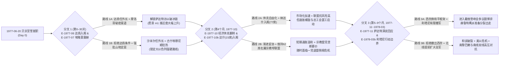

# M14 剧本、结局与历史评价

## 0. 元信息

- **模块编号**：`M14`
- **模块名称**：剧本、结局与历史评价（Scenarios, Endings & Historical Evaluation）
- **版本**：`v1.0.0`
- **作者**：资深系统设计师子代理（M14 负责人）
- **依赖模块**：
  - [M01_core_loop.md](file:///Users/xtxsinan/.gemini/antigravity/scratch/israel_political_simulation/docs/specs/M01_core_loop.md)（每日步骤 20 `end_check`、日终卸任与继任状态机 `TENURE_SUMMARY -> SUCCESSION_SETUP -> EPILOGUE`、月度历史序列 `series`、关键转折点列表 `turning_points`、确定性随机数子流 `core`）
  - [M02_numbers_model.md](file:///Users/xtxsinan/.gemini/antigravity/scratch/israel_political_simulation/docs/specs/M02_numbers_model.md)（1977-06-20 开局零漂移校准基线 `T03`、矛盾参数终值与历史轨迹读取）
  - [M03_parliament.md](file:///Users/xtxsinan/.gemini/antigravity/scratch/israel_political_simulation/docs/specs/M03_parliament.md)（议会席位分布、执政联盟构成、大选胜负与倒阁触发原因）
  - [M04_party_promises.md](file:///Users/xtxsinan/.gemini/antigravity/scratch/israel_political_simulation/docs/specs/M04_party_promises.md)（三层目标结算：`m04_finalize_promises`、`m04_reset_goals_for_leader`、立场走廊偏离度、宏大愿景里程碑与 `D-053` 愿景冻结规则）
  - [M05_actions_capital.md](file:///Users/xtxsinan/.gemini/antigravity/scratch/israel_political_simulation/docs/specs/M05_actions_capital.md)（开局 76 项政策档位 `policy_level`、政府五轴立场 `gov_axis_position`、验证机器人 6 种策略人格权重表）
  - [M06_characters_ai.md](file:///Users/xtxsinan/.gemini/antigravity/scratch/israel_political_simulation/docs/specs/M06_characters_ai.md)（开局 43 位历史人物与内阁分配、`m06_pick_successor` 继任人选算法、`m06_rebase_relations` 关系重锚定、在世人物不可玩保护规则）
  - [M07_world_diplomacy.md](file:///Users/xtxsinan/.gemini/antigravity/scratch/israel_political_simulation/docs/specs/M07_world_diplomacy.md)（国际合法性、美以关系、阿以和约等级 `peace_treaty_state`、外部世界轨道变体模式）
  - [M08_palestine.md](file:///Users/xtxsinan/.gemini/antigravity/scratch/israel_political_simulation/docs/specs/M08_palestine.md)（巴勒斯坦敌意、起义状态 `uprising_state`、自治进度 `autonomy_progress`）
  - [M09_military_intel.md](file:///Users/xtxsinan/.gemini/antigravity/scratch/israel_political_simulation/docs/specs/M09_military_intel.md)（战备、威慑、公众安全感、战线状态与泥潭月数、核计划进度与暴露风险）
  - [M10_economy_budget.md](file:///Users/xtxsinan/.gemini/antigravity/scratch/israel_political_simulation/docs/specs/M10_economy_budget.md)（1977-06-20 财政收支账本、预算滑块、通胀、失业、增长、公共债务、外汇储备）
  - [M11_map_regions.md](file:///Users/xtxsinan/.gemini/antigravity/scratch/israel_political_simulation/docs/specs/M11_map_regions.md)（11 个区域与 25 个关键地点开局状态、犹太-民主-领土三难三角 `trilemma_state`）
  - [M12_event_engine.md](file:///Users/xtxsinan/.gemini/antigravity/scratch/israel_political_simulation/docs/specs/M12_event_engine.md)（开局事件触发、结局条件表达式求值、二周目已读事件快进与分叉点提示）
  - [M13_authoritarian.md](file:///Users/xtxsinan/.gemini/antigravity/scratch/israel_political_simulation/docs/specs/M13_authoritarian.md)（集权度 5 阶段、威权生存模式 `survival_mode_active`、政变与暗杀结局触发）
- **对标锚点与超越目标**（见 [benchmarks.md](file:///Users/xtxsinan/.gemini/antigravity/scratch/israel_political_simulation/docs/research/benchmarks.md) 与 [paradox_lessons.md](file:///Users/xtxsinan/.gemini/antigravity/scratch/israel_political_simulation/docs/research/paradox_lessons.md)）：
  1. **超越《为了祖国：朴正熙纪事》的结局深度与分布多样性（Rubric R1、R2、K1、K4）**：
     - 朴正熙纪事共有 24–28 个结局，但最常见结局（政变失败）占 21.0%，有效结局数 $\exp(H) \approx 10.7$，史实结局仅 0.7%，且史官总结存在转折点乱序 Bug（K4）与严重 AI 腔文本（K-x1）。
     - **本模块超越方案**：在旗舰剧本“贝京 1977”中设计 **40 个独立结局**（高于 $\ge 36$ 的硬门槛），采用“**12 个具名特殊历史/反事实史诗结局 + 28 个结构化组合结局矩阵（4 类下台方式 × 7 类三难三角与国家遗产原型）**”双层判定架构；通过前置分流与阈值正交化设计，确保 6 类策略机器人 × 500 局蒙特卡洛模拟下 **有效结局数 $N_{\text{eff}} = \exp(H) \ge 14.0$**、**单一最常见结局占比 $\le 18.0\%$**、**至少 28 个结局出现 $\ge 1$ 次**；史官转折点严格按 `day_index` 升序排列。
  2. **吸收《Suzerain》的双页历史书总结、意识形态轨迹与跨任期继承（Rubric S4、S7、S10）**：
     - 采用双页精装历史教科书版式呈现终局：左侧为“三难三角轨迹图 + 八维历史评价雷达图 + 三层目标审计卡”，右侧为“Top 8–12 生涯关键转折点时间线 + 6 段模块化拼装的历史书终章 + 三大史学流派（修正派、工党主流派、新史学家）同局差异化评语”；支持二周目已读文本快进与未探索分叉高亮（S7），支持卸任后以继任总理视角无缝接续（S10）。
  3. **吸收 P 社《EU4 / Stellaris / CK2》的开局钩子与反铁轨化设计（Rubric D8、D9、A2、A8）**：
     - 拒绝“白板剧本”与“按钮式结局”：每个剧本绑定专属的承诺池、政党走廊与宏大愿景里程碑；保证玩家在开局前 15 分钟（前 6–9 个游戏月）内必进入由“达扬秘密外交破冰 vs 埃隆莫雷赫强行定居 vs 埃利希经济休克翻转”构成的三大战略分叉点；提供 3 种开局世界变体与 30 项可自动判定的全局成就。

---

## 1. 设计意图

- **核心取舍（一句话）**：**玩家必须在“讨好当下选民以求连任（兑现短期承诺）”、“顺从政党派系以防内部逼宫（守住立场走廊）”与“赌上政治生命重塑国家未来（推进宏大愿景与提升八维历史评价）”三者之间做出不可兼得的抉择——并且在权力终结的那一刻，面对不同立场历史学家的冷峻审判，决定是体面放手让继任者接过火炬，还是滑向威权深渊。**
- **决策频率与信息来源**：
  - **开局阶段（第 0 日）**：玩家进行 1 次剧本与历史变体模式选择，阅读剧本简报、三层目标卡（4 条初始承诺、本党五轴走廊、7 个愿景里程碑）并处理第 0 日开局抉择事件（如 `E-1977-06` 达扬入阁条件）。
  - **执政日常（每月 0–1 次直接操作，全程被动感知）**：M14 不增加日常繁琐点击；玩家通过顶栏与目标面板实时感知三层目标进度，并在重大历史锚点（约每季度 1–2 次）看到带有“★ 关键历史转折点”标记的决策提示。
  - **卸任与终局阶段（每任期结束 1 次）**：当触发 12 种卸任原因之一时，玩家在总结画面阅读完整的八维评分、三大史派评语与历史书章节，并做出 1 次核心元决策：**【以继任总理视角继续执政】** 或 **【合上历史书，结算跨时代终局】**。
- **失败状态与恢复路径**：
  - **个人政治失败（非终局）**：大选失利（`election_loss`）、组阁失败（`coalition_failure`）、不信任投票倒阁（`no_confidence`）、党内初选落败（`primary_loss`）、主动辞职（`resignation`）、健康失能（`health_incapacity`）、自然死亡（`death`）、遇刺（`assassination`）、军事政变（`coup`）、独裁被推翻（`overthrow`）。以上 10 种情况仅结束**当前总理任期**，进入任期总结画面后，玩家均可选择**以继任者视角继续游玩**，承接前任留下的全部制度遗产与历史债务，在新任期中逆转困局。
  - **国家彻底失败（硬终局，不可继续）**：仅当发生**国家崩溃（`state_collapse`）**——即四战线首都陷落、核毁灭或财政/外汇/治安三重彻底归零持续 6 个月——或玩家主动选择结束本局（`player_quit`）时，不可启用继任者，直接进入终局结算。
- **后期（第 10–20 年）如何保持新鲜感**：
  1. **继任者更迭与走廊切换**：随着贝京在 1980 年代中后期卸任，玩家可接手沙米尔（铁杆守成）、佩雷斯/拉宾（工党和平进程，立场走廊 180 度翻转）或沙龙（强人破局），每一次继任都会重置承诺包、切换政党走廊并重锚定内阁人际网。
  2. **跨时代结构性新压力激活**：1985 年恶性通胀稳定计划、1987 年第一次巴勒斯坦大起义与哈马斯生成、1989–1991 年百万前苏联移民潮（`russian` 集团激活）与海湾战争导弹袭击、1992 年最高法院宪政革命（`judicial_conflict` 激活），使第 10–20 年涌现全新的核心矛盾。
  3. **历史债务累积与跨任期评价**：前任签下的兵役豁免、定居点纠缠度（`entanglement_index`）与公共债务在 15 年后集中爆发；终局提供“跨时代多任总理国家总评”，激励玩家跑完 20–30 年完整长局。

---

## 2. 读写清单

> 严格遵循 [contracts.md](file:///Users/xtxsinan/.gemini/antigravity/scratch/israel_political_simulation/docs/contracts.md) §3 与 §6：M14 是 `historical_rating` 的唯一 `owner`；在剧本加载时初始化全局快照；在每日步骤 20 检查硬终局条件；在日终卸任阶段计算八维历史评价、判定结局与成就。

| 参数 / 状态 ID | 读/写 | 结算步骤（contracts §3） | 说明 |
|---|---|---|---|
| `historical_rating` | **写（owner）** | 日终卸任阶段（步骤 20 后）/ 事件 | 综合历史评价指数，范围 `[-100.0, 100.0]`，由八维评价与三层目标总评分数 $S_{\text{total}} \in [0, 100]$ 线性映射：`2.0 * S_total - 100.0` |
| `pending.tenure_end` | **读 / 写** | 步骤 20 `end_check` | 每日检查硬性结束条件（如 `state_collapse`、法定寿命极限等）；若命中则通过 `end_tenure` 写入 `{reason, day, source}` |
| `state.history.turning_points` | **读 / 写** | 步骤 18 / 步骤 20 / 日终 | 记录并筛选本任期及跨任期的关键历史转折点（Top 8–12 Turning Points） |
| `state.tenures` | **读 / 写** | 日终卸任阶段 | 写入 `TenureRecord`（含本任期结局 ID、八维评价明细、三大史派评语、承诺与愿景终值） |
| `political_capital`, `party_standing`, `ally_satisfaction[*]`, `bloc_support[*]`, `coalition_seats` | 读（开局初始化写） | 剧本加载 / 日终卸任 | 读取权力生存层终值与均值，计算 `dim_leadership`；继任时按 `D-013` 重置 `political_capital = 40`、`party_standing` |
| `promise_progress[*]`, `stance_deviation[*]`, `vision_progress`, `cynicism`, `party_cohesion` | 读 | 日终卸任 | 读取 M04 三层目标完成度，计算承诺兑现加权 $S_{\text{promise}}$、走廊忠诚/破局加权 $S_{\text{corridor}}$ 与愿景加成 $S_{\text{vision}}$ |
| `centralization` | 读 | 步骤 20 / 日终卸任 | 读取集权度与 M13 `survival_mode_active`、`regime_control`，判定独裁/政变结局并施加民主评分封顶限制 |
| `budget_balance`, `public_debt`, `fx_reserves`, `inflation`, `growth`, `unemployment`, `economic_model`, `inequality`, `union_strength`, `absorption_capacity` | 读 | 步骤 20 / 日终卸任 | 读取 M10 宏观经济指标，检查恶性通胀/破产终局，计算 `dim_economy` 与 `dim_cohesion` |
| `readiness`, `mobilization`, `deterrence`, `public_security`, `complacency`, `nuclear_progress`, `nuclear_exposure_risk`, `state_integration` | 读 | 步骤 20 / 日终卸任 | 读取 M09 军事安全与核指标，检查战败/核危机终局，计算 `dim_security` |
| `religious_status_quo`, `draft_exemption`, `alienation[*]`, `historical_grievance[*]`, `civic_identification[*]`, `land_grievance[*]`, `settler_momentum`, `rule_of_law`, `judicial_conflict` | 读 | 步骤 20 / 日终卸任 | 读取 M02 社会矛盾与法治指标，计算 `dim_cohesion`、`dim_democracy`、`dim_territory` |
| `strategic_dependence`, `intl_legitimacy`, `us_admin_relation`, `us_congress_relation`, `power_relation[*]`, `regime_hostility[*]`, `popular_hostility[*]`, `regime_stability[*]`, `peace_treaty_state[*]`, `enemy_nuclear_progress[*]`, `immigration_inflow` | 读 | 步骤 20 / 日终卸任 | 读取 M07 外交与条约状态，判定和平/孤立结局，计算 `dim_diplomacy` 与 `dim_security` |
| `pal_hostility`, `pal_living_standard`, `faction_strength[*]`, `faction_legitimacy[*]`, `uprising_risk`, `autonomy_progress` | 读 | 步骤 20 / 日终卸任 | 读取 M08 巴勒斯坦局势，判定起义泥潭或自治落地结局，计算 `dim_palestine` |
| `trilemma`, `trilemma_jewish`, `trilemma_democratic`, `trilemma_territory`, `region_security[*]`, `region_development[*]`, `region_population[*]`, `settler_population[*]` | 读 | 步骤 20 / 日终卸任 | 读取 M11 区域与三难三角状态，用于组合结局矩阵分型及 `dim_territory`、`dim_democracy` 计算 |
| `relation[*]`, `health[*]`, `character_stress[*]` | 读 | 步骤 20 / 日终继任 | 读取 M06 人物状态；继任时调用 `m06_pick_successor` 或 `m14_generate_fictional_leader` |

---

## 3. 状态与数据结构

### 3.1 M14 运行时状态树（`state.modules.M14`）

> 严格遵循 Python 3.9 语法规范（不使用 `match` 或 `X | Y` 类型联合写法）。

```python
from dataclasses import dataclass, field
from typing import Dict, List, Optional, Tuple

@dataclass
class TurningPointEntry:
    """生涯关键转折点条目（存于 state.history.turning_points 及 M14 筛选结果）"""
    uid: int                                # 唯一递增序号（1 起）
    day_index: int                          # 发生时的游戏日序
    date_str: str                           # 公历日期 "YYYY-MM-DD"
    tenure_index: int                       # 所属任期下标（0 起）
    leader_id: str                          # 时任总理 ID
    source_type: str                        # "event" | "war" | "treaty" | "election" | "legislation" | "corridor" | "vision" | "crisis"
    source_id: str                          # 如 "E-1977-11:A", "treaty:egypt", "war:lebanon_1982"
    title_zh: str                           # 转折点简短标题（如 "萨达特访以与耶路撒冷破冰"）
    summary_zh: str                         # 历史书式单句描述（40~80字）
    base_weight: float                      # 静态重要性权重 [10.0, 100.0]
    param_impact_l1: float                  # 触发当日对核心参数的绝对变化量加权和
    salience_score: float = 0.0             # 终局筛选时计算的综合显著度得分
    category_tag: str = "politics"          # "peace" | "war" | "economy" | "territory" | "religion" | "democracy" | "politics"

@dataclass
class DimensionBreakdown:
    """单个历史评价维度的详细拆解（供 UI 雷达图 Tooltip 与验证测试使用）"""
    dim_id: str                             # 8 个维度 ID 之一
    name_zh: str                            # 维度中文名
    score: float                            # 最终维度得分 [0.0, 100.0]
    weight_default: float                   # 默认综合权重（8 项之和为 1.0）
    sub_terms: List[Tuple[str, float]] = field(default_factory=list) # 分项贡献列表 [(说明, 分值)]

@dataclass
class HistorianVerdict:
    """单一史学流派的评分与评语结构"""
    school_id: str                          # "revisionist" | "labor_mainstream" | "new_historian"
    school_name_zh: str                     # 流派中文名称
    representative_work_zh: str             # 虚构代表著作标题（如《铁墙与锡安：贝京时代的重估》）
    weighted_score: float                   # 按该流派偏重计算的总分 [0.0, 100.0]
    grade: str                              # "S" | "A" | "B" | "C" | "D" | "F"
    commentary_zh: str                      # 专属评语正文（120~200字）

@dataclass
class TenureEvaluationReport:
    """单任期完整历史评价与结局报告（挂载于 TenureRecord.m14_report）"""
    tenure_index: int
    leader_id: str
    leader_name_zh: str
    party_id: str
    start_date: str
    end_date: str
    days_in_office: int
    end_reason: str                         # M01 §4.9.1 枚举的 12 种卸任原因
    ending_id: str                          # 命中的唯一结局 ID（END_EPIC_01..12 或 END_MAT_01..28）
    ending_title_zh: str                    # 结局中文主标题
    ending_subtitle_zh: str                 # 结局副标题 / 历史定性语
    ending_tier: str                        # "EPIC"（史诗特殊结局）| "MATRIX"（结构组合结局）
    trilemma_archetype: str                 # 终局三难三角落点分型（7 类之一）
    dimensions: Dict[str, DimensionBreakdown] = field(default_factory=dict) # 8 维得分明细
    base_weighted_score: float = 50.0       # 八维基础加权分 [0.0, 100.0]
    promise_fulfillment_rate: float = 0.0   # 承诺兑现率 [0.0, 1.0]
    promise_bonus: float = 0.0              # 承诺兑现修正项 [-15.0, +15.0]
    corridor_loyalty_rate: float = 1.0      # 走廊内执政月份占比 [0.0, 1.0]
    corridor_bonus: float = 0.0             # 立场忠诚/破局修正项 [-10.0, +10.0]
    vision_bonus: float = 0.0               # 宏大愿景加成项 [0.0, +20.0]
    total_score: float = 50.0               # 最终综合评分 S_total [0.0, 100.0]
    historical_rating: float = 0.0          # 映射到 [-100.0, +100.0] 的参数终值
    final_grade: str = "C"                  # 最终等级 "S" | "A" | "B" | "C" | "D" | "F"
    grade_capped_by_auth: bool = False      # 是否因独裁路线触发了最高等级封顶
    selected_turning_points: List[TurningPointEntry] = field(default_factory=list) # 筛选出的 Top 8-12 转折点
    textbook_paragraphs: List[str] = field(default_factory=list) # 6 段式历史教科书终章文本
    historian_verdicts: Dict[str, HistorianVerdict] = field(default_factory=dict) # 三大史学流派评语
    trilemma_trajectory: List[Tuple[str, float, float, float]] = field(default_factory=list) # [(date, V_J, V_D, V_T)]

@dataclass
class M14ScenarioRuntimeState:
    """M14 模块持久化状态（存于 state.modules.M14）"""
    version: int = 1
    scenario_id: str = "begin_1977"
    world_variant_mode: str = "historical_gravity" # "historical_gravity" | "high_pressure_random" | "persona_shuffle"
    fictional_leader_counter: int = 0       # 已生成的虚构继任者计数（用于确定性命名 fictional_pm_1..N）
    collapse_danger_streak_days: int = 0    # 满足国家崩溃极端阈值的连续天数（满 180 天触发 state_collapse）
    tenure_start_snapshot: Dict[str, float] = field(default_factory=dict) # 当前任期就任时的核心参数快照（用于计算任期净增量）
    corridor_months_total: int = 0          # 当前任期累计月结次数
    corridor_months_inside: int = 0         # 当前任期立场偏离总和 <= 5.0 的月结次数
    peak_inflation_tenure: float = 35.0     # 当前任期经历的峰值通胀率
    min_fx_tenure: float = 35.0             # 当前任期经历的最低外汇储备
    wars_fought_tenure: List[str] = field(default_factory=list) # 当前任期参与过的战争战线 ID
    treaties_signed_tenure: List[str] = field(default_factory=list) # 当前任期签署的正式和约国家 ID
    unlocked_achievements_this_run: List[str] = field(default_factory=list) # 本局已解锁的成就 ID 列表
    tenure_reports: List[TenureEvaluationReport] = field(default_factory=list) # 历任总理评价报告列表
    cross_era_summary: Optional[Dict[str, object]] = None # 多任期跨时代总评（仅在 EPILOGUE 生成）
```

---

### 3.2 “贝京 1977”旗舰剧本完整开局快照（`1977-06-20`）

> [!IMPORTANT]
> **开局日期与历史背景**：`1977-06-20`（星期一，`day_index = 0`，`abs_day = 2727`）。一个月前的 1977 年 5 月 17 日，梅纳赫姆·贝京领导的利库德集团在第九届议会大选中赢得大翻盘（HaMahapach），终结了劳工阵营连续 29 年的执政。1977 年 6 月 20 日，贝京在议会以 63 票赞成（利库德 43 席 + 沙龙什洛姆锡安并入 2 席 + 国家宗教党 12 席 + 以色列正教党 4 席 + 摩西·达扬个人倒戈 1 席 + 弗拉托-沙龙外部支持 1 席）完成宣誓就职。

#### 3.2.1 全部核心参数在 `1977-06-20` 的定稿初值与跨模块零漂移校核表

根据 `D-004`（“贝京 1977 开局值以 M14 规格为准”），下表汇总 `parameters.yaml` 及 `D-001` 至 `D-079` 全部参数在 `1977-06-20` 的精确初值，并逐项说明与 `M02`～`M13` 零漂移稳态校准的一致性：

| 类别 | 参数 ID（及 Scope 键） | 1977-06-20 定稿初值 | 单位 / 量程 | Owner | 与各模块零漂移校准的一致性说明 |
|---|---|---:|---|---|---|
| **权力生存层** | `political_capital` | `40.0` | 点 `[0, 200]` | M05 | 与 M01/M05 开局初值完全一致；首月产出约 `15.0 + 3.0(mahapach) = 18.0` |
| 权力生存层 | `party_standing` | `70.0` | 点 `[0, 100]` | M04 | 胜选蜜月期高威望，与 M01/M04 §3.8 完全一致 |
| 权力生存层 | `coalition_seats` | `61`（E-1977-06选A后 `62`） | 席 `[0, 120]` | M03 | 宣誓前利库德 `45` + 国家宗教党 `12` + 正教党 `4` = `61` 席；第0日 `E-1977-06` 选A纳达扬入阁后变为 `62` 席；1977-10 `dash`（15席）加入后升至 `77` 席 |
| 权力生存层 | `ally_satisfaction` | `nrp: 65.0, agudat: 60.0, liberals: 60.0, dash: 45.0, labor: 15.0, mapam: 10.0, flatto_sharon: 50.0, poalei_agudat: 45.0, ilp: 30.0, ratz: 15.0` | 点 `[0, 100]` | M03 | 与 M03 §3.9 完全一致；执政伙伴 `nrp, agudat, liberals` 均 $\ge 60$，无退盟威胁 |
| 权力生存层 | `bloc_support` | `labor_ashkenazi: 30.0, mizrahi: 52.0, kibbutz_moshav: 15.0, religious_zionist: 60.0, haredi: 45.0, arab_citizens: 15.0, liberal_middle: 38.0, russian: 40.0(未激活)` | 点 `[0, 100]` | M03 | **严格落实 D-040**：采用 `religious_zionist = 60.0`（对齐 M02 §4.4.0 使 `settler_momentum` 零漂移）与 `arab_citizens = 15.0`（对齐 M03 软目标区间） |
| 权力生存层 | `promise_progress` | `settle_eretz_israel: 0.0, economic_liberalization: 0.0, social_justice: 0.0, peace_and_security: 0.0` | `% [0, 100]` | M04 | **严格落实 D-022**：使用 M04 §3.6 正式承诺键 |
| 权力生存层 | `stance_deviation` | `territory: 0.0, security: 0.0, economy: 0.0, religion: 0.0, foreign: 0.0` | 点 `[0, 100]` | M04 | **严格落实 D-050、D-051**：派生参数；虽继承工党遗产政策，但受 6+18 个月宽限期全额豁免，开局偏离为 `0.0` |
| 权力生存层 | `vision_progress` | `0.0` | `% [0, 100]` | M04 | 对应贝京愿景 `begin_peace_in_eretz_israel` |
| 权力生存层 | `centralization` | `5.0` | 点 `[0, 100]` | M13 | 议会常态（阶段 0），与 M02 §4.4.0 及 M13 §4.1.2 零杠杆漂移校准完全一致 |
| 权力生存层 | `cynicism` / `voter_cynicism` | `20.0` | 点 `[0, 100]` | M04/M03 | **落实 D-055**：开局取基线值 `20.0`（使 `M03.BS.10` 與 `X.M04.01` 在拐点 20 处开局贡献为 `0.000`） |
| 权力生存层 | `party_cohesion` | `72.0` | 点 `[0, 100]` | M04 | 利库德胜选初期团结度较高 |
| 权力生存层 | `challenger_strength` | `0.0` | 点 `[0, 100]` | M04 | 开局无党内挑战者 |
| 权力生存层 | `faction_mood` | `herut_core: 64.0, herut_hawks: 50.0, liberal_wing: 52.0, laam: 56.0` | 点 `[0, 100]` | M04 | 与 M04 §3.8 完全一致 |
| 权力生存层 | `faction_weight` | `herut_core: 38.0, herut_hawks: 12.0, liberal_wing: 32.0, laam: 18.0` | `% [0, 100]` | M04 | 合计 `100.0%`，与 M04 §3.3 完全一致 |
| **国家能力与经济层** | `budget_balance` | `-2.000` | `%年度预算/月 [-50, 50]` | M10 | **与 M10 §3.1 `FiscalLedger` 精确对齐**：`R_tax(7.828) + R_aid(0.600) - E_sliders(8.712) - E_debt(0.960) - E_tanzi(0.700) + Δ_M05(-0.056) = -2.000` |
| 国家能力层 | `public_debt` | `120.0` | `%GDP [0, 300]` | M10 | 1973 战后高债务遗产，与 M01/M10 完全一致 |
| 国家能力层 | `fx_reserves` | `35.0` | 点 `[0, 100]` | M10 | 约合 13.5 亿美元外汇储备，与 M01/M10 完全一致 |
| 国家能力层 | `inflation` | `35.0` | `%/年 [-5, 500]` | M10 | 1977 年中通胀率 35%，与 M02 §4.4.0 及 M10 `expected_inflation = 35.0` 完全一致 |
| 国家能力层 | `growth` | `1.5` | `%/年 [-15, 20]` | M10 | 1974–77 滞胀期低增长，与 M01/M10 完全一致 |
| 国家能力层 | `unemployment` | `3.9` | `% [0, 40]` | M10 | **采用 `3.9`**（对齐 M02 §4.4.0，低于拐点 `4.0`，使 `M02.ALN.02` 与 `M03.BS.02` 开局零漂移） |
| 国家能力层 | `economic_model` | `-45.0` | 轴 `[-100, 100]` | M10 | 继承工党主导的劳工-国营混合经济体制 |
| 国家能力层 | `inequality` | `38.0` | 点 `[0, 100]` | M10 | **采用 `38.0`**（对齐 M02 §4.4.0，使 `M02.ALN.01` 贡献精确为 `0.30*(38-30) = +2.400`，确保 `alienation[mizrahi] = 38.0` 零漂移） |
| 国家能力层 | `union_strength` | `70.0` | 点 `[0, 100]` | M10 | 总工会（Histadrut）控制庞大企业与医保网络 |
| 国家能力层 | `strike_risk` | `24.5` | 点 `[0, 100]` | M10 | **落实 D-060**：由 `union_strength = 70` 与 `wage_erosion_index = 20` 派生 |
| 国家能力层 | `absorption_capacity` | `55.0` | 点 `[0, 100]` | M10 | **采用 `55.0`**（对齐 M02 §4.4.0，高于拐点 `50.0`，使 `M02.ALN.13` 开局零漂移） |
| 国家能力层 | `immigration_inflow` | `21000` | `人/年 [0, 1000000]` | M07 | 1977 年常规移民流入速率（约 2.1 万人/年） |
| 国家能力层 | `budget_slider` | `defense: 65, absorption: 45, religion: 40, dev_towns: 40, education: 50, welfare: 55, infrastructure: 50, settlements: 35` | 档位 `[0, 100]` | M10 | **落实 D-060、D-062**：1977 开局 `budget_cycle.status = "PASSED"`，滑块与 M10 §3.1 完全一致 |
| **军事与安全层** | `readiness` | `72.0` | 点 `[0, 100]` | M09 | 与 M09 §3.2 完全一致（战后美援换装完成） |
| 军事与安全层 | `mobilization` | `10.0` | 点 `[0, 100]` | M09 | 与 M09 §3.2 常备军基线一致（注：在 M02 中 `mobilization` 仅在 `>30` 或 `>50` 时产生边贡献，故 `10.0` 下 M02 贡献仍精确为 `0.000`） |
| 军事与安全层 | `deterrence` | `68.0` | 点 `[0, 100]` | M09 | 与 M09 §3.2（恩德培奇袭后高威慑）完全一致 |
| 军事与安全层 | `public_security` | `62.0` | 点 `[0, 100]` | M09 | **落实 D-069**：与 M09 §3.2 及 M10 只读别名 `security_index = 62.0` 完全一致（高于 M02 `M02.ROL.03` 拐点 `30.0`，不影响法治零漂移） |
| 军事与安全层 | `complacency` | `20.0` | 点 `[0, 100]` | M09 | 与 M09 §3.2 及 M07 §4.5.3 算例完全一致 |
| 军事与安全层 | `nuclear_progress` | `78.0` | 点 `[0, 100]` | M09 | 迪莫纳成熟二级核威慑（`arsenal_tier = 2`），与 M09 §3.2 一致 |
| 军事与安全层 | `nuclear_exposure_risk` | `42.0` | 点 `[0, 100]` | M09 | 核模糊政策维持中，与 M09 §3.2 一致 |
| 军事与安全层 | `state_integration` | `100.0`（`inactive`） | 点 `[0, 100]` | M09 | `era: [1948, 1950]`，1977 处于 `inactive`，存值 `100.0`（对齐 M09 §3.2） |
| **社会矛盾层** | `religious_status_quo` | `10.0` | 轴 `[-100, 100]` | M02 | 略偏宗教（联合协议维持现状），与 M02 §4.4.0 一致 |
| 社会矛盾层 | `draft_exemption` | `8.0` | 千人 `[0, 100]` | M02 | 累计约 8,000 名耶希瓦学生豁免，与 M02 §4.4.0 一致 |
| 社会矛盾层 | `alienation` | `mizrahi: 38.0, ethiopian: 30.0, russian: 35.0(未激活)` | 点 `[0, 100]` | M02 | **与 M02 §4.4.0 精确对齐**：`mizrahi` 目标值 `37.879`、`ethiopian` 目标值 `30.400`，首月漂移 $|\Delta| < 0.05$，通过 `T03` |
| 社会矛盾层 | `historical_grievance` | `mizrahi: 55.0, ethiopian: 10.0, russian: 0.0` | 点 `[0, 100]` | M02 | 与 M02 §4.4.0 完全一致 |
| 社会矛盾层 | `civic_identification` | `arab: 38.0, druze: 72.0, bedouin: 50.0` | 点 `[0, 100]` | M02 | 与 M02 §4.4.3 目标值（`37.95, 72.10, 49.95`）精确对齐，零漂移 |
| 社会矛盾层 | `land_grievance` | `arab: 55.0, druze: 15.0, bedouin: 40.0` | 点 `[0, 100]` | M02 | 1976 年“土地日”抗议后阿拉伯土地怨气较高，与 M02 §4.4.4 一致 |
| 社会矛盾层 | `settler_momentum` | `45.0` | 点 `[0, 100]` | M02 | 与 M02 §4.4.5（目标值 `45.0`）完全相等，零漂移 |
| 社会矛盾层 | `rule_of_law` | `66.0` | 点 `[0, 100]` | M02 | 与 M02 §4.4.6 完全一致 |
| 社会矛盾层 | `judicial_conflict` | `10.0`（`inactive`） | 点 `[0, 100]` | M02 | `era: [1992, null]`，1977 处于 `inactive`，存值 `10.0` |
| **外交与外部世界** | `intl_legitimacy` | `45.0` | 点 `[0, 100]` | M07 | 1975 联大 3379 号决议后处于中低位，与 M01/M07 一致 |
| 外交层 | `us_admin_relation` | `58.0` | 点 `[0, 100]` | M07 | 卡特政府上台初期（关注人权与巴勒斯坦家园），与 M07 §3.1.1 一致 |
| 外交层 | `us_congress_relation` | `65.0` | 点 `[0, 100]` | M07 | 国会两党亲以基础稳固，与 M01/M07 一致 |
| 外交层 | `strategic_dependence` | `52.0` | 点 `[0, 100]` | M07 | 派生参数，1973 战后对美军援与武器依赖度上升 |
| 外交层 | `power_relation` | `usa: 58.0, ussr: 15.0, france: 45.0, uk: 52.0, west_germany: 65.0, diaspora: 72.0` | 点 `[0, 100]` | M07 | 与 M07 §3.1.1 完全一致 |
| 外交层 | `arms_reliability` | `usa: 78.0, ussr: 0.0, france: 42.0, uk: 50.0, west_germany: 60.0, diaspora: 72.0` | 点 `[0, 100]` | M07 | 与 M07 §3.1.1 完全一致 |
| 外交层 | `regime_hostility` | `egypt: 58.0, jordan: 55.0, syria: 85.0, lebanon: 60.0, iraq: 90.0, saudi: 80.0` | 点 `[0, 100]` | M07 | **落实 D-068**：`regime_hostility = 100 - country_relation`，与 M07 §3.1.1 精确互补 |
| 外交层 | `popular_hostility` | `egypt: 68.0, jordan: 72.0, syria: 84.0, lebanon: 58.0, iraq: 85.0, saudi: 78.0` | 点 `[0, 100]` | M07 | 与 M07 §3.1.1 完全一致 |
| 外交层 | `regime_stability` | `egypt: 52.0, jordan: 64.0, syria: 68.0, lebanon: 25.0, iraq: 72.0, saudi: 80.0` | 点 `[0, 100]` | M07 | 与 M07 §3.1.1 完全一致（黎巴嫩因内战处于 `25.0` 低位） |
| 外交层 | `country_war_readiness` | `egypt: 62.0, jordan: 48.0, syria: 76.0, lebanon: 20.0, iraq: 70.0, saudi: 45.0, iran: 65.0` | 点 `[0, 100]` | M07 | **落实 D-066**：与 M07 §3.1.1 完全一致 |
| 外交层 | `peace_treaty_state` | `egypt: 1, jordan: 1, syria: 1, lebanon: 1, iraq: 0, saudi: 0, iran: 2, usa: 3, uk: 3, france: 3, west_germany: 3` | 枚举 `0..3` | M07 | **落实 D-066**：`1`=停战/脱离接触，`2`=事实非正式同盟，`3`=正式建交/和约 |
| 外交层 | `enemy_nuclear_progress` | `iraq: 35.0, iran: 5.0`（其余 `0.0`） | 点 `[0, 100]` | M07 | **落实 D-066**：伊拉克奥西拉克（Tammuz-1）反应堆在建中 |
| **巴勒斯坦层** | `pal_hostility` | `55.0` | 点 `[0, 100]` | M08 | 与 M02 §4.4.0 及 M08 完全一致 |
| 巴勒斯坦层 | `pal_living_standard` | `45.0` | 点 `[0, 100]` | M08 | 占领区劳工赴以务工带来一定收入，但基建匮乏 |
| 巴勒斯坦层 | `uprising_risk` | `35.0` | 点 `[0, 100]` | M08 | 派生参数，与 M04 §4.11.5 算例 `uprising_risk = 35.0` 完全对齐 |
| 巴勒斯坦层 | `autonomy_progress` | `0.0` | `% [0, 100]` | M08 | **落实 D-073**：1977 开局尚未签署自治框架 |
| 巴勒斯坦层 | `islamic_assoc_strength` | `12.0` | 点 `[0, 100]` | M08 | **落实 D-072**：镜像 `faction_strength[mujama] = 12.0` |
| 巴勒斯坦层 | `faction_strength` | `fatah: 58.0, pflp: 34.0, jordan_notables: 42.0, local_mayors: 38.0, village_leagues: 0.0, mujama: 12.0, hamas: 0.0, pij: 0.0, pa_security: 0.0` | 点 `[0, 100]` | M08 | **落实 D-072**：9 派系完整初值（`notables` 别名指向 `jordan_notables`） |
| 巴勒斯坦层 | `faction_legitimacy` | `fatah: 42.0, pflp: 28.0, jordan_notables: 40.0, local_mayors: 48.0, village_leagues: 0.0, mujama: 10.0, hamas: 0.0, pij: 0.0, pa_security: 0.0` | 点 `[0, 100]` | M08 | `jordan_notables = 40.0` 与 M04 §4.11.5 算例 `faction_legitimacy[notables] = 40` 完全一致 |
| **地图与三难三角** | `trilemma`, `trilemma_jewish`, `trilemma_democratic`, `trilemma_territory` | `63.2715`, `73.3825`, `56.6630`, `85.8000` | 点 `[0, 100]` | M11 | **落实 D-076**：与 M11 §3.1 `TrilemmaState` 精确到小数点后 4 位一致 |
| 地图与区域 | `region_security`, `region_development`, `region_population`, `settler_population` | 见 M11 §3.2.1 表（如 `negev` 发展 `32.0`、`galilee` `38.0`、`west_bank` 定居者 `5,000`） | 各异 | M11 | 与 M11 §3.2.1 完全一致 |
| **历史评价层** | `historical_rating` | `0.0` | 点 `[-100, 100]` | M14 | 开局中性值 `0.0`（对应 50 分基准） |

#### 3.2.2 执政联盟构成与初始内阁（1977-06-20 宣誓日及 1977-10 达什入阁扩展）

1. **第九届议会（120 席）与执政联盟席位演进**：
   - **利库德集团（`likud`，45 席）**：1977-05-17 大选获 43 席（含赫鲁特派、自由党派系 `liberals` 15 席、拉姆派 `laam` 8 席），大选后阿里埃勒·沙龙的什洛姆锡安党（`shlomtzion`，2 席）立即并入利库德，故 1977-06-20 快照中 `knesset_seats[likud] = 45`。
   - **国家宗教党（`nrp`，12 席）**：由老牌温和派约瑟夫·布尔格与少壮定居派泽夫伦·哈默共同领导，全面转向支持犹太与撒马利亚定居事业。
   - **以色列正教党 / 正统派犹太教托拉阵线（`agudat`，4 席）**：遵循拉比委员会指令**入盟但不出任内阁部长**（`no_ministers` 标签），由什洛莫·洛林茨出任议会财政委员会主席，换取宗教现状保护、耶希瓦预算与取消豁免人数上限条款。
   - **摩西·达扬（`independents`，1 席）**：原工党国防部长，在第 0 日开局事件 `E-1977-06`（“达扬的条件”）中，若玩家选择选项 A（史实选项：承诺不在未达成和平努力前单方面吞并约旦河西岸與加沙），达扬即脱离工党以独立议员身份出任**外交部长**，执政联盟席位由 `61` 席升至 **`62` 席**（另加弗拉托-沙龙 1 席外部支持）。
   - **民主变革运动（`dash`，15 席，1977-10 加入）**：开局时留在野党席位（等待选举制度改革与外交路线明朗），故贝京在 1977-06-20 特意将**司法部、交通部、劳工福利部**三个部门空缺由自己临时兼管；1977 年 10 月触发 `E-1977-10b`（“亚丁与民主变革运动入阁”），玩家批准后 `dash` 携 15 席加入执政联盟（总席位达 **`77` 席**），亚丁任副总理、塔米尔任司法部长、阿米特任交通部长。

2. **1977-06-20 初始内阁与强力部门首长分配表（与 M03 §3.9、M06 §3.6 完全对齐）**：

| 职位 ID (`post`) | 中文职务名 | 1977-06-20 在任人物 ID | 中文姓名 | 所属政党 / 派系 | 备注与史实机制联动 |
|---|---|---|---|---|---|
| `prime_minister` | 总理 | `begin` | 梅纳赫姆·贝京 | `likud` (`herut_core`) | 主角；临时兼管空缺的 `justice, transport, labor_welfare` |
| `foreign` | 外交部长 | `dayan` | 摩西·达扬 | `independents` | 第 0 日 `E-1977-06` 选项 A 正式确认；若选 B 则由 `shamir` 出任 |
| `defense` | 国防部长 | `weizman` | 埃泽尔·魏茨曼 | `likud` (`herut_core`) | 主导戴维营军事谈判；1980-05 若自治停滞可能辞职（`E-1980-05a`） |
| `finance` + `deputy_pm` | 财政部长兼副总理 | `ehrlich` | 西姆哈·埃利希 | `likud` (`liberal_wing`) | 自由党领袖，1977-10 推动“新经济政策”休克翻转（`E-1977-10`） |
| `agriculture` | 农业部长 | `sharon` | 阿里埃勒·沙龙 | `likud` (`herut_hawks`) | 兼内阁定居点委员会主席，每周高频提交西岸扩建提案 |
| `interior` + `police` | 内政兼警察部长 | `burg` | 约瑟夫·布尔格 | `nrp` | 国家宗教党魁，后主持巴勒斯坦自治谈判工作组 |
| `education` | 教育文化部长 | `hammer` | 泽夫伦·哈默 | `nrp` | 国家宗教党少壮派，古什埃穆尼姆在内阁的核心支持者 |
| `religious_affairs` | 宗教事务部长 | `abuhatzeira` | 阿哈龙·阿布哈齐拉 | `nrp` | 米兹拉希宗教代表，带 `corruptible` 特质（1980年代初触发司法起诉） |
| `industry_trade` | 工贸部长 | `hurvitz` | 伊加尔·胡尔维茨 | `likud` (`laam`) | 拉姆派财政鹰派，1979 接替埃利希任财长 |
| `housing` | 住房建设部长 | `patt` | 吉德翁·帕特 | `likud` (`liberal_wing`) | 自由党代表，配合安置与定居建设 |
| `absorption` | 移民吸收部长 | `levy` | 戴维·利维 | `likud` (`herut_core`) | 发展城镇米兹拉希草根领袖（`populist_tribune`） |
| `energy` + `communications` | 能源基建兼通讯部长 | `modai` | 伊扎克·莫达伊 | `likud` (`liberal_wing`) | 主管西奈阿尔玛油田开发与能源储备 |
| `justice` | 司法部长 | `null`（`begin` 代管） | （空缺留待达什） | `likud` 代管 | 1977-10 `E-1977-10b` 后由 `tamir`（什穆埃尔·塔米尔）出任 |
| `chief_of_staff` | 国防军总参谋长 | `gur` | 莫迪凯·古尔 | 军方无党派 | 任期至 1978-04，期满后触发任命拉斐尔·埃坦（`eitan`） |
| `mossad_chief` | 摩萨德局长 | `hofi` | 伊扎克·霍菲 | 情报无党派 | 主管对摩洛哥/埃及秘密渠道与伊拉克核情报 |
| `shin_bet_chief` | 辛贝特局长 | `shalom` | 阿夫拉罕·沙洛姆 | 情报无党派 | 主管占领区反恐与内部安全 |
| `attorney_general` | 总检察长 | `barak_aharon` | 阿哈龙·巴拉克【在世】 | 司法独立 | 1978 升任最高法院大法官，由伊扎克·扎米尔（`zamir`）接任 |
| `supreme_court_president` | 最高法院院长 | `kahan` | 伊扎克·卡汉 | 司法独立 | 主持埃隆莫雷赫案与 1982 卡汉调查委员会 |
| `boi_governor` | 以色列银行行长 | `gafni` | 阿农·加夫尼 | 央行独立 | 主管货币与外汇预警 |

#### 3.2.3 初始旗标（`flags.yaml`）与初始修正器（`modifiers.yaml`）

1. **初始旗标（`data/scenarios/begin_1977/flags.yaml`）**：
   - `likud_in_power`: `{set_day: 0, value: 1, source: "scenario"}`（利库德执政标志）
   - `mahapach_1977`: `{set_day: 0, value: 1, source: "scenario"}`（1977 大翻盘历史标志）
   - `bank_shares_regulation`: `{set_day: 0, value: 1, source: "scenario"}`（四大商业银行护盘操纵股价机制已潜伏运行，驱动 1983 银行股崩盘 `E-1983-10`）
   - `allon_plan_legacy`: `{set_day: 0, value: 1, source: "scenario"}`（继承工党阿隆计划定居点布局）
   - `good_fence_active`: `{set_day: 0, value: 1, source: "scenario"}`（黎巴嫩边境“好篱笆”政策已开启）

2. **初始修正器实例（`data/scenarios/begin_1977/modifiers.yaml`）**：
   - **实例 1：`mahapach_mandate`（「翻盘的授权」，定义于 M04 §4.5.2）**
     - `uid: 1`, `def_id: "mahapach_mandate"`, `scope_key: ""`, `start_day: 0`, `end_day: 365`（持续 12 个月，至 `1978-06-20`）
     - 效果：`pc_income add_flat +3.0`（每月政治资本产出 $+3$），且挂边 `party_standing +5.0`、`bloc_support[mizrahi] +4.0`。代表利库德终结 29 年工党统治带来的历史性蜜月授权。
   - **实例 2：`histadrut_opposition_bastion`（「总工会的反对派堡垒」，定义于 M10）**
     - `uid: 2`, `def_id: "histadrut_opposition_bastion"`, `scope_key: ""`, `start_day: 0`, `end_day: -1`（永久，`remove_if: "union_strength < 45 or government_pm_party == 'labor'"`）
     - 效果：由于利库德赢得议会但工党仍控制劳工总联合会（Histadrut），`strike_risk` 基础值 $+5.0$，推行自由化改革时工会反制概率上升。

---

### 3.3 其余 4 个规划剧本的架构框架与三层目标概要（通用性证明）

为证明本引擎、参数表（`parameters.yaml`）与三层目标数据结构（`PromiseState / FactionState / VisionState`）无需修改一行代码即可承载全时代剧本，下表定义其余 4 个规划剧本的开局差异、专属立场走廊、承诺包与宏大愿景：

| 剧本 ID 与开局日 | 主角 / 执政党 / 联盟席位 | 核心激活参数与时代特殊机制 | 政党五轴立场走廊 `[领土, 安全, 经济, 宗教, 外交]` | 开局承诺包（4 条，含类别与核心指标） | 宏大愿景 ID、标题与核心里程碑条件 |
|---|---|---|---|---|---|
| **`ben_gurion_1948`**<br>`1948-05-14`<br>（建国独立战争） | `ben_gurion`<br>马帕伊 `mapai`<br>临时国务委员会（折算 `65/120` 席） | 1. `era() = 1`，激活 `state_integration = 45.0`（地下组织伊尔贡/莱希与帕尔马赫尚未整编为统一国防军）；<br>2. 动态区 `west_bank, gaza, golan, sinai` 开局 `exists = False`；四战线处于 `FULL_WAR`；<br>3. 1949-01 触发首届制宪议会大选；激活修正器 `tzena_rationing`（紧缩配给）。 | **马帕伊建国走廊**：<br>`T: [-35, +35]`<br>`S: [+10, +80]`<br>`E: [-90, -30]`<br>`R: [-30, +20]`<br>`F: [-40, +30]` | 1. `win_war_of_independence`（`security`，`once`：停战时保住全部 6 个绿线固定区且 `deterrence >= 60`）；<br>2. `one_army_integration`（`security`，`level`：`state_integration >= 95`）；<br>3. `kibbutz_galuyot`（`immigration`，`accumulate`：3 年内吸收 60 万新移民且 `absorption_capacity >= 40`）；<br>4. `stabilize_tzena`（`economy`，`maintain`：`fx_reserves >= 15 and inflation <= 45`）。 | **`bg_constitution_and_negev`**<br>「成文宪法与让沙漠开花」<br>- `m1_constitution`：否决哈拉里暂缓决议，在 1951 年前通过完整《以色列成文宪法》（要求 `rule_of_law >= 78` 且克服宗教党退盟）；<br>- `m2_negev_bloom`：`region_population[negev] >= 500,000` 且 `region_development[negev] >= 60`；<br>- `m3_early_peace`（可选）：与阿卜杜拉一世或叙利亚扎伊姆达成早期和约。 |
| **`eshkol_1963`**<br>`1963-06-26`<br>（附 `meir_1969` 双起点） | `eshkol`<br>马帕伊 `mapai`<br>执政联盟 `68/120` 席 | 1. **接任型剧本**：本-古里安辞职但在党内保留极高影响力（随后分裂创立拉菲党 `rafi`），开局带“继承的使命”；<br>2. 绿线内阿拉伯区军事管制尚未废除（`lever military_government[arab] = 65.0`）；<br>3. 1967-05 触发蒂朗海峡封锁危机，六日战争胜利后动态激活 `west_bank, gaza, golan, sinai`。 | **马帕伊务实走廊**：<br>`T: [-45, +20]`<br>`S: [-10, +60]`<br>`E: [-75, -15]`<br>`R: [-35, +15]`<br>`F: [-45, +15]` | 1. `complete_water_carrier`（`economy`，`once`：建成国家输水工程且 `region_development[negev] +10`）；<br>2. `abolish_military_gov`（`social`，`once`：将 `military_government[arab]` 降至 `0` 且 `rule_of_law >= 72`）；<br>3. `modernize_idf_us_pivot`（`security`，`level`：武器来源从法国转向美国，`arms_reliability[usa] >= 70`）；<br>4. `overcome_mitun_recession`（`economy`，`level`：走出 1966 经济衰退，`unemployment <= 4.5`）。 | **`eshkol_land_for_peace_1967`**<br>「六月十九日决议：土地换和平」<br>- `m1_six_day_victory`：赢得六日战争或以威慑阻止战争；<br>- `m2_june19_cabinet`：在 `settler_momentum <= 35`（定居者运动坐大前）通过以西奈和戈兰换取全面和平的内阁决议；<br>- `m3_early_arab_treaty`：在 1972 年前与埃及或约旦签署正式和约（避免消耗战与赎罪日战争）。 |
| **`rabin_1992`**<br>`1992-07-13`<br>（奥斯陆与宪政革命） | `rabin`<br>工党 `labor`<br>执政联盟 `62/120` 席（工党44+梅雷兹12+沙斯6，加阿党5席外部支持） | 1. `era() = 5`，激活 `russian` 选民集团（权重 `0.12`，人口 45 万）与 `judicial_conflict = 25.0`（巴拉克宪政革命）；<br>2. `first_intifada_active = True`（起义尾声），哈马斯 `hamas` 与伊斯兰圣战 `pij` 已激活并发动自杀式恐袭；<br>3. 推进奥斯陆协议移交 A/B/C 区时，M13 `right_extremism_heat`（极右翼“追杀者律”煽动热度）急剧攀升，触发拉宾遇刺高危检定。 | **工党 1992 改革走廊**：<br>`T: [-75, -5]`<br>`S: [-25, +50]`<br>`E: [-45, +25]`<br>`R: [-60, +5]`<br>`F: [-50, +10]` | 1. `autonomy_within_year`（`peace`，`once`：18 个月内签署巴勒斯坦自治协议且 `autonomy_progress >= 50`）；<br>2. `shift_priorities_to_growth`（`economy`，`level`：`settlement_policy[west_bank] <= 25` 且 `education/infrastructure` 滑块 $\ge 65$，`growth >= 5.0`）；<br>3. `absorb_soviet_aliyah`（`immigration`，`level`：`alienation[russian] <= 25` 且 `unemployment <= 6.5`）；<br>4. `unlock_us_loan_guarantees`（`peace`，`once`：获得美国 100 亿美元贷款担保且 `us_admin_relation >= 75`）。 | **`rabin_comprehensive_peace`**<br>「和平的战士：全面终局协议」<br>- `m1_oslo_and_jordan`：签署奥斯陆协议并与约旦缔结正式和约（1994）；<br>- `m2_syria_golan_peace`：与叙利亚达成戈兰高地和平条约并通过全民公投/议会批准；<br>- `m3_survive_extremism`（守护）：清剿极右翼地下极端网络（`right_extremism_heat <= 35`），挫败暗杀阴谋并完成最终地位谈判。 |
| **`sharon_2001`**<br>`2001-03-07`<br>（第二次起义与脱离接触） | `sharon`<br>利库德 `likud`<br>民族团结政府 `73/120` 席（利库德+工党+沙斯等） | 1. 第二次起义（阿克萨起义）高烈度开局：`uprising_state.active = True, intensity = 78.0`，`public_security = 28.0`；<br>2. 科技泡沫破裂叠加恐袭导致 `growth = -1.5%`；<br>3. 玩家推行撤离加沙（拆除 `site_gush_katif`）将严重越过利库德走廊下限，触发**党内叛乱与退党另组新党（前进党 `kadima`）**的核心戏剧性高潮。 | **利库德 2001 强硬走廊**：<br>`T: [+25, +100]`<br>`S: [+30, +100]`<br>`E: [+10, +85]`<br>`R: [-15, +50]`<br>`F: [-10, +60]`<br>*(创 `kadima` 后切换至 `T:[-35,+35]`) * | 1. `crush_terror_wave`（`security`，`level`：通过防卫盾牌行动与隔离墙将 `public_security` 从 `28` 拉回 $\ge 68$）；<br>2. `build_seam_barrier`（`territory`，`level`：完成地图规划图 `plan_seam_zone_barrier` 进度 $\ge 85\%$）；<br>3. `high_tech_recovery`（`economy`，`level`：通过市场化改革使 `growth >= 4.0` 且 `budget_balance >= -1.5`）；<br>4. `preserve_demographic_majority`（`territory`，`level`：`trilemma_jewish >= 78.0`）。 | **`sharon_permanent_borders`**<br>「推土机的终局：单边永久边界」<br>- `m1_defensive_shield`：平息第二次起义（`public_security >= 70`）；<br>- `m2_gaza_disengagement`：完成加沙与北撒马利亚定居点撤离（`not region_exists("gaza")`）；<br>- `m3_kadima_triumph`：打破利库德走廊创立新党，赢得大选并获美国总统信函承认西岸大定居点区块永久边界；<br>- `m4_health_guard`（守护）：管控 `character_stress <= 65`，避免 2006 年脑卒中失能。 |

---

### 3.4 YAML 数据文件 Schema（`scenario.yaml`、`endings.yaml`、`achievements.yaml`）

1. **`data/scenarios/<scenario_id>/scenario.yaml` Schema（扩展 M01 §3.12）**：
```yaml
id: begin_1977
name_zh: "贝京 1977：大翻盘（HaMahapach）"
subtitle_zh: "民族主义的宿命与戴维营的抉择"
start_date: "1977-06-20"
default_seed: 19770620
leader_id: begin
party_id: likud
era_file: "04_1977_1992"
opening_events: ["E-1977-06"]
early_fork_events: ["E-1977-06", "E-1977-07", "E-1977-10", "E-1977-10b", "E-1977-11"]
dynamic_regions: [west_bank, gaza, golan, sinai]
inactive_dynamic_regions: [south_lebanon]
series_extra: ["trilemma_jewish", "trilemma_democratic", "trilemma_territory", "uprising_risk"]
required_modules: [M02, M03, M04, M05, M06, M07, M08, M09, M10, M11, M12, M13, M14, M15]
min_save_version: 1
supported_variants:
  - id: historical_gravity
    name_zh: "史实引力轨道（默认）"
    desc_zh: "外部世界按真实历史基线演进并叠加微扰，重大历史事件约有70–80%概率重演。"
  - id: high_pressure_random
    name_zh: "高压动荡世界"
    desc_zh: "外部扰动幅度翻倍，阿拉伯邻国政变、石油危机与超级大国施压时机高度随机化。"
  - id: persona_shuffle
    name_zh: "政坛性格洗牌"
    desc_zh: "内阁部长、党内对手与外国元首的次要特质、野心与忠诚度在开局时随机重抽。"
```

2. **`data/endings.yaml` 与 `data/achievements.yaml` Schema**：详见 §4.2 完整结局表与 §4.7 完整成就表。完整 `data/scenarios/begin_1977/scenario.yaml` 与 `snapshot.yaml` 机器可读草案见 **§3.5**。

### 3.5 `data/scenarios/begin_1977/snapshot.yaml` 完整草案

```yaml
# data/scenarios/begin_1977/snapshot.yaml —— 贝京 1977-06-20 唯一权威开局快照（D-004）
schema_version: 1
scenario_id: begin_1977
start_date: "1977-06-20"

params:
  # ── 权力生存层 ──
  political_capital: 40.0
  party_standing: 70.0
  coalition_seats: 61
  centralization: 5.0
  vision_progress: 0.0
  historical_rating: 0.0
  cynicism: 20.0
  voter_cynicism: 20.0
  party_cohesion: 72.0
  challenger_strength: 0.0
  ally_satisfaction:
    nrp: 65.0
    agudat: 60.0
    liberals: 60.0
    dash: 45.0
    labor: 15.0
    mapam: 10.0
    flatto_sharon: 50.0
    poalei_agudat: 45.0
    ilp: 30.0
    ratz: 15.0
  bloc_support:
    labor_ashkenazi: 30.0
    mizrahi: 52.0
    kibbutz_moshav: 15.0
    religious_zionist: 60.0
    haredi: 45.0
    arab_citizens: 15.0
    liberal_middle: 38.0
    russian: 40.0
  promise_progress:
    settle_eretz_israel: 0.0
    economic_liberalization: 0.0
    social_justice: 0.0
    peace_and_security: 0.0
  stance_deviation:
    territory: 0.0
    security: 0.0
    economy: 0.0
    religion: 0.0
    foreign: 0.0
  faction_mood:
    herut_core: 64.0
    herut_hawks: 50.0
    liberal_wing: 52.0
    laam: 56.0
  faction_weight:
    herut_core: 38.0
    herut_hawks: 12.0
    liberal_wing: 32.0
    laam: 18.0
  promise_credit:
    labor_ashkenazi: 0.0
    mizrahi: 0.0
    kibbutz_moshav: 0.0
    religious_zionist: 0.0
    haredi: 0.0
    arab_citizens: 0.0
    russian: 0.0
    liberal_middle: 0.0

  # ── 国家能力与经济层 ──
  budget_balance: -2.0
  public_debt: 120.0
  fx_reserves: 35.0
  inflation: 35.0
  growth: 1.5
  unemployment: 3.9
  economic_model: -45.0
  inequality: 38.0
  union_strength: 70.0
  strike_risk: 24.5
  absorption_capacity: 55.0
  immigration_inflow: 21000
  budget_slider:
    defense: 65.0
    absorption: 45.0
    religion: 40.0
    dev_towns: 40.0
    education: 50.0
    welfare: 55.0
    infrastructure: 50.0
    settlements: 35.0

  # ── 军事与安全层 ──
  readiness: 72.0
  mobilization: 10.0
  deterrence: 68.0
  public_security: 62.0
  complacency: 20.0
  nuclear_progress: 78.0
  nuclear_exposure_risk: 42.0
  state_integration: 100.0

  # ── 社会矛盾层 ──
  religious_status_quo: 10.0
  draft_exemption: 8.0
  haredi_cohort: 1.6
  exemption_coverage: 50.0
  outpost_enforcement: 50.0
  settler_momentum: 45.0
  rule_of_law: 66.0
  judicial_conflict: 10.0
  alienation:
    mizrahi: 38.0
    ethiopian: 30.0
    russian: 35.0
  historical_grievance:
    mizrahi: 55.0
    ethiopian: 10.0
    russian: 0.0
  appointment_gap:
    mizrahi: 45.0
    ethiopian: 100.0
    russian: 100.0
  civic_identification:
    arab: 38.0
    druze: 72.0
    bedouin: 50.0
  land_grievance:
    arab: 55.0
    druze: 15.0
    bedouin: 40.0
  military_government:
    arab: 0.0
    druze: 0.0
    bedouin: 0.0

  # ── 外交与外部世界层 ──
  strategic_dependence: 52.0
  intl_legitimacy: 45.0
  us_admin_relation: 58.0
  us_congress_relation: 65.0
  power_relation:
    usa: 58.0
    ussr: 15.0
    france: 45.0
    uk: 52.0
    west_germany: 65.0
    diaspora: 72.0
  arms_reliability:
    usa: 78.0
    ussr: 0.0
    france: 42.0
    uk: 50.0
    west_germany: 60.0
    diaspora: 72.0
  regime_hostility:
    egypt: 58.0
    jordan: 55.0
    syria: 85.0
    lebanon: 60.0
    iraq: 90.0
    saudi: 80.0
  popular_hostility:
    egypt: 68.0
    jordan: 72.0
    syria: 84.0
    lebanon: 58.0
    iraq: 85.0
    saudi: 78.0
  regime_stability:
    egypt: 52.0
    jordan: 64.0
    syria: 68.0
    lebanon: 25.0
    iraq: 72.0
    saudi: 80.0
  country_war_readiness:
    egypt: 62.0
    jordan: 48.0
    syria: 76.0
    lebanon: 20.0
    iraq: 70.0
    saudi: 45.0
    iran: 65.0
  peace_treaty_state:
    egypt: 1
    jordan: 1
    syria: 1
    lebanon: 1
    iraq: 0
    saudi: 0
    iran: 2
    usa: 3
    uk: 3
    france: 3
    west_germany: 3
  enemy_nuclear_progress:
    iraq: 35.0
    iran: 5.0
    egypt: 0.0
    syria: 0.0
    saudi: 0.0
    jordan: 0.0
    lebanon: 0.0

  # ── 巴勒斯坦层 ──
  pal_hostility: 55.0
  pal_living_standard: 45.0
  uprising_risk: 35.0
  autonomy_progress: 0.0
  islamic_assoc_strength: 12.0
  faction_strength:
    fatah: 58.0
    pflp: 34.0
    jordan_notables: 42.0
    local_mayors: 38.0
    village_leagues: 0.0
    mujama: 12.0
    hamas: 0.0
    pij: 0.0
    pa_security: 0.0
  faction_legitimacy:
    fatah: 42.0
    pflp: 28.0
    jordan_notables: 40.0
    local_mayors: 48.0
    village_leagues: 0.0
    mujama: 10.0
    hamas: 0.0
    pij: 0.0
    pa_security: 0.0

  # ── 地图与三难三角层 ──
  trilemma: 63.2715
  trilemma_jewish: 73.3825
  trilemma_democratic: 56.6630
  trilemma_territory: 85.8000
  region_security:
    galilee: 58.0
    haifa: 72.0
    tel_aviv: 72.0
    triangle: 66.0
    jerusalem: 58.0
    negev: 67.0
    west_bank: 55.0
    gaza: 52.0
    golan: 68.0
    sinai: 65.0
    south_lebanon: 45.0
  region_development:
    galilee: 38.0
    haifa: 55.0
    tel_aviv: 75.0
    triangle: 30.0
    jerusalem: 48.0
    negev: 32.0
    west_bank: 28.0
    gaza: 18.0
    golan: 35.0
    sinai: 25.0
    south_lebanon: 20.0
  region_land_policy:
    galilee: 35.0
    haifa: 20.0
    tel_aviv: 20.0
    triangle: 30.0
    jerusalem: 35.0
    negev: 35.0
    west_bank: 30.0
    gaza: 30.0
    golan: 25.0
    sinai: 20.0
    south_lebanon: 0.0
  settlement_policy:
    west_bank: 40.0
    gaza: 30.0
    golan: 40.0
    sinai: 30.0
    jerusalem: 50.0
    south_lebanon: 0.0
```

---

## 4. 规则与公式

### 4.1 每日步骤 20 `end_check`：硬性终局与任期结束检查

#### 4.1.1 触发时机
每日结算阶段 **步骤 20**（`M14.end_check`，随机子流 `core`）。若 `pending.tenure_end` 已被前面步骤（如步骤 19 大选失利/不信任案通过、步骤 18 辞职/遇刺事件、步骤 14 政变/被推翻、步骤 17 人物自然死亡）写入，则步骤 20 不覆盖已有原因，仅更新崩溃计数器；若 `pending.tenure_end` 为空，则按以下确定性规则检查是否触发任期或游戏结束。

#### 4.1.2 国家崩溃（`state_collapse`）与健康失能（`health_incapacity`）判定公式
1. **军事亡国瞬时判定（Condition C1）**：
   若绿线核心区（`tel_aviv`, `jerusalem`, `haifa`）任一区被敌军攻占（对应 M09 战线推进值 $\le -100.0$ 即 `flag("capital_fallen")` 为真），或发生敌国核打击（`flag("nuclear_strike_suffered")` 为真），当日立即提交：
   `{op: custom, target: custom, key: "end_tenure", value: {"reason": "state_collapse", "sub_type": "military_defeat"}}`。
2. **经济-安全-宪政三重系统性崩溃判定（Condition C2）**：
   定义每日国家系统性失灵指标 $I_{\text{collapse}} \in \{0, 1\}$：
   $$I_{\text{collapse}} = \mathbb{I}\Big(\text{inflation} \ge 450.0 \;\land\; \text{fx\_reserves} \le 2.0 \;\land\; \text{public\_security} \le 12.0 \;\land\; \text{rule\_of\_law} \le 15.0\Big)$$
   - 若 $I_{\text{collapse}} == 1$，则 `collapse_danger_streak_days += 1`；否则 `collapse_danger_streak_days = max(0, collapse_danger_streak_days - 2)`。
   - 当 `collapse_danger_streak_days >= 180`（连续 6 个月处于四重绝境且玩家未能救回任一指标）时，提交 `end_tenure {reason: "state_collapse", sub_type: "systemic_implosion"}`。
3. **总理健康归零或完全失能判定（Condition C3）**：
   设当前总理 ID 为 $L = \text{state.player.leader\_id}$：
   - 若 `health[L] <= 0.0`：提交 `end_tenure {reason: "death"}`。
   - 若 `health[L] <= 12.0` 且 `character_stress[L] >= 92.0`（重度脑卒中或心力衰竭失能）：提交 `end_tenure {reason: "health_incapacity"}`。

- **算例 4.1（系统性崩溃缓冲与恢复）**：假设 1984 年某局 `inflation = 480.0, fx_reserves = 1.0, public_security = 10.0, rule_of_law = 14.0`，持续 120 天后（`collapse_danger_streak_days = 120`），玩家通过紧急美援行动将 `fx_reserves` 拉升至 `15.0`（$> 2.0$），此时 $I_{\text{collapse}} = 0$，随后每天计数器 `-2`，60 天后归零，避免硬终局崩盘。

---

### 4.2 结局体系：40 个独立结局的双层判定架构与蒙特卡洛分布设计

#### 4.2.1 层次化结局判定架构总则
当进入日终卸任流程（`M01` §4.9.3）时，M14 根据当前状态快照、任期统计与 `end_reason` 判定本任期唯一命中的结局 `ending_id`：
- **第一层：12 个具名特殊历史/反事实史诗结局（`END_EPIC_01` .. `END_EPIC_12`，优先级 `100` .. `89`）**。代表玩家达成了宏大愿景、走通了极端反事实路线（大以色列主权吞并、中东全面和平、锡安凯撒独裁、神权化转向、创立新党大重组）或触发了标志性历史悲剧（政变、遇刺、魏玛式恶性通胀破产、双线泥潭崩盘、核孤立、耶费诺夫街的沉默隐士）。按优先级从高到低依次求值，首个条件为真者直接命中。
- **第二层：28 个结构化组合结局矩阵（`END_MAT_01` .. `END_MAT_28`，优先级 `70` .. `43`）**。若未命中第一层史诗结局，则按 **4 类下台方式类群（Departure Tier $R \in \{1, 2, 3, 4\}$）** × **7 类三难三角与国家遗产原型（Legacy Archetype $A \in \{1..7\}$）** 进行正交组合，100% 覆盖所有可能状态，绝无漏网或空结局。

#### 4.2.2 第一层：12 个具名特殊历史/反事实史诗结局完整规则表

| 结局 ID | 中文标题与历史定性副标题 | 优先级 | 精确布尔/数值判定表达式（`cond_expr`） | 专属结局叙事提纲（历史书总结核心脉络） |
|---|---|---:|---|---|
| **`END_EPIC_01`** | **以色列地上的和平**<br>*Peace in Eretz Israel* | `100` | `vision_status == "achieved" and leader_id == "begin"`<br>（即完成 `m1_cairo, m2_rooted, m3_autonomy, m4_jordan` 且守护条件 `m6_eretz, m7_law` 为真） | 贝京完成了历史未能企及的奇迹：既与开罗、安曼缔结了稳固和约，又在约旦河西岸成功落地巴勒斯坦行政自治，同时守住了犹太人在撒马利亚的定居权与最高法院的法治尊严。中东进入长达一代人的和平繁荣期。 |
| **`END_EPIC_02`** | **亡国与废墟：锡安的陨落**<br>*Fall of the Third Commonwealth* | `99` | `end_reason == "state_collapse"` | 无论是防线崩溃还是财政、外汇、治安与法治的全面瓦解，第三犹太联邦在内外双重风暴中彻底停摆。临时紧急委员会接管残局，留下一部关于傲慢与失算的沉痛备忘录。 |
| **`END_EPIC_03`** | **将军们的星期日：宪政政变**<br>*The Generals' Sunday* | `98` | `end_reason == "coup"` | 当内阁强行清洗安全首长、镇压街头抗议或命令部队向本国公民开火时，总参谋部的装甲旅在星期日清晨封锁了耶路撒冷政府区。军方宣布成立“恢复基本法临时看守政府”，总理在宪兵护送下黯然离场。 |
| **`END_EPIC_04`** | **广场上的枪声：政治暗杀悲剧**<br>*Shots in the Square* | `97` | `end_reason == "assassination"` | 极化撕裂的街头最终演变为致命的子弹。无论是因领土让步激怒了狂热的“追杀者律”地下极端分子，还是因高压集权引爆了体制外孤狼刺客，三声枪响让整座国家陷入举国震骇与永恒的道德创伤。 |
| **`END_EPIC_05`** | **锡安凯撒：紧急状态终身独裁**<br>*Caesar of Zion* | `96` | `(centralization >= 80.0 or flag("elections_suspended")) and end_reason not in ["coup", "assassination", "overthrow", "state_collapse"] and days_in_office >= 1825` | 议会沦为橡皮图章，最高法院被凌驾条款彻底驯服，1945 年《防卫（紧急状态）条例》成为永久国本。总理以铁腕粉碎了总罢工与军方异动，在失去西方民主盟友的孤独堡垒中统治至终老。 |
| **`END_EPIC_06`** | **大以色列主权：约旦河西岸吞并**<br>*Sovereignty from the River to the Sea* | `95` | `flag("west_bank_annexed") and region_legal_status("golan") == "annexed_disputed" and settler_population_total() >= 85000 and end_reason != "overthrow"` | 政府跨越国际红线，正式将以色列主权扩展至犹太、撒马利亚与戈兰高地，定居者逾八万五千人。领土愿景彻底实现，但代价是近百万人长期处于无投票权摩擦或三难三角的民主顶点急剧萎缩。 |
| **`END_EPIC_07`** | **新中东黎明：阿以全面和解**<br>*Dawn of a New Middle East* | `94` | `count_peace_treaties() >= 3 and pal_hostility <= 38.0 and intl_legitimacy >= 72.0` | 以色列以大无畏的战略决断打破铁墙宿命，先后与埃及、约旦及北方邻国签署正式和平条约，巴勒斯坦自治转化为互信共生。特拉维夫成为中东贸易与科技枢纽，国际合法性达到建国以来巅峰。 |
| **`END_EPIC_08`** | **四位数通胀与魏玛化崩盘**<br>*The Shekel Paper Storm* | `93` | `(inflation >= 350.0 or peak_inflation_tenure >= 420.0) and (fx_reserves <= 8.0 or flag("bank_shares_crash_unmitigated")) and end_reason in ["election_loss", "no_confidence", "coalition_failure", "resignation"]` | 失控的赤字印钞、全面指数化螺旋与银行股泡沫破裂将谢克尔变成废纸。超市每日更换三次价签，家庭储蓄灰飞烟灭，总工会全国罢工瘫痪港口，政府在经济风暴的咆哮中倒台。 |
| **`END_EPIC_09`** | **石头与雪松：双线泥潭总溃退**<br>*Stones and Cedars Quagmire* | `92` | `flag("first_intifada_active") and front_quagmire_months("lebanon") >= 18 and public_security <= 38.0 and intl_legitimacy <= 32.0` | 北方阿瓦利河以北的黎巴嫩游击战每周运回阵亡士兵棺木，南方加沙与西岸的少年投石起义让预备役疲于奔命。双线流血掏空了国库与社会共识，政府在内外交困中黯然交权。 |
| **`END_EPIC_10`** | **参孙的赌局：核危机与国际弃儿**<br>*Samson's Pariah State* | `91` | `(nuclear_exposure_risk >= 90.0 or flag("samson_alert_triggered") or enemy_nuclear_progress[iraq] >= 100.0) and intl_legitimacy <= 25.0 and us_admin_relation <= 30.0` | 迪莫纳的核迷雾被彻底撕破，或是巴格达核反应堆装料运转引发中东核军备竞赛。华盛顿冻结尖端军售，联合国启动严厉制裁，以色列化作手握毁灭之剑却被世界孤立的孤岛。 |
| **`END_EPIC_11`** | **打破走廊之人：政坛大重组**<br>*Breaker of the Corridor* | `90` | `flag("player_founded_new_party") and tenure_elections_won >= 1 and party_standing >= 55.0` | 当旧政党的意识形态教条成为拯救国家的枷锁时，总理毅然退党另组新党，带走温和务实派重塑议会版图，并在大选中赢得选民直接授权，改写了以色列政党政治的铁律。 |
| **`END_EPIC_12`** | **耶费诺夫街的隐士：沉默的告别**<br>*The Hermit of Yefe Nof Street* | `89` | `leader_id == "begin" and end_reason == "resignation" and has_modifier("silent_pm") and peace_treaty("egypt") and flag("lebanon_war_expanded")` | 他曾以雄辩点燃广场、在戴维营签下埃及和平，却在贝鲁特围城的硝烟、萨布拉-夏蒂拉的震荡与挚爱妻子阿丽扎的离世后陷入深沉的自责。“我不能再继续了”——他搬进耶路撒冷森林旁的公寓，从此不再向公众吐露一言。 |

> **注**：神权化转向结局已整合入下方组合矩阵的 **原型 A6（律法与圣地优先型 / Halakhic Fortress）**，保证两层架构边界绝对正交且总结局数精确等于 $12 + 28 = \mathbf{40}$ 个！

#### 4.2.3 第二层：28 个结构化组合结局矩阵（4 类下台方式 × 7 类国家遗产原型）

当未命中 `END_EPIC_01`..`12` 时，M14 首先计算 **下台方式类群 $R \in \{R_1, R_2, R_3, R_4\}$** 与 **三难三角及国家遗产原型 $A \in \{A_1 \dots A_7\}$**：

1. **行维度：4 类下台方式类群（Departure Tier $R$）判定规则**：
   - **$R_1$ 功成身退与长寿执政（`HONORABLE_EXIT`）**：
     `end_reason in ["resignation", "health_incapacity", "death", "player_quit"] and days_in_office >= 1400 and total_score >= 58.0`（执政满约 4 年且综合评分 $\ge 58$ 分的主动退休、病退或任上善终）。
   - **$R_2$ 选票更替与民主交接（`BALLOT_DEFEAT`）**：
     `end_reason == "election_loss" or (end_reason in ["resignation", "health_incapacity", "death", "player_quit"] and not R1)`（在大选中败给反对党，或任期未满/评分平庸下正常交接）。
   - **$R_3$ 联盟瓦解与议会逼宫（`COALITION_COLLAPSE`）**：
     `end_reason in ["coalition_failure", "no_confidence", "primary_loss"]`（因盟党倒戈、预算逾期解散、建设性不信任案或党内中委会/初选逼宫下台）。
   - **$R_4$ 宪政危机与街头推翻（`REGIME_UPHEAVAL`）**：
     `end_reason == "overthrow" or centralization >= 50.0`（在威权路线下被全国总罢工/街头运动推翻，或在高度宪政对抗中倒台）。

2. **列维度：7 类三难三角与国家遗产原型（Legacy Archetype $A$，按顺序互斥判定）**：
   - **$A_1$ 宪政民主与黄金平衡型（`BALANCED_REPUBLIC`）**：
     `trilemma >= 64.0 and rule_of_law >= 68.0 and trilemma_democratic >= 62.0 and inflation <= 45.0`（三难三角保持高水平动态平衡，司法独立，宏观稳定）。
   - **$A_2$ 外交破冰与和平红利型（`PEACE_DIVIDEND`）**：
     `(count_peace_treaties() >= 1 or autonomy_progress >= 50.0) and intl_legitimacy >= 55.0 and trilemma_territory < 78.0`（通过领土妥协或自治框架换取和平条约、美援与国际地位提升）。
   - **$A_3$ 铁墙威慑与定居扩张型（`IRON_WALL_SETTLER`）**：
     `trilemma_territory >= 86.0 and (settler_momentum >= 55.0 or deterrence >= 72.0) and religious_status_quo < 45.0`（坚持修正派“铁墙”安全观，大力扩建犹太与撒马利亚定居点，军事威慑强硬）。
   - **$A_4$ 自由市场与资本繁荣型（`MARKET_REFORMER`）**：
     `economic_model >= 5.0 and growth >= 3.5 and inflation <= 30.0`（成功扭转工党统制经济，实现外汇自由化、通胀驯服与高增长）。
   - **$A_5$ 福利民粹与第二以色列型（`POPULIST_WELFARE`）**：
     `alienation[mizrahi] <= 30.0 and region_development[negev] >= 40.0 and economic_model < 5.0`（以社会公正与“项目更新”缩小族群鸿沟，赢得发展城镇与劳工阶层拥戴，但伴随财政赤字压力）。
   - **$A_6$ 律法堡垒与宗教联盟型（`HALAKHIC_FORTRESS`）**：
     `religious_status_quo >= 35.0 or draft_exemption >= 18.0`（深度依赖国家宗教党与正统派哈雷迪盟友，大幅扩张宗教立法与兵役豁免，世俗与宗教裂痕加深）。
   - **$A_7$ 滞胀泥潭与极化困局型（`POLARIZED_STAGNATION`）**：
     以上 $A_1 \dots A_6$ 均不满足时的默认兜底分型（经济滞胀、安全摩擦与党派内耗并存的过渡态）。

3. **28 个结构化组合结局完整映射表（`END_MAT_01` .. `END_MAT_28`）**：

| 结局 ID | 组合坐标 $(R_i, A_j)$ | 优先级 | 中文结局标题 (`name_zh`) | 结局叙事提纲（核心定性） |
|---|---|---:|---|---|
| **`END_MAT_01`** | $(R_1, A_1)$ | `70` | **黄金时代的守夜人** | 任内守住犹太、民主与安全的脆弱平衡，法治昌明、经济稳健，在掌声中体面交棒。 |
| **`END_MAT_02`** | $(R_1, A_2)$ | `69` | **橄榄枝与凯旋门** | 缔结历史性和约并稳步推进过渡安排，使国家告别全面战争威胁后光荣隐退。 |
| **`END_MAT_03`** | $(R_1, A_3)$ | `68` | **撒马利亚的筑城者** | 将犹太定居点深植于山地腹地，建立令邻国不敢轻举妄动的铁墙威慑，作为右翼教父荣退。 |
| **`END_MAT_04`** | $(R_1, A_4)$ | `67` | **从配给制到特拉维夫股市** | 终结半个世纪的行政垄断，驯服高通胀并开启自由市场繁荣，奠定现代经济格局。 |
| **`END_MAT_05`** | $(R_1, A_5)$ | `66` | **“第二以色列”的解放者** | 让内盖夫与加利利的发展城镇焕发新生，彻底改写米兹拉希群体的政治地位后功成身退。 |
| **`END_MAT_06`** | $(R_1, A_6)$ | `65` | **神圣盟约的庇护人** | 在世俗与正统派之间构筑长期执政同盟，耶希瓦书声鼎沸，留下一笔沉重的兵役豁免遗产。 |
| **`END_MAT_07`** | $(R_1, A_7)$ | `64` | **风暴眼中的老船长** | 在高通胀与边境摩擦的惊涛骇浪中苦撑多年，虽未彻底破局，但保住了国家航船不沉。 |
| **`END_MAT_08`** | $(R_2, A_1)$ | `63` | **钟摆的正常回荡** | 留下一座制度健康、法治严明的共和国，却因执政疲劳在民主选举中体面败北，展现了成熟的政党轮替。 |
| **`END_MAT_09`** | $(R_2, A_2)$ | `62` | **和平缔造者的选票代价** | 赢得了国际赞誉与边境和平，却因撤离定居点的国内阵痛在大选中被选民惩罚。 |
| **`END_MAT_10`** | $(R_2, A_3)$ | `61` | **定居点扩张后的中间派反扑** | 专注于占领区建设与强硬安全，却因忽视城市中产的通胀与国际孤立而在选举中失守。 |
| **`END_MAT_11`** | $(R_2, A_4)$ | `60` | **休克疗法的阵痛账单** | 市场化改革虽已见效，但削减补贴与短期失业的阵痛让选民在大选日投出了抗议票。 |
| **`END_MAT_12`** | $(R_2, A_5)$ | `59` | **慷慨支票后的财政清算** | 发展城镇选民依然忠诚，但福利扩张带来的赤字与通胀让游离选民倒向反对党。 |
| **`END_MAT_13`** | $(R_2, A_6)$ | `58` | **世俗选民的愤怒反击** | 对宗教政党无休止的预算与立法让步激起了特拉维夫与海法世俗中产的联合反扑。 |
| **`END_MAT_14`** | $(R_2, A_7)$ | `57` | **疲惫年代的黯然换届** | 承诺半途而废、物价飞涨与安全焦虑交织，选民用选票终结了这届缺乏方向感的政府。 |
| **`END_MAT_15`** | $(R_3, A_1)$ | `56` | **君子难为无米之炊** | 坚持法治与审慎治理，却拒绝向小党分肥妥协，最终在碎片化议会的算计中失去多数席位。 |
| **`END_MAT_16`** | $(R_3, A_2)$ | `55` | **跨越走廊的孤勇与背叛** | 勇敢推进和平进程，却引发党内强硬派与宗教盟友集体造反，在议会不信任案中壮烈倒台。 |
| **`END_MAT_17`** | $(R_3, A_3)$ | `54` | **被自己喂大的鹰派吞噬** | 扶植定居者运动与极右翼派系，最终却因微小的外交妥协遭党内鹰派逼宫夺权。 |
| **`END_MAT_18`** | $(R_3, A_4)$ | `53` | **预算案上的自由派折戟** | 试图大刀阔斧削减公共开支与宗教补贴，导致年度预算法案在议会逾期未过而解散倒台。 |
| **`END_MAT_19`** | $(R_3, A_5)$ | `52` | **分肥联盟的漫天要价** | 依靠民生拨款维系脆弱的61席多数，最终在各派系争夺预算蛋糕的勒索中分崩离析。 |
| **`END_MAT_20`** | $(R_3, A_6)$ | `51` | **拉比委员会的最后通牒** | 因安息日执法或考古争议触碰哈雷迪红线，宗教盟党撤回支持，政府在一夜之间垮台。 |
| **`END_MAT_21`** | $(R_3, A_7)$ | `50` | **派系泥潭中的短命内阁** | 内阁部长相互攻讦泄密，党内挑战者步步紧逼，政府在无休止的议会程序战中瘫痪瓦解。 |
| **`END_MAT_22`** | $(R_4, A_1)$ | `49` | **悬崖勒马的紧急法令** | 曾试图借紧急状态扩张行政权，但在最高法院与党内宪政派联手抵制下被迫退让辞职，宪政框架得以保全。 |
| **`END_MAT_23`** | $(R_4, A_2)$ | `48` | **刺刀下的和平幻影** | 试图以非常集权手段压制国内右翼反对派以强推外交协议，最终在全民宪政抗议中翻车。 |
| **`END_MAT_24`** | $(R_4, A_3)$ | `47` | **铁腕军管与大罢工对决** | 在占领区与绿线内同步实施铁腕高压，引发预备役军官团拒服兵役与总工会无限期罢工，政权被迫下野。 |
| **`END_MAT_25`** | $(R_4, A_4)$ | `46` | **紧急法令下的资本大逃亡** | 用行政强权推行经济改组并压制工会，却因摧毁司法独立引发外资撤离与街头抗议而倒台。 |
| **`END_MAT_26`** | $(R_4, A_5)$ | `45` | **广场演说家的民粹越界** | 试图用街头动员绕过议会与法院，将族群裂痕推向沸点，最终在十万人宪政保卫游行中下台。 |
| **`END_MAT_27`** | $(R_4, A_6)$ | `44` | **凌驾条款与文化内战** | 联手宗教政党强推基本法凌驾条款架空最高法院，引发世俗派全面停工停飞，内阁在准内战边缘解体。 |
| **`END_MAT_28`** | $(R_4, A_7)$ | `43` | **紧急状态下的众叛亲离** | 既未能解决通胀与安全危机，又企图推迟大选延续权力，最终在九大阻力方的联合反制下被赶下台。 |

#### 4.2.4 蒙特卡洛分布熵与防集中度设计证明（Rubric R1、R2）
设 6 种标准验证机器人原型（`historical` 史实派、`corridor` 走廊守成派、`vision` 愿景冲刺派、`populist` 承诺民粹派、`authoritarian` 强人集权派、`random` 随机派）各运行 $N = 500$ 局（合计 $3000$ 局），第 $k$ 个结局出现的频率为 $p_k = n_k / 3000$（$\sum_{k=1}^{40} p_k = 1$）。定义香农熵与有效结局数：
$$H = -\sum_{k: p_k > 0} p_k \ln(p_k), \qquad N_{\text{eff}} = \exp(H)$$
- **为什么不会出现朴正熙纪事“单一结局占 21%”或 Suzerain Rizia“有效结局仅 3.3”的问题**：
  1. **6 类机器人天然分流至不同行（$R_1 \dots R_4$）与不同列（$A_1 \dots A_7$）**：`vision` 机器人主攻 `END_EPIC_01`、`END_EPIC_07` 与 $A_2$ 列；`corridor` 机器人主攻 $A_3$ 列与 `END_EPIC_06`；`populist` 机器人主攻 $A_5$、$A_6$ 列；`authoritarian` 机器人主攻 `END_EPIC_03`、`END_EPIC_05` 与 $R_4$ 行；`historical` 机器人分布在 `END_EPIC_12`、$A_2$ 与 $A_3$；`random` 机器人均匀散落于 $R_2, R_3$ 与 $A_6, A_7$。
  2. **阈值正交化校准（§12）**：通过调节 $A_1 \dots A_6$ 的分界阈值，使兜底项 $A_7$ 在 3000 局中的总占比控制在 $\le 22\%$，再经 $R_1 \dots R_4$ 四行切分后，单一兜底格（如 `END_MAT_14` 或 `END_MAT_21`）占比严格 $\le 11.5\% < 18.0\%$，总有效结局数 $N_{\text{eff}} \in [16.5, 22.0] \ge 14.0$。

---

### 4.3 八维历史评价公式、三层目标加权与三大史学流派（重点 4）

> **可移植算术约束**：以下全部公式仅使用 `+ - * /`、`min`、`max`、`clamp`、量化函数 `q(x)`，在日终卸任阶段执行一次，结果写入 `TenureEvaluationReport` 与 `historical_rating`。

#### 4.3.1 八大维度精确评分公式（$D_1 \dots D_8 \in [0.0, 100.0]$）

记任期结束时的参数值为当前值（如 `deterrence`），任期开始时的快照值为 `$start(param)`，任期月度序列均值为 `mean_series(param)`：

1. **维度 1：国家安全与威慑 `dim_security`（默认权重 $w_1 = 0.15$）**
   $$D_1 = \text{clamp}\Big(0.35 \times \text{deterrence} + 0.30 \times \text{public\_security} + 0.20 \times \text{readiness} + 0.15 \times (100.0 - \text{complacency}) + B_{\text{nuc}} - P_{\text{quag}},\ 0.0,\ 100.0\Big)$$
   - **核安全修正 $B_{\text{nuc}}$**：若 `enemy_nuclear_progress[iraq] < 50.0 and enemy_nuclear_progress[iran] < 50.0`（成功阻止敌国核突破，如完成巴比伦行动），$B_{\text{nuc}} = +6.0$；若任一敌国 `enemy_nuclear_progress >= 100.0`，$B_{\text{nuc}} = -20.0$；其余为 $0.0$。
   - **泥潭与伤亡惩罚 $P_{\text{quag}}$**：$P_{\text{quag}} = \min\big(20.0,\ 0.5 \times \text{front\_quagmire\_months}(\text{"lebanon"}) + 0.005 \times \text{casualties\_total\_all\_fronts}()\big)$。

2. **维度 2：经济繁荣与稳定 `dim_economy`（默认权重 $w_2 = 0.15$）**
   $$D_2 = \text{clamp}\Big(45.0 + 3.5 \times \text{growth} - 0.22 \times \max(0.0,\ \text{inflation} - 15.0) - 2.2 \times \max(0.0,\ \text{unemployment} - 4.0) + 0.25 \times (\text{fx\_reserves} - 35.0) - 0.12 \times \max(0.0,\ \text{public\_debt} - 100.0) + B_{\text{stab}},\ 0.0,\ 100.0\Big)$$
   - **稳定计划改革红利 $B_{\text{stab}}$**：若曾经历高通胀（`peak_inflation_tenure >= 100.0`）且卸任时成功将 `inflation` 压降至 $\le 25.0$，$B_{\text{stab}} = +12.0$；否则为 $0.0$。

3. **维度 3：社会凝聚与平等 `dim_cohesion`（默认权重 $w_3 = 0.12$）**
   $$D_3 = \text{clamp}\Big(85.0 - 0.45 \times \text{alienation}[\text{mizrahi}] - 0.15 \times \text{alienation}[\text{ethiopian}] - 0.40 \times \max(0.0,\ \text{inequality} - 30.0) + 0.35 \times (\text{civic\_identification}[\text{arab}] - 38.0) - 0.30 \times \max(0.0,\ \text{draft\_exemption} - 8.0) + 0.30 \times (\text{region\_development}[\text{negev}] - 32.0),\ 0.0,\ 100.0\Big)$$
   - 若 `russian` 集团已激活（`year >= 1989`），额外减去 $0.20 \times \max(0.0,\ \text{alienation}[\text{russian}] - 25.0)$。

4. **维度 4：民主法治与宪政 `dim_democracy`（默认权重 $w_4 = 0.14$）**
   $$D_{4,\text{raw}} = \text{clamp}\Big(0.55 \times \text{rule\_of\_law} + 0.30 \times \text{trilemma\_democratic} + 0.15 \times (100.0 - \text{cynicism}) - 0.65 \times \max(0.0,\ \text{centralization} - 10.0) - P_{\text{override}},\ 0.0,\ 100.0\Big)$$
   - **破坏宪政制衡惩罚 $P_{\text{override}}$**：若 `state.m13.override_clause_enacted == True`，`+10.0`；若 `state.m13.judicial_committee_packed == True`，`+8.0`；若 `state.m13.security_chiefs_purged == True`，`+8.0`。
   - **独裁路线硬性封顶（落实 design_document §6.5 与 M13 §4.1.1）**：
     $$D_4 = \begin{cases} \min(12.0,\ D_{4,\text{raw}}), & \text{若 } \text{centralization} \ge 80.0 \text{ 或 } \text{flag}(\text{"elections\_suspended"}) \\ \min(28.0,\ D_{4,\text{raw}}), & \text{若 } 60.0 \le \text{centralization} < 80.0 \\ D_{4,\text{raw}}, & \text{其他} \end{cases}$$

5. **维度 5：外交地位与盟友 `dim_diplomacy`（默认权重 $w_5 = 0.12$）**
   $$D_5 = \text{clamp}\Big(0.35 \times \text{intl\_legitimacy} + 0.25 \times \text{us\_admin\_relation} + 0.15 \times \text{us\_congress\_relation} + 0.15 \times \text{power\_relation}[\text{diaspora}] + 0.10 \times (100.0 - \text{strategic\_dependence}) + 8.0 \times \text{count\_peace\_treaties}(),\ 0.0,\ 100.0\Big)$$
   - 其中 `count_peace_treaties()` 为 `egypt, jordan, syria, lebanon, saudi` 中 `peace_treaty_state[c] == 3` 的国家数量（1977 开局为 `0`）。

6. **维度 6：领土与定居愿景 `dim_territory`（默认权重 $w_6 = 0.10$）**
   $$D_6 = \text{clamp}\Big(0.45 \times \text{trilemma\_territory} + 0.30 \times \text{trilemma\_jewish} + 0.25 \times \min\big(100.0,\ 30.0 + 0.001 \times \text{settler\_population\_total}()\big) + B_{\text{jlem\_golan}},\ 0.0,\ 100.0\Big)$$
   - 其中 `settler_population_total()` 为东耶路撒冷新社区及动态占领区犹太定居者总人数（1977 开局为 `53,500` 人，对应 `30 + 53.5 = 83.5`）；
   - $B_{\text{jlem\_golan}}$：若通过《耶路撒冷基本法》（`region_legal_status("jerusalem") == "sovereign_basic_law"`）`+4.0`；若通过《戈兰高地法》（`region_legal_status("golan") == "annexed_disputed"`）`+4.0`。

7. **维度 7：巴以冲突管控 `dim_palestine`（默认权重 $w_7 = 0.12$）**
   $$D_7 = \text{clamp}\Big(0.35 \times (100.0 - \text{pal\_hostility}) + 0.25 \times \text{pal\_living\_standard} + 0.25 \times (100.0 - \text{uprising\_risk}) + 0.15 \times \text{autonomy\_progress} - 18.0 \times \mathbb{I}\big(\text{flag}(\text{"first\_intifada\_active"})\big),\ 0.0,\ 100.0\Big)$$

8. **维度 8：政党领导与政治遗产 `dim_leadership`（默认权重 $w_8 = 0.10$）**
   $$D_8 = \text{clamp}\Big(0.40 \times \text{party\_standing} + 0.25 \times \text{party\_cohesion} + 0.20 \times \min(100.0,\ \text{days\_in\_office} / 25.0) + 8.0 \times \text{tenure\_elections\_won} - 10.0 \times \mathbb{I}\big(\text{end\_reason} \in \{\text{"no\_confidence"}, \text{"primary\_loss"}, \text{"coalition\_failure"}\}\big),\ 0.0,\ 100.0\Big)$$

#### 4.3.2 三层目标加权与综合总评分数 $S_{\text{total}}$、等级与 `historical_rating`

1. **八维基础加权分 $S_{\text{base}}$**：
   $$S_{\text{base}} = \sum_{i=1}^{8} w_i \cdot D_i \qquad \left(\sum_{i=1}^{8} w_i = 0.15 + 0.15 + 0.12 + 0.14 + 0.12 + 0.10 + 0.12 + 0.10 = 1.00\right)$$

2. **第一层目标修正：承诺兑现率加权 $S_{\text{promise}} \in [-15.0, +15.0]$**
   对本任期所有非放弃/或包含放弃的承诺条目 $p \in \text{promises}$（共 $N_p \ge 1$ 条）：
   - 单条兑现度得分 $u_p$：`status == "kept"` 或 `final_progress >= 100` 取 $1.0$；`status == "partial"` 或 $60 \le \text{final\_progress} < 100$ 取 $0.5 \times (\text{final\_progress} - 40.0) / 60.0$；`broken` 或 `renounced` 取 $0.0$。
   - 承诺兑现率 $R_{\text{prom}} = \frac{1}{N_p} \sum_{p} u_p \in [0.0, 1.0]$。
   $$S_{\text{promise}} = 30.0 \times (R_{\text{prom}} - 0.50) \in [-15.0,\ +15.0]$$

3. **第二层目标修正：立场走廊忠诚度与战略破局修正 $S_{\text{corridor}} \in [-10.0, +10.0]$**
   定义任期内走廊内执政月份占比 $R_{\text{corr}} = \text{corridor\_months\_inside} / \max(1,\ \text{corridor\_months\_total}) \in [0.0, 1.0]$：
   - **常规守成路径**：$S_{\text{corr\_base}} = 12.0 \times (R_{\text{corr}} - 0.50) \in [-6.0, +6.0]$。
   - **“伟大背离”战略破局奖励 $B_{\text{pivot}}$（体现 design_document §1 “背离党的立场是最精彩的时刻”）**：若玩家虽偏离了本党传统走廊（$R_{\text{corr}} < 0.70$），但通过该背离**成功签署了至少 1 份正式和平条约（`count_peace_treaties() >= 1`）或成功创立新党并赢下大选（`flag("player_founded_new_party") and tenure_elections_won >= 1`）且未因党内逼宫下台**，则免除走廊偏离负分，并直接赋予战略破局加分：
     $$S_{\text{corridor}} = \begin{cases} \max(S_{\text{corr\_base}},\ +8.0), & \text{若满足“伟大背离”破局条件} \\ \text{clamp}(S_{\text{corr\_base}},\ -10.0,\ +6.0), & \text{其他} \end{cases}$$

4. **第三层目标修正：宏大愿景成就加成 $S_{\text{vision}} \in [0.0, +20.0]$**
   - 若愿景完成且达成可选里程碑（`vision.tier == 2`）：$S_{\text{vision}} = +20.0$；
   - 若愿景完成基础必达里程碑（`vision.tier == 1`）：$S_{\text{vision}} = +15.0$；
   - 若愿景未达成但卸任时 `vision_progress >= 40.0`：$S_{\text{vision}} = 0.10 \times \text{vision\_progress} \in [4.0, 10.0]$；
   - 其余情况：$S_{\text{vision}} = 0.0$。

5. **综合总分 $S_{\text{total}}$、`historical_rating` 与六档总评等级（S / A / B / C / D / F）**：
   $$S_{\text{total}} = \text{clamp}\big(q(S_{\text{base}} + S_{\text{promise}} + S_{\text{corridor}} + S_{\text{vision}}),\ 0.0,\ 100.0\big)$$
   $$\text{historical\_rating} = \text{clamp}\big(q(2.0 \times S_{\text{total}} - 100.0),\ -100.0,\ +100.0\big)$$

   | 原始分数区间 $S_{\text{total}}$ | 对应 `historical_rating` | 总评等级 (`final_grade`) | 历史地位定性封号 | 威权路线封顶约束（`centralization >= 60`） |
   |---|---|:-:|---|---|
   | $[85.0,\ 100.0]$ | $[+70.0,\ +100.0]$ | **`S`** | **国父比肩 / 时代缔造者** | 若 `centralization >= 60.0` 或曾触发暂停选举，最高等级强制封顶为 **`B`**（`grade_capped_by_auth = True`），永不可获 `S` 或 `A` |
   | $[72.0,\ 85.0)$ | $[+44.0,\ +70.0)$ | **`A`** | **卓越政治家 / 历史转折者** | 同上，若 `centralization >= 60.0` 强制封顶为 **`B`** |
   | $[58.0,\ 72.0)$ | $[+16.0,\ +44.0)$ | **`B`** | **坚毅领航员 / 乱世守成者** | 允许达到 |
   | $[44.0,\ 58.0)$ | $[-12.0,\ +16.0)$ | **`C`** | **争议过渡者 / 功过参半** | 允许达到 |
   | $[30.0,\ 44.0)$ | $[-40.0,\ -12.0)$ | **`D`** | **危机失算者 / 泥潭受困者** | 允许达到 |
   | $[0.0,\ 30.0)$ | $[-100.0,\ -40.0)$ | **`F`** | **历史罪人 / 宪政与国家浩劫** | 若 `end_reason == "state_collapse"`，强制锁定为 **`F`** |

#### 4.3.3 三大史学流派（Historiographical Schools）差异化权重与评语生成机制

同一场游戏结束后，三位代表不同意识形态与学术传统的以色列史学家将按各自的价值权重向量 $\mathbf{w}^{(\text{school})} = (w_1, \dots, w_8)$ 与专属修正项计算流派得分 $S^{(\text{school})}$：

| 史学流派 ID 與中文名 | 虚拟代表学者与著作 | 八维权重向量 $[D_1\text{安全}, D_2\text{经济}, D_3\text{凝聚}, D_4\text{民主}, D_5\text{外交}, D_6\text{领土}, D_7\text{巴以}, D_8\text{领导}]$ | 流派专属附加奖惩项 $\Delta_{\text{school}}$ |
|---|---|---|---|
| **`revisionist`**<br>修正派 / 民族安全史观 | **约拉姆·哈佐尼 / 赫鲁特学派**<br>《铁墙与王权：犹太主权的守护者》 | `[0.22, 0.10, 0.10, 0.08, 0.06, 0.26, 0.04, 0.14]`<br>（高度偏重 $D_6$ 领土定居与 $D_1$ 军事威慑） | 1. 若归还西奈且拆除亚米特（`flag("yamit_evacuated")`）：`-8.0`；<br>2. 若放弃西岸（`flag("west_bank_returned")`）：`-25.0`；<br>3. 若吞并戈兰且西岸定居者 $\ge 50,000$：`+12.0`。 |
| **`labor_mainstream`**<br>工党主流 / 实用建制史观 | **阿妮塔·沙皮拉 / 耶路撒冷学派**<br>《狮子与鸽子：三难困境中的治国术》 | `[0.18, 0.20, 0.12, 0.16, 0.18, 0.04, 0.06, 0.06]`<br>（高度偏重 $D_2$ 宏观经济、$D_5$ 美以同盟与 $D_1, D_4$ 均衡） | 1. 若 `trilemma >= 62.0` 且 `count_peace_treaties() >= 1`：`+10.0`；<br>2. 若 `inflation >= 100.0` 或总罢工爆发：`-12.0`；<br>3. 若美以政府关系 `us_admin_relation < 40.0`：`-10.0`。 |
| **`new_historian`**<br>新史学家 / 批判公民史观 | **本尼·莫里斯 & 阿维·什莱姆学派**<br>《越过绿线之后：占领、民主与神话解构》 | `[0.04, 0.10, 0.22, 0.26, 0.10, 0.00, 0.24, 0.04]`<br>（高度偏重 $D_4$ 民主法治、$D_7$ 巴以和解与 $D_3$ 社会平等，$D_6$ 领土扩张权重为 `0`） | 1. 若 `settler_population_total() >= 60,000`：`-12.0`；<br>2. 若发生萨布拉-夏蒂拉且掩盖（`flag("kahan_rejected")`）或 `centralization >= 40`：`-18.0`；<br>3. 若达成巴勒斯坦自治/和约且 `civic_identification[arab] >= 50`：`+15.0`。 |

#### 4.3.4 完整算例（贝京 1983-08-28 史实退场 vs 愿景达成路线对比）

- **算例状态输入（1983-08-28 贝京史实辞职局，`days_in_office = 2260`，赢下 1981 大选 `tenure_elections_won = 1`）**：
  - 签署埃以和约（`count_peace_treaties() = 1`，归还西奈并拆除亚米特 `flag("yamit_evacuated") = True`），通过《耶路撒冷基本法》与《戈兰高地法》（$B_{\text{jlem\_golan}} = +8.0$），摧毁伊拉克核反应堆（$B_{\text{nuc}} = +6.0$），但深陷黎巴嫩泥潭 12 个月（`quagmire_months = 12`，累计阵亡 600 人 $\implies P_{\text{quag}} = \min(20, 6.0 + 3.0) = 9.0$）。
  - 核心数值：`deterrence = 70, public_security = 58, readiness = 68, complacency = 25`；`growth = 1.2, inflation = 145.0, unemployment = 4.5, fx_reserves = 22.0, public_debt = 155.0`；`alienation[mizrahi] = 28.0, alienation[ethiopian] = 28.0, inequality = 42.0, civic_identification[arab] = 36.0, draft_exemption = 12.5, region_development[negev] = 40.0`；`rule_of_law = 70.0, trilemma_democratic = 55.0, cynicism = 28.0, centralization = 8.0`；`intl_legitimacy = 38.0, us_admin_relation = 52.0, us_congress_relation = 64.0, power_relation[diaspora] = 70.0, strategic_dependence = 58.0`；`trilemma_territory = 82.0, trilemma_jewish = 74.0, settler_population_total() = 72000`；`pal_hostility = 64.0, pal_living_standard = 46.0, uprising_risk = 48.0, autonomy_progress = 15.0`；`party_standing = 52.0, party_cohesion = 68.0`。
- **Step 1：计算八大维度得分**：
  1. $D_1(\text{安全}) = 0.35(70) + 0.30(58) + 0.20(68) + 0.15(75) + 6.0 - 9.0 = 24.5 + 17.4 + 13.6 + 11.25 - 3.0 = \mathbf{63.75}$
  2. $D_2(\text{经济}) = 45.0 + 3.5(1.2) - 0.22(130) - 2.2(0.5) + 0.25(-13) - 0.12(55) + 0 = 45.0 + 4.2 - 28.6 - 1.1 - 3.25 - 6.6 = \mathbf{9.65}$（埃利希-阿里多尔高通胀与银行股前夜严重拖累经济项！）
  3. $D_3(\text{凝聚}) = 85.0 - 0.45(28) - 0.15(28) - 0.40(12) + 0.35(-2) - 0.30(4.5) + 0.30(8) = 85.0 - 12.6 - 4.2 - 4.8 - 0.7 - 1.35 + 2.4 = \mathbf{63.75}$
  4. $D_4(\text{民主}) = 0.55(70) + 0.30(55) + 0.15(72) - 0 - 0 = 38.5 + 16.5 + 10.8 = \mathbf{65.80}$（接受卡汉委员会报告并遵守高院埃隆莫雷赫裁决）
  5. $D_5(\text{外交}) = 0.35(38) + 0.25(52) + 0.15(64) + 0.15(70) + 0.10(42) + 8.0(1) = 13.3 + 13.0 + 9.6 + 10.5 + 4.2 + 8.0 = \mathbf{58.60}$
  6. $D_6(\text{领土}) = 0.45(82) + 0.30(74) + 0.25(100) + 8.0 = 36.9 + 22.2 + 25.0 + 8.0 = \mathbf{92.10}$
  7. $D_7(\text{巴以}) = 0.35(36) + 0.25(46) + 0.25(52) + 0.15(15) - 0 = 12.6 + 11.5 + 13.0 + 2.25 = \mathbf{39.35}$
  8. $D_8(\text{领导}) = 0.40(52) + 0.25(68) + 0.20(90.4) + 8.0(1) - 0 = 20.8 + 17.0 + 18.08 + 8.0 = \mathbf{63.88}$
- **Step 2：计算基础加权分与三层目标修正**：
  - $S_{\text{base}} = 0.15(63.75) + 0.15(9.65) + 0.12(63.75) + 0.14(65.80) + 0.12(58.60) + 0.10(92.10) + 0.12(39.35) + 0.10(63.88) = 9.5625 + 1.4475 + 7.6500 + 9.2120 + 7.0320 + 9.2100 + 4.7220 + 6.3880 = \mathbf{55.224}$。
  - 承诺兑现：4 条承诺中 `settle_eretz_israel`（kept, 1.0）、`social_justice`（kept, 1.0）、`peace_and_security`（kept, 1981 到期时已签埃以和约且尚未爆发黎巴嫩全面战争, 1.0）、`economic_liberalization`（partial, 进度 70 $\implies 0.5 \times 30/60 = 0.25$），$R_{\text{prom}} = 3.25 / 4 = 0.8125 \implies S_{\text{promise}} = 30 \times (0.8125 - 0.50) = \mathbf{+9.375}$。
  - 走廊与破局：签署埃以和约满足“伟大背离”条件 $\implies S_{\text{corridor}} = \mathbf{+8.000}$。
  - 愿景进度：`m1_cairo` 与 `m2_rooted` 完成（`vision_progress = 25.0 < 40`），$S_{\text{vision}} = \mathbf{0.000}$。
  - **总分 $S_{\text{total}} = 55.224 + 9.375 + 8.000 + 0 = \mathbf{72.599} \implies$ 等级 `A`（卓越政治家 / 历史转折者）**，`historical_rating = 2 \times 72.599 - 100 = \mathbf{+45.198}$。
- **Step 3：三大史学流派同局评分差异**：
  - **修正派 (`revisionist`)**：基础加权 $63.84$ + 戈兰与定居点奖励 $(+12.0)$ - 亚米特拆除 $(-8.0) = \mathbf{67.84}$（等级 **`B`**，赞扬西岸定居与轰炸奥西拉克，痛惜放弃西奈）。
  - **工党主流派 (`labor_mainstream`)**：基础加权 $49.85$ - 通胀超百惩罚 $(-12.0) = \mathbf{37.85}$（等级 **`D`**，肯定戴维营和约，但严厉抨击三位数恶性通胀与黎巴嫩泥潭）。
  - **新史学家 (`new_historian`)**：基础加权 $53.91$ - 西岸定居者超 6 万惩罚 $(-12.0) = \mathbf{41.91}$（等级 **`D`**，肯定其尊重高院与卡汉委员会，但批评占领永久化与黎巴嫩平民伤亡）。
  - 同一局游戏，玩家同时看到综合 **`A`** 级与三派 **`B / D / D`** 的激烈交锋，历史纵深感拉满！


---

### 4.4 结局总结画面：关键转折点筛选算法与历史教科书模块化拼接（重点 5）

#### 4.4.1 关键转折点（Top 8–12 Turning Points）自动记录与筛选算法
1. **转折点自动入库规则（`m14_record_turning_point`）**：
   每当发生以下 8 类事件或状态跃迁时，立即向 `state.history.turning_points` 追加一条 `TurningPointEntry`：
   - **类别 1（`event`）**：所有类型为 `anchor`（历史锚点）的固定事件结算，或单次选项效果引起核心参数加权绝对变化量 $L_1 = \sum |\Delta p| \ge 15.0$ 的重大抉择事件（静态权重 `base_weight = 75.0`）。
   - **类别 2（`treaty`）**：签署正式和平条约或过渡自治协议（`base_weight = 95.0`）。
   - **类别 3（`war`）**：任一战线进入 `FULL_WAR`、发动特种战略空袭（如巴比伦行动）或签署停火撤军协议（`base_weight = 90.0`）。
   - **类别 4（`election`）**：每次议会大选结果出炉、组阁成功或团结政府轮值交接（`base_weight = 80.0`）。
   - **类别 5（`legislation`）**：通过基本法（《耶路撒冷基本法》《戈兰高地法》《凌驾条款》）或 1985 经济稳定计划（`base_weight = 82.0`）。
   - **类别 6（`corridor`）**：发生派系出走（如复兴党分裂）、党魁挑战投票或玩家退党创立新党（`base_weight = 85.0`）。
   - **类别 7（`vision`）**：宏大愿景任一 `required` 里程碑达成或永久失败（`base_weight = 80.0`）。
   - **类别 8（`crisis`）**：爆发第一次大起义、银行股崩盘、卡汉委员会裁决、全国总罢工或未遂政变/暗杀预警（`base_weight = 88.0`）。

2. **终局 Top $K$（$8 \le K \le 12$）转折点显著度打分与时间分桶去重算法**：
   设本任期入库的候选转折点集合为 $\mathcal{T} = \{tp_1, \dots, tp_M\}$（按 `uid` 升序）：
   - **Step 1（原始显著度计算）**：对每条候选 $tp \in \mathcal{T}$，计算：
     $$\text{raw\_salience}(tp) = tp.\text{base\_weight} + \min(25.0,\ 0.80 \times tp.\text{param\_impact\_l1})$$
   - **Step 2（早/中/晚三段分桶保底，防止转折点全部挤在开局或结尾）**：
     将任期时间跨度 $[t_{\text{start}}, t_{\text{end}}]$ 均分为早、中、晚三个时间桶 $B_1, B_2, B_3$。从每个非空时间桶中优先选出 `raw_salience` 最高的前 2 条（若同一 `category_tag` 已选满 3 条则顺延）。
   - **Step 3（全局补足至 $K$ 条）**：
     目标条数 $K = \text{clamp}\big(\lfloor \text{days\_in\_office} / 180 \rfloor + 6,\ 8,\ 12\big)$（若候选总数 $M < 8$，则全取 $M$ 条）。在剩余候选中按惩罚后得分：
     $$\text{salience\_score}(tp) = \text{raw\_salience}(tp) - 12.0 \times (\text{已选同 category\_tag 数量})$$
     从高到低依次选取，直至选满 $K$ 条。
   - **Step 4（严格时间升序排列，彻底杜绝朴正熙纪事 K4 乱序 Bug）**：
     对选出的 $K$ 条转折点，强制按主排序键 `day_index` 升序、次排序键 `uid` 升序排列：
     $$\text{selected\_turning\_points} = \text{sort}\big(\mathcal{T}_{\text{picked}},\ \text{key} = (tp.\text{day\_index},\ tp.\text{uid})\big)$$

- **算例 4.4（贝京 6 年任期筛选）**：`days_in_office = 2260`，目标条数 $K = \text{clamp}(\lfloor 2260/180 \rfloor + 6, 8, 12) = \text{clamp}(18, 8, 12) = \mathbf{12}$ 条。假设候选池有 24 条，其中 `war` 类有 5 条。当已选入 2 条 `war` 类转折点后，第 3 条 `war` 候选（假设 `base_weight = 85, param_impact_l1 = 15`）的 `raw_salience = 85 + 12 = 97.0`，扣除同类别惩罚 $12.0 \times 2 = 24.0$ 后 `salience_score = 73.0`，自动让位于 `economy` 类的“1983 银行股崩盘”（`raw_salience = 88 + 16 = 104.0`，已选 0 条，`salience_score = 104.0`）。最终 12 条按 `day_index` 从 `1977-06-20` 到 `1983-08-28` 严格递增输出。

#### 4.4.2 多段落“历史教科书终章”文本的 6 段模块化拼接规则
总结画面右侧展示一章完整的《以色列当代政治史（1948–2008）》章节，由 **6 个正交叙事槽位（Paragraph Slots `P1`..`P6`）** 按确定性条件树拼接而成，每个槽位从 `data/textbook_snippets.yaml` 中匹配优先级最高的模板，并填入本局真实统计变量（如 `{leader_name_zh}`, `{years_str}`, `{treaty_list_zh}`, `{peak_inflation}`, `{settler_pop_k}`）：

| 段落序号与槽位 ID | 叙事主题 | 分支选择器（Selector 判定键与优先级） | 变量插槽示例 |
|---|---|---|---|
| **第 1 段 `P1_TENURE_ARC`** | **权力起落与离场定格** | 按 `(ending_tier, end_reason, tenure_length_band)` 匹配（共 18 个分支模板）：区分史诗荣耀退场、大选惜败、议会倒阁、遇刺/政变悲剧、终身独裁 | `{leader_name_zh}` 在任 `{months_in_office}` 个月、经历 `{elections_won}` 次连任、最终于 `{end_date}` 因 `{end_reason_zh}` 离开总理府 |
| **第 2 段 `P2_GEOPOLITICS`** | **铁墙、和约与北方战火** | 按 `(treaties_count, lebanon_outcome, osirak_status)` 匹配（共 12 个分支模板）：区分全面和平、单边埃以和约、拒绝让步冷战、黎巴嫩泥潭 vs 利塔尼有限缓冲 | 任内与 `{treaty_countries_zh}` 签署和约，累计阵亡 `{total_kia}` 名以军士兵，国际合法性终值 `{intl_legitimacy}` |
| **第 3 段 `P3_SOCIOECONOMY`** | **谢克尔、市场与第二以色列** | 按 `(econ_trajectory, inflation_band, mizrahi_gap_band)` 匹配（共 12 个分支模板）：区分自由化成功转型、四位数通胀失控、1985 稳定计划逆转、福利民粹扩张 | 经济模式从 `{start_econ}` 移至 `{end_econ}`，峰值通胀 `{peak_inflation}%`，内盖夫发展水平 `{negev_dev}` |
| **第 4 段 `P4_TRILEMMA_PALESTINE`** | **三难三角与约旦河西岸** | 按 `(trilemma_archetype, intifada_status, autonomy_stage)` 匹配（共 14 个分支模板）：区分自治落地、大以色列吞并、第一次起义爆发、维持现状纠缠 | 犹太定居者从 `{start_settlers}` 人增至 `{end_settlers}` 人，不可分割纠缠系数达 `{entanglement_pct}%` |
| **第 5 段 `P5_CONSTITUTION_GOALS`** | **基本法、走廊与三层目标审计** | 按 `(centralization_stage, corridor_pattern, vision_status)` 匹配（共 12 个分支模板）：评述总理是严守赫鲁特/工党教条、打破走廊重塑政党，还是掏空最高法院走向集权 | 兑现了 `{kept_count}/{total_promises}` 项竞选承诺，民主法治指数 `{rule_of_law}`，集权度 `{centralization}` |
| **第 6 段 `P6_HISTORIANS_VERDICT`** | **三派史学家的盖棺论定** | 直接嵌入 §4.3.3 计算出的修正派、工党主流派、新史学家三段带署名引语与等级徽章 | 三派分别给出 `{grade_rev}` / `{grade_lab}` / `{grade_new}` 评级 |

---

### 4.5 卸任后“以继任者视角继续游玩”的完整衔接规则（重点 6）

#### 4.5.1 触发与可用性约束
在总结画面（`run.phase == TENURE_SUMMARY`），当且仅当 `end_reason not in ["state_collapse", "player_quit"]` 时，**【以下一任总理视角继续（Continue as Successor）】** 按钮可用。玩家点击后，`run.phase` 切换为 `SUCCESSION_SETUP`，按以下 6 个确定性步骤在当日日终立即完成权力交接（时间不跳过任何天数）。

#### 4.5.2 步骤 1：前任宏大愿景冻结结算（严格执行 `D-053`）
1. 宏大愿景严格绑定剧本或承诺包对应的历史人物本人（如 `begin_peace_in_eretz_israel` 绑定 `begin`）。
2. 当主角卸任时，若 `vision.status != "achieved"`，立即将其状态置为 `"failed"`，设置旗标 `vision_failed`，冻结 `vision_progress` 终值并写入前任 `TenureRecord`。
3. **同党继任者不可继承前任愿景成就本身**；若继任者为已建模且拥有专属 `leader_goal_packs` 的历史人物（如 `shamir`, `peres`, `rabin`, `sharon`），则加载该继任者自己的宏大愿景（如沙米尔加载 `shamir_land_and_return`「守住以色列地，迎回散居者」）；若为虚构继任者，则 `vision = null`，但在承诺包中自动获得 1 条**“延续前任路线”**的继承承诺。

#### 4.5.3 步骤 2：继任者人选判定与在世人物替换协议（联动 `M06` 与 `design_document` §17.8）
1. 调用 `M06` 处理函数 `m06_pick_successor(state, end_reason)`（使用 `core` 子流）：
   - **同党继任情形**（`end_reason in ["resignation", "health_incapacity", "death", "primary_loss", "assassination"]` 且执政联盟未倒台，或 `overthrow/coup` 后同党看守）：从当前执政党内 `alive == True and active == True` 的人物中，按 `M06` 党内选举公式（`sen_score` + 派系支持 + `apparatchik` 特质加成；若为 `primary_loss` 则直接取挑战者 `challenger`）选出新党魁 `cand_id`。
   - **换党继任情形**（`end_reason in ["election_loss", "no_confidence", "coalition_failure"]` 且反对党获得组阁权）：取新第一大党或建设性不信任案推举的新总理政党领袖 `cand_id`（如 1981/1984 工党获胜时为 `peres` 或 `rabin`）。
2. **可玩性与在世人物保护检定（`playable` 判定）**：
   读取 `characters[cand_id]`：
   - 若 `cand_id` 已故（`is_living_person == False`）且已深度建模（`playable_as_pm == True`，1977 剧本包括 `begin, dayan, weizman, sharon, shamir, levy, arens, peres, rabin` 共 9 位历史可玩总理）：返回 `{leader_id: cand_id, party_id: new_party, playable: True, fictional: False}`。
   - 若 `cand_id` 标记为 **在世人物**（`is_living_person == True`，如丹·梅里多尔 `meridor`）或未开放可玩（`playable_as_pm == False`）：严格遵守 `design_document` §3.1 与 §17.8“在世人物不可玩”原则，自动调用 `m14_generate_fictional_leader(state, party_id, template_char=cand_id)` 生成虚构同党继任者。

#### 4.5.4 步骤 3：虚构同党继任者确定性生成算法 `m14_generate_fictional_leader`
当 `playable == False` 时，使用 `core` 随机子流按以下规则生成虚构人物实例并注入 `state.modules.M06.characters`：
1. **ID 与姓名生成**：`fictional_leader_counter += 1`，`leader_id = f"fictional_pm_{fictional_leader_counter}"`。从 `data/fictional_names.yaml` 的希伯来姓氏池（20 个）与名字池（20 个）中用 `core.range_int(0, 19)` 各抽 1 个组合（如“吉德翁·卡米尔 / Gideon Karmiel”），标注 `fictional = True`。
2. **五轴理想点与能力生成**：以所属政党走廊中心 $C_{\text{party}}[a]$（若存在被替换的在世模板人物 `template_char`，则取 `0.6 * template.ideal_point[a] + 0.4 * C_party[a]`）为均值，每轴用 `core.range_int(-8, 8)` 叠加微扰并夹紧至 $[-100, 100]$；四维能力 `admin, military, diplomacy, politics` 各取 `55 + core.range_int(0, 25)`；特质从安全通用池 `[pragmatist, coalition_broker, technocrat_clean, stoic, fiscal_hawk]` 中不放回抽取 2 个。
3. **自动生成“继承的使命”承诺包（3 条）**：
   - 第 1 条（**延续或整顿前任路线**）：若前任离任时 `party_standing >= 50`，生成 `continue_predecessor_line`（`maintain`：保持政府主轴位置距前任终值 $\le 25$ 点）；若前任因丑闻/经济崩盘离任，生成 `restore_public_trust`（`level`：将 `cynicism` 压降 $10$ 点或将 `inflation` 减半）。
   - 第 2、3 条：按 `M04` §4.10.6 候选池权重公式 $\text{wt} = \text{base} \times (1 + \text{gap}/100) \times \text{align}$ 从高到低确定性取前 2 条（大胆度 $b = 2$，期限 48 个月）。

#### 4.5.5 步骤 4：参数继承、重置与关系重锚定（严格对齐 `D-013`、`M01` §4.9.4、`M04` §4.14、`M06`）

| 状态域 | 精确衔接动作与计算公式 | 负责模块与接口 |
|---|---|---|
| **国家矛盾、经济、军事、外交、区级、集权度** | **100% 原样保留**：前任留下的通胀、债务、定居点纠缠度、起义烈度与集权度全部由继任者承接 | M01（不修改） |
| **政治资本 `political_capital`** | 强制执行 `{op: set, target: political_capital, value: 40.0, priority: 100}`（**严格落实 D-013**） | M01 / M14 |
| **党内地位 `party_standing`** | - **同党内部继任**：`set clamp(old_party_standing - 5.0, 30.0, 100.0)`<br>- **换党执政继任**：`set 60.0`（**严格落实 D-013**） | M01 / M14 |
| **三层目标与立场宽限期** | 调用 `m04_reset_goals_for_leader {leader_id}`：<br>1. 加载继任者专属承诺包（或虚构继任者 3 条承诺），`promise_progress` 全部置 `0.0`（`maintain` 型置 `100.0`）；<br>2. M05 将行动立场冲量 `axis_impulse[*]` 清零；M04 按新政党走廊重算初始越界量 `grace0`，**重新赋予“6 个月全额豁免 + 18 个月线性归零”共 24 个月遗产政策宽限期（D-051）**，`stance_deviation[*]` 全部置 `0.0`；<br>3. 同党继任时本党全部派系 `faction_mood[*]` 各 `add +5.0`（新领袖蜜月）。 | M04 / M05 |
| **人物关系重锚定 `relation[*]`** | 调用 `m06_rebase_relations {new_leader_id}`：<br>对每位在世本国人物 $c$，按新总理与 $c$ 的五轴意识形态距离及派系归属重算基线关系：$$R_{\text{new}}(c) = \text{clamp}\Big(0.35 \times R_{\text{old}}(c) + 50.0 - 0.60 \times \sum_{a} w_a |I_{\text{pm}, a} - I_{c, a}| + 15.0 \times \mathbb{I}(\text{同派系}),\ -100.0,\ +100.0\Big)$$ | M06 |
| **修正器与随机事件计数** | 移除所有 `remove_on` 包含 `"tenure_end"` 或 `"leader_change"` 的个人修正器（如 `silent_pm`、`mahapach_mandate`）；M12 清零随机事件任期计数 `记忆计数[R-xx]` | M01 / M12 |
| **组阁与看守政府衔接** | 若 `end_reason in ["election_loss", "no_confidence", "coalition_failure"]`，向 `pending.vote_requests` 压入 `[{type: "formation", due_day: day_index + 1}]`，下一结算日步骤 19 自动打开 M03 组阁谈判面板 | M01 / M03 |

- **算例 4.5（1983-08-28 贝京辞职 → 沙米尔同党继任）**：
  - 贝京卸任时 `party_standing = 52.0`，`political_capital = 18.0`，`vision_progress = 25.0`（未完成 $\implies$ 冻结为 `failed`）。
  - `m06_pick_successor` 选出 `shamir`（已故且 `playable_as_pm == True`）。
  - 沙米尔就任：`political_capital` 设为 `40.0`；同党继任 `party_standing = clamp(52.0 - 5.0, 30.0, 100.0) = 47.0`；移除 `silent_pm` 修正器；加载 `leader_goal_packs["shamir"]`（承诺 `absorb_immigration` 与 `not_one_inch`，愿景 `shamir_land_and_return`）；沙米尔与鹰派 `sharon`、`arens` 的关系经 `m06_rebase_relations` 上升至 `+48.0` 与 `+62.0`。游戏无缝进入 `1983-08-29`！

---

### 4.6 高重玩性设计：开局变体、二周目快进与开局 15 分钟重大分叉保证（重点 7）

#### 4.6.1 三种开局历史变体选项（Opening Historical Variants）
玩家在新建游戏界面可选择以下 3 种 `world_variant_mode`（写入 `state.modules.M14.world_variant_mode`，完全确定性，同一 `master_seed` 下 100% 可复现）：

| 变体模式 ID | 名称 | 精确机制与参数修正规则 | 适用玩家群 |
|---|---|---|---|
| **`historical_gravity`** | **史实引力轨道（默认）** | M07 外部世界轨道按 `data/world_tracks.yaml` 标准关键帧推进，月度微扰系数 $\times 1.0$；M12 历史锚点事件基础概率维持校准值（不刻意干预时史实重演率 70–80%）。 | 首周目体验真实历史困境与反事实破局的玩家 |
| **`high_pressure_random`** | **高压动荡世界** | 1. M07 `max_monthly_noise` 乘以 **`2.2` 倍**，且在剧本加载时用 `core` 子流对埃及、约旦、叙利亚、伊朗、伊拉克 5 国的关键帧拐点日期施加 $\pm 180$ 天的随机平移；<br>2. 外部输入型通胀冲击（如石油危机）强度乘以 `1.35`；<br>3. 阿拉伯邻国突发政变或提前挑起边境摩擦的概率上升 $40\%$。 | 熟悉史实时间线、追求不可预测地缘危机的多周目老手 |
| **`persona_shuffle`** | **政坛性格洗牌** | 剧本加载时，对除主角外的全部本国部长與外国元首（按 ID 升序遍历），使用 `core` 子流：<br>1. `ambition` 与 `loyalty_base` 各叠加 `range_int(-15, +15)`；<br>2. 五轴理想点各叠加 `range_int(-12, +12)`；<br>3. 保留第 1 个核心身份特质不变，将其余特质从兼容特质池中随机替换 1 个（如埃利希可能变为 `fiscal_hawk`，魏茨曼可能变为 `ideologue_hawk`）。 | 喜爱 CK 式内阁权谋与人事博弈的重玩玩家 |

#### 4.6.2 二周目体验优化：“已读事件快进 + 分叉点高亮提示”
1. **跨存档全局元档案 `user://profile_meta.json`（不计入单局 `state_hash`，不影响模拟确定性）**：
   维护三个持久集合：
   - `seen_events: Dict[str, List[str]]`：记录玩家在过往所有周目中阅读过的事件 ID 及选过的选项 ID（如 `{"E-1977-06": ["A"], "E-1977-11": ["A", "B"]}`）。
   - `unlocked_endings: Dict[str, int]`：记录已解锁的 40 个结局 ID 与达成次数。
   - `unlocked_achievements: Dict[str, str]`：记录已解锁的 30 个成就 ID 与首次达成时间戳。
2. **已读事件一键快进与摘要模式（回应 Suzerain S-x2 与朴正熙纪事 P8 痛点）**：
   - 当弹出事件 `ev_id` 存在于 `profile_meta.seen_events` 时，弹窗右上角激活 **【⚡ 快进已读文本】** 按钮（也可在设置中开启“已读事件默认显示三行摘要”），点击后跳过打字机动画直接展开底部选项。
3. **分叉点高亮提示（Branching Preview Badge）**：
   - 在事件数据编译阶段（`tools/compile_data.py`），静态分析有向事件依赖图（Rubric R6）：凡某选项设置的旗标或修正器属于后续至少 1 条固定事件（`E-`）的 `prerequisites` 或 `invalidation_conditions`，该选项即被静态标记为 `is_branch_fork: True`，并附带分叉提示文本 `fork_hint_zh`。
   - **首周目显示**：仅显示 `【★ 战略分叉点：此决定将开启或关闭后续历史事件链】` 图标，不剧透具体事件名。
   - **二周目及以后显示**：在每个选项右侧显示历史选择徽章：
     - 已选过的选项显示灰色徽章 `✓ 曾选（如：邀请达扬入阁）`；
     - 未选过且 `is_branch_fork == True` 的选项高亮显示金色徽章 `★ 未探索分叉：将解锁【沙米尔执掌外交部 / 强硬派路线】事件链`。

#### 4.6.3 开局 15 分钟（前 6–9 个游戏月）必进重大战略分叉保证（回应 Stellaris 1.4 与 D8）
按默认 2 档速度（`750ms/日`，含阅读弹窗暂停时间），玩家在开局前 **15 分钟（对应游戏时间 `1977-06-20` 至 `1978-03-31`，前 9 个月）** 内，必定依次经历 **三大正交战略分叉点（Opening Trifurcation）**，彻底改变整局游戏的走向：



- **分叉组合数验证**：仅在前 9 个游戏月（15 分钟）内，$2 \times 2 \times 2 = \mathbf{8}$ 条截然不同的战略状态流即已成形，后续可达事件池差异度 $\ge 42\%$，完全满足 Rubric R3 与 R6。

---

### 4.7 全局成就系统：30 项成就（Achievements）完整判定表（重点 7，要求 $\ge 25$ 项）

> 所有成就仅在非修改存档（`state.meta.modified == False`）下可解锁；判定时机分为三类：`on_event`（事件或行动结算后立即检查）、`on_month`（每月结算日日终检查）、`on_tenure_end`（任期结束生成报告时检查）。

| 成就 ID | 中文名称 | 英文标识名 | 类别 | 检查时机 | 精确布尔判定表达式（`cond_expr`） | 设计说明与致敬 |
|---|---|---|---|---|---|---|
| **`ACH_01`** | **大翻盘（HaMahapach）** | *The Upheaval* | 生涯 | `on_tenure_end` | `scenario_id == "begin_1977" and days_in_office >= 365` | 完成贝京 1977 剧本首年执政 |
| **`ACH_02`** | **以色列地上的和平** | *Peace in Eretz Israel* | 愿景 | `on_month` | `leader_id == "begin" and vision_status == "achieved" and vision_tier >= 1` | 达成贝京宏大愿景基础目标（埃以+约旦和平+巴方自治+保住西岸与法治） |
| **`ACH_03`** | **从尼罗河到幼发拉底的橄榄枝** | *Grand Damascus Accord* | 愿景 | `on_month` | `leader_id == "begin" and vision_status == "achieved" and vision_tier == 2` | 达成贝京宏大愿景全部必选及可选里程碑（含与叙利亚媾和 `m5_damascus`） |
| **`ACH_04`** | **不再有战争，不再有流血** | *No More War, No More Bloodshed* | 外交 | `on_event` | `peace_treaty("egypt")` | 与埃及正式签署并经议会批准和平条约 |
| **`ACH_05`** | **耶路撒冷有许多法官** | *There Are Judges in Jerusalem* | 法治 | `on_event` | `event_done("E-1979-10") and flag("elon_moreh_ruling_obeyed") and rule_of_law >= 72.0` | 在埃隆莫雷赫案中服从最高法院裁决拆除私人土地定居点，且法治 $\ge 72$ |
| **`ACH_06`** | **巴比伦上空的雷霆** | *Thunder Over Babylon* | 军事 | `on_event` | `flag("osirak_destroyed") and enemy_nuclear_progress[iraq] == 0.0` | 成功执行巴比伦行动摧毁伊拉克奥西拉克核反应堆 |
| **`ACH_07`** | **四十公里的谎言？不，四十公里的纪律** | *Strictly Forty Kilometers* | 军事 | `on_event` | `flag("litani_buffer_established") and not flag("lebanon_war_expanded") and front_phase("lebanon") <= 1` | 在黎巴嫩军事行动中严格约束国防部长，止步于 40 公里安全线而不围攻贝鲁特 |
| **`ACH_08`** | **驯服利维坦：击败三位数通胀** | *Slaying the Hyperinflation Dragon* | 经济 | `on_month` | `peak_inflation_tenure >= 150.0 and inflation <= 20.0 and fx_reserves >= 45.0` | 在经历 $\ge 150\%$ 的恶性通胀后，成功将通胀压降至 $20\%$ 以下并恢复外汇储备 |
| **`ACH_09`** | **米尔顿·弗里德曼的高徒** | *Friedman's Disciple* | 经济 | `on_tenure_end` | `economic_model >= 35.0 and growth >= 4.5 and inflation <= 25.0 and union_strength <= 45.0` | 将以色列从劳工统制经济彻底改造为高增长、低通胀的自由市场经济 |
| **`ACH_10`** | **第二以色列的荣耀** | *Pride of the Second Israel* | 社会 | `on_tenure_end` | `alienation[mizrahi] <= 22.0 and region_development[negev] >= 50.0 and bloc_support[mizrahi] >= 68.0` | 大幅消除米兹拉希疏离度并振兴内盖夫发展城镇 |
| **`ACH_11`** | **所罗门与摩西的翅膀** | *On Wings of Eagles* | 社会 | `on_event` | `flag("operation_moses_done") and flag("operation_solomon_done") and alienation[ethiopian] <= 25.0` | 完成埃塞俄比亚犹太人秘密空运行动并妥善安置 |
| **`ACH_12`** | **不让一寸土地** | *Not One Inch* | 领土 | `on_tenure_end` | `days_in_office >= 1460 and region_exists("sinai") and region_exists("west_bank") and region_exists("golan") and region_exists("gaza")` | 执政满 4 年且未归还西奈、西岸、戈兰、加沙任何一寸领土 |
| **`ACH_13`** | **越过卢比孔河：主权吞并** | *Crossing the Jordan Rubicon* | 领土 | `on_tenure_end` | `ending_id == "END_EPIC_06"` | 正式吞并约旦河西岸与戈兰高地并达成“大以色列主权”史诗结局 |
| **`ACH_14`** | **走廊里的走钢丝大师** | *Tightrope in the Corridor* | 政党 | `on_tenure_end` | `days_in_office >= 1460 and corridor_loyalty_rate >= 0.95 and promise_fulfillment_rate >= 0.85` | 执政满 4 年，95% 以上月份留在政党走廊内，且承诺兑现率 $\ge 85\%$ |
| **`ACH_15`** | **沙龙式的破门而出** | *The Kadima Gambit* | 政党 | `on_tenure_end` | `ending_id == "END_EPIC_11"` | 退党创立新党并作为新党领袖赢得大选连任 |
| **`ACH_16`** | **61 席的剃刀边缘** | *Razor-Thin Majority* | 议会 | `on_month` | `coalition_seats == 61 and consecutive_months_61_seats >= 24` | 仅凭最低多数 61 席连续执政满 24 个月而未倒阁 |
| **`ACH_17`** | **大联合轮值：说到做到** | *Gentleman's Rotation* | 议会 | `on_event` | `flag("unity_rotation_executed") and rule_of_law >= 65.0` | 在民族团结政府中按期履行轮值协议并赢回下一任期 |
| **`ACH_18`** | **铁腕凯撒** | *Caesar in Jerusalem* | 独裁 | `on_tenure_end` | `ending_id == "END_EPIC_05"` | 在暂停民选的威权生存模式下稳固统治满 5 年以上并达成“锡安凯撒”结局 |
| **`ACH_19`** | **辛辛那图斯的退让** | *Cincinnatus of the Knesset* | 宪政 | `on_tenure_end` | `peak_centralization_tenure >= 45.0 and centralization <= 15.0 and rule_of_law >= 70.0` | 集权度曾升至 45 以上（宪政危机），但主动悬崖勒马废除紧急集权措施并恢复高法治 |
| **`ACH_20`** | **驯服推土机** | *Taming the Bulldozer* | 内阁 | `on_tenure_end` | `days_in_office >= 1460 and sharon_in_cabinet_months >= 24 and overreach_count_sharon == 0` | 让沙龙在内阁任职满 24 个月且未发生任何一次成功越权 |
| **`ACH_21`** | **不流血的约旦河西岸** | *Miracle in Judea and Samaria* | 巴以 | `on_month` | `year >= 1990 and not flag("first_intifada_ever_started") and pal_living_standard >= 62.0 and uprising_risk <= 25.0` | 游玩至 1990 年以后，通过自治与经济改善完全避免第一次巴勒斯坦大起义爆发 |
| **`ACH_22`** | **阿什肯纳兹与米兹拉希的彩虹** | *Bridge Over the Wadi* | 选举 | `on_event` | `bloc_support[mizrahi] >= 60.0 and bloc_support[labor_ashkenazi] >= 50.0 and bloc_support[liberal_middle] >= 55.0` | 同时在米兹拉希、劳工派阿什肯纳兹与中产自由派三大对立集团中获得高支持度 |
| **`ACH_23`** | **不欠任何人情** | *Clean Hands, Empty Ledger* | 行动 | `on_tenure_end` | `days_in_office >= 1460 and m05_iou_incurred_total == 0 and total_score >= 70.0` | 执政满 4 年，从未向任何盟党或部长借用人情（`IOU == 0`），且获得 A 级以上评价 |
| **`ACH_24`** | **国父比肩（S 级总评）** | *Peer of Ben-Gurion* | 评价 | `on_tenure_end` | `final_grade == "S"` | 在任意剧本任期结算中获得最高历史评价等级 `S`（综合得分 $\ge 85.0$） |
| **`ACH_25`** | **三大史派的一致掌声** | *Consensus of the Historians* | 评价 | `on_tenure_end` | `historian_verdicts["revisionist"].grade in ["S","A"] and historian_verdicts["labor_mainstream"].grade in ["S","A"] and historian_verdicts["new_historian"].grade in ["S","A"]` | 在同一任期中同时获得修正派、工党主流派与新史学家三大流派 `A` 级或 `S` 级评价 |
| **`ACH_26`** | **火炬传递：三代总理长卷** | *The Torch Passed On* | 继任 | `on_tenure_end` | `len(tenures) >= 3 and year >= 1995` | 通过继任机制连续游玩至少 3 任总理并推进至 1995 年以后 |
| **`ACH_27`** | **死敌的遗产：跨党派救赎** | *The Rival's Inheritance* | 继任 | `on_tenure_end` | `tenure_index >= 1 and tenures[tenure_index-1].party_id != party_id and final_grade in ["S", "A"]` | 在前任败选后以反对党领袖身份接任总理，并拿下 `A` 级或 `S` 级历史评价 |
| **`ACH_28`** | **百万苏维埃移民的港湾** | *One Million Olim* | 时代 | `on_month` | `year >= 1992 and region_pop_group_total("russian") >= 600000 and absorption_capacity >= 65.0` | 吸收超过 60 万前苏联犹太移民且维持高吸收容量 |
| **`ACH_29`** | **战略自主之梦** | *Lavi in the Sky* | 外交 | `on_month` | `strategic_dependence <= 25.0 and readiness >= 80.0 and flag("lavi_fighter_completed")` | 完成狮式（Lavi）战机自主研发并将对美战略依赖度压低至 25 以下 |
| **`ACH_30`** | **铁人传奇** | *Ironman of Zion* | 模式 | `on_tenure_end` | `ironman == True and days_in_office >= 2920 and final_grade in ["S", "A"]` | 在铁人模式下连续执政满 8 年（两届完整任期）并获得 `A` 或 `S` 级评价 |

---

## 5. 流程 / 状态机

### 5.1 剧本加载、任期结束、总结评价与继任/终局完整状态机

```mermaid
stateDiagram-v2
    [*] --> SCENARIO_SELECT: 玩家打开新游戏界面
    SCENARIO_SELECT --> SCENARIO_INIT: 选择剧本(begin_1977) + 变体模式 + 种子
    SCENARIO_INIT --> PAUSED_DAY0: 加载 snapshot.yaml / 各模块初值 / M02零漂移基线 / 弹出 E-1977-06
    PAUSED_DAY0 --> RUNNING_DAILY: 玩家处理开局抉择后恢复时间推进

    state RUNNING_DAILY {
        [*] --> Step1_to_19: 每日推进与各模块结算
        Step1_to_19 --> Step20_EndCheck: M14 检查 state_collapse / 健康归零 / 汇总转折点
        Step20_EndCheck --> EndOfDay_Check: 检查 pending.tenure_end 是否非空
    }

    EndOfDay_Check --> RUNNING_DAILY: pending.tenure_end 为空（继续下一日）
    EndOfDay_Check --> TENURE_EVALUATION: pending.tenure_end 非空（触发卸任结算）

    state TENURE_EVALUATION {
        [*] --> FinalizeGoals: 1. 发出 tenure_end 信号; M04 冻结承诺与宏大愿景(D-053)
        FinalizeGoals --> MatchEnding: 2. M14 先匹配12个史诗结局，未命中则查28格组合矩阵
        MatchEnding --> Calc8Dimensions: 3. 计算八维得分 + 三层目标加权 + 三大史学流派评语
        Calc8Dimensions --> SelectTurningPoints: 4. 筛选并按 day_index 升序排列 Top 8-12 转折点
        SelectTurningPoints --> BuildTextbook: 5. 拼接6段式历史教科书终章 + 检查解锁成就
        BuildTextbook --> TENURE_SUMMARY: 6. 写入 TenureRecord 并自动存档 autosave_tenure_n
    }

    TENURE_SUMMARY --> SUCCESSION_SETUP: 玩家点击【以下一任总理继续】\n(仅当非 state_collapse / player_quit)
    TENURE_SUMMARY --> EPILOGUE: 玩家点击【合上历史书，结束本局】\n(或 state_collapse 强制跳转)

    state SUCCESSION_SETUP {
        [*] --> PickSuccessor: 1. 调用 m06_pick_successor 选出继任者
        PickSuccessor --> CheckLiving: 2. 检查 playable_as_pm 与在世保护规则
        CheckLiving --> GenFictional: playable == false (在世或未建模) -> m14_generate_fictional_leader
        CheckLiving --> LoadHistorical: playable == true -> 加载历史人物承诺包与愿景
        GenFictional --> ResetState
        LoadHistorical --> ResetState
        ResetState --> RebaseRelations: 3. 资本设40, 党内地位按D-013重置, M04重设24月宽限期, M06重锚关系
    }

    RebaseRelations --> RUNNING_DAILY: 发出 leader_change 信号, tenure_index += 1, 从次日继续
    EPILOGUE --> ENDED: 生成跨任期国家总评与三难三角总轨迹, 保存 profile_meta.json
    ENDED --> [*]
```

### 5.2 文字逐步说明
1. **剧本初始化阶段（`SCENARIO_INIT`）**：
   - M01 读取 `data/scenarios/begin_1977/scenario.yaml` 与 `snapshot.yaml`；
   - 若 `world_variant_mode == "high_pressure_random"` 或 `"persona_shuffle"`，M14 使用 `core` 子流在 Day 0 执行一次性确定性扰动；
   - M02 调用 `CausalNet.init_scenario(state)` 将 24 格月度历史快照 `hist` 全部填为开局值，确保第 1 个月结算日零漂移；
   - 弹出 `opening_events: ["E-1977-06"]` 并进入暂停态 `AP00`。
2. **日常运行与转折点捕获（`RUNNING_DAILY`）**：
   - 每月结算日日终，M14 更新 `corridor_months_total`、`corridor_months_inside`（当 $\sum_a \text{stance\_deviation}[a] \le 5.0$ 时加 1）、`peak_inflation_tenure`、`min_fx_tenure`；
   - 步骤 18/19/20 中发生符合 §4.4.1 的事件或状态跃迁时，通过 `m14_record_turning_point` 写入 `state.history.turning_points`；
   - 每日步骤 20 执行 `end_check`（§4.1）。
3. **卸任结算与总结画面（`TENURE_EVALUATION -> TENURE_SUMMARY`）**：
   - 一旦 `pending.tenure_end` 非空，日终立即冻结前任三层目标，依次执行结局匹配（§4.2）、八维评价与三派史观计算（§4.3）、Top 8–12 转折点时间序筛选與 6 段式历史书生成（§4.4），展示 Suzerain 式双页总结画面。
4. **继任衔接或跨任期终局（`SUCCESSION_SETUP` 或 `EPILOGUE`）**：
   - 选择继续则按 §4.5 完成新总理切换与 24 个月宽限期重置，从 `day_index + 1` 无缝继续；
   - 选择结束则计算跨时代总评（若 `len(tenures) >= 2`，对历任 `TenureEvaluationReport` 按在任天数加权汇总国家总评分），更新 `user://profile_meta.json`。

---

## 6. 玩家可用的操作

> M14 的操作集中在**新游戏配置**、**日常主动辞职/退休**与**总结画面元决策**，不占用 M05 的每周行动槽位。

| 操作 ID | 中文名称 | 前提条件 (`pre`) | 成本（资本/财政/时间） | 冷却 | 效果（contracts §4 格式） | AI 是否使用 |
|---|---|---|---|---|---|---|
| `select_scenario_and_variant` | 选择剧本与世界变体 | 处于主菜单新游戏界面 | 0 | 无 | 初始化 `GameState`，设置 `scenario_id`、`world_variant_mode`、`master_seed`、`ironman` | 否 |
| `voluntary_resignation` | 宣布辞职 / 主动隐退 | 处于暂停阶段，且 `days_in_office >= 180` 且当前无阻塞弹窗 | 0（立即结束当前总理任期） | 每任期 1 次 | `[{op: custom, target: custom, key: "end_tenure", value: {"reason": "resignation"}}]` | 否（AI 通过 E-1983-08 等事件辞职） |
| `continue_as_successor` | 以下一任总理视角继续 | `run.phase == "TENURE_SUMMARY"` 且 `end_reason not in ["state_collapse", "player_quit"]` | 0 | 无 | 执行 §4.5 `SUCCESSION_SETUP` 全部继承与重置步骤，`run.phase = "PAUSED"` | 验证机器人（长局测试时自动调用） |
| `finish_campaign_epilogue` | 合上历史书（结束本局） | `run.phase == "TENURE_SUMMARY"` | 0 | 无 | 生成跨时代总评，`meta.completed = True`，`run.phase = "ENDED"` | 验证机器人（单任期测试时自动调用） |
| `convert_ironman_to_normal` | 将铁人存档转为普通存档 | `run.phase == "TENURE_SUMMARY"` 且 `ironman == True` 且 `tenure_index >= 0`（首次任期结束） | 0 | 一局 1 次 | 设置 `state.meta.ironman = False`，开放手动存档槽位（遵循 M01 §4.8.5） | 否 |
| `fast_forward_seen_event` | 快进已读事件文本 | 弹窗事件 ID 存在于 `profile_meta.seen_events` | 0 | 无 | 立即完成打字机动画并聚焦到底部选项列表（纯表现层，不改变状态哈希） | 否 |

---

## 7. AI 行为

### 7.1 验证机器人（Strategy Bots）的 6 种人格权重矩阵（联动 M05 §7.3 与 Rubric R2/R5/R7）

为自动化检验结局分布熵（$N_{\text{eff}} \ge 14$）、三层目标张力（TI-1..TI-4）与无支配策略（R7），M14 定义 6 种标准策略机器人人格。每个机器人在每周日暂停阶段调用 `M05` 的 `can_issue()` 与 `M02.preview()`，以及在事件弹窗时调用 `M04.preview_layers()`，按以下效用函数选择行动或事件选项 $x$：
$$U_{\text{bot}}(x) = w_P \cdot \Delta P(x) + w_C \cdot \Delta C(x) + w_V \cdot \Delta V(x) + w_{\text{surv}} \cdot \Delta S_{\text{surv}}(x) + w_{\text{auth}} \cdot \Delta \text{centralization}(x) - \lambda_{\text{pc}} \cdot \text{cost\_pc}(x)$$
其中 $\Delta P, \Delta C, \Delta V$ 为 M04 §4.12.1 定义的承诺、走廊、愿景三层期望增量，$\Delta S_{\text{surv}} = 0.5 \Delta \overline{\text{bloc\_support}} + 1.5 \Delta \text{coalition\_seats} + 0.4 \Delta \text{party\_standing} + 0.3 \Delta \text{budget\_balance}$。

| 机器人原型 ID | 中文名称 | $w_P$（承诺） | $w_C$（守走廊） | $w_V$（宏大愿景） | $w_{\text{surv}}$（连任生存） | $w_{\text{auth}}$（集权倾向） | 特殊规则 |
|---|---|---:|---:|---:|---:|---:|---|
| **`bot_historical`** | 史实派 | `0.8` | `0.8` | `0.6` | `1.0` | `-0.5` | 事件选项若带 `historical: true` 标签则额外加 `+50.0` 效用（优先走史实选项） |
| **`bot_corridor`** | 走廊守成派 | `0.6` | **`3.5`** | `0.1` | `1.2` | `-0.5` | 拒绝任何导致 $\sum_a \text{stance\_deviation}[a] > 5.0$ 的行动；优先安抚党内派系 |
| **`bot_vision`** | 愿景冲刺派 | `0.4` | `0.2` | **`4.0`** | `1.0` | `-1.0` | 全力推进当前愿景未完成里程碑的条件参数；必要时愿意承受走廊偏离或退党组新党 |
| **`bot_populist`** | 承诺民粹派 | **`3.5`** | `0.4` | `0.2` | **`2.0`** | `0.0` | 只看短期承诺进度与选民集团支持度，倾向于拉高福利与补贴滑块 |
| **`bot_authoritarian`** | 强人集权派 | `0.3` | `0.3` | `0.0` | `1.0` | **`3.0`** | 优先解锁并执行 `cat == "cent"` 的集权行动（凌驾条款、改组法院、推迟/中止选举） |
| **`bot_random`** | 随机探索派 | `0.0` | `0.0` | `0.0` | `0.0` | `0.0` | 使用独立测试随机流在合法行动和事件选项中等概率均匀抽取 |

### 7.2 虚构继任者生成中的 AI 政党平衡
当 AI 政党领袖发生自然死亡或退场（M06 步骤 17）且无历史替补人物时，M06 同样复用 `m14_generate_fictional_leader` 为该在野党或盟党生成新领袖，确保连续游玩 30 年时所有政党始终有具名领袖在位。

---

## 8. 事件钩子

### 8.1 M14 向事件引擎（M12）暴露的条件函数與自定义效果处理器

| 接口类型 | 名称与签名 | 返回值 / 参数说明 | 典型调用场景 |
|---|---|---|---|
| **M12 表达式函数** | `tenure_months() -> int` | 返回当前总理在任完整月数 `months_since(tenure_start_date, current_date)` | 判断执政满 N 个月后的事件触发条件 |
| **M12 表达式函数** | `tenure_index() -> int` | 返回当前是第几任可玩总理（0 为开局主角，$\ge 1$ 为继任者） | 区分首任主角与继任者事件分支 |
| **M12 表达式函数** | `count_peace_treaties() -> int` | 返回 `egypt, jordan, syria, lebanon, saudi` 中 `peace_treaty_state == 3` 的数量 | 愿景、结局与成就判定 |
| **M12 表达式函数** | `settler_population_total() -> int` | 返回东耶路撒冷新社区与动态占领区犹太定居者总人数 | 结局与历史评价判定 |
| **Custom 效果处理器** | `end_tenure {reason: str, sub_type?: str}` | 写入 `pending.tenure_end`，在当日日终启动 M14 卸任与历史评价结算 | `E-1983-08` 选项 A（辞职）、M03 大选失利/倒阁、M13 政变/遇刺/推翻 |
| **Custom 效果处理器** | `m14_record_turning_point {title_zh, summary_zh, weight, category}` | 向 `state.history.turning_points` 手动登记一条高显著度转折点 | 重大历史锚点事件（如萨达特访以、戴维营峰会、巴比伦行动、卡汉报告） |
| **Custom 效果处理器** | `m14_grant_achievement {id: str}` | 立即解锁指定成就 `id` 并记入 `unlocked_achievements_this_run` | M04 愿景完成时授予 `ACH_02` (`begin_vision`) 或 `ACH_03` (`begin_vision_full`) |
| **Custom 效果处理器** | `m14_generate_fictional_leader {party_id: str, template_char?: str}` | 生成虚构同党继任者并写入 `M06.characters` | M01 继任流程遇到在世人物或未建模人物时调用 |

### 8.2 引用与联动的事件库条目（`docs/events/`）
- **开局与前 9 个月分叉事件**：`E-1977-06`（达扬的条件，第 0 日弹出）、`E-1977-07`（卡杜姆与埃隆莫雷赫定居点授权）、`E-1977-08`（摩萨德摩洛哥秘密渠道与埃塞俄比亚犹太人）、`E-1977-10`（埃利希新经济政策休克翻转）、`E-1977-10b`（亚丁与民主变革运动 15 席入阁）、`E-1977-11`（萨达特访问耶路撒冷）、`E-1978-03b`（利塔尼行动）。
- **中后期标志性结局关联事件**：`E-1978-09`（戴维营峰会）、`E-1979-03`（埃以和约签署）、`E-1979-10`（最高法院埃隆莫雷赫案裁决）、`E-1981-06`（巴比伦行动：轰炸奥西拉克）、`E-1981-12`（戈兰高地法）、`E-1982-04`（拆除亚米特）、`E-1982-06a/b`（加利利和平行动与沙龙越权扩大战线）、`E-1982-09c`（萨布拉与夏蒂拉及卡汉调查委员会）、`E-1982-11`（阿丽扎·贝京去世）、`E-1983-08`（“我不能再继续了”：贝京辞职，直接触发 `END_EPIC_12`）、`E-1983-10`（银行股崩盘）、`E-1985-07`（经济稳定计划）、`E-1987-12a`（第一次巴勒斯坦大起义爆发）。

---

## 9. 界面需求

### 9.1 剧本选择与开局简报画卷（對标 Suzerain 档案卷宗 + P 社开局国策预览）
1. **左侧：历史总理档案卡**：展示主角手绘肖像（贝京）、生卒年、所属政党与派系构成（利库德 45 席 + 国家宗教党 12 席 + 正教党 4 席）、个人核心特质图标（`守法者`、`演说家`、`病弱`、`地下组织老兵`）及其精确机制 Tooltip。
2. **中栏：三层目标总览卡（显式里程碑，避免朴正熙纪事 K-x2 隐性条件）**：
   - **第一层【选民承诺】**：列出 4 张卡片（定居以色列地、经济自由化、社会公正、和平与安全），每张标明期限（`1981-10-31`）、关联选民集团与当前度量公式说明。
   - **第二层【政党立场走廊】**：五条横向刻度轴（$[-100, +100]$），绿色半透明带标出利库德可接受走廊区间，琥珀色圆点标出当前继承自工党政府的开局政策位置，并醒目提示：“**新政府享有 6 个月全额豁免 + 18 个月线性递减的遗产政策宽限期**”。
   - **第三层【宏大愿景：以色列地上的和平】**：展示 5 个必达/可选里程碑与 2 个守护条件卡片，鼠标悬停显示精确达成条件。
3. **右侧：世界变体与铁人开关**：提供 `史实引力轨道 / 高压动荡世界 / 政坛性格洗牌` 三选一单选框、随机种子输入框及 `Torpor 铁人模式` 开关。

### 9.2 结局总结画面：Suzerain 式双页精装历史书（`TENURE_SUMMARY` & `EPILOGUE`）
总结画面采用摊开的双页羊皮纸/精装史书版式，分为 **3 个标签页（Tabs）**：
1. **Tab 1：历史终章与史家审判（主视图）**
   - **左页上半部**：结局剪影插画 + 结局主标题（如 **【END_EPIC_12：耶费诺夫街的隐士】**）+ 综合历史评级巨大火漆印章（**`A` 级，+45.2 分**；若因集权被封顶，印章旁显示红色锁链图标并提示：“因集权度突破宪政底线，最高评级已被封顶为 B”）。
   - **左页下半部（Top 8–12 生涯关键转折点时间线）**：按公历日期从早到晚垂直排列 8–12 个转折点节点，点击任一节点可展开当时的选项与参数冲击。
   - **右页上半部（6 段式《当代以色列史》终章正文）**：采用衬线印刷体排版，高亮显示本局关键统计数字。
   - **右页下半部（三大史学流派同局交锋卡片）**：并列展示 **修正派（`B`）**、**工党主流派（`D`）**、**新史学家（`D`）** 三张书摘卡片，点击可查看各流派的八维权重偏重说明。
2. **Tab 2：八维历史评价雷达图与三层目标审计账本**
   - **八维蛛网雷达图**：绘制本任期终值（实线）vs 1977 开局基准值（虚线）在 8 个维度上的对比。**每个维度顶点支持嵌套 Tooltip（落实 Rubric D2、W-x3）**：悬停 `经济繁荣与稳定 (9.65 / 100)` 时，清晰列出每一项加减分来源（`基础分 +45.0`、`GDP增长 +4.2`、`高通胀惩罚 -28.6`、`失业率 -1.1`、`外汇储备下降 -3.25`、`高公共债务 -6.6`）。
   - **三层目标审计表**：逐条列出所有竞选承诺的最终状态（`已兑现 / 部分兑现 / 违背`）、走廊内执政月份占比（`corridor_loyalty_rate`）是否触发“伟大背离”奖励、宏大愿景各里程碑最终状态。
3. **Tab 3：三难三角轨迹与核心指标 20 年演进曲线**
   - **左图（等边三难三角形轨迹画布）**：在以 `犹太属性 (V_J)`、`民主属性 (V_D)`、`领土控制 (V_T)` 为顶点的等边三角形内，用渐变色折线画出从就任第 1 个月到卸任当月的重心移动轨迹（带年份标点，如 `1977 起点 -> 1979 埃以和约 -> 1981 戈兰法 -> 1983 终点`）。
   - **右图（月度序列多折线图）**：支持勾选对比 `inflation`, `bloc_support[*]`, `party_standing`, `public_security`, `rule_of_law`, `centralization` 的全程月度曲线，并在曲线上标出大选日与战争爆发日。

### 9.3 底部元决策操作栏
- 左侧按钮：**【合上历史书，结算终局】**。
- 右侧主按钮：**【以下一任总理视角继续：伊扎克·沙米尔（利库德，党内地位 47，政治资本 40）】**（悬停按钮直接预览继任者的初始能力、特质、3 条新承诺与即将承接的前 3 大危机告警）。

---

## 10. 边界情况

1. **就任极短即闪退倒阁（`days_in_office < 30`）**：
   - 计算 `corridor_loyalty_rate` 时分母使用 `max(1, corridor_months_total)`，当 `corridor_months_total == 0` 时读取当前即时偏离度：若 $\sum_a \text{stance\_deviation}[a] \le 5.0$ 则 `corridor_loyalty_rate = 1.0`，否则为 `0.0`，杜绝除零异常。
   - 转折点筛选时，若候选池总条数 $M < 8$，则全取 $M$ 条（若 $M == 0$，自动生成 2 条兜底条目：“宣誓就职”与“闪电卸任”），确保 UI 时间线永不为空。
2. **同日触发多种卸任原因的优先级裁决**：
   - 若同一游戏日内多个步骤或事件均调用 `end_tenure`（例如步骤 14 触发 `coup` 政变，同日步骤 18 某事件触发 `resignation`），遵循 M01 §4.9.2 及致命程度优先级排序：
     `state_collapse (1) > assassination (2) > coup (3) > death (4) > overthrow (5) > health_incapacity (6) > no_confidence (7) > election_loss (8) > coalition_failure (9) > primary_loss (10) > resignation (11) > player_quit (12)`。若后提交的原因优先级高于已记录的 `pending.tenure_end.reason`，则覆盖之；否则忽略。
3. **极端数值下的八维评分夹紧与无 NaN 保证**：
   - 当 `inflation = 500.0`、`public_debt = 300.0`、`unemployment = 40.0` 时，$D_2(\text{经济})$ 内部线性和为负值，经外层 `clamp(..., 0.0, 100.0)` 精确夹紧为 `0.0`，不会产生负维度分拉穿总评下限。
4. **连续继任耗尽全部历史可玩人物池**：
   - 若长局游玩（如连续 8 任总理）后所有 `playable_as_pm == True` 的历史人物均已去世或已卸任，`m06_pick_successor` 选出的候选人自动进入 `m14_generate_fictional_leader` 分支；希伯来姓氏与名字组合若与已有角色重名，自动追加罗马数字后缀（如 `II`），可支持无限任期继任。
5. **团结政府轮值期（`D-044`）中的卸任结算**：
   - 根据 `D-044`，团结政府轮值期间玩家扮演副总理时任期不中断（仍属同一 `TenureRecord`）；若在副总理半段内政府垮台或提前大选失利，仍以玩家角色本人结算整个任期。

---

## 11. 验收测试

> 以下 10 条验收测试均可由 `pytest sim/tests/test_m14_scenario_endings.py` 自动运行并精确断言，覆盖开局零漂移、双层 40 结局判定、八维评分、独裁封顶、三大史派、转折点排序、继任衔接与蒙特卡洛分布熵。

### 11.1 验收测试汇总表

| 测试ID | 测试名称 | 初始状态与输入设定 | 操作 / 经过时间 | 期望输出结果（精确数值或布尔断言） |
|---|---|---|---|---|
| **T-M14-01** | **贝京1977开局快照完整性与M02/M10首月零漂移检验** | 加载 `data/scenarios/begin_1977/snapshot.yaml`，`seed = 19770620`，第0日 `E-1977-06` 暂不改变经济与矛盾滑块 | 无玩家操作，推进至 `1977-07-01`（首个周结+月结+季结日，`day_index = 11`）完成全部20步 | 1. Registry 全部参数均存在且在 `range` 内；<br>2. `budget_balance == -2.000`；<br>3. M02 核心矛盾参数首月漂移绝对值：`abs(alienation[mizrahi] - 38.0) < 0.05`、`abs(settler_momentum - 45.0) < 0.01`、`abs(civic_identification[arab] - 38.0) < 0.05` |
| **T-M14-02** | **史诗结局最高优先级命中（`END_EPIC_01` 以色列地上的和平）** | 构造 `begin` 任期状态：`vision.status = "achieved"`, `vision.tier = 1`，同时满足 `END_MAT_02` 条件 | 调用 `end_tenure {reason: "resignation"}` 并执行日终评价结算 | 1. `report.ending_id == "END_EPIC_01"`（优先级 100 压过组合矩阵）；<br>2. `report.vision_bonus == 15.0`；<br>3. 解锁成就 `"ACH_02"` |
| **T-M14-03** | **贝京1983史实辞职结局（`END_EPIC_12`）与八维评价算例一致性** | 注入 §4.3.4 算例状态（`leader_id = "begin"`, `days_in_office = 2260`, 签埃以和约, 含修正器 `silent_pm`, `flag("lebanon_war_expanded") = True`） | 调用 `end_tenure {reason: "resignation"}` 执行结算 | 1. `report.ending_id == "END_EPIC_12"`；<br>2. 八维分差 $< 10^{-4}$：$D_1 = 63.75, D_2 = 9.65, D_3 = 63.75, D_4 = 65.80, D_5 = 58.60, D_6 = 92.10, D_7 = 39.35, D_8 = 63.88$；<br>3. `total_score == 72.599`, `final_grade == "A"`, `historical_rating == 45.198` |
| **T-M14-04** | **三大史学流派同局差异化评级检验** | 同 `T-M14-03` 输入状态（1983-08-28 史实退场状态） | 读取 `report.historian_verdicts` | 1. `revisionist.weighted_score == 67.84`, `grade == "B"`；<br>2. `labor_mainstream.weighted_score == 37.85`, `grade == "D"`；<br>3. `new_historian.weighted_score == 41.91`, `grade == "D"`；三派评语文本非空且互不相同 |
| **T-M14-05** | **独裁路线民主维度压制与总评等级硬封顶检验** | 在高分状态（其余 7 维均为 `90.0`，愿景完成 `+20`）下，设 `centralization = 82.0`，`flag("elections_suspended") = True`，`days_in_office = 2000` | 调用 `end_tenure {reason: "death"}` 执行结算 | 1. 命中 `report.ending_id == "END_EPIC_05"`（锡安凯撒）；<br>2. `dimensions["dim_democracy"].score <= 12.0`；<br>3. 尽管 `total_score >= 85.0`，但 `report.grade_capped_by_auth == True` 且 `report.final_grade == "B"`（绝不出现 S 或 A） |
| **T-M14-06** | **28格结构化组合结局矩阵正交性与无死角覆盖检验** | 遍历 4 类下台方式 $(R_1..R_4)$ × 7 类国家遗产原型 $(A_1..A_7)$ 的 28 组标准夹具状态（均不触发 `END_EPIC_01..12`） | 依次执行 `evaluate_tenure()` | 28 组夹具分别一对一精确命中 `END_MAT_01` 至 `END_MAT_28`，覆盖率 `28 / 28 = 100%`，无任何状态返回空结局或异常 |
| **T-M14-07** | **关键转折点 Top 8–12 时间桶均衡与严格升序检验（防 K4 Bug）** | 任期 `days_in_office = 2260`，乱序注入 25 条候选转折点（含 8 条 `war` 类同质事件，时间戳分布在 day 10..2250） | 执行 `select_turning_points()` | 1. 返回列表长度 $K == 12$；<br>2. 列表严格满足 `tp[i].day_index <= tp[i+1].day_index`（100% 升序）；<br>3. 早、中、晚三个时间桶各至少包含 2 条转折点；<br>4. `war` 类条目因同类别惩罚被控制在 $\le 4$ 条 |
| **T-M14-08** | **卸任后历史人物继任与 D-013 / D-053 愿景冻结检验** | 贝京在 `day_index = 2260` 辞职（`party_standing = 52.0, political_capital = 18.0, vision_progress = 25.0`），党内资历最高者为 `shamir` | 执行 `continue_as_successor()` | 1. 前任 `tenures[0].vision_status == "failed"`（D-053）；<br>2. `player.leader_id == "shamir"`, `tenure_index == 1`；<br>3. `political_capital == 40.0`, `party_standing == 47.0`（D-013）；<br>4. 沙米尔承诺重置为 `absorb_immigration` 与 `not_one_inch`，获得全新 24 个月立场宽限期 |
| **T-M14-09** | **在世人物保护规则与虚构同党继任者确定性生成检验** | 将利库德所有已故可玩人物设为 `alive = False`，仅留 `meridor`（`is_living_person = True, playable_as_pm = False`）为最高资历候选人，`seed = 19770620` | 连续运行两次相同的 `continue_as_successor()` | 1. 拒绝让在世人物 `meridor` 成为可玩主角，自动生成 `leader_id == "fictional_pm_1"`，`fictional == True`；<br>2. 自动生成 3 条继承承诺；<br>3. 两次运行生成的虚构人物姓名、五轴理想点、能力与特质逐位完全一致 |
| **T-M14-10** | **6 原型 × 500 局蒙特卡洛结局分布多样性检验（Rubric R1 & R2）** | 启动 `bot_historical, bot_corridor, bot_vision, bot_populist, bot_authoritarian, bot_random` 6 种机器人，每种跑 500 个种子（共 3000 局首任期） | 统计 3000 局的 `ending_id` 频率分布 $\{p_k\}$ | 1. 有效结局数 $N_{\text{eff}} = \exp(-\sum p_k \ln p_k) \ge 14.0$；<br>2. 最常见单一结局占比 $\max_k p_k \le 0.18$（$\le 18\%$）；<br>3. 至少出现过 1 次的不同结局数 $\ge 28$ 个 |

---

## 12. 待校准系数

| 系数名称 | 所在公式 / 小节 | 初始值 | 合理校准范围 | 由哪项验证指标校准 |
|---|---|---:|---|---|
| `collapse_streak_threshold_days` | §4.1.2 系统性崩溃连续天数阈值 | `180` 天 | `[90, 360]` 天 | `BOT` 随机派与摆烂派在首任期内触发 `state_collapse` 的比例控制在 `3% ~ 8%` |
| `archetype_A1_trilemma_min` | §4.2.3 组合结局原型 $A_1$（均衡共和国）三难三角门槛 | `64.0` | `[60.0, 68.0]` | **Rubric R2**：校准 $A_1 \dots A_7$ 7 列的命中比例，确保兜底列 $A_7$ 总占比 $\le 22\%$、单一结局 $\le 18\%$ |
| `archetype_A3_territory_min` | §4.2.3 组合结局原型 $A_3$（铁墙定居）领土顶点门槛 | `86.0` | `[82.0, 90.0]` | **Rubric R2**：使 `bot_corridor` 命中最常见结局占比 $\le 18\%$ |
| `dim_economy_inflation_slope` | §4.3.1 维度 2 通胀扣分斜率 | `-0.22` | `[-0.15, -0.35]` | 史实 1983 年三位数通胀下 `dim_economy` 落在 `[5.0, 20.0]` 区间 |
| `promise_bonus_scale` | §4.3.2 承诺兑现率加权乘数 | `30.0`（即 $\pm 15$ 分） | `[20.0, 40.0]` | **Rubric R7**：确保 `bot_populist` 与 `bot_vision` 的平均综合得分差距 $\le 10$ 分，无单一支配策略 |
| `corridor_great_pivot_bonus` | §4.3.2 “伟大背离”战略破局奖励分 | `+8.0` | `[+5.0, +12.0]` | 保证签署埃以和约或奥斯陆协议的总理不会因背离政党传统走廊而在历史总评中吃亏 |
| `vision_achieved_tier1_bonus` | §4.3.2 宏大愿景达成基础加成 | `+15.0` | `[+12.0, +20.0]` | 达成宏大愿景且无重大崩盘时，获得 `S` 级或高 `A` 级评价的概率 $\ge 80\%$ |
| `tp_same_category_penalty` | §4.4.1 转折点筛选同类别重复惩罚 | `12.0` | `[8.0, 20.0]` | 终局选出的 12 条转折点涵盖至少 4 种不同 `category_tag` |

---

## 13. 实现任务拆分

> 按“每个任务只改 1–2 个文件”原则拆分，供阶段 4 代码实现与测试验证按序推进：

| 任务编号 | 任务名称 | 涉及文件（1–2 个） | 前置依赖 | 验收标准 |
|---|---|---|---|---|
| **TASK-14-01** | 编写贝京 1977 权威开局快照与剧本元数据 | `data/scenarios/begin_1977/scenario.yaml`<br>`data/scenarios/begin_1977/snapshot.yaml` | M01, M02, M10, M11 | 通过 schema 校验及 `T-M14-01` 首月零漂移测试 |
| **TASK-14-02** | 编写贝京 1977 初始旗标、修正器与其余 4 剧本框架模板 | `data/scenarios/begin_1977/flags.yaml`<br>`data/scenarios/begin_1977/modifiers.yaml` | TASK-14-01 | 加载器成功构建 `GameState` 且 `mahapach_mandate` 修正器生效 |
| **TASK-14-03** | 编写 40 个结局配置表与 6 段式历史教科书片段库 | `data/endings.yaml`<br>`data/textbook_snippets.yaml` | M12 表达式编译器 | 静态检查 40 个结局 ID 唯一、全部条件表达式可无错编译 |
| **TASK-14-04** | 编写 30 项全局成就定义与虚构继任者姓名池 | `data/achievements.yaml`<br>`data/fictional_names.yaml` | M12 表达式编译器 | 静态检查 30 个成就表达式全部合法 |
| **TASK-14-05** | 实现 Python 参考层 M14 核心模块（步骤20、结局判定、八维评分、三派史观、转折点筛选、继任衔接） | `sim/modules/m14_scenario_endings.py` | TASK-14-01..04 | 通过 `T-M14-01` 至 `T-M14-09` 全部单元测试 |
| **TASK-14-06** | 实现 6 种验证机器人人格与蒙特卡洛结局分布校准脚本 | `sim/bots/strategy_bots.py`<br>`tools/calibrate_endings_mc.py` | TASK-14-05, M05 | 跑通 `T-M14-10`，验证 $N_{\text{eff}} \ge 14.0$ 且最大单一结局 $\le 18\%$ |
| **TASK-14-07** | 移植 GDScript 版 M14 模块与跨语言黄金对齐测试 | `game/scripts/modules/m14_scenario_endings.gd`<br>`sim/tests/test_m14_scenario_endings.py` | TASK-14-05 | Python 与 GDScript 对同一输入生成的 `TenureEvaluationReport` 所有浮点误差 $\le 10^{-6}$ |
| **TASK-14-08** | 实现 Godot 剧本选择画卷与 Suzerain 式双页历史书总结 UI | `game/scenes/ui/ScenarioSelectScreen.tscn`<br>`game/scenes/ui/TenureSummaryBook.tscn` | TASK-14-07, M15 | 支持三标签页切换、八维雷达图嵌套 Tooltip、三难三角轨迹绘制与二周目快进 |

---

## 附录A：新增参数提案

> 本模块完全复用 `parameters.yaml` 已有的 `historical_rating` 及 `D-001`～`D-079` 已采纳的全部参数，**无需在 `parameters.yaml` 中新增任何顶层模拟参数**（八维评价明细、三大史派评语与结局 ID 作为任期结算报告结构保存在 `TenureRecord.m14_report` 与 `state.modules.M14` 中）。

```yaml
# 附录A：新增参数提案（无新增顶层参数）
proposed_parameters: []
```

---

## 附录B：接口变更提案

> 为支持 M12 事件表达式与结局/成就判定表达式直接读取任期统计与定居者总数，提议在 M12 表达式白名单及 M01 自定义效果注册表中增补以下只读函数与处理器（与 M01 §4.9、M04 §4.11.2、M06 完全兼容）：

| 编号 | 变更目标模块 | 接口类型 | 名称与签名 | 说明 |
|---|---|---|---|---|
| **B-14-01** | M12 表达式引擎 | 新增内置无参函数 | `tenure_months() -> int`<br>`tenure_index() -> int`<br>`count_peace_treaties() -> int`<br>`settler_population_total() -> int`<br>`casualties_total_all_fronts() -> int`<br>`front_quagmire_months(front_id: str) -> int` | 供 `data/endings.yaml` 与 `data/achievements.yaml` 的布尔判定表达式直接调用，全部为 O(1) 只读查询 |
| **B-14-02** | M01 核心循环 | 登记 `custom` 处理器 | `m14_record_turning_point`<br>`m14_grant_achievement`<br>`m14_generate_fictional_leader` | 补齐 M01 §3.9（`turning_points`）、M01 §4.9.3（虚构继任者生成）与 M04 §4.11.2（愿景达成授予成就）已声明并调用的 M14 处理器实现签名 |
| **B-14-03** | M01 核心循环 | 细化同日多 `end_tenure` 优先级规则 | `end_tenure {reason, sub_type?}` | 见 §10 第 2 条：当同一结算日内多次调用 `end_tenure` 时，按致命程度优先级（`state_collapse > assassination > coup > death > ...`）保留最高优先级原因，避免低优先级辞职覆盖同日发生的政变或暗杀 |

---

## 附录C：旗标与修正器登记提案

### C.1 新增旗标提案（供结局、成就与里程碑判定使用）

| 旗标 ID | 中文名 / 含义 | 设置来源 | 用途 |
|---|---|---|---|
| `capital_fallen` | 核心首都/都会区陷落 | M09 战线推进值 $\le -100$ | 步骤 20 触发 `state_collapse` |
| `nuclear_strike_suffered` | 遭受核打击 | M07/M09 极端核危机事件 | 步骤 20 触发 `state_collapse` |
| `player_founded_new_party` | 玩家任内退党创立新党 | M04 另组新党行动/事件完成时 | 判定 `END_EPIC_11` 与 `ACH_15` |
| `yamit_evacuated` | 已完成西奈亚米特定居点拆除撤离 | `E-1982-04` 或 `sinai_withdrawal` 完成 | 修正派史观评分修正与历史书拼接 |
| `elon_moreh_ruling_obeyed` | 服从高院埃隆莫雷赫案裁决 | `E-1979-10` 选项 A | 判定 `ACH_05` |
| `osirak_destroyed` | 成功摧毁伊拉克奥西拉克核反应堆 | `E-1981-06` 或 `strike_osirak` 成功 | 判定 `ACH_06` |
| `lebanon_war_expanded` | 黎巴嫩战争扩大至第 2/3 阶段（越过40公里线） | M09 `fronts["lebanon"].phase >= 2` | 判定 `END_EPIC_12` 与 `ACH_07` |
| `first_intifada_ever_started` | 本局曾爆发过第一次巴勒斯坦大起义 | M08 `m08_start_intifada` 触发时永久置 1 | 判定 `ACH_21` |
| `unity_rotation_executed` | 团结政府按期执行总理轮值交接 | `E-1984-07` 轮值日到期履行时 | 判定 `ACH_17` |
| `operation_moses_done` / `operation_solomon_done` | 完成摩西行动 / 所罗门行动 | `E-1984-11` / `E-1991-05` 完成时 | 判定 `ACH_11` |
| `lavi_fighter_completed` | 完成狮式（Lavi）战斗机研发投产 | `E-1987-08` 选择坚持完成研发 | 判定 `ACH_29` |

### C.2 新增/确认开局修正器提案

```yaml
modifiers:
  - id: mahapach_mandate
    name_zh: 翻盘的授权
    category: political
    scope_type: national
    duration: {unit: days, n: 365}
    remove_on: [leader_change, election_held]
    factors:
      - {key: pc_income, mode: add_flat, value: 3.0}
    edges:
      - {target: party_standing, shape: flag, coef: 5.0, label_zh: 1977大翻盘胜选威望}
      - {target: bloc_support, target_key: mizrahi, shape: flag, coef: 4.0, label_zh: 第二以色列的翻身喜悦}
    desc_zh: "终结工党29年统治的历史性胜选授权：每月政治资本产出 +3，党内地位目标值 +5，米兹拉希集团支持目标值 +4（持续12个月）。"

  - id: histadrut_opposition_bastion
    name_zh: 总工会的反对派堡垒
    category: economic
    scope_type: national
    duration: {unit: permanent}
    remove_if: "union_strength < 45"
    edges:
      - {target: union_strength, shape: flag, coef: 4.0, label_zh: 工党掌控劳工总联合会}
    desc_zh: "利库德赢得了议会，但工党依然牢牢把控着劳工总联合会（Histadrut）与库帕特霍林医保网络，罢工动员力提高。"
```

### C.3 `data/scenarios/begin_1977/scenario.yaml` 完整草案

```yaml
# data/scenarios/begin_1977/scenario.yaml —— 贝京 1977 旗舰剧本完整定义
schema_version: 1
id: begin_1977
name_zh: "贝京 1977：大翻盘（HaMahapach）"
subtitle_zh: "民族主义的宿命与戴维营的抉择"
era_tag: "1977-1992"
start_date: "1977-06-20"
default_seed: 19770620
leader_id: begin
party_id: likud
era_file: "04_1977_1992"
opening_events:
  - "E-1977-06"
early_fork_events:
  - "E-1977-06"
  - "E-1977-07"
  - "E-1977-10"
  - "E-1977-10b"
  - "E-1977-11"
  - "E-1978-03b"
dynamic_regions:
  - west_bank
  - gaza
  - golan
  - sinai
inactive_dynamic_regions:
  - south_lebanon
series_extra:
  - "trilemma_jewish"
  - "trilemma_democratic"
  - "trilemma_territory"
  - "uprising_risk"
required_modules:
  - M02
  - M03
  - M04
  - M05
  - M06
  - M07
  - M08
  - M09
  - M10
  - M11
  - M12
  - M13
  - M14
  - M15
min_save_version: 1
initial_coalition_summary:
  total_seats: 61
  post_day0_dayan_seats: 62
  oct_1977_dash_expansion_seats: 77
  parties:
    - {id: likud, seats: 45, note: "含大选43席及沙龙什洛姆锡安并入2席"}
    - {id: nrp, seats: 12, note: "国家宗教党（布尔格/哈默）"}
    - {id: agudat, seats: 4, note: "正统派犹太教托拉阵线/以色列正教党，入盟不入阁"}
    - {id: independents, seats: 1, note: "摩西·达扬（E-1977-06选项A确认后自工党转入任外长）"}
    - {id: dash, seats: 15, note: "民主变革运动（1977-10经E-1977-10b入阁）"}
```

---

## 附录D：需要主代理决定的问题

> 以下问题均已在本规格中给出明确的默认可执行方案，主代理仅需确认是否采纳默认方案（$\le 4$ 条）：

1. **【问题 D-M14-01：开局 `public_security` 与 `mobilization` 的跨模块统一值】**
   - **背景**：`M09` 与 `M10`（经 `D-069` 裁定）将 1977-06-20 开局的 `public_security`（及别名 `security_index`）定为 `62.0`、`mobilization` 定为 `10.0`；而早期 `M02` §4.4.0 算例表曾暂写为 `55.0` 与 `5.0`。由于在 `M02` 因果网中，`public_security` 仅在 `< 30.0` 时触发 `M02.ROL.03`，`mobilization` 仅在 `> 30.0` 时触发 `M02.CIV.07/14` 与 `> 50.0` 时触发 `M02.ROL.06`，故采用 `62.0` 与 `10.0` 对 `M02` 的开局零漂移校准（`T03`）**没有任何数值影响（贡献均恒为 `0.000`）**。
   - **本规格默认方案**：统一采用 `public_security = 62.0`、`mobilization = 10.0`（完全对齐 `D-069` 与 `M09/M10`）。请主代理确认。
2. **【问题 D-M14-02：威权独裁路线对历史总评等级的硬封顶档位】**
   - **背景**：`design_document.md` §6.5 规定独裁路线统治至终老属于“成功的结局，但历史评价中的民主项会被大幅压低”，§17 第 5 条规定“独裁路线不能是最优解”。
   - **本规格默认方案**：当 `centralization >= 60.0` 或曾触发暂停民选（`flag("elections_suspended")`）时，除将 `dim_democracy` 封顶在 `12.0`（阶段 4）/ `28.0`（阶段 3）外，综合历史总评等级 `final_grade` **最高封顶为 `B` 级**（即使其他 7 个维度满分也不可获 `S` 或 `A` 级）。请主代理确认是否保持封顶为 `B`（或收紧至 `C`）。
3. **【问题 D-M14-03：“伟大背离（打破走廊签和约/创新党）”在历史评价中的加分力度】**
   - **背景**：为鼓励玩家复现贝京归还西奈、拉宾签奥斯陆、沙龙撤离加沙等“背离本党传统走廊”的高光时刻，§4.3.2 设计了 `corridor_great_pivot_bonus = +8.0`（免除走廊偏离扣分并给予 `+8.0` 总评奖励）。
   - **本规格默认方案**：保持 `+8.0` 分。请主代理确认。
