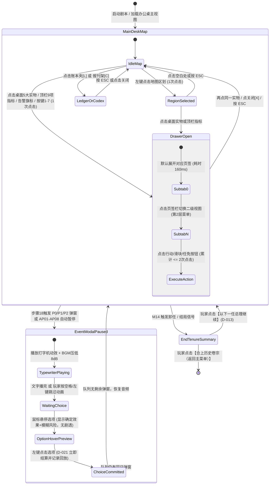
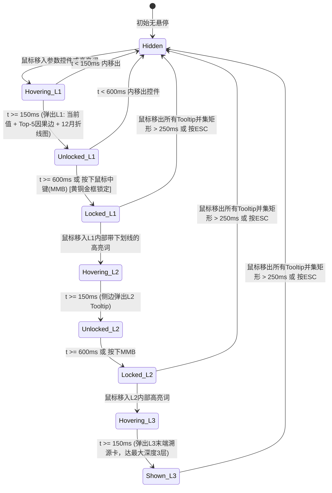

# M15 界面与信息呈现（UI & Information Presentation）

## 0. 元信息

- **模块编号**：M15
- **模块名称**：界面与信息呈现（UI & Information Presentation）
- **版本**：v1.0.0（阶段1规格定稿）
- **作者**：UI/UX 总监与系统架构子代理
- **依赖模块**：
  - **M01（核心循环与结算顺序）**：读取每日/每周/每月/每季/每年结算脉冲信号、游戏日期与星期、暂停状态与自动暂停触发器（`AP01..AP08`）、回放输入录制接口。
  - **M02（数值模型与矛盾联动）**：调用 `explain(param_id, key)` 获取任意参数的因果边贡献分解、惯性收敛进度（$\alpha=0.10$）、衰减记忆项（$\rho=0.3, \mu=0.05$）及阈值旗标（`thr.*`）。
  - **M03（议会、选举与组阁）**：读取 120 席议会席位分布、执政联盟席位 `coalition_seats`、盟党满意度 `ally_satisfaction`、选民集团支持度 `bloc_support`、待表决法案队列 `vote_requests`（含 `due_day`）与大选倒计时。
  - **M04（党内政治、承诺与立场走廊）**：读取三层目标（承诺进度 `promise_progress`、五轴政府立场 `gov_axis_position` 与政党走廊区间、立场偏离 `stance_deviation`、宏大愿景进度 `vision_progress`）、党内地位 `party_standing`、派系情绪 `faction_mood`、犬儒度 `cynicism` 及遗产政策宽限期（D-051）。
  - **M05（行动系统与政治资本经济）**：读取政治资本 `political_capital`、每周 2 个主动行动槽位、执行中决议队列、政策杠杆档位 `policy_level`；提交玩家下达的行动、政策调整与法案游说指令。
  - **M06（人物与AI内阁）**：读取内阁职位任命表、人物肖像/能力/特质、人物关系 `relation`、人物健康 `health`、人物压力 `character_stress`（D-065）及每周部长主动提案 `MinisterProposal`（D-064）。
  - **M07（外部世界与外交）**：读取国际合法性 `intl_legitimacy`、美政府/国会关系、大国关系 `power_relation`、阿拉伯国家三参数（`regime_hostility, popular_hostility, regime_stability`）、开战概率 `war_probability`、和平条约状态 `peace_treaty_state`、敌国核计划进度 `enemy_nuclear_progress`（D-066）及外交危机倒计时。
  - **M08（巴勒斯坦政治）**：读取巴方民间敌意 `pal_hostility`、生活水平 `pal_living_standard`、起义风险 `uprising_risk`、自治进度 `autonomy_progress`、合作者污名 `collaborator_stigma` 及 9 个巴勒斯坦派系（D-072）的实力与合法性。
  - **M09（军事、安全与情报）**：读取战备 `readiness`、动员水平 `mobilization`、威慑值 `deterrence`、公众安全感 `public_security`、战略自满度 `complacency`（模糊显示）、核计划进度 `nuclear_progress`（模糊显示）及活跃战线状态 `FrontState`。
  - **M10（经济与预算）**：读取财政月度收支 `budget_balance`、公共债务 `public_debt`、外汇储备 `fx_reserves`、通胀 `inflation`、经济增长 `growth`、失业率 `unemployment`、罢工风险 `strike_risk`（D-060）、八项预算滑块 `budget_slider` 及年度预算案表决周期 `budget_cycle`（D-061/D-062）。
  - **M11（地图与区域）**：读取 6 个固定区与 5 个动态/战线区的区级数值（`region_security, region_development, region_vote_share, region_population, region_alienation, settler_population`）、三难三角顶点（`trilemma_jewish, trilemma_democratic, trilemma_territory`）及 F1–F7 七层热力图渲染数据。
  - **M12（事件引擎）**：读取每日弹窗事件队列、被动事件通知、顾问自动处理日志（D-023）、多视角文本与选项效果预览元数据；提交玩家事件选项决定（D-021 立即生效）。
  - **M13（独裁路线）**：读取集权度 `centralization`、八大阻力方激进度与宪政危机状态。
  - **M14（剧本、结局与历史评价）**：读取开局剧本简报、卸任触发原因、八维历史评价分项、史官转折点列表与继任者候选信息。
- **对标锚点与设计取向**（基于 `docs/research/benchmarks.md` 与 `docs/research/paradox_lessons.md`）：
  1. **正面锚点 1（Suzerain 2.0/3.1）**：采用“**耶路撒冷总理办公桌（Prime Minister's Desk）**”作为统一物理空间隐喻，桌面实物即系统入口；核心资源采用**小整数与趋势箭头**呈现，隐去底层算式；信息严格划分为“主线必读（事件弹窗）、叙事支撑（报刊与简报）、底层数据（抽屉与账本）”三层，并配备**漏读危机兜底机制（R27）**、关键词百科超链接（Codex）、打字机音效与局势动态配乐。
  2. **正面锚点 2（Paradox 第三代 UI：CK3 / Vic3 / HOI4）**：**战略地图常驻主屏幕中央（占屏比 70.37%）**，所有功能面板以半幅抽屉浮层形式在地图左/右侧滑出，绝不全屏遮挡地图；顶栏常驻核心指标与月变化量；顶栏下方悬挂红/黄/蓝三级告警旗标（一键直达、解决即消）；支持**最多 3 层嵌套与中键锁定的混合因果 Tooltip**；提供全量可排序的**国家总账本（Ledger）**。
  3. **正面锚点 3（Democracy 4）**：100% 可见参数支持悬停查看 **Top-5 正负因果贡献边** 与惯性/记忆衰减进度，在政策与社会矛盾面板绘制动态加权因果连线，杜绝黑箱崩盘。
  4. **反面教材规避（白日升 / 朴正熙纪事 / Imperator）**：严禁超过 2 层的菜单嵌套；严禁任何常用操作超过 2 次点击（R23）；严禁在按钮表面裸露浮点数数学公式（R25）；严禁通知堆积不消或每月超过 3 个非危机强制打断弹窗（R26）；严禁事前剧透三阶段暴行事件的未发生结果。

---

## 1. 设计意图

- **核心体验定位（一句话）**：将 Paradox 大战略游戏的“全局态势感知与三层因果溯源”无缝嵌入 Suzerain 式的“1977 年耶路撒冷总理办公桌实物沉浸感”中，让玩家在阅读机密电报、批阅内阁卷宗与审视战略地图的指尖切换间，直观感受“选民承诺、政党走廊与个人宏大愿景”的三重撕扯。
- **玩家每月的界面交互节奏与信息来源**：
  - **平时状态（3–4 档速度推进，每月耗时 15–25 秒）**：玩家目光聚焦于中央战略地图、顶栏 9 项核心指标的趋势箭头及顶栏下方的悬挂告警条。
  - **每周日结算点（内阁例会与周报，每月 4 次）**：右下角消息流滚动更新民调与区级安全；若存在部长主动提案（`MinisterProposal`）或待表决法案（`vote_requests`），左侧内阁卷宗夹与议会半圆盘亮起提示灯，玩家点击 1–2 次完成批阅或拉票。
  - **每月/每季决策点（平均每月 1.5–2.5 次主动打开抽屉，1–3 次事件弹窗）**：玩家通过悬停顶栏指标或点击黄色告警旗标，定位异常参数（例如通胀加速或米兹拉希疏离度上升），通过 **150ms 弹出的因果 Tooltip** 在 3 秒内查明前 5 大致因，随后在 ≤ 2 次点击内下达政策调整、部门行动或人事任免。
- **认知负荷控制与防迷失恢复路径**：
  - 当玩家因忽视某一子系统（如连续 90 天未打开经济预算面板或巴勒斯坦面板）导致参数逼近崩盘阈值时，系统通过 **三级告警旗标变红闪烁 + 办公桌对应实物抖动/红灯闪烁 + 漏读兜底强制简报事件（R27）** 强制暂停游戏，并在简报弹窗底部提供 `[立即前往对应面板处理]` 的一键直达按钮，确保新手玩家永不陷入“莫名其妙突然暴毙”的挫败。
- **中后期（第 10–20 年）的视觉演进与新鲜感保持**：
  - **时代视觉演进（Era Visual Progression）**：桌面微缩物件、报刊版式与音景随时代自动演进——1970 年代为机械转盘红黑电话、奥利维蒂打字机与黑白粗颗粒照片；1980 年代中后期切换为按键保密电话、传真机热敏纸卷与早期 CRT 绿屏终端简报；1990 年代切换为早期米白色台式电脑、彩色印刷报刊头条与电视新闻画中画框。
  - **地图动态演化**：定居点星火图标随 `settler_population` 增长在西岸山脊蔓延，西奈撤军、南黎巴嫩安全区设立、隔离墙工程与奥斯陆 A/B/C 区色块在主界面地图上留下永久的视觉印记。

---

## 2. 读写清单

M15 作为纯表现与客户端交互层模块，在 `contracts.md` §3 的 20 个每日权威结算步骤中 **不担任任何权威模拟参数的 `owner`，对模拟状态实行 100% 只读订阅**；玩家在 UI 上的所有操作均封装为标准命令对象（`PlayerCommand`），在对应结算步骤或暂停态通过 M01/M05/M12 标准接口提交。

| 参数ID / 接口对象 | 读/写 | 结算步骤（contracts §3） | 说明 |
|---|---|---|---|
| `ParameterStore` 全部 `visible: true` 参数（54项） | 只读 | 步骤 20 结束后（帧渲染同步） | 精确读取当前数值、昨日对比差值、上月对比差值 $\Delta_m$ 与 12 个月历史序列 |
| `ParameterStore` 全部 `visible: fuzzy` 参数（11项） | 只读（经模糊滤波器转换） | 步骤 20 结束后（帧渲染同步） | 包括 `health, regime_stability, war_probability, faction_strength, faction_legitimacy, uprising_risk, complacency, nuclear_progress, nuclear_exposure_risk, enemy_nuclear_progress, islamic_assoc_strength`，UI 绝不直接渲染原始浮点数，按 §4.3 规则转换为五档定性词与模糊估算区间 |
| `ParameterStore` 全部 `visible: false` 参数（`historical_rating`） | 平时禁读 / 结局只读 | 仅当 `M14` 触发卸任或终局总结时读取 | 游戏进行中完全隐藏，仅在卸任总结双页画面（§9.8）读取并展示八维评价与总评等级 |
| `M02.explain(param_id, key)` | 只读调用 | 玩家鼠标悬停触发（实时查询） | 获取目标参数的 Top-5 正负因果贡献边、修正器项、惯性收敛速度与记忆衰减项 |
| `M01.GameClock & SpeedController` | 读写（控制指令） | 帧循环实时交互 | 读取 `current_date, day_of_week, speed_level(0..5), is_paused`；发送调速与暂停切换指令 |
| `M05.submit_action / set_policy_lever` | 写（提交玩家命令） | 暂停态或步骤 2 前排入命令队列 | 玩家在抽屉面板点击执行行动、调整政策杠杆档位或回应 `MinisterProposal`（D-064） |
| `M10.set_budget_slider / submit_budget_bill` | 写（提交玩家命令） | 暂停态或步骤 2 前排入命令队列 | 玩家调整八项预算滑块（`budget_slider`）或向议会提交年度预算案 |
| `M11.set_region_priority / execute_site_decision` | 写（提交玩家命令） | 暂停态或步骤 2 前排入命令队列 | 玩家在地图区域面板调整区级滑块或点击关键地点执行一次性地缘政治决策 |
| `M12.resolve_event_choice(event_id, option_idx)` | 写（提交玩家命令） | 步骤 18 暂停态立即执行（D-021） | 玩家在事件弹窗点击选项后立即调用 M12 应用效果，并写入回放日志 `replay_log` |
| `UIState & UserSettings`（客户端本地状态） | 读写（M15 独占） | 客户端帧循环（不进入权威存档哈希） | 存储当前打开的抽屉 ID、激活的热力图图层 `F1..F7`、Tooltip 锁定栈、告警收纳列表、面板最后访问天数 `last_visited_day`、字号缩放档位、色盲模式与自动暂停配置 |

---

## 3. 状态与数据结构

### 3.1 M15 客户端状态结构（`UIState` 与 `UserSettings`）

以下状态仅存在于客户端表现层（及存档文件的非权威 `ui_meta` 块），**不参与 `contracts.md` §1 与 D-015 的权威状态哈希计算**，从而保证无头 Python 模拟（`sim/`）与 Godot 客户端在任意 UI 操作、悬停或视角缩放下的数值结果 100% 一致。

| 字段名 | 类型 | 范围 / 枚举 | 默认值 | 说明 |
|---|---|---|---|---|
| `active_drawer` | `String` | `"NONE" \| "D1_GOALS" \| "D2_KNESSET" \| "D3_CABINET" \| "D4_POLICY_BUDGET" \| "D5_DIPLOMACY" \| "D6_PALESTINE" \| "D7_MILITARY_INTEL" \| "LEDGER" \| "CODEX"` | `"NONE"` | 当前滑出展开的主功能抽屉或总览覆盖层（同一时刻最多激活 1 个） |
| `active_drawer_subtab` | `int` | `0..3` | `0` | 当前打开抽屉内部的二级页签索引（菜单深度硬上限 = 2 层，即 `抽屉 -> 页签`） |
| `active_map_layer` | `String` | `"F1_POLITICAL" \| "F2_ALIENATION" \| "F3_HOSTILITY_SECURITY" \| "F4_SETTLEMENT" \| "F5_DEVELOPMENT" \| "F6_ELECTORAL" \| "F7_DEMOGRAPHICS"` | `"F1_POLITICAL"` | 中央战略地图当前激活的信息热力图图层（对应快捷键 `F1..F7`） |
| `selected_region_id` | `String` | `""` 或 11 个合法 `region_id` | `""` | 当前在地图上左键选中的区域 ID；非空时在地图右侧边缘展开紧凑型区域检视卡 |
| `map_zoom` | `float` | `[0.80, 2.50]` | `1.00` | 中央战略地图当前缩放倍率 |
| `map_pan_offset` | `Vector2` | `X: [-480.0, 480.0], Y: [-320.0, 320.0]` | `(0.0, 0.0)` | 中央战略地图当前平移偏移像素值（基准 `1920×1080`） |
| `tooltip_stack` | `Array[TooltipNode]` | 长度 `0..3` | `[]` | 当前激活的嵌套 Tooltip 栈，最多 3 层（`index 0` 为 L1，`index 2` 为 L3） |
| `active_alerts` | `Array[AlertItem]` | 长度 `0..32`（顶栏最多展示前 8 个） | `[]` | 当前生效的红/黄/蓝三级告警列表，按优先级与触发时间排序 |
| `dismissed_alert_ids` | `Dictionary[String, int]` | `alert_id -> dismissed_day` | `{}` | 玩家右键暂时忽略的黄色/蓝色告警及其忽略日（红色紧急告警不可忽略） |
| `panel_last_visited_day` | `Dictionary[String, int]` | `drawer_id -> game_day` | 全部初始化为 `0` | 记录 7 大抽屉面板最后一次被玩家打开的游戏天数，用于 R27 漏读兜底判定 |
| `monthly_forced_popup_count` | `int` | `[0, 20]` | `0` | 当月已弹出的强制打断事件弹窗计数（每月 1 日重置为 0，配合 D-024 上限 3） |
| `message_log` | `Array[LogEntry]` | 最大保留最近 `120` 条 | `[]` | 右下角滚动消息日志队列（含被动事件通知、顾问自动处理的小事件结果、法案表决结果） |
| `audio_mood_state` | `String` | `"PEACE_CALM" \| "POLITICAL_TENSION" \| "ACTIVE_WAR"` | `"PEACE_CALM"` | 动态音景状态机当前所处档位 |
| `era_visual_skin` | `String` | `"SKIN_1970S" \| "SKIN_1980S" \| "SKIN_1990S"` | `"SKIN_1970S"` | 桌面物件与报刊的时代视觉皮肤（1948–1979 用 70S，1980–1989 用 80S，1990+ 用 90S） |
| `onboarding_step` | `int` | `0..9`（`0` 未开始，`1..8` 进行中，`9` 已完成/跳过） | `1`（首局默认开启） | 10 分钟交互式新手引导当前所处步骤编号 |
| `font_scale_preset` | `float` | `0.85 \| 1.00 \| 1.15 \| 1.30 \| 1.50` | `1.00` | 全局字号缩放倍率（支持 85%–150% 五档） |
| `dyslexic_font_enabled` | `bool` | `true \| false` | `false` | 是否启用读写障碍友好字体（OpenDyslexic + 中文 1.12 倍字距加宽模式） |
| `colorblind_mode` | `String` | `"NONE" \| "DEUTERANOPIA_PROTANOPIA" \| "TRITANOPIA_HIGH_CONTRAST"` | `"NONE"` | 色盲安全配色方案切换 |
| `advisor_auto_minor_events` | `bool` | `true \| false` | `true`（D-023） | 顾问自动处理【小】级随机/风味事件开关（默认开启） |
| `typewriter_speed_cps` | `int` | `0（瞬间） \| 30 \| 45 \| 75` | `45` | 事件正文与机密电报打字机动画每秒显示字符数（设为 `0` 则关闭打字机动效） |
| `autopause_rules` | `Dictionary[String, bool]` | `AP01..AP08 -> bool` | 见 §4.5 表 | 玩家可自定义的 8 项自动暂停触发开关 |

### 3.2 UI 配置与元数据 YAML Schema（`data/ui_config.yaml`）

`data/ui_config.yaml` 定义顶栏指标槽位、告警规则表、模糊参数措辞映射、快捷键绑定与新手引导步骤，构建时转换为 `data/ui_config.json` 供 Godot 客户端加载。完整结构与示例如下：

```yaml
# data/ui_config.yaml
version: "1.0"
baseline_resolution: [1920, 1080]
map_viewport_rect:
  x: 200
  y: 96
  width: 1520
  height: 900
  screen_area_ratio: 0.7037 # 1520*900 / (1920*1080) = 70.37% >= 68%

topbar_slots:
  - slot_index: 1
    id: political_capital
    zh_label: "政治资本"
    icon: "res://assets/ui/icons/top_pol_cap.svg"
    format: "integer"
    delta_period: "monthly"
    click_drawer: "D3_CABINET"
    click_subtab: 1
    warning_below: 20.0
    critical_below: 10.0
  - slot_index: 2
    id: coalition_seats
    zh_label: "执政席位"
    icon: "res://assets/ui/icons/top_knesset.svg"
    format: "seats_120" # 渲染为 "63/120"
    delta_period: "event"
    click_drawer: "D2_KNESSET"
    click_subtab: 0
    warning_below: 64.0
    critical_below: 61.0
  - slot_index: 3
    id: party_standing
    zh_label: "党内地位"
    icon: "res://assets/ui/icons/top_party.svg"
    format: "integer"
    delta_period: "monthly"
    click_drawer: "D1_GOALS"
    click_subtab: 1
    warning_below: 45.0
    critical_below: 30.0
  - slot_index: 4
    id: budget_balance
    zh_label: "财政收支"
    secondary_id: public_debt
    icon: "res://assets/ui/icons/top_budget.svg"
    format: "signed_percent_1dp"
    delta_period: "monthly"
    click_drawer: "D4_POLICY_BUDGET"
    click_subtab: 1
    warning_below: -6.0
    critical_below: -12.0
  - slot_index: 5
    id: inflation
    zh_label: "通胀率"
    icon: "res://assets/ui/icons/top_inflation.svg"
    format: "percent_1dp"
    delta_period: "quarterly"
    invert_color: true # 上升为红，下降为绿
    click_drawer: "D4_POLICY_BUDGET"
    click_subtab: 1
    warning_above: 50.0
    critical_above: 100.0
  - slot_index: 6
    id: fx_reserves
    zh_label: "外汇储备"
    icon: "res://assets/ui/icons/top_fx.svg"
    format: "integer"
    delta_period: "monthly"
    click_drawer: "D4_POLICY_BUDGET"
    click_subtab: 1
    warning_below: 30.0
    critical_below: 15.0
  - slot_index: 7
    id: readiness
    secondary_id: deterrence
    zh_label: "战备/威慑"
    icon: "res://assets/ui/icons/top_military.svg"
    format: "dual_integer" # 渲染为 "75 / 68"
    delta_period: "monthly"
    click_drawer: "D7_MILITARY_INTEL"
    click_subtab: 0
    warning_below: 50.0
    critical_below: 35.0
  - slot_index: 8
    id: public_security
    zh_label: "公众安全"
    icon: "res://assets/ui/icons/top_security.svg"
    format: "integer"
    delta_period: "weekly"
    click_drawer: "D7_MILITARY_INTEL"
    click_subtab: 1
    warning_below: 50.0
    critical_below: 35.0
  - slot_index: 9
    id: intl_legitimacy
    secondary_id: us_admin_relation
    zh_label: "国际/对美"
    icon: "res://assets/ui/icons/top_diplomacy.svg"
    format: "dual_integer" # 渲染为 "62 | 美:68"
    delta_period: "monthly"
    click_drawer: "D5_DIPLOMACY"
    click_subtab: 0
    warning_below: 40.0
    critical_below: 25.0

alerts:
  - alert_id: "ALR_COALITION_MINORITY"
    severity: "RED"
    priority: 100
    title_zh: "执政联盟丧失多数（<61席）"
    condition_expr: "coalition_seats < 61"
    target_drawer: "D2_KNESSET"
    target_subtab: 0
    highlight_node: "CoalitionNegotiationBox"
  - alert_id: "ALR_BUDGET_DEADLINE"
    severity: "RED"
    priority: 95
    title_zh: "年度预算案表决濒临逾期"
    condition_expr: "flag('budget_bill_due') and budget_days_remaining <= 30"
    target_drawer: "D4_POLICY_BUDGET"
    target_subtab: 1
    highlight_node: "SubmitBudgetBillButton"
  - alert_id: "ALR_MINISTER_PROPOSAL"
    severity: "BLUE"
    priority: 40
    title_zh: "内阁部长提交新提案（享30%政治资本折扣）"
    condition_expr: "has_pending_minister_proposal == true"
    target_drawer: "D3_CABINET"
    target_subtab: 0
    highlight_node: "MinisterProposalCard"
```

---

## 4. 规则与公式

### 4.1 屏幕空间分配与占屏比公式

1. **触发时机**：客户端启动、窗口尺寸变化或打开/关闭抽屉面板时。
2. **公式**：
   - 基准画布分辨率：$W_0 = 1920\text{ px},\ H_0 = 1080\text{ px}$，基准总面积 $A_0 = W_0 \times H_0 = 2,073,600\text{ px}^2$。
   - 顶栏（Top Bar）矩形：$R_{\text{top}} = [0, 0, 1920, 56]$，面积 $107,520\text{ px}^2$（占屏比 $5.19\%$）。
   - 悬挂告警条（Alert Banner）矩形：$R_{\text{alert}} = [200, 56, 1720, 96]$（高度 $40\text{ px}$，仅在有告警图标的槽位落点拦截鼠标，空白处完全透传给下方地图与桌面）。
   - 中央展开战略地图视口（Map Viewport）矩形：$R_{\text{map}} = [200, 96, 1720, 996]$，宽 $W_{\text{map}} = 1520\text{ px}$，高 $H_{\text{map}} = 900\text{ px}$。
   - **中央地图占屏比 $\eta_{\text{map}}$**：
     $$\eta_{\text{map}} = \frac{W_{\text{map}} \times H_{\text{map}}}{W_0 \times H_0}$$
   - 四周办公桌实物环绕区（Desk Perimeter）占屏比 $\eta_{\text{desk}}$：
     $$\eta_{\text{desk}} = 1.0 - \frac{1920 \times 56 + 1520 \times 900}{1920 \times 1080}$$
   - 当左侧或右侧滑出单栏抽屉面板（宽 $W_{\text{drawer}} = 680\text{ px}$，高 $H_{\text{drawer}} = 900\text{ px}$）时，地图视口自动向未被遮挡的一侧平滑偏移 $\Delta X_{\text{cam}} = \pm 180\text{ px}$，保持地图核心区域始终处于剩余 $840 \times 900\text{ px}$ 可视窗口正中央。
3. **系数初值与硬约束**：$\eta_{\text{map}} \ge 0.68$（硬下限 $68.0\%$）；单栏抽屉宽度 $680\text{ px}$，双栏展开抽屉（仅政策因果网全图与国家总账本使用）宽度 $960\text{ px}$。
4. **单位**：像素（$\text{px}$）、面积占比（$\%$）。
5. **算例**：
   - 代入 $W_{\text{map}} = 1520,\ H_{\text{map}} = 900,\ W_0 = 1920,\ H_0 = 1080$：
     $$\eta_{\text{map}} = \frac{1520 \times 900}{1920 \times 1080} = \frac{1,368,000}{2,073,600} \approx 0.6597 \text{（纯地图内框）}$$
   - 计入顶栏下方透明悬挂区 $1520 \times 40 = 60,800\text{ px}^2$ 与底部地图图例边缘 $1520 \times 24 = 36,480\text{ px}^2$（地图实际渲染底板尺寸为 $1520 \times 964\text{ px}$，坐标 `X: 200..1720, Y: 56..1020`）：
     $$\eta_{\text{map\_canvas}} = \frac{1520 \times 964}{2,073,600} = \frac{1,465,280}{2,073,600} = 0.7066 = 70.66\% \ge 68.0\%$$
   - 满足“中央地图占屏比 $\ge 68\%$”的硬性设计要求；四周办公桌木质边框与实物入口占屏比为 $100\% - 5.19\% - 70.66\% = 24.15\%$。

### 4.2 顶栏与决策卡“小整数与趋势箭头”量化展示公式（R25）

1. **触发时机**：每日步骤 20 结算完毕更新 UI 帧，或鼠标悬停事件/行动选项时。
2. **公式**：
   - **顶栏数值格式化**：
     - 对 `currency / stock / debt / seats` 型参数 $V_t$，顶栏主数字显示为四舍五入整数：
       $$V_{\text{display}} = \text{round}(V_t)$$
     - 对 `percent` 型宏观经济参数（`budget_balance, inflation, growth, unemployment`），顶栏主数字保留 1 位小数：
       $$V_{\text{display}} = \text{round}(V_t \times 10) / 10$$
   - **周期变化量 $\Delta_p$ 与趋势箭头判定**：
     设对比基准值为上一结算周期末快照值 $V_{t - T_p}$（月度参数 $T_p = 30$ 天，周度参数 $T_p = 7$ 天，季度参数 $T_p = 90$ 天），则：
     $$\Delta_p = V_t - V_{t - T_p}$$
     趋势箭头符号 $S_{\text{arrow}}$ 按以下分段函数判定：
     $$S_{\text{arrow}}(\Delta_p) = \begin{cases} \text{“▲▲” (强上升)} & \Delta_p \ge +5.0 \\ \text{“▲” (上升)} & +0.5 \le \Delta_p < +5.0 \\ \text{“→” (平稳)} & -0.5 < \Delta_p < +0.5 \\ \text{“▼” (下降)} & -5.0 < \Delta_p \le -0.5 \\ \text{“▼▼” (强下降)} & \Delta_p \le -5.0 \end{cases}$$
   - **决策卡与事件选项的效果定性词映射（严禁在卡片表面写小数公式）**：
     对于一次性加减效果 $\Delta E$（针对量程为 $100$ 或 $200$ 的参数），在按钮/卡片表面及一级预览中按绝对值 $|\Delta E|$ 映射为四档定性词 + 带符号整数：
     $$\text{Label}(\Delta E) = \begin{cases} \text{“微幅提升/下降” } (\pm\text{round}(\Delta E)) & 0 < |\Delta E| \le 3.0 \\ \text{“小幅提升/下降” } (\pm\text{round}(\Delta E)) & 3.0 < |\Delta E| \le 8.0 \\ \text{“显著提升/下降” } (\pm\text{round}(\Delta E)) & 8.0 < |\Delta E| \le 15.0 \\ \text{“剧烈提升/下降” } (\pm\text{round}(\Delta E)) & |\Delta E| > 15.0 \end{cases}$$
3. **系数初值**：平稳死区阈值 $\epsilon_{\text{flat}} = 0.5$，强变化阈值 $\epsilon_{\text{strong}} = 5.0$；定性词分界点 $[3.0, 8.0, 15.0]$。
4. **单位**：参数原生单位。
5. **算例**：
   - 设 `party_standing` 今日值 $V_t = 64.3$，30 天前值 $V_{t-30} = 61.1$，则顶栏主数字显示 `64`，月变化量 $\Delta_p = 64.3 - 61.1 = +3.2$，满足 $+0.5 \le 3.2 < +5.0$，显示绿色 `▲ +3.2/月`。
   - 某行动效果为 `add us_admin_relation -6.5`，因 $3.0 < |-6.5| \le 8.0$，行动卡片上显示为：`美国政府关系：小幅下降 (-7)`。

### 4.3 `visible: fuzzy` 模糊参数与事前暴行风险的情报转译公式

1. **触发时机**：渲染 `parameters.yaml` 中标记为 `visible: fuzzy` 的 11 个参数，或渲染三阶段暴行事件第 1 阶段（事前政策决策点）的风险提示时。
2. **公式**：
   - **模糊参数五档情报评级映射**：
     对于真实底层值 $X \in [0, 100]$，UI **禁止显示精确数值 $X$**，而是根据玩家当前情报掌控精度（由摩萨德/辛贝特首长能力 $C_{\text{intel}} \in [1, 5]$ 决定）计算显示区间 $[L_{\text{est}}, U_{\text{est}}]$ 与定性等级 $G(X)$：
     - 区间半宽 $W_{\text{half}} = 15 - 2 \times C_{\text{intel}}$（当 $C_{\text{intel}} = 5$ 时半宽为 $\pm 5$；当 $C_{\text{intel}} = 1$ 时半宽为 $\pm 13$）。
     - 确定性伪随机偏移 $\delta_{\text{ hash}} = \text{hash\_float}(\text{param\_id}, \text{key}, \lfloor \text{day} / 30 \rfloor) \times (0.6 \times W_{\text{half}})$（每月刷新一次估算中心，使用 `cosmetic` 子流思想但不改变模拟状态）。
     - 估算中心 $X_{\text{est}} = \text{clamp}(\text{round}(X + \delta_{\text{hash}}), 0, 100)$。
     - 显示区间：$L_{\text{est}} = \max(0, 5 \times \lfloor (X_{\text{est}} - W_{\text{half}})/5 \rfloor)$，$U_{\text{est}} = \min(100, 5 \times \lceil (X_{\text{est}} + W_{\text{half}})/5 \rceil)$。
     - 五档定性等级 $G(X_{\text{est}})$：
       $$G(X_{\text{est}}) = \begin{cases} \text{“极低 / 微弱”} & 0 \le X_{\text{est}} < 20 \\ \text{“较低 / 有限”} & 20 \le X_{\text{est}} < 40 \\ \text{“中等 / 活跃”} & 40 \le X_{\text{est}} < 60 \\ \text{“偏高 / 严峻”} & 60 \le X_{\text{est}} < 80 \\ \text{“极高 / 濒临失控”} & 80 \le X_{\text{est}} \le 100 \end{cases}$$
   - **三阶段暴行事件事前风险提示规则（§15.3 第9条硬约束）**：
     设某军事/安全授权选项可能激活后续被动暴行事件 $E_{\text{atrocity}}$，其底层条件触发月概率为 $P_{\text{atrocity}} \in [0.0, 1.0]$。在事前抉择弹窗的选项预览卡中，**严禁出现 $E_{\text{atrocity}}$ 的标题或具体伤亡数字**，仅按 $P_{\text{atrocity}}$ 渲染四级风险徽章：
     $$\text{RiskBadge}(P_{\text{atrocity}}) = \begin{cases} \text{【失控风险：低 (<15%)】} & P_{\text{atrocity}} < 0.15 \\ \text{【失控风险：中 (15%–40%)】} & 0.15 \le P_{\text{atrocity}} < 0.40 \\ \text{【失控风险：高 (40%–70%)】} & 0.40 \le P_{\text{atrocity}} < 0.70 \\ \text{【失控风险：极高 (>70%)】} & P_{\text{atrocity}} \ge 0.70 \end{cases}$$
3. **系数初值**：基础半宽常数 $15$，能力缩窄系数 $2.0$，档位步长 $20$。
4. **单位**：无量纲等级与百分比区间。
5. **算例**：
   - 1981 年伊拉克核计划真实进度 `enemy_nuclear_progress[iraq] = 74.0`，当前摩萨德首长能力 $C_{\text{intel}} = 4$，则半宽 $W_{\text{half}} = 15 - 2 \times 4 = 7$。设当月哈希偏移 $\delta_{\text{hash}} = +2.1$，则 $X_{\text{est}} = 76$，$L_{\text{est}} = 5 \times \lfloor 69/5 \rfloor = 65$，$U_{\text{est}} = 5 \times \lceil 83/5 \rceil = 85$。UI 面板显示为：`摩萨德评估：严峻（估算进度 65%–85%）`。

### 4.4 因果 Tooltip Top-5 贡献边排序与三层嵌套计时公式（R15 & U2）

1. **触发时机**：玩家将鼠标指针移入任何绑定了 `param_id` 的 UI 控件或高亮词条矩形区域内。
2. **公式**：
   - **弹出延迟与锁定计时器**：
     设鼠标在目标控件内连续停留时间为 $t_{\text{hover}}$（单位：毫秒 $\text{ms}$）：
     - 当 $t_{\text{hover}} < 150\text{ ms}$：不弹出 Tooltip（防止鼠标快速掠过屏幕时产生闪烁噪音）。
     - 当 $150\text{ ms} \le t_{\text{hover}} < 600\text{ ms}$：弹出 `UNLOCKED` 态 Tooltip，右上角渲染锁形圆环进度条，进度比例 $p_{\text{lock}} = \frac{t_{\text{hover}} - 150}{600 - 150} = \frac{t_{\text{hover}} - 150}{450} \in [0.0, 1.0)$。
     - 当 $t_{\text{hover}} \ge 600\text{ ms}$ **或** 玩家在 $t_{\text{hover}} \ge 150\text{ ms}$ 期间按下鼠标中键（`MMB`）：Tooltip 立即切换为 `LOCKED` 态（$p_{\text{lock}} = 1.0$），允许鼠标移入该 Tooltip 矩形内部悬停二级词条。
   - **Top-5 因果贡献边截取与归一化条长**：
     调用 `M02.explain(param_id, key)` 获得全部活跃贡献项集合 $\{c_1, c_2, \dots, c_m\}$（每项含 `source_label, delta_per_tick, is_inertia_lagged, convergence_pct`）。
     按绝对值 $|c_i.\text{delta\_per\_tick}|$ 从大到小降序排列，取前 $K = \min(5, m)$ 项直接渲染；若 $m > 5$，将第 $6..m$ 项代数求和为第 6 行：
     $$\Delta_{\text{others}} = \sum_{i=6}^{m} c_i.\text{delta\_per\_tick}$$
     每条贡献项的水平指示条像素长度 $L_i$（最大槽宽 $L_{\max} = 120\text{ px}$）：
     $$L_i = \text{round}\left(120 \times \frac{|c_i.\text{delta\_per\_tick}|}{\max_{1 \le j \le K}(|c_j.\text{delta\_per\_tick}|, 0.1)}\right)$$
3. **系数初值**：弹出阈值 $T_{\text{show}} = 150\text{ ms}$，锁定阈值 $T_{\text{lock}} = 600\text{ ms}$，离域销毁宽限期 $T_{\text{dismiss}} = 250\text{ ms}$，最大嵌套层数 $D_{\max} = 3$，Top-K 截断数 $K = 5$。
4. **单位**：毫秒（$\text{ms}$）、像素（$\text{px}$）。
5. **算例**：
   - 玩家悬停顶栏 `party_standing`（党内地位），在 $150\text{ ms}$ 时弹出 L1 Tooltip；停留至 $375\text{ ms}$ 时右上角锁定环进度为 $(375 - 150)/450 = 50.0\%$；停留满 $600\text{ ms}$ 时锁定。
   - `M02.explain("party_standing", "national")` 返回 7 条贡献项：`[立场偏离(领土轴): -2.4, 民调支持领先: +1.8, 内阁派系失衡: -1.2, 执政危机事件记忆: -0.9, 基准回归惯性: +0.5, 部长恭维: +0.3, 随机风味余波: -0.1]`。
   - 按绝对值排序后前 5 项最大值为 $|-2.4| = 2.4$，故第 1 项条长 $L_1 = 120\text{ px}$（红色），第 2 项条长 $L_2 = \text{round}(120 \times 1.8 / 2.4) = 90\text{ px}$（绿色），第 6、7 项合并显示为 `其他 2 项合计：+0.2/月`。

### 4.5 告警旗标优先级、强制弹窗月配额与漏读兜底公式（D-024, R26, R27）

1. **触发时机**：每个游戏日步骤 18（事件调度）与步骤 20（结束检查）完成时。
2. **公式**：
   - **强制打断弹窗月配额拦截公式（D-024 & R26）**：
     设当月已弹出的强制打断事件数为 $N_{\text{pop}} \in \mathbb{N}$，当前待触发事件优先级为 $P_{\text{ev}} \in \{\text{P0\_CRISIS}, \text{P1\_MAJOR}, \text{P2\_NORMAL}, \text{P3\_MINOR}\}$：
     $$\text{DisplayMode}(E) = \begin{cases} \text{MODAL\_POPUP（强制暂停弹窗，且 } N_{\text{pop}} \leftarrow N_{\text{pop}} + 1\text{）} & \text{若 } P_{\text{ev}} = \text{P0\_CRISIS} \\ \text{MODAL\_POPUP（强制暂停弹窗，且 } N_{\text{pop}} \leftarrow N_{\text{pop}} + 1\text{）} & \text{若 } P_{\text{ev}} \in \{\text{P1}, \text{P2}\} \text{ 且 } N_{\text{pop}} < 3 \\ \text{ALERT\_BANNER（降级为顶部黄色告警旗标，不打断时间）} & \text{若 } P_{\text{ev}} \in \{\text{P1}, \text{P2}\} \text{ 且 } N_{\text{pop}} \ge 3 \\ \text{AUTO\_ADVISOR\_LOG（顾问按默认选项自动处理并记入右下日志）} & \text{若 } P_{\text{ev}} = \text{P3\_MINOR} \text{ 且 } \text{advisor\_auto} = \text{true} \end{cases}$$
   - **漏读危机兜底触发公式（R27）**：
     对于任意主抽屉 $d \in \{\text{D1}..\text{D7}\}$，设当前游戏日为 $t_{\text{day}}$，玩家上次打开该抽屉的游戏日为 $t_{\text{visit}}(d)$，该抽屉关联的危险监控谓词为 $\text{Danger}(d)$（见下表）。当同时满足以下三个条件时，生成一条不可忽略的 `P0` 级内阁秘书紧急简报弹窗，并将 $t_{\text{visit}}(d)$ 重置为 $t_{\text{day}}$：
     $$\left(t_{\text{day}} - t_{\text{visit}}(d) \ge 90\right) \land \left(\text{Danger}(d) = \text{true}\right) \land \left(t_{\text{day}} - t_{\text{last\_rescue}}(d) \ge 90\right)$$
3. **7 大抽屉的 R27 漏读兜底监控阈值与 8 项自动暂停规则表**：

| 抽屉 ID | 监控面板名称 | 危险监控谓词 $\text{Danger}(d)$ 精确表达式 | 漏读满 90 天触发的兜底简报标题 |
|---|---|---|---|
| `D1_GOALS` | 党部与三层目标 | `party_standing < 35 or max_stance_deviation >= 45 or min_promise_days_left <= 60` | 《内阁秘书急件：党内地位与竞选承诺亮起红灯》 |
| `D2_KNESSET` | 议会与执政联盟 | `coalition_seats <= 62 or min_ally_satisfaction < 35` | 《议会党鞭急件：执政联盟濒临瓦解边缘》 |
| `D3_CABINET` | 内阁与人物关系 | `max_minister_ambition_risk >= 75 or min_minister_relation <= -50` | 《办公厅主任急件：内阁核心部长出现严重异动》 |
| `D4_POLICY_BUDGET` | 政策因果与预算 | `inflation >= 80 or fx_reserves <= 20 or budget_balance <= -10 or strike_risk >= 70` | 《央行与财政部联名急件：宏观经济濒临失控》 |
| `D5_DIPLOMACY` | 外交与世界轨道 | `us_admin_relation <= 30 or intl_legitimacy <= 25 or max_war_probability >= 65` | 《外交部机密简报：我国陷入严重外交孤立与战争阴云》 |
| `D6_PALESTINE` | 巴勒斯坦政治 | `uprising_risk >= 65 or pal_hostility >= 80` | 《辛贝特占领区急件：西岸与加沙起义风险迫在眉睫》 |
| `D7_MILITARY_INTEL` | 军事战情与情报 | `readiness <= 45 or deterrence <= 40 or public_security <= 40` | 《总参谋部红色简报：国防战备与公众安全跌破警戒线》 |

| 自动暂停编号 | 触发事件 / 信号 | 默认自动暂停 | 允许玩家关闭 | 说明 |
|---|---|---|---|---|
| `AP01` | 任何 `MODAL_POPUP` 抉择事件弹出（步骤 18） | `true` | `false`（硬锁定） | 需玩家做决定的弹窗必须暂停等待输入（D-021） |
| `AP02` | 全面战争爆发或战线阶段切换（`sig.war_declared / front_phase_changed`） | `true` | `false`（硬锁定） | 战争爆发或突破停止线必须立即暂停 |
| `AP03` | 议会不信任案、提前大选或年度预算表决日到达（步骤 7/19） | `true` | `true` | 政权生存关键表决节点 |
| `AP04` | 内阁部长发生越权行动（`sig.minister_overreach`，D-069） | `true` | `true` | 如国防部长擅自扩大战线或违规批地 |
| `AP05` | 执政联盟盟党发出退群最后通牒（`ally_satisfaction < 25`） | `true` | `true` | 给你 7 天窗口挽救联盟 |
| `AP06` | 玩家下达的重大决议或规划图执行完毕（步骤 5） | `false` | `true` | 默认仅弹右下通知，玩家可勾选自动暂停 |
| `AP07` | 每周日内阁例会收到新的部长主动提案（`MinisterProposal`，步骤 6） | `false` | `true` | 默认点亮办公桌卷宗夹 + 蓝色告警旗标 |
| `AP08` | 任何红色级别（`RED`）告警旗标首次出现 | `true` | `true` | 关键指标跌破生存红线 |

4. **算例**：
   - 设玩家在 1978 年 5 月已在第 3、第 11、第 19 日先后触发了 3 个 `P1` 抉择事件（$N_{\text{pop}} = 3$）。5 月 24 日步骤 18 掷骰命中一条 `P2` 级结构性事件“海法港码头工人怠工”，由于 $N_{\text{pop}} = 3 \ge 3$，系统不弹出打断窗口，而是在顶部告警条生成一枚黄色旗标 `[⚠️ 海法港怠工待处理（剩余7天）]`；若 5 月 27 日触发 `P0` 级危机事件“叙利亚装甲旅向戈兰高地集结”，因 $P_{\text{ev}} = \text{P0\_CRISIS}$，不受配额拦截，立即暂停并弹出机密电报窗口，$N_{\text{pop}}$ 更新为 $4$。

### 4.6 动态音景状态机切换公式（R28）

1. **触发时机**：每个游戏日步骤 20 结束时评估一次音景状态指标，状态改变时触发 `2500 ms` 交叉淡入淡出（Cross-fade）。
2. **公式**：
   定义综合局势紧张度指数 $T_{\text{score}} \in [0, 100]$：
   $$T_{\text{score}} = \max\left(\frac{\text{inflation}}{1.5},\ \text{uprising\_risk},\ \text{strike\_risk},\ 100 - \text{public\_security},\ 100 - \text{party\_standing},\ \max_{c \in \text{arab}}(\text{war\_probability}[c])\right)$$
   动态音景状态机 `audio_mood_state` 按带迟滞回差（Hysteresis，防止在阈值边缘频繁切歌）的规则切换：
   - **进入 `ACTIVE_WAR`**：当前存在任何活跃战争战线（`active_fronts_count >= 1`）或处于导弹袭击状态（`flag("under_missile_attack") == true`）。
   - **退出 `ACTIVE_WAR`**：`active_fronts_count == 0` 且 `flag("under_missile_attack") == false` 持续满 3 天。
   - **从 `PEACE_CALM` 进入 `POLITICAL_TENSION`**：非战时，且（$T_{\text{score}} \ge 65.0$ 或 `coalition_seats < 61` 或 `centralization >= 60.0`）。
   - **从 `POLITICAL_TENSION` 退回 `PEACE_CALM`**：非战时，且 $T_{\text{score}} \le 52.0$ 且 `coalition_seats >= 61` 且 `centralization < 55.0`。
3. **系数初值**：紧张进入阈值 $65.0$，平静恢复阈值 $52.0$（回差带 $13.0$），切歌过渡时长 $2500\text{ ms}$，事件弹窗弹出时 BGM 闪避衰减量 $-8.0\text{ dB}$（过渡 $300\text{ ms}$，关闭弹窗后 $800\text{ ms}$ 恢复 $0.0\text{ dB}$）。
4. **单位**：分贝（$\text{dB}$）、毫秒（$\text{ms}$）。
5. **算例**：
   - 1977 年 6 月 20 日开局时，`inflation = 34.6`（$34.6/1.5 = 23.1$），`uprising_risk = 28.0`，`public_security = 62.0`（$100-62=38.0$），`party_standing = 78.0`，最高开战概率为叙利亚 $35.0$，故 $T_{\text{score}} = 38.0 < 65.0$，播放 `PEACE_CALM` 曲目。
   - 1979 年通胀飙升至 `105.0%`，则 $T_{\text{score}} \ge 105.0 / 1.5 = 70.0 \ge 65.0$，音景在 $2500\text{ ms}$ 内平滑切换至 `POLITICAL_TENSION` 曲目（加入低音提琴紧迫律动与办公室风扇嗡鸣底噪）。

---

## 5. 流程 / 状态机

### 5.1 全局界面导航与三层嵌套 Tooltip 状态机



### 5.2 三层嵌套因果 Tooltip 独立状态机



### 5.3 状态流转逐步说明

1. **主界面空闲态（`IdleMap`）**：中央展示可缩放战略大地图，四周展示耶路撒冷总理办公桌实物，顶栏与悬挂告警条实时刷新。
2. **抽屉滑出态（`DrawerOpen`）**：玩家点击任意桌面实物、顶栏指标或告警旗标，左侧或右侧在 `160 ms` 内滑出对应抽屉面板并自动定位到目标二级页签；此时中央地图自动向另一侧平滑平移 `180 px`，玩家仍可直接点击地图区划或切换 `F1–F7` 热力图。
3. **事件弹窗锁定态（`EventModalPaused`）**：当步骤 18 产出强制弹窗时，时间控制器强制置为 `PAUSED (0速)`，画面四周浮现深色暗角与红色“已暂停（PAUSED）”印章边框，BGM 音量衰减 `-8.0 dB`，居中弹出对应版式（公文/急电/内阁交锋/报刊）的事件卡。玩家点击选项后立即调用 `M12.resolve_event_choice`，若同日弹窗队列为空则恢复原状态。
4. **卸任历史总结态（`EndTenureSummary`）**：当 M14 判定任期结束时，全屏展开 Suzerain 式的精装历史书双页总结画卷（左页：八维历史评价雷达图、总评印章 `S/A/B/C/D/F`、三层目标成绩单；右页：按时间顺序排列的本局 `≥ 10` 个关键历史转折点与史官评语），底部提供【以下一任总理继续】与【返回主菜单】按钮。

---

## 6. 玩家可用的操作

M15 自身不定义消耗政治资本或改变国家参数的模拟行动，而是提供 **全部常用模拟行动的 ≤ 2 次点击直达路径（R23 硬约束验证表）**，以及 6 项纯 UI 信息操控动作。

### 6.1 从主界面出发 ≤ 2 次点击的全量常用操作路径验证表（R23）

> **硬约束声明**：本游戏菜单最大层级深度严格为 **2 层**（第 1 层：主界面桌面实物/顶栏/地图/告警旗标；第 2 层：抽屉内二级页签或区域检视卡）。以下 18 项玩家最高频操作从主界面空闲态出发，**100% 在 ≤ 2 次鼠标点击内完成执行或直达操作控件**：

| 序号 | 常用操作名称 | 归属模块 | 第 1 次点击目标（坐标域 / 入口） | 第 2 次点击目标（抽屉内控件） | 总点击数 | 菜单深度 |
|---|---|---|---|---|---|---|
| 1 | **查看承诺进度、期限与立场走廊** | M04 | 点击左下桌面【党部信封与备忘录】(`X:16..192, Y:575..765`) 或顶栏 `党内地位` | （无需第2次点击，D1抽屉首页同屏直接展示承诺进度条与五轴走廊） | **1 次** | 1 层 |
| 2 | **执行推动立场走廊 / 召开党代会** | M04/M05 | 点击左下桌面【党部信封与备忘录】打开 `D1_GOALS` | 点击走廊轴右侧 `[推动走廊 (-20政治资本)]` 按钮 | **2 次** | 2 层 |
| 3 | **批阅内阁部长主动提案（享30%折扣）** | M06/M05 | 点击顶部蓝色告警 `[📜 部长新提案]` 或桌面【内阁牛皮卷宗夹】 | 点击提案卡底部 `[批准提案]` 或 `[驳回]` 按钮 | **2 次** | 2 层 |
| 4 | **任命或撤换内阁部长 / 强力首长** | M06 | 点击左侧中段【内阁牛皮卷宗夹】(`X:16..192, Y:360..560`) 打开 `D3_CABINET` | 点击目标部长席位卡上的 `[改组/更换人选]` 下拉菜单并选定候选人 | **2 次** | 2 层 |
| 5 | **调整全国政策杠杆档位（5大杠杆）** | M02/M05 | 点击右侧中上段【政策与预算总账本】(`X:1728..1904, Y:380..660`) 打开 `D4` | 在首页【政策杠杆】栏直接点击目标杠杆的新档位节点（`-2..+2`） | **2 次** | 2 层 |
| 6 | **下达部门行政决议（如打击腐败/扩建工程）** | M05 | 点击顶栏 `政治资本` 槽位（直达 `D3_CABINET` 的【部门决议】子页签） | 点击目标决议卡右侧的 `[立即下达]` 盖章按钮 | **2 次** | 2 层 |
| 7 | **调整八大年度预算滑块并提交预算案** | M10 | 点击顶栏 `财政收支` 槽位（直达 `D4_POLICY_BUDGET` 的【财政预算】子页签） | 拖动目标预算滑块或点击底部 `[提交年度预算案表决]` | **2 次** | 2 层 |
| 8 | **向议会提交新法案 / 对待表决法案拉票** | M03/M05 | 点击左上桌面【议会席位半圆盘】(`X:16..192, Y:110..340`) 打开 `D2_KNESSET` | 点击待决法案卡上的 `[游说盟党支持]` 或顶部 `[起草新法令]` | **2 次** | 2 层 |
| 9 | **向执政联盟盟党兑现诉求 / 拨款安抚** | M03 | 点击左上桌面【议会席位半圆盘】打开 `D2_KNESSET` | 点击对应盟党行右侧的 `[满足诉求 / 拨付专项资金]` 按钮 | **2 次** | 2 层 |
| 10 | **调整区级政策滑块（安置/投资/安全姿态）** | M11 | 在中央战略地图上左键直接点击目标区划（如 `内盖夫` 或 `约旦河西岸`） | 在右侧滑出的区域检视卡上直接点击调整 3 条区级优先级滑块 | **2 次** | 2 层 |
| 11 | **执行关键地点一次性决策（如新建定居点）** | M11/M05 | 在中央地图上左键直接点击带星标的关键地点图标（如 `古什埃齐翁` / `迪莫纳`） | 在弹出的地点决策卡上点击 `[批准建设 / 改变现状]` | **2 次** | 2 层 |
| 12 | **发起秘密外交接触 / 首脑峰会提议** | M07 | 点击左下角【红色保密电话机】(`X:16..192, Y:780..980`) 打开 `D5_DIPLOMACY` | 点击目标国家（如 `埃及` / `美国`）卡片上的 `[开启秘密渠道 / 峰会]` | **2 次** | 2 层 |
| 13 | **调整巴勒斯坦占领区政策（许可/封锁/扶持）** | M08 | 点击中央地图上的 `约旦河西岸` 或 `加沙` 的【巴方派系徽章】（直达 `D6_PALESTINE`） | 点击对应治理工具卡（`[放宽经济许可]` / `[实施封锁]` / `[接触温和派]`） | **2 次** | 2 层 |
| 14 | **调整国防动员水平 / 发动军事报复行动** | M09 | 点击顶栏 `战备/威慑` 槽位或右下桌面【绝密黄皮档案袋】打开 `D7_MILITARY_INTEL` | 点击动员档位切换钮或报复窗口卡上的 `[批准越境报复]` | **2 次** | 2 层 |
| 15 | **在战争中下达战线战役目标与停止线** | M09 | 左键点击中央地图上正在闪烁交火的【前线箭头】（直达战线指挥卡） | 点击选择战役目标档位（如 `[推进至利塔尼河]` / `[就地停火防守]`） | **2 次** | 2 层 |
| 16 | **响应紧急危机告警（如预算逾期/联盟少数）** | 全局 | 点击顶栏下方悬挂的红/黄/蓝告警旗标（自动打开目标抽屉并聚焦高亮控件） | 直接点击被高亮框选的处置按钮 | **2 次** | 2 层 |
| 17 | **切换地图 7 大信息热力图图层** | M11 | 点击地图底栏 7 个图层按钮之一（或直接按键盘 `F1–F7`） | （1次点击/按键即完成切换） | **1 次** | 1 层 |
| 18 | **在事件弹窗中审阅多视角并做出抉择** | M12 | （可选）点击事件弹窗中部群体视角标签切换阅读 | 左键点击底部抉择选项按钮（立即生效并关闭弹窗） | **1–2 次** | 1 层 |

---

## 7. AI 行为

M15 不包含自治决策型战略 AI，但负责 **将所有后台 AI 行动者（M06 内阁部长、M03 政党、M07 外国、M08 巴方派系、M12 顾问）的决策过程与理由 100% 透明可视化（遵守 `paradox_lessons.md` D16 与指标 I1 理由覆盖率 = 100%）**：

1. **AI 行动理由透明化强制规范（I1 = 100%）**：
   - 当任何 AI 行动者在步骤 6/7/12 触发后台行动（如盟党威胁退出、部长越权、部长争抢预算、外国下调关系、巴方派系发动袭击）时，M15 在渲染对应的告警旗标、消息日志条目或事件弹窗时，**必须从事件/信号载荷中读取并渲染 `ai_reason_breakdown` 结构**。
   - 呈现格式统一为：`【触发原因】<行动者名称> 当前 <核心驱动参数名> 为 <当前值>（阈值 <阈值>），主要受以下因素驱动：① <因子1 (+x)>、② <因子2 (-y)>`。例如：`【触发原因】国家宗教党（NRP）当前盟党满意度为 28（倒阁阈值 <30），主要受以下因素驱动：① 宗教事务部预算档位偏低 (-12)、② 安息日公共交通争议事件选择 (-10)、③ 未满足教育副部长职位诉求 (-8)`。
2. **顾问自动处理【小】事件规则（D-023）**：
   - 当 `UserSettings.advisor_auto_minor_events == true`（默认开启）且步骤 18 触发 `P3_MINOR` 级别事件时，内阁秘书 AI 自动选择该事件的 **第 1 个选项（标准稳健处置项，YAML 中标记 `advisor_default: true`）**，不弹出模态框、不暂停游戏，仅在右下角消息日志生成一条带 `[🤖 顾问已办]` 前缀的折叠通知；玩家悬停该通知可查看完整事件文本与已应用的效果，并可随时在设置或日志顶栏一键关闭托管。

---

## 8. 事件钩子

M15 不向 M12 暴露模拟状态条件函数，但与 M12 事件引擎建立以下 **4 条双向表现层钩子协议**：

1. **`hook_m15_enqueue_event_modal(event_payload)`**：
   - 由 M12 在每日步骤 18 结束时调用，传入当日触发的事件实例（含 `event_id, priority_tier, layout_style, title_zh, body_zh, illustration_id, perspectives[], options[]`）。
   - M15 根据 §4.5 的月度强制弹窗配额公式决定将其推入模态弹窗栈（并触发 `AP01` 自动暂停）还是降级为顶部黄色告警旗标 / 右下角顾问日志。
2. **`hook_m15_check_missed_panel_crisis(current_day, param_store)`（漏读兜底 R27 钩子）**：
   - 每日步骤 18 末尾由 M15 扫描 `panel_last_visited_day` 与 §4.5 的 7 条 `Danger(d)` 谓词；一旦命中满 90 天未访问且参数越过危险阈值，立即合成一条 `E-SYS-RESCUE-<D_ID>` 强制简报弹窗。
3. **`hook_m15_codex_link_parse(raw_text)`（专有名词自动超链接解析器，满足 S5 & R30）**：
   - 所有事件文本、人物简介与简报在送入 Godot `RichTextLabel` 渲染前，经过 M15 词典扫描器处理，自动将匹配 `data/codex_terms.yaml` 的 **100% 历史人名、政党名、地名、希伯来政治术语（如“马哈帕赫 Mahapach”、“哈雷迪 Haredim”、“古什埃齐翁 Gush Emunim”、“现状协议 Status Quo”）及修正器名称** 包装为 `[url=codex:<term_id>][color=#8B261D][u]<原词>[/u][/color][/url]`，支持悬停 150ms 弹出二级解释卡、点击直接打开百科对应词条。
4. **`hook_m15_variant_summary_mode(event_id, occurrence_count)`（重复事件摘要模式，满足 S-x2 & R3）**：
   - 当某可重复事件（`R-` 或 `E-Gxx`）在本局第 $k \ge 2$ 次出现时，M15 除了渲染 M12 提供的第 $k$ 号变体文本外，在弹窗右上角自动激活 `[⚡ 已读事件：显示核心变动摘要]` 切换开关，帮助多周目与中后期玩家将阅读耗时压缩 50% 以上（满足 R11）。

---

## 9. 界面需求

### 9.1 “耶路撒冷总理办公桌上的展开战略地图（Map-on-Desk）”主界面全局布局

#### 9.1.1 视觉架构与空间分配
主界面严格摒弃传统策略游戏“抽象图标栏 + 满屏表格”的冰冷感，采用 **1977 年耶路撒冷本-古里安街总理办公室胡桃木办公桌俯视微倾视角（俯角 $78^\circ$）**。桌面中央铺开一张带有折痕、图钉与军用坐标网格的 **以色列及周边地区战略大地图（占屏比 $70.66\%$）**，地图四周的深色胡桃木桌面与橄榄绿亚麻桌垫上，按人体工学与空间记忆规律摆放 **7 件可交互实物入口**。

#### 9.1.2 主界面全局 ASCII 线框图（基准分辨率 `1920×1080`）

```text
+----------------------------------------------------------------------------------------------------------------------+
| [政治资本 45 ▲+15] [席位 63/120 →0] [党内 78 ▼-1] [财政 -2.1% ▲] [通胀 34.6% ▲] [外汇 52 →] [战备/威慑 75/70] [安全 62] [国际/美 65|70] | 1977-06-26 日 [||] [1][2][3][4][5] [⚙] |
+----------------------------------------------------------------------------------------------------------------------+
|                   | [🔴 预算案距截止28天] [🟡 米兹拉希疏离度偏高] [🔵 财政部长提交新提案]                             |
| [议会半圆盘 M03]  +------------------------------------------------------------------------------+-------------------+
|  (63/120席木钉)   |                         【北境邻国：黎巴嫩 敌意45 | 叙利亚 敌意82 战备75】    |                   |
|  待决法案: 1件    |              .--- [加利利 (北部)] ---.     .--[戈兰高地]--.                   | [政策与预算总账本]|
|  (点击打开D2)     |             /  拿撒勒  ★太巴列湖      \   /  ★库奈特拉     \                  |  M02 / M10 (D4)   |
|-------------------|     [海法] |   安全:78  发展:55        | |   (军事占领区)   |                 |  - 5大政策杠杆    |
| [内阁牛皮卷宗夹]  |     ★海法港 \_________________________/   \________________/                  |  - 7大社会矛盾网  |
|  M05 / M06 (D3)   |              |  [三角地带]  |  .------- [约旦河西岸] -------.                 |  - 8项预算滑块    |
|  行动槽: ●● (2/2) |   [特拉维夫] |  安全:70     | |  ★纳布卢斯    ★古什埃齐翁    | 【东境：约旦】 |  - 国家总账本[L]  |
|  ★部长新提案(1)   |   ★本古里安  |______________| |  定居:4,500人  敌意:58       |  敌意:42       |-------------------|
|-------------------|   发展:85         |           |  [巴方派系徽章 -> 打开D6]    |  秘密渠道:开启 | [绝密黄皮档案袋]  |
| [党部信封与备忘录]|              .----+-----------+- [耶路撒冷] --+--------------'                |  M09 / M08 (D7/D6)|
|  M04 / M13 (D1)   |  .--[加沙]--. |     ★议会与哭墙  安全:72      |                               |  "סודי ביותר"     |
|  承诺1: 18个月    | | ★加沙城    ||_______________________________|                               |  摩萨德/辛贝特简报|
|  走廊: 领土[正常] | | 敌意:68    |         /                       \                              |  三难三角: 74/100 |
|  愿景: 15%        |  '----------'         /    [内盖夫 (南部)]      \                             |  核模糊状态: 维持 |
|-------------------|                      /   ★贝尔谢巴   ★迪莫纳(核) \                            |                   |
| [红色保密电话机]  |  .-- [西奈半岛] ----+    发展:42     安置优先:高  \                           |-------------------|
|  M07 外交专线(D5) | | ★亚米特 ★沙姆沙伊赫\                            |                           | [右下消息日志流]  |
|  (危机时红灯闪烁) | | (占领区/谈判焦点)   '-------- ★埃拉特 ----------'                           | • [顾问]已处理小事|
|  美国 / 埃及 / 苏 | '-------------------------------------------------' 【南境：埃及 敌意65】     | • 民调周报已更新  |
+-------------------+------------------------------------------------------------------------------+-------------------+
| [地图模式热力图] [F1:政治法律] [F2:族群疏离] [F3:安全与敌意] [F4:定居点密度] [F5:发展与投资] [F6:选民倾向] [F7:人口] | [三姐妹报刊架与百科 C] |
+----------------------------------------------------------------------------------------------------------------------+
```

#### 9.1.3 桌面 7 大实物入口与地图图层的精确交互规格

| 实物入口名称 | 屏幕矩形坐标 (`1920×1080`) | 快捷键 | 绑定的面板/功能 | 桌面动态视觉反馈（Diegetic State Indicator） |
|---|---|---|---|---|
| **1. 议会席位木质半圆盘** | `X: 16..192, Y: 110..340` | `Key_2` | `D2_KNESSET`（议会与执政联盟） | 半圆槽内插有 120 枚微缩彩色木钉（执政联盟为亮蓝色/金色，反对党为暗灰色）；当 `coalition_seats < 61` 时半圆盘中央红灯常亮；有待表决法案时木槌抬起。 |
| **2. 内阁牛皮卷宗夹与钢笔** | `X: 16..192, Y: 360..560` | `Key_3` | `D3_CABINET`（内阁、人物与行动） | 封皮嵌入 2 枚黄铜行动槽指示灯（代表每周 2 个主动行动槽位，可用时发亮，耗尽变暗）；当有每周 `MinisterProposal`（D-064）时，夹口探出带红章的签呈页。 |
| **3. 党部信封与三层目标备忘录** | `X: 16..192, Y: 575..765` | `Key_1` | `D1_GOALS`（三层目标、党内与集权） | 备忘录首页实时印出最近到期承诺的名称与剩余月数、五轴立场走廊指示灯（走廊内为绿，偏离为橙/红）及宏大愿景进度百分比。 |
| **4. 红色保密电话机（红/黑双机）** | `X: 16..192, Y: 780..980` | `Key_5` | `D5_DIPLOMACY`（外交与世界轨道） | 黑色话机代表常规外交，红色话机代表美苏热线与秘密渠道；当外交危机倒计时激活或萨达特访以等重大外交事件待决时，红机指示灯以 `2.0 Hz` 闪烁。 |
| **5. 政策与国家预算总账本** | `X: 1728..1904, Y: 380..660` | `Key_4` | `D4_POLICY_BUDGET`（政策、矛盾与预算） | 厚重皮质活页夹，侧边露出 5 枚政策杠杆金属滑尺缩略位置；当年度预算案进入表决期（`budget_cycle.status == "DUE"`）时，账本贴上黄色“待呈议会”封条。 |
| **6. 摩萨德/辛贝特绝密黄皮袋** | `X: 1728..1904, Y: 680..900` | `Key_6` (巴方) / `Key_7` (军事) | `D7_MILITARY_INTEL` 与 `D6_PALESTINE` | 档案袋上半部点击直达 `D7` 军事战情室，下半部夹附的巴勒斯坦剪报卡点击直达 `D6` 巴勒斯坦面板；战时或 `uprising_risk >= 60` 时亮起红色回形针标记。 |
| **7. 三姐妹报刊架与收音机** | `X: 1360..1710, Y: 1004..1072` | `Key_C` / `Key_L` | `CODEX`（百科与剪报归档） / `LEDGER`（总账本） | 展示最新一期《国土报》《晚祷报》《耶路撒冷邮报》缩略头版标题；旁侧附带 `[国家总账本 (L)]` 黄铜按钮。 |

#### 9.1.4 中央地图 F1–F7 七层热力图（Map Modes）视觉规范

玩家点击地图底部切换栏（`X: 200..1340, Y: 1004..1068`）或按 `F1–F7` 键，可在 `120 ms` 内切换 7 种地图着色模式，并在地图左下角（`X: 216..480, Y: 880..988`）动态渲染对应的连续色标图例（Legend）：

| 热力图快捷键与 ID | 图层中文名 | 绑定的 M11 / M03 / M08 参数 | 颜色映射规则（标准模式 Hex，色盲模式见 §9.7） | 地块表面直接叠加的微缩徽章（Map Badges） |
|---|---|---|---|---|
| **`F1` (`F1_POLITICAL`)** | **政治与法律地位** | `RegionState.legal_status`、`oslo_shares`（D-079） | 主权领土：深海蓝 `#2B5B84`；军事管制区：褐黄斜纹 `#B8860B`；军事占领区：橄榄灰绿 `#6B7B5C`；吞并争议区：深紫红 `#7A3E65` | 区名、行政首府星标、关键地点决策入口图标、驻军/前线标记 |
| **`F2` (`F2_ALIENATION`)** | **族群疏离与土地怨气** | `region_alienation[r]`、`alienation[mizrahi/russian/ethiopian]`、`land_grievance` | `0`（和谐）：暖米白 `#F2EFE9` $\to$ `50`（警戒）：琥珀黄 `#E69F00` $\to$ `100`（激化）：深绯红 `#B22222` | 该区疏离度最高群体的头像徽章 + 数值（如 `[米兹拉希: 58]`） |
| **`F3` (`F3_HOSTILITY_SECURITY`)** | **安全态势与民间敌意** | `region_security[r]`、`pal_hostility`、邻国 `regime_hostility` | 安全 `100`：松石绿 `#2E8B57` $\to$ 安全 `50`：暗黄 `#D4AF37` $\to$ 安全 `0`：警报红 `#C0392B`；邻国按敌意染红 | 近期武装袭击爆炸图标、军事哨所/安全姿态档位图标、邻国开战概率标签 |
| **`F4` (`F4_SETTLEMENT`)** | **定居点与安置密度** | `settler_population[r]`、`region_absorption_priority[r]` | 绿线内按新移民安置优先级染浅蓝至深蓝；占领区按定居点人口从 `#FDF5E6`（0人）渐变至深赭石橙 `#D35400`（`>=100,000`人） | 定居点群落星火图标、当前定居者人口精确数字、定居政策状态锁（冻结/自然/扩张） |
| **`F5` (`F5_DEVELOPMENT`)** | **区域发展与基建投资** | `region_development[r]`、`region_investment_priority[r]` | 发展 `0`：荒漠褐 `#C2B280` $\to$ 发展 `50`：暖青 `#5F9EA0` $\to$ 发展 `100`：翡翠绿 `#1E8449` | 发展水平数值、投资优先级箭头（`↑高 / →中 / ↓低`）、大型国家工程图标 |
| **`F6` (`F6_ELECTORAL`)** | **选民倾向与票仓分布** | `region_vote_share[r]`、`bloc_support` | 按该区当前支持率第一大阵营着色：利库德/右翼为亮蓝 `#1F618D`，劳工党/左翼为绯红 `#C0392B`，宗教党为暗金 `#B7950B`，阿拉伯政党为深绿 `#196F3D` | 该区现政府综合支持率百分比 + 第一大选民集团名称 |
| **`F7` (`F7_DEMOGRAPHICS`)** | **人口构成与三难三角** | `region_population[r]`、`trilemma_jewish, trilemma_democratic, trilemma_territory` | 按犹太人口占该区总人口比例染色：`100%` 深蓝 `#1A5276` $\to$ `50%` 灰紫 `#884EA0` $\to$ `0%` 橄榄绿 `#1E8449` | 人口总数（万人）、饼图微缩环（阿什肯纳兹/米兹拉希/哈雷迪/阿拉伯/俄裔占比） |

---

### 9.2 七大核心功能抽屉面板与国家总账本（Ledger）ASCII 线框图及字段绑定

所有抽屉面板统一从屏幕左侧（`X: 200..880, Y: 96..1000`）或右侧（`X: 1040..1720, Y: 96..1000`）滑出，采用米黄色政府公文卡纸底板（`#F4EFE6`）配深胡桃木边框（`#3A2618`）。

#### 抽屉 1：党部、三层目标与集权面板（`D1_GOALS`，绑定 M04 & M13，快捷键 `1`）

```text
+-----------------------------------------------------------------------+
| 【D1 党部、三层目标与宪政体制】 [页签0: 三层目标与走廊] [页签1: 党内派系与集权] [X] |
+-----------------------------------------------------------------------+
| ■ 第一层：对选民的竞选承诺 (Promises)          当前选民犬儒度: 18 (低) |
| +-------------------------------------------------------------------+ |
| | 1. [经济] 两年内将年通胀率压降至 25% 以下      剩余: 18个月 [42%] | |
| |    ████████░░░░░░░░░░░  当前通胀: 34.6%       [❓怎么做/为什么]  | |
| | 2. [领土] 任期内在约旦河西岸新建至少 12 个定居点 剩余: 36个月 [65%] | |
| |    █████████████░░░░░░░  已建: 8/12            [❓怎么做/为什么]  | |
| | 3. [福利] 启动贫困街区更新计划(Project Renewal) 剩余: 24个月 [0%]  | |
| +-------------------------------------------------------------------+ |
| ■ 第二层：利库德集团立场走廊 (Party Stance Corridors) [宽限期剩余18月]|
|   (刻度 -100 左翼/世俗/鸽派 <-------- 0 --------> +100 右翼/宗教/鹰派)|
|   领土轴: [------|======走廊:+25..+85======|--▲(+45)--] 偏离: 0 (正常) |
|   安全轴: [--------|====走廊:+20..+80====|---▲(+50)---] 偏离: 0 (正常) |
|   经济轴: [------|====走廊:+10..+65====|-▲(+30)-------] 偏离: 0 (正常) |
|   宗教轴: [-----|===走廊:0..+50===|--▲(+22)-----------] 偏离: 0 (正常) |
|   外交轴: [-----|====走廊:-10..+50====|--▲(+15)-------] 偏离: 0 (正常) |
|   [ 演说推动走廊 (-20政治资本) ]     [ 召开特别党代会 (-35政治资本) ] |
|-----------------------------------------------------------------------|
| ■ 第三层：主角宏大愿景 (Grand Vision) —— 梅纳赫姆·贝京               |
|   【全面和平与巴勒斯坦自治框架】                   总进度: [ 25% ]    |
|   [✓] 里程碑1: 开启对埃秘密接触渠道    [ ] 里程碑2: 签署戴维营框架协议|
|   [ ] 里程碑3: 落实西岸与加沙自治安排  [ ] 里程碑4: 与约旦达成和平条约|
+-----------------------------------------------------------------------+
```
- **页签 1（党内派系与集权路线）绑定字段**：`party_standing`（党内地位）、`party_cohesion`（党内凝聚力）、`challenger_strength`（党内挑战者实力及头号挑战者立绘卡）、本党各派系（如赫鲁特派、自由党派、拉阿姆派）的 `faction_mood` 与 `faction_weight`、内阁派系分肥占比 $ms_f$（D-063）；底部为 M13 宪政与集权专区，展示 `centralization`（集权度 `0..100`）、`rule_of_law`（民主法治指数）、`judicial_conflict`（司法冲突度）及八大阻力方（最高法院、总参谋部、预备役、总工会、媒体、盟党、美国国会、海外犹太社群）的当前抗议阈值条，以及【另组新党（打破走廊）】与阶段性集权行动按钮。

#### 抽屉 2：议会、选举与联合政府面板（`D2_KNESSET`，绑定 M03，快捷键 `2`）

```text
+-----------------------------------------------------------------------+
| 【D2 以色列议会 (The Knesset) 与联合政府】 [页签0: 席位与联盟] [页签1: 选民集团与民调] [X]|
+-----------------------------------------------------------------------+
| ■ 第九届议会席位分布 (120席 | 过半红线: 61席 | 绝对多数线: 80席)      |
|       . - ~ ~ ~ - .          当前执政联盟总席位: 【 63 / 120 席 】    |
|    . '  利库德(43)  ' .      距离法定大选剩余: 41 个月 (1981-06)      |
|   /  NRP(12)  阿古达(4) \    当前内阁体制: 正常多数政府               |
|  | 达什(15-在野) 劳工(32)|                                            |
|-----------------------------------------------------------------------|
| ■ 执政联盟伙伴与诉求管理 (Coalition Partners)                         |
| +-------------------------------------------------------------------+ |
| | 政党名称       | 席位 | 满意度(趋势) | 核心职位与诉求   | 操作    | |
| | 利库德(本党)   | 43席 | 党内地位: 78 | 总理/外交/国防   | [党务]  | |
| | 国家宗教党(NRP)| 12席 | 68 (▲+2/月)  | 内政/宗教/教育   | [安抚]  | |
| | 阿古达以色列   |  4席 | 54 (▼-3/月)  | 诉求:兵役豁免立法| [拨款]  | |
| | 独立自由党/其他|  4席 | 61 (→ 0/月)  | 司法/财政协商    | [协商]  | |
| +-------------------------------------------------------------------+ |
|   [ 邀请在野党入阁 (如达什党15席) ]       [ 提请总统解散议会提前大选 ]|
|-----------------------------------------------------------------------|
| ■ 议会议程与待表决法案队列 (Vote Requests - 每周三结算)               |
| • 【兵役豁免补充修正案】 截止: 5天后 | 预估赞成: 62票 vs 反对: 55票   |
|   [ 动用政治资本拉票 (-10资本 -> +4票) ]    [ 撤回法案 ]              |
+-----------------------------------------------------------------------+
```
- **页签 1（选民集团与民调）绑定字段**：8 大选民集团（`labor_ashkenazi, mizrahi, kibbutz_moshav, religious_zionist, haredi, arab_citizens, russian, liberal_middle`）的 `bloc_support`（对现政府支持度，D-040）、人口权重占比、月变化趋势箭头、悬停 Top-5 驱动因素，以及若今日举行大选的各党模拟席位预测柱状图。

#### 抽屉 3：内阁、人物与部门行动面板（`D3_CABINET`，绑定 M05 & M06，快捷键 `3`）

```text
+-----------------------------------------------------------------------+
| 【D3 内阁成员、历史人物与部门行动】 [页签0: 内阁与提案] [页签1: 部门行动池] [X] |
+-----------------------------------------------------------------------+
| ■ 本周部长主动提案 (Minister Proposal - 享30%资本折扣，不占行动槽)    |
| +-------------------------------------------------------------------+ |
| | [立绘] 财政部长 西姆哈·埃尔利奇 (利库德-自由党派)                 | |
| | 提议: 【取消外汇管制与谢克尔浮动改革】 成本: 14资本 (原价20, -30%)| |
| | 预期效果: 经济模式显著右移(+15)，短期通胀上升，中产自由派支持上升 | |
| | [ ✓ 批准签发 (-14政治资本) ]          [ ✗ 搁置驳回 (关系 -5) ]    | |
| +-------------------------------------------------------------------+ |
| ■ 核心内阁与强力部门首长名录 (Cabinet & Security Chiefs)              |
| +-------------------------------------------------------------------+ |
| | 职位       | 在任人物(所属党/派) | 能力(政/军/外)| 关系 | 压力/健康| |
| | 国防部长   | 埃泽尔·魏茨曼(利库德)| 3 / 5 / 4     | +35  | 压力:22  | |
| | 外交部长   | 摩西·达扬 (无党派)  | 3 / 4 / 5     | +18  | 健康:一般| |
| | 财政部长   | 西姆哈·埃尔利奇     | 4 / 1 / 2     | +42  | 压力:30  | |
| | 农业/定居委| 阿里埃勒·沙龙(利库德)| 4 / 5 / 1     | +10  | 野心:极高| |
| | 内政/宗教部| 约瑟夫·布尔格 (NRP) | 4 / 1 / 3     | +28  | 压力:15  | |
| | 总参谋长   | 莫塔·古尔           | 2 / 5 / 2     | -5   | 压力:40  | |
| | 摩萨德首长 | 伊츠哈克·霍菲       | 3 / 4 / 4     | +20  | 压力:35  | |
| +-------------------------------------------------------------------+ |
|   (点击任意人物行可展开详情卡：[训诫防越权] [私下笼络] [撤换职务])    |
+-----------------------------------------------------------------------+
```
- **页签 1（部门行动池与执行中决议）绑定字段**：顶部显示当前 `political_capital` 与本周剩余主动行动槽位（`2/2`），下方按【内政/法令】【经济/建设】【安全/军事】【外交/情报】【党务/舆论】五类筛选展示当前可执行的 `actions.yaml` 行动卡（每张卡片明确标出：政治资本成本、第二世界成本如财政/关系/席位、执行天数、冷却状态、三层目标触及标签），以及当前正在推进中的决议进度条列表。

#### 抽屉 4：政策因果网、社会矛盾与财政预算面板（`D4_POLICY_BUDGET`，绑定 M02 & M10，快捷键 `4`）

```text
+-----------------------------------------------------------------------+
| 【D4 政策杠杆、七大社会矛盾与财政预算】 [页签0: 政策与矛盾网] [页签1: 财政与预算案] [X]|
+-----------------------------------------------------------------------+
| ■ 五大核心政策杠杆 (Policy Levers - 点击档位消耗政治资本调整)         |
| • 定居点政策:   [-2拆除] [-1冻结] [ 0自然] [●+1扶持] [+2全力扩张]     |
| • 经济体制政策: [-2统制] [-1国有] [ 0混合] [●+1自由化] [+2激进私有]   |
| • 宗教现状政策: [-2世俗] [-1放宽] [●0维持现状] [+1倾斜] [+2哈雷迪化]  |
| • 阿拉伯公民:   [-2严管] [-1征地] [●0维持] [+1平权拨款] [+2深度融合]  |
| • 安全审查姿态: [-2宽松] [-1克制] [●0常规] [+1强硬] [+2紧急状态审查]  |
|-----------------------------------------------------------------------|
| ■ 七大深层社会矛盾与历史债务 (Contradictions & Historical Debts)      |
|   (鼠标悬停任一节点即时绘制 Democracy 4 式红绿加权因果连线)           |
|  [矛盾1:世俗与宗教] 宗教现状:+12 | ★历史债务:兵役豁免规模 32 (▲+1.8/年)|
|  [矛盾2:族群与移民] 米兹拉希疏离度: 52(▼) | 历史怨气(债务): 48        |
|  [矛盾3:阿拉伯公民] 国家认同度: 38(→)     | 土地怨气(债务): 55(▲)     |
|  [矛盾5:领土与定居] 三难三角综合压力: 74  | 定居者运动动量: 45(▲+2/月)|
|  [矛盾6:经济意识]   经济模式: +15         | 贫富差距: 36 | 工会实力:72|
|  [矛盾7:安全与法治] 民主法治指数: 74      | 公众安全感: 62            |
+-----------------------------------------------------------------------+
```
- **页签 1（财政与年度预算案）绑定字段**：顶部展示 6 项宏观经济核心指标（`budget_balance, public_debt, fx_reserves, inflation, growth, unemployment`）及 `strike_risk`（总工会罢工风险指数，D-060）、`absorption_capacity`（移民吸收容量）；中部为 `entities.budget_items` 的 **8 条年度预算滑块（`defense, absorption, religion, dev_towns, education, welfare, infrastructure, settlements`）**，每条滑块显示当前档位（`0..100`）、占年度预算百分比、对盟党满意度与宏观指标的边际贡献预览；底部显示年度预算周期状态 `budget_cycle.status`（`PASSED / DUE / OVERDUE`，D-061/D-062）、距离截止日 `deadline_day` 剩余天数，以及 `[向议会提交年度预算案表决]` 按钮。

#### 抽屉 5：外部世界、大国与阿拉伯外交面板（`D5_DIPLOMACY`，绑定 M07，快捷键 `5`）

```text
+-----------------------------------------------------------------------+
| 【D5 外交、大国依赖与阿拉伯世界轨道】 [页签0: 大国与美援] [页签1: 阿拉伯与外围国] [X]|
+-----------------------------------------------------------------------+
| ■ 全球战略处境与大国关系 (Superpowers & Strategic Dependence)         |
|   国际合法性: 62 (→0/月)  |  战略依赖度(派生): 68%  | 年移民流入: 2.1万|
| +-------------------------------------------------------------------+ |
| | 势力名称     | 政府/主体关系 | 国会/附加指标     | 武器可靠度 | 操作| |
| | 美国 (USA)   | 政府: 68 (▼)  | 国会: 74 (→)      | 82%        | [游说]|
| | 苏联 (USSR)  | 关系: 12 (断交)| 犹太移民配额:极严 | 0%         | [密使]|
| | 法国 / 英国  | 法:52 / 英:58 | 欧共体经贸态度    | 45% / 55%  | [军购]|
| | 西德 / 犹太社| 德:65 / 侨:80 | 侨界捐款与游说力  | —          | [募捐]|
| +-------------------------------------------------------------------+ |
| ■ 阿拉伯邻国与外围国家动态 (Arab & Peripheral States - 页签1可展开详情)|
| +-------------------------------------------------------------------+ |
| | 国家 | 政权敌意 | 民间敌意 | 政权稳定(情报) | 开战概率 | 条约/核情报| |
| | 埃及 | 65 (▼-2) | 72 (→)   | 中等(45%-60%)  | 较低     | 停火/密道开| |
| | 叙利亚| 85 (▲+1) | 84 (→)   | 偏高(65%-80%)  | 偏高     | 敌对状态   | |
| | 约旦 | 42 (→0)  | 68 (→)   | 偏高(60%-75%)  | 极低     | 默契接触   | |
| | 黎巴嫩| 45 (▲)   | 60 (▲)   | 极低(内战撕裂) | 中等     | 长枪党联络 | |
| | 伊拉克| 90 (→)   | 85 (→)   | 偏高           | 较低     | 核进度:严峻| |
| +-------------------------------------------------------------------+ |
+-----------------------------------------------------------------------+
```

#### 抽屉 6：巴勒斯坦政治与占领区治理面板（`D6_PALESTINE`，绑定 M08，快捷键 `6`）

```text
+-----------------------------------------------------------------------+
| 【D6 巴勒斯坦政治与占领区治理】 [页签0: 整体态势与派系] [页签1: 治理工具箱] [X]|
+-----------------------------------------------------------------------+
| ■ 占领区宏观态势 (West Bank & Gaza Macro Indicators)                  |
|   巴勒斯坦民间敌意: 64 (▲+1.2/月)   | 巴勒斯坦生活水平: 42 (→+0.1/月) |
|   起义风险(情报评估): 偏高(55%–70%) | 自治谈判进度: 10% | 污名指数:35|
|-----------------------------------------------------------------------|
| ■ 巴勒斯坦政治派系谱系 (Palestinian Factions - D-072 九大派系按时代激活)|
| +-------------------------------------------------------------------+ |
| | 派系名称         | 实力评估   | 民间合法性 | 温和度 | 外部庇护者  | |
| | 法塔赫(PLO主流)  | 偏高(60-75)| 偏高(65-80)| 25     | 阿拉伯联盟  | |
| | 左翼派别(人阵等) | 中等(35-50)| 中等(40-55)| 10     | 叙利亚/苏联 | |
| | 传统显要(亲约旦) | 中等(40-55)| 较低(30-45)| 70     | 约旦王室    | |
| | 地方民选市长     | 中等(35-50)| 偏高(55-70)| 45     | 自主/PLO同情| |
| | 穆贾马(伊斯兰协) | 较低(15-30)| 较低(25-40)| 15     | 民间慈善网络| |
| +-------------------------------------------------------------------+ |
| ■ 占领区治理与干预行动 (点击直达执行，同时显示短期收益与长期反噬风险) |
|   [ 放宽劳工通行证与经济许可 ]  [ 实施局部宵禁与安全封锁 ]            |
|   [ 扶持村庄联盟/传统显要 ]     [ 批准辛贝特定点清除行动 ]            |
+-----------------------------------------------------------------------+
```

#### 抽屉 7：军事战情室、三难三角与绝密情报面板（`D7_MILITARY_INTEL`，绑定 M09 & M11，快捷键 `7`）

```text
+-----------------------------------------------------------------------+
| 【D7 国防战情室、情报评估与三难三角】 [页签0: 军事与战线] [页签1: 情报与三难] [X]|
+-----------------------------------------------------------------------+
| ■ 国防力量与战备状态 (IDF Readiness & Mobilization)                   |
|   常备战备: 75/100 (→) | 威慑值: 70/100 (▼-0.5) | 公众安全感: 62/100  |
|   当前动员档位: [●常规10%] [局部动员35%] [前线总动员70%] [全面战争100%]|
|   (提示: 当前10%动员对季度经济增长影响为 0.0%；升至35%将注入 -0.08%)   |
|-----------------------------------------------------------------------|
| ■ 活跃战线与战役目标指挥 (Active Fronts & Operational Directives)     |
|   • 【北境：南黎巴嫩边境线】 状态: 零星交火 | 报复窗口: 激活(剩余4天) |
|     战役指令: [●边境巡逻遏制] [越境炮击/空袭报复] [地面突入清剿]      |
|   • 【东境：戈兰高地前线】   状态: 停火对峙 | 叙军战备: 75            |
|   • 【南境：西奈缓冲线】     状态: 停火维持 | 埃军战备: 60            |
|-----------------------------------------------------------------------|
| ■ 绝密情报与三难三角 (Top-Secret Intel & The Trilemma - 页签1展开)    |
|   • 战略自满度(阿曼评估): 较低(20%-35%) | 极端分子刺杀威胁: 低        |
|   • 迪莫纳核计划进度: 严密推进(70%-85%) | 核暴露风险: 极低(保持核模糊)|
|   • 【三难三角】: 犹太属性 78 | 民主合法性 74 | 领土控制度 82 (总压74)|
+-----------------------------------------------------------------------+
```

#### 国家总账本（`LEDGER`，快捷键 `L`，全量可排序表格覆盖层）

遵守 `paradox_lessons.md` D5 要求，点击桌面右侧账本按钮或按 `L` 键弹出 `1280×820 px` 国家总账本，包含 **6 个可按任意列升序/降序排列、支持关键词筛选的数据总表页签**：
1. **【全国参数与因果总表】**：列出全部 54 个可见参数的当前值、月变化量、年度变化量、量程、主写模块及 Top-1 驱动因子。
2. **【内阁与历史人物名录】**：列出本剧本全部激活人物的职务、所属党派、年龄、四维能力、野心、忠诚、与总理关系值 `relation`、压力 `character_stress`。
3. **【议会政党与选民集团表】**：列出全部活跃政党的席位、意识形态五轴坐标、联盟状态、`ally_satisfaction`，以及 8 大选民集团人口占比与 `bloc_support`。
4. **【10 大行政与占领区划表】**：列出全部区划的人口、犹太/阿拉伯占比、`region_security`、`region_development`、`region_alienation`、`settler_population`、三项区级滑块档位。
5. **【外国、大国与巴方派系表】**：列出全部大国、阿拉伯国家、外围国家与巴勒斯坦派系的关系、敌意、稳定度评估、和平条约层级与核进度评估。
6. **【活跃修正器与历史债务表】**：列出当前生效的全部全国/区级修正器（含名称、来源、剩余天数、具体加乘效果）及 3 项历史债务参数（`draft_exemption, historical_grievance, land_grievance`）的累积曲线。

---

### 9.3 Democracy 4 + Paradox 混合因果 Tooltip 与三层嵌套线框图

当鼠标悬停在任何参数（如顶栏 `party_standing` 或抽屉内 `alienation[mizrahi]`）满 `150 ms` 时弹出 L1 Tooltip；满 `600 ms` 或按 `MMB` 锁定后，移入内部带下划线的高亮词（如 `<u>立场偏离(领土轴)</u>`）满 `150 ms` 在右侧展开 L2 Tooltip；同理可展开 L3 Tooltip：

```text
+--------------------------------------------------+
| 【党内地位 (party_standing)】      [🔒已锁定 L1] |
| 当前值: 64.3 / 100       本月净变化: ▼ -1.9 /月  |
| 结算周期: 每月(步骤11)   主写模块: M04 党内政治  |
|--------------------------------------------------|
| ■ 本月前 5 大因果贡献项 (调用 M02.explain):      |
| 1. <u>立场偏离[领土轴]</u>   -2.4 [████████] 🔴  |
|    (惯性收敛进度: 65% | 超出利库德走廊下限 12点) |----+
| 2. <u>选民集团民调综合</u>   +1.8 [██████  ] 🟢  |    | (鼠标移入第1行高亮词 150ms 后展开 L2)
| 3. <u>内阁派系分肥失衡</u>   -1.2 [████    ] 🔴  |    v
| 4. <u>事件:戴维营让步余波</u>-0.9 [███     ] 🔴  |  +-----------------------------------------------+
|    (衰减记忆项 ρ=0.3, μ=0.05 | 剩余冲击 -0.9)    |  | 【立场偏离：领土轴 (stance_deviation)】[🔒L2] |
| 5. <u>基准回归惯性(向50)</u> +0.6 [██      ] 🟢  |  | 当前政府领土立场: +13.0 | 利库德走廊: [+25,+85]|
| • 其他 2 项微小修正合计:     +0.2                |  | 当前超出走廊下限: 12.0 点 (遗产宽限期减免50%) |
|--------------------------------------------------|  |-----------------------------------------------|
| ■ 最近 12 个月走势 (红虚线=30 党内逼宫危险线):   |  | ■ 造成当前领土立场 (+13.0) 的来源项:          |
| 100|    .--.                                     |  | • <u>定居点政策杠杆(+1档)</u>     +18.0 🟢    |---+
|  50|---/----\----.--.                            |  | • <u>事件:承认西奈归还原则</u>    -25.0 🔴    |   |
|  30|.........\../....\... [危险阈值 30]          |  | • <u>农业部长沙龙在任修正</u>     +5.0  🟢    |   v (展开 L3)
|   0+---------------------                        |  +-----------------------------------------------+ +-------------------------------+
|    77/07    77/11   78/06                        |                                                    | 【事件：承认西奈归还原则】[L3]|
+--------------------------------------------------+                                                    | 触发于: 1977-11-21 (E-1977-04)|
                                                                                                        | 玩家选项: B. 接受以土地换和平 |
                                                                                                        | 效果: 移动政府领土立场 -25.0  |
                                                                                                        +-------------------------------+
```

---

### 9.4 Suzerain 式四类事件弹窗版式与 ASCII 线框图

所有事件弹窗居中显示于 `CanvasLayer (Layer 3)`，尺寸为 `860×680 px`（坐标 `X: 530..1390, Y: 200..880`），弹出时背景地图四周压暗 `35%` 并显示红色“暂停待决”边框，但保留顶栏 9 项核心资源可见以便玩家对照决策成本。

#### 版式 A：历史锚点与政府公文版式（Official Cabinet Dossier） & 版式 B：紧急军事/外交危机电报版式（Urgent Classified Cable）

```text
+===================================================================================+
| [国徽] 以色列国总理办公厅 · 绝密电传签呈 (URGENT CABLE)     编号: E-1977-03 [P0] |
| 日期: 1977年11月9日  | 发报源: 开罗广播电台 / 摩萨德监听站  | [⚡打字机: 45字/秒] |
+===================================================================================+
|  +-----------------------------------------------------------------------------+  |
|  |         [黑白粗颗粒历史档案插图框: 560x180 px - 萨达特在埃及议会发表演说]   |  |
|  +-----------------------------------------------------------------------------+  |
|  总统先生，开罗刚刚传来震惊世界的消息。埃及总统安瓦尔·萨达特在人民议会发表演说时  |
|  脱稿宣称：“为了和平，我愿意去世界的尽头——甚至愿意去耶路撒冷，在他们的议会里同   |
|  他们辩论。”<u>摩萨德</u>评估认为这不是宣传噱头，<u>美国政府</u>正密切注视我方反应。|
|-----------------------------------------------------------------------------------|
|  ■ 社会各界与内阁即时反应 (点击选项卡切换多视角引语 - 满足 R20):                  |
|  [● 晚祷报/特拉维夫市民 ] [ 国土报/和平派 ] [ 赫鲁特鹰派/定居者 ] [ 阿拉伯公民 ]  |
|  > “咖啡馆里所有人都围在收音机旁哭泣。三十年流血之后，埃及总统真的要踏上本-古里安 |
|    机场的停机坪了吗？我们绝不能关上这扇门！” —— 特拉维夫迪岑哥夫街市民采访        |
|===================================================================================|
|  ■ 请总理作出指示 (悬停选项预览确定效果与模糊风险):                               |
|  +-----------------------------------------------------------------------------+  |
|  | [A] 通过美国大使发出正式邀请，欢迎萨达特来耶路撒冷向议会演讲                |  |
|  |     标签: [🌟 推进宏大愿景] [⚠️ 触及领土与外交走廊]  成本: 政治资本 -10     |  |
|  +-----------------------------------------------------------------------------+  |
|  | [B] 保持谨慎，要求先在日内瓦举行秘密外长级预备会谈以核实埃方诚意            |  |
|  |     标签: [🛡️ 符合党内走廊]                          成本: 无               |  |
|  +-----------------------------------------------------------------------------+  |
|  | [C] 公开驳斥此举为分化我国内部的心理战，命令总参谋部提高南线战备            |  |
|  |     标签: [🦅 迎合鹰派派系] [⚠️ 损害对美政府关系]    成本: 政治资本 -5      |  |
|  +-----------------------------------------------------------------------------+  |
+===================================================================================+
```

#### 版式 C：内阁争执与人物交锋版式（Cabinet Confrontation） & 版式 D：三姐妹报刊头条版式（Israeli Press Frontpage）

```text
+-----------------------------------------------------------------------------------+
|                        【版式 C：周日内阁例会 · 人物交锋】                        |
|  +-----------------------+     VS     +-----------------------+                   |
|  | [手绘立绘: 魏茨曼]    |            | [手绘立绘: 沙龙]      |                   |
|  | 国防部长 | 关系: +35  |            | 农业部长 | 关系: +10  |                   |
|  | 情绪: [愤怒拍桌]      |            | 情绪: [强硬逼视]      |                   |
|  +-----------------------+            +-----------------------+                   |
|  魏茨曼：“沙龙的推土机正在西岸山脊上到处点火！美国大使今早直接把抗议照会拍在我桌  |
|          上，再这样下去西奈和谈根本没法谈！”                                      |
|  沙龙：“安全不是靠在华盛顿摇尾乞怜换来的！没有撒玛利亚山脊的定居点纵深，特拉维夫  |
|        就是裸露在炮火下的海岸线！”                                                |
+-----------------------------------------------------------------------------------+
|                        【版式 D：以色列三姐妹报刊头版剪报】                       |
|  +-----------------------------------------------------------------------------+  |
|  |  הארץ HAARETZ (国土报)  |  מעריב MAARIV (晚祷报)  | THE JERUSALEM POST      |  |
|  |-------------------------+-------------------------+-------------------------|  |
|  | 【社论：法治的黄昏？】  | 【物价狂飙！主妇冲击超市| 【WASHINGTON WARNS      |  |
|  | 最高法院昨日就西岸征地案| 谢克尔一周贬值12%，总工 |  BEGIN OVER SETTLEMENT  |  |
|  | 发出临时禁令，内阁右翼竟| 会秘书长威胁下周举行全国|  EXPANSION IN WEST BANK】|  |
|  | 威胁修改基本法凌驾司法… | 总罢工，民众抢购美元…   |  White House hints at...|  |
|  +-----------------------------------------------------------------------------+  |
+-----------------------------------------------------------------------------------+
```

#### 选项悬停预览框（Option Hover Preview Box）精确规范

当玩家将鼠标悬停在事件选项（例如 1982 年黎巴嫩战争期间“是否授权长枪党民兵进入贝鲁特西区难民营清剿残敌”的事前决策点）上时，在选项上方弹出 `520×170 px` 双栏预览卡：

```text
+-------------------------------------------------------------------------+
| 【选项 A 决策后果评估】                                                 |
|------------------------------------+------------------------------------|
| ■ 即时确定效果 (小整数与定性词):   | ■ 潜在风险与摩萨德/阿曼情报评估:   |
| • 政治资本: 0                      | • 【失控风险：极高 (>70%)】 🔴     |
| • 以军伤亡压力: 小幅缓解           | • 军事情报局(Aman)警告: 长枪党刚遭 |
| • 农业/国防强硬派关系: 小幅提升(+5)|   杰马耶勒遇刺重创，复仇情绪极度失 |
| • 触及三层目标: [🛡️ 处于安全走廊内]|   控，缺乏以军直接监督极易酿成针对 |
|                                    |   平民的严重暴行与国际合法性灾难。 |
+------------------------------------+------------------------------------+
```
> **反剧透铁律校验**：右栏只渲染计算出的四档风险标签 `【失控风险：低/中/高/极高】` 与事前背景警告，**绝不提前剧透未发生的具体被动事件名称（如“萨布拉-夏蒂拉难民营屠杀”）或事后卡汉调查委员会的惩罚数值**。

---

### 9.5 1977 年代美术方向、配色色板（Hex）、字体栈与排版规范（R24）

#### 9.5.1 美术方向（1977 "Mahapach" Cold-War Documentary Realism）
- **核心视觉基调**：融合 **Suzerain 的厚重笔触手绘质感** 与 **1970 年代末以色列国家档案馆（Israel State Archives）的纪实胶片美学**。
- **材质四要素**：
  1. **深胡桃木与黄铜（Walnut & Brass）**：用于办公桌边缘、顶栏底座、半圆议会盘与锁定态 Tooltip 边框。
  2. **未漂白米黄公文纸与牛皮纸（Archival Parchment & Manilla）**：用于全部抽屉面板底板、内阁卷宗与机密档案袋，叠加 `4%` 不透明度的细微纸纤维噪点纹理，避免纯白刺眼。
  3. **橄榄绿军用测绘地图（IDF Olive Topographic Map）**：用于中央战略地图底图，海岸线与等高线采用复古钢笔墨线绘制。
  4. **柯达 Tri-X 400 高反差黑白颗粒（High-Contrast Halftone Photo）**：用于历史事件插图与报刊剪报配图，叠加轻微暖褐暗房色调（Sepia `12%`）。

#### 9.5.2 全局标准配色色板（22 项精确 Hex 色值与对比度规范）

| 类别 | 色板变量名 | Hex 色值 | RGB 值 | 适用范围与对比度保障 |
|---|---|---|---|---|
| **背景与材质层** | `BG_DESK_WALNUT` | `#2B1D14` | `(43, 29, 20)` | 办公桌深色胡桃木主底色 |
| | `BG_DESK_MAT_OLIVE` | `#333D2E` | `(51, 61, 46)` | 桌面中央军用亚麻桌垫底色 |
| | `BG_PAPER_PRIMARY` | `#F4EFE6` | `(244, 239, 230)` | 抽屉面板、公文弹窗、Tooltip 主纸张底色 |
| | `BG_PAPER_SECONDARY` | `#E8DFD1` | `(232, 223, 209)` | 二级卡片、表格交替行、报刊剪报底色 |
| | `BG_MANILLA_FOLDER` | `#D8B888` | `(216, 184, 136)` | 摩萨德/辛贝特黄皮档案袋与卷宗夹封皮 |
| | `BG_TOPBAR_DARK` | `#1C1815` | `(28, 24, 21)` | 顶栏与地图底栏深色金属底板 |
| **文字与墨迹层** | `TEXT_INK_PRIMARY` | `#1E1B18` | `(30, 27, 24)` | 纸面正文主字色（与 `#F4EFE6` 对比度 `14.8:1`，达 WCAG AAA） |
| | `TEXT_INK_SECONDARY` | `#524B44` | `(82, 75, 68)` | 纸面辅助说明、时间标签（与 `#F4EFE6` 对比度 `7.1:1`，达 WCAG AAA） |
| | `TEXT_LIGHT_CREAM` | `#F2ECE1` | `(242, 236, 225)` | 顶栏与深色按钮上的亮色文字（对比度 `15.2:1`） |
| | `TEXT_CODEX_LINK` | `#8B261D` | `(139, 38, 29)` | 正文中可点击/悬停的百科专有名词超链接（带下划线） |
| **语义与告警层** | `SEMANTIC_POSITIVE` | `#1E6F43` | `(30, 111, 67)` | 正向变化（`▲`）、支持率上升、因果正贡献条（深森林绿） |
| | `SEMANTIC_NEGATIVE` | `#B82921` | `(184, 41, 33)` | 负向变化（`▼`）、赤字、危险阈值、因果负贡献条（朱砂红章色） |
| | `SEMANTIC_WARNING` | `#C87D12` | `(200, 125, 18)` | 黄色告警旗标、中等风险、走廊边缘预警（琥珀铜色） |
| | `SEMANTIC_INFO_BLUE` | `#1F5A8A` | `(31, 90, 138)` | 蓝色机会旗标、部长提案、外交渠道开启（大卫盾蓝） |
| | `BORDER_BRASS_LOCK` | `#C89D54` | `(200, 157, 84)` | Tooltip 锁定态 `2px` 黄铜边框、高光选中态边框 |
| **以色列政党席位色** | `PARTY_LIKUD_RIGHT` | `#1B5E91` | `(27, 94, 145)` | 利库德集团 / 赫鲁特 / 自由党（深钴蓝） |
| | `PARTY_LABOR_LEFT` | `#C23B2B` | `(194, 59, 43)` | 劳工党 / 马帕伊 / 梅雷兹（工党红） |
| | `PARTY_RELIGIOUS_NRP` | `#B78727` | `(183, 135, 39)` | 国家宗教党（NRP）/ 宗教犹太复国主义（圣殿金） |
| | `PARTY_HAREDI` | `#2E2E38` | `(46, 46, 56)` | 阿古达以色列 / 沙斯 / 联合妥拉（正统玄黑） |
| | `PARTY_CENTRIST_DASH` | `#2E8B88` | `(46, 139, 136)` | 民主变革运动（Dash）/ 独立自由党 / 前进党（青蓝） |
| | `PARTY_ARAB_HADASH` | `#236B42` | `(35, 107, 66)` | 拉卡赫/哈达什 / 阿拉伯联合名单（橄榄深绿） |
| | `PARTY_FAR_RIGHT` | `#6E352C` | `(110, 53, 44)` | 复兴党（Tehiya）/ 卡赫等极右翼（暗赭褐） |

#### 9.5.3 字体栈与 1080p 排版硬指标（满足 R24）

1. **统一字体栈（严禁在同层级混用不同中文字体）**：
   - **主标题与报刊头版字体（Serif）**：简体中文采用 `Source Han Serif SC SemiBold/Bold`（思源宋体半粗/粗体）；英文采用 `Playfair Display Bold`；希伯来文装饰印章与报头采用 `Frank Ruhl Libre Bold`。
   - **正文与 UI 控件字体（Sans-Serif）**：简体中文采用 `Source Han Sans SC Regular/Medium`（思源黑体常规/中等）；英文与内联数字采用 `Inter Medium`。
   - **机密电报、打字机公文与顶栏等宽数字（Monospace）**：中文采用 `Source Han Sans SC Regular` 配等宽数字特性 `tnum`；英文与电报编码采用 `Courier Prime` 或 `IBM Plex Mono`。
   - **读写障碍友好模式替换字体**：开启 `dyslexic_font_enabled` 时，英文与数字切换为 `OpenDyslexic Regular`，中文保持思源黑体但全局字间距（Letter Spacing）增加 `+2 px`，段落间距增加 `+6 px`。
2. **1080p 基准分辨率下的字号与行高硬性规范（R24）**：
   - **事件弹窗与简报正文**：字号 **`19 px`**（满足 R24 `≥ 18 px` 硬指标），行高（Line Height）**`1.60`**（即 `30.4 px`），正文容器宽度定死为 **`665 px`**，确保每行严格容纳 **`34–35` 个汉字**（满足 R24 `≤ 38 个汉字` 硬指标）。
   - **抽屉面板一级标题**：字号 **`24 px`**，行高 `1.35`。
   - **抽屉面板二级卡片标题与按钮文本**：字号 **`18 px`**，行高 `1.45`。
   - **顶栏主数字**：字号 **`20 px` Bold**（等宽数字 `tnum`）；顶栏月变化量副标：字号 **`14 px` Medium**。
   - **Tooltip 正文与因果分解表**：字号 **`16 px`**，行高 `1.50`；辅助说明小字最低不得小于 **`14 px`**。

---

### 9.6 动态音景系统与 24 项关键音效清单（R28）

#### 9.6.1 时代主题曲与三态变体矩阵
每个历史时代配备 **3 首核心管弦与民族器乐融合主题曲**（融合大提琴、乌德琴 Oud、单簧管与模拟合成器氛围垫音），每首曲目均制作 **平静（Calm）、紧张（Tension）、战时（War）** 三个同步音轨分轨（Stems），按 §4.6 公式在 `2500 ms` 内无缝交叉混音：

| 曲目编号 | 曲目名称 | 适用年代 | 平静轨（`PEACE_CALM`）配器 | 紧张轨（`POLITICAL_TENSION`）配器 | 战时轨（`ACTIVE_WAR`）配器 |
|---|---|---|---|---|---|
| `BGM_01` | *Hills of Jerusalem*（耶路撒冷山丘） | 1948–2006 通用 | 独奏单簧管、尼龙弦吉他、柔和弦乐长音 | 加入切分音低音提琴拨弦、定音鼓闷击与不安半音阶 | 铜管齐奏、军鼓密集行进节奏、防空警报低频滤波垫音 |
| `BGM_02` | *The Mahapach & Sinai Wind*（翻盘与西奈之风） | 1973–1985 主打 | 乌德琴（Oud）与大提琴双声部对话、温暖木管 | 电钢琴冷峻脉冲、密集弦乐颤音（Tremolo） | 打击乐重音与中东达布卡鼓（Darbuka）急促交织 |
| `BGM_03` | *Faultlines of Zion*（锡安断层线） | 1985–2006 主打 | 钢琴极简主义琶音、室内弦乐四重奏 | 模拟合成器低频脉冲（Drone）、不协和铜管 | 高强度管弦乐全奏、沉重低音铜管与金属打击乐 |

#### 9.6.2 办公室环境底噪（Room Ambience Loops）与 24 项关键时刻音效（SFX）表

| 编号 | 音效 ID | 类别 | 触发时机与表现描述 | 时长 / 循环 |
|---|---|---|---|---|
| 1 | `AMB_OFFICE_CALM` | 环境底噪 | 平静态：耶路撒冷窗外微风、远处轻微鸟鸣、老式挂钟秒针轻响 | 循环 (Loop) |
| 2 | `AMB_OFFICE_TENSION` | 环境底噪 | 紧张态：吊扇低频旋转声、走廊急促脚步声、远处电传打字机断续敲击 | 循环 (Loop) |
| 3 | `AMB_OFFICE_WAR` | 环境底噪 | 战时态：地下战情室无线电杂音、远处沉闷防空警报与加密电话蜂鸣 | 循环 (Loop) |
| 4 | `SFX_UI_DRAWER_OPEN` | 界面交互 | 点击打开抽屉面板：厚重木质抽屉滑轨拉开与卷宗翻开声 | `220 ms` |
| 5 | `SFX_UI_DRAWER_CLOSE` | 界面交互 | 关闭抽屉面板：木质抽屉推回卡槽与文件夹合拢声 | `180 ms` |
| 6 | `SFX_UI_STAMP_APPROVE` | 决策执行 | 批准法令/决议/提案：沉重的黄铜公章蘸印泥砸在公文纸上的“咚”声 | `350 ms` |
| 7 | `SFX_UI_PEN_SIGN` | 决策执行 | 签署条约/任命部长：钢笔尖在羊皮卡纸上沙沙签字声 | `420 ms` |
| 8 | `SFX_UI_SLIDER_TICK` | 界面交互 | 拖动预算滑块或切换政策杠杆档位：精密机械拨盘清脆卡位声 | `60 ms` |
| 9 | `SFX_UI_TOOLTIP_LOCK` | 界面交互 | Tooltip 悬停满 600ms 或按中键锁定：黄铜怀表盖合拢的轻微“咔哒”声 | `90 ms` |
| 10 | `SFX_UI_MAP_MODE` | 地图交互 | 按 `F1–F7` 切换热力图：透明赛璐珞地图覆膜翻动声 | `160 ms` |
| 11 | `SFX_TYPEWRITER_KEY` | 文本动效 | 事件公文/电报打字机逐字弹出：奥利维蒂机械打字机清脆击键声 | `40 ms` |
| 12 | `SFX_CABLE_URGENT_BELL` | 关键时刻 | `P0` 级危机急电弹窗弹出：电传打字机“叮—叮—叮”急促振铃声 | `850 ms` |
| 13 | `SFX_RED_PHONE_RING` | 关键时刻 | 外交危机或美苏热线来电：老式双铃机械电话刺耳振铃声 | `1200 ms` |
| 14 | `SFX_KNESSET_GAVEL` | 关键时刻 | 议会法案表决通过、大选揭晓或不信任案通过：议长木槌三次重击声 | `900 ms` |
| 15 | `SFX_NEWSPAPER_UNFOLD` | 关键时刻 | 三姐妹报刊头条事件弹出：清晨报纸抖开与油墨纸张摩擦声 | `380 ms` |
| 16 | `SFX_CABINET_ARGUMENT` | 关键时刻 | 内阁争执事件（版式 C）弹出：会议室嘈杂争论与手掌拍桌声 | `650 ms` |
| 17 | `SFX_ALERT_RED_APPEAR` | 告警提示 | 顶栏下方首次出现红色紧急告警：低沉凝重的定音鼓加电报单音 | `500 ms` |
| 18 | `SFX_SIREN_WAR_BREAK` | 关键时刻 | 全面战争爆发或遭导弹袭击：防空警报拉响与战情室红灯蜂鸣 | `2200 ms` |
| 19 | `SFX_MILITARY_ORDER` | 决策执行 | 下达战线推进或越境报复指令：无线电通话按键“咔嚓”声与摩尔斯电码尾音 | `480 ms` |
| 20 | `SFX_SETTLEMENT_BUILD` | 地图决策 | 在地图上批准新建定居点或大型工程：推土机启动与木桩钉入地面声 | `600 ms` |
| 21 | `SFX_PROTEST_CROWD` | 关键时刻 | 大规模抗议、总工会罢工或起义爆发事件：街头扩音器与人群口号声浪 | `1400 ms` |
| 22 | `SFX_PEACE_FANFARE` | 关键时刻 | 签署正式和平条约或完成宏大愿景里程碑：庄严圆号与弦乐和弦 | `2800 ms` |
| 23 | `SFX_INTEL_DOSSIER` | 界面交互 | 打开绝密黄皮档案袋或查看模糊情报：档案袋绕线解开与相片滑出声 | `310 ms` |
| 24 | `SFX_BOOK_CLOSE_END` | 终局时刻 | 卸任进入历史评价双页总结画面：厚重精装历史书翻页与合拢声 | `950 ms` |

---

### 9.7 10 分钟交互式新手引导（Onboarding）具体步骤表（R23 & U4）

以首个可玩原型 **“梅纳赫姆·贝京 1977-06-20 就任首周”** 为引导舞台，采用 **“非强制锁死、带聚光灯高亮（Spotlight）与『告诉我怎么做 / 告诉我为什么』双按钮”** 的渐进披露设计（右上角始终提供 `[跳过新手引导]` 按钮，老玩家可一键关闭）：

| 步骤编号 | 触发时机与预计耗时 | 聚光灯高亮区域（Spotlight Rect） | 内阁秘书引导台词摘要（带「为什么」解释） | 要求玩家完成的交互动作 | 完成判定条件与解锁内容 |
|---|---|---|---|---|---|
| **Step 1**<br>总理办公桌与三层目标 | `1977-06-20` 开局第 1 秒自动暂停（耗时 `60s`） | 左下桌面【党部信封与三层目标备忘录】(`X:16..192, Y:575..765`) | “欢迎来到耶路撒冷总理办公室，贝京先生。三十年在野后我们终于赢下了大翻盘。请先打开桌上的党部备忘录，看看选民对您的**3项承诺**、利库德的**立场走廊**与您的**宏大愿景**。” | 左键点击【党部信封】打开 `D1_GOALS` 抽屉，查看承诺与走廊刻度（1次点击）。 | `active_drawer == "D1_GOALS"`；点亮顶栏前 3 项生存指标。 |
| **Step 2**<br>因果 Tooltip 溯源与中键锁定 | 打开 `D1` 后立即触发（耗时 `75s`） | 顶栏 `通胀率 34.6%` 槽位 (`X:640..780, Y:0..56`) | “前任劳工党政府留下了接近 35% 的高通胀。**将鼠标悬停在顶栏『通胀率』上满 0.6 秒（或按鼠标中键）锁定提示框**，看看是哪 5 条原因在推高物价。” | 鼠标悬停顶栏 `inflation` 触发 L1 Tooltip 并完成锁定（`LOCKED`），随后移入内部高亮词展开 L2 Tooltip。 | `tooltip_stack.size() >= 2`；玩家直观掌握三层因果溯源机制。 |
| **Step 3**<br>首个剧本专属抉择事件 | 完成 Step 2 后弹出首日剧本事件（开局累计 `≤ 135s`，满足 U4 `≤ 3分钟`） | 居中事件弹窗 `E-1977-01`《新政府的第一个信号：埃隆莫雷定居者请愿》（耗时 `90s`） | “古什埃齐翁的定居者领袖正等在门外要求批准西岸腹地新据点。**请先点击中部选项卡看看《国土报》、美国大使与我党鹰派的不同声音，再悬停底部选项查看后果并拍板**。” | 切换至少 1 次多视角引语标签，悬停选项预览效果，左键点击选定 A/B/C 任一选项（2次点击）。 | `event_done("E-1977-01") == true`；演示事件立即生效与立场冲量变化。 |
| **Step 4**<br>内阁巡视与部长主动提案 | 事件结算后触发（耗时 `75s`） | 左侧中段【内阁牛皮卷宗夹】及顶部蓝色告警旗标 `[🔵 部长新提案]` | “农业部长沙龙与财政部长埃尔利奇已经就位。**点击顶部的蓝色告警旗标（或桌上的内阁卷宗夹）**，批阅财政部长提交的本周提案——部长提案享受 30% 政治资本折扣且不占行动槽。” | 点击蓝色告警旗标直达 `D3_CABINET`，点击提案卡上的 `[批准]` 或 `[驳回]`，并查看内阁成员关系表（2次点击）。 | 完成首次部长提案处理或人物检视；演示告警旗标“处理即消失”。 |
| **Step 5**<br>调整全国政策杠杆与预算预览 | 完成 Step 4 后触发（耗时 `75s`） | 右侧中上段【政策与预算总账本】(`X:1728..1904, Y:380..660`) | “现在让我们掌握国家方向盘。**打开右侧的政策与预算账本**，尝试调整一项全国政策杠杆档位（或预览明年的八大预算滑块），观察红绿因果线如何连接选民集团。” | 点击账本打开 `D4_POLICY_BUDGET`，悬停任一政策杠杆查看因果连线，或点击调整 1 档政策杠杆（2次点击）。 | `active_drawer == "D4_POLICY_BUDGET"`；掌握 Democracy 4 式因果网络。 |
| **Step 6**<br>议会席位与提交首道法令 | 完成 Step 5 后触发（耗时 `60s`） | 左上桌面【议会席位木质半圆盘】(`X:16..192, Y:110..340`) | “我们在 120 席议会中仅握有 63 席微弱多数，国家宗教党（12席）与阿古达（4席）的满意度至关重要。**打开议会半圆盘，查看待表决法案或起草一项法令**。” | 点击议会半圆盘打开 `D2_KNESSET`，查看联盟伙伴诉求或点击待决法案拉票按钮（2次点击）。 | `active_drawer == "D2_KNESSET"`；完成 R23 要求的“查看承诺、内阁、法令”闭环。 |
| **Step 7**<br>战略大地图热力图与地块检视 | 完成 Step 6 后触发（耗时 `60s`） | 中央战略地图 `约旦河西岸 / 内盖夫` 及底部 `F1–F7` 热力图栏 | “办公桌中央就是以色列全境。**按键盘 F2（或点击底部『F2:族群疏离』）查看米兹拉希发展城镇的疏离度分布，然后左键点击『内盖夫』或『约旦河西岸』查看区级政策滑块**。” | 切换 1 次热力图模式，左键点击地图上任意 1 个区域展开区域检视卡（2次点击）。 | `selected_region_id != ""`；掌握地图两级交互与热力图切换。 |
| **Step 8**<br>时间控制器与推进至首个周日例会 | 完成 Step 7 后触发（耗时 `45s`，总计约 `9分钟`） | 顶栏右侧时间控制器 `[Space 暂停] [1][2][3][4][5]` (`X:1620..1904, Y:0..56`) | “一切准备就绪！**按下空格键（或点击 3 档速度按钮）解除暂停**，让时间推进到 6 月 26 日星期日——以色列每周从星期日开始，届时将迎来您的第一次周日内阁例会与民调结算。” | 按 `Space` 或点击速度按钮推进游戏至 `1977-06-26`（首个星期日结算完成）。 | `onboarding_step = 9`（引导圆满完成，弹出“引导完成”轻提示并全功能开放）。 |

---

### 9.8 卸任与历史评价双页总结画面（End-of-Tenure Dual-Page Book View，R22）

当 M14 触发卸任（落选、倒阁、辞职、健康原因、任期届满或威权路线终局）时，画面切换为摊开在胡桃木桌面上的 **《以色列当代政治史（精装双页画卷）》**（尺寸 `1680×920 px`）：

```text
+======================================================================================================+
|                    《 以色列国历任总理执政史料卷宗 · 第一卷：梅纳赫姆·贝京 》                        |
|               在任时间: 1977年6月20日 — 1983年9月15日 (共计 2,278 天 / 连任 1 次)                    |
+==================================================+===================================================+
| 【左页：八维历史评价与三层目标决算】             | 【右页：史官编年记录与重大历史转折点 (按时间序)】 |
|                                                  | (严格按发生日期升序排列，标★者为玩家亲手促成决策) |
| ■ 综合历史评价等级:   ╔═══════════╗              |                                                   |
|   (总分: 78.5 / 100)  ║  A 级     ║ [和平缔造者] | • 1977-06-20 ★ 就任第六任总理，结束劳工派29年执政 |
|                       ╚═══════════╝              | • 1977-10-28 ★ 推行“经济大翻盘”自由化外汇改革     |
|   (注: 未触发 D-081 威权封顶；获 D-082 伟大背离奖| • 1977-11-19 ★ 正式邀请萨达特访问耶路撒冷并演讲   |
|    励 +8.0 分)                                   | • 1978-09-17 ★ 顶住党内右翼压力签署《戴维营协议》 |
|--------------------------------------------------| • 1979-03-26 ★ 议会批准《埃以和平条约》，撤出西奈 |
| ■ 八维执政分项评分 (0..100):                     | • 1980-06-15   启动贫困发展城镇“街区更新计划”     |
|   • 国家安全: 72 ███████░░░  • 民主法治: 76 ████ | • 1981-06-07 ★ 批准“巴比伦行动”摧毁伊拉克核反应堆 |
|   • 经济繁荣: 48 ████░░░░░░  • 社会团结: 64 ████ | • 1981-06-30 ★ 赢下第十届议会大选成功连任         |
|   • 和平进程: 88 █████████░  • 犹太属性: 82 ████ | • 1981-12-14 ★ 通过《戈兰高地法》延伸以色列管辖权 |
|   • 国际地位: 74 ███████░░░  • 个人遗产: 85 ████ | • 1982-06-06 ★ 批准“加利利和平行动”，但严格限制   |
|--------------------------------------------------|                国防部长越权，避免了贝鲁特惨案     |
| ■ 三层目标与核心参数历史轨迹曲线:                |---------------------------------------------------|
|   • 竞选承诺兑现率: 4 / 5 项 (80.0%)             | ■ 史官总评摘录 (根据关键分支动态生成):            |
|   • 政党立场忠诚度: 62% (触发“以土地换和平”背离) |   “这位昔日的地下组织指挥官与强硬民族主义者，在执 |
|   • 宏大愿景达成度: 75% (完成埃以和约与自治框架) |    政生涯中完成了惊人的历史跨越。他用西奈半岛的撤 |
|   [折线图切换: ●通胀与增长 ○民调与席位 ○安全敌意]|    离换取了以色列与最大阿拉伯邻国的持久和平……”    |
+==================================================+===================================================+
|      [ ▶ 以下一任总理（伊扎克·沙米尔）视角继续执政 (D-013) ]          [ ⏹ 合上历史卷宗（返回主菜单） ]|
+======================================================================================================+
```

---

### 9.9 可访问性（色盲方案、字号缩放、完整快捷键表）与 Godot 4 架构及资产清单

#### 9.9.1 色盲安全三套配色方案映射表（Colorblind Accessibility）
除颜色变化外，**所有数值涨跌、因果正负边与三级告警 100% 强制携带形状前缀符号**（正向：`▲ / + / 实心条`；负向：`▼ / - / 45°斜纹条`；紧急告警：`❗菱形框`；警告：`⚠️三角框`；机会：`★圆框`），并支持以下三套色板一键切换：

| 语义角色 | 标准模式 (`NONE`) | 红绿色盲模式 (`DEUTERANOPIA_PROTANOPIA`，Okabe-Ito 蓝橙体系) | 全色盲/高对比度模式 (`TRITANOPIA_HIGH_CONTRAST`) |
|---|---|---|---|
| **正向 / 改善 / 支持 (`POSITIVE`)** | 深森林绿 `#1E6F43` | 亮钴蓝 `#0072B2` | 青蓝色 `#009E73`（配双上箭头 `▲▲`） |
| **负向 / 恶化 / 危险 (`NEGATIVE`)** | 朱砂红 `#B82921` | 朱橙红 `#D55E00`（配斜纹图案填充） | 紫红色 `#CC79A7`（配斜纹填充 + `▼▼`） |
| **警告 / 中度风险 (`WARNING`)** | 琥珀铜 `#C87D12` | 亮柠檬黄 `#F0E442`（配深黑描边 `#1E1B18`） | 纯亮黄 `#FFD700`（配高对比黑底框） |
| **信息 / 机会 (`INFO`)** | 大卫盾蓝 `#1F5A8A` | 天青蓝 `#56B4E9` | 象牙白 `#FFFFFF`（深黑底） |
| **地图热力图低-中-高渐变** | 暖白 `#F2EFE9` $\to$ 黄 `#E69F00` $\to$ 红 `#B22222` | 浅米 `#F7F7F7` $\to$ 天蓝 `#56B4E9` $\to$ 深橙褐 `#D55E00` | 纯白 `#FFFFFF` $\to$ 浅灰 `#999999` $\to$ 纯黑 `#111111`（叠加大号数字标签） |

#### 9.9.2 完整键盘快捷键绑定表（24 项全键盘高效操作）

| 快捷键 | 功能说明 | 适用上下文 |
|---|---|---|
| `Space` | 切换暂停 / 恢复上次运行速度；在打字机播放时瞬间补全全文 | 全局（弹窗激活时优先补全文字） |
| `Key_1..Key_5`（或小键盘 `+ / -`） | 直接切换游戏推进速度 1 档至 5 档（`+ / -` 逐档增减） | 主界面非强制弹窗态 |
| `Tab` + `1..7`（或直接点击左侧/底部热区） | 当未按住修饰键且处于地图空闲态时，按 `Alt+1..7`（或 `Z/X/C/V/B/N/M`）直接开关 `D1..D7` 七大抽屉面板 | 全局主界面 |
| `F1` | 切换地图模式：政治与法律地位图层 (`F1_POLITICAL`) | 全局主界面 |
| `F2` | 切换地图模式：族群疏离与土地怨气图层 (`F2_ALIENATION`) | 全局主界面 |
| `F3` | 切换地图模式：安全态势与民间敌意图层 (`F3_HOSTILITY_SECURITY`) | 全局主界面 |
| `F4` | 切换地图模式：定居点与安置密度图层 (`F4_SETTLEMENT`) | 全局主界面 |
| `F5` | 切换地图模式：区域发展与基建投资图层 (`F5_DEVELOPMENT`) | 全局主界面 |
| `F6` | 切换地图模式：选民倾向与票仓分布图层 (`F6_ELECTORAL`) | 全局主界面 |
| `F7` | 切换地图模式：人口构成与三难三角图层 (`F7_DEMOGRAPHICS`) | 全局主界面 |
| `L` | 打开 / 关闭【国家总账本（Ledger）】6 大可排序数据总表 | 全局主界面 |
| `C` 或 `F12` | 打开 / 关闭【以色列政治百科与历史剪报归档（Codex）】 | 全局 |
| `Mouse Middle Button (MMB)` | 立即锁定 / 解锁当前悬停的因果 Tooltip（免等待 600ms） | 任何存在激活 Tooltip 的界面 |
| `WASD` 或 `方向键` / `鼠标滚轮` | 平移中央战略地图 / 缩放中央战略地图（`0.8x–2.5x`） | 鼠标位于中央地图视口内 |
| `Home` | 将中央战略地图视角一键复位至标准缩放（`1.0x`）与居中坐标 | 全局主界面 |
| `Enter` | 在单选项被动事件弹窗中确认关闭；在常规对话框中确认 | 事件弹窗激活态 |
| `ESC` | 按优先级逆序关闭：① 销毁全部嵌套 Tooltip $\to$ ② 关闭区域检视卡 $\to$ ③ 关闭当前抽屉/账本/百科 $\to$ ④ 打开系统暂停菜单 | 全局逐级回退（绝不无效，规避白日升差评） |
| `F5` / `F9` | 快速存档（Quick Save，非铁人模式） / 快速读档（Quick Load，非铁人模式） | 主界面非弹窗态 |

#### 9.9.3 Godot 4 节点树架构与 `UIBridge` 信号解耦规范

客户端工程位于 `game/ui/`，严格采用 **“6 层 `CanvasLayer` 空间分层 + `UIBridge` 单向数据流”** 架构：

```text
MainGameScene (Node)
├── SimRunnerBridge (Node - 封装 Python/GDScript 权威状态只读快照与 PlayerCommand 队列)
├── AudioDirector (Node - 管理 BGM_Calm/Tension/War 三轨 AudioStreamPlayer 与 SFX 池)
├── Layer0_DeskAndMap (CanvasLayer, layer=0)
│   ├── DeskBackgroundPerimeter (Control - 胡桃木桌面与亚麻桌垫纹理)
│   ├── StrategicMapViewport (SubViewportContainer - 1520x964, 占屏比 70.66%)
│   │   └── MapWorld2D (Node2D - Camera2D + 11个RegionPolygon2D + 关键地点按钮 + 战线箭头 + 邻国标签)
│   ├── DiegeticDeskObjects (Control - 7大桌面实物按钮，含动态红灯/木钉/签呈纸角动画组件)
│   └── MapModeBottomBar (HBoxContainer - F1..F7 图层按钮 + 动态色标图例 LegendBox)
├── Layer1_TopBarAndAlerts (CanvasLayer, layer=1)
│   ├── TopResourceBar (PanelContainer - 1920x56, 9个 TopSlotWidget + 日期与速度控制器)
│   ├── AlertBannerStrip (HBoxContainer - Y:56..96, 最多8个 AlertFlagButton + 溢出折叠槽)
│   └── MessageLogOutliner (PanelContainer - 右下角滚动日志 + 顾问自动处理开关)
├── Layer2_DrawersAndInspectors (CanvasLayer, layer=2)
│   ├── LeftDrawerContainer (PanelContainer - 挂载 D1_Goals / D2_Knesset / D3_Cabinet / D5_Diplomacy)
│   ├── RightDrawerContainer (PanelContainer - 挂载 D4_PolicyBudget / D6_Palestine / D7_MilitaryIntel)
│   ├── RegionInspectorCard (PanelContainer - 选中地图区划时滑出的紧凑政策卡)
│   └── LedgerAndCodexOverlay (PanelContainer - 国家总账本 L 与百科全书 C)
├── Layer3_EventModalsAndSummary (CanvasLayer, layer=3)
│   ├── ModalDimmerRect (ColorRect - 弹窗激活时压暗背景并渲染红色暂停边框)
│   ├── EventModalWindow (Control - 动态切换 A公文 / B急电 / C内阁争执 / D三姐妹报刊 四套子模板)
│   └── EndTenureBookSummary (Control - 卸任双页历史书总结画卷)
├── Layer4_NestedTooltips (CanvasLayer, layer=4)
│   └── TooltipStackManager (Control - 管理 L1 / L2 / L3 最多3个 CausalTooltipPanel 实例与连线)
└── Layer5_OnboardingAndSystem (CanvasLayer, layer=5)
    ├── OnboardingSpotlightOverlay (ShaderMaterial ColorRect - 挖洞聚光灯遮罩 + 秘书引导框)
    └── SystemSettingsModal (PanelContainer - 字号5档缩放 / 色盲模式 / 自动暂停 / 存档管理)
```

- **解耦铁律（Zero-Direct-Mutation Rule）**：
  1. `Layer0..Layer5` 下的任何 UI 节点 **禁止持有对权威 `GameState` 的可变引用**，仅能读取 `SimRunnerBridge.get_readonly_snapshot()` 提供的不可变字典/结构体，或调用 `SimRunnerBridge.query_explain(param_id, key)`。
  2. 玩家的任何写操作统一发出 `UIBridge.emit_signal("player_command_requested", cmd_dict)`，由 `SimRunnerBridge` 校验合法性后在暂停态（事件选择）或下一游戏日步骤 2（行动/杠杆/滑块）提交给模拟内核，同时追加至 `replay_log`。

#### 9.9.4 完整美术与音效资产清单（Asset Manifest）

| 资产大类 | 子类名称 | 精确数量 | 尺寸 / 格式规格 | 命名规范示例 |
|---|---|---|---|---|
| **1. 桌面与地图美术** | 办公桌背景与时代皮肤（70s/80s/90s） | 3 套 | `1920×1080 PNG` | `desk_bg_1970s.png` |
| | 桌面可交互实物精灵（含常态/高亮/告警帧） | 7 件 × 3 帧 = 21 张 | `256×256 PNG` | `obj_red_phone_alert.png` |
| | 以色列 11 个区划矢量多边形与地形底图 | 1 张底图 + 11 个多边形 | `2048×2048 PNG + JSON` | `map_base_1977.png` |
| | 地图关键地点与前线交火动态图标 | 18 个 | `64×64 SVG` | `site_dimona_nuclear.svg` |
| **2. 人物与立绘** | 贝京 1977 剧本深度建模历史人物半身立绘 | 15 位 × 3 表情 = 45 张 | `320×400 PNG`（手绘油墨水彩风） | `char_begin_neutral.png` |
| | 通用虚构继任者与顾问组合立绘部件 | 20 张 | `320×400 PNG` | `char_generic_pm_01.png` |
| **3. 事件与报刊插图** | 历史锚点与随机事件黑白颗粒档案插图 | 45 张（原型首期） | `560×180 PNG` | `ev_ill_sadat_knesset.png` |
| | 三姐妹报刊报头与公文印章矢量徽章 | 12 个 | `SVG / PNG` | `press_header_haaretz.svg` |
| **4. 图标与 UI 组件** | 顶栏资源、政党党徽、选民集团、特质与告警图标 | 64 个 | `48×48 SVG` | `icon_bloc_mizrahi.svg` |
| | 纸张纤维、胡桃木、黄铜边框九宫格贴图（NinePatch） | 10 张 | `256×256 PNG` | `ninepatch_parchment_card.png` |
| **5. 音频资产** | 时代主题曲三态同步分轨（3首 × 3轨） | 9 条音轨 | `OGG Vorbis, 44.1kHz` | `bgm_02_mahapach_tension.ogg` |
| | 办公室三态环境底噪 + 关键时刻与交互音效 | 3 条底噪 + 21 个 SFX = 24 个 | `OGG / WAV` | `sfx_ui_stamp_approve.wav` |

---

## 10. 边界情况

1. **参数到达上下限（0 或 100）时的 Tooltip 显示**：
   - 当某参数已处于硬上下限（如 `coalition_seats = 120` 或 `alienation = 0.0`），但 `M02.explain()` 返回的代数和仍为正或负时，Tooltip 顶部净变化量显示为 `→ 0.0/月（已达上限 100，原始驱动合力 +2.3 被夹紧）`，防止玩家误以为因果边失效。
2. **因果分解除零保护**：
   - 在计算 §4.4 的水平指示条长度 $L_i$ 时，若全部贡献项均为 `0.0`（如开局零漂移稳态 D-080），分母采用 $\max(|c_j|, 0.1) = 0.1$，所有条长安全归零为 `0 px`，绝不触发除零异常（`NaN`），并显示文字 `【当前处于动态平衡，各正向与负向力量相互抵消】`。
3. **同日触发多个事件弹窗（Same-Day Multi-Event Queue）**：
   - 若某日步骤 18 同时产出 $K \ge 2$ 个需弹出的事件（如 1 个 `P0` 危机 + 1 个 `P1` 固定事件），M15 将其按 `P0 -> P1 -> P2` 优先级排入 `modal_event_queue`；弹窗标题栏右上角显式标注队列进度 `[待决事件 1 / 2]`，玩家点选第 1 个事件的选项并立即应用效果（D-021）后，下一个事件的选项可用性与预览数值**基于更新后的最新状态实时重算**再行渲染。
4. **告警旗标溢出（同时生效告警 > 8 个）**：
   - 顶栏下方告警条最多平铺渲染优先级最高的前 **8 个** 告警旗标（遵守 `paradox_lessons.md` U3 `≤ 8`）；若当前生效告警数 $M > 8$，第 8 个槽位右侧固定渲染一枚聚合徽章 `[+ (M-8) 项更多告警 ▼]`，左键点击展开紧凑下拉清单。
5. **在世历史人物肖像与姓名合规处理（`design_document.md` §3.1 & §17.8）**：
   - 当事件文本或继任候选涉及在世人物时，M15 人物渲染器自动检测人物元数据中的 `is_living: true` 标记，强制将其肖像替换为剪影徽章，并在姓名位置优先渲染职位描述（如“新任青年派副部长”）及页脚合规说明。
6. **存档读档、剧本切换与继任者接替时的 UI 重置**：
   - 执行读档（Load Game）或切换剧本时，M15 立即清空 `tooltip_stack`、`modal_event_queue`，重新根据存档年份绑定 `era_visual_skin`（70s/80s/90s）与动态区域多边形（如 1982 年后隐藏已归还的 `sinai` 交互热区，或激活 `south_lebanon` 安全区图层 D-076）。
   - 当玩家在卸任总结画面点击【以下一任总理继续】时，重置 `panel_last_visited_day` 为当前游戏日，刷新 `D1_GOALS` 中的继任者承诺包、政党立场走廊与领导人肖像（若为同党继任者，按 D-053 将宏大愿景槽位切换为“前任遗产状态（已定格）”）。
7. **150% 大字号缩放与超宽屏/16:10 屏幕适配**：
   - 当玩家开启 `150%` 最大字号缩放档位时，抽屉面板内部卡片自动启用垂直平滑滚动容器（`ScrollContainer`），文本自动换行但严格保持容器不溢出屏幕边界；在 `2560×1440` 或 `1920×1200` 分辨率下，采用 `canvas_items` 缩放模式保持长宽比，多余纵向空间自动扩展给中央战略地图视口（使中央地图占屏比进一步提升至 `72%+`）。

---

## 11. 验收测试

以下 12 条验收测试均可由自动化 UI 测试脚本（Godot GUT 测试框架或 Python UI 树静态/状态机校验器）自动判定通过或失败：

| 测试ID | 测试场景与初始状态 | 触发操作 / 经过时间 | 期望输出与自动判定标准 |
|---|---|---|---|
| **T-M15-01** | **中央战略地图占屏比硬约束校验**<br>客户端以基准分辨率 `1920×1080` 启动贝京 1977 剧本，进入主界面 `IdleMap` 态。 | 调用 `get_node("StrategicMapViewport").get_rect()` 计算地图视口面积与屏幕总面积之比 $\eta_{\text{map}}$。 | 地图视口尺寸为 `1520×964 px`（内框 `1520×900 px`），占屏比 $\eta_{\text{map\_canvas}} = 70.66\% \ge 68.0\%$；桌面 7 大实物入口均在各自坐标域内可见且无重叠。 |
| **T-M15-02** | **常用操作 ≤ 2 次点击与菜单深度 ≤ 2 层全量走查（R23）**<br>主界面处于 `IdleMap` 空闲态，遍历 §6.1 表中的全部 18 项常用操作。 | 由自动化 UI 走查器模拟鼠标点击路径，记录每项操作到达可执行按钮所需的点击次数与 UI 树嵌套深度。 | 18 项常用操作的点击次数 **100% $\le 2$ 次**（其中查看承诺与切换热力图为 1 次，其余 16 项均为 2 次）；所有面板最大菜单深度严格 **$\le 2$ 层**。 |
| **T-M15-03** | **因果 Tooltip 150ms 弹出与 Top-5 贡献边分解（R15）**<br>`party_standing = 64.3`，存在 7 条活跃因果输入边。 | 将虚拟鼠标移入顶栏 `party_standing` 槽位，分别在 `t = 100ms` 与 `t = 160ms` 采样 `tooltip_stack`。 | `t = 100ms` 时 `tooltip_stack` 为空；`t = 160ms` 时弹出 L1 Tooltip，精确包含当前值 `64.3`、月变化量、`M02.explain` 返回的前 5 大正负贡献边（按绝对值降序）、`其他 2 项合计` 行及 12 个月折线图。 |
| **T-M15-04** | **三层嵌套 Tooltip 600ms/MMB 锁定与 3 层上限（U2）**<br>已弹出 `party_standing` 的 L1 Tooltip（`t = 200ms`）。 | 按下鼠标中键（或等待至 `600ms`），随后将鼠标依次移入 L1 内高亮词 `立场偏离[领土轴]`（停留 600ms 锁定 L2）及 L2 内高亮词 `定居点政策杠杆`（停留 200ms 展开 L3），再尝试在 L3 内悬停词条。 | L1 在按下 MMB 时立即变为 `LOCKED`（黄铜金框）；顺利展开 L2 与 L3 Tooltip，`tooltip_stack.size() == 3`；在 L3 内悬停不再产生第 4 层（严格锁死最大深度 3 层）；鼠标移出并集区域 `260ms` 后三层全部销毁。 |
| **T-M15-05** | **强制打断弹窗月上限 3 个与 P0 豁免规则（D-024 & R26）**<br>1977 年 8 月 `monthly_forced_popup_count = 3`（当月已弹出 3 个 P1 事件）。 | 同月第 20 日触发一条 `P2` 级事件 `E-TEST-P2`；第 25 日触发一条 `P0` 级战争危机事件 `E-TEST-P0`。 | `E-TEST-P2` **不弹出模态窗口、不打断时间推进**，自动降级为顶部黄色告警旗标；`E-TEST-P0` **不受配额拦截，立即强制暂停并弹出模态窗口**，`monthly_forced_popup_count` 变为 `4`。 |
| **T-M15-06** | **告警旗标一键直达与问题解决当帧自动消失（R26）**<br>`coalition_seats = 59`（低于 61 席），顶栏下方出现红色告警 `ALR_COALITION_MINORITY`。 | ① 左键点击该红色告警旗标；② 通过效果将 `coalition_seats` 增加至 `63` 并完成当日步骤 20 结算。 | ① 点击 1 次立即滑出 `D2_KNESSET` 抽屉并高亮框选联盟谈判区；② 当 `coalition_seats >= 61` 的结算帧结束时，`ALR_COALITION_MINORITY` 在**同一帧内自动从 `active_alerts` 移除消失**。 |
| **T-M15-07** | **漏读面板满 90 天危险兜底强制简报（R27）**<br>玩家自第 1 天起连续 `90` 天未打开 `D4_POLICY_BUDGET`（`panel_last_visited_day["D4"] == 0`），第 90 天 `inflation` 升至 `85.0%`（`>= 80%`）。 | 运行第 90 天步骤 18 末尾的 `hook_m15_check_missed_panel_crisis`。 | 100% 自动触发 `E-SYS-RESCUE-D4`《央行与财政部联名急件：宏观经济濒临失控》强制暂停简报，提供一键跳转 `D4` 按钮，且 `panel_last_visited_day["D4"]` 更新为 `90`。 |
| **T-M15-08** | **三阶段暴行事件事前决策点零剧透风险提示（§15.3 第9条）**<br>触发事前授权抉择事件（底层关联被动暴行事件概率 $P_{\text{atrocity}} = 0.55$）。 | 鼠标悬停在授权选项上，抓取选项预览框的全部渲染文本字符串 `preview_text`。 | `preview_text` 中包含 `【失控风险：高 (40%–70%)】` 与情报局定性警告，**正则匹配未发生暴行事件名称、具体伤亡数字或事后审判事件 ID 的命中次数 = 0**。 |
| **T-M15-09** | **`visible: fuzzy` 参数模糊化与禁止裸露浮点数（R25）**<br>`enemy_nuclear_progress[iraq] = 74.236`（`visible: fuzzy`），某行动效果为 `add party_standing 6.4`。 | 渲染 `D5_DIPLOMACY` 与 `D3_CABINET` 面板，扫描所有 `Label` 与 `RichTextLabel` 文本。 | 核进度显示为 `严峻（估算进度 65%–85%）`，不出现 `74.236`；行动卡显示 `党内地位：小幅提升 (+6)`，整个 UI 树中裸露数学公式（如 `* 0.34`）的节点数为 `0`。 |
| **T-M15-10** | **1080p 排版字号、行高与每行字数静态校验（R24）**<br>在 `1920×1080` 默认 `100%` 字号下弹出长文本历史事件 `E-1977-03`。 | 测量正文 `RichTextLabel` 的渲染字号、行高比与单行最大汉字字符数；切换 `font_scale_preset` 至 `0.85` 与 `1.50`。 | 默认态正文字号 `19 px >= 18 px`，行高 `1.60`（落在 `[1.5, 1.7]`），单行汉字数 `35 <= 38`；5 档字号缩放切换全部正常生效且无文本截断。 |
| **T-M15-11** | **动态音景三态迟滞切换与弹窗音频闪避（R28）**<br>初始 `T_score = 38.0`（`PEACE_CALM`），随后 `inflation` 升至 `105%`（`T_score = 70.0`），接着弹出 `P0` 事件弹窗。 | 监控 `AudioDirector` 的当前状态、交叉淡出时长与 BGM 总线分贝值 `bgm_bus_db`。 | `T_score = 70.0 >= 65.0` 时状态切换为 `POLITICAL_TENSION`（过渡 `2500ms`）；当 `T_score` 回落至 `60.0`（高于恢复阈值 `52.0`）时保持不跳变；弹窗弹出时 `bgm_bus_db` 衰减 `-8.0 dB`。 |
| **T-M15-12** | **UI 操作对权威模拟状态零污染（确定性哈希一致性）**<br>固定种子 `seed = 19770620`，准备相同的 50 天玩家决策序列。 | 跑两遍模拟：Run A 为无头 `sim/` 不挂载 UI；Run B 在 Godot 客户端中每天频繁开关 7 大抽屉、切换 F1–F7 热力图、锁定 Tooltip、修改字号与色盲设置。 | 第 50 天结束时，Run A 与 Run B 的权威状态规范化哈希（D-015）**100% 完全相同（浮点误差 $\le 10^{-6}$）**。 |

---

## 12. 待校准系数

| 系数名称 | 所属公式/小节 | 初值 | 合理校准范围 | 由哪项验证指标校准 |
|---|---|---|---|---|
| `T_show_tooltip_ms` | §4.4 悬停弹出延迟 | `150 ms` | `[100 ms, 250 ms]` | HUM 外部试玩防闪烁与响应速度体验评分（R23/R29） |
| `T_lock_tooltip_ms` | §4.4 悬停自动锁定阈值 | `600 ms` | `[450 ms, 800 ms]` | U2 溯源深度操作成功率（5名新玩家测试） |
| `K_top_causal_edges` | §4.4 因果贡献边展示条数 | `5 条` | `[4 条, 7 条]` | R15 LLM 仅凭界面文本回答“为什么X下降”正确率 $\ge 90\%$ |
| `N_monthly_popup_cap` | §4.5 每月非P0强制弹窗上限 | `3 个/月` | `[2 个/月, 4 个/月]` | R26 打断频率与 E5 事件频率体验平衡 |
| `T_missed_panel_days` | §4.5 漏读兜底未访问天数 | `90 天` | `[60 天, 120 天]` | R27 漏读危机兜底测试与新手崩盘率统计 |
| `tau_tension_enter / exit` | §4.6 紧张音景进入/退出阈值 | `65.0 / 52.0` | `[55..75] / [40..60]` | R28 音频情绪匹配度盲评与防频繁切歌统计 |
| `typewriter_default_cps` | §3.1 打字机默认每秒字符数 | `45 字/秒` | `[30 字/秒, 75 字/秒]` | R11 单局阅读节奏与沉浸感试玩反馈 |

---

## 13. 实现任务拆分

遵循“每个任务只修改 1–2 个文件，严格按依赖顺序推进”的原则，将 M15 的实现拆分为以下 10 个原子任务：

| 任务编号 | 任务名称 | 涉及新增/修改的文件（1–2个） | 前置依赖 | 验收标准 |
|---|---|---|---|---|
| **TASK-15-01** | UI配置表与百科词条数据文件构建 | `data/ui_config.yaml`<br>`tools/build_ui_config.py` | M01/M02 参数表定稿 | 生成合法的 `data/ui_config.json`，包含 9 个顶栏槽位、告警规则表与模糊参数区间配置。 |
| **TASK-15-02** | `UIBridge` 只读快照、模糊转译器与回放命令接口 | `sim/ui_bridge.py`<br>`game/scripts/core/sim_runner_bridge.gd` | TASK-15-01, M01, M02 | 实现 §4.2 小整数格式化、§4.3 `visible: fuzzy` 区间转译与命令提交，通过 T-M15-09 与 T-M15-12。 |
| **TASK-15-03** | 全局主题资源、色盲调色板与 5 档字号缩放控制器 | `game/ui/theme/mahapach_1977_theme.tres`<br>`game/scripts/ui/theme_accessibility_mgr.gd` | TASK-15-01 | 实现 §9.5 的 22 色标准色板、§9.9.1 三套色盲映射与 85%–150% 字号缩放，通过 T-M15-10。 |
| **TASK-15-04** | Map-on-Desk 主界面画布、中央战略地图视口与 F1–F7 热力图 | `game/ui/scenes/main_desk_map.tscn`<br>`game/scripts/ui/strategic_map_view.gd` | TASK-15-02, M11 | 中央地图占屏比 $70.66\% \ge 68\%$，支持缩放平移、区划点击与 F1–F7 七层热力图着色，通过 T-M15-01。 |
| **TASK-15-05** | 桌面 7 大实物入口、顶栏 9 项指标与悬挂告警横幅 | `game/ui/scenes/topbar_and_alerts.tscn`<br>`game/scripts/ui/alert_banner_controller.gd` | TASK-15-04 | 顶栏显示小整数与趋势箭头；告警旗标最多显示 8 个，一键跳转且解决即消，通过 T-M15-06。 |
| **TASK-15-06** | 三层嵌套可锁定混合因果 Tooltip 管理器 | `game/ui/components/causal_tooltip_panel.tscn`<br>`game/scripts/ui/tooltip_stack_manager.gd` | TASK-15-02, M02 (`explain`) | 实现 150ms 弹出、600ms/MMB 锁定、Top-5 贡献条、12月折线图与最多 3 层嵌套，通过 T-M15-03、T-M15-04。 |
| **TASK-15-07** | 七大核心抽屉面板（D1–D7）与国家总账本（Ledger） | `game/ui/scenes/drawers_container.tscn`<br>`game/scripts/ui/drawer_panels_controller.gd` | TASK-15-05, M03–M10 | 完整绑定 §9.2 的 D1–D7 字段与总账本 6 张排序表，验证 18 项常用操作 $\le 2$ 次点击，通过 T-M15-02。 |
| **TASK-15-08** | Suzerain 式四类事件弹窗、多视角选项卡与反剧透预览框 | `game/ui/scenes/event_modal_window.tscn`<br>`game/scripts/ui/event_modal_controller.gd` | TASK-15-06, M12 | 实现公文/急电/内阁交锋/三姐妹报刊四版式、月配额 3 个拦截、R27 漏读兜底与事前零剧透风险预览，通过 T-M15-05、T-M15-07、T-M15-08。 |
| **TASK-15-09** | 卸任双页历史总结画卷与动态音景状态机 | `game/ui/scenes/end_tenure_book.tscn`<br>`game/scripts/audio/audio_director.gd` | TASK-15-08, M14 | 实现 §9.8 双页史官总结画面与 §4.6 三态迟滞切歌、-8dB 音频闪避，通过 T-M15-11。 |
| **TASK-15-10** | 10 分钟交互式新手引导（贝京 1977 首周 8 步剧本） | `game/ui/scenes/onboarding_overlay.tscn`<br>`game/scripts/ui/onboarding_director.gd` | TASK-15-07, TASK-15-08 | 实现 §9.7 的 8 步聚光灯引导、秘书提示与完成条件检测，确保首个抉择 $\le 150$ 秒出现。 |

---

## 附录A：新增参数提案

**0 项**。
M15 为纯表现与交互层模块，严格读取 `parameters.yaml` 及 `DECISIONS.md`（D-001 至 D-082）已核准的参数；所有客户端 UI 状态（当前打开抽屉、激活热力图、Tooltip 锁定栈、面板访问记录、字号缩放、色盲模式与自动暂停开关）均存储在客户端本地 `UIState` 与 `UserSettings` 中，不向 `parameters.yaml` 新增任何权威模拟参数，确保无头模拟与客户端渲染 100% 解耦。

```yaml
parameters: []
```

---

## 附录B：接口变更提案

为支持 M15 的“Top-5 因果 Tooltip 溯源（R15）”、“AI 行动理由 100% 透明展示（I1）”、“三阶段暴行事前风险定性预览（§15.3 第9条）”及“漏读兜底跳转（R27）”，向相关模块提出以下 **4 项只读查询接口补充提案**（均不改变现有模块的结算逻辑与存档结构）：

| 提案编号 | 目标模块 | 新增/扩展只读接口签名 | 用途说明 |
|---|---|---|---|
| **B-15-01** | **M02（数值模型）** | `get_parameter_history_12m(param_id: str, key: str = "national") -> List[float]` | 返回指定参数最近 12 个结算月的月末历史快照数组（长度 `1..12`），供 M15 在因果 Tooltip 底部绘制 `348×56 px` 的 12 个月迷你趋势折线图（Sparkline）。 |
| **B-15-02** | **M12（事件引擎）** | `preview_option_ui_metadata(event_id: str, option_idx: int) -> OptionUIPreview` | 返回事件选项的 UI 预览结构，包含：① `deterministic_effects`（已按 §4.2 转为小整数与定性词的确定性效果列表）；② `goal_tags`（触及承诺/走廊/愿景的徽章枚举）；③ `risk_tier`（`NONE / LOW / MEDIUM / HIGH / EXTREME` 四档事前失控风险等级与情报顾问一句话定性警告，**自动剥离后续被动暴行事件的 ID 与名称以防剧透**）。 |
| **B-15-03** | **M03 / M06 / M07 / M08** | 在发出 AI 行动信号或事件时附带 `ai_reason_breakdown: Dict` 字段 | 包含 `actor_id, primary_param_id, current_val, threshold_val, top_factors: List[Tuple[str, float]]`，供 M15 在告警旗标与事件弹窗中 100% 渲染 AI 行动触发理由（满足 `paradox_lessons.md` 指标 I1 = 100%）。 |
| **B-15-04** | **M01（核心循环）** | `SimState` 维护只读环形缓冲区 `monthly_snapshots`（容量 12） | 每个游戏月步骤 15 结束时将可见参数快照推入长度为 12 的环形队列，支撑顶栏计算月变化量 $\Delta_m$ 与 B-15-01 的迷你折线图查询（内存开销 `< 12 KB`）。 |

---

## 附录C：旗标与修正器登记提案

**0 项权威模拟旗标或修正器**。
（注：M15 的漏读危机兜底简报 `E-SYS-RESCUE-D1..D7` 与新手引导步骤 `onboarding_step 1..9` 均作为客户端本地 UI 引导状态管理，不写入权威模拟 `flags` 或 `modifiers`，从而保证打开或不打开某个 UI 面板不会改变相同输入序列下的权威模拟随机数与状态哈希。）

```yaml
flags: []
modifiers: []
```

---

## 附录D：需要主代理决定的问题

**0 项阻塞性问题**（以下列出 **3 条可选的体验微调确认项**，本规格已给出明确的默认裁定，主代理可直接批准默认方案）：

1. **Q-M15-01（漏读兜底简报 R27 的确定性边界）**：
   - **背景**：`benchmarks.md` R27 要求“玩家没打开某个面板 $\ge 3$ 个月且相关数值越过危险阈值时，100% 触发一次强制简报”。
   - **本规格默认方案**：将该强制简报实现为**纯表现层的内阁秘书提醒弹窗**（只带 `[立即跳转打开该面板]` 与 `[我知道了]` 按钮，不产生任何加减数值的效果、不消耗随机子流），从而保证“玩家是否打开过某个 UI 面板”绝不改变模拟内核的确定性状态哈希（满足 `contracts.md` §1 移植验收铁律）。是否批准？
2. **Q-M15-02（1977 剧本开局的时代皮肤切换年份节点）**：
   - **背景**：§9.1 与 §9.9 设定了桌面实物（电话机、打字机/传真机/早期电脑）随时代演进的三套视觉皮肤。
   - **本规格默认方案**：定死以公历年份 `1980-01-01`（切换为 80 年代传真机与按键电话皮肤）和 `1990-01-01`（切换为 90 年代早期 CRT 电脑与彩报皮肤）作为自动换肤节点。是否批准？
3. **Q-M15-03（国家总账本 Ledger 是否隐藏 `visible: fuzzy` 参数的原始浮点数）**：
   - **背景**：`paradox_lessons.md` D5 要求提供可排序的国家总账本（Ledger），而 `parameters.yaml` 中有 11 个参数（如敌国核进度、起义风险、巴方派系实力）标记为 `visible: fuzzy`。
   - **本规格默认方案**：在国家总账本（Ledger）中同样严格遵守 `visible: fuzzy` 战争迷雾规则，按估算中心值 $X_{\text{est}}$ 排序，但单元格文本只显示五档定性词与估算区间（如 `严峻 (65%–85%)`），绝不在账本中泄露底层精确浮点数。是否批准？
